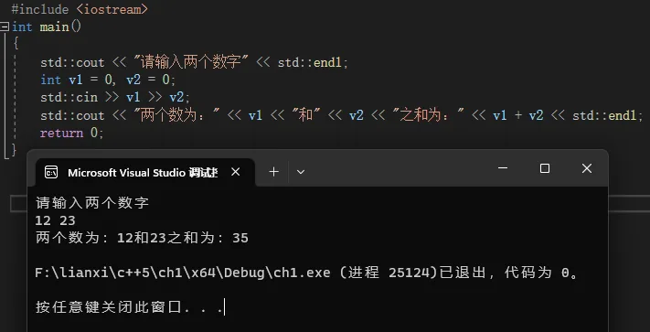
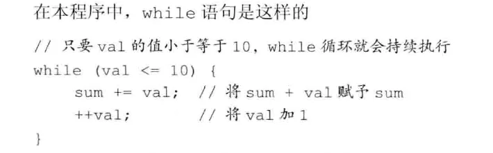
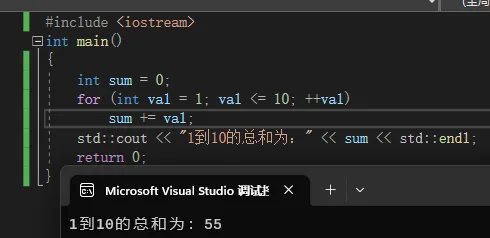
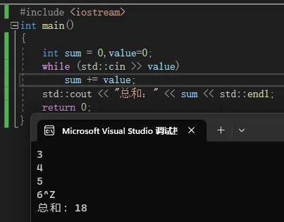
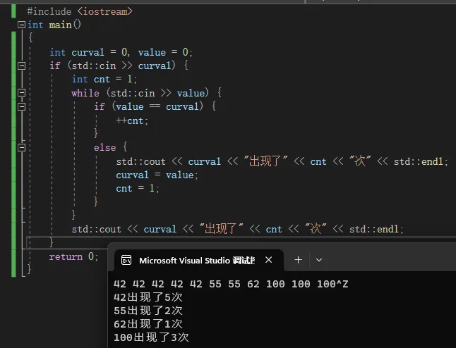
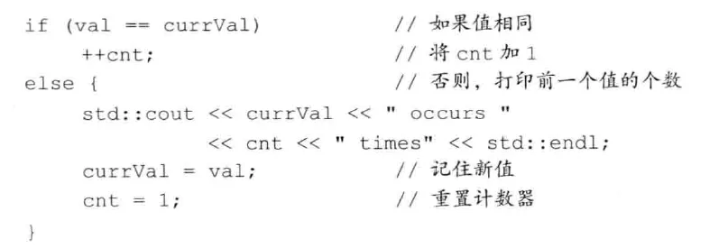
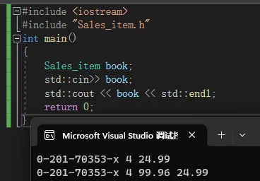
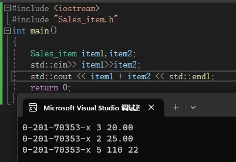
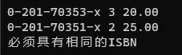
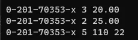

## 第一章 开始

### 1.1	编写一个简单的C++程序

```c++
#include <iostream>
int main()
{
    return 0;
}
```

​		一个函数的定义包含四部分：返回类型(return type)、函数名(function name)、一个括号包围的形参列表(parameter list ，允许为空)以及函数体(function body)。虽然main函数在某种程度上比较特殊，但其定义与其他函数是一样的。

​		在本例中，main的形参列表是空的(`()`中什么也没有)。

​		`main函数`的返回类型必须为int，即整数类型。int类型是一种内置类型(built-intype)，即语言自身定义的类型。

​		函数定义的最后一部分是函数体，它是一个以左花括号(curly brace)开始，以右花括号结束的语句块(block of statements)。

​		这个语句块中唯一的一条语句是return，它结束函数的执行。当return语句包括一个值时，此返回值的类型必须与函数的返回类型相容。

> 请注意，return语句末尾的分号。在C++中，大多数C++语句以`;`分号表示结束。它们很容易被忽略，但如果忘记了写分号，就会导致莫名其妙的编译错误。


### 1.2	初识输入输出

​		C++语言并未定义任何输入输出(IO)语句，取而代之，包含了一个全面的标准库(standard library)来提供IO机制（以及很多其他设施）。

​		本书中的很多示例都使用了iostream库。iostream库包含两个基础类型istream和ostream，分别表示输入流和输出流。一个流就是一个字符序列，是从IO设备读出或写入IO设备的。术语“流”(stream)想要表达的是，随着时间的推移，字符是顺序生成或消耗的。

​		标准库定义了4个IO对象。为了处理输入，我们使用一个名为cin(发音为see-in)的istream类型的对象。这个对象也被称为标准输入(standard input)。对于输出，我们使用一个名为cout(发音为see-out)的ostream类型的对象。此对象也被称为标准输出(standard output)。标准库还定义了其他两个ostream对象，名为cerr和clog(发音分别为see-er和see-log)。我们通常用cerr来输出警告和错误消息，因此它也被称为标准错误(standard error)。而clog用来输出程序运行时的一般性信息。

​		系统通常将程序所运行的窗口与这些对象关联起来。因此，当我们读取cin，数据将从程序正在运行的窗口读入，当我们向cout、cerr和clog写入数据时，将会写到同一个窗口。

```c++
#include <iostream>
int main()
{
	std::cout << "请输入两个数字" << std::endl;
	int v1 = 0， v2 = 0;
	std::cin >> v1 >> v2;
	std::cout << "两个数为：" << v1 << "和" << v2 << "之和为：" << v1 + v2 << std::endl;
	return 0;
}
```



​		程序的第一行
​		`#include <iostream>`
​		告诉编译器我们想要使用iostream库。尖括号中的名字指出了一个头文件(header)。每个使用标准库设施的程序都必须包含相关的头文件。`#include`指令和头文件的名字必须写在同一行中。通常情况下，`#include`指令必须出现在所有函数之外。我们一般将一个程序的所有`#include`指令都放在源文件的开始位置。

##### **想流写入数据**

​		main的函数体的第一条语句执行了一个表达式(expression)。这条语句中的表达式使用了输出运算符(<<)在标准输出上打印消息。

​		<<运算符接受两个运算对象：左侧的运算对象必须是一个ostream对象，右侧的运算对象是要打印的值。此运算符将给定的值写到给定的ostream对象中。输出运算符的计算结果就是其左侧运算对象。即，计算结果就是我们写入给定值的那个ostream对象。

​		我们的输出语句使用了两次<<运算符。因为此运算符返回其左侧的运算对象，因此第一个运算符的结果成为了第二个运算符的左侧运算对象。这样，我们就可以将输出请求连接起来。因此，我们的表达式等价于

```c++
(std:cout <"Enter two numbers:")<<std:endl;
```

​		第一个输出运算符给用户打印一条消息。这个消息是一个字符串字面值常量(string literal)，是用一对双引号包围的字符序列。在双引号之间的文本被打印到标准输出。

​		第二个运算符打印endl，这是一个被称为操纵符(manipulator)的特殊值。写入endl的效果是结束当前行，并将与设备关联的缓冲区(buffer)中的内容刷到设备中。缓冲刷新操作可以保证到目前为止程序所产生的所有输出都真正写入输出流中，而不是仅停留在内存中等待写入流。

##### **使用标准库中的名字**

​		这个程序使用了`std::cout`和`std::endl`，而不是直接的`cout`和`endl`。前缀`std::`指出名字`cout`和`endl`是定义在名为`std`的命名空间(namespace)中的。命名空间可以帮助我们避免不经意的名字定义冲突，以及使用库中相同名字导致的冲突。标准库定义的所有名字都在命名空间std中。

​		通过命名空间使用标准库有一个副作用：当使用标准库中的一个名字时，必须显式说明我们想使用来自命名空间std中的名字。例如，需要写出std::cout，通过使用作用域运算符(::)来指出我们想使用定义在命名空间std中的名字cout。

##### **从流读取数据**

​		在提示用户输入数据之后，接下来我们希望读入用户的输入。首先定义两个名为v1和v2的`变量(variable)`来保存输入：

```c++
	int v1 = 0， v2 = 0;
```

​		我们将这两个变量定义为int类型，int是一种内置类型，用来表示整数。还将它们初始化(initialize)为0。初始化一个变量，就是在变量创建的同时为它赋予一个值。

​		下一条语句是：

```c++
	std::cin >> v1 >> v2;
```

​		它读入输入数据。输入运算符`(>>)`与输出运算符类似，它接受一个`istream`作为其左侧运算对象，接受一个对象作为其右侧运算对象。它从给定的istream读入数据，并存入给定对象中。与输出运算符类似，输入运算符返回其左侧运算对象作为其计算结果。因此，此表达式等价于

```c++
(std:cin >v1)>>v2;
```

​		由于此运算符返回其左侧运算对象，因此我们可以将一系列输入请求合并到单一语句中。本例中的输入操作从std::cin读入两个值，并将第一个值存入v1，将第二个值存入v2。

##### **完成流程**

打印结果

```c++
	std::cout << "两个数为：" << v1 << "和" << v2 << "之和为：" << v1 + v2 << std::endl;
```

​		这条语句虽然比提示用户输入的打印语句更长，但原理上是一样的，它将每个运算对象打印在标准输出上。

### 1.3	注释简介

- 单行注释： `//`
- 多行注释： `/**/`。编译器将`/*`和`*/`之间的内容都作为注释内容忽略。注意不能嵌套。

```c++
#define SALESITEM_H
/*
 * 多行注释格式
 * 每一行加一个*
 */
```

### 1.4	控制流

语句一般是顺序执行的，但允许有复杂的执行顺序。

#### 1.4.1while语句

while语句反复执行一段代码，直至给定条件为假为止。

`1到10的总和`

```c++
#include <iostream>
int main()
{
	int sum = 0， val = 1;
	while (val <= 10) {
		sum += val;
		++val;
	}
	std::cout << "1到10的总和为：" << sum << std::endl;
	return 0;
}
```

*(原图缺失)*

​		与之前的例子一样，我们首先包含头文件iostream，然后定义main。在main中我们定义两个int变量：sum用来保存和：va1用来表示从1到10的每个数。我们将sum的初值设置为0，va1从1开始。

```c++
while (condition) 
    statement
```

​		while语句的执行过程是交替地检测condition条件和执行关联的语句statement，直至condition为假时停止。所谓条件(condition)就是一个产生真或假的结果的表达式。只要condition为真，statement就会被执行。当执行完statement，会再次检测condition。如果condition仍为真，statement再次被执行。while语句持续地交替检测condition和执行statement，直至condition为假为止。



#### 1.4.2for语句

​		while循环条件中检测变量、在循环体中递增变量的模式使用非常频繁，以至于C++语言专门定义了第二种循环语句一for语句，来简化符合这种模式的语句。可以用for语句来重写从1加到10的程序：

```c++
#include <iostream>
int main()
{
	int sum = 0;
	for (int val = 1; val <= 10; ++val)
		sum += val;
	std::cout << "1到10的总和为：" << sum << std::endl;
	return 0;
}
```



每个for语句都包含两部分：循环头和循环体。循环头控制循环体的执行次数，它由三部分组成：一个初始化语句(init-statement)、一个循环条件(condition)以及一个表达式(expression)。

简要重述一下for循环的总体执行流程：
1.创建变量va1，将其初始化为1。
2.检测va1是否小于等于10。若检测成功，执行for循环体。若失败，退出循环，继续执行for循环体之后的第一条语句。
3.将va1的值增加1。
4.重复第2步中的条件检测，只要条件为真就继续执行剩余步骤。

#### 1.4.3读取数量不定的输入数据

​		如果不知道要对多少个数求和，这就需要不断读取数据直至没有新的输入为止：

```c++
#include <iostream>
int main()
{
	int sum = 0，value=0;
	while (std::cin >> value)
		sum += value;
	std::cout << "总和：" << sum << std::endl;
	return 0;
}
```



​		当我们使用一个istream对象作为条件时，其效果是检测流的状态。如果流是有效的，即流未遇到错误，那么检测成功。当遇到文件结束符(end-of-file)，或遇到一个无效输入时（例如读入的值不是一个整数），istream对象的状态会变为无效。处于无效状态的istream对象会使条件变为假。

​		因此，我们的while循环会一直执行直至遇到文件结束符（或输入错误)。while循环体使用复合赋值运算符将当前值加到sum上。一旦条件失败，while循环将会结束。我们将执行下一条语句，打印sum的值和一个endl。

> **`结束符`**
>
> ​		当从键盘向程序输入数据时，对于如何指出文件结束，不同操作系统有不同的约定。在Windows系统中，输入文件结束符的方法是敲Ctrl+Z(按住Ctrl键的同时按Z键)，然后按Enter或Return键。

#### 1.4.4if语句

​		与大多数语言一样，C++也提供了if语句来支持条件执行。

```c++
#include <iostream>
int main()
{
	int curval = 0， value = 0;
	if (std::cin >> curval) {
		int cnt = 1;
		while (std::cin >> value) {
			if (value == curval) {
				++cnt;
			}
			else {
				std::cout << curval << "出现了" << cnt << "次" << std::endl;
				curval = value;
				cnt = 1;
			}
		}
		std::cout << curval << "出现了" << cnt << "次" << std::endl;
	}
	return 0;
}
```





### 1.5	类简介

​		在C++中，我们通过定义一个类(class)来定义自己的数据结构。一个类定义了一个类型，以及与其关联的一组操作。类机制是C++最重要的特性之一。实际上，C++最初的一个设计焦点就是能定义使用上像内置类型一样自然的类类型(class type)。

#### 1.5.1Sales_item类

​		每个类实际上都定义了一个新的类型，其类型名就是类名。因此，我们的Sales item类定义了一个名为Sales item的类型。与内置类型一样，我们可以定义类类型的变量。

除了可以定义Sales item类型的变量之外，我们还可以：

- 调用一个名为isbn的函数从一个Sales_item对象中提取ISBN书号。
- 用输入运算符(>)和输出运算符(<<)读、写Sales item类型的对象。
- 用赋值运算符(=)将一个Sales item对象的值赋予另一个Sales item对象。
- 用加法运算符(+)将两个Sales item对象相加。两个对象必须表示同一本书（相同的ISBN)。加法结果是一个新的Sales item对象，其ISBN与两个运算对象相同，而其总销售额和售出册数则是两个运算对象的对应值之和。
- 使用复合赋值运算符(+=)将一个Sales_item对象加到另一个对象上。

##### **读写Sales_item类**

此程序以两个#include指令开始，其中一个使用了新的形式。包含来自标准库的头文件时，也应该用尖括号`<>`包围头文件名。对于不属于标准库的头文件，则用双引号`""`包围。

在main中我们定义了一个名为book的对象，用来保存从标准输入读取出的数据。下一条语句读取数据存入对象中，第三条语句将对象打印到标准输出上并打印一个endl。

```c++
#include <iostream>
#include "Sales_item.h"
int main()
{
	Sales_item book;
	std::cin>> book;
	std::cout << book << std::endl;
	return 0;
}
```



##### **Sales_item对象的加法**

```c++
#include <iostream>
#include "Sales_item.h"
int main()
{
	Sales_item item1，item2;
	std::cin>> item1>>item2;
	std::cout << item1 + item2 << std::endl;
	return 0;
}
```



​		此程序开始包含了Sales item和iostream两个头文件。然后定义了两个Sales item对象来保存销售记录。我们从标准输入读取数据，存入两个对象之中。输出表达式完成加法运算并打印结果。

#### 15.2初识成员函数

```c++
#include <iostream>
#include "Sales_item.h"
int main()
{
	Sales_item item1，item2;
	std::cin >> item1 >> item2;
	if (item1.isbn() == item2.isbn()) {
		std::cout << item1 + item2 << std::endl;
		return 0;
	}
	else {
		std::cerr << "必须具有相同的ISBN" << std::endl;
		return -1;
	}
}
```



##### **什么是成员函数**

​		成员函数是定义为类的一部分的函数，有时也被称为方法(method)。我们通常以一个类对象的名义来调用成员函数。

`item1.isbn()`

​		使用点运算符`.`来表达我们需要“名为iteml的对象的isbn成员”。点运算符只能用于类类型的对象。其左侧运算对象必须是一个类类型的对象，右侧运算对象必须是该类型的一个成员名，运算结果为右侧运算对象指定的成员。

​		当用点运算符访问一个成员函数时，通常我们是想（效果也确实是）调用该函数。我们使用调用运算符(())来调用一个函数。调用运算符是一对圆括号，里面放置实参(argument)列表（可能为空）。成员函数isbn并不接受参数。

### 1.6	书店程序

​		我们的程序会将每个ISBN的所有数据合并起来，存入名为total的变量中。我们使用另一个名为trans的变量保存读取的每条销售记录。如果trans和total指向相同的ISBN，我们会更新total的值。否则，我们会打印total的值，并将其重置为刚刚读取的数据(trans)

```c++
#include <iostream>
#include "Sales_item.h"
int main()
{
	Sales_item total;
	if (std::cin >> total) {
		Sales_item trans;
		while (std::cin >> trans) {
			if (total.isbn() == trans.isbn())
				total += trans;
			else {
				std::cout << "总数据" << total << std::endl;
				total = trans;
			}
		}
		std::cout << "总数据" << total << std::endl;
	}
	else {
		std::cerr << "没有数据" << std::endl;
		return -1;
	}
	return 0;
}
```
