## 第二章 变量和基本类型

### 2.1基本内置类型

​		C++定义了一套包括算术类型(arithmetic type)和空类型(void)在内的基本数据类型。其中算术类型包含了字符、整型数、布尔值和浮点数。空类型不对应具体的值，仅用于一些特殊的场合，例如最常见的是，当函数不返回任何值时使用空类型作为返回类型。

#### 2.1.1算数类型

​		算数类型分为两类：整型(integral type，包括字符和布尔类型在内)和浮点型。

| 类型          | 含义           | 最小尺寸                       |
| ------------- | -------------- | ------------------------------ |
| `bool`        | 布尔类型       | 未定义                         |
| `char`        | 字符           | 8bits                          |
| `wchar_t`     | 宽字符         | 16bits                         |
| `char16_t`    | Unicode字符    | 16bits                         |
| `char32_t`    | Unicode字符    | 32bits                         |
| `short`       | 短整型         | 16bits                         |
| `int`         | 整型           | 16bits (在32位机器中是32bits)  |
| `long`        | 长整型         | 32bits                         |
| `long long`   | 长整型         | 64bits （是在C++11中新定义的） |
| `float`       | 单精度浮点数   | 6位有效数字                    |
| `double`      | 双精度浮点数   | 10位有效数字                   |
| `long double` | 扩展精度浮点数 | 10位有效数字                   |

​		布尔类型(bool)：取值是真(true)或者假(false)。

​		整型（integral type）：除字符和布尔类型之外，其他整型用于表示（可能）不同尺寸的整数。在整型类型大小方面，C++规定`short` ≤ `int` ≤ `long` ≤ `long long`（`long long`是C++11定义的类型）。

​		浮点型（floating-point type）：浮点型可表示单精度、双精度和扩展精度值。浮点型可表示单精度（single-precision）、双精度（double-precision）和扩展精度（extended-precision）值，分别对应`float`、`double`和`long double`类型。

​		字符型（Character type）：

​		**作用：**字符型变量用于显示单个字符

​		**语法：**`char ch = 'a';`

> 注意1：在显示字符型变量时，用单引号将字符括起来，不要用双引号
>
> 注意2：单引号内只能有一个字符，不可以是字符串

- C和C++中字符型变量只占用==1个字节==。
- 字符型变量并不是把字符本身放到内存中存储，而是将对应的ASCII编码放入到存储单元

```C++
int main() {
	
	char ch = 'a';
	cout << ch << endl;
	cout << sizeof(char) << endl;

	//ch = "abcde"; //错误，不可以用双引号
	//ch = 'abcde'; //错误，单引号内只能引用一个字符

	cout << (int)ch << endl;  //查看字符a对应的ASCII码
	ch = 97; //可以直接用ASCII给字符型变量赋值
	cout << ch << endl;

	system("pause");

	return 0;
}
```

ASCII码表格：

| **ASCII**值 | **控制字符** | **ASCII**值 | **字符** | **ASCII**值 | **字符** | **ASCII**值 | **字符** |
| ----------- | ------------ | ----------- | -------- | ----------- | -------- | ----------- | -------- |
| 0           | NUT          | 32          | (space)  | 64          | @        | 96          | 、       |
| 1           | SOH          | 33          | !        | 65          | A        | 97          | a        |
| 2           | STX          | 34          | "        | 66          | B        | 98          | b        |
| 3           | ETX          | 35          | #        | 67          | C        | 99          | c        |
| 4           | EOT          | 36          | $        | 68          | D        | 100         | d        |
| 5           | ENQ          | 37          | %        | 69          | E        | 101         | e        |
| 6           | ACK          | 38          | &        | 70          | F        | 102         | f        |
| 7           | BEL          | 39          | ，       | 71          | G        | 103         | g        |
| 8           | BS           | 40          | (        | 72          | H        | 104         | h        |
| 9           | HT           | 41          | )        | 73          | I        | 105         | i        |
| 10          | LF           | 42          | *        | 74          | J        | 106         | j        |
| 11          | VT           | 43          | +        | 75          | K        | 107         | k        |
| 12          | FF           | 44          | ，       | 76          | L        | 108         | l        |
| 13          | CR           | 45          | -        | 77          | M        | 109         | m        |
| 14          | SO           | 46          | .        | 78          | N        | 110         | n        |
| 15          | SI           | 47          | /        | 79          | O        | 111         | o        |
| 16          | DLE          | 48          | 0        | 80          | P        | 112         | p        |
| 17          | DCI          | 49          | 1        | 81          | Q        | 113         | q        |
| 18          | DC2          | 50          | 2        | 82          | R        | 114         | r        |
| 19          | DC3          | 51          | 3        | 83          | S        | 115         | s        |
| 20          | DC4          | 52          | 4        | 84          | T        | 116         | t        |
| 21          | NAK          | 53          | 5        | 85          | U        | 117         | u        |
| 22          | SYN          | 54          | 6        | 86          | V        | 118         | v        |
| 23          | TB           | 55          | 7        | 87          | W        | 119         | w        |
| 24          | CAN          | 56          | 8        | 88          | X        | 120         | x        |
| 25          | EM           | 57          | 9        | 89          | Y        | 121         | y        |
| 26          | SUB          | 58          | :        | 90          | Z        | 122         | z        |
| 27          | ESC          | 59          | ;        | 91          | [        | 123         | {        |
| 28          | FS           | 60          | <        | 92          | /        | 124         | \|       |
| 29          | GS           | 61          | =        | 93          | ]        | 125         | }        |
| 30          | RS           | 62          | >        | 94          | ^        | 126         | `        |
| 31          | US           | 63          | ?        | 95          | _        | 127         | DEL      |

ASCII 码大致由以下**两部分组**成：

* ASCII 非打印控制字符： ASCII 表上的数字 **0-31** 分配给了控制字符，用于控制像打印机等一些外围设备。
* ASCII 打印字符：数字 **32-126** 分配给了能在键盘上找到的字符，当查看或打印文档时就会出现。

​		其他字符类型用于扩展字符集，如wchar_t、char16_t、char32_t。wchar_t类型用于确保可以存放机器最大扩展字符集中的任意一个字符，类型char16_t和char32_t则为Unicode字符集服务(Unicode是用于表示所有自然语言中字符的标准).

##### **带符号类型和无符号类型**

​		除去布尔型和扩展的字符型之外，其他整型可以划分为带符号的(signed)和无符号的(unsigned)两种。带符号类型可以表示正数、负数或0，无符号类型则仅能表示大于等于0的值。

​		除去布尔型和扩展字符型，其他整型可以分为带符号（signed）和无符号（unsigned）两种。带符号类型可以表示正数、负数和0，无符号类型只能表示大于等于0的数值。类型`int`、`short`、`long`和`long long`都是带符号的，在类型名前面添加`unsigned`可以得到对应的无符号类型，如`unsigned int`。

​		字符型分为`char`、`signed char`和`unsigned char`三种，但是表现形式只有带符号和无符号两种。类型`char`和`signed char`并不一样， `char`的具体形式由编译器（compiler）决定。

如何选择算数类型：

- 当明确知晓数值不可能为负时，应该使用无符号类型。
- 使用`int`执行整数运算，如果数值超过了`int`的表示范围，应该使用`long long`类型。
- 在算数表达式中不要使用`char`和`bool`类型。如果需要使用一个不大的整数，应该明确指定它的类型是`signed char`还是`unsigned char`。
- 执行浮点数运算时建议使用`double`类型。

#### 2.1.2类型转换

对象的类型定义了对象能包含的数据和能参与的运算，其中一种运算被大多数类型支持，就是将对象从一种给定的类型转换(convert)为另一种相关类型。

进行类型转换时，类型所能表示的值的范围决定了转换的过程。

- 把非布尔类型的算术值赋给布尔类型时，初始值为0则结果为`false`，否则结果为`true`。

- 把布尔值赋给非布尔类型时，初始值为`false`则结果为0，初始值为`true`则结果为1。

- 把浮点数赋给整数类型时，进行近似处理，结果值仅保留浮点数中的整数部分。

- 把整数值赋给浮点类型时，小数部分记为0。如果该整数所占的空间超过了浮点类型的容量，精度可能有损失。

- 赋给无符号类型一个超出它表示范围的值时，结果是初始值对无符号类型表示数值总数（8比特大小的`unsigned char`能表示的数值总数是256）取模后的余数。

- 赋给带符号类型一个超出它表示范围的值时，结果是未定义的（undefined）。

##### **含有无符号类型的表达式**

- int、无符号变量

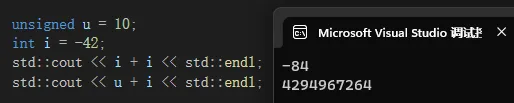

- 两无符号变量

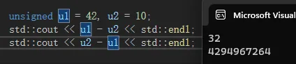

- 无符号在循环中的使用

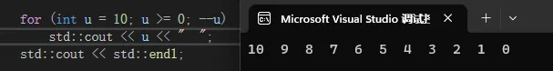

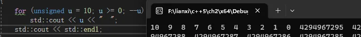

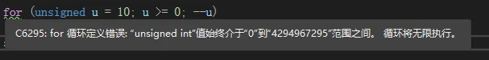

- 可以用while循环

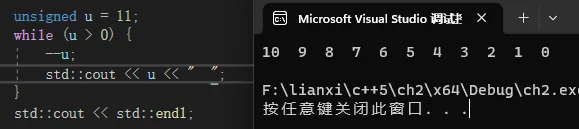

#### 2.1.3字面值常量

##### **整形和浮点型字面值**

​		我们可以将整型字面值写作十进制数、八进制数或十六进制数的形式。以0开头的整数代表八进制数，以0x或0X开头的代表十六进制数。整型字面值具体的数据类型由它的值和符号决定。默认情况下，十进制字面值是带符号数，八进制和十六进制字面值既可能是带符号的也可能是无符号的。

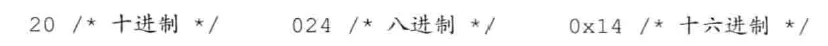

​		浮点型字面值表现为一个小数或以科学计数法表示的指数，其中指数部分用E或e标识。默认的，浮点型字面值是一个double。

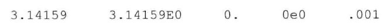

##### **字符和字符串字面值**

​		由单引号括起来的一个字符称为char型字面值，双引号括起来的零个或多个字符则构成字符串型字面值。

​		字符串字面值的类型实际上是由常量字符构成的数组(aray)。编译器在每个字符串的结尾处添加一个空字符（'\0'），故字符串字面值的实际长度要比它的内容多1。

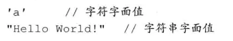

##### **转义序列**

​		有两类字符程序员不能直接使用：一类是不可打印(nonprintable)的字符，如退格或其他控制字符，因为它们没有可视的图符：另一类是在C++语言中有特殊含义的字符（单引号、双引号、问号、反斜线)。在这些情况下需要用到转义序列(escape sequence)，转义序列均以反斜线作为开始.

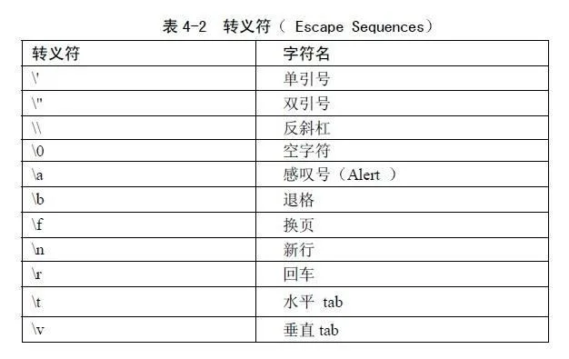

##### **指定字面值的类型**

​		通过添加前缀和后缀，可以改变整型、浮点型和字符型字面值的默认类型。

```c++
L'a';		//宽字符型字面值，类型是wchar_t
u8"hi!";	//utf-8字符串字面值(utf-8用8位编码一个Unicode字符)
42ULL;		//无符号整型字面值，类型为unsigned long long
1E-3F;		//单精度浮点型字面值，类型为float
3.14159L；	//扩展精度浮点型字面值，类型为long double
```

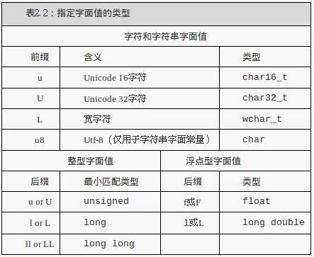

##### **布尔字面值和指针字面值**

​		true和false是布尔类型的字面值，nullptr是指针字面值。

### 2.2变量

​		变量提供一个具名的、可供程序操作的存储空间。C+中的每个变量都有其数据类型，数据类型决定着变量所占内存空间的大小和布局方式、该空间能存储的值的范围，以及变量能参与的运算。对C++程序员来说，“变量(variable)”和“对象(object)”一般可以互换使用。

#### 2.2.1变量定义

​		变量定义的基本形式是：首先是类型说明符(type specifier)，随后紧跟由一个或多个变量名组成的列表，其中变量名以逗号分隔，最后以分号结束。列表中每个变量名的类型都由类型说明符指定，定义时还可以为一个或多个变量赋初值。

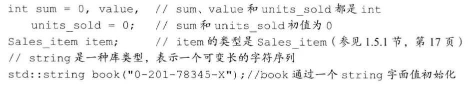

##### **初始值**

​		当对象在创建时获得了一个特定的值，我们说这个对象被初始化(initialized)了。用于初始化变量的值可以是任意复杂的表达式。当一次定义了两个或多个变量时，对象的名字随着定义也就马上可以使用了。因此在同一条定义语句中，可以用先定义的变量值去初始化后定义的其他变量。

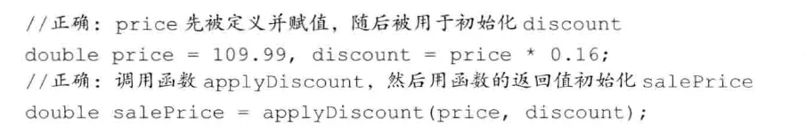


##### **列表初始化**

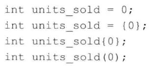

​		作为C++11新标准的一部分，用花括号来初始化变量得到了全面应用，用花括号初始化的形式被称为列表初始化(list initialization)。现在，无论是初始化对象还是某些时候为对象赋新值，都可以使用这样一组由花括号括起来的初始值了。

当用于内置类型的变量时，这种初始化形式有一个重要特点：如果我们使用列表初始化且初始值存在丢失信息的风险，则编译器将报错：

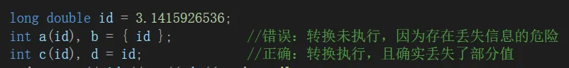

##### **默认初始化**

​		如果定义变量时没有指定初值，则变量被默认初始化(default initialized)，此时变量被赋予了“默认值”。默认值到底是什么由变量类型决定，同时定义变量的位置也会对此有影响。

​		如果是内置类型的变量未被显式初始化，它的值由定义的位置决定。定义于任何函数体之外的变量被初始化为0。一种例外情况是，定义在函数体内部的内置类型变量将不被初始化(uninitialized)。一个未被初始化的内置类型变量的值是未定义的，如果试图拷贝或以其他形式访问此类值将引发错误。

#### 2.2.2变量声明和定义的关系

​		为了允许把程序拆分成多个逻辑部分来编写，C+语言支持分离式编译(separatecompilation)机制，该机制允许将程序分割为若干个文件，每个文件可被独立编译。如果将程序分为多个文件，则需要有在文件间共享代码的方法。

​		为了支持分离式编译，C+语言将声明和定义区分开来。声明(declaration)使得名字为程序所知，一个文件如果想使用别处定义的名字则必须包含对那个名字的声明。而定义(definition)负责创建与名字关联的实体。

​		变量声明规定了变量的类型和名字，在这一点上定义与之相同。但是除此之外，定义还申请存储空间，也可能会为变量赋一个初始值。

​		如果想声明一个变量而非定义它，就在变量名前添加关键字extern，而且不要显式地初始化变量：

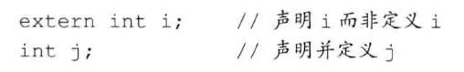


​		任何包含了显式初始化的声明即成为定义。我们能给由extern关键字标记的变量赋一个初始值，但是这么做也就抵消了extern的作用。extern语句如果包含初始值就不再是声明，而变成定义了：

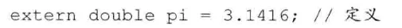

​		如果要在多个文件中使用同一个变量，就必须将声明和定义分离。此时，变量的定义必须出现在且只能出现在一个文件中，而其他用到该变量的文件必须对其进行声明，却绝对不能重复定义。

#### 2.2.3标识符

​		C++的标识符(identifier)由字母、数字和下画线组成，其中必须以字母或下画线开头。标识符的长度没有限制，但是对大小写字母敏感。同时，C++也为标准库保留了一些名字。用户自定义的标识符中不能连续出现两个下画线，也不能以下画线紧连大写字母开头。此外，定义在函数体外的标识符不能以下画线开头。

##### **变量命名的规范**

1. 需体现实际意义
2. 变量名用小写字母
3. 自定义类名用大写字母开头：Sales_item
4. 标识符由多个单词组成，中间须有明确区分：student_loan或studentLoan，不要用studentloan。

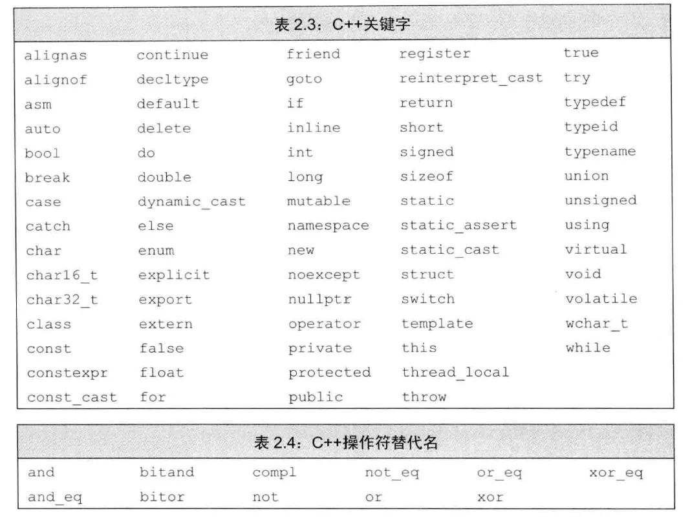

#### 2.2.4名字的作用域

​		不论是在程序的什么位置，使用到的每个名字都会指向一个特定的实体：变量、函数、类型等。然而，同一个名字如果出现在程序的不同位置，也可能指向的是不同实体。
​		作用域(scope)是程序的一部分，在其中名字有其特定的含义。C+语言中大多数作用域都以花括号分隔。
​		同一个名字在不同的作用域中可能指向不同的实体。名字的有效区域始于名字的声明语句，以声明语句所在的作用域末端为结束。

```c++
#include <iostream>
int main()
{
	int sum=0;
	//sum用于存放从1到10所有数的和
	for (int val=1; val < 10; ++val)
		sum += val;//等价于sum=sum+val
	std::cout << "1到10的总和为：" << sum << std::endl;
	return 0;
}
```

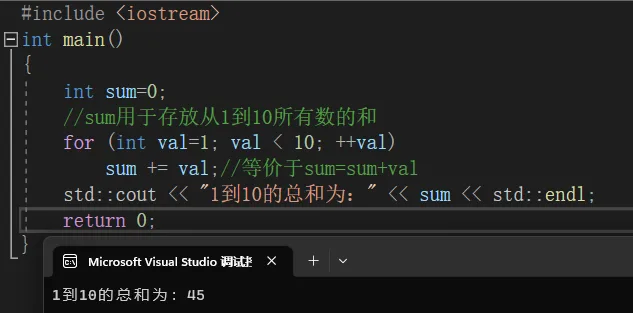

​		名字main定义于所有花括号之外，它和其他大多数定义在函数体之外的名字一样拥有**`全局作用域（global scope)`**。一旦声明之后，全局作用域内的名字在整个程序的范围内都可使用。名字sum定义于main函数所限定的作用域之内，从声明sum开始直到main函数结束为止都可以访问它，但是出了main函数所在的块就无法访问了，因此说变量sum拥有**`块作用域(block scope)`**。名字val定义于for语句内，在for语句之内可以访问val，但是在main函数的其他部分就不能访问它了。

##### **嵌套的作用域**

​		作用域能彼此包含，被包含（或者说被嵌套）的作用域称为内层作用域(inner scope)，包含着别的作用域的作用域称为外层作用域(outer scope)。
​		作用域中一旦声明了某个名字，它所嵌套着的所有作用域中都能访问该名字。同时，允许在内层作用域中重新定义外层作用域已有的名字：


> 如果函数有可能用到某全局变量，则不宜再定义一个同名的局部变量。

```c++
#include <iostream>
//该程序仅用于说明：函数内部不宜定义与全局变量同名的新变量
int reused = 42;//reused拥有全局作用域
int main()
{
	int unique = 0;//unique拥有块作用域
	//输出#1：使用全局变量reused;输出420
	std::cout << reused << "" << unique << std::endl;
	int reused = 0;//新建局部变量reused，覆盖了全局变量reused
	//输出#2：使用局部变量reused;输出00
	std::cout << reused << "" << unique << std::endl;
	//输出#3：显式地访问全局变量reused;输出420
	std::cout << ::reused << "" << unique << std::endl;
	return 0;
}
```

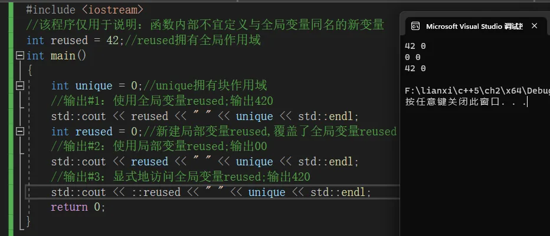

> 输出#1出现在局部变量reused定义之前，因此这条语句使用全局作用域中定义的名字reused，输出42 0。
>
> 输出#2发生在局部变量reused定义之后，此时局部变量reused正在作用域内(in scope)，因此第二条输出语句使用的是局部变量reused而非全局变量，输出0 0。
>
> 输出#3使用作用域操作符（参见1.2节，第7页）来覆盖默认的作用域规则，因为全局作用域本身并没有名字，所以当作用域操作符的左侧为空时，向全局作用域发出请求获取作用域操作符右侧名字对应的变量。结果是，第三条输出语句使用全局变量reused，输出42 0。

### 2.3复合类型

​		复合类型(compound type)是指基于其他类型定义的类型。C++语言有几种复合类型，本章将介绍其中的两种：引用和指针。

​		与我们已经掌握的变量声明相比，定义复合类型的变量要复杂很多。2.2节提到，一条简单的声明语句由一个数据类型和紧随其后的一个变量名列表组成。其实更通用的描述是，一条声明语句由一个基本数据类型(base type)和紧随其后的一个声明符(declarator)列表组成。每个声明符命名了一个变量并指定该变量为与基本数据类型有关的某种类型。

​		目前为止，我们所接触的声明语句中，声明符其实就是变量名，此时变量的类型也就是声明的基本数据类型。其实还可能有更复杂的声明符，它基于基本数据类型得到更复杂的类型，并把它指定给变量。

#### 2.3.1引用

> C++11中新增了一种引用：所谓的“右值引用(rvalue reference)”，我们将在13.6.1节做更详细的介绍。这种引用主要用于内置类。严格来说，当我们使用术语“引用（reference)”时，指的其实是“左值引用(Ivaluereference)”

​		引用(reference)为对象起了另外一个名字，引用类型引用(refers to)另外一种类型。通过将声明符写成&d的形式来定义引用类型，其中d是声明的变量名：

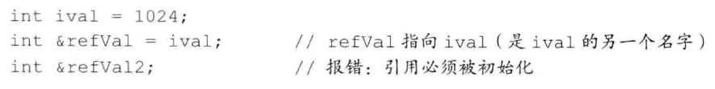

​		一般在初始化变量时，初始值会被拷贝到新建的对象中。然而定义引用时，程序把引用和它的初始值绑定(bid)在一起，而不是将初始值拷贝给引用。一旦初始化完成，引用将和它的初始值对象一直绑定在一起。因为无法令引用重新绑定到另外一个对象，因此引用必须初始化。

> 引用并非对象，相反的，它只是为一个已经存在的对象所起的另外一个名字

​		定义了一个引用之后，对其进行的所有操作都是在与之绑定的对象上进行的：

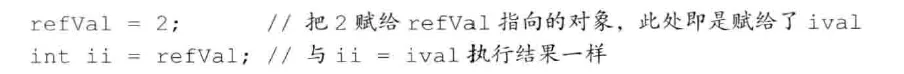

​		为引用赋值，实际上是把值赋给了与引用绑定的对象。获取引用的值，实际上是获取了与引用绑定的对象的值。同理，以引用作为初始值，实际上是以与引用绑定的对象作为初始值：

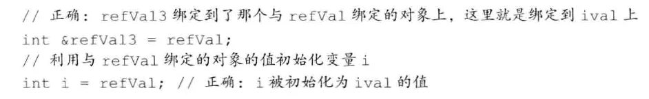

##### **引用的定义**

​		允许在一条语句中定义多个引用，其中每个引用标识符都必须以符号&开头：

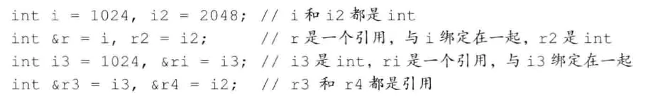

​		除了2.4.1节和15.2.3节将要介绍的两种例外情况，其他所有引用的类型都要和与之绑定的对象严格匹配。而且，引用只能绑定在对象上，而不能与字面值或某个表达式的计算结果绑定在一起，相关原因将在2.4.1节详述：

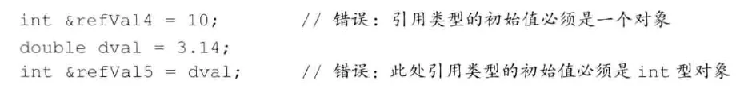

```c++
#include <iostream>
int main()
{
	int ival = 1024;
	int& refval = ival;				//refVal指向ival(是ival的另一个名字)
	/*int& refval12;*/				//报错：引用必须被初始化
	std::cout << "&refval:" << &refval << "\trefval:" << refval << "\tival:" << ival << std::endl;

	refval = 2;						//把2赋给refval指向的对象，此处即是赋给了ival
	int li = refval;				//与ii=ival执行结果一样
	std::cout << "li:" << li << "\t&refval:" << &refval << "\trefval:" << refval << "\tival:" << ival << std::endl;

	//正确：refVal3绑定到了那个与refVal绑定的对象上，这里就是绑定到ival上
	int& refval3 = refval;
	//利用与refVal绑定的对象的值初始化变量i
	int i = refval;					//正确：i被初始化为ival的值
	std::cout << "li:" << li << "\t&refval:" << &refval << "\trefval:" << refval << "\tival:" << ival << std::endl;

	int i = 1024， i2 = 2048;		//i和i2都是int
	int& r = i， r2 = i2;			//r是一个引用，与i绑定在一起，r2是int
	int i3 = 1024， & ri = i3;		//i3是int，ri是一个引用，与i3绑定在一起
	int& r3 = i3， & r4 = i2;		//r3和r4都是引用
	std::cout << "i:" << i << "\ti2:" << i2 << "\t&r:" << &r << "\tr2:" << r2 << std::endl;
	std::cout << "i3:" << i3 << "\t&ri:" << &ri << "\t&r3:" << &r3 << "\t&r4:" << &r4 << std::endl;
	return 0;
}
```

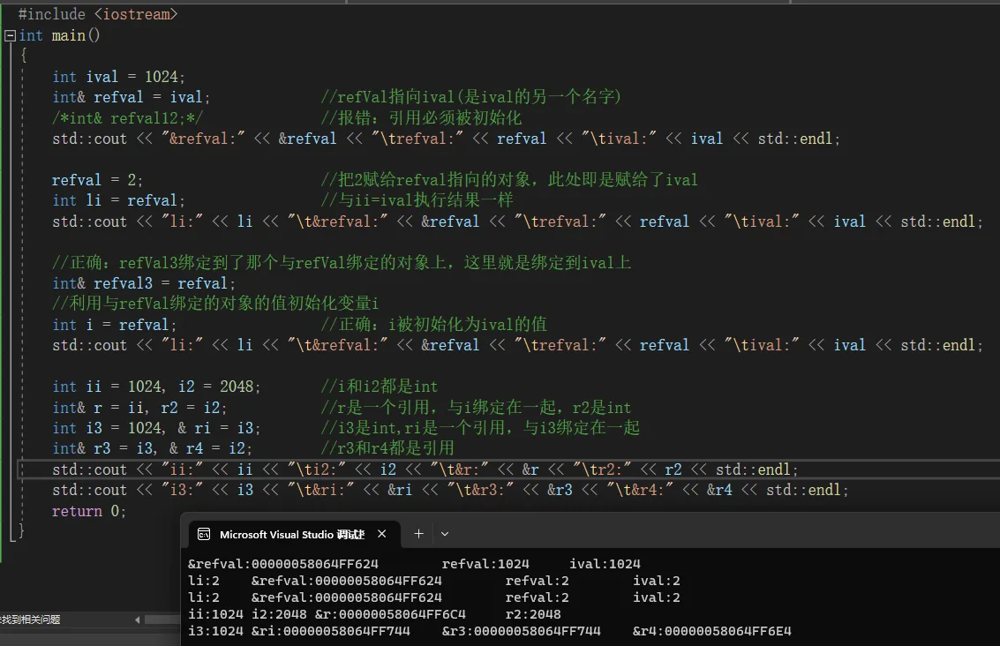

#### 2.3.2指针

​		指针(pointer)是“指向(point to)”另外一种类型的复合类型。与引用类似，指针也实现了对其他对象的间接访问。然而指针与引用相比又有很多不同点。

- 指针本身就是一个对象，允许对指针赋值和拷贝，而且在指针的生命周期内它可以先后指向几个不同的对象。
- 指针无须在定义时赋初值。和其他内置类型一样，在块作用域内定义的指针如果没有被初始化，也将拥有一个不确定的值。

定义指针类型的方法将声明符写`*d`的形式，其中d是变量名。如果在一条语句中定义了几个指针变量，每个变量前面都必须有符号`*`：

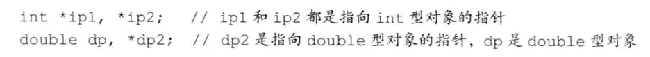

##### **获取对象的地址**

指针存放某个对象的地址，要想获取该地址，需要使用取地址符（操作符&）：

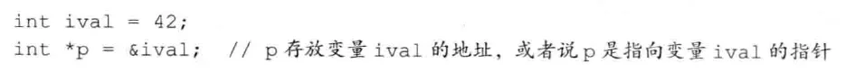

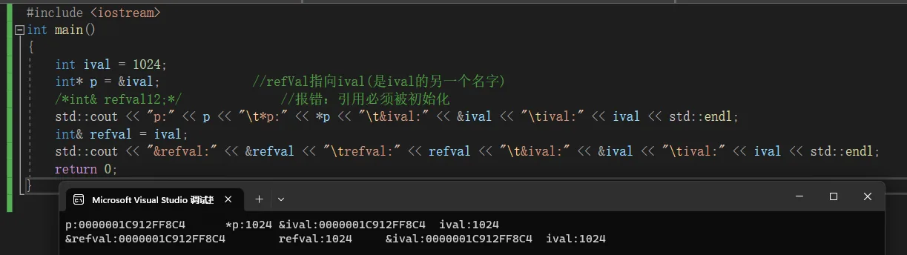

​		第二条语句把p定义为一个指向int的指针，随后初始化p令其指向名为ival的int对象。因为引用不是对象，没有实际地址，所以不能定义指向引用的指针。

​		除了2.4.2节和15.2.3节将要介绍的两种例外情况，其他所有指针的类型都要和它所指向的对象严格匹配：

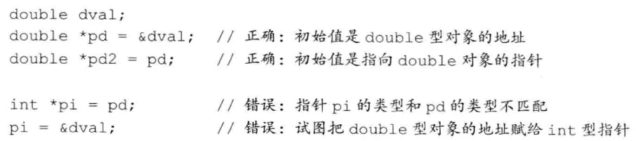

##### **指针值**

指针的值（即地址）应属于下列状态之一：

- 指向一个对象。

- 指向紧邻对象所占空间的下一个位置。

- 空指针，即指针没有指向任何对象。

- 无效指针，即上述情况之外的其他值。

试图拷贝或以其他方式访问无效指针的值都会引发错误。

##### **利用指针访问对象**

​		如果指针指向一个对象，可以使用解引用（dereference）符`*`来访问该对象。

​		对指针解引用会得出所指的对象，因此如果给解引用的结果赋值，实际上也就是给指针所指的对象赋值：

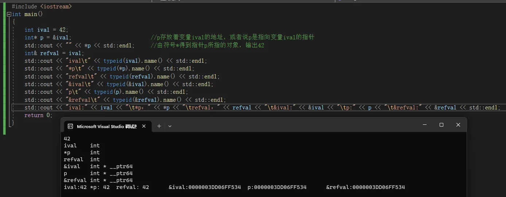

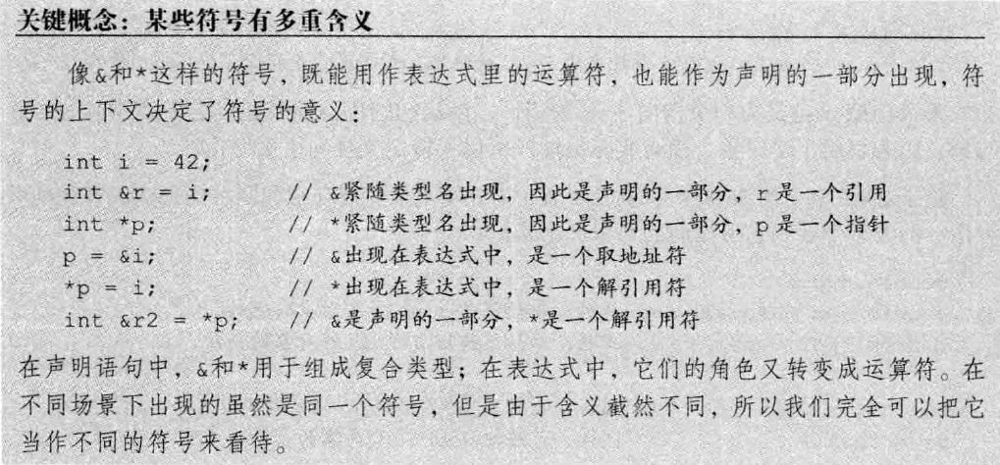

##### **空指针**

​		空指针（null pointer）不指向任何对象，在试图使用一个指针前代码可以先检查它是否为空。得到空指针最直接的办法是用字面值`nullptr`来初始化指针。

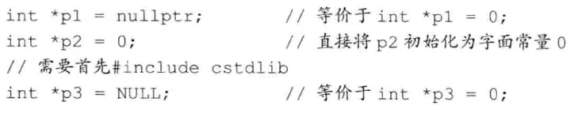

​		得到空指针最直接的办法就是用字面值nu11ptr来初始化指针，这也是C+11新标准刚刚引入的一种方法。nu11ptr是一种特殊类型的字面值，它可以被转换成任意其他的指针类型。另一种办法就如对P2的定义一样，也可以通过将指针初始化为字面值0来生成空指针。

​		把int变量直接赋给指针是错误的操作，即使int变量的值恰好等于0也不行。

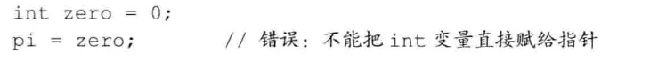

##### **赋值和指针**

​		指针和引用都能提供对其他对象的间接访问，然而在具体实现细节上二者有很大不同，其中最重要的一点就是引用本身并非一个对象。一旦定义了引用，就无法令其再绑定到另外的对象，之后每次使用这个引用都是访问它最初绑定的那个对象。

​		指针和它存放的地址之间就没有这种限制了。和其他任何变量（只要不是引用）一样，给指针赋值就是令它存放一个新的地址，从而指向一个新的对象：

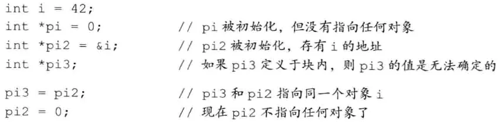

​		有时候要想搞清楚一条赋值语句到底是改变了指针的值还是改变了指针所指对象的值不太容易，最好的办法就是记住赋值永远改变的是等号左侧的对象。

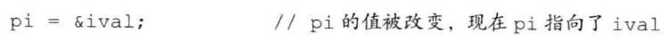

​		意思是为pi赋一个新的值，也就是改变了那个存放在pi内的地址值。

##### **其他指针操作**

​		只要指针拥有一个合法值，就能将它用在条件表达式中。和采用算术值作为条件遵循的规则类似，如果指针的值是0，条件取fa1se:

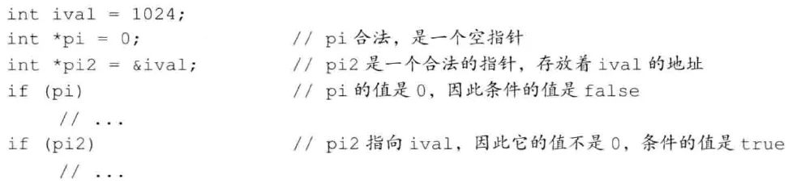

​		对于两个类型相同的合法指针，可以用相等操作符(==)或不相等操作符(!=)来比较它们，比较的结果是布尔类型。如果两个指针存放的地址值相同，则它们相等：反之它们不相等。这里两个指针存放的地址值相同（两个指针相等）有三种可能：

- 它们都为空
- 都指向同一个对象
- 或者都指向了同一个对象的下一地址。

​		需要注意的是，一个指针指向某对象，同时另一个指针指向另外对象的下一地址，此时也有可能出现这两个指针值相同的情况，即指针相等。

​		因为上述操作要用到指针的值，所以不论是作为条件出现还是参与比较运算，都必须使用合法指针，使用非法指针作为条件或进行比较都会引发不可预计的后果。

##### **`void*`指针**

​		`void*`是一种特殊的指针类型，可用于存放任意对象的地址。一个`void*`指针存放着一个地址，这一点和其他指针类似。不同的是，我们对该地址中到底是个什么类型的对象并不了解：

​		利用`void*`指针能做的事儿比较有限：拿它和别的指针比较、作为函数的输入或输出，或者赋给另外一个void指针。不能直接操作`void*`指针所指的对象，因为我们并不知道这个对象到底是什么类型，也就无法确定能在这个对象上做哪些操作。
​		概括说来，以`void*`的视角来看内存空间也就仅仅是内存空间，没办法访问内存空间中所存的对象.

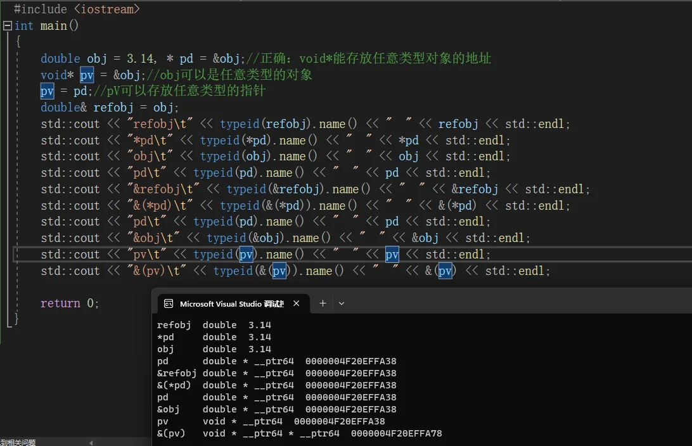

#### 2.3.3理解复合类型的声明

​		如前所述，变量的定义包括一个基本数据类型(base type)和一组声明符。在同一条定义语句中，虽然基本数据类型只有一个，但是声明符的形式却可以不同。也就是说，一条定义语句可能定义出不同类型的变量：

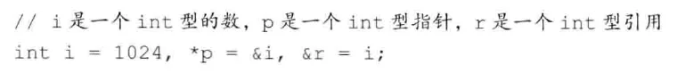

> ==很多程序员容易迷惑于基本数据类型和类型修饰符的关系，其实后者不过是声明符的一部分罢了。==

##### **定义多个变量**

​		涉及指针或引用的声明，一般有两种写法。

- 第一种把修饰符和变量标识符写在一起：

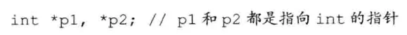

这种形式着重强调变量具有的复合类型。

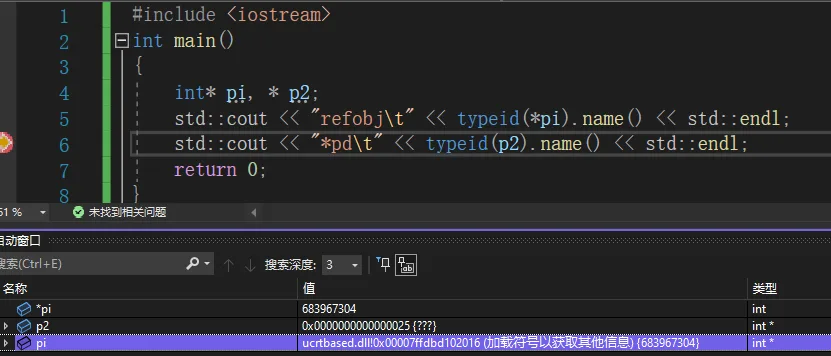

> 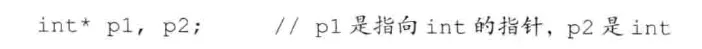
>
> 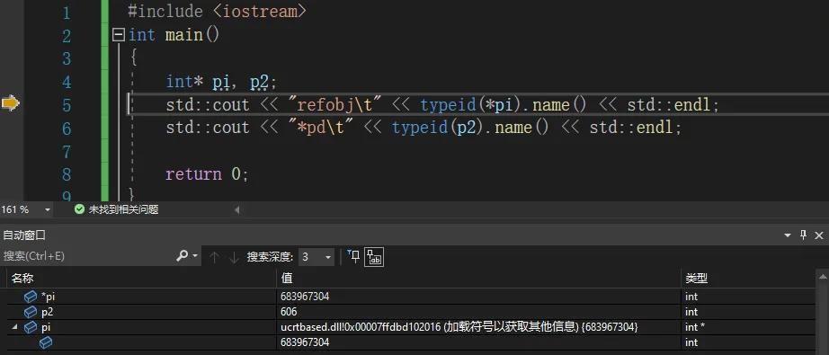

- 第二种把修饰符和类型名写在一起，并且每条语句只定义一个变量：

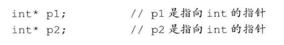


##### **指向指针的指针**

​		般来说，声明符中修饰符的个数并没有限制。当有多个修饰符连写在一起时，按照其逻辑关系详加解释即可。以指针为例，指针是内存中的对象，像其他对象一样也有自己的地址，因此允许把指针的地址再存放到另一个指针当中。

​		通过*的个数可以区分指针的级别。也就是说，`**`表示指向指针的指针，`***`表示指向指针的指针的指针，以此类推：

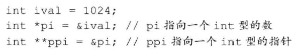

​		此处pi是指向int型数的指针，而ppi是指向int型指针的指针，下图描述了它们之间的关系。

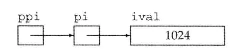

```c++
#include <iostream>
int main()
{
	int ival = 1024;
	int* pi = &ival;//pi指向一个int型的数
	int** ppi = &pi;//ppi指向一个int型的指针
	std::cout << "The value of ival\n"
		<< "ival：\t" << ival << "\n"
		<< "*pi：\t" << *pi << "\n"
		<< "pi：\t" << pi << "\n"
		<< "**ppi：\t" << **ppi << "\n"
		<< "*ppi：\t" << *ppi << "\n"
		<< "ppi：\t" << ppi << "\n"
		<< std::endl;
	return 0;
}
```

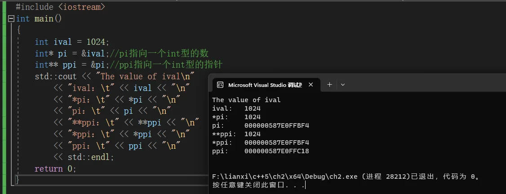

##### **指向指针的引用**

​		引用本身不是一个对象，因此不能定义指向引用的指针。但指针是对象，所以存在对指针的引用：

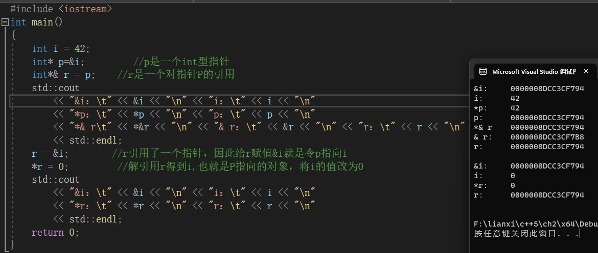


> 面对一条比较复杂的指针或引用的声明语句时，从右向左阅读有助于弄清楚它的真实含义。

### 2.4const限定符

​		有时我们希望定义这样一种变量，它的值不能被改变。为了满足这一要求，可以用关键字const对变量的类型加以限定，因为const对象一旦创建后其值就不能再改变，所以const对象必须初始化。一如既往，初始值可以是任意复杂的表达式。

##### **初始化和const**

​		正如之前反复提到的，对象的类型决定了其上的操作。与非const类型所能参与的操作相比，const类型的对象能完成其中大部分，但也不是所有的操作都适合。主要的限制就是只能在const类型的对象上执行不改变其内容的操作。

​		在不改变cost对象的操作中还有一种是初始化，如果利用一个对象去初始化另外一个对象，则它们是不是const都无关紧要：

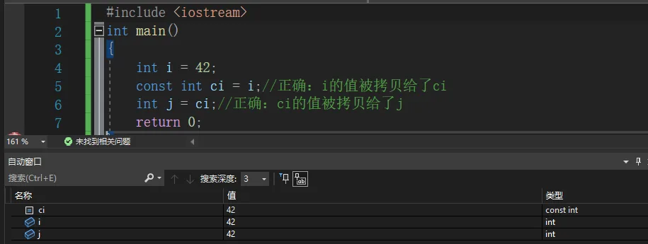

##### **默认状态下，const对象仅在文件内有效**

​		如果程序包含多个文件，则每个用了cost对象的文件都必须得能访问到它的初始值才行。要做到这一点，就必须在每一个用到变量的文件中都有对它的定义。为了支持这一用法，同时避免对同一变量的重复定义，默认情况下，cost对象被设定为仅在文件内有效。当多个文件中出现了同名的cost变量时，其实等同于在不同文件中分别定义了独立的变量。

​		某些时候有这样一种cost变量，它的初始值不是一个常量表达式，但又确实有必要在文件间共享。这种情况下，我们不希望编译器为每个文件分别生成独立的变量。相反，我们想让这类cost对象像其他（非常量）对象一样工作，也就是说，只在一个文件中定义const，而在其他多个文件中声明并使用它。

​		解决的办法是，对于const变量不管是声明还是定义都添加extern关键字，这样只需定义一次就可以了。

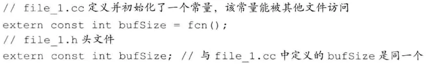

> 如果想在多个文件之间共享const对象，必须在变量的定义之前添加extern关键字。

#### 2.4.1const引用

​		可以把引用绑定到const对象上，就像绑定到其他对象上一样，我们称之为对常量的引用(reference to const)。与普通引用不同的是，对常量的引用不能被用作修改它所绑定的对象：


> ==术语：常量引用是对const的引用==
>
> ------
>
> ​		==C++程序员们经常把词组“对const的引用”简称为“常量引用”，这一简称还是挺靠谱的，不过前提是你得时刻记得这就是个简称而已。==
>
> ​		==严格来说，并不存在常量引用。因为引用不是一个对象，所以我们没法让引用本身恒定不变。事实上，由于C++语言并不允许随意改变引用所绑定的对象，所以从这层意义上理解所有的引用又都算是常量。引用的对象是常量还是非常量可以决定其所能参与的操作，却无论如何都不会影响到引用和对象的绑定关系本身。==

##### **初始化和对const的引用**

​		一般情况下，引用的类型必须与其所引用对象的类型一致，但是有两个例外。**`第一种例外情况就是在初始化常量引用时允许用任意表达式作为初始值，只要该表达式的结果能转换成引用的类型即可。`**尤其，允许为一个常量引用绑定非常量的对象、字面值，甚至是个一般表达式：


原因：

*(原图缺失)**(原图缺失)*

​		此处ri引用了一个int型的数。对ri的操作应该是整数运算，但dval却是一个双精度浮点数而非整数。因此为了确保让ri绑定一个整数，编译器把上述代码变成了右侧，在这种情况下，ri绑定了一个临时量(temporary)对象。所谓临时量对象就是当编译器需要一个空间来暂存表达式的求值结果时临时创建的一个未命名的对象。C+程序员们常常把临时量对象简称为临时量。

​		接下来探讨当ri不是常量时，如果执行了类似于上面的初始化过程将带来什么样的后果。**`如果ri不是常量，就允许对ri赋值，这样就会改变ri所引用对象的值。`**但此时绑定的对象是一个临时量而非dval。C++语言也就把这种行为`归为非法`。

##### **对const的引用可能引用一个并非const的对象**

​		必须认识到，常量引用仅对引用可参与的操作做出了限定，对于引用的对象本身是不是一个常量未作限定。因为对象也可能是个非常量，所以允许通过其他途径改变它的值。


#### 2.4.2指针和const

​		与引用一样，也可以令指针指向常量或非常量。类似于常量引用，指向常量的指针(pointer to const)不能用于改变其所指对象的值。要想存放常量对象的地址，只能使用指向常量的指针：


​		2.3.2节提到，指针的类型必须与其所指对象的类型一致，但是有两个例外。第一种例外情况是允许令一个指向常量的指针指向一个非常量对象：


​		和常量引用一样，指向常量的指针也没有规定其所指的对象必须是一个常量。所谓指向常量的指针仅仅要求不能通过该指针改变对象的值，而没有规定那个对象的值不能通过其他途径改变。

> 试试这样想吧：所谓指向常量的指针或引用，不过是指针或引用“自以为是”罢了，它们觉得自己指向了常量，所以自觉地不去玫变所指对象的值。


##### **const指针**

​		指针是对象而引用不是，因此就像其他对象类型一样，允许把指针本身定为常量。常量指针(const pointer)必须初始化，而且一旦初始化完成，则它的值（也就是存放在指针中的那个地址)就不能再改变了。把`*`放在cost关键字之前用以说明指针是一个常量，这样的书写形式隐含着一层意味，即不变的是指针本身的值而非指向的那个值：


​	

​	指针本身是一个常量并不意味着不能通过指针修改其所指对象的值，能否这样做完全依赖于所指对象的类型。


##### **`总结`**

###### **`常量指针`**

常量const，指针`*`，这里把`*`p，看做一个整体，被const修饰，`const（*p）`。

*(原图缺失)*

1. 定义： 又叫常指针，可以理解为常量的指针，也即这个是指针，但指向的是个常量，这个常量是指针的值（地址），而不是地址指向的值。

   > *p1的值不可以被更改
   >
   > p1的值可以被更改
   >
   > 可以通过修改原来的声明修改*p值
   >
   > ```c++
   > const int* p1 = &a;
   > a = 300;     //OK，仍然可以通过原来的声明修改值，
   > *p1 = 56;  	 //Error，*p1是const int的，不可修改，即常量指针不可修改其指向地址
   > p1 = &b;     //OK，指针还可以指向别处，因为指针只是个变量，可以随意指向；
   > ```

2. 关键点：

   1. 常量指针指向的对象不能通过这个指针来修改，可是仍然可以通过原来的声明修改；
   2. 常量指针可以被赋值为变量的地址，之所以叫常量指针，是限制了通过这个指针修改变量的值；
   3. 指针还可以指向别处，因为指针本身只是个变量，可以指向任意地址；

3. 代码形式：

```c++
int const* p;  const int* p;
```

> <strong style="color:#3eb985;">常量指针</strong>就是一个指针指向一个常量，并且这个指针是可以改变的，指针可以改变指向的常量、变量，指针指向的变量是可以修改的，但是只限于变量本身去修改，不能够通过指针的形式来修改该值。


###### **`指针常量`**

指针`*`，常量const，const修饰q，，`* const（p）`。


1. 定义：本质是一个常量，而用指针修饰它。指针常量的值是指针，这个值因为是常量，所以不能被赋值。

   > *p2的值可以被更改
   >
   > p2的值不可以被更改
   >
   > 可以通过修改原来的声明修改*p值
   >
   > ```c++
   > a = 500;     //OK，仍然可以通过原来的声明修改值，
   > *p2 = 400;   //OK，指针是常量，指向的地址不可以变化，但是指向的地址所对应的内容可以变化
   > p2 = &b;     //Error，因为p2是const 指针，因此不能改变p2指向的内容
   > ```

2. 关键点：

   1. 它是个常量！
   2. 指针本身是常量，指向的地址不可以变化，但是指向的地址所对应的内容可以变化；

3. 代码形式：

```c++
int* const p;
```

> <strong style="color:#3eb985;">指针常量</strong>指针常量是指指针本身所指向的常量/变量的地址值不能改变，但是可以通过`*p`去改变变量的值。


###### **`指向常量的常指针`**

> *p2的值可以被更改
>
> p2的值不可以被更改
>
> 可以通过修改原来的声明修改*p值
>
> ```c++
> a = 500;     //OK，仍然可以通过原来的声明修改值，
> *p2 = 400;   //Error，*p2是const int的，不可修改，即常量指针不可修改其指向地址
> p2 = &b;     //Error，因为p2是const 指针，因此不能改变p2指向的内容
> ```

1. 定义：指向常量的指针常量就是一个常量，且它指向的对象也是一个常量，`const(*const(p))`。
2. 关键点：
   1. 它是个常量！指向的也是常量！
   2. 指针本身是常量，指向的地址不可以变化，但是指向的地址所对应的内容可以变化；
3. 代码形式：

```c++
const int* const p;
```

> <strong style="color:#3eb985;">常量指针常量</strong> 就融合了指针常量和常量指针的特性，即指针不能指向别的变量、常量，并且不能通过指针去修改变量的数值。


```c++
//-------常量指针-------
const int *p1 = &a;
a = 300;     //OK，仍然可以通过原来的声明修改值，
//*p1 = 56;  //Error，*p1是const int的，不可修改，即常量指针不可修改其指向地址
p1 = &b;     //OK，指针还可以指向别处，因为指针只是个变量，可以随意指向；
 
//-------指针常量-------//
int*  const p2 = &a;
a = 500;     //OK，仍然可以通过原来的声明修改值，
*p2 = 400;   //OK，指针是常量，指向的地址不可以变化，但是指向的地址所对应的内容可以变化
//p2 = &b;     //Error，因为p2是const 指针，因此不能改变p2指向的内容
 
//-------指向常量的常量指针-------//
const int* const p3 = &a;
//*p3 = 1;    //Error
//p3 = &b;    //Error
a = 5000;    //OK，仍然可以通过原来的声明修改值
```


#### `2.4.3顶层const`

​		指针本身是一个对象，它又可以指向另外一个对象。因此，指针本身是不是常量以及指针所指的是不是一个常量就是两个相互独立的问题。==**用名词顶层const(top-level const)表示指针`本身`是个常量**==，==**而用名词底层const(low-level const)表示指针所指的`对象`是一个常量**==。

​		更一般的，顶层const可以表示任意的对象是常量，这一点对任何数据类型都适用，如算术类型、类、指针等。底层cost则与指针和引用等复合类型的基本类型部分有关。比较特殊的是，指针类型既可以是顶层const也可以是底层const，这一点和其他类型相比区别明显：

> 顶层：
>
> - *p1的值可以被更改
> - p1的值不可以被更改
>
> 
>
> | 引用                                                         | 指针                                                         |
> | ------------------------------------------------------------ | ------------------------------------------------------------ |
> | 实际上没有常量引用这种东西，因为引用不是一个对象，我们没法让引用本身恒定不变。 | **常量指针**：指针本身为常量。<br/>`int a = 0;`<br/>`int *const p1 = &a;` |
> | 引用没有顶层const                                            | 1） 指针本身为常量，初始化后，则指针的值（也就是存放在指针中的那个地址）就不能再被改变了。<br/><br/>2） 指针本身是一个常量并不意味着不能通过指针修改其所指对象的值，能否这样做依赖于所指对象的类型。<br/><br/>例子：<br/>`int a = 0;`<br/>`int *const p1 = &a;`// 所指对象是非常量<br/>`*p1=2;` // 可以这样修改所指对象*p1的值` |
>
> 底层：
>
> - *p2的值不可以被更改
> - p2的值可以被更改
>
> 
>
> | 引用                                                         | 指针                                                         |
> | ------------------------------------------------------------ | ------------------------------------------------------------ |
> | **对const的引用**：把引用绑定到const对象上。对常量的引用不能被用作修改它所绑定的对象。<br/>“对const的引用”简称为“常量引用”，不过你得时刻记得这就是个简称而已。 | **指向常量的指针**：指针指向const对象。                      |
> | 1） 正常情况：将const int &绑定到const对象上。<br/>例子：<br/>`const int a = 1;`<br/>`const int &r1 = a;`<br/>2） 例外情况：引用的类型必须与引用的对象类型一致，但有两个例外：一种例外情况就是允许将const int &绑定到一个普通int对象上。<br/>此时不能通过引用去修改被绑定对象的值，但可以通过别的方式修改对象的值。<br/>例子：<br/>`int a=0;`<br/>`const int &r1 = a;`<br/>a =1; // 可以修改a的值，因为a是非常量<br/>3） 允许将const int &和字面值或某个表达式的计算结果绑定到一起。<br/>`const int &r2 = 2;`<br/>`const int &r3 = a*3;` | 1） 正常情况：让const int *指向常量对象。<br/><br/>例子<br/>`const int a = 1;`<br/>`const int *p = &a;`<br/>`p =nullptr;` // 指针本身不是const型，可以修改<br/>2） 例外情况：指针的类型必须与所指对象的类型一致，但有两个例外：一种例外情况就是允许令一个指向常量的指针指向一个非常量的对象（就问你这句话绕不绕）。此时不能通过该指针改变对象的值，但没有规定那个对象的值不能通过其他途径改变。<br/>例子：<br/>`int a = 0;`<br/>`const int *p = &a;`<br/>`a = 1;` // 可以修改a的值，因为a是非常量 |
>
> *(原图缺失)*

```c++
int i = 0;
int* const p1 = &i;			//  不能改变 p1 的值，这是一个顶层
const int ci = 42;			//  不能改变 ci 的值，这是一个顶层
const int* p2 = &ci;		//  允许改变 p2 的值，这是一个底层
const int* const p3 = p2;   //  靠右的 const 是顶层 const，靠左的是底层 const
const int& r = ci;			//  所有的引用本身都是顶层 const，因为引用一旦初始化就不能再改为其他对象的引用，这里用于声明引用的 const 都是底层 const
```

​		当执行对象的拷贝操作时，常量是顶层const还是底层const区别明显。其中，顶层const不受什么影响，执行拷贝操作并不会改变被拷贝对象的值，因此，拷入和拷出的对象是否是常量都没什么影响.

```c++
i = ci;     //  正确：拷贝 ci 的值给 i，ci 是一个顶层 const，对此操作无影响。
p2 = p3;    //  正确：p2 和 p3 指向的对象相同，p3 顶层 const 的部分不影响。
```

​		另一方面，底层cost的限制却不能忽视。当执行对象的拷贝操作时，拷入和拷出的对象必须具有相同的底层cost资格，或者两个对象的数据类型必须能够转换。一般来说，非常量可以转换成常量，反之则不行。

```c++
int *p = p3;   		 //  错误：p3 包含底层 const 的定义，而p没有。假设成功，p 就可以改变 p3 指向的对象的值。
p2 = p3;             //  正确：p2 和 p3 都是底层 const
p2 = &i;             //  正确：int* 能够转化为 const int*，这也是形参是底层const的函数形参传递外部非 const 指针的基础。
int &r = ci;   		 //  错误：普通 int& 不能绑定到 int 常量中。
const int &r2 = i;   //  正确：const int& 可以绑定到一个普通 int 上。
```

#### 2.4.4constexper和常量表达

​		==常量表达式(const expression)是指值不会改变并且在编译过程就能得到计算结果的表达式。==显然，字面值属于常量表达式，用常量表达式初始化的const对象也是常量表达式。一个对象（或表达式)是不是常量表达式由它的数据类型和初始值共同决定。

##### **constexper变量**

​		在一个复杂系统中，很难分辨一个初始值到底是不是常量表达式。当然可以定义一个cost变量并把它的初始值设为我们认为的某个常量表达式，但在实际使用时，尽管要求如此却常常发现初始值并非常量表达式的情况。可以这么说，在此种情况下，对象的定义和使用根本就是两回事儿。
​		C++11新标准规定，允许将变量声明为constexpr类型以便由编译器来验证变量的值是否是一个常量表达式。声明为constexpr的变量一定是一个常量，而且必须用常量表达式初始化：


> 一般来说，如果你认定变量是一个常量表达式，那就把它声明成constexpr类型。

##### **字面值类型**

​		常量表达式的值需要在编译时就得到计算，因此对声明constexpr时用到的类型必须有所限制。因为这些类型一般比较简单，值也显而易见、容易得到，就把它们称为“字面值类型”(literal type)。到目前为止接触过的数据类型中，算术类型、引用和指针都属于字面值类型。自定义类Sales item、IO库、string类型则不属于字面值类型，也就不能被定义成constexpr。

##### **指针和constexper**

​		必须明确一点，在constexpr声明中如果定义了一个指针，限定符constexpr仅对指针有效，与指针所指的对象无关：


​		与其他常量指针类似，constexpr指针既可以指向常量也可以指向一个非常量：


### 2.5处理类型

#### 2.5.1类型别名

​		类型别名(type alias)是一个名字，它是某种类型的同义词。

​		有两种方法可用于定义类型别名。

1. 传统的方法是使用关键字typedef:

   

2. 新标准规定了一种新的方法，使用别名声明(alias declaration)来定义类型的别名：

   

​		类型别名和类型的名字等价，只要是类型的名字能出现的地方，就能使用类型别名：

```c++
wages hourly，weekly;//等价于double hour1y、weekly;
SI item;//等价于Sales_item item
```

##### **指针、常量和类型别名**

​		如果某个类型别名指代的是复合类型或常量，那么把它用到声明语句里就会产生意想不到的后果。


​		再强调一遍：这种理解是错误的。声明语句中用到pstring时，其基本数据类型是指针。可是用`char*`重写了声明语句后，数据类型就变成了`char`，`*`成为了声明符的一部分。这样改写的结果是，const char成了基本数据类型。上下两种声明含义截然不同，上面的声明了一个指向char的常量指针，下面的的形式则声明了一个指向const char的指针。


#### 2.5.2 auto类型说明符

​		编程时常常需要把表达式的值赋给变量，这就要求在声明变量的时候清楚地知道表达式的类型，但有时很困难。为了解决这个问题，C++引入了auto类型说明符，用它就能让编译器替我们去分析表达式所属的类型。和原来那些只对应一种特定类型的说明符（比如double)不同，auto让编译器通过初始值来推算变量的类型。显然，auto定义的变量必须有初始值：


​		使用auto也能在一条语句中声明多个变量。因为一条声明语句只能有一个基本数据类型，所以该语句中所有变量的初始基本数据类型都必须一样：


##### **复合类型、常量和auto**

​		编译器推断出来的auto类型有时候和初始值的类型并不完全一样，编译器会适当地改变结果类型使其更符合初始化规则。

```c++
#include <iostream>
int main()
{
	//首先，正如我们所熟知的，使用引用其实是使用引用的对象，特别是当引用被用作初始值时，真正参与初始化的其实是引用对象的值。
	//此时编译器以引用对象的类型作为auto的类型：
	int i = 0， & r = i;
	auto a = r; //a是一个整数(r是i的别名， 而i是一个整数）

	//其次，auto一般会忽略掉顶层const，同时底层const则会保留下来，比如当初始值是一个指向常量的指针时：
	const int ci = i， & cr = ci;
	auto b = ci;//b是一个整数（ci的顶层const特性被忽略掉了)
	auto c = cr;//c是一个整数(cx是ci的别名，ci本身是一个顶层const)
	auto d = &i;//d是一个整型指针（整数的地址就是指向整数的指针）
	auto e = &ci;//e是一个指向整数常量的指针（对常量对象取地址是一种底层const)

	//如果希望推断出的auto类型是一个项层const，需要明确指出：
	const auto f = ci;//ci的推演类型是int，f是const int

	//还可以将引用的类型设为auto，此时原来的初始化规则仍然适用：
	auto& g = ci;//g是一个整型常量引用，绑定到ci
	//auto& h =42;//错误：不能为非常量引用绑定字面值
	const auto& j = 42;//正确：可以为常量引用绑定字面值
	//设置一个类型为auto的引用时，初始值中的顶层常量属性仍然保留。和往常一样，如果我们给初始值绑定一个引用，则此时的常量就不是顶层常量了。

	//要在一条语句中定义多个变量，切记，符号&和*只从属于某个声明符，而非基本数据类型的一部分，因此初始值必须是同一种类型：
	auto k = ci， & l = i;//k是整数，1是整型引用
	auto& m = ci， * p = &ci;//m是对整型常量的引用，p是指向整型常量的指针
	//auto& n = i， * p2 = &ci;//错误：i的类型是int而&ci的类型是const int
	return 0;
}
```


#### 2.5.3 decltype类型指示符

​		C++引入了第二种类型说明符decltype，它的作用是选择并返回操作数的数据类型，从表达式的类型推断出要定义的变量的类型。在此过程中，编译器分析表达式并得到它的类型，却不实际计算表达式的值。


​		decltype处理顶层const和引用的方式与auto有些许不同。如果decltype使用的表达式是一个变量，则decltype返回该变量的类型（包括顶层const和引用在内）。


##### **decltype和引用**

​		如果decltype使用的表达式不是一个变量，则decltype返回表达式结果对应的类型。一般来说当这种情况发生时，意味着该表达式的结果对象能作为一条赋值语句的左值：


​		另一方面，如果表达式的内容是解引用操作，则decltype将得到引用类型。正如我们所熟悉的那样，解引用指针可以得到指针所指的对象，而且还能给这个对象赋值。因此，decltype(*p)的结果类型就是int&，而非int。

​		decltype和auto的另一处重要区别是，decltype的结果类型与表达式形式密切相关。有一种情况需要特别注意：对于decltype所用的表达式来说，如果变量名加上了一对括号，则得到的类型与不加括号时会有不同。如果decltype使用的是一个不加括号的变量，则得到的结果就是该变量的类型：如果给变量加上了一层或多层括号，编译器就会把它当成是一个表达式。变量是一种可以作为赋值语句左值的特殊表达式，所以这样的decltype就会得到引用类型：


> 切记：decltype((variable)(注意是双层括号)的结果永远是引用，而decltype(variable)结果只有当variable本身就是一个引用时才是引用。

### 2.6自定义数据结构

​	数据结构是把一组相关的数据元素组织起来然后使用它们的策略和方法。C++语言允许用户以类的形式自定义数据类型，而库类型string、istream、ostream等也都是以类的形式定义的，就像第1章的Sales item类型一样。

#### 2.6.1 定义Sales_data类型

​		我们的类以关键字struct开始， 紧跟着类名和类体（其中类体部分可以为空）。类体由花括号包围形成了一个新的作用域（参见2.2.4节，第43页)。类内部定义的名字必须唯一，但是可以与类外部定义的名字重复。

```c++
#include <iostream>
struct Sales_data
{
	std::string bookNo;
	unsigned units_sold = 0;
	double revenue = 0;
};
```

##### **类数据成员**

​		类体定义类的成员，我们的类只有数据成员(data member)。类的数据成员定义了类的对象的具体内容，每个对象有自己的一份数据成员拷贝。定义数据成员的方法和定义普通变量一样：首先说明一个基本类型，随后紧跟一个或多个声明符。C++新标准规定，可以为数据成员提供一个类内初始值(in-class initializer)。创建对象时，类内初始值将用于初始化数据成员。没有初始值的成员将被默认初始化。对类内初始值的限制与之前介绍的类似：或者放在花括号里，或者放在等号右边，记住不能使用圆括号。

#### 2.6.2使用Sales_data类

##### **添加两个Sales_data对象**

```c++
#include <iostream>
#include<string>
#include "Sales_data.h"
int main()
{
	Sales_data data1， data2;
	return 0;
}
```

##### **Sales_data对象读入数据**

```c++
double price = 0;  //书的单价，用于计算销售收入
//读入第1笔交易：ISBN、销售数量、单价
std::cin >> data1.bookNo >> data1.units_sold >> price;
//计算销售收入
data1.revenue = data1.units_sold * price;
//读入第2笔交易
std::cin >> data2.bookNo >> data2.units_sold >> price;
data2.revenue = data2.units_sold * price;
```

##### **输出两个Sales_data对象的和**

```c++
//检查两笔交易涉及的ISBN编号是否相同。如果相同输出它们的和，否则输出一条报错信息.
if (data1.bookNo == data2.bookNo) {
	unsigned totalCnt = data1.units_sold + data2.units_sold;
	double totalRevenue = data1.revenue + data2.revenue;
	//输出：ISBN、总销售量、总销售额、平均价格
	std::cout << data1.bookNo << " " << totalCnt
		<< " " << totalRevenue << " ";
	if (totalCnt != 0)
		std::cout << totalRevenue / totalCnt << std::endl;
	else
		std::cout << "(no sales)" << std::endl;
	return 0;  //标示成功
}
else {  //两笔交易的ISBN不一样
	std::cerr << "Data must refer to the same ISBN"
		<< std::endl;
	return -1; //标示失败
}
```

#### 2.6.3编写自己的头文件

​		为了确保各个文件中类的定义一致，类通常被定义在头文件中，而且类所在头文件的名字应与类的名字一样。头文件通常包含那些只能被定义一次的实体，如类、const和constexpr变量等。头文件也经常用到其他头文件的功能。

> 头文件一旦改变，相关的源文件必须重新编译以获取更新过的声明。

##### **预处理器概述**

​		确保头文件多次包含仍能安全工作的常用技术是预处理器(preprocessor)，它由C++语言从C语言继承而来。预处理器是在编译之前执行的一段程序，可以部分地改变我们所写的程序。之前已经用到了一项预处理功能#include，当预处理器看到#include标记时就会用指定的头文件的内容代替#include。

​		C++程序还会用到的一项预处理功能是头文件保护符(header guard)，头文件保护符依赖于预处理变量。预处理变量有两种状态：已定义和未定义。#define指令把一个名字设定为预处理变量，另外两个指令则分别检查某个指定的预处理变量是否已经定义：#ifdef当且仅当变量已定义时为真，#ifndef当且仅当变量未定义时为真。一旦检查结果为真，则执行后续操作直至遇到#endif指令为止。

`Sales_data.h`

```c++
#ifndef SALES_DATA_H
#define SALES_DATA_H
#include <iostream>
#include<string>
struct Sales_data
{
	std::string bookNo;
	unsigned units_sold = 0;
	double revenue = 0.0;
};
#endif
```

`Sales_data.cpp`

```c++
#include <iostream>
#include <string>
#include "Sales_data.h"
int main()
{
	Sales_data data1， data2;

	//读入datal和data2的代码
	double price = 0;  //书的单价，用于计算销售收入
	std::cin >> data1.bookNo >> data1.units_sold >> price;//读入第1笔交易：ISBN、销售数量、单价
	data1.revenue = data1.units_sold * price;	//计算销售收入
	//读入第2笔交易
	std::cin >> data2.bookNo >> data2.units_sold >> price;
	data2.revenue = data2.units_sold * price;
	//检查两笔交易涉及的ISBN编号是否相同。如果相同输出它们的和，否则输出一条报错信息.
	if (data1.bookNo == data2.bookNo) {
		unsigned totalCnt = data1.units_sold + data2.units_sold;
		double totalRevenue = data1.revenue + data2.revenue;
		//输出：ISBN、总销售量、总销售额、平均价格
		std::cout << data1.bookNo << " " << totalCnt
			<< " " << totalRevenue << " ";
		if (totalCnt != 0)
			std::cout << totalRevenue / totalCnt << std::endl;
		else
			std::cout << "(no sales)" << std::endl;
		return 0;  //标示成功
	}
	else {  //两笔交易的ISBN不一样
		std::cerr << "Data must refer to the same ISBN"
			<< std::endl;
		return -1; //标示失败
	}
}
```


​		整个程序中的预处理变量包括头文件保护符必须唯一，通常的做法是基于头文件中类的名字来构建保护符的名字，以确保其唯一性。为了避免与程序中的其他实体发生名字冲突，一般把预处理变量的名字全部大写。

> 1. 预处理变量无视C++语言中关于作用域的规则.
> 2. 头文件即使（目前还）没有被包含在任何其他头文件中，也应该设置保护符。头文件保护符很简单，程序员只要习惯性地加上就可以了，没必要太在乎你的程序到底需不需要.
