## 第三章 字符串、向量和数组

### 3.1 命名空间using声明

​		目前为止，我们用到的库函数基本上都属于命名空间std，而程序也显式地将这一点标示了出来。因此，std::cin的意思就是要使用命名空间std中的名字cin。有了using声明就无须专门的前缀（形如命名空间::）也能使用所需的名字了。using声明具有如下的形式：

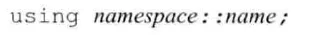

​		一旦声明了上述语句，就可以直接访问命名空间中的名字.

##### **每个名字都需要独立的using声明**

​		按照规定，每个using声明引入命名空间中的一个成员。

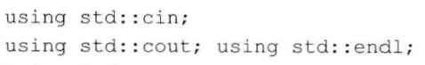

##### **头文件不应包含using声明**

​		位于头文件的代码一般来说不应该使用using声明。这是因为头文件的内容会拷贝到所有引用它的文件中去，如果头文件里有某个using声明，那么每个使用了该头文件的文件就都会有这个声明。对于某些程序来说，由于不经意间包含了一些名字，反而可能产生始料未及的名字冲突。

### 3.2 标准库类型string

​		标准库类型string表示可变长的字符序列，使用string类型必须首先包含string头文件。作为标准库的一部分，string定义在命名空间std中。

#### 3.2.1 定义和初始化string对象

​		如何初始化类的对象是由类本身决定的。一个类可以定义很多种初始化对象的方式，只不过这些方式之间必须有所区别：或者是初始值的数量不同，或者是初始值的类型不同。

> C++标准一方面对库类型所提供的操作做了详细规定，另一方面也对库的实现者做出一些性能上的需求。因此，标准库类型对于一般应用场合来说有足够的效率。

```c++
#include <iostream>
#include <string>
using std::string;
int main() {
	string s1;//默认初始化，s1是一个空字符串
	string s2 = s1;//s2是s1的副本
	string s3 = "hiya";//s3是该字符串字面值的副本
	string s4(10， 'c');//s4的内容是cccccccccc
	return 0;
}
```

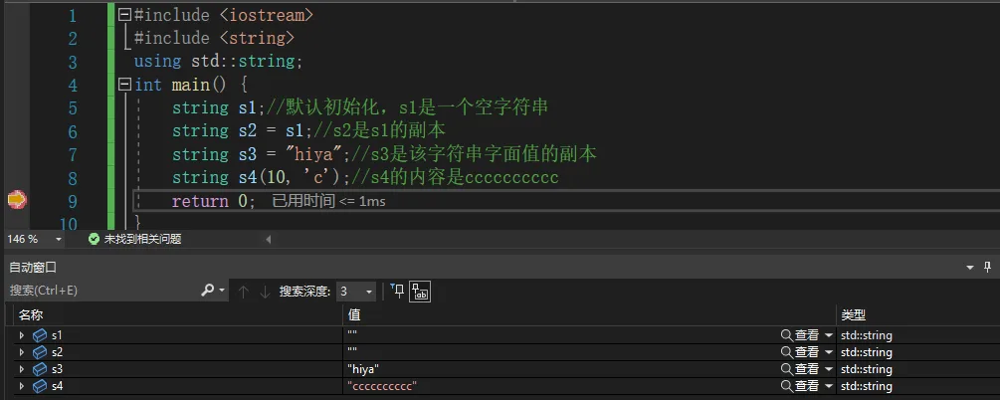

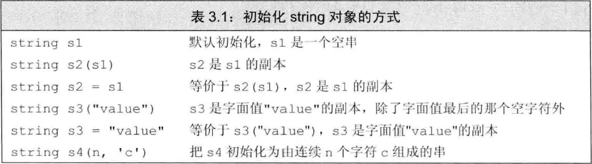

##### **直接初始化和拷贝初始化**

​		C++语言有几种不同的初始化方式，通过string我们可以清楚地看到在这些初始化方式之间到底有什么区别和联系。如果使用等号`=`初始化一个变量，实际上执行的是拷贝初始化(copy initialization)，编译器把等号右侧的初始值拷贝到新创建的对象中去。与之相反，如果不使用等号，则执行的是直接初始化(direct initialization)。

```c++
#include <iostream>
#include <string>
using std::string; using std::cin; using std::cout; using std::endl;
int main() {
	//当初始值只有一个时，使用直接初始化或拷贝初始化都行。如果初始化的值有多个，使用直接初始化的方式。
	string s5 = "hiya";//拷贝初始化
	string s6("hiya");//直接初始化
	string s7(10， 'c');//直接初始化，s7的内容是cccccccccc

	//对于用多个值进行初始化的情况，非要用拷贝初始化的方式来处理也不是不可以，不过需要显式地创建一个（临时）对象用于拷贝：
	string s8 = string(10， 'c');//拷贝初始化，s8的内容是cccccccccc

	//等价于下面的两条语句
	string temp(10， 'c');// temp的内容是cccccccccc
	string s9 = temp;//将temp拷贝给s8

	cout << s5 << "\n" << s6 << "\n" << s7 << "\n" << s8 << "\n" << s9 << "\n";
	return 0;
}
```

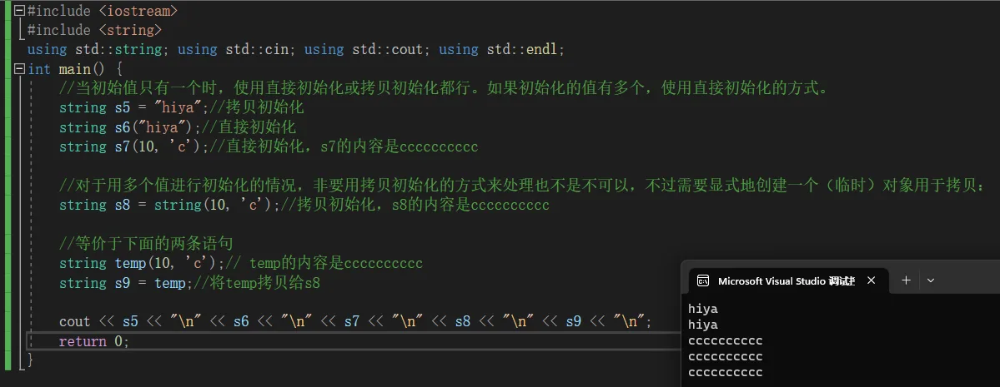

#### 3.2.2 string对象上的操作

*(原图缺失)*

##### **读写string对象**

​		可以使用IO操作符读写string对象，这段程序首先定义一个名为s的空string，然后将标准输入的内容读取到s中。在执行读取操作时，string对象会自动忽略开头的空白（即空格符、换行符、制表符等）并从第一个真正的字符开始读起，直到遇见下一处空白为止。

```c++
#include <iostream>
#include <string>
using std::string; using std::cin; using std::cout; using std::endl;
int main() {
	string s;//空字符串
	cin >> s;//将string对象读入s，遇到空白停止
	cout << s << endl;//输出s
	return 0;
}
```

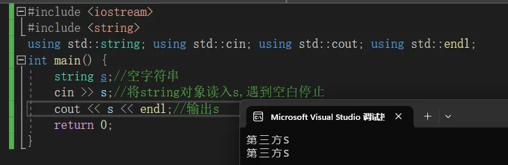

​		和内置类型的输入输出操作一样，string对象的此类操作也是返回运算符左侧的运算对象作为其结果。因此，多个输入或者多个输出可以连写在一起：

```c++
#include <iostream>
#include <string>
using std::string; using std::cin; using std::cout; using std::endl;
int main() {
	string s1， s2;//空字符串
	cin >> s1 >> s2;//把第一个输入读到s1中，第二个输入读到s2中
	cout << s1 << s2 << endl;//输出两个string对象
	return 0;
}
```

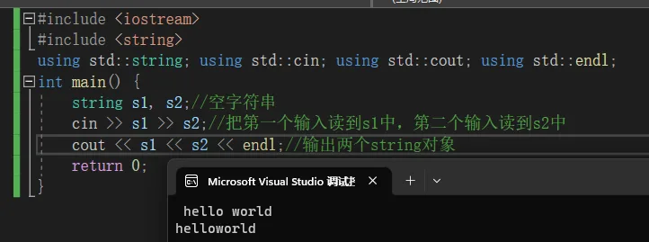

##### **读取未知数量的string对象**

​		通过循环语句

```c++
#include <iostream>
#include <string>
using std::string; using std::cin; using std::cout; using std::endl;
int main() {
	string word;//空字符串
	while (cin >> word)//反复读取，直至到达文件末尾
		cout << word << endl;//逐个输出单词，每个单词后面紧跟一个换行
	return 0;
}
```

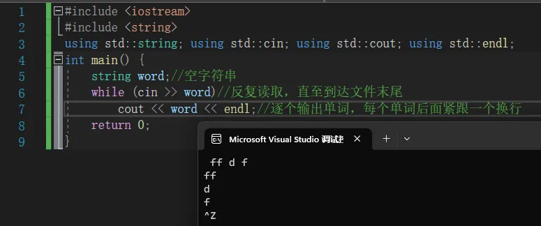

##### **使用getline读取一整行**

​		有时我们希望能在最终得到的字符串中保留输入时的空白符，这时应该用getline函数代替原来的>>运算符。getline函数的参数是一个输入流和一个string对象，函数从给定的输入流中读入内容，直到遇到换行符为止（注意换行符也被读进来了），然后把所读的内容存入到那个string对象中去（注意不存换行符）。getline只要一遇到换行符就结束读取操作并返回结果，哪怕输入的一开始就是换行符也是如此。如果输入真的一开始就是换行符，那么所得的结果是个空string。

​		和输入运算符一样，getline也会返回它的流参数。因此既然输入运算符能作为判断的条件，我们也能用getline的结果作为条件。

```c++
#include <iostream>
#include <string>
using std::string; using std::cin; using std::cout; using std::endl;
int main() {
	string line;
	//每次读入一整行，直至到达文件末尾
	while (getline(cin， line))
		cout << line << endl;
	return 0;
}
```

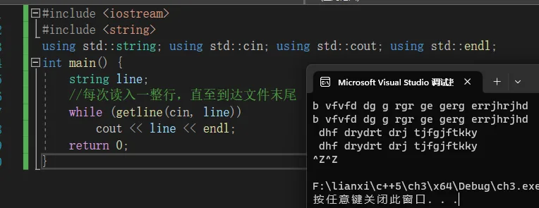

> 触发getline函数返回的那个换行符实际上被丢弃掉了，得到的string对象中并不包含该换行符

##### **string的empty和size操作**

​		顾名思义，empty函数根据string对象是否为空返回一个对应的布尔值

```c++
#include <iostream>
#include <string>
using std::string; using std::cin; using std::cout; using std::endl;
int main() {
	string line;
	//每次读入一整行，直至到达文件末尾
	while (getline(cin， line))
		if (!line.empty())
			cout << line << endl;
		else
			cout << "空" << endl;
	return 0;
}
```

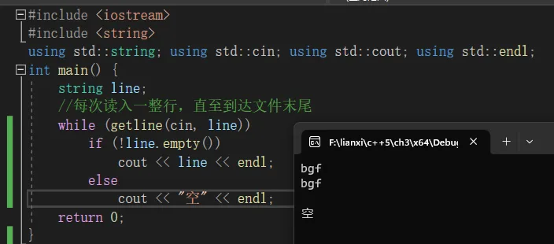

​		size函数返回string对象的长度（即string对象中字符的个数），可以使用size函数只输出长度超过80个字符的行。

```c++
#include <iostream>
#include <string>
using std::string; using std::cin; using std::cout; using std::endl;
int main() {
	string line;
	//每次读入一整行，直至到达文件末尾
	while (getline(cin， line))
		if (line.size() > 80)
			cout << line << endl;
	return 0;
}
```

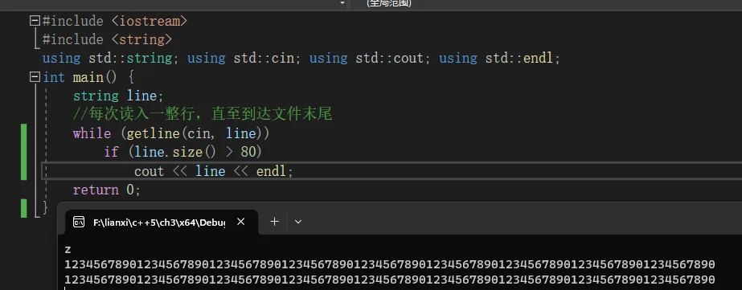

##### **`string:size_type`类型**

​		尽管我们不太清楚`string:size_type`类型的细节，但有一点是肯定的：它是一个无符号类型的值，而且能足够存放下任何string对象的大小。所有用于存放string类的size函数返回值的变量，都应该是`string:size_type`类型的。

> 如果一条表达式中已经有了size()函数就不要再使用int了，这样可以避免混用int和unsigned可能带来的问题。

##### **比较string对象**

​		string类定义了几种用于比较字符串的运算符。这些比较运算符逐一比较string对象中的字符，并且对大小写敏感，也就是说，`在比较时同一个字母的大写形式和小写形式是不同的`。

​		相等性运算符(`==`和`!=`)分别检验两个string对象相等或不相等，string对象相等意味着它们的长度相同而且所包含的字符也全都相同。关系运算符`<、<=、>、>=`分别检验一个string对象是否小于、小于等于、大于、大于等于另外一个string对象。上述这些运算符都依照（大小写敏感的）字典顺序：

1. 如果两个string对象的长度不同，而且较短string对象的每个字符都与较长string对象对应位置上的`字符相同`，就说较短string对象小于较长string对象。
2. 如果两个string对象在某些对应的位置上不一致，则string对象比较的结果其实是string对象中`第一对相异字符`比较的结果。

```c++
#include <iostream>
#include <string>
using std::string; using std::cin; using std::cout; using std::endl;
int main() {
	string str = "hello";
	string phrase = "hello world";
	string slang = "hiya";
	cout << (str == phrase) << endl;
	cout << (str != phrase) << endl;
	cout << (slang >= phrase) << endl;
	cout << (slang >= str) << endl;
	cout << (slang > phrase) << endl;
	cout << (slang > str) << endl;
	return 0;
}
```

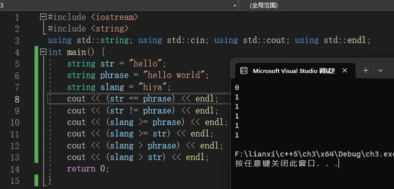

##### **为string对象赋值**

​		一般来说，在设计标准库类型时都力求在易用性上向内置类型看齐，因此大多数库类型都支持赋值操作。对于string类而言，允许把一个对象的值赋给另外一个对象.

```c++
#include <iostream>
#include <string>
using std::string; using std::cin; using std::cout; using std::endl;
int main() {
	string str1(10， 'c')， str2;//st1的内容是cccccccccc;st2是一个空字符串
	cout << str1 << endl;
	cout << str2 << endl;
	str1 = str2;//赋值：用st2的副本替换st1的内容
	cout << str1 << endl;//此时st1和st2都是空字符串
	cout << str2 << endl;
	return 0;
}
```

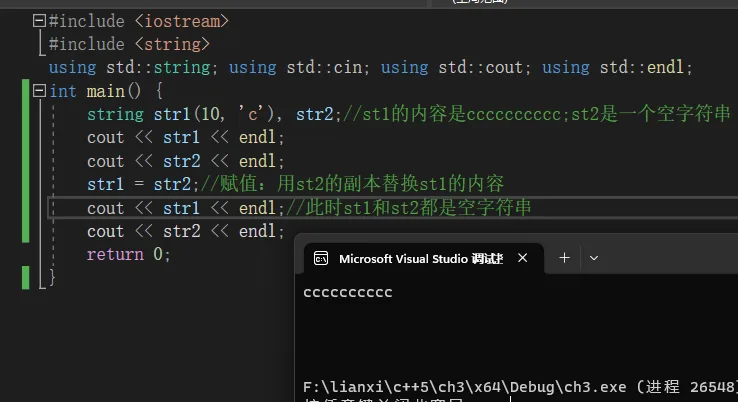

##### **两个string对象相加**

​		两个string对象相加得到一个新的string对象，其内容是把左侧的运算对象与右侧的运算对象串接而成。也就是说，对string对象使用加法运算符(+)的结果是一个新的string对象，它所包含的字符由两部分组成：前半部分是加号左侧string对象所含的字符、后半部分是加号右侧string对象所含的字符。另外，复合赋值运算符(+=)负责把右侧string对象的内容追加到左侧string对象的后面。

```c++
#include <iostream>
#include <string>
using std::string; using std::cin; using std::cout; using std::endl;
int main() {
	string str1="hello，"， str2="world\n";
	string str3 = str1 + str2;//s3的内容是hello，world\n
	cout << str3 << endl;
	str1 += str2;//等价于s1=s1+s2
	cout << str1 << endl;
	return 0;
}
```

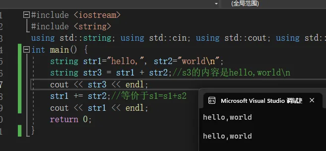

##### **字面值和string对象相加**

​		即使一种类型并非所需，我们也可以使用它，不过前提是该种类型可以自动转换成所需的类型。因为标准库允许把字符字面值和字符串字面值转换成string对象，所以在需要string对象的地方就可以使用这两种字面值来替代。

```c++
#include <iostream>
#include <string>
using std::string; using std::cin; using std::cout; using std::endl;
int main() {
	string str1 = "hello"， str2 = "world";//在s1和s2中都没有标，点符号
	string str3 = str1 + "，" + str2 + "\n";
	cout << str3;

	string str4 = str1 + "，";//正确：把一个string对象和一个字面值相加
	//string str5 = "hello" + "，";//错误：两个运算对象都不是string
	cout << str4 << endl;

	string str6 = str1 + "，" + "world"; //正确：每个加法运算符都至少有一个运算对象是string
	//string str7 = "hello" + "，" + str2;//错误：不能把字面值直接相加
	cout << str6;

	return 0;
}
```

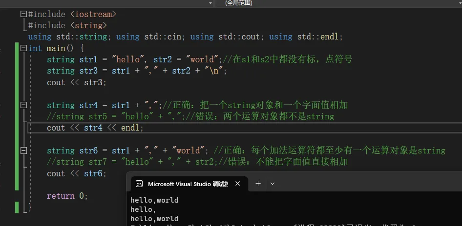

> str6可以理解为：
>
> ```c++
> string str6 = (str1 + "，") + "world"; //子表达式s1 + "，"的结果是一个string对象，它同时作为第二个加法运算符的左侧运算对象
> //等价为
> string tmp = str1 + "，";//正确：加法运算符有一个运算对象是string
> str6 = tmp + "world";//正确：加法运算符有一个运算对象是string
> ```

> 因为某些历史原因，也为了与C兼容，所以C++语言中的字符串字面值并不是标准库类型string的对象。切记，字符串字面值与string是不同的类型。

#### 3.2.3 处理string对象中的字符

​	在cctype头文件中定义了一组标准库函数处理string对象中的字符，表3.3列出了主要的函数名及其含义。

*(原图缺失)*

`cctype`头文件中定义了一组标准函数：

| 函数          | 解释                                                         |
| ------------- | ------------------------------------------------------------ |
| `isalnum(c)`  | 当`c`是字母或数字时为真                                      |
| `isalpha(c)`  | 当`c`是字母时为真                                            |
| `iscntrl(c)`  | 当`c`是控制字符时为真                                        |
| `isdigit(c)`  | 当`c`是数字时为真                                            |
| `isgraph(c)`  | 当`c`不是空格但可以打印时为真                                |
| `islower(c)`  | 当`c`是小写字母时为真                                        |
| `isprint(c)`  | 当`c`是可打印字符时为真                                      |
| `ispunct(c)`  | 当`c`是标点符号时为真                                        |
| `isspace(c)`  | 当`c`是空白时为真（空格、横向制表符、纵向制表符、回车符、换行符、进纸符） |
| `isupper(c)`  | 当`c`是大写字母时为真                                        |
| `isxdigit(c)` | 当`c`是十六进制数字时为真                                    |
| `tolower(c)`  | 当`c`是大写字母，输出对应的小写字母；否则原样输出`c`         |
| `toupper(c)`  | 当`c`是小写字母，输出对应的大写字母；否则原样输出`c`         |

-

> 建议：使用C++版本的C标准库头文件
> 		C+标准库中除了定义C++语言特有的功能外，也兼容了C语言的标准库。C语言的头文件形如name，h，C+则将这些文件命名为cname。也就是去掉了.h后缀，而在文件名name之前添加了字母c，这里的c表示这是一个属于C语言标准库的头文件。
> 		因此，cctype头文件和ctype.h头文件的内容是一样的，只不过从命名规范上来讲更符合C++语言的要求。特别的，在名为cname的头文件中定义的名字从属于命名空间std，而定义在名为.h的头文件中的则不然。
> 		一般来说，C++程序应该使用名为cname的头文件而不使用name.h的形式，标准库中的名字总能在命名空间std中找到。如果使用.h形式的头文件，程序员就不得不时刻牢记哪些是从C语言那儿继承过来的，哪些又是C++语言所独有的。

##### **处理每个字符？使用基于范围的for语句**

​		如果想对string对象中的每个字符做点儿什么操作，目前最好的办法是使用C++11新标准提供的一种语句：范围for(range for)语句。这种语句遍历给定序列中的每个元素并对序列中的每个值执行某种操作。

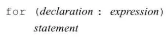

​		`expression`部分是一个对象，用于表示一个序列。`declaration`部分负责定义一个变量，该变量将被用于访问序列中的基础元素。每次迭代，`declaration`部分的变量会被初始化为`expression`部分的下一个元素值。

```c++
#include <iostream>
#include <string>
using std::string; using std::cin; using std::cout; using std::endl;
int main() {
	string str("some string");

	//每行输出str中的一个字符。
	for (auto c : str)//对于str中的每个字符
		cout << c << endl;//输出当前字符，后面紧跟一个换行符
	return 0;
}
```

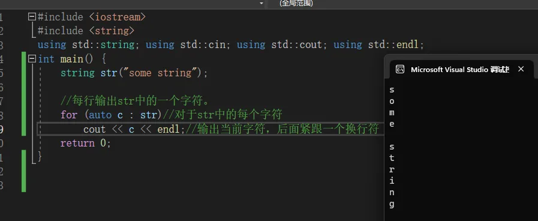

```c++
#include <iostream>
#include <string>
using std::string; using std::cin; using std::cout; using std::endl;
int main() {
	string str("Hello，World!!!");
	decltype(str.size()) punct_cnt = 0;//punct_cnt的类型和s.size的返回类型一样
	//统计str中标点符号的数量
	for (auto c : str)//对于str中的每个字符
		if (ispunct(c))//如果该字符是标点符号
			++punct_cnt;//将标点符号的计数值加1
	cout << punct_cnt << "个标点在" << str << endl;//输出当前字符，后面紧跟一个换行符
	return 0;
}
```

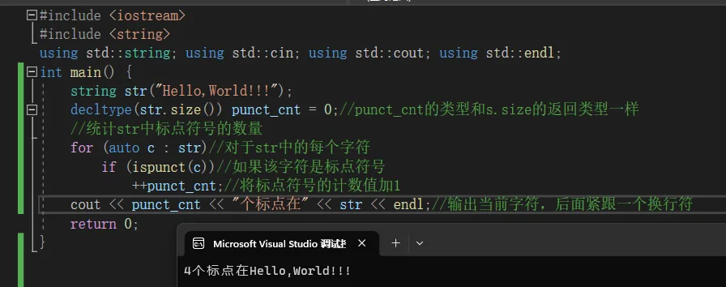

##### **使用范围for语句改变字符串中的字符**

​		如果想要改变string对象中字符的值，必须把循环变量定义成引用类型。记住，所谓引用只是给定对象的一个别名，因此当使用引用作为循环控制变量时，这个变量实际上被依次绑定到了序列的每个元素上。使用这个引用，我们就能改变它绑定的字符。

```c++
#include <iostream>
#include <string>
using std::string; using std::cin; using std::cout; using std::endl;
int main() {
	string str("Hello，World!!!");
	//转换成大写形式
	for (auto& c : str)//对于str中的每个字符(注意c是引用)
		c = toupper(c);//C是一个引用，因此赋值语句将改变s中字符的值
	cout << str << endl;
	return 0;
}
```

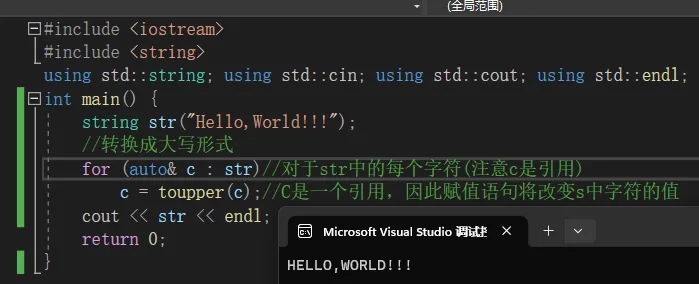

##### **只处理一部分字符？**

​		要想访问string对象中的单个字符有两种方式：一种是使用下标，另外一种是使用迭代器。下标运算符([])接收的输入参数是string:size_type类型的值，这个参数表示要访问的字符的位置；返回值是该位置上字符的引用。

​		string对象的下标从0计起。如果string对象s至少包含两个字符，则s[0]是第1个字符、s[1]是第2个字符、s[s.size()-1]是最后一个字符。下标的值称作“下标”或“索引”，任何表达式只要它的值是一个整型值就能作为索引。不过，如果某个索引是带符号类型的值将自动转换成由string::size_type表达的无符号类型。

​		在访问指定字符之前，首先检查s是否为空。其实不管什么时候只要对string对象使用了下标，都要确认在那个位置上确实有值。如果s为空，则s[0]的结果将是未定义的。只要字符串不是常量，就能为下标运算符返回的字符赋新值。

```c++
#include <iostream>
#include <string>
using std::string; using std::cin; using std::cout; using std::endl;
int main() {
	string s("some thing");

	if (!s.empty()) {//确保s[0]的位置确实有字符
		cout << s[0] << endl;//输出s的第一个字符
		cout << s << endl;
		s[0] = toupper(s[0]);//为s的第一个字符赋一个新值
		cout << s << endl;
	}
	return 0;
}
```

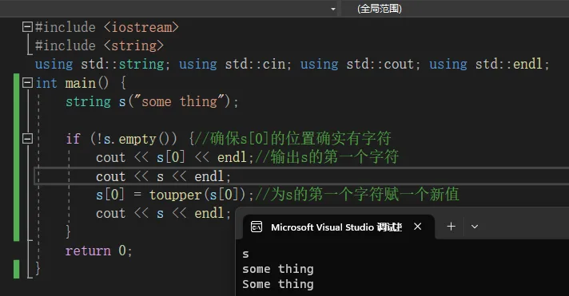

> string对象的下标必须大于等于0而小于s，size()。
>
> <strong style="color:#ff0000;">使用超出此范围的下标将引发不可预知的结果，以此推断，使用下标访问空string也会引发不可预知的结果。</strong>

##### **使用下标执行迭代**

```c++
#include <iostream>
#include <string>
using std::string; using std::cin; using std::cout; using std::endl;
int main() {
	string s("some thing");
	//依次处理S中的字符直至我们处理完全部字符或者遇到一个空白
	for (decltype(s.size()) index = 0;index != s.size() && !isspace(s[index]); ++index)
		s[index] = toupper(s[index]);//将当前字符改成大写形式
	cout << s << endl;
	return 0;
}
```

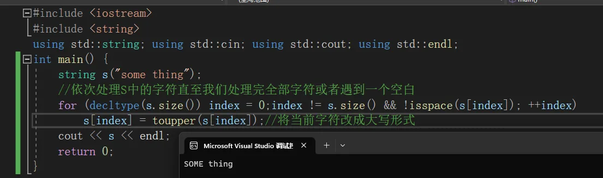


> 1. C++语言规定只有当左侧运算对象为真时才会检查右侧运算对象的情况。
> 2. 使用下标时必须确保其在合理范围之内，也就是说，下标必须大于等于0而小于字符串的size()的值。一种简便易行的方法是，总是设下标的类型为string::size type，因为此类型是无符号数，可以确保下标不会小于0。此时，代码只需保证下标小于size()的值就可以了。
> 3. C++标准并不要求标准库检测下标是否合法。一旦使用了一个超出范围的下标，就会产生不可预知的结果。

##### **使用下标执行随机访问**

```c++
#include <iostream>
#include <string>
using std::string; using std::cin; using std::cout; using std::endl;
int main() {
	const string hexdigits = "0123456789ABCDEF";//可能的十六进制数字
	cout << "请输入0-15之间的数，并用空格隔开。当按下回车键（enter）结束" << endl;
	string result;//用于保存十六进制的字符串
	string::size_type n;//用于保存从输入流读取的数
	while (cin >> n)
		if (n < hexdigits.size())//忽略无效输入
			result += hexdigits[n];//得到对应的十六进制数字
	cout << "16进制的结果为" << result << endl;
	return 0;
}
```

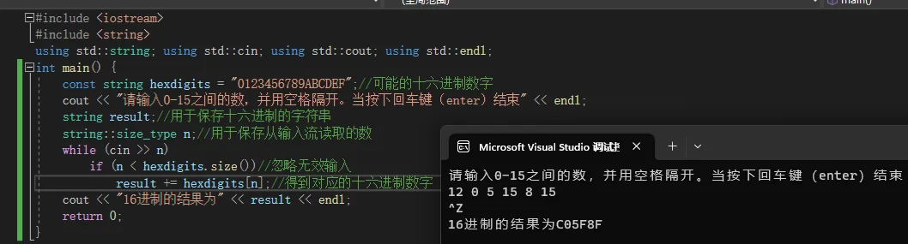

​		无论何时用到字符串的下标，都应该注意检查其合法性。在上面的程序中，下标是string::size_type类型，也就是无符号类型，所以n可以确保大于或等于0。在实际使用时，还需检查n是否小于hexdigits的长度。

### 3.3 标准库类型vector

​			标准库类型vector表示对象的集合，其中所有对象的类型都相同。集合中的每个对象都有一个与之对应的索引，索引用于访问对象。因为vector“容纳着”其他对象，所以它也常被称作容器(container)。

​			C++语言既有类模板(class template)，也有函数模板，其中vector是一个类模板。模板本身不是类或函数，相反可以将模板看作为编译器生成类或函数编写的一份说明。编译器根据模板创建类或函数的过程称为实例化(instantiation)，当使用模板时，需要指出编译器应把类或函数实例化成何种类型。

​			对于类模板来说，我们通过提供一些额外信息来指定模板到底实例化成什么样的类，需要提供哪些信息由模板决定。提供信息的方式总是这样：即在模板名字后面跟一对尖括号，在括号内放上信息。

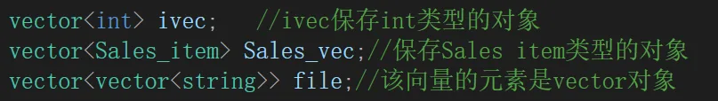

​			vector能容纳绝大多数类型的对象作为其元素，但是因为引用不是对象，所以不存在包含引用的vector。除此之外，其他大多数（非引用）内置类型和类类型都可以构成vector对象，甚至组成vector的元素也可以是vector。

> 1. vector是模板而非类型，由vector生成的类型必须包含vector中元素的类型，例如`vector<int>`。
> 2. 某些编译器可能仍需以老式的声明语句来处理元素为vector的vector对象，如`vector<vector<int> >`。

#### 3.3.1 定义和初始化vector对象

| 方法                          | 解释                                                         |
| ----------------------------- | ------------------------------------------------------------ |
| `vector<T> v1`                | `v1`是一个空`vector`，它潜在的元素是`T`类型的，执行默认初始化 |
| `vector<T> v2(v1)`            | `v2`中包含有`v1`所有元素的副本                               |
| `vector<T> v2 = v1`           | 等价于`v2(v1)`，`v2`中包含`v1`所有元素的副本                 |
| `vector<T> v3(n， val)`       | `v3`包含了n个重复的元素，每个元素的值都是`val`               |
| `vector<T> v4(n)`             | `v4`包含了n个重复地执行了值初始化的对象                      |
| `vector<T> v5{a， b， c...}`  | `v5`包含了初始值个数的元素，每个元素被赋予相应的初始值       |
| `vector<T> v5={a， b， c...}` | 等价于`v5{a， b， c...}`                                     |

​		可以默认初始化vector对象，从而创建一个指定类型的空vector。

​		当然也可以在定义vector对象时指定元素的初始值。

```c++
#include <iostream>
#include <string>
#include <vector>
using std::string; using std::cin; using std::cout; using std::endl; using std::vector;
int main() {

	vector<string> svec;//默认初始化，svec不含任何元素
	cout << svec.size() << endl;
	vector<int> ivec;	//初始状态为空
	cout << svec.size() << endl;
	//在此处给ivec添加一些值
	for (int i = 0; i != 10; ++i)
		ivec.push_back(i);//依次把整数值放到ivec尾端

	for (auto i : ivec)
		cout << i ;
	cout << endl;

	vector<int> ivec2(ivec);//把ivec的元素拷贝给ivec2
	for (auto i : ivec2)
		cout << i;
	cout << endl;

	vector<int> ivec3 = ivec;//把ivec的元素拷贝给ivec3
	for (auto i : ivec3)
		cout << i;
	cout << endl;

	//vector<string> svec(ivec);//错误：svec的元素是string对象，不是int
	return 0;
}
```

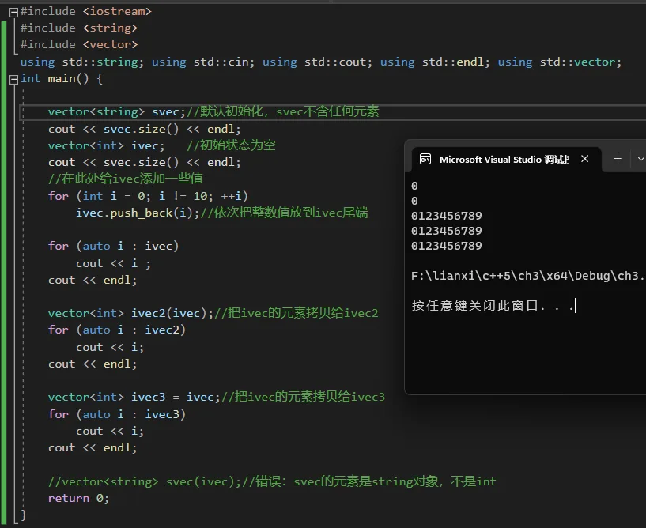

##### **列表初始化vector对象**

​		C++11新标准还提供了另外一种为vector对象的元素赋初值的方法，即列表初始化。

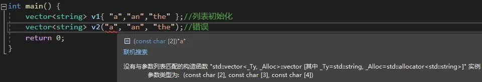

> 之前已经讲过，C++语言提供了几种不同的初始化方式。在大多数情况下这些初始化方式可以相互等价地使用，不过也并非一直如此：
>
> 1. 使用拷贝初始化时（即使用=时），只能提供一个初始值；
> 2. 如果提供的是一个类内初始值，则只能使用拷贝初始化或使用花括号的形式初始化。
> 3. 如果提供的是初始元素值的列表，则只能把初始值都放在花括号里进行列表初始化，而不能放在圆括号里。

##### **创建指定数量的元素**

​				还可以用vector对象容纳的元素数量和所有元素的统一初始值来初始化vector对象。

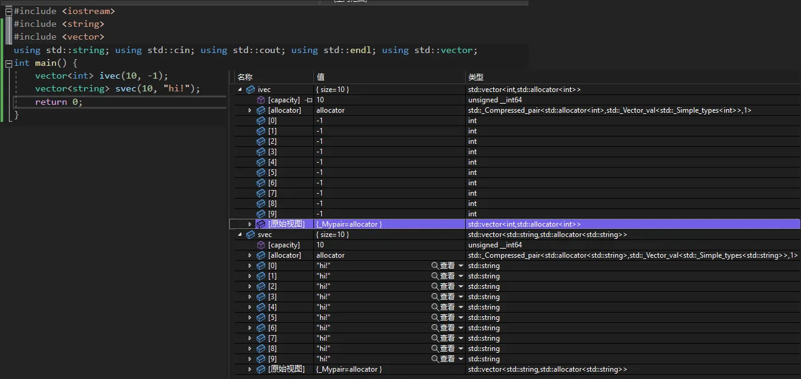

##### **值初始化**

​		通常情况下，可以只提供vector对象容纳的元素数量而不用略去初始值。此时库会创建一个值初始化的(value-initialized)元素初值，并把它赋给容器中的所有元素。这个初值由vector对象中元素的类型决定。如果vector对象的元素是内置类型，比如int，则元素初始值自动设为0。如果元素是某种类类型，比如string，则元素由类默认初始化。

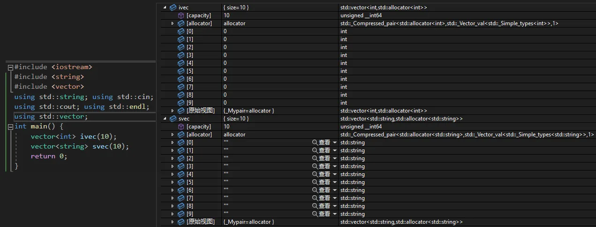

> 对这种初始化的方式有两个特殊限制：
>
> 1. 有些类要求必须明确地提供初始值，如果vector对象中元素的类型不支持默认初始化，我们就必须提供初始的元素值。对这种类型的对象来说，只提供元素的数量而不设定初始值无法完成初始化工作。
> 2. 如果只提供了元素的数量而没有设定初始值，只能使用直接初始化：

##### **列表初始值还是元素数量？**

​			在某些情况下，初始化的真实含义依赖于传递初始值时用的是花括号还是圆括号。

​			如果用的是圆括号，可以说提供的值是用来构造(construct)vector对象的。

​			如果用的是花括号，可以表述成我们想列表初始化(list initialize)该vector对象。也就是说，初始化过程会尽可能地把花括号内的值当成是元素初始值的列表来处理，只有在无法执行列表初始化时才会考虑其他初始化方式。

​			另一方面，如果初始化时使用了花括号的形式但是提供的值又不能用来列表初始化，就要考虑用这样的值来构造vector对象了。

```c++
#include <iostream>
#include <string>
#include <vector>
using std::string; using std::cin; 
using std::cout; using std::endl; 
using std::vector;
int main() {
	vector<int> v1(10);//v1有10个元素，每个的值都是0
	vector<int> v2{ 10 };//v2有1个元素，该元素的值是10
	vector<int> v3(10, 1);//v3有10个元素，每个的值都是1
	vector<int> v4{ 10, 1 };//v4有2个元素，值分别是10和1
	vector<string> v5{ "hi" };//列表初始化：v5有一个元素
	//vector<string> v6("hi");//错误：不能使用字符串字面值构建vector对象
	vector<string> v7{ 10 };//v7有10个默认初始化的元素
	vector<string> v8{ 10,"hi" };//v8有10个值为"hi"的元素
	cout << "v1:" << v1.size() << "v2:" << v2.size() << "v3:" << v3.size() << "v4:" << v4.size() << endl
		<< "v5:" << v5.size() << "v7:" << v7.size() << "v8:" << v8.size() << endl;
	return 0;
}
```

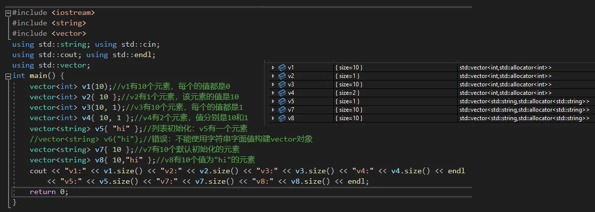

#### 3.3.2 向vector对象中添加元素

​		对vector对象来说，直接初始化的方式适用于三种情况：初始值已知且数量较少、初始值是另一个vector对象的副本、所有元素的初始值都一样。然而更常见的情况是：创建一个vector对象时并不清楚实际所需的元素个数，元素的值也经常无法确定。还有些时候即使元素的初值已知，但如果这些值总量较大而各不相同，那么在创建vector对象的时候执行初始化操作也会显得过于烦琐。

```c++
#include <iostream>
#include <string>
#include <vector>
using std::string; using std::cin; 
using std::cout; using std::endl; 
using std::vector;
int main() {
	vector<int> ivec;//空vector对象
	for (int i = 0; i != 100; ++i)
		ivec.push_back(i);//依次把整数值放到ivec尾端
	//循环结束后v2有100个元素，值从0到99

	for (auto i : ivec)
		cout << i << "\t";
	cout << endl;

	string word;
	vector<string> svec;//空vector对象
	while (cin >> word) {
		svec.push_back(word);//把word添加到svec后面
	}
	for (auto i : svec)
		cout << i;
	cout << endl;
	return 0;
}
```

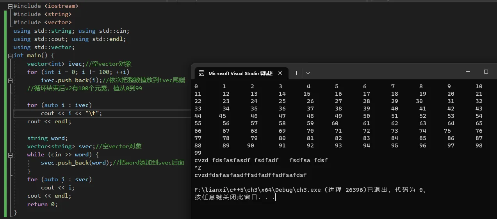

> ​		C++标准要求vector应该能在运行时高效快速地添加元素。因此既然vector对象能高效地增长，那么在定义vector对象的时候设定其大小也就没什么必要了，事实上如果这么做性能可能更差。只有-种例外情况，就是所有(l)元素的值都一样。一旦元素的值有所不同，更有效的办法是先定义一个空的vector对象，再在运行时向其中添加具体值。此外，vector还提供了方法，允许我们进一步提升动态添加元素的性能。
>
> ​		开始的时候创建空的vector对象，在运行时再动态添加元素，这一做法与C语言及其他大多数语言中内置数组类型的用法不同。特别是如果用惯了C或者Java,可以预计在创建vector对象时顺便指定其容量是最好的。然而事实上，通常的情况是恰恰相反。

##### **向vector对象添加元素蕴含的编程假定**

​		由于能高效便捷地向vector对象中添加元素，很多编程工作被极大简化了。然而，这种简便性也伴随着一些对编写程序更高的要求：其中一条就是必须要确保所写的循环正确无误，特别是在循环有可能改变vector对象容量的时候。
​		随着对vector的更多使用，我们还会逐渐了解到其他一些隐含的要求，其中一条是现在就要指出的：如果循环体内部包含有向vector对象添加元素的语句，则不能使用范围for循环。

> 范围for语句体内不应改变其所遍历序列的大小。

#### 3.3.3 其他vector操作

`vector`支持的操作：

| 操作               | 解释                                                         |
| ------------------ | ------------------------------------------------------------ |
| `v.emtpy()`        | 如果`v`不含有任何元素，返回真；否则返回假                    |
| `v.size()`         | 返回`v`中元素的个数                                          |
| `v.push_back(t)`   | 向`v`的尾端添加一个值为`t`的元素                             |
| `v[n]`             | 返回`v`中第`n`个位置上元素的**引用**                         |
| `v1 = v2`          | 用`v2`中的元素拷贝替换`v1`中的元素                           |
| `v1 = {a,b,c...}`  | 用列表中元素的拷贝替换`v1`中的元素                           |
| `v1 == v2`         | `v1`和`v2`相等当且仅当它们的元素数量相同且对应位置的元素值都相同 |
| `v1 != v2`         | 同上                                                         |
| `<`,`<=`,`>`, `>=` | 以字典顺序进行比较                                           |

​		访问vector对象中元素的方法和访问string对象中字符的方法差不多，也是通过元素在vector对象中的位置。

```c++
#include <iostream>
#include <string>
#include <vector>
using std::string; using std::cin; 
using std::cout; using std::endl; 
using std::vector;
int main() {
	vector<int> v{ 1,2,3,4,5,6,7,8,9 };
	for (auto& i : v)//对于v中的每个元素（注意：1是一个引用）
		i *= i;//求元素值的平方
	for (auto i : v)//对于v中的每个元素
		cout << i << "\t";//输出该元素
	cout << endl;
	return 0;
}
```

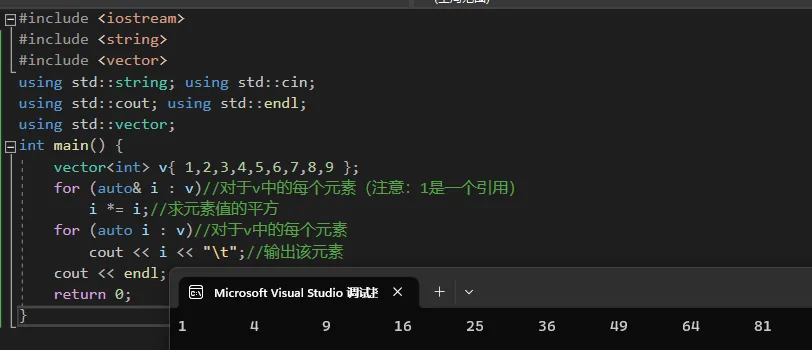

​		vector的empty和size两个成员与string的同名成员功能完全一致：empty检查vector对象是否包含元素然后返回一个布尔值：size则返回vector对象中元素的个数，返回值的类型是由vector定义的size_type类型。

> ​		要使用size type,需首先指定它是由哪种类型定义的。vector对象的类型总是包含着元素的类型：
>
> ```c++
> vector<int>::size type	//正确
> vector::size type		//错误
> ```

##### **计算vector内对象的索引**

​		使用下标运算符能获取到指定的元素。和string一样，vector对象的下标也是从0开始计起，下标的类型是相应的size_type类型。只要vector对象不是一个常量，就能向下标运算符返回的元素赋值。此外，也能通过计算得到vector内对象的索引，然后直接获取索引位置上的元素。

```c++
#include <iostream>
#include <string>
#include <vector>
using std::string; using std::cin; 
using std::cout; using std::endl; 
using std::vector;
int main() {
	//以10分为一个分数段统计成绩的数量：0~9,10~19，...，90~99,100
	vector<int> score(11, 0);//11个分数段，全都初始化为0
	unsigned grade;
	while (cin >> grade)//读取成绩
	{
		if (grade <= 100)//只处理有效的成绩
			++score[grade / 10];//将对应分数段的计数值加1
	}
	for (auto i : score)
		cout << i << " ";
	cout << endl;
	return 0;
}
```

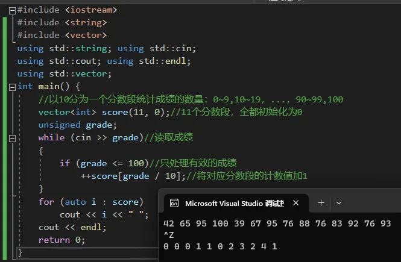

> ```c++
> ++score[grade / 10];//将对应分数段的计数值加1
> ```
>
> 等价于
>
> ```c++
> auto ind = grade / 10;//得到分数段索引
> score[ind] = score[ind] + 1;//将计数值加1
> ```
>
> 

##### **不能用下标形式添加元素**

​		空vector根本不包含任何元素，不能通过下标去访问任何元素！

> ​		vector对象（以及string对象）的下标运算符可用于访问已存在的元素，而不能用于添加元素。
>
> ​		关于下标必须明确的一点是：只能对确知已存在的元素执行下标操作。
>
> ```c++
> vector<int>ivec;//空vector对象
> cout << ivec[0];//错误：ivec不包含任何元素
> vector<int>ivec2(10);//含有10个元素的vector对象
> cout << ivec2[10];//错误：ivec2元素的合法索引是从0到9
> ```
>
> ​		试图用下标的形式去访问一个不存在的元素将引发错误，不过这种错误不会被编译器发现，而是在运行时产生一个不可预知的值。不幸的是，这种通过下标访问不存在的元素的行为非常常见，而且会产生很严重的后果。所谓的缓冲区溢出(buffer overflow)指的就是这类错误，这也是导致PC及其他设备上应用程序出现安全问题的一个重要原因。
>
> 		<strong style="color:#ff0000;">确保下标合法的一种有效手段就是尽可能使用范围for语句。</strong>

### 3.4 迭代器介绍

​		我们已经知道可以使用下标运算符来访问string对象的字符或vector对象的元素，还有另外一种更通用的机制也可以实现同样的目的，这就是迭代器(iterator)。所有标准库容器都可以使用迭代器，但是其中只有少数几种才同时支持下标运算符。严格来说，string对象不属于容器类型，但是string支持很多与容器类型类似的操作。vector支持下标运算符，这点和string一样：string支持迭代器，这也和vector是一样的。

​		类似于指针类型，迭代器也提供了对对象的间接访问。就迭代器而言，其对象是容器中的元素或者string对象中的字符。使用迭代器可以访问某个元素，迭代器也能从一个元素移动到另外一个元素。迭代器有有效和无效之分，这一点和指针差不多。有效的迭代器或者指向某个元素，或者指向容器中尾元素的下一位置：其他所有情况都属于无效。

#### 3.4.1 使用迭代器

​		和指针不一样的是，获取迭代器不是使用取地址符，有迭代器的类型同时拥有返回迭代器的成员。比如，这些类型都拥有名为begin和end的成员，其中begin成员负责返回指向第一个元素（或第一个字符）的迭代器。

```c++
//由编译器决定b和e的类型
//b表示v的第一个元素，e表示v尾元素的下一位置
auto b = v.begin(), e = v.end();//b和e的类型相同
```

> 如果容器为空，则begin和end返回的是同一个迭代器，都是尾后迭代器。

##### **迭代器运算符**

​		如果两个迭代器指向的元素相同或者都是同一个容器的尾后迭代器，则它们相等；否则就说这两个迭代器不相等。

| 运算符           | 解释                                                         |
| ---------------- | ------------------------------------------------------------ |
| `*iter`          | 返回迭代器`iter`所指向的**元素的引用**                       |
| `iter->mem`      | 解引用`iter`并获取该元素的名为`mem`的成员，等价于`(*iter).mem` |
| `++iter`         | 令`iter`指示容器中的下一个元素                               |
| `--iter`         | 令`iter`指示容器中的上一个元素                               |
| `iter1 == iter2` | 判断两个迭代器是否相等                                       |

​		和指针类似，也能通过解引用迭代器来获取它所指示的元素，执行解引用的迭代器必须合法并确实指示着某个元素。试图解引用一个非法迭代器或者尾后迭代器都是未被定义的行为。

```c++
#include <iostream>
#include <string>
#include <vector>
using std::string; using std::cin; 
using std::cout; using std::endl; 
using std::vector;
int main() {
	string s("some thing");
	if (s.begin() != s.end()) {//确保s非空
		auto it = s.begin();//it表示s的第一个字符
		*it = toupper(*it);//将当前字符改成大写形式
	}
	cout << s << endl;
	return 0;
}
```

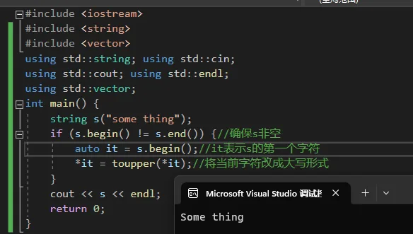

##### **将迭代器从一个元素移动到另外一个元素**

​		迭代器的递增和整数的递增类似，整数的递增是在整数值上“加1”，迭代器的递增则是将迭代器“向前移动一个位置”。

> 因为end返回的迭代器并不实际指示某个元素，所以不能对其进行递增或解引用的操作。

```c++
#include <iostream>
#include <string>
#include <vector>
using std::string; using std::cin; 
using std::cout; using std::endl; 
using std::vector;
int main() {
	string s("some thing");
	//依次处理s的字符直至我们处理完全部字符或者遇到空白
	for (auto it = s.begin(); it != s.end() && !isspace(*it); ++it)
		*it = toupper(*it);//将当前字符改成大写形式
	cout << s << endl;
	return 0;
}
```

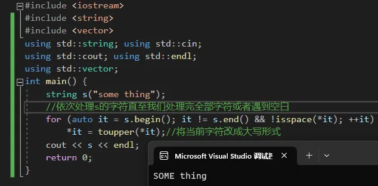

> 关键概念：泛型编程
> 		原来使用C或Java的程序员在转而使用C++语言之后，会对for循环中使用!=而非<进行判断有点儿奇怪，比如上面的这个程序以及85页的那个。C+程序员习惯性地使用!=，其原因和他们更愿意使用迭代器而非下标的原因一样：因为这种编程风格在标准库提供的所有容器上都有效。
> 		之前已经说过，只有string和vector等一些标准库类型有下标运算符，而并非全都如此。与之类似，所有标准库容器的迭代器都定义了==和!=，但是它们中的大多数都没有定义<运算符。因此，只要我们养成使用迭代器和!=的习惯，就不用太在意用的到底是哪种容器类型。

##### **迭代器类型**

​		拥有迭代器的标准库类型使用iterator和const_iterator来表示迭代器的类型.

```c++
vector<int>::iterator it;//it能读写vector<int>的元素
string::iterator it2;//it2能读写string对象中的字符
vector<int>::const_iterator it3;//it3只能读元素，不能写元素
string::const_iterator it4;//it4只能读字符，不能写字符
```

> ​		迭代器这个名词有三种不同的含义：可能是迭代器概念本身，也可能是指容器定义的迭代器类型，还可能是指某个迭代器对象。
> ​		重点是理解存在一组概念上相关的类型，我们认定某个类型是迭代器当且仅当它支持一套操作，这套操作使得我们能访问容器的元素或者从某个元素移动到另外一个元素。
> ​		每个容器类定义了一个名为iterator的类型，该类型支持迭代器概念所规定的套操作。

##### **begin和end运算符**

​		begin和end返回的具体类型由对象是否是常量决定。

```c++
vector<int> v;
const vector<int>cv;
auto it1 = v.begin();//itl的类型是vector<int>::iterator
auto it2 = cv.begin();//it2的类型是vector<int>::const_iterator
```

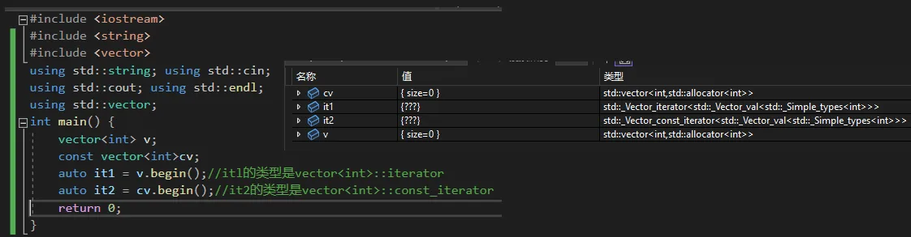

​		有时，对象只需读操作而无须写操作，C++新标准引入了两个新函数，分别是cbegin和cend，类似于begin和end,上述两个新函数也分别返回指示容器第一个元素或最后元素下一位置的迭代器。有所不同的是，不论vector对象（或string对象）本身是否是常量，返回值都是const_iterator。

```c++
auto it3 = v.cbegin();//it3的类型是vector<int>::const_iterator
```

##### **结合解引用和成员访问操作**

​		解引用迭代器可获得迭代器所指的对象，如果该对象的类型恰好是类，就有可能希望进一步访问它的成员。代码如下：

```c++
(*it).empty()
```

​		注意，`(*it).empty()`中的圆括号必不可少，该表达式的含义是先对it解引用，然后解引用的结果再执行点运算符。如果不加圆括号，点运算符将由it来执行，而非it解引用的结果：

```c++
(*it).empty();//解引用it,然后调用结果对象的empty成员
*it.empty();//错误：试图访问it的名为empty的成员，但it是个迭代器，没有empty成员
```

​		为了简化上述表达式，C++语言定义了箭头运算符(->)。箭头运算符把解引用和成员访问两个操作结合在一起，也就是说，`it->mem`和`(*it).mem`表达的意思相同。

```c++
#include <iostream>
#include <string>
#include <vector>
using std::string; using std::cin; 
using std::cout; using std::endl; 
using std::vector;
int main() {
	vector<string> text;     

	string s;
	while (getline(cin, s))  
		text.push_back(s);   
	cout << "文本大小: " << text.size() << endl;
	//依次输出text的每一行直至遇到第一个空白行为止
	for (auto it = text.cbegin();
		it != text.cend() && !(*it).empty(); ++it)
		cout << *it << endl;
	//依次输出text的每一行直至遇到第一个空白行为止
	for (auto it = text.cbegin();
		it != text.cend() && !it->empty(); ++it)
		cout << *it << endl;
	return 0;
}
```

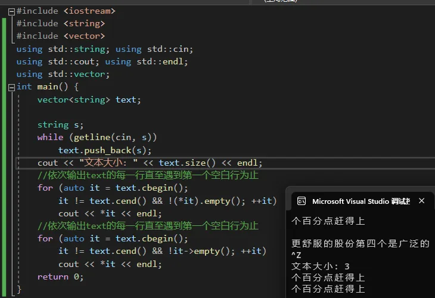

##### **某些对vector对象的操作会使迭代器失效**

​			虽然vector对象可以动态地增长，但是也会有一些副作用。已知的一个限制是不能在范围for循环中向vector对象添加元素。另外一个限制是任何一种可能改变vector对象容量的操作，比如push_back,都会使该vector对象的迭代器失效。

> 谨记，但凡是使用了迭代器的循环体，都不要向迭代器所属的容器添加元素。

#### 3.4.2 迭代器运算

`vector`和`string`迭代器支持的运算：

| 运算符               | 解释                                                         |
| -------------------- | ------------------------------------------------------------ |
| `iter + n`           | 迭代器加上一个整数值仍得到一个迭代器，迭代器指示的新位置和原来相比向前移动了若干个元素。结果迭代器或者指示容器内的一个元素，或者指示容器尾元素的下一位置。 |
| `iter - n`           | 迭代器减去一个整数仍得到一个迭代器，迭代器指示的新位置比原来向后移动了若干个元素。结果迭代器或者指向容器内的一个元素，或者指示容器尾元素的下一位置。 |
| `iter1 += n`         | 迭代器加法的复合赋值语句，将`iter1`加n的结果赋给`iter1`      |
| `iter1 -= n`         | 迭代器减法的复合赋值语句，将`iter2`减n的加过赋给`iter1`      |
| `iter1 - iter2`      | 两个迭代器相减的结果是它们之间的距离，也就是说，将运算符右侧的迭代器向前移动差值个元素后得到左侧的迭代器。参与运算的两个迭代器必须指向的是同一个容器中的元素或者尾元素的下一位置。 |
| `>`、`>=`、`<`、`<=` | 迭代器的关系运算符，如果某迭代器                             |

##### **迭代器的算术运算**

​		可以令迭代器和一个整数值相加（或相减），其返回值是向前（或向后）移动了若干个位置的迭代器。执行这样的操作时，结果迭代器或者指示原vector对象（或string对象)内的一个元素，或者指示原vector对象（或string对象）尾元素的下一位置。

​		对于string或vector的迭代器来说，除了判断是否相等，还能使用关系运算符(<、<=、>、>=)对其进行比较。参与比较的两个迭代器必须合法而且指向的是同一个容器的元素（或者尾元素的下一位置）。

​		只要两个迭代器指向的是同一个容器中的元素或者尾元素的下一位置，就能将其相减，所得结果是两个迭代器的距离。所谓距离指的是右侧的迭代器向前移动多少位置就能追上左侧的迭代器，其类型是名为difference_type的带符号整型数。string和vector都定义了difference_type,因为这个距离可正可负，所以difference_type是带符号类型的。

##### **使用迭代器运算**

​		使用迭代器运算的一个经典算法是二分搜索。

```c++
#include <iostream>
#include <string>
#include <vector>
using std::string; using std::cin; 
using std::cout; using std::endl; 
using std::vector;
int main() {
	vector<int> v = { 1,2,3,4,5,6,7,8,9 };	//v必须是有序的
	int sought = 2;
	auto beg = v.begin(), end = v.end();	//beg和end表示我们搜索的范围
	auto mid = v.begin() + (end - beg) / 2;	//初始状态下的中间点
	while (mid != end && *mid != sought) {
		if (sought < *mid)	//我们要找的元素在前半部分吗？
			end = mid;		//如果是，调整搜索范围使得忽略掉后半部分
		else				//我们要找的元素在后半部分
			beg = mid + 1;	//在mid之后寻找
		mid = beg + (end - beg) / 2;
	}
	if (sought == *mid)
		cout << "找到了" << endl;
	else
		cout << "找不到" << endl;

	return 0;
}
```

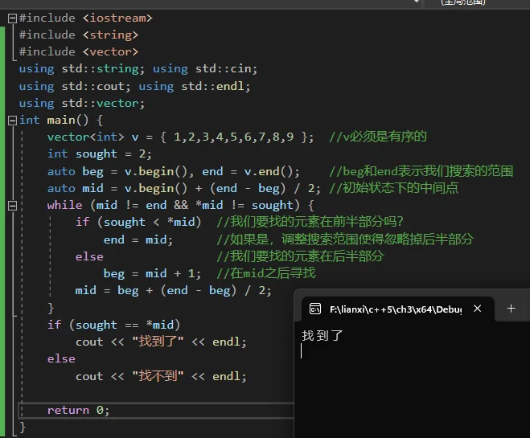

### 3.5 数组

​		数组是一种类似于标准库类型vector的数据结构，但是在性能和灵活性的权衡上又与vector有所不同。与vector相似的地方是，数组也是存放类型相同的对象的容器，这些对象本身没有名字，需要通过其所在位置访问。与vector不同的地方是，数组的大小确定不变，不能随意向数组中增加元素。**因为数组的大小固定，因此对某些特殊的应用来说程序的运行时性能较好，但是相应地也损失了一些灵活性。**

> 如果不请楚元素的确切个数，请使用vector。

#### 3.5.1 定义和初始化内置数组

​		数组是一种复合类型。数组的声明形如a[d],其中a是数组的名字，d是数组的维度。维度说明了数组中元素的个数，因此必须大于0。数组中元素的个数也属于数组类型的一部分，编译的时候维度应该是已知的。也就是说，维度必须是一个常量表达式。

```c++
unsigned cnt = 42;//不是常量表达式
constexpr unsigned sz = 42;//常量表达式
int arr[10];//含有10个整数的数组
int* parr[sz];//含有42个整型指针的数组
string bad[cnt];//错误：cnt不是常量表达式
string strs[get_size()];//当get size是constexpr时正确；否则错误
```

> 和内置类型的变量一样，如果在函数内部定义了某种内置类型的数组，那么默认初始化会令数组含有未定义的值。

##### **显示初始化数组元素**

​		可以对数组的元素进行列表初始化，此时允许忽略数组的维度。如果在声明时没有指明维度，编译器会根据初始值的数量计算并推测出来：相反，如果指明了维度，那么初始值的总数量不应该超出指定的大小。

```c++
#include <iostream>
#include <string>
#include <vector>
using std::string; using std::cin; 
using std::cout; using std::endl; 
using std::vector;
int main() {
	const unsigned sz = 3;
	int a1[sz] = { 0,1,2 };//含有3个元素的数组，元素值分别是0,1,2
	int a2[] = { 0,1,2 };//维度是3的数组
	int a3[5] = { 0,1,2 };//等价于a3[]={0,1,2,0,0)
	string a4[3] = { "hi","bye" };// 等价于a4[] = { "hi","bye","")
	//int a5[2] = { 0,1,2 };	//错误：初始值过多
	return 0;
}
```

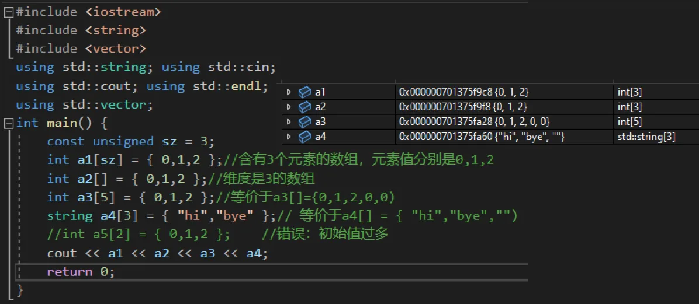

##### **字符数组的特殊性**

​		字符数组有一种额外的初始化形式，我们可以用字符串字面值对此类数组初始化。当使用这种方式时，一定要注意字符串字面值的结尾处还有一个空字符，这个空字符也会像字符串的其他字符一样被拷贝到字符数组中去。

```c++
#include <iostream>
#include <string>
#include <vector>
using std::string; using std::cin; 
using std::cout; using std::endl; 
using std::vector;
int main() {
	char a1[] = { 'c','+','+' };//列表初始化，没有空字符
	char a2[] = { 'c','+','+' ,'\0' };//列表初始化，含有显式的空字符
	char a3[] = "c++";//自动添加表示字符串结束的空字符
	//const char a4[6] = "Daniel";//错误：没有空间可存放空字符！
	return 0;
}
```

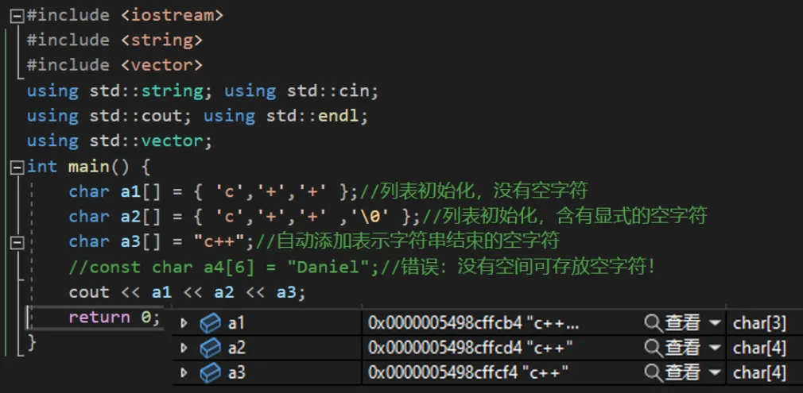

##### **不允许拷贝和赋值**

​		不能将数组的内容拷贝给其他数组作为其初始值，也不能用数组为其他数组赋值：

```c++
int a[] = { 0,1,2 };//含有3个整数的数组
int a2[] = a;//错误：不允许使用一个数组初始化另一个数组
a2 = a1;//错误：不能把一个数组直接赋值给另一个数组
```

> ​		一些编译器支持数组的赋值，这就是所谓的编译器扩展(compiler extension)。但一般来说，最好避免使用非标准特性，因为含有非标准特性的程序很可能在其他编译器上无法正常工作。

##### **理解复杂的数组声明**

​		和vector一样，数组能存放大多数类型的对象。又因为数组本身就是对象，所以允许定义数组的指针及数组的引用。在这几种情况中，定义存放指针的数组比较简单和直接，但是定义数组的指针或数组的引用就稍微复杂一点了。

```c++
int* ptrs[10];	//ptrs是含有10个整型指针的数组
int& refs[10];	//错误：不存在引用的数组
int (*Parray)[10] = &arr;	//Parray指向一个含有10个整数的数组
int(&arrRef)[10] = arr		//arrRef引用一个含有I0个整数的数组
```

> 要想理解数组声明的含义，最好的办法是从数组的名字开始按照由内向外的顺序阅读。

#### 3.5.2 访问数组元素

​		与标准库类型vector和string一样，数组的元素也能使用范围for语句或下标运算符来访问。
​		在使用数组下标的时候，通常将其定义为`size_t`类型。`size_t`是一种机器相关的无符号类型，它被设计得足够大以便能表示内存中任意对象的大小。在`cstddef`头文件中定义了`size_t`类型，这个文件是C标准库stddef.h头文件的C++语言版本。

```c++
#include <iostream>
#include <string>
#include <vector>
using std::string; using std::cin; 
using std::cout; using std::endl; 
using std::vector;
int main() {
	//以10分为一个分数段统计成绩的数量：0~9,10~19，...，90~99,100
	unsigned scores[11] = {};//11个分数段，全都初始化为0
	unsigned grade;
	while (cin >> grade)//读取成绩
	{
		if (grade <= 100)//只处理有效的成绩
			++scores[grade / 10];//将对应分数段的计数值加1
	}
	for (size_t i = 0; i < 11; i++)
	{
		cout << scores[i] << " ";
	}
	return 0;
}
```

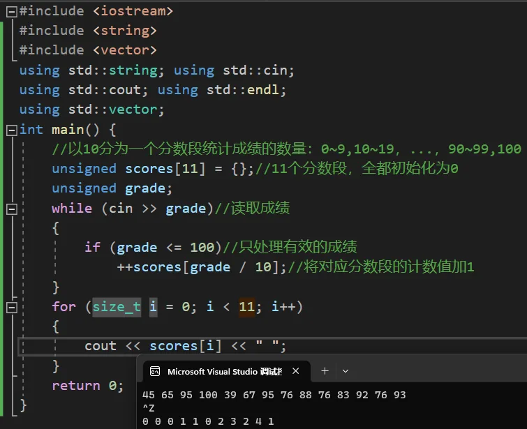

##### **检查下标的值**

​		与vector和string一样，数组的下标是否在合理范围之内由程序员负责检查，所谓合理就是说下标应该大于等于0而且小于数组的大小。要想防止数组下标越界，除了小心谨慎注意细节以及对代码进行彻底的测试之外，没有其他好办法。对于一个程序来说，即使顺利通过编译并执行，也不能肯定它不包含此类致命的错误。

> 大多数常见的安全问题都源于缓冲区溢出错误。当数组或其他类似数据结构的下标越界并试图访问非法内存区域时，就会产生此类错误。

#### 3.5.3 指针和数组

​		在C++语言中，指针和数组有非常紧密的联系。就如即将介绍的，使用数组的时候编译器一般会把它转换成指针。
​		通常情况下，使用取地址符来获取指向某个对象的指针，取地址符可以用于任何对象。数组的元素也是对象，对数组使用下标运算符得到该数组指定位置的元素。因此像其他对象一样，对数组的元素使用取地址符就能得到指向该元素的指针。

```c++
#include <iostream>
#include <string>
#include <vector>
using std::string; using std::cin; 
using std::cout; using std::endl; 
using std::vector;
int main() {
	string nums[] = { "one","two","three" };//数组的元素是string对象
	string* p = &nums[0];//p指向nums的第一个元素
	cout << nums << endl;
	cout << *p << endl;
	cout << p << endl;
	return 0;
}
```

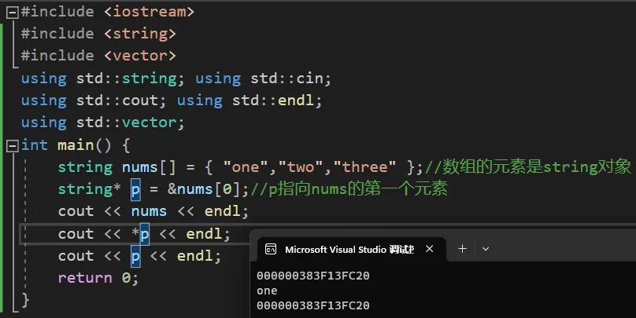

> 在大多数表达式中，使用数组类型的对象其实是使用一个指向该数组首元素的指针。

​		由上可知，在一些情况下数组的操作实际上是指针的操作，这一结论有很多隐含的意思。其中一层意思是当使用数组作为一个auto变量的初始值时，推断得到的类型是指针而非数组。但当使用decltype关键字时上述转换不会发生。

```c++
int ia[] = { 0,1,2,3,4,5,6,7,8,9 };//ia是一个含有10个整数的数组
auto ia2(ia);//ia2是一个整型指针，指向ia的第一个元素,类似于auto ia2(&ia[0]);
ia2 = 42;//错误：ia2是一个指针，不能用int值给指针赋值
decltype(ia) ia3= { 0,1,2,3,4,5,6,7,8,9 };//ia3是一个含有10个整数的数组
ia3 = p;//错误：不能用整型指针给数组赋值
ia3[4] = i;//正确：把i的值赋给ia3的一个元素
```

##### **指针迭代器**

​		指向数组元素的指针拥有更多功能。vector和string的迭代器支持的运算，数组的指针全都支持。就像使用迭代器遍历vector对象中的元素一样，使用指针也能遍历数组中的元素。当然，这样做的前提是先得获取到指向数组第一个元素的指针和指向数组尾元素的下一位置的指针。之前已经介绍过，通过数组名字或者数组中首元素的地址都能得到指向首元素的指针：不过获取尾后指针就要用到数组的另外一个特殊性质了。我们可以设法获取数组尾元素之后的那个并不存在的元素的地址。就像尾后迭代器一样，尾后指针也不指向具体的元素。因此，不能对尾后指针执行解引用或递增的操作。

```c++
#include <iostream>
#include <string>
#include <vector>
using std::string; using std::cin; 
using std::cout; using std::endl; 
using std::vector;
int main() {
	int arr[] = { 0,1,2,3,4,5,6,7,8,9 };
	int* p = arr;
	cout << *p << endl;//p指向arr的第一个元素
	++p;
	cout << *p << endl;//p指向arr[1]
	int* e = &arr[10];
	cout << *e << endl;//指向arr尾元素的下一位置的指针
	for (int* b = arr; b != e; ++b)
		cout << *b << " ";//输出arr的元素
	return 0;
}
```

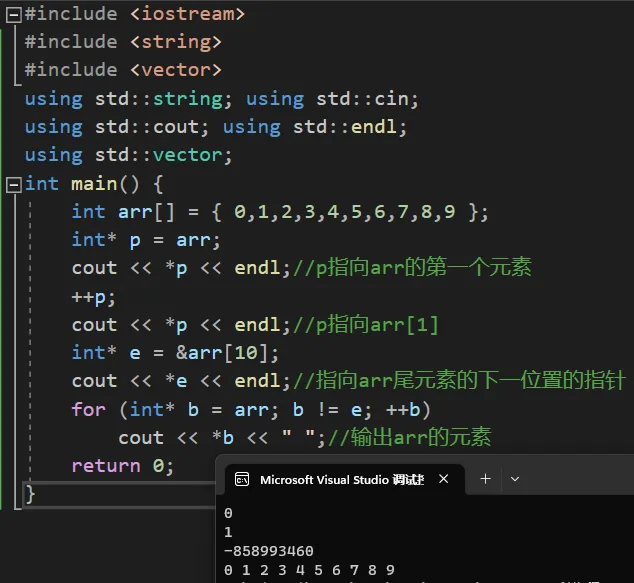

##### **标准函数begin和end**

​		尽管能计算得到尾后指针，但这种用法极易出错。为了让指针的使用更简单、更安全，c++新标准引入了两个名为begin和end的函数。这两个函数与容器中的两个同名成员功能类似，不过数组毕竟不是类类型，因此这两个函数不是成员函数。正确的使用形式是将数组作为它们的参数。

```c++
#include <iostream>
#include <string>
#include <vector>
using std::string; using std::cin; using std::cout; 
using std::endl; using std::vector; using std::begin;
using std::end;
int main() {
	int ia[] = { 0,1,-2,3,4,5,6,7,8,9 };//ia是一个含有10个整数的数组
	int* beg = begin(ia);//指向ia首元素的指针
	cout << *beg << endl;
	int* last = end(ia);//指向arr尾元素的下一位置的指针
	cout << *last << endl;
	//寻找第一个负值元素，如果已经检查完全部元素则结束循环
	while (beg != last && *beg >= 0)
		++beg;
	if (beg == last)
		cout << "没有负数" << endl;
	else
		cout << *beg << endl;
	return 0;
}
```

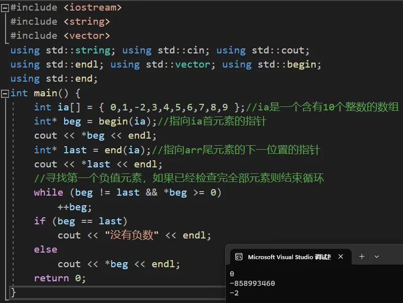

> 一个指针如果指向了某种内置类型数组的尾元素的“下一位置”，则其具备与vector的end函数返回的与迭代器类似的功能。特别要注意，尾后指针不能执行解引用和递增操作。

##### **指针运算**

​		指向数组元素的指针可以执行几乎所有迭代器运算。这些运算，包括解引用、递增、比较、与整数相加、两个指针相减等，用在指针和用在迭代器上意义完全一致。

​		给（从）一个指针加上（减去）某整数值，结果仍是指针。新指针指向的元素与原来的指针相比前进了（后退了）该整数值个位置。给指针加上一个整数，得到的新指针仍需指向同一数组的其他元素，或者指向同一数组的尾元素的下一位置。

​		和迭代器一样，两个指针相减的结果是它们之间的距离。参与运算的两个指针必须指向同一个数组当中的元素。两个指针相减的结果的类型是一种名为`ptrdiff_t`的标准库类型，和`size_t`一样，`ptrdiff_t`也是一种定义在`cstddef`头文件中的机器相关的类型。因为差值可能为负值，所以`ptrdiff_t`是一种带符号类型。

​		只要两个指针指向同一个数组的元素，或者指向该数组的尾元素的下一位置，就能利用关系运算符对其进行比较。

```c++
#include <iostream>
#include <string>
#include <vector>
using std::string; using std::cin; using std::cout; 
using std::endl; using std::vector; using std::begin;
using std::end;
int main() {
	constexpr size_t sz = 5; int arr[sz] = { 1,2,3,4,5 };
	int* ip = arr; 	cout << "*ip\t" << *ip << endl;//等价于int*ip=&arr[0]
	int* ip2 = ip + 4;	cout << "*ip2\t" << *ip2 << endl;//ip2指向arr的尾元素arr[4]

	//正确：arr转换成指向它首元素的指针；p指向arr尾元素的下一位置
	int* p = arr + sz;	cout << "*p\t" << *p << endl;//使用警告：不要解引用！
	int* p2 = arr + 10;	cout << "*p2\t" << *p2 << endl;//错误：arr只有5个元素，p2的值未定义

	auto n = end(arr) - begin(arr);	cout << "n\t" << n << endl;//n的值是5，也就是arr中元素的数量

	int* b = arr, * e = arr + sz;
	while (b < e) {//遍历数组中的元素
		cout << "*b\t" << *b << endl;
		++b;
	}

	int i = 0, si = 42; int* ipi = &i, * iei = &si;
	cout << "ipi < iei\t" << (ipi < iei) << endl;//未定义的：p和e无关，因此比较毫无意义！
	return 0;
}
```

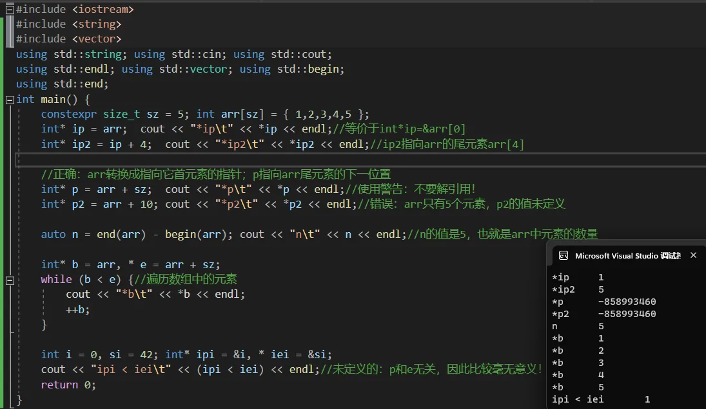

##### **解引用和指针运算的交互**

​		指针加上一个整数所得的结果还是一个指针。假设结果指针指向了一个元素，则允许解引用该结果指针。

```c++
#include <iostream>
#include <string>
#include <vector>
using std::string; using std::cin; using std::cout; 
using std::endl; using std::vector; using std::begin;
using std::end;
int main() {
	int ia[] = { 0,2,4,6,8 };//含有5个整数的数组
	int last = *(ia + 4);//正确：把last初始化成8，也就是ia[4]的值。ia前进4个元素后的新地址。
	cout << last << endl;
	int last1 = *ia + 4;//正确：last1=4等价于ia[0]+4。此时先解引用ia,然后给解引用的结果再加上4。
	cout << last1 << endl;
	return 0;
}
```

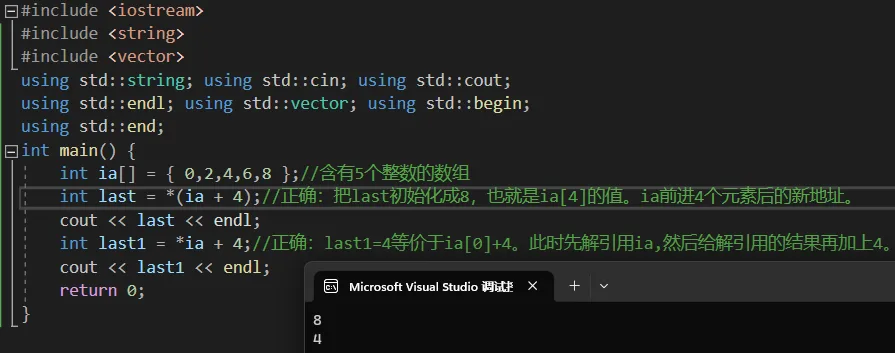

##### **下标和指针**

​		在很多情况下使用数组的名字其实用的是一个指向数组首元素的指针。一个典型的例子是当对数组使用下标运算符时，编译器会自动执行上述转换操作。只要指针指向的是数组中的元素（或者数组中尾元素的下一位置），都可以执行下标运算。

```c++
#include <iostream>
#include <string>
#include <vector>
using std::string; using std::cin; using std::cout; 
using std::endl; using std::vector; using std::begin;
using std::end;
int main() {
	int ia[] = { 0,2,4,6,8 };//含有5个整数的数组
	int i = ia[2]; cout << "i\t" << i << endl;//ia转换成指向数组首元素的指针，ia[2]得到(ia+2)所指的元素。
	int* p = ia; cout << "* p\t" << *p << endl;//p指向ia的首元素
	i = *(p + 2); cout << "i\t" << i << endl;//等价于i=ia[2]
	int* p1 = &ia[2]; cout << "* p1\t" << *p1 << endl;//p指向索引为2的元素
	int j = p1[1]; cout << "j\t" << j << endl;//p[1]等价于*(p+1),就是ia[3]表示的那个元素
	int k = p1[-2]; cout << "k \t" << k << endl;//p[-2]是ia[0]表示的那个元素
	return 0;
}
```

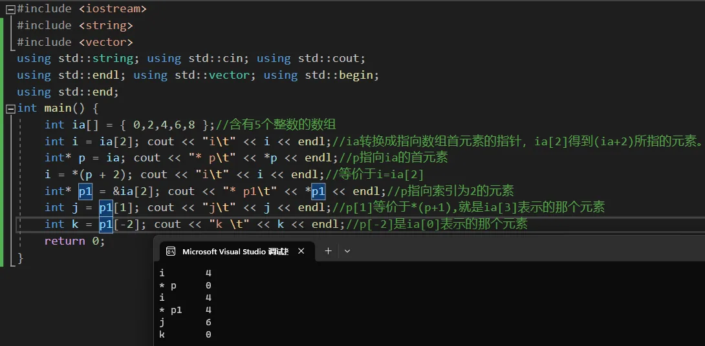

​		虽然标准库类型string和vector也能执行下标运算，但是数组与它们相比还是有所不同。标准库类型限定使用的下标必须是无符号类型，而内置的下标运算无此要求，上面的最后一个例子很好地说明了这一点。内置的下标运算符可以处理负值，当然，结果地址必须指向原来的指针所指同一数组中的元素（或是同一数组尾元素的下一位置）。

> ​		内置的下标运算符所用的索引值不是无符号类型，这一点与vector和string不一样。

#### 3.5.4 C风格字符串

> ​		尽管C++支持C风格字符串，但在C++程序中最好还是不要使用它们。这是因为C风格字符串不仅使用起来不太方便，而且极易引发程序漏洞，是诸多安全问题的根本原因。

​		字符串字面值是一种通用结构的实例，这种结构即是C++由C继承而来的C风格字符串(C-style character string)。C风格字符串不是一种类型，而是为了表达和使用字符串而形成的一种约定俗成的写法。按此习惯书写的字符串存放在字符数组中并以空字符结束(lterminated)。以空字符结束的意思是在字符串最后一个字符后面跟着一个空字符('\0')。般利用指针来操作这些字符串。

##### **C标准库String函数**

C标准库String函数，定义在`<cstring>` 中：

| 函数             | 介绍                                                         |
| ---------------- | ------------------------------------------------------------ |
| `strlen(p)`      | 返回`p`的长度，空字符不计算在内                              |
| `strcmp(p1, p2)` | 比较`p1`和`p2`的相等性。如果`p1==p2`，返回0；如果`p1>p2`，返回一个正值；如果`p1<p2`，返回一个负值。 |
| `strcat(p1, p2)` | 将`p2`附加到`p1`之后，返回`p1`                               |
| `strcpy(p1, p2)` | 将`p2`拷贝给`p1`，返回`p1`                                   |

**传入此类函数的指针必须指向以空字符作为结束的数组**

```c++
#include <iostream>
#include <string>
#include <vector>
using std::string; using std::cin; using std::cout; 
using std::endl; using std::vector; using std::begin;
using std::end;
int main() {
	char ca[] = { 'c', '+', '+'};//不以空字符结束
	cout << strlen(ca) << endl;//严重错误：ca没有以空字符结束，故长度错误
	return 0;
}
```

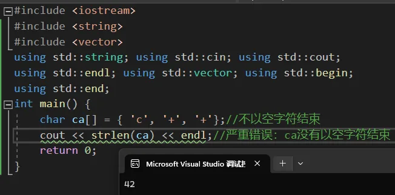

##### **比较字符串**

```c++
#include <iostream>
#include <string>
#include <vector>
using std::string; using std::cin; using std::cout; 
using std::endl; using std::vector; using std::begin;
using std::end;
int main() {
	string s1 = "A string example";
	string s2 = "A different string";
	cout << (s1 < s2) << endl;//false:s2小于s1
	const char ca1[] = "A string example";
	const char ca2[] = "A different string";
	cout << (ca1 < ca2) << endl;//未定义的：试图比较两个无关地址
	cout << strcmp(ca1, ca2) << endl;//和两个string对象的比较s1<s2效果一样
	return 0;
}
```

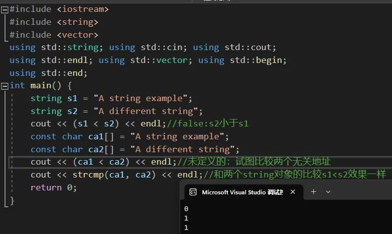

​		如果把标准库运算符用在两个C风格字符串上，实际比较的将是指针而非字符串本身。要想比较两个C风格字符串需要调用`strcmp`函数，此时比较的就不再是指针了。如果两个字符串相等，`strcmp`返回0：如果前面的字符串较大，返回正值；如果后面的字符串较大，返回负值。

##### **目标字符串的大小由调用者指定**

​		连接或拷贝C风格字符串也与标准库string对象的同类操作差别很大。一个潜在的问题是，我们在估算所需的空间时不容易估准，而且所存的内容一旦改变，就必须重新检查其空间是否足够。不幸的是，这样的代码到处都是，程序员根本没法照顾周全。这类代码充满了风险而且经常导致严重的安全泄漏。

```c++
#include <iostream>
#include <string>
#include <vector>
using std::string; using std::cin; using std::cout; 
using std::endl; using std::vector; using std::begin;
using std::end;
int main() {
	string s1 = "A string example";
	string s2 = "A different string";
	string largeStr = s1 + " "+s2;//将largeStr初始化成s1、一个空格和s2的连接
	cout << largeStr << endl;
	const char ca1[] = "A string example";
	const char ca2[] = "A different string";
	char ca3[38]="";//如果我们计算错了ca3的大小将引发严重错误
	strcpy(ca3, ca1);//把ca1拷贝给ca3
	cout << ca3 << endl;
	strcat(ca3, " ");//在ca3的末尾加上一个空格
	cout << ca3 << endl;
	strcat(ca3, ca2);//把ca2连接到largeStr后面
	cout << ca3 << endl;
	return 0;
}
```

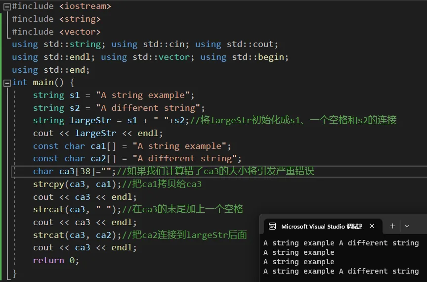

> 对大多数应用来说，使用标准库string要比使用C风格字符串更安全、更高效。

#### 3.5.5 与旧代码的接口

​		很多C++程序在标准库出现之前就已经写成了，它们肯定没用到string和vector类型。而且，有一些C++程序实际上是与C语言或其他语言的接口程序，当然也无法使用C++标准库。因此，现代的C++程序不得不与那些充满了数组和（或）C风格字符串的代码衔接，为了使这一工作简单易行，C++专门提供了一组功能。

##### 混用string对象和C风格字符串

​		c++允许使用字符串字面值来初始化string对象，任何出现字符串字面值的地方都可以用以空字符结束的字符数组来替代：

- 允许使用以空字符结束的字符数组来初始化string对象或为string对象赋值。
- 在string对象的加法运算中允许使用以空字符结束的字符数组作为其中一个运算对象（不能两个运算对象都是）：在string对象的复合赋值运算中允许使用以空字符结束的字符数组作为右侧的运算对象。

​		上述性质反过来就不成立了：如果程序的某处需要一个C风格字符串，无法直接用string对象来代替它。为了完成用string对象直接初始化指向字符的指针，string专门提供了一个名为`c_str`的成员函数。

```c++
#include <iostream>
#include <string>
#include <vector>
using std::string; using std::cin; using std::cout; 
using std::endl; using std::vector; using std::begin;
using std::end;
int main() {
	string s("Hello world");
	cout << "s\t" << s << endl;//s的内容是Hello world
	//char* str = s;//错误：不能用string对象初始化char*
	const char* str = s.c_str();//正确
	cout << "*str\t" << *str << endl;
	cout << "str\t" << str << endl;
	return 0;
}
```

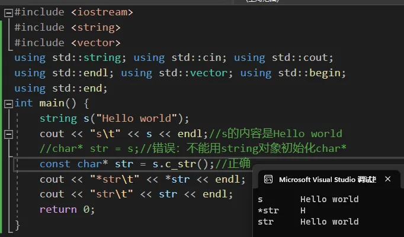

​		顾名思义，`c_str`函数的返回值是一个C风格的字符串。也就是说，函数的返回结果是一个指针，该指针指向一个以空字符结束的字符数组，而这个数组所存的数据恰好与那个string对象的一样。结果指针的类型是const char*,从而确保我们不会改变字符数组的内容。我们无法保证`c_str`函数返回的数组一直有效，事实上，如果后续的操作改变了S的值就可能让之前返回的数组失去效用。

> 如果执行完`c_str`()函数后程序想一直都能使用其返回的数组，最好将该数组重新拷贝一份。

##### 使用数组初始化vector对象

​		c++不允许使用一个数组为另一个内置类型的数组赋初值，也不允许使用vector对象初始化数组。相反的，允许使用数组来初始化vector对象。要实现这一目的，只需指明要拷贝区域的首元素地址和尾后地址就可以了。用于初始化vector对象的值也可能仅是数组的一部分。

```c++
#include <iostream>
#include <string>
#include <vector>
using std::string; using std::cin; using std::cout; 
using std::endl; using std::vector; using std::begin;
using std::end;
int main() {
	int int_arr[] = { 0,1,2,3,4,5 };
	vector<int> ivec(begin(int_arr), end(int_arr));//ivec有6个元素，分别是int_arr中对应元素的副本
	for (auto i :ivec)
		cout << i << " ";
	cout << endl;

	vector<int> subVec(int_arr + 1, int_arr + 4);//拷贝三个元素：int_arr[1]、int_arr[2]、int_arr[3]
	for (auto i : subVec)
		cout << i << " ";
	cout << endl;
	return 0;
}
```

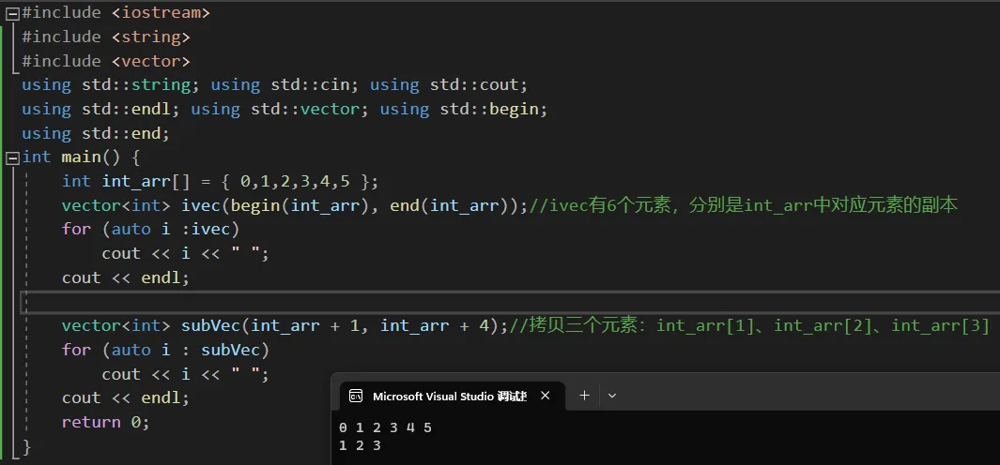

> ​		使用指针和数组很容易出错。一部分原因是概念上的问题：指针常用于底层操作，因此容易引发一些与烦琐细节有关的错误。其他问题则源于语法错误，特别是声明指针时的语法错误。
> ​		现代的C++程序应当尽量使用vector和迭代器，避免使用内置数组和指针；应该尽量使用string,避免使用C风格的基于数组的字符串。

### 3.6 多维数组

​		多维数组其实是数组的数组。当一个数组的元素仍然是数组时，通常使用两个维度来定义它：一个维度表示数组本身大小，另外一个维度表示其元素（也是数组）大小。对于二维数组来说，常把第一个维度称作行，第二个维度称作列。

```c++
#include <iostream>
#include <string>
#include <vector>
using std::string; using std::cin; using std::cout; 
using std::endl; using std::vector; using std::begin;
using std::end;
int main() {
	int ia[3][4];//大小为3的数组，每个元素是含有4个整数的数组
	//大小为10的数组，它的每个元素都是大小为20的数组，这些数组的元素是含有30个整数的数组
	int arr[10][20][30] = { 0 };//将所有元素初始化为0
	return 0;
}
```


##### 多维数组的初始化

​		允许使用花括号括起来的一组值初始化多维数组，这点和普通的数组一样。下面的初始化形式中，多维数组的每一行分别用花括号括了起来。其中内层嵌套着的花括号并非必需的。类似于一维数组，在初始化多维数组时也并非所有元素的值都必须包含在初始化列表之内，其他未列出的元素执行默认值初始化。

```c++
#include <iostream>
#include <string>
#include <vector>
using std::string; using std::cin; using std::cout; 
using std::endl; using std::vector; using std::begin;
using std::end;
int main() {
	int ia[3][4] = { //三个元素，每个元素都是大小为4的数组
		{0,1,2,3},//第1行的初始值
		{4,5,6,7},//第2行的初始值
		{8,9,10,11} //第3行的初始值
	};
	int ia1[3][4] = { 0,1,2,3,4,5,6,7,8,9,10,11 };//没有标识每行的花括号，与之前的初始化语句是等价的
	int ia2[3][4] = { {0},{4},{8} };//显式地初始化每行的首元素
	int ia3[3][4] = { 0,3,6,9 };//显式地初始化第1行，其他元素执行值初始化
	return 0;
}
```

*(原图缺失)*

##### 多维数组的下标引用

​		可以使用下标运算符来访问多维数组的元素，此时数组的每个维度对应一个下标运算符。如果表达式含有的下标运算符数量和数组的维度一样多，该表达式的结果将是给定类型的元素；反之，如果表达式含有的下标运算符数量比数组的维度小，则表达式的结果将是给定索引处的一个内层数组。

```c++
#include <iostream>
#include <string>
#include <vector>
using std::string; using std::cin; using std::cout; 
using std::endl; using std::vector; using std::begin;
using std::end;
int main() {
	int arr[10][20][30] = { 0 };
	int ia[3][4] = { //三个元素，每个元素都是大小为4的数组
			{0,1,2,3},//第1行的初始值
			{4,5,6,7},//第2行的初始值
			{8,9,10,11} //第3行的初始值
	};
	ia[2][3] = arr[0][0][0];//用arr的首元素为ia最后一行的最后一个元素赋值
	cout << ia[2][3] << endl;
	int(&row)[4] = ia[1];//把row绑定到ia的第二个4元素数组上
	cout << row << endl;
	constexpr size_t rowCnt = 3, colCnt = 4;
	int ia1[rowCnt][colCnt];
	for (size_t i = 0; i < rowCnt; i++)
	{
		for (size_t j = 0; j < colCnt; j++)
		{
			ia1[i][j] = i * colCnt + j;
			cout << ia1[i][j] << " ";
		}
		cout << endl;
	}
	return 0;
}
```


##### 使用范围for语句处理多维数组

​		因为要改变数组元素的值，所以我们选用引用类型作为循环控制变量，但其实还有一个深层次的原因促使我们这么做。如果row不是引用类型，编译器初始化row时会自动将这些数组形式的元素（和其他类型的数组一样）转换成指向该数组内首元素的指针。这样得到的row的类型就是`int*`,显然内层的循环就不合法了，编译器将试图在一个`int*`内遍历，这显然和程序的初衷相去甚远。

```c++
#include <iostream>
#include <string>
#include <vector>
using std::string; using std::cin; using std::cout; 
using std::endl; using std::vector; using std::begin;
using std::end;
int main() {
	constexpr size_t rowCnt = 3, colCnt = 4;
	int ia[rowCnt][colCnt];
	size_t cnt = 0, rowc = 0, colc = 0;
	for (auto& row : ia)//对于外层数组的每一个元素
	{
		for (auto& col : row)//对于内层数组的每一个元素
		{
			col = cnt;//将下一个值赋给该元素
			cout << ia[rowc][colc] << " ";
			++cnt;//将cnt加1
			colc++;
		}
		cout << endl;
		rowc++;
		colc = 0;
	}
	return 0;
}
```


> ​		要使用范围for语句处理多维数组，除了最内层的循环外，其他所有循环的控制变量都应该是引用类型。

##### **指针和多维数组**

​		当程序使用多维数组的名字时，也会自动将其转换成指向数组首元素的指针。通过使用auto或者decltype就能尽可能地避免在数组前面加上一个指针类型了。

> ​		定义指向多维数组的指针时，千万别忘了这个多维数组实际上是数组的数组。

```c++
#include <iostream>
#include <string>
#include <vector>
using std::string; using std::cin; using std::cout; 
using std::endl; using std::vector; using std::begin;
using std::end;
int main() {
	int ia[3][4] = { {0,1,2,3},	{4,5,6,7}, {8,9,10,11} };//大小为3的数组，每个元素是含有4个整数的数组

	int a = 10, b = 20, c = 30, d = 40;
	int* ip[4] = { &a, &b, &c, &d };//整型指针的数组
	cout << *ip[0] << "\t" << *ip[1] << "\t" << *ip[2] << "\t" << *ip[3] << endl;
	int(*p)[4] = ia;//P指向含有4个整数的数组
	cout << "(*p)[4]\t" << (*p) << "\t" << "ia\t" << ia << endl;
	p = &ia[2];//p指向ia的尾元素
	cout << "p\t" << p << "\t" << "&ia[2]\t" << &ia[2] << endl;

	for (auto p = ia; p != ia + 3; ++p)//输出ia中每个元素的值，每个内层数组各占一行，p指向含有4个整数的数组
	{
		for (auto q = *p; q != *p + 4; ++q)//q指向4个整数数组的首元素，也就是说，q指向一个整数
			cout << *q << ' ';
		cout << endl;
	}

	for (auto p = begin(ia); p != end(ia); ++p)	//p指向ia的第一个数组
	{
		for (auto q = begin(*p); q != end(*p); ++q)//q指向内层数组的首元素
			cout << *q << ' ';//输出q所指的整数值
		cout << endl;
	}
	return 0;
}
```


##### **类型别名简化多维数组的指针**

```c++
#include <iostream>
#include <string>
#include <vector>
using std::string; using std::cin; using std::cout; 
using std::endl; using std::vector; using std::begin;
using std::end;
int main() {
	int ia[3][4] = { {0,1,2,3},	{4,5,6,7}, {8,9,10,11} };//大小为3的数组，每个元素是含有4个整数的数组
	using int_array = int[4];//新标准下类型别名的声明
	typedef int int_array[4];//等价的typedef声明
	//输出ia中每个元素的值，每个内层数组各占一行
	for (int_array* p = ia; p != ia + 3; ++p)
	{
		for (int* q = *p; q != *p + 4; q++)
			cout << *q << ' ';
		cout << endl;
	}
	return 0;
}
```


