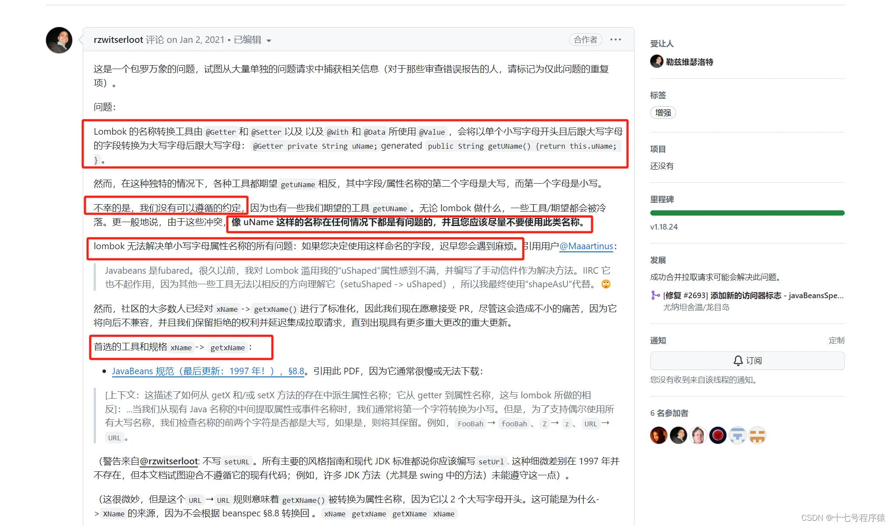

# 使用Lombok导致传值失败

[spring中，为什么前端明明传了值，后端却接收不到_springboot接口无法获取参数-CSDN博客](https://blog.csdn.net/qq_39327650/article/details/134419523)

## 结论

到这里，我们就可以得出结论了

> 因为 Lombok 生成 get、set 方法的语义规范与和Jackson 处理 get、set 方法之间的不一致，导致属性名无法匹配上，最终也就导致了前端明明传了参数，后端却接收不到的问题。



看到这里，我就来总结一下能解决这个问题的三种方案吧

**1.加@JsonProperty注解强行指定属性名**

```java
@Data
public class UserVO {
    /**
     * 用户名称
     */
    @JsonProperty(value = "uName")
    private String uName;
    /**
     * 登录类型
     */
    private String loginType;
}
```

**2.不使用lombok，使用IDEA默认生成get/set方法**

**3.加上lombok配置项**

```java
lombok.accessors.capitalization = [basic | beanspec] (default: basic)
```

第一种方法最好
