# 2	`Vue2`

## 2.1	初始化脚手架

### 2.1.1	说明

1. `Vue`脚手架是`Vue`官方提供的标准化开发工具（开发平台）
2. 最新的版本是 `4.x`
3. 文档 [`VueCLI`](https://cli.vuejs.org/zh/)
4. 目前已经 `Vue CLI`已经被弃用了，`Vue`官方开发并推荐[`Vite`](https://cn.vitejs.dev/)

### 2.1.2	具体步骤

1. 如果下载缓慢请配置`npm`淘宝镜像`npm config set registry http://registry.npm.taobao.org`
2. 全局安装 `@vue/cli npm install -g @vue/cli`
3. 切换到创建项目的目录，使用命令创建项目`vue create xxx`
4. 选择使用`vue`的版本
5. 启动项目`npm run serve`
6. 打包项目`npm run build`
7. 暂停项目 `Ctrl+C`

> `Vue`脚手架隐藏了所有`webpack`相关的配置，若想查看具体的`webpack`配置，请执行`vue inspect > output.js`

### 2.1.3	脚手架文件结构

```markdown
.文件目录
├── node_modules 
├── public
│   ├── favicon.ico: 页签图标
│   └── index.html: 主页面
├── src
│   ├── assets: 存放静态资源
│   │   └── logo.png
│   │── component: 存放组件
│   │   └── HelloWorld.vue
│   │── App.vue: 汇总所有组件
│   └── main.js: 入口文件
├── .gitignore: git版本管制忽略的配置
├── babel.config.js: babel的配置文件
├── package.json: 应用包配置文件 
├── README.md: 应用描述文件
└── package-lock.json: 包版本控制文件
```

**`public/index.html`**

```html
<!DOCTYPE html>
<html lang="">
    <head>
        <meta charset="UTF-8">
      
        <!-- 针对IE浏览器的特殊配置，含义是让IE浏览器以最高渲染级别渲染页面 -->
        <meta http-equiv="X-UA-Compatible" content="IE=edge">
      
        <!-- 开启移动端的理想端口 -->
        <meta name="viewport" content="width=device-width, initial-scale=1.0">
      
        <!-- 配置页签图标 <%= BASE_URL %>是public所在路径，使用绝对路径 -->
        <link rel="icon" href="<%= BASE_URL %>favicon.ico">
      
        <!-- 配置网页标题 -->
        <title><%= htmlWebpackPlugin.options.title %></title>
    </head>
    <body>
      
      	<!-- 当浏览器不支持js时，noscript中的元素就会被渲染 -->
      	<noscript>
      		<strong>We're sorry but <%= htmlWebpackPlugin.options.title %> doesn't work properly without JavaScript enabled. Please enable it to continue.</strong>
    		</noscript>
          
        <!-- 容器 -->
        <div id="app"></div>
    </body>
</html>
```

**`src/main.js`**

```javascript
// 该文件是整个项目的入口文件

import Vue from 'vue'				// 引入Vue
import App from './App.vue'	// 引入App组件，它是所有组件的父组件

Vue.config.productionTip = false

new Vue({
	el:'#app',
  render: h => h(App),			// render函数完成了这个功能：将App组件放入容器中
})// .$mount('#app')
```

**`src/App.vue`**

```vue
<template>
	<div>
		
		<School></School>
		<Student></Student>
	</div>
</template>

<script>
	// 引入组件
	import School from './components/School.vue'
	import Student from './components/Student.vue'

	export default {
		name:'App',
		components:{ School, Student }
	}
</script>
```

**`src/components/School.vue`**

```vue
<template>
  <div class="demo">
    <h2>学校名称：{{ name }}</h2>
    <h2>学校地址：{{ address }}</h2>
    <button @click="showName">点我提示学校名</button>
  </div>
</template>

<script>
  export default {
    name: "School",
    data() {
      return {
        name: "UESTC",
        address: "成都",
      };
    },
    methods: {showName() {alert(this.name);},},
  };
</script>

<style>
  .demo {background-color: orange;}
</style>
```

**`src/components/Student.vue`**

```vue
<template>
  <div class="demo">
    <h2>学校名称：{{ name }}</h2>
    <h2>学校地址：{{ address }}</h2>
    <button @click="showName">点我提示学校名</button>
  </div>
</template>

<script>
  export default {
    name: "School",
    data() {
      return {
        name: "UESTC",
        address: "成都",
      };
    },
    methods: {showName() {alert(this.name);},},
  };
</script>

<style>
  .demo {background-color: orange;}
</style>
```

### 2.1.4	`render` 函数

```javascript
import Vue from 'vue'
import App from './App.vue'

Vue.config.productionTip = false

new Vue({
  el:'#app',
  // render函数功能：将App组件放入容器中
  // 简写形式
  render: h => h(App),
  // 完整形式
  // render(createElement){
  //   return createElement(App)
  // }
})
```

### 2.1.5	关于不同版本的函数

1. `vue.js`与`vue.runtime.xxx.js`的区别
   - `vue.js` 是完整版的`Vue`，包含：核心功能+模板解析器
   - `vue.runtime.xxx.js` 是运行版的`Vue`，只包含核心功能，没有模板解析器
   - `esm` 就是 `ES6 module`
2. 因为 `vue.runtime.xxx.js` 没有模板解析器，所以不能使用`template`配置项，需要使用render函数接收到的`createElement`函数去指定具体内容

### 2.1.6	`vue.config.js` 配置文件

1. `vue inspect > output.js`可以查看到`Vue`脚手架的默认配置
2. 使用`vue.config.js`可以对脚手架进行个性化定制，和`package.json`同级目录，详见 配置参考[Vue CLI](https://cli.vuejs.org/zh/config/#vue-config-js)

```javascript
module.exports = {
  pages: {
    index: {
      entry: 'src/index/main.js' // 入口
    }
  },
  lineOnSave: false	// 关闭语法检查
}
```

#### 2.1.7	综合代码

`main.js`

```js
/* 
	该文件是整个项目的入口文件
*/
//引入Vue
import Vue from 'vue'
//引入App组件，它是所有组件的父组件
import App from './App.vue'
//关闭vue的生产提示
Vue.config.productionTip = false

/* 
	关于不同版本的Vue：
	
		1.vue.js与vue.runtime.xxx.js的区别：
				(1).vue.js是完整版的Vue，包含：核心功能+模板解析器。
				(2).vue.runtime.xxx.js是运行版的Vue，只包含：核心功能；没有模板解析器。

		2.因为vue.runtime.xxx.js没有模板解析器，所以不能使用template配置项，需要使用
			render函数接收到的createElement函数去指定具体内容。
*/

//创建Vue实例对象---vm
new Vue({
	el:'#app',
	//render函数完成了这个功能：将App组件放入容器中
  render: h => h(App),
	// render:q=> q('h1','你好啊')

	// template:`<h1>你好啊</h1>`,
	// components:{App},
})
```

`App.vue`

```vue
<template>
	<div>
		
		<School></School>
		<Student></Student>
	</div>
</template>

<script>
	//引入组件
	import School from './components/School'
	import Student from './components/Student'

	export default {
		name:'App',
		components:{
			School,
			Student
		}
	}
</script>

```

`School.vue`

```vue
<template>
	<div class="demo">
		<h2>学校名称：{{name}}</h2>
		<h2>学校地址：{{address}}</h2>
		<button @click="showName">点我提示学校名</button>	
	</div>
</template>

<script>
	 export default {
		name:'School',
		data(){
			return {
				name:'尚硅谷',
				address:'北京昌平'
			}
		},
		methods: {
			showName(){
				alert(this.name)
			}
		},
	}
</script>

<style>
	.demo{
		background-color: orange;
	}
</style>
```

`Student.vue`

```vue
<template>
	<div>
		<h2>学生姓名：{{name}}</h2>
		<h2>学生年龄：{{age}}</h2>
	</div>
</template>

<script>
	 export default {
		name:'Student',
		data(){
			return {
				name:'张三',
				age:18
			}
		}
	}
</script>

```

## 2.2	`ref` 属性

<strong style="color:#ff0000">`ref`</strong>被用来给元素或子组件注册引用信息（`id`的替代者）

- 应用在`html`标签上获取的是真实`DOM`元素，应用在组件标签上获取的是组件实例对象`vc`
- 使用方式
  - 打标识：`<h1 ref="xxx"></h1>`或`<School ref="xxx"></School>`
  - 获取：<strong style="color:#ff0000;font-size: 22px;">this.$refs.xxx</strong>

<strong style="color:#ff0000;font-size: 22px;">`School.vue`</strong>

```vue
<template>
	<div class="school">
		<h2>学校名称：{{name}}</h2>
		<h2>学校地址：{{address}}</h2>
	</div>
</template>

<script>
	export default {
		name:'School',
		data() {
			return {
				name:'尚硅谷',
				address:'北京·昌平'
			}
		},
	}
</script>

<style>
	.school{
		background-color: gray;
	}
</style>
```

<strong style="color:#DD5145">`App.vue`</strong>：

```vue
<template>
	<div>
		<h1 v-text="msg" ref="title"></h1>
		<button ref="btn" @click="showDOM">点我输出上方的DOM元素</button>
		<School ref="sch"/>
	</div>
</template>

<script>
	//引入School组件
	import School from './components/School'

	export default {
		name:'App',
		components:{School},
		data() {
			return {
				msg:'欢迎学习Vue！'
			}
		},
		methods: {
			showDOM(){
				console.log(this.$refs.title) //真实DOM元素
				console.log(this.$refs.btn) //真实DOM元素
				console.log(this.$refs.sch) //School组件的实例对象（vc）
			}
		},
	}
</script>

```

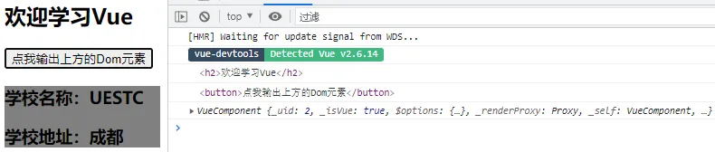

## 2.3	`props` 配置项

<strong style="color:#ff0000;font-size: 22px;">props</strong>让组件接收外部传过来的数据

- 传递数据`<Demo name="xxx" :age="18"/>`这里`age`前加:，通过`v-bind`使得里面的18是数字
- 接收数据
  - 第一种方式（只接收）`props:['name', 'age']`
  - 第二种方式（限制类型）`props:{name:String, age:Number}`
  - 第三种方式（限制类型、限制必要性、指定默认值）

使用方式：

```javascript
props: {
    name: {
        type: String,	 // 类型
        required: true,// 必要性
        default: 'cess'// 默认值
    }
}
```

<strong style="color:#DD5145">`Student.vue`</strong>：

```vue
<template>
	<div>
		<h1>{{msg}}</h1>
		<h2>学生姓名：{{name}}</h2>
		<h2>学生性别：{{sex}}</h2>
		<h2>学生年龄：{{myAge+1}}</h2>
		<button @click="updateAge">尝试修改收到的年龄</button>
	</div>
</template>

<script>
	export default {
		name:'Student',
		data() {
			console.log(this)
			return {
				msg:'我是一个尚硅谷的学生',
				myAge:this.age
			}
		},
		methods: {
			updateAge(){
				this.myAge++
			}
		},
		//简单声明接收
		// props:['name','age','sex'] 

		//接收的同时对数据进行类型限制
		/* props:{
			name:String,
			age:Number,
			sex:String
		} */

		//接收的同时对数据：进行类型限制+默认值的指定+必要性的限制
		props:{
			name:{
				type:String, //name的类型是字符串
				required:true, //name是必要的
			},
			age:{
				type:Number,
				default:99 //默认值
			},
			sex:{
				type:String,
				required:true
			}
		}
	}
</script>
```

<strong style="color:#DD5145">`App.vue`</strong>：

```vue
<template>
	<div>
		<Student name="李四" sex="女" :age="18"/>
	</div>
</template>

<script>
	import Student from './components/Student'

	export default {
		name:'App',
		components:{Student}
	}
</script>

```

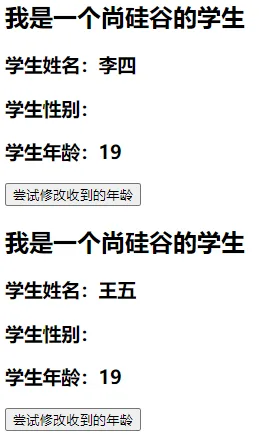

## 2.4	`mixin` 混入

1. 功能：可以把多个组件共用的配置提取成一个混入对象

2. 使用方式

   - 定义混入

     ```js
     const mixin = {
         data() {....},
         methods: {....}
         ....
     }
     ```

   - 功能：可以把多个组件共用的配置提取成一个混入对象

   - 使用混入

     - 全局混入`Vue.mixin(xxx)`
     - 局部混入`mixins:['xxx']`

3. 备注

   1. 组件和混入对象含有同名选项时，这些选项将以恰当的方式进行“合并”，在发生冲突时以组件优先

      ```js
      var mixin = {
          data: function () {
              return {
                  message: 'hello',
                  foo: 'abc'
              }
            }
      }
      
      new Vue({
            mixins: [mixin],
            data () {
              return {
                    message: 'goodbye',
                      bar: 'def'
              }
          },
            created () {
              console.log(this.$data)
              // => { message: "goodbye", foo: "abc", bar: "def" }
            }
      })
      ```

   2. 同名生命周期钩子将合并为一个数组，因此都将被调用。另外，混入对象的钩子将在组件自身钩子之前调用

      ```js
      var mixin = {
            created () {
              console.log('混入对象的钩子被调用')
            }
      }
      
      new Vue({
            mixins: [mixin],
            created () {
              console.log('组件钩子被调用')
            }
      })
      
      // => "混入对象的钩子被调用"
      // => "组件钩子被调用"
      ```

<strong style="color:#DD5145">`mixin.js`</strong>：

```javascript
export const hunhe = {
	methods: {
		showName(){
			alert(this.name)
		}
	},
	mounted() {
		console.log('你好啊！')
	},
}
export const hunhe2 = {
	data() {
		return {
			x:100,
			y:200
		}
	},
}
```

<strong style="color:#DD5145">`main.js`</strong>：

```js
//引入Vue
import Vue from 'vue'
//引入App
import App from './App.vue'
//引入mixin
import {hunhe,hunhe2} from './mixin'
//关闭Vue的生产提示
Vue.config.productionTip = false

Vue.mixin(hunhe)
Vue.mixin(hunhe2)


//创建vm
new Vue({
	el:'#app',
	render: h => h(App)
})
```

<strong style="color:#DD5145">`Student.vue`</strong>：

```vue
<template>
	<div>
		<h2 @click="showName">学生姓名：{{name}}</h2>
		<h2>学生性别：{{sex}}</h2>
	</div>
</template>

<script>
	// import {hunhe,hunhe2} from '../mixin'

	export default {
		name:'Student',
		data() {
			return {
				name:'张三',
				sex:'男'
			}
		},
		// mixins:[hunhe,hunhe2]
	}
</script>
```

<strong style="color:#DD5145">`School.vue`</strong>：

```vue
<template>
	<div>
		<h2 @click="showName">学校名称：{{name}}</h2>
		<h2>学校地址：{{address}}</h2>
	</div>
</template>

<script>
	//引入一个hunhe
	// import {hunhe,hunhe2} from '../mixin'

	export default {
		name:'School',
		data() {
			return {
				name:'尚硅谷',
				address:'北京',
				x:666
			}
		},
		// mixins:[hunhe,hunhe2],
	}
</script>
```

<strong style="color:#DD5145">`App.vue`</strong>：

```vue
<template>
	<div>
		<School/>
		<hr>
		<Student/>
	</div>
</template>

<script>
	import School from './components/School'
	import Student from './components/Student'

	export default {
		name:'App',
		components:{School,Student}
	}
</script>

```

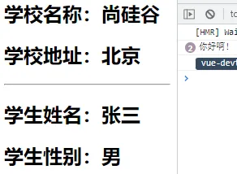

## 2.5	`plugin` 插件

1. 功能：用于增强`Vue`
2. 本质：包含`install`方法的一个对象，`install`的第一个参数是`Vue`，第二个以后的参数是插件使用者传递的数据
3. 定义插件（见下 `src/plugin.js`）
4. 使用插件：`Vue.use()`

<strong style="color:#DD5145">`plugin.js`</strong>：

```js
export default {
	install(Vue,x,y,z){
		console.log(x,y,z)
		//全局过滤器
		Vue.filter('mySlice',function(value){
			return value.slice(0,4)
		})

		//定义全局指令
		Vue.directive('fbind',{
			//指令与元素成功绑定时（一上来）
			bind(element,binding){
				element.value = binding.value
			},
			//指令所在元素被插入页面时
			inserted(element,binding){
				element.focus()
			},
			//指令所在的模板被重新解析时
			update(element,binding){
				element.value = binding.value
			}
		})

		//定义混入
		Vue.mixin({
			data() {
				return {
					x:100,
					y:200
				}
			},
		})

		//给Vue原型上添加一个方法（vm和vc就都能用了）
		Vue.prototype.hello = ()=>{alert('你好啊')}
	}
}
```

<strong style="color:#DD5145">`main.js`</strong>：

```js
//引入Vue
import Vue from 'vue'
//引入App
import App from './App.vue'
//引入插件
import plugins from './plugins'
//关闭Vue的生产提示
Vue.config.productionTip = false

//应用（使用）插件
Vue.use(plugins,1,2,3)
//创建vm
new Vue({
	el:'#app',
	render: h => h(App)
})
```

<strong style="color:#DD5145">`Student.vue`</strong>：

```vue
<template>
	<div>
		<h2>学生姓名：{{name}}</h2>
		<h2>学生性别：{{sex}}</h2>
		<input type="text" v-fbind:value="name">
	</div>
</template>

<script>
	export default {
		name:'Student',
		data() {
			return {
				name:'张三',
				sex:'男'
			}
		},
	}
</script>
```

<strong style="color:#DD5145">`School.vue`</strong>：

```vue
<template>
	<div>
		<h2>学校名称：{{name | mySlice}}</h2>
		<h2>学校地址：{{address}}</h2>
		<button @click="test">点我测试一个hello方法</button>
	</div>
</template>

<script>
	export default {
		name:'School',
		data() {
			return {
				name:'尚硅谷atguigu',
				address:'北京',
			}
		},
		methods: {
			test(){
				this.hello()
			}
		},
	}
</script>
```

<strong style="color:#DD5145">`App.vue`</strong>：

```vue
<template>
	<div>
		<School/>
		<hr>
		<Student/>
	</div>
</template>

<script>
	import School from './components/School'
	import Student from './components/Student'

	export default {
		name:'App',
		components:{School,Student}
	}
</script>

```

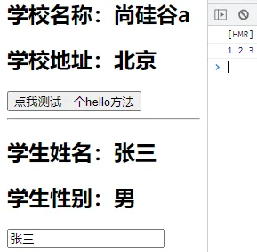

## 2.6	`scoped`样式

1. 作用：让样式在局部生效，防止冲突
2. 写法：`<style scoped>`

> `Vue2`中的`webpack`并没有安装最新版，导致有些插件也不能默认安装最新版，如 `npm i less-loader@7`，而不是最新版

<strong style="color:#DD5145">`Student.vue`</strong>：

```vue
<template>
	<div class="demo">
		<h2 class="title">学生姓名：{{name}}</h2>
		<h2 class="atguigu">学生性别：{{sex}}</h2>
	</div>
</template>

<script>
	export default {
		name:'Student',
		data() {
			return {
				name:'张三',
				sex:'男'
			}
		}
	}
</script>

<style lang="less" scoped>
	.demo{
		background-color: pink;
		.atguigu{
			font-size: 40px;
		}
	}
</style>

```

<strong style="color:#DD5145">`School.vue`</strong>：

```vue
<template>
	<div class="demo">
		<h2 class="title">学校名称：{{name}}</h2>
		<h2>学校地址：{{address}}</h2>
	</div>
</template>

<script>
	export default {
		name:'School',
		data() {
			return {
				name:'尚硅谷atguigu',
				address:'北京',
			}
		}
	}
</script>

<style scoped>
	.demo{
		background-color: skyblue;
	}
</style>
```

<strong style="color:#DD5145">`App.vue`</strong>：

```vue
<template>
	<div>
		<h1 class="title">你好啊</h1>
		<School/>
		<Student/>
	</div>
</template>

<script>
	import Student from './components/Student'
	import School from './components/School'

	export default {
		name:'App',
		components:{School,Student}
	}
</script>

<style scoped>
	.title{
		color: red;
	}
</style>

```

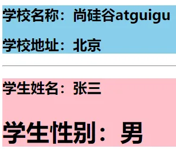

## 2.7	`Todo-List` 案例

组件化编码流程

1. 拆分静态组件：组件要按照功能点拆分，命名不要与`html`元素冲突
2. 实现动态组件：考虑好数据的存放位置，数据是一个组件在用，还是一些组件在用
   - 一个组件在用：放在组件自身即可
   - 一些组件在用：放在他们共同的父组件上<strong style="color:#ff0000;font-size: 18px;">（状态提升）</strong>
3. 实现交互：从绑定事件开始

`props`适用于

- 父组件 ==> 子组件 通信
- 子组件 ==> 父组件 通信（要求父组件先给子组件一个函数）

使用`v-model`时要切记：`v-model`绑定的值不能是`props`传过来的值，因为`props`是不可以修改的

`props`传过来的若是对象类型的值，修改对象中的属性时`Vue`不会报错，但不推荐这样做

<strong style="color:#DD5145">`MyHeader.vue`</strong>：

```vue
<template>
	<div class="todo-header">
		<input type="text" placeholder="请输入你的任务名称，按回车键确认" v-model="title" @keyup.enter="add"/>
	</div>
</template>

<script>
	import {nanoid} from 'nanoid'
	export default {
		name:'MyHeader',
		//接收从App传递过来的addTodo
		props:['addTodo'],
		data() {
			return {
				//收集用户输入的title
				title:''
			}
		},
		methods: {
			add(){
				//校验数据
				if(!this.title.trim()) return alert('输入不能为空')
				//将用户的输入包装成一个todo对象
				const todoObj = {id:nanoid(),title:this.title,done:false}
				//通知App组件去添加一个todo对象
				this.addTodo(todoObj)
				//清空输入
				this.title = ''
			}
		},
	}
</script>

<style scoped>
	/*header*/
	.todo-header input {
		width: 560px;
		height: 28px;
		font-size: 14px;
		border: 1px solid #ccc;
		border-radius: 4px;
		padding: 4px 7px;
	}

	.todo-header input:focus {
		outline: none;
		border-color: rgba(82, 168, 236, 0.8);
		box-shadow: inset 0 1px 1px rgba(0, 0, 0, 0.075), 0 0 8px rgba(82, 168, 236, 0.6);
	}
</style>
```

<strong style="color:#DD5145">`MyItem.vue`</strong>：

```vue
<template>
	<li>
		<label>
			<input type="checkbox" :checked="todo.done" @change="handleCheck(todo.id)"/>
			<!-- 如下代码也能实现功能，但是不太推荐，因为有点违反原则，因为修改了props -->
			<!-- <input type="checkbox" v-model="todo.done"/> -->
			<span>{{todo.title}}</span>
		</label>
		<button class="btn btn-danger" @click="handleDelete(todo.id)">删除</button>
	</li>
</template>

<script>
	export default {
		name:'MyItem',
		//声明接收todo、checkTodo、deleteTodo
		props:['todo','checkTodo','deleteTodo'],
		methods: {
			//勾选or取消勾选
			handleCheck(id){
				//通知App组件将对应的todo对象的done值取反
				this.checkTodo(id)
			},
			//删除
			handleDelete(id){
				if(confirm('确定删除吗？')){
					//通知App组件将对应的todo对象删除
					this.deleteTodo(id)
				}
			}
		},
	}
</script>

<style scoped>
	/*item*/
	li {
		list-style: none;
		height: 36px;
		line-height: 36px;
		padding: 0 5px;
		border-bottom: 1px solid #ddd;
	}

	li label {
		float: left;
		cursor: pointer;
	}

	li label li input {
		vertical-align: middle;
		margin-right: 6px;
		position: relative;
		top: -1px;
	}

	li button {
		float: right;
		display: none;
		margin-top: 3px;
	}

	li:before {
		content: initial;
	}

	li:last-child {
		border-bottom: none;
	}

	li:hover{
		background-color: #ddd;
	}
	
	li:hover button{
		display: block;
	}
</style>
```

<strong style="color:#DD5145">`MyList.vue`</strong>：

```vue
<template>
	<ul class="todo-main">
		<MyItem 
			v-for="todoObj in todos"
			:key="todoObj.id" 
			:todo="todoObj" 
			:checkTodo="checkTodo"
			:deleteTodo="deleteTodo"
		/>
	</ul>
</template>

<script>
	import MyItem from './MyItem'

	export default {
		name:'MyList',
		components:{MyItem},
		//声明接收App传递过来的数据，其中todos是自己用的，checkTodo和deleteTodo是给子组件MyItem用的
		props:['todos','checkTodo','deleteTodo']
	}
</script>

<style scoped>
	/*main*/
	.todo-main {
		margin-left: 0px;
		border: 1px solid #ddd;
		border-radius: 2px;
		padding: 0px;
	}

	.todo-empty {
		height: 40px;
		line-height: 40px;
		border: 1px solid #ddd;
		border-radius: 2px;
		padding-left: 5px;
		margin-top: 10px;
	}
</style>
```

<strong style="color:#DD5145">`MyFooter.vue`</strong>：

```vue
<template>
	<div class="todo-footer" v-show="total">
		<label>
			<!-- <input type="checkbox" :checked="isAll" @change="checkAll"/> -->
			<input type="checkbox" v-model="isAll"/>
		</label>
		<span>
			<span>已完成{{doneTotal}}</span> / 全部{{total}}
		</span>
		<button class="btn btn-danger" @click="clearAll">清除已完成任务</button>
	</div>
</template>

<script>
	export default {
		name:'MyFooter',
		props:['todos','checkAllTodo','clearAllTodo'],
		computed: {
			//总数
			total(){
				return this.todos.length
			},
			//已完成数
			doneTotal(){
				//此处使用reduce方法做条件统计
				/* const x = this.todos.reduce((pre,current)=>{
					console.log('@',pre,current)
					return pre + (current.done ? 1 : 0)
				},0) */
				//简写
				return this.todos.reduce((pre,todo)=> pre + (todo.done ? 1 : 0) ,0)
			},
			//控制全选框
			isAll:{
				//全选框是否勾选
				get(){
					return this.doneTotal === this.total && this.total > 0
				},
				//isAll被修改时set被调用
				set(value){
					this.checkAllTodo(value)
				}
			}
		},
		methods: {
			/* checkAll(e){
				this.checkAllTodo(e.target.checked)
			} */
			//清空所有已完成
			clearAll(){
				this.clearAllTodo()
			}
		},
	}
</script>

<style scoped>
	/*footer*/
	.todo-footer {
		height: 40px;
		line-height: 40px;
		padding-left: 6px;
		margin-top: 5px;
	}

	.todo-footer label {
		display: inline-block;
		margin-right: 20px;
		cursor: pointer;
	}

	.todo-footer label input {
		position: relative;
		top: -1px;
		vertical-align: middle;
		margin-right: 5px;
	}

	.todo-footer button {
		float: right;
		margin-top: 5px;
	}
</style>
```

<strong style="color:#DD5145">`App.vue`</strong>：

```vue
<template>
	<div id="root">
		<div class="todo-container">
			<div class="todo-wrap">
				<MyHeader :addTodo="addTodo"/>
				<MyList :todos="todos" :checkTodo="checkTodo" :deleteTodo="deleteTodo"/>
				<MyFooter :todos="todos" :checkAllTodo="checkAllTodo" :clearAllTodo="clearAllTodo"/>
			</div>
		</div>
	</div>
</template>

<script>
	import MyHeader from './components/MyHeader'
	import MyList from './components/MyList'
	import MyFooter from './components/MyFooter.vue'

	export default {
		name:'App',
		components:{MyHeader,MyList,MyFooter},
		data() {
			return {
				//由于todos是MyHeader组件和MyFooter组件都在使用，所以放在App中（状态提升）
				todos:[
					{id:'001',title:'抽烟',done:true},
					{id:'002',title:'喝酒',done:false},
					{id:'003',title:'开车',done:true}
				]
			}
		},
		methods: {
			//添加一个todo
			addTodo(todoObj){
				this.todos.unshift(todoObj)
			},
			//勾选or取消勾选一个todo
			checkTodo(id){
				this.todos.forEach((todo)=>{
					if(todo.id === id) todo.done = !todo.done
				})
			},
			//删除一个todo
			deleteTodo(id){
				this.todos = this.todos.filter( todo => todo.id !== id )
			},
			//全选or取消全选
			checkAllTodo(done){
				this.todos.forEach((todo)=>{
					todo.done = done
				})
			},
			//清除所有已经完成的todo
			clearAllTodo(){
				this.todos = this.todos.filter((todo)=>{
					return !todo.done
				})
			}
		}
	}
</script>

<style>
	/*base*/
	body {
		background: #fff;
	}
	.btn {
		display: inline-block;
		padding: 4px 12px;
		margin-bottom: 0;
		font-size: 14px;
		line-height: 20px;
		text-align: center;
		vertical-align: middle;
		cursor: pointer;
		box-shadow: inset 0 1px 0 rgba(255, 255, 255, 0.2), 0 1px 2px rgba(0, 0, 0, 0.05);
		border-radius: 4px;
	}
	.btn-danger {
		color: #fff;
		background-color: #da4f49;
		border: 1px solid #bd362f;
	}
	.btn-danger:hover {
		color: #fff;
		background-color: #bd362f;
	}
	.btn:focus {
		outline: none;
	}
	.todo-container {
		width: 600px;
		margin: 0 auto;
	}
	.todo-container .todo-wrap {
		padding: 10px;
		border: 1px solid #ddd;
		border-radius: 5px;
	}
</style>

```

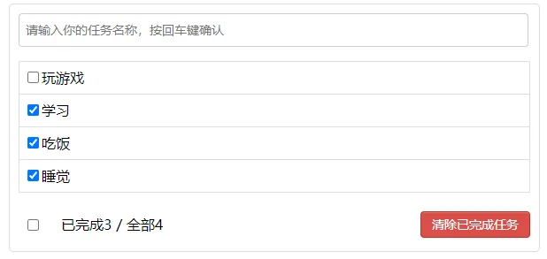

## 2.8	`WebStorage`

### 2.8.1	`WebStorage`

存储内容大小一般支持 `5MB` 左右（不同浏览器可能还不一样）

浏览器端通过`Window.sessionStorage`和`Window.localStorage`属性来实现本地存储机制

相关`API`

- `xxxStorage.`<strong style="color:#ff0000;font-size: 22px;">`setItem('key', 'value')`</strong>该方法接受一个键和值作为参数，会把键值对添加到存储中，如果键名存在，则更新其对应的值
- `xxxStorage.`<strong style="color:#ff0000;font-size: 22px;">`getItem('key')`</strong>该方法接受一个键名作为参数，返回键名对应的值
- `xxxStorage.`<strong style="color:#ff0000;font-size: 22px;">`removeItem('key')`</strong>该方法接受一个键名作为参数，并把该键名从存储中删除
- `xxxStorage.`<strong style="color:#ff0000;font-size: 22px;">`clear()`</strong>该方法会清空存储中的所有数据

备注

- `SessionStorage`存储的内容会随着浏览器窗口关闭而消失
- `LocalStorage`存储的内容，需要手动清除才会消失
- `xxxStorage.getItem(xxx)`如果 `xxx` 对应的 `value` 获取不到，那么`getItem()`的返回值是`null`
- `JSON.parse(null)`的结果依然是`null`

<strong style="color:#DD5145">`localStorage.html`</strong>：

```html
<!DOCTYPE html>
<html>
	<head>
		<meta charset="UTF-8" />
		<title>localStorage</title>
	</head>
	<body>
		<h2>localStorage</h2>
		<button onclick="saveData()">点我保存一个数据</button>
		<button onclick="readData()">点我读取一个数据</button>
		<button onclick="deleteData()">点我删除一个数据</button>
		<button onclick="deleteAllData()">点我清空一个数据</button>

		<script type="text/javascript" >
			let p = {name:'张三',age:18}

			function saveData(){
				localStorage.setItem('msg','hello!!!')
				localStorage.setItem('msg2',666)
				localStorage.setItem('person',JSON.stringify(p))
			}
			function readData(){
				console.log(localStorage.getItem('msg'))
				console.log(localStorage.getItem('msg2'))

				const result = localStorage.getItem('person')
				console.log(JSON.parse(result))

				// console.log(localStorage.getItem('msg3'))
			}
			function deleteData(){
				localStorage.removeItem('msg2')
			}
			function deleteAllData(){
				localStorage.clear()
			}
		</script>
	</body>
</html>
```

<strong style="color:#DD5145">`sessionStorage.html`</strong>：

```html
<!DOCTYPE html>
<html>
	<head>
		<meta charset="UTF-8" />
		<title>sessionStorage</title>
	</head>
	<body>
		<h2>sessionStorage</h2>
		<button onclick="saveData()">点我保存一个数据</button>
		<button onclick="readData()">点我读取一个数据</button>
		<button onclick="deleteData()">点我删除一个数据</button>
		<button onclick="deleteAllData()">点我清空一个数据</button>

		<script type="text/javascript" >
			let p = {name:'张三',age:18}

			function saveData(){
				sessionStorage.setItem('msg','hello!!!')
				sessionStorage.setItem('msg2',666)
				sessionStorage.setItem('person',JSON.stringify(p))
			}
			function readData(){
				console.log(sessionStorage.getItem('msg'))
				console.log(sessionStorage.getItem('msg2'))

				const result = sessionStorage.getItem('person')
				console.log(JSON.parse(result))

				// console.log(sessionStorage.getItem('msg3'))
			}
			function deleteData(){
				sessionStorage.removeItem('msg2')
			}
			function deleteAllData(){
				sessionStorage.clear()
			}
		</script>
	</body>
</html>
```

### 2.8.2	使用本地存储优化`Todo-List`

<strong style="color:#DD5145">`App.vue`</strong>：

```vue
<template>
	<div id="root">
		<div class="todo-container">
			<div class="todo-wrap">
				<MyHeader :addTodo="addTodo"/>
				<MyList :todos="todos" :checkTodo="checkTodo" :deleteTodo="deleteTodo"/>
				<MyFooter :todos="todos" :checkAllTodo="checkAllTodo" :clearAllTodo="clearAllTodo"/>
			</div>
		</div>
	</div>
</template>

<script>
	import MyHeader from './components/MyHeader'
	import MyList from './components/MyList'
	import MyFooter from './components/MyFooter.vue'

	export default {
		name:'App',
		components:{MyHeader,MyList,MyFooter},
		data() {
			return {
				//由于todos是MyHeader组件和MyFooter组件都在使用，所以放在App中（状态提升）
				todos:JSON.parse(localStorage.getItem('todos')) || []
			}
		},
		methods: {
			//添加一个todo
			addTodo(todoObj){
				this.todos.unshift(todoObj)
			},
			//勾选or取消勾选一个todo
			checkTodo(id){
				this.todos.forEach((todo)=>{
					if(todo.id === id) todo.done = !todo.done
				})
			},
			//删除一个todo
			deleteTodo(id){
				this.todos = this.todos.filter( todo => todo.id !== id )
			},
			//全选or取消全选
			checkAllTodo(done){
				this.todos.forEach((todo)=>{
					todo.done = done
				})
			},
			//清除所有已经完成的todo
			clearAllTodo(){
				this.todos = this.todos.filter((todo)=>{
					return !todo.done
				})
			}
		},
		watch: {
			todos:{
				deep:true,
				handler(value){
					localStorage.setItem('todos',JSON.stringify(value))
				}
			}
		},
	}
</script>

<style>
	/*base*/
	body {
		background: #fff;
	}
	.btn {
		display: inline-block;
		padding: 4px 12px;
		margin-bottom: 0;
		font-size: 14px;
		line-height: 20px;
		text-align: center;
		vertical-align: middle;
		cursor: pointer;
		box-shadow: inset 0 1px 0 rgba(255, 255, 255, 0.2), 0 1px 2px rgba(0, 0, 0, 0.05);
		border-radius: 4px;
	}
	.btn-danger {
		color: #fff;
		background-color: #da4f49;
		border: 1px solid #bd362f;
	}
	.btn-danger:hover {
		color: #fff;
		background-color: #bd362f;
	}
	.btn:focus {
		outline: none;
	}
	.todo-container {
		width: 600px;
		margin: 0 auto;
	}
	.todo-container .todo-wrap {
		padding: 10px;
		border: 1px solid #ddd;
		border-radius: 5px;
	}
</style>
```

## 2.9	组件的自定义事件

### 2.9.1	组件的自定义事件

1. 一种组件间通信的方式，适用于：<strong style="color:#ff0000;font-size: 22px;">子组件 ===> 父组件</strong>

2. 使用场景：**子组件**想给**父组件**传数据，**那么就要在父组件中给子组件绑定自定义事件**<strong style="color:#ff0000;font-size: 22px;">（事件的回调在A中）</strong>

3. 绑定自定义事件

   1. 第一种方式，在父组件中`<Demo @事件名="方法"/>`或`<Demo v-on:事件名="方法"/>`

   2. 第二种方式，在父组件中`this.$refs.demo.$on('事件名',方法)`

      ```js
      <Demo ref="demo"/>
      ......
      mounted(){
         this.$refs.demo.$on('atguigu',this.test)
      }
      ```

   3. 若想让自定义事件只能触发一次，可以使用`once`修饰符，或`$once`方法
      触发

4. 自定义事件`this.$emit('事件名',数据)`

5. 解绑自定义事件`this.$off('事件名')`

6. 组件上也可以绑定原生`DOM`事件，需要使用`native`修饰符 `@click.native="show"`上面绑定自定义事件，即使绑定的是原生事件也会被认为是自定义的，需要加`native`，加了后就将此事件给组件的根元素

7. 注意：通过`this.$refs.xxx.$on('事件名',回调函数)`绑定自定义事件时，回调函数要么配置在`methods`中，要么用箭头函数，否则 `this` 指向会出问题

<strong style="color:#DD5145">`School.vue`</strong>：

```VUE
<template>
	<div class="school">
		<h2>学校名称：{{name}}</h2>
		<h2>学校地址：{{address}}</h2>
		<button @click="sendSchoolName">把学校名给App</button>
	</div>
</template>

<script>
	export default {
		name:'School',
		props:['getSchoolName'],
		data() {
			return {
				name:'尚硅谷',
				address:'北京',
			}
		},
		methods: {
			sendSchoolName(){
				this.getSchoolName(this.name)
			}
		},
	}
</script>

<style scoped>
	.school{
		background-color: skyblue;
		padding: 5px;
	}
</style>
```

<strong style="color:#DD5145">`Student.vue`</strong>：

```VUE
<template>
	<div class="student">
		<h2>学生姓名：{{name}}</h2>
		<h2>学生性别：{{sex}}</h2>
		<h2>当前求和为：{{number}}</h2>
		<button @click="add">点我number++</button>
		<button @click="sendStudentlName">把学生名给App</button>
		<button @click="unbind">解绑atguigu事件</button>
		<button @click="death">销毁当前Student组件的实例(vc)</button>
	</div>
</template>

<script>
	export default {
		name:'Student',
		data() {
			return {
				name:'张三',
				sex:'男',
				number:0
			}
		},
		methods: {
			add(){
				console.log('add回调被调用了')
				this.number++
			},
			sendStudentlName(){
				//触发Student组件实例身上的atguigu事件
				this.$emit('atguigu',this.name,666,888,900)
				// this.$emit('demo')
				// this.$emit('click')
			},
			unbind(){
				this.$off('atguigu') //解绑一个自定义事件
				// this.$off(['atguigu','demo']) //解绑多个自定义事件
				// this.$off() //解绑所有的自定义事件
			},
			death(){
				this.$destroy() //销毁了当前Student组件的实例，销毁后所有Student实例的自定义事件全都不奏效。
			}
		},
	}
</script>

<style lang="less" scoped>
	.student{
		background-color: pink;
		padding: 5px;
		margin-top: 30px;
	}
</style>

```

<strong style="color:#DD5145">`App.vue`</strong>：

```vue
<template>
	<div class="app">
		<h1>{{msg}}，学生姓名是:{{studentName}}</h1>

		<!-- 通过父组件给子组件传递函数类型的props实现：子给父传递数据 -->
		<School :getSchoolName="getSchoolName"/>

		<!-- 通过父组件给子组件绑定一个自定义事件实现：子给父传递数据（第一种写法，使用@或v-on） -->
		<!-- <Student @atguigu="getStudentName" @demo="m1"/> -->

		<!-- 通过父组件给子组件绑定一个自定义事件实现：子给父传递数据（第二种写法，使用ref） -->
		<Student ref="student" @click.native="show"/>
	</div>
</template>

<script>
	import Student from './components/Student'
	import School from './components/School'

	export default {
		name:'App',
		components:{School,Student},
		data() {
			return {
				msg:'你好啊！',
				studentName:''
			}
		},
		methods: {
			getSchoolName(name){
				console.log('App收到了学校名：',name)
			},
			getStudentName(name,...params){
				console.log('App收到了学生名：',name,params)
				this.studentName = name
			},
			m1(){
				console.log('demo事件被触发了！')
			},
			show(){
				alert(123)
			}
		},
		mounted() {
			this.$refs.student.$on('atguigu',this.getStudentName) //绑定自定义事件
			// this.$refs.student.$once('atguigu',this.getStudentName) //绑定自定义事件（一次性）
		},
	}
</script>

<style scoped>
	.app{
		background-color: gray;
		padding: 5px;
	}
</style>
```

### 2.9.2 	使用自定义事件优化`Todo-List`

<strong style="color:#DD5145">`MyHeader.vue`</strong>：

```vue
<template>
	<div class="todo-header">
		<input type="text" placeholder="请输入你的任务名称，按回车键确认" v-model="title" @keyup.enter="add"/>
	</div>
</template>

<script>
	import {nanoid} from 'nanoid'
	export default {
		name:'MyHeader',
		data() {
			return {
				//收集用户输入的title
				title:''
			}
		},
		methods: {
			add(){
				//校验数据
				if(!this.title.trim()) return alert('输入不能为空')
				//将用户的输入包装成一个todo对象
				const todoObj = {id:nanoid(),title:this.title,done:false}
				//通知App组件去添加一个todo对象
				this.$emit('addTodo',todoObj,1,2,3)
				//清空输入
				this.title = ''
			}
		},
	}
</script>

<style scoped>
	/*header*/
	.todo-header input {
		width: 560px;
		height: 28px;
		font-size: 14px;
		border: 1px solid #ccc;
		border-radius: 4px;
		padding: 4px 7px;
	}

	.todo-header input:focus {
		outline: none;
		border-color: rgba(82, 168, 236, 0.8);
		box-shadow: inset 0 1px 1px rgba(0, 0, 0, 0.075), 0 0 8px rgba(82, 168, 236, 0.6);
	}
</style>
```

<strong style="color:#DD5145">`MyFooter.vue`</strong>：

```vue
<template>
	<div class="todo-footer" v-show="total">
		<label>
			<!-- <input type="checkbox" :checked="isAll" @change="checkAll"/> -->
			<input type="checkbox" v-model="isAll"/>
		</label>
		<span>
			<span>已完成{{doneTotal}}</span> / 全部{{total}}
		</span>
		<button class="btn btn-danger" @click="clearAll">清除已完成任务</button>
	</div>
</template>

<script>
	export default {
		name:'MyFooter',
		props:['todos'],
		computed: {
			//总数
			total(){
				return this.todos.length
			},
			//已完成数
			doneTotal(){
				//此处使用reduce方法做条件统计
				/* const x = this.todos.reduce((pre,current)=>{
					console.log('@',pre,current)
					return pre + (current.done ? 1 : 0)
				},0) */
				//简写
				return this.todos.reduce((pre,todo)=> pre + (todo.done ? 1 : 0) ,0)
			},
			//控制全选框
			isAll:{
				//全选框是否勾选
				get(){
					return this.doneTotal === this.total && this.total > 0
				},
				//isAll被修改时set被调用
				set(value){
					// this.checkAllTodo(value)
					this.$emit('checkAllTodo',value)
				}
			}
		},
		methods: {
			/* checkAll(e){
				this.checkAllTodo(e.target.checked)
			} */
			//清空所有已完成
			clearAll(){
				// this.clearAllTodo()
				this.$emit('clearAllTodo')
			}
		},
	}
</script>

<style scoped>
	/*footer*/
	.todo-footer {
		height: 40px;
		line-height: 40px;
		padding-left: 6px;
		margin-top: 5px;
	}

	.todo-footer label {
		display: inline-block;
		margin-right: 20px;
		cursor: pointer;
	}

	.todo-footer label input {
		position: relative;
		top: -1px;
		vertical-align: middle;
		margin-right: 5px;
	}

	.todo-footer button {
		float: right;
		margin-top: 5px;
	}
</style>
```

<strong style="color:#DD5145">`App.vue`</strong>：

```vue
<template>
	<div id="root">
		<div class="todo-container">
			<div class="todo-wrap">
				<MyHeader @addTodo="addTodo"/>
				<MyList :todos="todos" :checkTodo="checkTodo" :deleteTodo="deleteTodo"/>
				<MyFooter :todos="todos" @checkAllTodo="checkAllTodo" @clearAllTodo="clearAllTodo"/>
			</div>
		</div>
	</div>
</template>

<script>
	import MyHeader from './components/MyHeader'
	import MyList from './components/MyList'
	import MyFooter from './components/MyFooter.vue'

	export default {
		name:'App',
		components:{MyHeader,MyList,MyFooter},
		data() {
			return {
				//由于todos是MyHeader组件和MyFooter组件都在使用，所以放在App中（状态提升）
				todos:JSON.parse(localStorage.getItem('todos')) || []
			}
		},
		methods: {
			//添加一个todo
			addTodo(todoObj){
				this.todos.unshift(todoObj)
			},
			//勾选or取消勾选一个todo
			checkTodo(id){
				this.todos.forEach((todo)=>{
					if(todo.id === id) todo.done = !todo.done
				})
			},
			//删除一个todo
			deleteTodo(id){
				this.todos = this.todos.filter( todo => todo.id !== id )
			},
			//全选or取消全选
			checkAllTodo(done){
				this.todos.forEach((todo)=>{
					todo.done = done
				})
			},
			//清除所有已经完成的todo
			clearAllTodo(){
				this.todos = this.todos.filter((todo)=>{
					return !todo.done
				})
			}
		},
		watch: {
			todos:{
				deep:true,
				handler(value){
					localStorage.setItem('todos',JSON.stringify(value))
				}
			}
		},
	}
</script>

<style>
	/*base*/
	body {
		background: #fff;
	}
	.btn {
		display: inline-block;
		padding: 4px 12px;
		margin-bottom: 0;
		font-size: 14px;
		line-height: 20px;
		text-align: center;
		vertical-align: middle;
		cursor: pointer;
		box-shadow: inset 0 1px 0 rgba(255, 255, 255, 0.2), 0 1px 2px rgba(0, 0, 0, 0.05);
		border-radius: 4px;
	}
	.btn-danger {
		color: #fff;
		background-color: #da4f49;
		border: 1px solid #bd362f;
	}
	.btn-danger:hover {
		color: #fff;
		background-color: #bd362f;
	}
	.btn:focus {
		outline: none;
	}
	.todo-container {
		width: 600px;
		margin: 0 auto;
	}
	.todo-container .todo-wrap {
		padding: 10px;
		border: 1px solid #ddd;
		border-radius: 5px;
	}
</style>
```

## 2.10	全局事件总线（`GlobalEventBus`）

### 2.10.1	全局事件总线

**一种可以在任意组件间通信的方式，本质上就是一个对象，它必须满足以下条件**：

1. 所有的组件对象都必须能看见他
2. 这个对象必须能够使用`$on` `$emit` `$off`方法去绑定、触发和解绑事件

**使用步骤**

1. 定义全局事件总线

   ```js
   new Vue({
      	...
      	beforeCreate() {
      		Vue.prototype.$bus = this // 安装全局事件总线，$bus 就是当前应用的 vm
      	},
       ...
   })
   ```

2. 使用事件总线

   - 接收数据：`A`组件想接收数据，则在`A`组件中给`$bus`绑定自定义事件，事件的回调留在A组件自身

   ```JS
   export default {
       methods(){
           demo(data){...}
       }
       ...
       mounted() {
           this.$bus.$on('xxx',this.demo)
       }
   }
   ```

    - 提供数据：`this.$bus.$emit('xxx',data)`

3. 最好在`beforeDestroy`钩子中，用`$off()`去解绑当前组件所用到的事件

<strong style="color:#DD5145">`main.js`</strong>：

```JS
//引入Vue
import Vue from 'vue'
//引入App
import App from './App.vue'
//关闭Vue的生产提示
Vue.config.productionTip = false

//创建vm
new Vue({
	el:'#app',
	render: h => h(App),
	beforeCreate() {
		Vue.prototype.$bus = this //安装全局事件总线
	},
})
```

<strong style="color:#DD5145">`Student.vue`</strong>：

```VUE
<template>
	<div class="student">
		<h2>学生姓名：{{name}}</h2>
		<h2>学生性别：{{sex}}</h2>
		<button @click="sendStudentName">把学生名给School组件</button>
	</div>
</template>

<script>
	export default {
		name:'Student',
		data() {
			return {
				name:'张三',
				sex:'男',
			}
		},
		mounted() {
			// console.log('Student',this.x)
		},
		methods: {
			sendStudentName(){
				this.$bus.$emit('hello',this.name)
			}
		},
	}
</script>

<style lang="less" scoped>
	.student{
		background-color: pink;
		padding: 5px;
		margin-top: 30px;
	}
</style>
```

<strong style="color:#DD5145">`School.vue`</strong>：

```VUE
<template>
	<div class="school">
		<h2>学校名称：{{name}}</h2>
		<h2>学校地址：{{address}}</h2>
	</div>
</template>

<script>
	export default {
		name:'School',
		data() {
			return {
				name:'尚硅谷',
				address:'北京',
			}
		},
		mounted() {
			// console.log('School',this)
			this.$bus.$on('hello',(data)=>{
				console.log('我是School组件，收到了数据',data)
			})
		},
		beforeDestroy() {
			this.$bus.$off('hello')
		},
	}
</script>

<style scoped>
	.school{
		background-color: skyblue;
		padding: 5px;
	}
</style>
```

<strong style="color:#DD5145">`App.vue`</strong>：

```VUE
<template>
	<div class="app">
		<h1>{{msg}}</h1>
		<School/>
		<Student/>
	</div>
</template>

<script>
	import Student from './components/Student'
	import School from './components/School'

	export default {
		name:'App',
		components:{School,Student},
		data() {
			return {
				msg:'你好啊！',
			}
		}
	}
</script>

<style scoped>
	.app{
		background-color: gray;
		padding: 5px;
	}
</style>

```

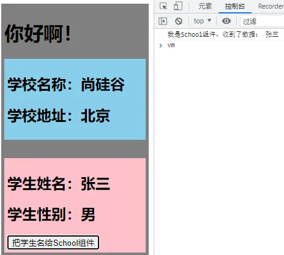

### 2.10.2	使用全局事件总线优化`Todo-List`

<strong style="color:#DD5145">`main.js`</strong>：

```JS
//引入Vue
import Vue from 'vue'
//引入App
import App from './App.vue'
//关闭Vue的生产提示
Vue.config.productionTip = false

//创建vm
new Vue({
	el:'#app',
	render: h => h(App),
	beforeCreate() {
		Vue.prototype.$bus = this
	},
})
```

<strong style="color:#DD5145">`MyItem.vue`</strong>：

```VUE
<template>
	<li>
		<label>
			<input type="checkbox" :checked="todo.done" @change="handleCheck(todo.id)"/>
			<!-- 如下代码也能实现功能，但是不太推荐，因为有点违反原则，因为修改了props -->
			<!-- <input type="checkbox" v-model="todo.done"/> -->
			<span>{{todo.title}}</span>
		</label>
		<button class="btn btn-danger" @click="handleDelete(todo.id)">删除</button>
	</li>
</template>

<script>
	export default {
		name:'MyItem',
		//声明接收todo
		props:['todo'],
		methods: {
			//勾选or取消勾选
			handleCheck(id){
				//通知App组件将对应的todo对象的done值取反
				// this.checkTodo(id)
				this.$bus.$emit('checkTodo',id)
			},
			//删除
			handleDelete(id){
				if(confirm('确定删除吗？')){
					//通知App组件将对应的todo对象删除
					// this.deleteTodo(id)
					this.$bus.$emit('deleteTodo',id)
				}
			}
		},
	}
</script>

<style scoped>
	/*item*/
	li {
		list-style: none;
		height: 36px;
		line-height: 36px;
		padding: 0 5px;
		border-bottom: 1px solid #ddd;
	}

	li label {
		float: left;
		cursor: pointer;
	}

	li label li input {
		vertical-align: middle;
		margin-right: 6px;
		position: relative;
		top: -1px;
	}

	li button {
		float: right;
		display: none;
		margin-top: 3px;
	}

	li:before {
		content: initial;
	}

	li:last-child {
		border-bottom: none;
	}

	li:hover{
		background-color: #ddd;
	}
	
	li:hover button{
		display: block;
	}
</style>
```

<strong style="color:#DD5145">`App.vue`</strong>：

```VUE
<template>
	<div id="root">
		<div class="todo-container">
			<div class="todo-wrap">
				<MyHeader @addTodo="addTodo"/>
				<MyList :todos="todos"/>
				<MyFooter :todos="todos" @checkAllTodo="checkAllTodo" @clearAllTodo="clearAllTodo"/>
			</div>
		</div>
	</div>
</template>

<script>
	import MyHeader from './components/MyHeader'
	import MyList from './components/MyList'
	import MyFooter from './components/MyFooter.vue'

	export default {
		name:'App',
		components:{MyHeader,MyList,MyFooter},
		data() {
			return {
				//由于todos是MyHeader组件和MyFooter组件都在使用，所以放在App中（状态提升）
				todos:JSON.parse(localStorage.getItem('todos')) || []
			}
		},
		methods: {
			//添加一个todo
			addTodo(todoObj){
				this.todos.unshift(todoObj)
			},
			//勾选or取消勾选一个todo
			checkTodo(id){
				this.todos.forEach((todo)=>{
					if(todo.id === id) todo.done = !todo.done
				})
			},
			//删除一个todo
			deleteTodo(id){
				this.todos = this.todos.filter( todo => todo.id !== id )
			},
			//全选or取消全选
			checkAllTodo(done){
				this.todos.forEach((todo)=>{
					todo.done = done
				})
			},
			//清除所有已经完成的todo
			clearAllTodo(){
				this.todos = this.todos.filter((todo)=>{
					return !todo.done
				})
			}
		},
		watch: {
			todos:{
				deep:true,
				handler(value){
					localStorage.setItem('todos',JSON.stringify(value))
				}
			}
		},
		mounted() {
			this.$bus.$on('checkTodo',this.checkTodo)
			this.$bus.$on('deleteTodo',this.deleteTodo)
		},
		beforeDestroy() {
			this.$bus.$off('checkTodo')
			this.$bus.$off('deleteTodo')
		},
	}
</script>

<style>
	/*base*/
	body {
		background: #fff;
	}
	.btn {
		display: inline-block;
		padding: 4px 12px;
		margin-bottom: 0;
		font-size: 14px;
		line-height: 20px;
		text-align: center;
		vertical-align: middle;
		cursor: pointer;
		box-shadow: inset 0 1px 0 rgba(255, 255, 255, 0.2), 0 1px 2px rgba(0, 0, 0, 0.05);
		border-radius: 4px;
	}
	.btn-danger {
		color: #fff;
		background-color: #da4f49;
		border: 1px solid #bd362f;
	}
	.btn-danger:hover {
		color: #fff;
		background-color: #bd362f;
	}
	.btn:focus {
		outline: none;
	}
	.todo-container {
		width: 600px;
		margin: 0 auto;
	}
	.todo-container .todo-wrap {
		padding: 10px;
		border: 1px solid #ddd;
		border-radius: 5px;
	}
</style>
```

## 2.11	消息的订阅与发布（基本不用）

### 2.11.1	消息的订阅与发布

消息订阅与发布`（pubsub）`消息订阅与发布是一种组件间通信的方式，适用于任意组件间通信

使用步骤

1. 安装`pubsub：npm i pubsub-js`

2. 引入：`import pubsub from 'pubsub-js'`

3. 接收数据：`A`组件想接收数据，则在`A`组件中订阅消息，订阅的回调留在`A`组件自身

   ```js
   export default {
       methods: {
           demo(msgName, data) {...}
       }
       ...
       mounted() {
   			this.pid = pubsub.subscribe('xxx',this.demo)
       }
   }
   ```

4. 提供数据：`pubsub.publish('xxx',data)`

5. 最好在`beforeDestroy`钩子中，使用`pubsub.unsubscribe(pid)`取消订阅

<strong style="color:#DD5145">`Student.vue`</strong>：

```vue
<template>
	<div class="student">
		<h2>学生姓名：{{name}}</h2>
		<h2>学生性别：{{sex}}</h2>
		<button @click="sendStudentName">把学生名给School组件</button>
	</div>
</template>

<script>
	import pubsub from 'pubsub-js'
	export default {
		name:'Student',
		data() {
			return {
				name:'张三',
				sex:'男',
			}
		},
		mounted() {
			// console.log('Student',this.x)
		},
		methods: {
			sendStudentName(){
				// this.$bus.$emit('hello',this.name)
				pubsub.publish('hello',666)
			}
		},
	}
</script>

<style lang="less" scoped>
	.student{
		background-color: pink;
		padding: 5px;
		margin-top: 30px;
	}
</style>

```

<strong style="color:#DD5145">`School.vue`</strong>：

```VUE
<template>
	<div class="school">
		<h2>学校名称：{{name}}</h2>
		<h2>学校地址：{{address}}</h2>
	</div>
</template>

<script>
	import pubsub from 'pubsub-js'
	export default {
		name:'School',
		data() {
			return {
				name:'尚硅谷',
				address:'北京',
			}
		},
		mounted() {
			// console.log('School',this)
			/* this.$bus.$on('hello',(data)=>{
				console.log('我是School组件，收到了数据',data)
			}) */
			this.pubId = pubsub.subscribe('hello',(msgName,data)=>{
				console.log(this)
				// console.log('有人发布了hello消息，hello消息的回调执行了',msgName,data)
			})
		},
		beforeDestroy() {
			// this.$bus.$off('hello')
			pubsub.unsubscribe(this.pubId)
		},
	}
</script>

<style scoped>
	.school{
		background-color: skyblue;
		padding: 5px;
	}
</style>
```

### 2.11.2	使用消息的订阅与发布优化`Todo-List`

<strong style="color:#DD5145">`MyItem.vue`</strong>：

```VUE
<template>
	<li>
		<label>
			<input type="checkbox" :checked="todo.done" @change="handleCheck(todo.id)"/>
			<!-- 如下代码也能实现功能，但是不太推荐，因为有点违反原则，因为修改了props -->
			<!-- <input type="checkbox" v-model="todo.done"/> -->
			<span>{{todo.title}}</span>
		</label>
		<button class="btn btn-danger" @click="handleDelete(todo.id)">删除</button>
	</li>
</template>

<script>
	import pubsub from 'pubsub-js'
	export default {
		name:'MyItem',
		//声明接收todo
		props:['todo'],
		methods: {
			//勾选or取消勾选
			handleCheck(id){
				//通知App组件将对应的todo对象的done值取反
				// this.checkTodo(id)
				this.$bus.$emit('checkTodo',id)
			},
			//删除
			handleDelete(id){
				if(confirm('确定删除吗？')){
					//通知App组件将对应的todo对象删除
					// this.deleteTodo(id)
					// this.$bus.$emit('deleteTodo',id)
					pubsub.publish('deleteTodo',id)
				}
			}
		},
	}
</script>

<style scoped>
	/*item*/
	li {
		list-style: none;
		height: 36px;
		line-height: 36px;
		padding: 0 5px;
		border-bottom: 1px solid #ddd;
	}

	li label {
		float: left;
		cursor: pointer;
	}

	li label li input {
		vertical-align: middle;
		margin-right: 6px;
		position: relative;
		top: -1px;
	}

	li button {
		float: right;
		display: none;
		margin-top: 3px;
	}

	li:before {
		content: initial;
	}

	li:last-child {
		border-bottom: none;
	}

	li:hover{
		background-color: #ddd;
	}
	
	li:hover button{
		display: block;
	}
</style>
```

<strong style="color:#DD5145">`App.vue`</strong>：

```VUE
<template>
	<div id="root">
		<div class="todo-container">
			<div class="todo-wrap">
				<MyHeader @addTodo="addTodo"/>
				<MyList :todos="todos"/>
				<MyFooter :todos="todos" @checkAllTodo="checkAllTodo" @clearAllTodo="clearAllTodo"/>
			</div>
		</div>
	</div>
</template>

<script>
	import pubsub from 'pubsub-js'
	import MyHeader from './components/MyHeader'
	import MyList from './components/MyList'
	import MyFooter from './components/MyFooter'

	export default {
		name:'App',
		components:{MyHeader,MyList,MyFooter},
		data() {
			return {
				//由于todos是MyHeader组件和MyFooter组件都在使用，所以放在App中（状态提升）
				todos:JSON.parse(localStorage.getItem('todos')) || []
			}
		},
		methods: {
			//添加一个todo
			addTodo(todoObj){
				this.todos.unshift(todoObj)
			},
			//勾选or取消勾选一个todo
			checkTodo(id){
				this.todos.forEach((todo)=>{
					if(todo.id === id) todo.done = !todo.done
				})
			},
			//删除一个todo
			deleteTodo(_,id){
				this.todos = this.todos.filter( todo => todo.id !== id )
			},
			//全选or取消全选
			checkAllTodo(done){
				this.todos.forEach((todo)=>{
					todo.done = done
				})
			},
			//清除所有已经完成的todo
			clearAllTodo(){
				this.todos = this.todos.filter((todo)=>{
					return !todo.done
				})
			}
		},
		watch: {
			todos:{
				deep:true,
				handler(value){
					localStorage.setItem('todos',JSON.stringify(value))
				}
			}
		},
		mounted() {
			this.$bus.$on('checkTodo',this.checkTodo)
			this.pubId = pubsub.subscribe('deleteTodo',this.deleteTodo)
		},
		beforeDestroy() {
			this.$bus.$off('checkTodo')
			pubsub.unsubscribe(this.pubId)
		},
	}
</script>

<style>
	/*base*/
	body {
		background: #fff;
	}
	.btn {
		display: inline-block;
		padding: 4px 12px;
		margin-bottom: 0;
		font-size: 14px;
		line-height: 20px;
		text-align: center;
		vertical-align: middle;
		cursor: pointer;
		box-shadow: inset 0 1px 0 rgba(255, 255, 255, 0.2), 0 1px 2px rgba(0, 0, 0, 0.05);
		border-radius: 4px;
	}
	.btn-danger {
		color: #fff;
		background-color: #da4f49;
		border: 1px solid #bd362f;
	}
	.btn-danger:hover {
		color: #fff;
		background-color: #bd362f;
	}
	.btn:focus {
		outline: none;
	}
	.todo-container {
		width: 600px;
		margin: 0 auto;
	}
	.todo-container .todo-wrap {
		padding: 10px;
		border: 1px solid #ddd;
		border-radius: 5px;
	}
</style>
```

## 2.12	`$nextTick`

这是一个生命周期钩子
`this.$nextTick(回调函数`)在下一次`DOM`更新结束后执行其指定的回调
什么时候用：当改变数据后，要基于更新后的新`DOM`进行某些操作时，要在`nextTick`所指定的回调函数中执行
使用

`$nextTick` 优化 `Todo-List`

<strong style="color:#DD5145">`App.vue`</strong>：

```vue
<template>
	<li>
		<label>
			<input type="checkbox" :checked="todo.done" @change="handleCheck(todo.id)"/>
			<!-- 如下代码也能实现功能，但是不太推荐，因为有点违反原则，因为修改了props -->
			<!-- <input type="checkbox" v-model="todo.done"/> -->
			<span v-show="!todo.isEdit">{{todo.title}}</span>
			<input 
				type="text" 
				v-show="todo.isEdit" 
				:value="todo.title" 
				@blur="handleBlur(todo,$event)"
				ref="inputTitle"
			>
		</label>
		<button class="btn btn-danger" @click="handleDelete(todo.id)">删除</button>
		<button v-show="!todo.isEdit" class="btn btn-edit" @click="handleEdit(todo)">编辑</button>
	</li>
</template>

<script>
	import pubsub from 'pubsub-js'
	export default {
		name:'MyItem',
		//声明接收todo
		props:['todo'],
		methods: {
			//勾选or取消勾选
			handleCheck(id){
				//通知App组件将对应的todo对象的done值取反
				// this.checkTodo(id)
				this.$bus.$emit('checkTodo',id)
			},
			//删除
			handleDelete(id){
				if(confirm('确定删除吗？')){
					//通知App组件将对应的todo对象删除
					// this.deleteTodo(id)
					// this.$bus.$emit('deleteTodo',id)
					pubsub.publish('deleteTodo',id)
				}
			},
			//编辑
			handleEdit(todo){
				if(todo.hasOwnProperty('isEdit')){
					todo.isEdit = true
				}else{
					// console.log('@')
					this.$set(todo,'isEdit',true)
				}
				this.$nextTick(function(){
					this.$refs.inputTitle.focus()
				})
			},
			//失去焦点回调（真正执行修改逻辑）
			handleBlur(todo,e){
				todo.isEdit = false
				if(!e.target.value.trim()) return alert('输入不能为空！')
				this.$bus.$emit('updateTodo',todo.id,e.target.value)
			}
		},
	}
</script>

<style scoped>
	/*item*/
	li {
		list-style: none;
		height: 36px;
		line-height: 36px;
		padding: 0 5px;
		border-bottom: 1px solid #ddd;
	}

	li label {
		float: left;
		cursor: pointer;
	}

	li label li input {
		vertical-align: middle;
		margin-right: 6px;
		position: relative;
		top: -1px;
	}

	li button {
		float: right;
		display: none;
		margin-top: 3px;
	}

	li:before {
		content: initial;
	}

	li:last-child {
		border-bottom: none;
	}

	li:hover{
		background-color: #ddd;
	}
	
	li:hover button{
		display: block;
	}
</style>
```

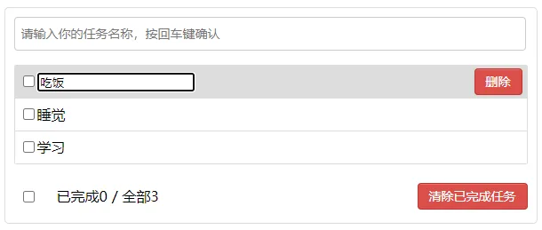

## 2.13	 过渡与动画

### 2.13.1	过渡与动画

`Vue`封装的过度与动画：在插入、更新或移除`DOM`元素时，在合适的时候给元素添加样式类名

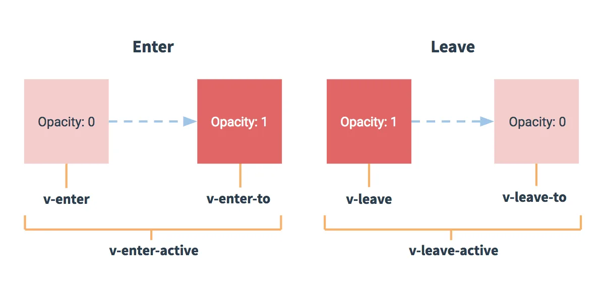

写法

1. 准备好样式

   1. 元素进入的样式
      - `v-enter`		 			  进入的起点
      - `v-enter-active`	进入过程中
      - `v-enter-to`	 	     进入的终点
   2. 元素离开的样式
      - `v-leave`			         离开的起点
      - `v-leave-active`	离开过程中
      - `v-leave-to`		      离开的终点

2. 使用`<transition>`包裹要过度的元素，并配置`name`属性，此时需要将上面样式名的`v`换为`name`

3. 要让页面一开始就显示动画，需要添加`appear`

   ```vue
   <transition name="hello" appear>
     <h1 v-show="isShow">你好啊！</h1>
   </transition>
   
   <style>
     .hello-enter-active{
       animation: hello 0.5s linear;
     }
   
     .hello-leave-active{
       animation: hello 0.5s linear reverse;
     }
   
     @keyframes hello {
       from{
         transform: translateX(-100%);
       }
       to{
         transform: translateX(0px);
       }
     }
   </style>
   ```

4. 备注：若有多个元素需要过度，则需要使用`<transition-group>`，且每个元素都要指定key值

   ```vue
   <transition-group name="hello" appear>
     <h1 v-show="!isShow" key="1">你好啊！</h1>
     <h1 v-show="isShow" key="2">尚硅谷！</h1>
   </transition-group>
   ```

5. 第三方动画库`Animate.css`

```vue
<transition-group appear
          name="animate__animated animate__bounce"
          enter-active-class="animate__swing"
          leave-active-class="animate__backOutUp">
  <h1 v-show="!isShow" key="1">你好啊！</h1>
  <h1 v-show="isShow" key="2">尚硅谷！</h1>
</transition-group>
```

<strong style="color:#DD5145">`main.js`</strong>：

```js
//引入Vue
import Vue from 'vue'
//引入App
import App from './App.vue'
//关闭Vue的生产提示
Vue.config.productionTip = false

//创建vm
new Vue({
	el:'#app',
	render: h => h(App),
	beforeCreate() {
		Vue.prototype.$bus = this
	},
})
```

<strong style="color:#DD5145">`Test.vue`</strong>：

```vue
<template>
	<div>
		<button @click="isShow = !isShow">显示/隐藏</button>
		<transition name="hello" appear>
			<h1 v-show="isShow">你好啊！</h1>
		</transition>
	</div>
</template>

<script>
	export default {
		name:'Test',
		data() {
			return {
				isShow:true
			}
		},
	}
</script>

<style scoped>
	h1{
		background-color: orange;
	}

	.hello-enter-active{
		animation: atguigu 0.5s linear;
	}

	.hello-leave-active{
		animation: atguigu 0.5s linear reverse;
	}

	@keyframes atguigu {
		from{
			transform: translateX(-100%);
		}
		to{
			transform: translateX(0px);
		}
	}
</style>
```

<strong style="color:#DD5145">`Test2.vue`</strong>：

```vue
<template>
	<div>
		<button @click="isShow = !isShow">显示/隐藏</button>
		<transition-group name="hello" appear>
			<h1 v-show="!isShow" key="1">你好啊！</h1>
			<h1 v-show="isShow" key="2">尚硅谷！</h1>
		</transition-group>
	</div>
</template>

<script>
	export default {
		name:'Test',
		data() {
			return {
				isShow:true
			}
		},
	}
</script>

<style scoped>
	h1{
		background-color: orange;
	}
	/* 进入的起点、离开的终点 */
	.hello-enter,.hello-leave-to{
		transform: translateX(-100%);
	}
	.hello-enter-active,.hello-leave-active{
		transition: 0.5s linear;
	}
	/* 进入的终点、离开的起点 */
	.hello-enter-to,.hello-leave{
		transform: translateX(0);
	}

</style>
```

<strong style="color:#DD5145">`Test3.vue`</strong>：

```vue
<template>
	<div>
		<button @click="isShow = !isShow">显示/隐藏</button>
		<transition-group 
			appear
			name="animate__animated animate__bounce" 
			enter-active-class="animate__swing"
			leave-active-class="animate__backOutUp"
		>
			<h1 v-show="!isShow" key="1">你好啊！</h1>
			<h1 v-show="isShow" key="2">尚硅谷！</h1>
		</transition-group>
	</div>
</template>

<script>
	import 'animate.css'
	export default {
		name:'Test',
		data() {
			return {
				isShow:true
			}
		},
	}
</script>

<style scoped>
	h1{
		background-color: orange;
	}
	

</style>
```

<strong style="color:#DD5145">`App.vue`</strong>：

```vue
<template>
	<div>
		<Test/>
		<Test2/>
		<Test3/>
	</div>
</template>

<script>
	import Test from './components/Test'
	import Test2 from './components/Test2'
	import Test3 from './components/Test3'

	export default {
		name:'App',
		components:{Test,Test2,Test3},
	}
</script>
```

### 2.13.2	使用动画优化 `Todo-List`

<strong style="color:#DD5145">`MyItem.vue`</strong>：

```vue
<template>
	<li>
		<label>
			<input type="checkbox" :checked="todo.done" @change="handleCheck(todo.id)"/>
			<!-- 如下代码也能实现功能，但是不太推荐，因为有点违反原则，因为修改了props -->
			<!-- <input type="checkbox" v-model="todo.done"/> -->
			<span v-show="!todo.isEdit">{{todo.title}}</span>
			<input 
				type="text" 
				v-show="todo.isEdit" 
				:value="todo.title" 
				@blur="handleBlur(todo,$event)"
				ref="inputTitle"
			>
		</label>
		<button class="btn btn-danger" @click="handleDelete(todo.id)">删除</button>
		<button v-show="!todo.isEdit" class="btn btn-edit" @click="handleEdit(todo)">编辑</button>
	</li>
</template>

<script>
	import pubsub from 'pubsub-js'
	export default {
		name:'MyItem',
		//声明接收todo
		props:['todo'],
		methods: {
			//勾选or取消勾选
			handleCheck(id){
				//通知App组件将对应的todo对象的done值取反
				// this.checkTodo(id)
				this.$bus.$emit('checkTodo',id)
			},
			//删除
			handleDelete(id){
				if(confirm('确定删除吗？')){
					//通知App组件将对应的todo对象删除
					// this.deleteTodo(id)
					// this.$bus.$emit('deleteTodo',id)
					pubsub.publish('deleteTodo',id)
				}
			},
			//编辑
			handleEdit(todo){
				if(todo.hasOwnProperty('isEdit')){
					todo.isEdit = true
				}else{
					// console.log('@')
					this.$set(todo,'isEdit',true)
				}
				this.$nextTick(function(){
					this.$refs.inputTitle.focus()
				})
			},
			//失去焦点回调（真正执行修改逻辑）
			handleBlur(todo,e){
				todo.isEdit = false
				if(!e.target.value.trim()) return alert('输入不能为空！')
				this.$bus.$emit('updateTodo',todo.id,e.target.value)
			}
		},
	}
</script>

<style scoped>
	/*item*/
	li {
		list-style: none;
		height: 36px;
		line-height: 36px;
		padding: 0 5px;
		border-bottom: 1px solid #ddd;
	}

	li label {
		float: left;
		cursor: pointer;
	}

	li label li input {
		vertical-align: middle;
		margin-right: 6px;
		position: relative;
		top: -1px;
	}

	li button {
		float: right;
		display: none;
		margin-top: 3px;
	}

	li:before {
		content: initial;
	}

	li:last-child {
		border-bottom: none;
	}

	li:hover{
		background-color: #ddd;
	}
	
	li:hover button{
		display: block;
	}
</style>
```

## 2.14	Ajax 配置代理

本案例需要下载`axios`库<strong style="color:#ff0000;font-size: 22px;">`npm install axios`</strong>

**配置参考文档 `Vue-Cli devServer.proxy`**
`vue.config.js` 是一个可选的配置文件，如果项目的 (和 `package.json` 同级的) 根目录中存在这个文件，那么它会被 `@vue/cli-service` 自动加载。你也可以使用 `package.json` 中的 `vue` 字段，但是注意这种写法需要你严格遵照 `JSON` 的格式来写

**方法一**

​	在`vue.config.js`中添加如下配置

```js
module.exports = {
  devServer:{
    proxy:"http://localhost:5000"
  }
}
```

说明

1. 优点：配置简单，请求资源时直接发给前端`（8080）`即可
2. 缺点：不能配置多个代理，不能灵活的控制请求是否走代理
3. 工作方式：若按照上述配置代理，当请求了前端不存在的资源时，才会将请求会转发给服务器 （优先匹配前端资源）

**方法二**

​	编写`vue.config.js`配置具体代理规则

```js
module.exports = {
	devServer: {
      proxy: {
      '/api1': {													// 匹配所有以 '/api1'开头的请求路径
        target: 'http://localhost:5000',	// 代理目标的基础路径
        pathRewrite: {'^/api1':''},				// 代理往后端服务器的请求去掉 /api1 前缀
        ws: true,													// WebSocket
        changeOrigin: true,
        
      },
      '/api2': {
        target: 'http://localhost:5001',
        pathRewrite: {'^/api2': ''},
        changeOrigin: true
      }
    }
  }
}
/*
   changeOrigin设置为true时，服务器收到的请求头中的host为：localhost:5000
   changeOrigin设置为false时，服务器收到的请求头中的host为：localhost:8080
   changeOrigin默认值为true
*/
```

说明

1. 优点：可以配置多个代理，且可以灵活的控制请求是否走代理
2. 缺点：配置略微繁琐，请求资源时必须加前缀

<strong style="color:#DD5145">`vue.config.js`</strong>：

```js
module.exports = {
    pages: {
        index: {
            entry: 'src/main.js',
        },
    },
    lintOnSave:false,
    // 开启代理服务器（方式一）
    // devServer: {
    //     proxy:'http://localhost:5000'
    // }

    //开启代理服务器（方式二）
	devServer: {
        proxy: {
            '/api1': {
                target: 'http://localhost:5000',
                pathRewrite:{'^/api1':''},
                // ws: true, //用于支持websocket,默认值为true
                // changeOrigin: true //用于控制请求头中的host值,默认值为true
            },
            '/api2': {
                target: 'http://localhost:5001',
                pathRewrite:{'^/api2':''},
            }
        }
    }
}
```

<strong style="color:#DD5145">`MyItem.vue`</strong>：

```vue
<template>
	<div>
		<button @click="getStudents">获取学生信息</button>
		<button @click="getCars">获取汽车信息</button>
	</div>
</template>

<script>
	import axios from 'axios'
	export default {
		name:'App',
		methods: {
			getStudents(){
				axios.get('http://localhost:8080/students').then(
					response => {
						console.log('请求成功了',response.data)
					},
					error => {
						console.log('请求失败了',error.message)
					}
				)
			},
			getCars(){
				axios.get('http://localhost:8080/demo/cars').then(
					response => {
						console.log('请求成功了',response.data)
					},
					error => {
						console.log('请求失败了',error.message)
					}
				)
			}
		},
	}
</script>
```

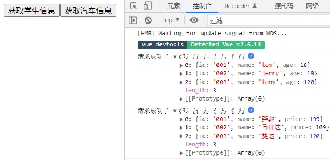

发送请求的几种方式：

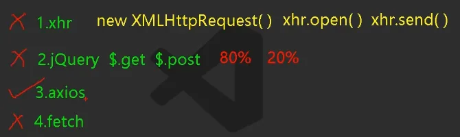

跨域的几种解决方法：

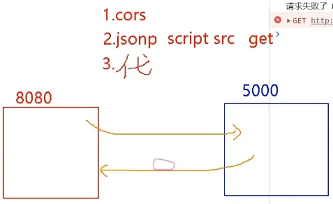

代理服务器的原理及方案：

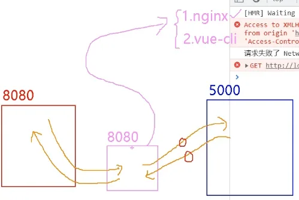

加了前缀后的问题：

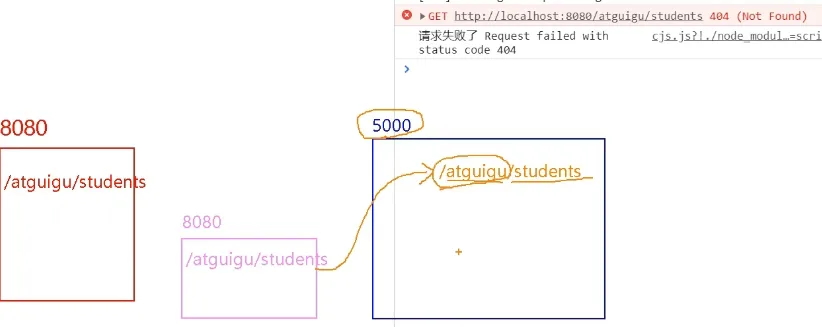

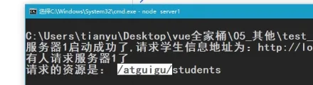

## 2.15	`GitHub`用户搜索案例

<strong style="color:#DD5145">`main.js`</strong>：

```js
//引入Vue
import Vue from 'vue'
//引入App
import App from './App.vue'
//关闭Vue的生产提示
Vue.config.productionTip = false

//创建vm
new Vue({
	el:'#app',
	render: h => h(App),
	beforeCreate() {
		Vue.prototype.$bus = this
	},
})
```

<strong style="color:#DD5145">`index.html`</strong>：

```html
<!DOCTYPE html>
<html lang="">
    <head>
        <meta charset="UTF-8">
        <!-- 针对IE浏览器的特殊配置，含义是让IE浏览器以最高渲染级别渲染页面 -->
        <meta http-equiv="X-UA-Compatible" content="IE=edge">
        <!-- 开启移动端的理想端口 -->
        <meta name="viewport" content="width=device-width, initial-scale=1.0">
        <!-- 配置页签图标 -->
        <link rel="icon" href="<%= BASE_URL %>favicon.ico">
      
        <!-- 引入bootstrap样式 -->
        <link rel="stylesheet" href="<%= BASE_URL %>css/bootstrap.css">
      
        <!-- 配置网页标题 -->
        <title><%= htmlWebpackPlugin.options.title %></title>
    </head>
    <body>
        <!-- 容器 -->
        <div id="app"></div>
    </body>
</html>
```

<strong style="color:#DD5145">`List.vue`</strong>：

```vue
<template>
	<div class="row">
		<!-- 展示用户列表 -->
		<div v-show="info.users.length" class="card" v-for="user in info.users" :key="user.login">
			<a :href="user.html_url" target="_blank">
				
			</a>
			<p class="card-text">{{user.login}}</p>
		</div>
		<!-- 展示欢迎词 -->
		<h1 v-show="info.isFirst">欢迎使用！</h1>
		<!-- 展示加载中 -->
		<h1 v-show="info.isLoading">加载中....</h1>
		<!-- 展示错误信息 -->
		<h1 v-show="info.errMsg">{{info.errMsg}}</h1>
	</div>
</template>

<script>
	export default {
		name:'List',
		data() {
			return {
				info:{
					isFirst:true,
					isLoading:false,
					errMsg:'',
					users:[]
				}
			}
		},
		mounted() {
			this.$bus.$on('updateListData',(dataObj)=>{
				this.info = {...this.info,...dataObj}
			})
		},
	}
</script>

<style scoped>
	.album {
		min-height: 50rem; /* Can be removed; just added for demo purposes */
		padding-top: 3rem;
		padding-bottom: 3rem;
		background-color: #f7f7f7;
	}

	.card {
		float: left;
		width: 33.333%;
		padding: .75rem;
		margin-bottom: 2rem;
		border: 1px solid #efefef;
		text-align: center;
	}

	.card > img {
		margin-bottom: .75rem;
		border-radius: 100px;
	}

	.card-text {
		font-size: 85%;
	}
</style>
```

<strong style="color:#DD5145">`Search.vue`</strong>：

```vue
<template>
	<section class="jumbotron">
		<h3 class="jumbotron-heading">Search Github Users</h3>
		<div>
			<input type="text" placeholder="enter the name you search" v-model="keyWord"/>&nbsp;
			<button @click="searchUsers">Search</button>
		</div>
	</section>
</template>

<script>
	import axios from 'axios'
	export default {
		name:'Search',
		data() {
			return {
				keyWord:''
			}
		},
		methods: {
			searchUsers(){
				//请求前更新List的数据
				this.$bus.$emit('updateListData',{isLoading:true,errMsg:'',users:[],isFirst:false})
				axios.get(`https://api.github.com/search/users?q=${this.keyWord}`).then(
					response => {
						console.log('请求成功了')
						//请求成功后更新List的数据
						this.$bus.$emit('updateListData',{isLoading:false,errMsg:'',users:response.data.items})
					},
					error => {
						//请求后更新List的数据
						this.$bus.$emit('updateListData',{isLoading:false,errMsg:error.message,users:[]})
					}
				)
			}
		},
	}
</script>

```

<strong style="color:#DD5145">`App.vue`</strong>：

```vue
<template>
	<div class="container">
		<Search/>
		<List/>
	</div>
</template>

<script>
	import Search from './components/Search'
	import List from './components/List'
	export default {
		name:'App',
		components:{Search,List}
	}
</script>

```

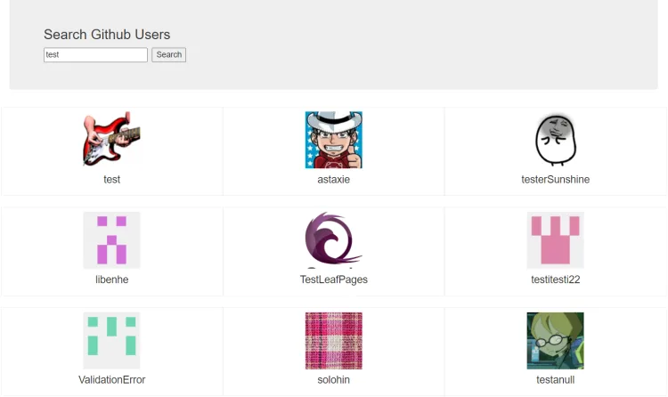

## 2.16	 ~~`vue-resource`(目前已经弃用)~~

`vue`项目常用的两个`Ajax`库

1. `axios`：通用的Ajax请求库，官方推荐，效率高
2. `vue-resource：vue`插件库，`vue 1.x`使用广泛，官方已不维护

下载`vue-resource`库`npm i vue-resource`

<strong style="color:#DD5145">`main.js`</strong>：

```js
//引入Vue
import Vue from 'vue'
//引入App
import App from './App.vue'
//引入插件
import vueResource from 'vue-resource'
//关闭Vue的生产提示
Vue.config.productionTip = false
//使用插件
Vue.use(vueResource)

//创建vm
new Vue({
	el:'#app',
	render: h => h(App),
	beforeCreate() {
		Vue.prototype.$bus = this
	},
})
```

<strong style="color:#DD5145">`List.vue`</strong>：

```vue
<template>
	<div class="row">
		<!-- 展示用户列表 -->
		<div v-show="info.users.length" class="card" v-for="user in info.users" :key="user.login">
			<a :href="user.html_url" target="_blank">
				
			</a>
			<p class="card-text">{{user.login}}</p>
		</div>
		<!-- 展示欢迎词 -->
		<h1 v-show="info.isFirst">欢迎使用！</h1>
		<!-- 展示加载中 -->
		<h1 v-show="info.isLoading">加载中....</h1>
		<!-- 展示错误信息 -->
		<h1 v-show="info.errMsg">{{info.errMsg}}</h1>
	</div>
</template>

<script>
	export default {
		name:'List',
		data() {
			return {
				info:{
					isFirst:true,
					isLoading:false,
					errMsg:'',
					users:[]
				}
			}
		},
		mounted() {
			this.$bus.$on('updateListData',(dataObj)=>{
				this.info = {...this.info,...dataObj}//解构函数
			})
		},
	}
</script>

<style scoped>
	.album {
		min-height: 50rem; /* Can be removed; just added for demo purposes */
		padding-top: 3rem;
		padding-bottom: 3rem;
		background-color: #f7f7f7;
	}

	.card {
		float: left;
		width: 33.333%;
		padding: .75rem;
		margin-bottom: 2rem;
		border: 1px solid #efefef;
		text-align: center;
	}

	.card > img {
		margin-bottom: .75rem;
		border-radius: 100px;
	}

	.card-text {
		font-size: 85%;
	}
</style>
```

<strong style="color:#DD5145">`Search.vue`</strong>：

```vue
<template>
	<section class="jumbotron">
		<h3 class="jumbotron-heading">Search Github Users</h3>
		<div>
			<input type="text" placeholder="enter the name you search" v-model="keyWord"/>&nbsp;
			<button @click="searchUsers">Search</button>
		</div>
	</section>
</template>

<script>
	export default {
		name:'Search',
		data() {
			return {
				keyWord:''
			}
		},
		methods: {
			searchUsers(){
				//请求前更新List的数据
				this.$bus.$emit('updateListData',{isLoading:true,errMsg:'',users:[],isFirst:false})
				this.$http.get(`https://api.github.com/search/users?q=${this.keyWord}`).then(
					response => {
						console.log('请求成功了')
						//请求成功后更新List的数据
						this.$bus.$emit('updateListData',{isLoading:false,errMsg:'',users:response.data.items})
					},
					error => {
						//请求后更新List的数据
						this.$bus.$emit('updateListData',{isLoading:false,errMsg:error.message,users:[]})
					}
				)
			}
		},
	}
</script>
```

<strong style="color:#DD5145">`App.vue`</strong>：

```vue
<template>
	<div class="container">
		<Search/>
		<List/>
	</div>
</template>

<script>
	import Search from './components/Search'
	import List from './components/List'
	export default {
		name:'App',
		components:{Search,List}
	}
</script>
```

## 2.17	 `slot` 插槽

`<slot>`插槽：让父组件可以向子组件指定位置插入`html`结构，也是一种组件间通信的方式，

适用于 父组件 ===> 子组件

1. 分类：默认插槽、具名插槽、作用域插槽

2. 使用方式

   1. 默认插槽

      ```vue
      父组件中：
              <Category>
                 <div>html结构1</div>
              </Category>
      子组件中：Category
              <template>
                  <div>
                     <!-- 定义插槽 -->
                     <slot>插槽默认内容...</slot>
                  </div>
              </template>
      ```

   2. 具名插槽

      1. 父组件指明放入子组件的哪个插槽`slot="footer"`，如果是`template`可以写成`v-slot:footer`

         ```vue
         父组件中：
                 <Category>
                     <template slot="center">
                       <div>html结构1</div>
                     </template>
         
                     <template v-slot:footer>
                        <div>html结构2</div>
                     </template>
                 </Category>
         子组件中：
                 <template>
                     <div>
                        <!-- 定义插槽 -->
                        <slot name="center">插槽默认内容...</slot>
                        <slot name="footer">插槽默认内容...</slot>
                     </div>
                 </template>
         ```

   3. 作用域插槽

      1. `scope`用于父组件往子组件插槽放的`html`结构接收子组件的数据

      2. 理解：数据在组件的自身，但根据数据生成的结构需要组件的使用者来决定（`games`数据在`Category`组件中，但使用数据所遍历出来的结构由`App`组件决定）

         ```vue
         父组件中：
                 <Category>
                     <template scope="scopeData">
                         <!-- 生成的是ul列表 -->
                         <ul>
                           <li v-for="g in scopeData.games" :key="g">{{g}}</li>
                         </ul>
                     </template>
                 </Category>
         
                 <Category>
                     <template slot-scope="scopeData">
                         <!-- 生成的是h4标题 -->
                         <h4 v-for="g in scopeData.games" :key="g">{{g}}</h4>
                     </template>
                 </Category>
         子组件中：
                 <template>
                     <div>
                         <slot :games="games"></slot>
                     </div>
                 </template>
                 
                 <script>
                     export default {
                         name:'Category',
                         props:['title'],
                         //数据在子组件自身
                         data() {
                             return {
                                 games:['红色警戒','穿越火线','劲舞团','超级玛丽']
                             }
                         },
                     }
                 </script>
         ```


注意：关于样式，既可以写在父组件中，解析后放入子组件插槽；也可以放在子组件中，传给子组件再解析

### 2.17.1	默认插槽

<strong style="color:#DD5145">`Category.vue`</strong>：

```vue
<template>
	<div class="category">
		<h3>{{title}}分类</h3>
		<!-- 定义一个插槽（挖个坑，等着组件的使用者进行填充） -->
		<slot>我是一些默认值，当使用者没有传递具体结构时，我会出现</slot>
	</div>
</template>

<script>
	export default {
		name:'Category',
		props:['title']
	}
</script>

<style scoped>
	.category{
		background-color: skyblue;
		width: 200px;
		height: 300px;
	}
	h3{
		text-align: center;
		background-color: orange;
	}
	video{
		width: 100%;
	}
	img{
		width: 100%;
	}
</style>
```

<strong style="color:#DD5145">`App.vue`</strong>：

```vue
<template>
	<div class="container">
		<Category title="美食" >
			
		</Category>

		<Category title="游戏" >
			<ul>
				<li v-for="(g,index) in games" :key="index">{{g}}</li>
			</ul>
		</Category>

		<Category title="电影">
			<video controls src="http://clips.vorwaerts-gmbh.de/big_buck_bunny.mp4"></video>
		</Category>
	</div>
</template>

<script>
	import Category from './components/Category'
	export default {
		name:'App',
		components:{Category},
		data() {
			return {
				foods:['火锅','烧烤','小龙虾','牛排'],
				games:['红色警戒','穿越火线','劲舞团','超级玛丽'],
				films:['《教父》','《拆弹专家》','《你好，李焕英》','《尚硅谷》']
			}
		},
	}
</script>

<style scoped>
	.container{
		display: flex;
		justify-content: space-around;
	}
</style>
```

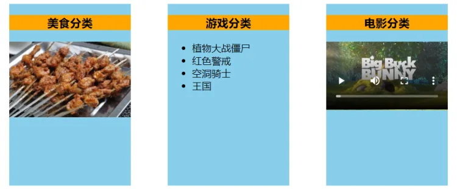

### 2.17.2	具名插槽

<strong style="color:#DD5145">`Category.vue`</strong>：

```vue
<template>
	<div class="category">
		<h3>{{title}}分类</h3>
		<!-- 定义一个插槽（挖个坑，等着组件的使用者进行填充） -->
		<slot name="center">我是一些默认值，当使用者没有传递具体结构时，我会出现1</slot>
		<slot name="footer">我是一些默认值，当使用者没有传递具体结构时，我会出现2</slot>
	</div>
</template>

<script>
	export default {
		name:'Category',
		props:['title']
	}
</script>

<style scoped>
	.category{
		background-color: skyblue;
		width: 200px;
		height: 300px;
	}
	h3{
		text-align: center;
		background-color: orange;
	}
	video{
		width: 100%;
	}
	img{
		width: 100%;
	}
</style>
```

<strong style="color:#DD5145">`App.vue`</strong>：

```vue
<template>
	<div class="container">
		<Category title="美食" >
			
			<a slot="footer" href="http://www.atguigu.com">更多美食</a>
		</Category>

		<Category title="游戏" >
			<ul slot="center">
				<li v-for="(g,index) in games" :key="index">{{g}}</li>
			</ul>
			<div class="foot" slot="footer">
				<a href="http://www.atguigu.com">单机游戏</a>
				<a href="http://www.atguigu.com">网络游戏</a>
			</div>
		</Category>

		<Category title="电影">
			<video slot="center" controls src="http://clips.vorwaerts-gmbh.de/big_buck_bunny.mp4"></video>
			<template v-slot:footer>
				<div class="foot">
					<a href="http://www.atguigu.com">经典</a>
					<a href="http://www.atguigu.com">热门</a>
					<a href="http://www.atguigu.com">推荐</a>
				</div>
				<h4>欢迎前来观影</h4>
			</template>
		</Category>
	</div>
</template>

<script>
	import Category from './components/Category'
	export default {
		name:'App',
		components:{Category},
		data() {
			return {
				foods:['火锅','烧烤','小龙虾','牛排'],
				games:['红色警戒','穿越火线','劲舞团','超级玛丽'],
				films:['《教父》','《拆弹专家》','《你好，李焕英》','《尚硅谷》']
			}
		},
	}
</script>

<style scoped>
	.container,.foot{
		display: flex;
		justify-content: space-around;
	}
	h4{
		text-align: center;
	}
</style>
```

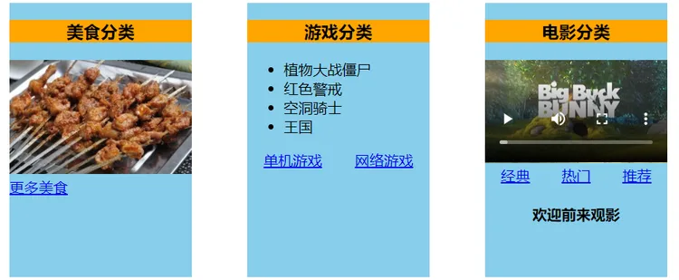

### 2.17.3	作用域插槽

<strong style="color:#DD5145">`Category.vue`</strong>：

```vue
<template>
	<div class="category">
		<h3>{{title}}分类</h3>
		<slot :games="games" msg="hello">我是默认的一些内容</slot>
	</div>
</template>

<script>
	export default {
		name:'Category',
		props:['title'],
		data() {
			return {
				games:['红色警戒','穿越火线','劲舞团','超级玛丽'],
			}
		},
	}
</script>

<style scoped>
	.category{
		background-color: skyblue;
		width: 200px;
		height: 300px;
	}
	h3{
		text-align: center;
		background-color: orange;
	}
	video{
		width: 100%;
	}
	img{
		width: 100%;
	}
</style>
```

<strong style="color:#DD5145">`App.vue`</strong>：

```vue
<template>
	<div class="container">

		<Category title="游戏">
			<template scope="atguigu">
				<ul>
					<li v-for="(g,index) in atguigu.games" :key="index">{{g}}</li>
				</ul>
			</template>
		</Category>

		<Category title="游戏">
			<template scope="{games}">
				<ol>
					<li style="color:red" v-for="(g,index) in games" :key="index">{{g}}</li>
				</ol>
			</template>
		</Category>

		<Category title="游戏">
			<template slot-scope="{games}">
				<h4 v-for="(g,index) in games" :key="index">{{g}}</h4>
			</template>
		</Category>

	</div>
</template>

<script>
	import Category from './components/Category'
	export default {
		name:'App',
		components:{Category},
	}
</script>

<style scoped>
	.container,.foot{
		display: flex;
		justify-content: space-around;
	}
	h4{
		text-align: center;
	}
</style>

```

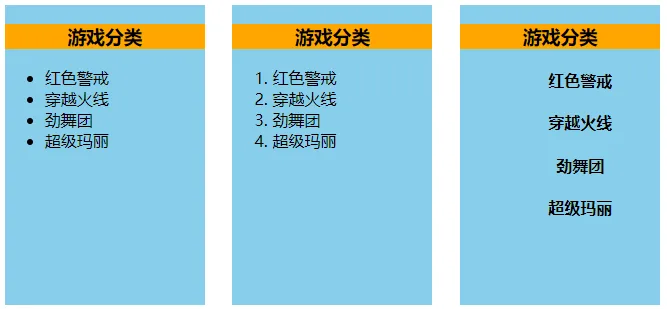
