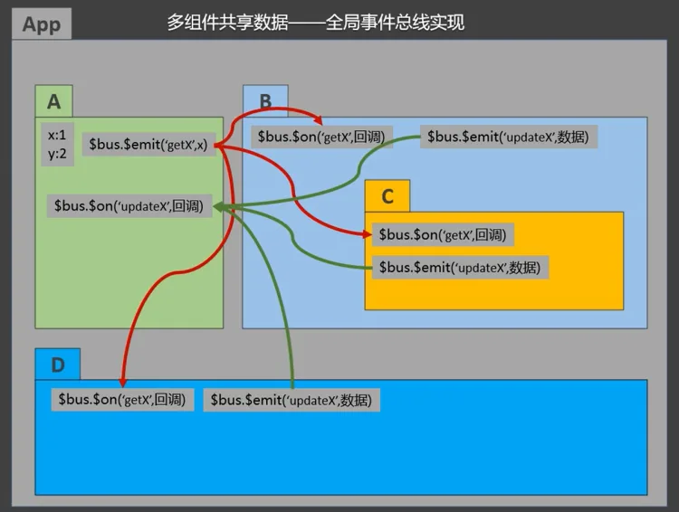
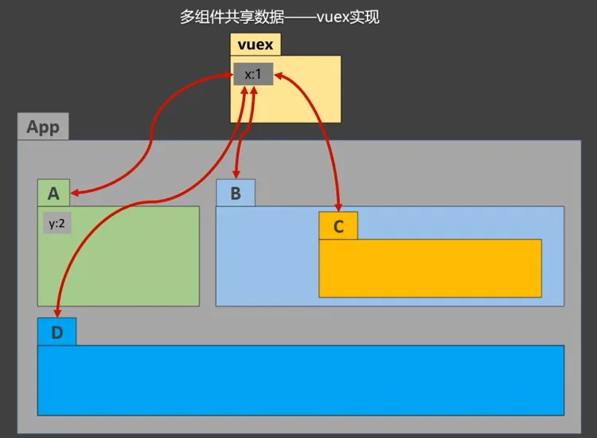
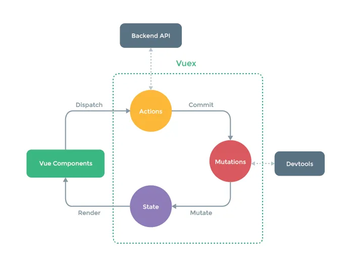
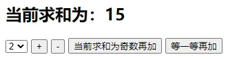
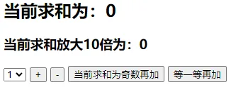
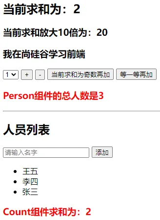
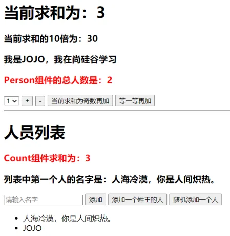

# 3    `Vuex`

## 3.1	理解 `Vuex`

### 3.1.1    `Vuex` 是什么

1. 概念：专门在`Vue`中实现集中式状态（数据）管理的一个`Vue`插件，对`Vue`应用中多个组件的共享状态进行集中式的管理（读/写），也是一种组件间通信的方式，且适用于任意组件间通信
2. [`Vuex Github地址`](https://github.com/vuejs/vuex)





### 3.1.2	 什么时候使用 `Vuex`

1. 多个组件依赖于同一状态
2. 来自不同组件的行为需要变更同一状态

### 3.1.3    `Vuex` 工作原理图



## 3.2	 求和案例



### 3.2.1	使用纯 vue 编写

<strong style="color:#DD5145">`Count.vue`</strong>：

```vue
<template>
  <div>
    <h1>当前求和为：{{sum}}</h1>
    <select v-model.number="n">
      <option value="1">1</option>
      <option value="2">2</option>
      <option value="3">3</option>
    </select>
    <button @click="increment">+</button>
    <button @click="decrement">-</button>
    <button @click="incrementOdd">当前求和为奇数再加</button>
    <button @click="incrementWait">等一等再加</button>
  </div>
</template>

<script>
  export default {
    name: 'Count',
    data() {
      return {
        n: 1, //用户选择的数字
        sum: 0 //当前的和
      }
    },
    methods: {
      increment() {
        this.sum += this.n
      },
      decrement() {
        this.sum -= this.n
      },
      incrementOdd() {
        if (this.sum % 2) {
          this.sum += this.n
        }
      },
      incrementWait() {
        setTimeout(() => {
          this.sum += this.n
        }, 500)
      },
    },
  }
</script>

<style lang="css">
  button {
    margin-left: 5px;
  }
</style>
```

<strong style="color:#DD5145">`App.vue`</strong>：

```vue
<template>
  <div>
    <Count/>
  </div>
</template>

<script>
  import Count from './components/Count'

  export default {
    name: 'App',
    components: {Count},
  }
</script>
```

### 3.2.2	搭建 `Vuex` 环境

下载安装`vuex` `npm i vuex`

创建`src/store/index.js`该文件用于创建`Vuex`中最为核心的`store`

```js
import Vue from 'vue'
import Vuex from 'vuex'	// 引入Vuex

Vue.use(Vuex)	// 应用Vuex插件

const actions = {}		// 准备actions——用于响应组件中的动作
const mutations = {}	// 准备mutations——用于操作数据（state）
const state = {}			// 准备state——用于存储数据

// 创建并暴露store
export default new Vuex.Store({
    actions,
    mutations,
    state,
})
```

在`src/main.js`中创建`vm`时传入`store`配置项

```js
import Vue from 'vue'
import App from './App.vue'
import store from './store'	// 引入store

Vue.config.productionTip = false

new Vue({
    el: '#app',
    render: h => h(App),
    store,										// 配置项添加store
    beforeCreate() {
        Vue.prototype.$bus = this
    }
})
```

### 3.2.3 	使用 `Vuex` 编写

`Vuex`的基本使用

1. 初始化数据`state`，配置`actions`、`mutations`，操作文件`store.js`
2. 组件中读取`vuex`中的数据`$store.state.数据`
3. 组件中修改`vuex`中的数据`$store.dispatch('action中的方法名',数据)`或 `$store.commit('mutations中的方法名',数据)  `
4. 若没有网络请求或其他业务逻辑，组件中也可越过`actions`，即不写`dispatch`，直接编写`commit`

<strong style="color:#DD5145">`src/store/index.js`</strong>：

```js
//该文件用于创建Vuex中最为核心的store
import Vue from 'vue'
//引入Vuex
import Vuex from 'vuex'
//应用Vuex插件
Vue.use(Vuex)

//准备actions——用于响应组件中的动作
const actions = {
    /* jia(context,value){
        console.log('actions中的jia被调用了')
        context.commit('JIA',value)
    },
    jian(context,value){
        console.log('actions中的jian被调用了')
        context.commit('JIAN',value)
    }, */
    jiaOdd(context, value) {
        console.log('actions中的jiaOdd被调用了')
        if (context.state.sum % 2) {
            context.commit('JIA', value)
        }
    },
    jiaWait(context, value) {
        console.log('actions中的jiaWait被调用了')
        setTimeout(() => {
            context.commit('JIA', value)
        }, 500)
    }
}
//准备mutations——用于操作数据（state）
const mutations = {
    JIA(state, value) {
        console.log('mutations中的JIA被调用了')
        state.sum += value
    },
    JIAN(state, value) {
        console.log('mutations中的JIAN被调用了')
        state.sum -= value
    }
}
//准备state——用于存储数据
const state = {
    sum: 0 //当前的和
}

//创建并暴露store
export default new Vuex.Store({
    actions,
    mutations,
    state,
})
```

<strong style="color:#DD5145">`src/components/Count.vue`</strong>：

```vue
<template>
  <div>
    <h1>当前求和为：{{$store.state.sum}}</h1>
    <select v-model.number="n">
      <option value="1">1</option>
      <option value="2">2</option>
      <option value="3">3</option>
    </select>
    <button @click="increment">+</button>
    <button @click="decrement">-</button>
    <button @click="incrementOdd">当前求和为奇数再加</button>
    <button @click="incrementWait">等一等再加</button>
  </div>
</template>

<script>
  export default {
    name: 'Count',
    data() {
      return {
        n: 1, //用户选择的数字
      }
    },
    methods: {
      increment() {
        this.$store.commit('JIA', this.n)
      },
      decrement() {
        this.$store.commit('JIAN', this.n)
      },
      incrementOdd() {
        this.$store.dispatch('jiaOdd', this.n)
      },
      incrementWait() {
        this.$store.dispatch('jiaWait', this.n)
      },
    },
    mounted() {
      console.log('Count', this)
    },
  }
</script>

<style lang="css">
  button {
    margin-left: 5px;
  }
</style>
```

<strong style="color:#DD5145">`App.vue`</strong>

```vue
<template>
  <div>
    <Count/>
  </div>
</template>

<script>
  import Count from './components/Count'

  export default {
    name: 'App',
    components: {Count},
    mounted() {
      // console.log('App',this)
    },
  }
</script>
```

## 3.3    `getters` 配置项

1. 概念：当`state`中的数据需要经过加工后再使用时，可以使用`getters`加工，相当于全局计算属性

2. 在`store.js`中追加`getters`配置

   ```js
   const getters = {
   	bigSum(state){
   		return state.sum * 10
   	}
   }
   
   // 创建并暴露store
   export default new Vuex.Store({
   	......
   	getters
   })
   ```

3. 组件中读取数据`$store.getters.bigSum`

<strong style="color:#DD5145">`src/store/index.js`</strong>

```js
//该文件用于创建Vuex中最为核心的store
import Vue from 'vue'
//引入Vuex
import Vuex from 'vuex'
//应用Vuex插件
Vue.use(Vuex)

//准备actions——用于响应组件中的动作
const actions = {
    /* jia(context,value){
        console.log('actions中的jia被调用了')
        context.commit('JIA',value)
    },
    jian(context,value){
        console.log('actions中的jian被调用了')
        context.commit('JIAN',value)
    }, */
    jiaOdd(context, value) {
        console.log('actions中的jiaOdd被调用了')
        if (context.state.sum % 2) {
            context.commit('JIA', value)
        }
    },
    jiaWait(context, value) {
        console.log('actions中的jiaWait被调用了')
        setTimeout(() => {
            context.commit('JIA', value)
        }, 500)
    }
}
//准备mutations——用于操作数据（state）
const mutations = {
    JIA(state, value) {
        console.log('mutations中的JIA被调用了')
        state.sum += value
    },
    JIAN(state, value) {
        console.log('mutations中的JIAN被调用了')
        state.sum -= value
    }
}
//准备state——用于存储数据
const state = {
    sum: 0 //当前的和
}
//准备getters——用于将state中的数据进行加工
const getters = {
    bigSum(state) {
        return state.sum * 10
    }
}

//创建并暴露store
export default new Vuex.Store({
    actions,
    mutations,
    state,
    getters
})
```

<strong style="color:#DD5145">`App.vue`</strong>

```vue
<template>
  <div>
    <h1>当前求和为：{{$store.state.sum}}</h1>
    <h3>当前求和放大10倍为：{{$store.getters.bigSum}}</h3>
    <select v-model.number="n">
      <option value="1">1</option>
      <option value="2">2</option>
      <option value="3">3</option>
    </select>
    <button @click="increment">+</button>
    <button @click="decrement">-</button>
    <button @click="incrementOdd">当前求和为奇数再加</button>
    <button @click="incrementWait">等一等再加</button>
  </div>
</template>

<script>
  export default {
    name: 'Count',
    data() {
      return {
        n: 1, //用户选择的数字
      }
    },
    methods: {
      increment() {
        this.$store.commit('JIA', this.n)
      },
      decrement() {
        this.$store.commit('JIAN', this.n)
      },
      incrementOdd() {
        this.$store.dispatch('jiaOdd', this.n)
      },
      incrementWait() {
        this.$store.dispatch('jiaWait', this.n)
      },
    },
    mounted() {
      console.log('Count', this.$store)
    },
  }
</script>

<style lang="css">
  button {
    margin-left: 5px;
  }
</style>
```



## 3.4	四个 `map` 方法的使用

`mapState`方法：用于帮助映射`state`中的数据为计算属性

```js
computed: {
    // 借助mapState生成计算属性：sum、school、subject（对象写法一）
...
    mapState({sum: 'sum', school: 'school', subject: 'subject'}),

    // 借助mapState生成计算属性：sum、school、subject（数组写法二）
...
    mapState(['sum', 'school', 'subject']),
}
,
```

`mapGetters`方法：用于帮助映射`getters`中的数据为计算属性

```js
computed: {
    //借助mapGetters生成计算属性：bigSum（对象写法一）
...
    mapGetters({bigSum: 'bigSum'}),

    //借助mapGetters生成计算属性：bigSum（数组写法二）
...
    mapGetters(['bigSum'])
}
,
```

`mapActions`方法：用于帮助生成与`actions`对话的方法，即包含`$store.dispatch(xxx)`的函数

```js
methods:{
    //靠mapActions生成：incrementOdd、incrementWait（对象形式）
...
    mapActions({incrementOdd: 'jiaOdd', incrementWait: 'jiaWait'})

    //靠mapActions生成：incrementOdd、incrementWait（数组形式）
...
    mapActions(['jiaOdd', 'jiaWait'])
}
```

`mapMutations`方法：用于帮助生成与`mutations`对话的方法，即包含`$store.commit(xxx)`的函数

```js
methods:{
    //靠mapActions生成：increment、decrement（对象形式）
...
    mapMutations({increment: 'JIA', decrement: 'JIAN'}),

    //靠mapMutations生成：JIA、JIAN（对象形式）
...
    mapMutations(['JIA', 'JIAN']),
}
```

注意：`mapActions`与`mapMutations`使用时，若需要传递参数需要：<strong style="color:#ff0000;font-size: 22px;">
在模板中绑定事件时传递好参数</strong>，否则参数是事件对象

<strong style="color:#DD5145">`Count.vue`</strong>

```vue
<template>
  <div>
    <h1>当前求和为：{{sum}}</h1>
    <h3>当前求和放大10倍为：{{bigSum}}</h3>
    <h3>我在{{school}}，学习{{subject}}</h3>
    <select v-model.number="n">
      <option value="1">1</option>
      <option value="2">2</option>
      <option value="3">3</option>
    </select>
    <button @click="increment(n)">+</button>
    <button @click="decrement(n)">-</button>
    <button @click="incrementOdd(n)">当前求和为奇数再加</button>
    <button @click="incrementWait(n)">等一等再加</button>
  </div>
</template>

<script>
  import {mapState, mapGetters, mapMutations, mapActions} from 'vuex'

  export default {
    name: 'Count',
    data() {
      return {
        n: 1, //用户选择的数字
      }
    },
    computed: {
      //借助mapState生成计算属性，从state中读取数据。（对象写法）
      // ...mapState({he:'sum',xuexiao:'school',xueke:'subject'}),

      //借助mapState生成计算属性，从state中读取数据。（数组写法）
      ...mapState(['sum', 'school', 'subject']),

      /* ******************************************************************** */

      //借助mapGetters生成计算属性，从getters中读取数据。（对象写法）
      // ...mapGetters({bigSum:'bigSum'})

      //借助mapGetters生成计算属性，从getters中读取数据。（数组写法）
      ...mapGetters(['bigSum'])

    },
    methods: {
      //程序员亲自写方法
      /* increment(){
          this.$store.commit('JIA',this.n)
      },
      decrement(){
          this.$store.commit('JIAN',this.n)
      }, */

      //借助mapMutations生成对应的方法，方法中会调用commit去联系mutations(对象写法)
      ...mapMutations({increment: 'JIA', decrement: 'JIAN'}),

      //借助mapMutations生成对应的方法，方法中会调用commit去联系mutations(数组写法)
      // ...mapMutations(['JIA','JIAN']),

      /* ************************************************* */

      //程序员亲自写方法
      /* incrementOdd(){
          this.$store.dispatch('jiaOdd',this.n)
      },
      incrementWait(){
          this.$store.dispatch('jiaWait',this.n)
      }, */

      //借助mapActions生成对应的方法，方法中会调用dispatch去联系actions(对象写法)
      ...mapActions({incrementOdd: 'jiaOdd', incrementWait: 'jiaWait'})

      //借助mapActions生成对应的方法，方法中会调用dispatch去联系actions(数组写法)
      // ...mapActions(['jiaOdd','jiaWait'])
    },
    mounted() {
      const x = mapState({he: 'sum', xuexiao: 'school', xueke: 'subject'})
      console.log(x)
    },
  }
</script>

<style lang="css">
  button {
    margin-left: 5px;
  }
</style>

```

## 3.5	多组件共享数据案例

<strong style="color:#DD5145">`index.js`</strong>

```js
//该文件用于创建Vuex中最为核心的store
import Vue from 'vue'
//引入Vuex
import Vuex from 'vuex'
//应用Vuex插件
Vue.use(Vuex)

//准备actions——用于响应组件中的动作
const actions = {
    /* jia(context,value){
        console.log('actions中的jia被调用了')
        context.commit('JIA',value)
    },
    jian(context,value){
        console.log('actions中的jian被调用了')
        context.commit('JIAN',value)
    }, */
    jiaOdd(context, value) {
        console.log('actions中的jiaOdd被调用了')
        if (context.state.sum % 2) {
            context.commit('JIA', value)
        }
    },
    jiaWait(context, value) {
        console.log('actions中的jiaWait被调用了')
        setTimeout(() => {
            context.commit('JIA', value)
        }, 500)
    }
}
//准备mutations——用于操作数据（state）
const mutations = {
    JIA(state, value) {
        console.log('mutations中的JIA被调用了')
        state.sum += value
    },
    JIAN(state, value) {
        console.log('mutations中的JIAN被调用了')
        state.sum -= value
    },
    ADD_PERSON(state, value) {
        console.log('mutations中的ADD_PERSON被调用了')
        state.personList.unshift(value)
    }
}
//准备state——用于存储数据
const state = {
    sum: 0, //当前的和
    school: '尚硅谷',
    subject: '前端',
    personList: [
        {id: '001', name: '张三'}
    ]
}
//准备getters——用于将state中的数据进行加工
const getters = {
    bigSum(state) {
        return state.sum * 10
    }
}

//创建并暴露store
export default new Vuex.Store({
    actions,
    mutations,
    state,
    getters
})
```

<strong style="color:#DD5145">`main.js`</strong>

```js
//引入Vue
import Vue from 'vue'
//引入App
import App from './App.vue'
//引入插件
import vueResource from 'vue-resource'
//引入store
import store from './store'

//关闭Vue的生产提示
Vue.config.productionTip = false
//使用插件
Vue.use(vueResource)

//创建vm
new Vue({
    el: '#app',
    render: h => h(App),
    store,
    beforeCreate() {
        Vue.prototype.$bus = this
    }
})

```

<strong style="color:#DD5145">`Count.vue`</strong>

```vue
<template>
  <div>
    <h1>当前求和为：{{sum}}</h1>
    <h3>当前求和放大10倍为：{{bigSum}}</h3>
    <h3>我在{{school}}，学习{{subject}}</h3>
    <h3 style="color:red">Person组件的总人数是：{{personList.length}}</h3>
    <select v-model.number="n">
      <option value="1">1</option>
      <option value="2">2</option>
      <option value="3">3</option>
    </select>
    <button @click="increment(n)">+</button>
    <button @click="decrement(n)">-</button>
    <button @click="incrementOdd(n)">当前求和为奇数再加</button>
    <button @click="incrementWait(n)">等一等再加</button>
  </div>
</template>

<script>
  import {mapState, mapGetters, mapMutations, mapActions} from 'vuex'

  export default {
    name: 'Count',
    data() {
      return {
        n: 1, //用户选择的数字
      }
    },
    computed: {
      //借助mapState生成计算属性，从state中读取数据。（数组写法）
      ...mapState(['sum', 'school', 'subject', 'personList']),
      //借助mapGetters生成计算属性，从getters中读取数据。（数组写法）
      ...mapGetters(['bigSum'])
    },
    methods: {
      //借助mapMutations生成对应的方法，方法中会调用commit去联系mutations(对象写法)
      ...mapMutations({increment: 'JIA', decrement: 'JIAN'}),
      //借助mapActions生成对应的方法，方法中会调用dispatch去联系actions(对象写法)
      ...mapActions({incrementOdd: 'jiaOdd', incrementWait: 'jiaWait'})
    },
    mounted() {
      // const x = mapState({he:'sum',xuexiao:'school',xueke:'subject'})
      // console.log(x)
    },
  }
</script>

<style lang="css">
  button {
    margin-left: 5px;
  }
</style>

```

<strong style="color:#DD5145">`Person.vue`</strong>

```vue
<template>
  <div>
    <h1>人员列表</h1>
    <h3 style="color:red">Count组件求和为：{{sum}}</h3>
    <input type="text" placeholder="请输入名字" v-model="name">
    <button @click="add">添加</button>
    <ul>
      <li v-for="p in personList" :key="p.id">{{p.name}}</li>
    </ul>
  </div>
</template>

<script>
  import {nanoid} from 'nanoid'

  export default {
    name: 'Person',
    data() {
      return {
        name: ''
      }
    },
    computed: {
      personList() {
        return this.$store.state.personList
      },
      sum() {
        return this.$store.state.sum
      }
    },
    methods: {
      add() {
        const personObj = {id: nanoid(), name: this.name}
        this.$store.commit('ADD_PERSON', personObj)
        this.name = ''
      }
    },
  }
</script>

```

<strong style="color:#DD5145">`App.vue`</strong>

```vue
<template>
  <div>
    <Count/>
    <hr>
    <Person/>
  </div>
</template>

<script>
  import Count from './components/Count'
  import Person from './components/Person'

  export default {
    name: 'App',
    components: {Count, Person},
    mounted() {
      // console.log('App',this)
    },
  }
</script>
```



## 3.6	模块化+命名空间

1. 目的：让代码更好维护，让多种数据分类更加明确

2. 修改`store.js`

   为了解决不同模块命名冲突的问题，将不同模块的`namespaced: true`，之后在不同页面中引入`getter` `actions` `mutations`
   时，需要加上所属的模块名

   ```js
   const countAbout = {
     namespaced: true,	// 开启命名空间
     state: {x:1},
     mutations: { ... },
     actions: { ... },
     getters: {
       bigSum(state){ return state.sum * 10 }
     }
   }
   
   const personAbout = {
     namespaced: true,	// 开启命名空间
     state: { ... },
     mutations: { ... },
     actions: { ... }
   }
   
   const store = new Vuex.Store({
     modules: {
       countAbout,
       personAbout
     }
   })
   ```

3. 开启命名空间后，组件中读取`state`数据

   ```js
   // 方式一：自己直接读取
   this.$store.state.personAbout.list
   // 方式二：借助mapState读取：
   ...mapState('countAbout',['sum','school','subject']),
   ```

4. 开启命名空间后，组件中读取`getters`数据

   ```js
   //方式一：自己直接读取
   this.$store.getters['personAbout/firstPersonName']
   //方式二：借助mapGetters读取：
   ...mapGetters('countAbout',['bigSum'])
   ```

5. 开启命名空间后，组件中调用`dispatch`

   ```js
   //方式一：自己直接dispatch
   this.$store.dispatch('personAbout/addPersonWang',person)
   //方式二：借助mapActions：
   ...mapActions('countAbout',{incrementOdd:'jiaOdd',incrementWait:'jiaWait'})
   ```

6. 开启命名空间后，组件中调用`commit`

   ```js
   //方式一：自己直接commit
   this.$store.commit('personAbout/ADD_PERSON',person)
   //方式二：借助mapMutations：
   ...mapMutations('countAbout',{increment:'JIA',decrement:'JIAN'}),
   ```

<strong style="color:#DD5145">`index.js`</strong>

```js
//该文件用于创建Vuex中最为核心的store
import Vue from 'vue'
//引入Vuex
import Vuex from 'vuex'
import countOptions from './count'
import personOptions from './person'
//应用Vuex插件
Vue.use(Vuex)

//创建并暴露store
export default new Vuex.Store({
    modules: {
        countAbout: countOptions,
        personAbout: personOptions
    }
})
```

<strong style="color:#DD5145">`count.js`</strong>

```js
//求和相关的配置
export default {
    namespaced: true,
    actions: {
        jiaOdd(context, value) {
            console.log('actions中的jiaOdd被调用了')
            if (context.state.sum % 2) {
                context.commit('JIA', value)
            }
        },
        jiaWait(context, value) {
            console.log('actions中的jiaWait被调用了')
            setTimeout(() => {
                context.commit('JIA', value)
            }, 500)
        }
    },
    mutations: {
        JIA(state, value) {
            console.log('mutations中的JIA被调用了')
            state.sum += value
        },
        JIAN(state, value) {
            console.log('mutations中的JIAN被调用了')
            state.sum -= value
        },
    },
    state: {
        sum: 0, //当前的和
        school: '尚硅谷',
        subject: '前端',
    },
    getters: {
        bigSum(state) {
            return state.sum * 10
        }
    },
}
```

<strong style="color:#DD5145">`person.js`</strong>

```js
//人员管理相关的配置
import axios from 'axios'
import {nanoid} from 'nanoid'

export default {
    namespaced: true,
    actions: {
        addPersonWang(context, value) {
            if (value.name.indexOf('王') === 0) {
                context.commit('ADD_PERSON', value)
            } else {
                alert('添加的人必须姓王！')
            }
        },
        addPersonServer(context) {
            axios.get('https://api.uixsj.cn/hitokoto/get?type=social').then(
                response => {
                    context.commit('ADD_PERSON', {id: nanoid(), name: response.data})
                },
                error => {
                    alert(error.message)
                }
            )
        }
    },
    mutations: {
        ADD_PERSON(state, value) {
            console.log('mutations中的ADD_PERSON被调用了')
            state.personList.unshift(value)
        }
    },
    state: {
        personList: [
            {id: '001', name: '张三'}
        ]
    },
    getters: {
        firstPersonName(state) {
            return state.personList[0].name
        }
    },
}
```

<strong style="color:#DD5145">`Count.vue`</strong>

```vue
<template>
  <div>
    <h1>当前求和为：{{sum}}</h1>
    <h3>当前求和放大10倍为：{{bigSum}}</h3>
    <h3>我在{{school}}，学习{{subject}}</h3>
    <h3 style="color:red">Person组件的总人数是：{{personList.length}}</h3>
    <select v-model.number="n">
      <option value="1">1</option>
      <option value="2">2</option>
      <option value="3">3</option>
    </select>
    <button @click="increment(n)">+</button>
    <button @click="decrement(n)">-</button>
    <button @click="incrementOdd(n)">当前求和为奇数再加</button>
    <button @click="incrementWait(n)">等一等再加</button>
  </div>
</template>

<script>
  import {mapState, mapGetters, mapMutations, mapActions} from 'vuex'

  export default {
    name: 'Count',
    data() {
      return {
        n: 1, //用户选择的数字
      }
    },
    computed: {
      //借助mapState生成计算属性，从state中读取数据。（数组写法）
      ...mapState('countAbout', ['sum', 'school', 'subject']),
      ...mapState('personAbout', ['personList']),
      //借助mapGetters生成计算属性，从getters中读取数据。（数组写法）
      ...mapGetters('countAbout', ['bigSum'])
    },
    methods: {
      //借助mapMutations生成对应的方法，方法中会调用commit去联系mutations(对象写法)
      ...mapMutations('countAbout', {increment: 'JIA', decrement: 'JIAN'}),
      //借助mapActions生成对应的方法，方法中会调用dispatch去联系actions(对象写法)
      ...mapActions('countAbout', {incrementOdd: 'jiaOdd', incrementWait: 'jiaWait'})
    },
    mounted() {
      console.log(this.$store)
    },
  }
</script>

<style lang="css">
  button {
    margin-left: 5px;
  }
</style>
```

<strong style="color:#DD5145">`Person.vue`</strong>

```vue
<template>
  <div>
    <h1>人员列表</h1>
    <h3 style="color:red">Count组件求和为：{{sum}}</h3>
    <h3>列表中第一个人的名字是：{{firstPersonName}}</h3>
    <input type="text" placeholder="请输入名字" v-model="name">
    <button @click="add">添加</button>
    <button @click="addWang">添加一个姓王的人</button>
    <button @click="addPersonServer">添加一个人，名字随机</button>
    <ul>
      <li v-for="p in personList" :key="p.id">{{p.name}}</li>
    </ul>
  </div>
</template>

<script>
  import {nanoid} from 'nanoid'

  export default {
    name: 'Person',
    data() {
      return {
        name: ''
      }
    },
    computed: {
      personList() {
        return this.$store.state.personAbout.personList
      },
      sum() {
        return this.$store.state.countAbout.sum
      },
      firstPersonName() {
        return this.$store.getters['personAbout/firstPersonName']
      }
    },
    methods: {
      add() {
        const personObj = {id: nanoid(), name: this.name}
        this.$store.commit('personAbout/ADD_PERSON', personObj)
        this.name = ''
      },
      addWang() {
        const personObj = {id: nanoid(), name: this.name}
        this.$store.dispatch('personAbout/addPersonWang', personObj)
        this.name = ''
      },
      addPersonServer() {
        this.$store.dispatch('personAbout/addPersonServer')
      }
    },
  }
</script>
```

<strong style="color:#DD5145">`App.vue`</strong>

```vue
<template>
  <div>
    <Count/>
    <hr>
    <Person/>
  </div>
</template>

<script>
  import Count from './components/Count'
  import Person from './components/Person'

  export default {
    name: 'App',
    components: {Count, Person},
    mounted() {
      // console.log('App',this)
    },
  }
</script>

```


