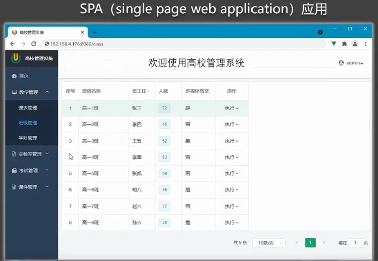
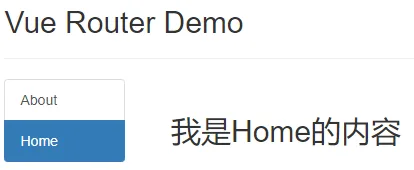
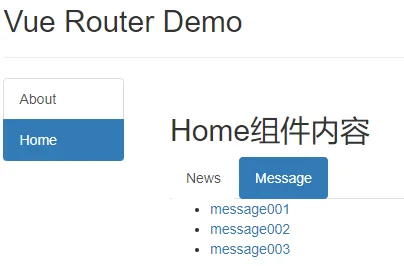
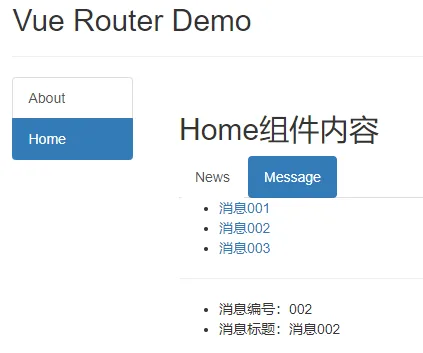
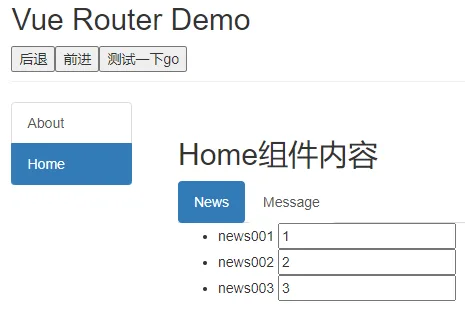
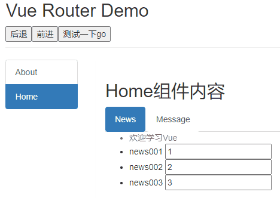
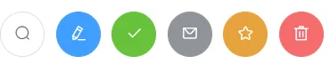

# 4	`Vue Router`

## 4.1	`Vue Router` 相关理解

### 4.1.1	`vue-router` 的理解

`vue`的一个插件库，专门用来实现`SPA`应用

#### 4.1.2	对`SPA`应用的理解

1. 单页`Web`应用`（single page web application，SPA）`
2. <strong style="color:#ff0000;font-size: 22px;">整个应用只有一个完整的页面</strong>
3. 点击页面中的导航链接<strong style="color:#ff0000;font-size: 22px;">不会刷新页面</strong>，只会做页面的<strong style="color:#ff0000;font-size: 22px;">局部更新</strong>
4. 数据需要通过`ajax`请求获取



#### 4.1.3	路由的理解

1. 什么是路由?
   1. 一个路由就是一组映射关系`（key - value）`
   2. `key`为路径，`value`可能是`function`或`componen`
2. 路由分类
   1.  后端路由
       - 理解：`value`是`function`，用于处理客户端提交的请求
       - 工作过程：服务器接收到一个请求时，根据请求路径找到匹配的函数来处理请求，返回响应数据
   2.  前端路由
       - 理解：`value`是`component`，用于展示页面内容
       - 工作过程：当浏览器的路径改变时，对应的组件就会显示

## 4.2	基本路由

1. 安装`vue-router`，命令`npm i vue-router`

2. 应用插件`Vue.use(VueRouter)`

3. 编写`router`配置项

   ```js
   import VueRouter from 'vue-router'			// 引入VueRouter
   import About from '../components/About'	// 路由组件
   import Home from '../components/Home'		// 路由组件
   
   // 创建router实例对象，去管理一组一组的路由规则
   const router = new VueRouter({
   	routes:[
   		{
   			path:'/about',
   			component:About
   		},
   		{
   			path:'/home',
   			component:Home
   		}
   	]
   })
   
   //暴露router
   export default router
   ```

4. 实现切换

   <strong style="color:#ff0000;font-size: 22px;">`<router-link></router-link>`</strong>浏览器会被替换为`a`标签
   **`active-class`**可配置高亮样式

   ```vue
   <router-link active-class="active" to="/about">About</router-link>
   ```

5. 指定展示位

   ```vue
   <router-view></router-view>
   ```

<strong style="color:#DD5145">`src/router/index.js`</strong>

```vue
// 该文件专门用于创建整个应用的路由器
import VueRouter from 'vue-router'
//引入组件
import About from '../components/About'
import Home from '../components/Home'

//创建并暴露一个路由器
export default new VueRouter({
	routes:[
		{
			path:'/about',
			component:About
		},
		{
			path:'/home',
			component:Home
		}
	]
})
```

<strong style="color:#DD5145">`main.js`</strong>

```js
//引入Vue
import Vue from 'vue'
//引入App
import App from './App.vue'
//引入VueRouter
import VueRouter from 'vue-router'
//引入路由器
import router from './router'

//关闭Vue的生产提示
Vue.config.productionTip = false
//应用插件
Vue.use(VueRouter)

//创建vm
new Vue({
	el:'#app',
	render: h => h(App),
	router:router
})
```

<strong style="color:#DD5145">`About.vue`</strong>

```vue
<template>
	<h2>我是About的内容</h2>
</template>

<script>
	export default {
		name:'About'
	}
</script>
```

<strong style="color:#DD5145">`Home.vue`</strong>

```vue
<template>
	<h2>我是Home的内容</h2>
</template>

<script>
	export default {
		name:'Home'
	}
</script>
```

<strong style="color:#DD5145">`App.vue`</strong>

```vue
<template>
  <div>
    <div class="row">
      <div class="col-xs-offset-2 col-xs-8">
        <div class="page-header"><h2>Vue Router Demo</h2></div>
      </div>
    </div>
    <div class="row">
      <div class="col-xs-2 col-xs-offset-2">
        <div class="list-group">
					<!-- 原始html中我们使用a标签实现页面的跳转 -->
          <!-- <a class="list-group-item active" href="./about.html">About</a> -->
          <!-- <a class="list-group-item" href="./home.html">Home</a> -->

					<!-- Vue中借助router-link标签实现路由的切换 -->
					<router-link class="list-group-item" active-class="active" to="/about">About</router-link>
          <router-link class="list-group-item" active-class="active" to="/home">Home</router-link>
        </div>
      </div>
      <div class="col-xs-6">
        <div class="panel">
          <div class="panel-body">
						<!-- 指定组件的呈现位置 -->
            <router-view></router-view>
          </div>
        </div>
      </div>
    </div>
  </div>
</template>

<script>
	export default {
		name:'App',
	}
</script>
```



## 4.3	几个注意事项

1. 路由组件通常存放在pages文件夹，一般组件通常存放在`components`文件夹比如上一节的案例就可以修改为
   1. `src/pages/Home.vue`
   2. `src/pages/About.vue`
   3. `src/router/index.js`
   4. `src/components/Banner.vue`
   5. `src/App.vue`
2. 通过切换，“隐藏”了的路由组件，默认是被销毁掉的，需要的时候再去挂载
3. 每个组件都有自己的`$route`属性，里面存储着自己的路由信息
4. 整个应用只有一个`router`，可以通过组件的`$router`属性获取到

## 4.4	多级路由

1. 配置路由规则，使用children配置项

   ```js
   routes:[
   	{
   		path:'/about',
   		component:About,
   	},
   	{
   		path:'/home',
   		component:Home,
   		children:[ 					// 通过children配置子级路由
   			{
   				path:'news', 		// 此处一定不要带斜杠，写成 /news
   				component:News
   			},
   			{
   				path:'message',	// 此处一定不要写成 /message
   				component:Message
   			}
   		]
   	}
   ]
   ```

2. 跳转（要写完整路径）

```vue
<router-link to="/home/news">News</router-link>
```

<strong style="color:#DD5145">`News.vue`</strong>

```vue
<template>
	<ul>
		<li>news001</li>
		<li>news002</li>
		<li>news003</li>
	</ul>
</template>

<script>
	export default {
		name:'News'
	}
</script>
```

<strong style="color:#DD5145">`Message.vue`</strong>

```vue
<template>
	<div>
		<ul>
			<li>
				<a href="/message1">message001</a>&nbsp;&nbsp;
			</li>
			<li>
				<a href="/message2">message002</a>&nbsp;&nbsp;
			</li>
			<li>
				<a href="/message/3">message003</a>&nbsp;&nbsp;
			</li>
		</ul>
	</div>
</template>

<script>
	export default {
		name:'Message'
	}
</script>
```

<strong style="color:#DD5145">`Home.vue`</strong>

```vue
<template>
	<div>
		<h2>Home组件内容</h2>
		<div>
			<ul class="nav nav-tabs">
				<li>
					<router-link class="list-group-item" active-class="active" to="/home/news">News</router-link>
				</li>
				<li>
					<router-link class="list-group-item" active-class="active" to="/home/message">Message</router-link>
				</li>
			</ul>
			<router-view></router-view>
		</div>
	</div>
</template>

<script>
	export default {
		name:'Home',
		/* beforeDestroy() {
			console.log('Home组件即将被销毁了')
		}, */
		/* mounted() {
			console.log('Home组件挂载完毕了',this)
			window.homeRoute = this.$route
			window.homeRouter = this.$router
		},  */
	}
</script>
```

<strong style="color:#DD5145">`About.vue`</strong>

```vue
<template>
	<h2>我是About的内容</h2>
</template>

<script>
	export default {
		name:'About',
		/* beforeDestroy() {
			console.log('About组件即将被销毁了')
		},*/
		/* mounted() {
			console.log('About组件挂载完毕了',this)
			window.aboutRoute = this.$route
			window.aboutRouter = this.$router
		},  */
	}
</script>
```

<strong style="color:#DD5145">`Banner.vue`</strong>

```vue
<template>
	<div class="col-xs-offset-2 col-xs-8">
		<div class="page-header"><h2>Vue Router Demo</h2></div>
	</div>
</template>

<script>
	export default {
		name:'Banner'
	}
</script>
```

<strong style="color:#DD5145">`src/router/index.js`</strong>

```js
// 该文件专门用于创建整个应用的路由器
import VueRouter from 'vue-router'
//引入组件
import About from '../pages/About'
import Home from '../pages/Home'
import News from '../pages/News'
import Message from '../pages/Message'

//创建并暴露一个路由器
export default new VueRouter({
	routes:[
		{
			path:'/about',
			component:About
		},
		{
			path:'/home',
			component:Home,
			children:[
				{
					path:'news',
					component:News,
				},
				{
					path:'message',
					component:Message,
				}
			]
		}
	]
})

```

<strong style="color:#DD5145">`main.js`</strong>

```js
//引入Vue
import Vue from 'vue'
//引入App
import App from './App.vue'
//引入VueRouter
import VueRouter from 'vue-router'
//引入路由器
import router from './router'

//关闭Vue的生产提示
Vue.config.productionTip = false
//应用插件
Vue.use(VueRouter)

//创建vm
new Vue({
	el:'#app',
	render: h => h(App),
	router:router
})
```

<strong style="color:#DD5145">`App.vue`</strong>

```vue
<template>
  <div>
    <div class="row">
      <Banner/>
    </div>
    <div class="row">
      <div class="col-xs-2 col-xs-offset-2">
        <div class="list-group">
					<!-- 原始html中我们使用a标签实现页面的跳转 -->
          <!-- <a class="list-group-item active" href="./about.html">About</a> -->
          <!-- <a class="list-group-item" href="./home.html">Home</a> -->

					<!-- Vue中借助router-link标签实现路由的切换 -->
					<router-link class="list-group-item" active-class="active" to="/about">About</router-link>
          <router-link class="list-group-item" active-class="active" to="/home">Home</router-link>
        </div>
      </div>
      <div class="col-xs-6">
        <div class="panel">
          <div class="panel-body">
						<!-- 指定组件的呈现位置 -->
            <router-view></router-view>
          </div>
        </div>
      </div>
    </div>
  </div>
</template>

<script>
	import Banner from './components/Banner'
	export default {
		name:'App',
		components:{Banner}
	}
</script>
```



## 4.5	路由的 `query` 参数

1. 传递参数

   ```vue
   <!-- 跳转并携带query参数，to的字符串写法 -->
   <router-link :to="`/home/message/detail?id=${m.id}&title=${m.title}`">跳转</router-link>
   				
   <!-- 跳转并携带query参数，to的对象写法（推荐） -->
   <router-link 
   	:to="{
   		path:'/home/message/detail',
   		query:{
   		   id: m.id,
          title: m.title
   		}
   	}"
   >跳转</router-link>
   ```

2. 接收参数

   ```js
   $route.query.id
   $route.query.title
   ```

   <strong style="color:#DD5145">`src/router.index.js`</strong>

```js
// 该文件专门用于创建整个应用的路由器
import VueRouter from 'vue-router'
//引入组件
import About from '../pages/About'
import Home from '../pages/Home'
import News from '../pages/News'
import Message from '../pages/Message'
import Detail from '../pages/Detail'

//创建并暴露一个路由器
export default new VueRouter({
	routes:[
		{
			path:'/about',
			component:About
		},
		{
			path:'/home',
			component:Home,
			children:[
				{
					path:'news',
					component:News,
				},
				{
					path:'message',
					component:Message,
					children:[
						{
							path:'detail',
							component:Detail,
						}
					]
				}
			]
		}
	]
})

```

<strong style="color:#DD5145">`Message.vue`</strong>

```vue
<template>
	<div>
		<ul>
			<li v-for="m in messageList" :key="m.id">
				<!-- 跳转路由并携带query参数，to的字符串写法 -->
				<!-- <router-link :to="`/home/message/detail?id=${m.id}&title=${m.title}`">{{m.title}}</router-link>&nbsp;&nbsp; -->

				<!-- 跳转路由并携带query参数，to的对象写法 -->
				<router-link :to="{
					path:'/home/message/detail',
					query:{
						id:m.id,
						title:m.title
					}
				}">
					{{m.title}}
				</router-link>
			
			</li>
		</ul>
		<hr>
		<router-view></router-view>
	</div>
</template>

<script>
	export default {
		name:'Message',
		data() {
			return {
				messageList:[
					{id:'001',title:'消息001'},
					{id:'002',title:'消息002'},
					{id:'003',title:'消息003'}
				]
			}
		},
	}
</script>
```

<strong style="color:#DD5145">`Detail.vue`</strong>

```vue
<template>
	<ul>
		<li>消息编号：{{$route.query.id}}</li>
		<li>消息标题：{{$route.query.title}}</li>
	</ul>
</template>

<script>
	export default {
		name:'Detail',
		mounted() {
			console.log(this.$route)
		},
	}
</script>
```



## 4.6	命名路由

命名路由

1. 作用：可以简化路由的跳转

2. 如何使用

   - 给路由命名

     ```js
     {
     	path:'/demo',
     	component:Demo,
     	children:[
     		{
     			path:'test',
     			component:Test,
     			children:[
     				{
               name:'hello' // 给路由命名
     					path:'welcome',
     					component:Hello,
     				}
     			]
     		}
     	]
     }
     ```

   - 简化跳转

     ```js
     <!--简化前，需要写完整的路径 -->
     <router-link to="/demo/test/welcome">跳转</router-link>
     
     <!--简化后，直接通过名字跳转 -->
     <router-link :to="{name:'hello'}">跳转</router-link>
     
     <!--简化写法配合传递参数 -->
     <router-link 
     	:to="{
     		name:'hello',
     		query:{
     		    id:666,
             title:'你好'
     		}
     	}"
     >跳转</router-link>
     ```

<strong style="color:#DD5145">`src/router/index.js`</strong>

```vue
// 该文件专门用于创建整个应用的路由器
import VueRouter from 'vue-router'
//引入组件
import About from '../pages/About'
import Home from '../pages/Home'
import News from '../pages/News'
import Message from '../pages/Message'
import Detail from '../pages/Detail'

//创建并暴露一个路由器
export default new VueRouter({
	routes:[
		{
			name:'guanyu',
			path:'/about',
			component:About
		},
		{
			path:'/home',
			component:Home,
			children:[
				{
					path:'news',
					component:News,
				},
				{
					path:'message',
					component:Message,
					children:[
						{
							name:'xiangqing',
							path:'detail',
							component:Detail,
						}
					]
				}
			]
		}
	]
})

```

<strong style="color:#DD5145">`Message.vue`</strong>

```vue
<template>
	<div>
		<ul>
			<li v-for="m in messageList" :key="m.id">
				<!-- 跳转路由并携带query参数，to的字符串写法 -->
				<!-- <router-link :to="`/home/message/detail?id=${m.id}&title=${m.title}`">{{m.title}}</router-link>&nbsp;&nbsp; -->

				<!-- 跳转路由并携带query参数，to的对象写法 -->
				<router-link :to="{
					name:'xiangqing',
					query:{
						id:m.id,
						title:m.title
					}
				}">
					{{m.title}}
				</router-link>
			
			</li>
		</ul>
		<hr>
		<router-view></router-view>
	</div>
</template>

<script>
	export default {
		name:'Message',
		data() {
			return {
				messageList:[
					{id:'001',title:'消息001'},
					{id:'002',title:'消息002'},
					{id:'003',title:'消息003'}
				]
			}
		},
	}
</script>
```

<strong style="color:#DD5145" >`Detail.vue`</strong>

```vue
<template>
	<ul>
		<li>消息编号：{{$route.query.id}}</li>
		<li>消息标题：{{$route.query.title}}</li>
	</ul>
</template>

<script>
	export default {
		name:'Detail',
		mounted() {
			console.log(this.$route)
		},
	}
</script>
```


## 4.7	路由的 `params` 参数

1. 配置路由，声明接收`params`参数

   ```js
   {
   	path:'/home',
   	component:Home,
   	children:[
   		{
   			path:'news',
   			component:News
   		},
   		{
   			component:Message,
   			children:[
   				{
   					name:'xiangqing',
   					path:'detail/:id/:title', // 🔴使用占位符声明接收params参数
   					component:Detail
   				}
   			]
   		}
   	]
   }
   ```

2. 传递参数
   特别注意：路由携带`params`参数时，若使用`to`的对象写法，则不能使用`path`配置项，必须使用`name`配置！

   ```vue
   <!-- 跳转并携带params参数，to的字符串写法 -->
   <router-link :to="/home/message/detail/666/你好">跳转</router-link>
   				
   <!-- 跳转并携带params参数，to的对象写法 -->
   <router-link 
   	:to="{
   		name:'xiangqing',
   		params:{
   		   id:666,
          title:'你好'
   		}
   	}"
   >跳转</router-link>
   ```

3. 接收参数

   ```js
   $route.params.id
   $route.params.title
   ```

<strong style="color:#DD5145" >`Detail.vue`</strong>

```js
// 该文件专门用于创建整个应用的路由器
import VueRouter from 'vue-router'
//引入组件
import About from '../pages/About'
import Home from '../pages/Home'
import News from '../pages/News'
import Message from '../pages/Message'
import Detail from '../pages/Detail'

//创建并暴露一个路由器
export default new VueRouter({
	routes:[
		{
			name:'guanyu',
			path:'/about',
			component:About
		},
		{
			path:'/home',
			component:Home,
			children:[
				{
					path:'news',
					component:News,
				},
				{
					path:'message',
					component:Message,
					children:[
						{
							name:'xiangqing',
							path:'detail/:id/:title',
							component:Detail,
						}
					]
				}
			]
		}
	]
})
```

<strong style="color:#DD5145" >`Message.vue`</strong>

```vue
<template>
	<div>
		<ul>
			<li v-for="m in messageList" :key="m.id">
				<!-- 跳转路由并携带params参数，to的字符串写法 -->
				<!-- <router-link :to="`/home/message/detail/${m.id}/${m.title}`">{{m.title}}</router-link>&nbsp;&nbsp; -->

				<!-- 跳转路由并携带params参数，to的对象写法 -->
				<router-link :to="{
					name:'xiangqing',
					params:{
						id:m.id,
						title:m.title
					}
				}">
					{{m.title}}
				</router-link>
			
			</li>
		</ul>
		<hr>
		<router-view></router-view>
	</div>
</template>

<script>
	export default {
		name:'Message',
		data() {
			return {
				messageList:[
					{id:'001',title:'消息001'},
					{id:'002',title:'消息002'},
					{id:'003',title:'消息003'}
				]
			}
		},
	}
</script>
```

<strong style="color:#DD5145" >`Detail.vue`</strong>

```vue
<template>
	<ul>
		<li>消息编号：{{$route.params.id}}</li>
		<li>消息标题：{{$route.params.title}}</li>
	</ul>
</template>

<script>
	export default {
		name:'Detail',
		mounted() {
			// console.log(this.$route)
		},
	}
</script>
```


## 4.8	路由的 `props` 配置

`props`作用：让路由组件更方便的收到参数

<strong style="color:#DD5145" >`src/router/index.js`</strong>

```js
// 该文件专门用于创建整个应用的路由器
import VueRouter from 'vue-router'
//引入组件
import About from '../pages/About'
import Home from '../pages/Home'
import News from '../pages/News'
import Message from '../pages/Message'
import Detail from '../pages/Detail'

//创建并暴露一个路由器
export default new VueRouter({
	routes:[
		{
			name:'guanyu',
			path:'/about',
			component:About
		},
		{
			path:'/home',
			component:Home,
			children:[
				{
					path:'news',
					component:News,
				},
				{
					path:'message',
					component:Message,
					children:[
						{
							name:'xiangqing',
							path:'detail',
							component:Detail,

							//props的第一种写法，值为对象，该对象中的所有key-value都会以props的形式传给Detail组件。
							// props:{a:1,b:'hello'}

							//props的第二种写法，值为布尔值，若布尔值为真，就会把该路由组件收到的所有params参数，以props的形式传给Detail组件。
							// props:true

							//props的第三种写法，值为函数
							props($route){
								return {
									id:$route.query.id,
									title:$route.query.title,
									a:1,
									b:'hello'
								}
							}

						}
					]
				}
			]
		}
	]
})
```

<strong style="color:#DD5145" >`Message.vue`</strong>

```vue
<template>
	<div>
		<ul>
			<li v-for="m in messageList" :key="m.id">
				<!-- 跳转路由并携带params参数，to的字符串写法 -->
				<!-- <router-link :to="`/home/message/detail/${m.id}/${m.title}`">{{m.title}}</router-link>&nbsp;&nbsp; -->

				<!-- 跳转路由并携带params参数，to的对象写法 -->
				<router-link :to="{
					name:'xiangqing',
					query:{
						id:m.id,
						title:m.title
					}
				}">
					{{m.title}}
				</router-link>
			
			</li>
		</ul>
		<hr>
		<router-view></router-view>
	</div>
</template>

<script>
	export default {
		name:'Message',
		data() {
			return {
				messageList:[
					{id:'001',title:'消息001'},
					{id:'002',title:'消息002'},
					{id:'003',title:'消息003'}
				]
			}
		},
	}
</script>
```

<strong style="color:#DD5145" >`Detail.vue`</strong>

```vue
<template>
	<ul>
		<li>消息编号：{{id}}</li>
		<li>消息标题：{{title}}</li>
	</ul>
</template>

<script>
	export default {
		name:'Detail',
		props:['id','title'],
		computed: {
			// id(){
			// 	return this.$route.query.id
			// },
			// title(){
			// 	return this.$route.query.title
			// },
		},
		mounted() {
			// console.log(this.$route)
		},
	}
</script>
```


## 4.9	路由跳转的 `replace` 方法

1. 作用：控制路由跳转时操作浏览器历史记录的模式

2. 浏览器的历史记录有两种写入方式：`push`和`replace`

   1. `push`是追加历史记录
   2. `replace`是替换当前记录，路由跳转时候默认为`push`方式

3. 开启`replace`模式:

   `<router-link :replace="true" ...>News</router-link>`

   简写`<router-link replace ...>News</router-link>`

总结：浏览记录本质是一个栈，默认`push`，点开新页面就会在栈顶追加一个地址，后退，栈顶指针向下移动，改为`replace`就是不追加，而将栈顶地址替换

<strong style="color:#DD5145" >`Home.vue`</strong>

```VUE
<template>
	<div>
		<h2>Home组件内容</h2>
		<div>
			<ul class="nav nav-tabs">
				<li>
					<router-link replace class="list-group-item" active-class="active" to="/home/news">News</router-link>
				</li>
				<li>
					<router-link replace class="list-group-item" active-class="active" to="/home/message">Message</router-link>
				</li>
			</ul>
			<router-view></router-view>
		</div>
	</div>
</template>

<script>
	export default {
		name:'Home',
		/* beforeDestroy() {
			console.log('Home组件即将被销毁了')
		}, */
		/* mounted() {
			console.log('Home组件挂载完毕了',this)
			window.homeRoute = this.$route
			window.homeRouter = this.$router
		},  */
	}
</script>
```

## 4.10	编程式路由导航（不用`<router-link>`）

作用：不借助`<router-link>`实现路由跳转，让路由跳转更加灵活

1. `this.$router.push({})`		    内传的对象与`<router-link>`中的`to`相同
2. `this.$router.replace({})`
3. `this.$router.forward()`	    前进
4. `this.$router.back()`		       后退
5. `this.$router.go(n)`		         可前进也可后退，`n`为正数前进`n`，为负数后退

```javascript
this.$router.push({
	name:'xiangqing',
  params:{
    id:xxx,
    title:xxx
  }
})

this.$router.replace({
	name:'xiangqing',
  params:{
    id:xxx,
    title:xxx
  }
})
```

<strong style="color:#DD5145" >`Banner.vue`</strong>

```vue
<template>
	<div class="col-xs-offset-2 col-xs-8">
		<div class="page-header">
			<h2>Vue Router Demo</h2>
			<button @click="back">后退</button>
			<button @click="forward">前进</button>
			<button @click="test">测试一下go</button>
		</div>
	</div>
</template>

<script>
	export default {
		name:'Banner',
		methods: {
			back(){
				this.$router.back()
				// console.log(this.$router)
			},
			forward(){
				this.$router.forward()
			},
			test(){
				this.$router.go(3)
			}
		},
	}
</script>
```

<strong style="color:#DD5145" >`Message.vue`</strong>

```vue
<template>
	<div>
		<ul>
			<li v-for="m in messageList" :key="m.id">
				<!-- 跳转路由并携带params参数，to的字符串写法 -->
				<!-- <router-link :to="`/home/message/detail/${m.id}/${m.title}`">{{m.title}}</router-link>&nbsp;&nbsp; -->

				<!-- 跳转路由并携带params参数，to的对象写法 -->
				<router-link :to="{
					name:'xiangqing',
					query:{
						id:m.id,
						title:m.title
					}
				}">
					{{m.title}}
				</router-link>
				<button @click="pushShow(m)">push查看</button>
				<button @click="replaceShow(m)">replace查看</button>
			</li>
		</ul>
		<hr>
		<router-view></router-view>
	</div>
</template>

<script>
	export default {
		name:'Message',
		data() {
			return {
				messageList:[
					{id:'001',title:'消息001'},
					{id:'002',title:'消息002'},
					{id:'003',title:'消息003'}
				]
			}
		},
		methods: {
			pushShow(m){
				this.$router.push({
					name:'xiangqing',
					query:{
						id:m.id,
						title:m.title
					}
				})
			},
			replaceShow(m){
				this.$router.replace({
					name:'xiangqing',
					query:{
						id:m.id,
						title:m.title
					}
				})
			}
		},
	}
</script>
```


## 4.11	缓存路由组件

作用：让不展示的路由组件保持挂载，不被销毁
`<keep-alive include="News"><router-view></router-view></keep-alive>`
`<keep-alive :include="['News', 'Message']"><router-view></router-view></keep-alive>`

```vue
// 缓存一个路由组件
<keep-alive include="News"> // include中写想要缓存的组件名，不写表示全部缓存
    <router-view></router-view>
</keep-alive>

// 缓存多个路由组件
<keep-alive :include="['News','Message']"> 
    <router-view></router-view>
</keep-alive>
```

<strong style="color:#DD5145" >`News.vue`</strong>

```vue
<template>
	<ul>
		<li>news001 <input type="text"></li>
		<li>news002 <input type="text"></li>
		<li>news003 <input type="text"></li>
	</ul>
</template>

<script>
	export default {
		name:'News',
		beforeDestroy() {
			console.log('News组件即将被销毁了')
		},
	}
</script>
```

<strong style="color:#DD5145" >`Home.vue`</strong>

```VUE
<template>
	<div>
		<h2>Home组件内容</h2>
		<div>
			<ul class="nav nav-tabs">
				<li>
					<router-link class="list-group-item" active-class="active" to="/home/news">News</router-link>
				</li>
				<li>
					<router-link class="list-group-item" active-class="active" to="/home/message">Message</router-link>
				</li>
			</ul>
			<!-- 缓存多个路由组件 -->
			<!-- <keep-alive :include="['News','Message']"> -->
				
			<!-- 缓存一个路由组件 -->
			<keep-alive include="News">
				<router-view></router-view>
			</keep-alive>
		</div>
	</div>
</template>

<script>
	export default {
		name:'Home',
		/* beforeDestroy() {
			console.log('Home组件即将被销毁了')
		}, */
		/* mounted() {
			console.log('Home组件挂载完毕了',this)
			window.homeRoute = this.$route
			window.homeRouter = this.$router
		},  */
	}
</script>
```



## 4.12	`activated` `deactivated`

`activated`和`deactivated`是路由组件所独有的两个钩子，用于捕获路由组件的激活状态
具体使用
`activated`路由组件被激活时触发
`deactivated`路由组件失活时触发

<strong style="color:#DD5145" >`News.vue`</strong>

```vue
<template>
	<ul>
		<li :style="{opacity}">欢迎学习Vue</li>
		<li>news001 <input type="text"></li>
		<li>news002 <input type="text"></li>
		<li>news003 <input type="text"></li>
	</ul>
</template>

<script>
	export default {
		name:'News',
		data() {
			return {
				opacity:1
			}
		},
		/* beforeDestroy() {
			console.log('News组件即将被销毁了')
			clearInterval(this.timer)
		}, */
		/* mounted(){
			this.timer = setInterval(() => {
				console.log('@')
				this.opacity -= 0.01
				if(this.opacity <= 0) this.opacity = 1
			},16)
		}, */
		activated() {
			console.log('News组件被激活了')
			this.timer = setInterval(() => {
				console.log('@')
				this.opacity -= 0.01
				if(this.opacity <= 0) this.opacity = 1
			},16)
		},
		deactivated() {
			console.log('News组件失活了')
			clearInterval(this.timer)
		},
	}
</script>
```




## 4.13	路由守卫

作用：对路由进行权限控制
分类：全局守卫、独享守卫、组件内守卫

1. 全局守卫

   `meta`路由源信息

   ```js
   // 全局前置守卫：初始化时、每次路由切换前执行
   router.beforeEach((to,from,next) => {
   	console.log('beforeEach',to,from)
   	if(to.meta.isAuth){ // 判断当前路由是否需要进行权限控制
   		if(localStorage.getItem('school') === 'atguigu'){ // 权限控制的具体规则
   			next()	// 放行
   		}else{
   			alert('暂无权限查看')
   		}
   	}else{
   		next()	// 放行
   	}
   })
   
   // 全局后置守卫：初始化时、每次路由切换后执行
   router.afterEach((to,from) => {
   	console.log('afterEach',to,from)
   	if(to.meta.title){ 
   		document.title = to.meta.title //修改网页的title
   	}else{
   		document.title = 'vue_test'
   	}
   })
   ```

2. 独享守卫

   ```js
   beforeEnter(to,from,next){
   	console.log('beforeEnter',to,from)
       if(localStorage.getItem('school') === 'atguigu'){
           next()
       }else{
           alert('暂无权限查看')
       }
   }
   ```

3. 组件内守卫

   ```js
   //进入守卫：通过路由规则，进入该组件时被调用
   beforeRouteEnter (to, from, next) {... next()},
   
   //离开守卫：通过路由规则，离开该组件时被调用
   beforeRouteLeave (to, from, next) {... next()},
   ```

### 4.13.1	全局守卫

<strong style="color:#DD5145" >`src/router/index.js`</strong>

```js
// 该文件专门用于创建整个应用的路由器
import VueRouter from 'vue-router'
//引入组件
import About from '../pages/About'
import Home from '../pages/Home'
import News from '../pages/News'
import Message from '../pages/Message'
import Detail from '../pages/Detail'

//创建并暴露一个路由器
const router =  new VueRouter({
	routes:[
		{
			name:'guanyu',
			path:'/about',
			component:About,
			meta:{title:'关于'}
		},
		{
			name:'zhuye',
			path:'/home',
			component:Home,
			meta:{title:'主页'},
			children:[
				{
					name:'xinwen',
					path:'news',
					component:News,
					meta:{isAuth:true,title:'新闻'}
				},
				{
					name:'xiaoxi',
					path:'message',
					component:Message,
					meta:{isAuth:true,title:'消息'},
					children:[
						{
							name:'xiangqing',
							path:'detail',
							component:Detail,
							meta:{isAuth:true,title:'详情'},

							//props的第一种写法，值为对象，该对象中的所有key-value都会以props的形式传给Detail组件。
							// props:{a:1,b:'hello'}

							//props的第二种写法，值为布尔值，若布尔值为真，就会把该路由组件收到的所有params参数，以props的形式传给Detail组件。
							// props:true

							//props的第三种写法，值为函数
							props($route){
								return {
									id:$route.query.id,
									title:$route.query.title,
									a:1,
									b:'hello'
								}
							}

						}
					]
				}
			]
		}
	]
})

//全局前置路由守卫————初始化的时候被调用、每次路由切换之前被调用
router.beforeEach((to,from,next)=>{
	console.log('前置路由守卫',to,from)
	if(to.meta.isAuth){ //判断是否需要鉴权
		if(localStorage.getItem('school')==='atguigu'){
			next()
		}else{
			alert('学校名不对，无权限查看！')
		}
	}else{
		next()
	}
})

//全局后置路由守卫————初始化的时候被调用、每次路由切换之后被调用
router.afterEach((to,from)=>{
	console.log('后置路由守卫',to,from)
	document.title = to.meta.title || '硅谷系统'
})

export default router
```

### 4.13.2	独享守卫

<strong style="color:#DD5145" >`src/router/index.js`</strong>

```js
// 该文件专门用于创建整个应用的路由器
import VueRouter from 'vue-router'
//引入组件
import About from '../pages/About'
import Home from '../pages/Home'
import News from '../pages/News'
import Message from '../pages/Message'
import Detail from '../pages/Detail'

//创建并暴露一个路由器
const router =  new VueRouter({
	routes:[
		{
			name:'guanyu',
			path:'/about',
			component:About,
			meta:{title:'关于'}
		},
		{
			name:'zhuye',
			path:'/home',
			component:Home,
			meta:{title:'主页'},
			children:[
				{
					name:'xinwen',
					path:'news',
					component:News,
					meta:{isAuth:true,title:'新闻'},
					beforeEnter: (to, from, next) => {
						console.log('独享路由守卫',to,from)
						if(to.meta.isAuth){ //判断是否需要鉴权
							if(localStorage.getItem('school')==='atguigu'){
								next()
							}else{
								alert('学校名不对，无权限查看！')
							}
						}else{
							next()
						}
					}
				},
				{
					name:'xiaoxi',
					path:'message',
					component:Message,
					meta:{isAuth:true,title:'消息'},
					children:[
						{
							name:'xiangqing',
							path:'detail',
							component:Detail,
							meta:{isAuth:true,title:'详情'},

							//props的第一种写法，值为对象，该对象中的所有key-value都会以props的形式传给Detail组件。
							// props:{a:1,b:'hello'}

							//props的第二种写法，值为布尔值，若布尔值为真，就会把该路由组件收到的所有params参数，以props的形式传给Detail组件。
							// props:true

							//props的第三种写法，值为函数
							props($route){
								return {
									id:$route.query.id,
									title:$route.query.title,
									a:1,
									b:'hello'
								}
							}

						}
					]
				}
			]
		}
	]
})

//全局前置路由守卫————初始化的时候被调用、每次路由切换之前被调用
/* router.beforeEach((to,from,next)=>{
	console.log('前置路由守卫',to,from)
	if(to.meta.isAuth){ //判断是否需要鉴权
		if(localStorage.getItem('school')==='atguigu'){
			next()
		}else{
			alert('学校名不对，无权限查看！')
		}
	}else{
		next()
	}
}) */

//全局后置路由守卫————初始化的时候被调用、每次路由切换之后被调用
router.afterEach((to,from)=>{
	console.log('后置路由守卫',to,from)
	document.title = to.meta.title || '硅谷系统'
})

export default router
```

### 4.13.3	组件内守卫

<strong style="color:#DD5145" >`src/router/index.js`</strong>

```js
// 该文件专门用于创建整个应用的路由器
import VueRouter from 'vue-router'
//引入组件
import About from '../pages/About'
import Home from '../pages/Home'
import News from '../pages/News'
import Message from '../pages/Message'
import Detail from '../pages/Detail'

//创建并暴露一个路由器
const router =  new VueRouter({
	routes:[
		{
			name:'guanyu',
			path:'/about',
			component:About,
			meta:{isAuth:true,title:'关于'}
		},
		{
			name:'zhuye',
			path:'/home',
			component:Home,
			meta:{title:'主页'},
			children:[
				{
					name:'xinwen',
					path:'news',
					component:News,
					meta:{isAuth:true,title:'新闻'},
					/* beforeEnter: (to, from, next) => {
						console.log('前置路由守卫',to,from)
						if(to.meta.isAuth){ //判断是否需要鉴权
							if(localStorage.getItem('school')==='atguigu'){
								next()
							}else{
								alert('学校名不对，无权限查看！')
							}
						}else{
							next()
						}
					} */
				},
				{
					name:'xiaoxi',
					path:'message',
					component:Message,
					meta:{isAuth:true,title:'消息'},
					children:[
						{
							name:'xiangqing',
							path:'detail',
							component:Detail,
							meta:{isAuth:true,title:'详情'},

							//props的第一种写法，值为对象，该对象中的所有key-value都会以props的形式传给Detail组件。
							// props:{a:1,b:'hello'}

							//props的第二种写法，值为布尔值，若布尔值为真，就会把该路由组件收到的所有params参数，以props的形式传给Detail组件。
							// props:true

							//props的第三种写法，值为函数
							props($route){
								return {
									id:$route.query.id,
									title:$route.query.title,
									a:1,
									b:'hello'
								}
							}

						}
					]
				}
			]
		}
	]
})

//全局前置路由守卫————初始化的时候被调用、每次路由切换之前被调用
/* router.beforeEach((to,from,next)=>{
	console.log('前置路由守卫',to,from)
	if(to.meta.isAuth){ //判断是否需要鉴权
		if(localStorage.getItem('school')==='atguigu'){
			next()
		}else{
			alert('学校名不对，无权限查看！')
		}
	}else{
		next()
	}
}) */

//全局后置路由守卫————初始化的时候被调用、每次路由切换之后被调用
router.afterEach((to,from)=>{
	console.log('后置路由守卫',to,from)
	document.title = to.meta.title || '硅谷系统'
})

export default router
```


## 4.14	路由器的两种工作模式

1. 对于一个`url`来说，什么是`hash`值？

   `#`及其后面的内容就是`hash`值

2. `hash`值不会包含在`HTTP`请求中，即：`hash`值不会带给服务器

3. `hash`模式

   1. 地址中永远带着`#`号，不美观
   2. 若以后将地址通过第三方手机`app`分享，若`app`校验严格，则地址会被标记为不合法
   3. 兼容性较好

4. `history`模式

   1. 地址干净，美观
   2. 兼容性和`hash`模式相比略差
   3. 应用部署上线时需要后端人员支持，解决刷新页面服务端404的问题

```js
const router =  new VueRouter({
	mode:'history',
	routes:[...]
})

export default router
```


## 4.15	`Vue UI` 组件库

### 4.15.1	常用`UI`组件库

#### 4.15.1.1	移动端常用`UI`组件库

1. [`Vant`](https://youzan.github.io/vant)
2. [`Cube UI`](https://didi.github.io/cube-ui)
3. [`Mint UI`](http://mint-ui.github.io)
4. [`NutUI`](https://nutui.jd.com/next/#/)

### 4.15.1.2	`PC`端常用`UI`组件库

1. [`Element UI`](https://element.eleme.cn)
2. [`IView UI`](https://www.iviewui.com)

### 4.15.2	`element-ui`基本使用

安装 `element-ui：npm i element-ui -S`

`main.js`

```js
//引入Vue
import Vue from 'vue'
//引入App
import App from './App.vue'

//完整引入
//引入ElementUI组件库
// import ElementUI from 'element-ui';
//引入ElementUI全部样式
// import 'element-ui/lib/theme-chalk/index.css';

//按需引入
import { Button,Row,DatePicker } from 'element-ui';

//关闭Vue的生产提示
Vue.config.productionTip = false

//应用ElementUI
// Vue.use(ElementUI);
Vue.component('atguigu-button', Button);
Vue.component('atguigu-row', Row);
Vue.component('atguigu-date-picker', DatePicker);

//创建vm
new Vue({
	el:'#app',
	render: h => h(App),
})
```

`App.vue`

```vue
<template>
  <div>
		<button>原生的按钮</button>
		<input type="text">
		<atguigu-row>
			<el-button>默认按钮</el-button>
			<el-button type="primary">主要按钮</el-button>
			<el-button type="success">成功按钮</el-button>
			<el-button type="info">信息按钮</el-button>
			<el-button type="warning">警告按钮</el-button>
			<el-button type="danger">危险按钮</el-button>
		</atguigu-row>
		<atguigu-date-picker
      type="date"
      placeholder="选择日期">
    </atguigu-date-picker>
		<atguigu-row>
			<el-button icon="el-icon-search" circle></el-button>
			<el-button type="primary" icon="el-icon-s-check" circle></el-button>
			<el-button type="success" icon="el-icon-check" circle></el-button>
			<el-button type="info" icon="el-icon-message" circle></el-button>
			<el-button type="warning" icon="el-icon-star-off" circle></el-button>
			<el-button type="danger" icon="el-icon-delete" circle></el-button>
		</atguigu-row>
  </div>
</template>

<script>
	export default {
		name:'App',
	}
</script>
```



### 4.15.3	`element-ui`按需引入

安装 `babel-plugin-component npm i babel-plugin-component -D`

修改 `babel-config-js`

```js
module.exports = {
  presets: [
    '@vue/cli-plugin-babel/preset',
    ["@babel/preset-env", { "modules": false }]
  ],
  plugins: [
    [
      "component",
      {        
        "libraryName": "element-ui",
        "styleLibraryName": "theme-chalk"
      }
    ]
  ]
}
```

`main.js`

```js
import Vue from 'vue'
import App from './App.vue'
import { Button,Row } from 'element-ui'	// 按需引入

Vue.config.productionTip = false

Vue.component(Button.name, Button);
Vue.component(Row.name, Row);
/* 或写为
 * Vue.use(Button)
 * Vue.use(Row)
 */

new Vue({
    el:"#app",
    render: h => h(App),
})
```
