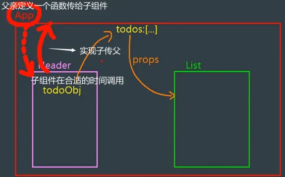
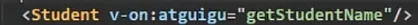
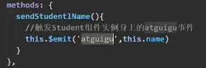
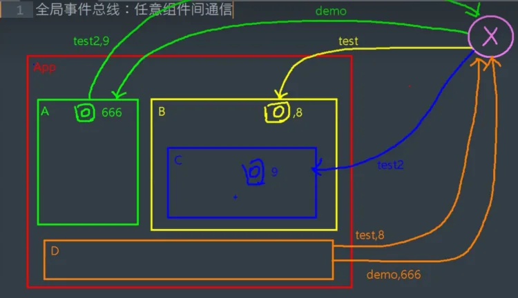
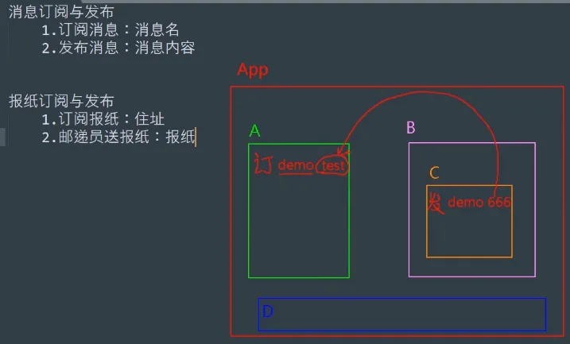

# 数据传递

## 1、`props`

`props`让组件接收外部传过来的数据 (不会影响另一组件的数据)

`props`适用于

- 父组件 ==> 子组件 通信
- 子组件 ==> 父组件 通信（要求父组件先给子组件一个函数）

父传子：父组件在写子组件标签时，将要传递的数据绑定在标签上，子组件用`props`接收后即可使用。
子传父：首先在父组件中定义一个方法，将方法传递到子组件中，子组件用`props`接收后，在需要传给父组件数据的方法中调用父组件传递过来的方法，将要传递的数据作为方法的参数。



## 2、本地存储

可以实现全局通信，但是不建议使用，因为不安全。

存储内容大小一般支持 5MB 左右（不同浏览器可能还不一样）

浏览器端通过`Window.sessionStorage`和`Window.localStorage`属性来实现本地存储机制

相关API

- `xxxStorage.setItem('key', 'value')`该方法接受一个键和值作为参数，会把键值对添加到存储中，如果键名存在，则更新其对应的值
- `xxxStorage.getItem('key')`该方法接受一个键名作为参数，返回键名对应的值
- `xxxStorage.removeItem('key')`该方法接受一个键名作为参数，并把该键名从存储中删除
- `xxxStorage.clear()`该方法会清空存储中的所有数据

备注

- `SessionStorage`存储的内容会随着浏览器窗口关闭而消失
- `LocalStorage`存储的内容，需要手动清除才会消失
- `xxxStorage.getItem(xxx)`如果 `xxx` 对应的 `value` 获取不到，那么`getItem()`的返回值是`null`
- `JSON.parse(null)`的结果依然是`null`

## 3、组件的自定义事件

#### 3.1原生DOM事件

代码如下:

```
 <pre @click="handler">
      我是祖国的老花骨朵
 </pre>
```


当前代码级给pre标签绑定原生DOM事件点击事件,默认会给事件回调注入event事件对象。当然点击事件想注入多个参数可以按照下图操作。但是切记注入的事件对象务必叫做$event.

```
  <div @click="handler1(1,2,3,$event)">我要传递多个参数</div>
```

在vue3框架click、dbclick、change(这类原生DOM事件),不管是在标签、自定义标签上(组件标签)都是原生DOM事件。

**<!--vue2中却不是这样的,在vue2中组件标签需要通过native修饰符才能变为原生DOM事件-->**

#### 3.2自定义事件

1. 一种组件间通信的方式，适用于：<strong style="color:#ff0000;font-size: 22px;">子组件 ===> 父组件</strong>

2. 使用场景：**子组件**想给**父组件**传数据，**那么就要在父组件中给子组件绑定自定义事件
   
   **<strong style="color:#ff0000;font-size: 22px;">（事件的回调在A中）</strong>

3. 绑定自定义事件

   1. 第一种方式，在父组件中`<Demo @事件名="方法"/>`或`<Demo v-on:事件名="方法"/>`

   2. 第二种方式，在父组件中`this.$refs.demo.$on('事件名',方法)`

      ```js
      <Demo ref="demo"/>
      ......
      mounted(){
         this.$refs.demo.$on('atguigu',this.test)
      }
      ```

   3. 若想让自定义事件只能触发一次，可以使用`once`修饰符，或`$once`方法
      触发

4. 自定义事件`this.$emit('事件名',数据)`

5. 解绑自定义事件`this.$off('事件名')`

6. 组件上也可以绑定原生`DOM`事件，需要使用`native`修饰符 `@click.native="show"`
   上面绑定自定义事件，即使绑定的是原生事件也会被认为是自定义的，需要加`native`，加了后就将此事件给组件的根元素

在父组件中给子组件实例绑定自定义事件；



在子组件上设置触发事件的行为，并且可以在触发时传递参数；事件触发后，执行父组件身上的`getStudentName`
方法，并接收参数作用于该方法上（子组件给父组件传数据）。



## 4、 全局事件总线

全局事件总线可以实现任意组件通信，在vue2中可以根据VM与VC关系推出全局事件总线。

但是在vue3中没有Vue构造函数，也就没有Vue.prototype.以及组合式API写法没有this，

那么在Vue3想实现全局事件的总线功能就有点不现实啦，如果想在Vue3中使用全局事件总线功能

可以使用插件mitt实现。

**mitt:官网地址:https://www.npmjs.com/package/mitt**

**一种可以在任意组件间通信的方式，本质上就是一个对象，它必须满足以下条件**：

1. 所有的组件对象都必须能看见他
2. 这个对象必须能够使用`$on` `$emit` `$off`方法去绑定、触发和解绑事件

**使用步骤**

1. 定义全局事件总线

   ```js
   new Vue({
      	...
      	beforeCreate() {
      		Vue.prototype.$bus = this // 安装全局事件总线，$bus 就是当前应用的 vm
      	},
       ...
   })
   ```

2. 使用事件总线

   - 接收数据：`A`组件想接收数据，则在`A`组件中给`$bus`
     绑定自定义事件，事件的回调留在A组件自身<strong style="color:#ff0000;font-size: 22px;">`（谁接收数据，谁绑定事件）`</strong>

   ```JS
   export default {
       methods(){
           demo(data){...}
       }
       ...
       mounted() {
           this.$bus.$on('xxx',this.demo)
       }
   }
   ```

    - 提供数据：`this.$bus.$emit('xxx',data)`

3. 最好在`beforeDestroy`钩子中，用`$off()`去解绑当前组件所用到的事件



## 5、 消息的订阅与发布

消息订阅与发布`（pubsub）`消息订阅与发布是一种组件间通信的方式，适用于任意组件间通信

使用步骤

1. 安装`pubsub：npm i pubsub-js`

2. 引入：`import pubsub from 'pubsub-js'`

3. 接收数据：`A`组件想接收数据，则在`A`组件中订阅消息，订阅的回调留在`A`组件自身

   ```js
   export default {
       methods: {
           demo(msgName, data) {...}
       }
       ...
       mounted() {
   			this.pid = pubsub.subscribe('xxx',this.demo)
       }
   }
   ```

4. 提供数据：`pubsub.publish('xxx',data)`

5. 最好在`beforeDestroy`钩子中，使用`pubsub.unsubscribe(pid)`取消订阅



## 6、v-model

v-model指令可是收集表单数据(数据双向绑定)，除此之外它也可以实现父子组件数据同步。

而v-model实指利用props[modelValue]与自定义事件[update:modelValue]实现的。

下方代码:相当于给组件Child传递一个props(modelValue)与绑定一个自定义事件update:modelValue

实现父子组件数据同步

```
<Child v-model="msg"></Child>
```

在vue3中一个组件可以通过使用多个v-model,让父子组件多个数据同步,下方代码相当于给组件Child传递两个props分别是pageNo与pageSize，以及绑定两个自定义事件update:pageNo与update:pageSize实现父子数据同步

```
<Child v-model:pageNo="msg" v-model:pageSize="msg1"></Child>
```

## 7、useAttrs

在Vue3中可以利用useAttrs方法获取组件的属性与事件(包含:原生DOM事件或者自定义事件),次函数功能类似于Vue2框架中$attrs属性与$listeners方法。

比如:在父组件内部使用一个子组件my-button

```
<my-button type="success" size="small" title='标题' @click="handler"></my-button>
```

子组件内部可以通过useAttrs方法获取组件属性与事件.因此你也发现了，它类似于props,可以接受父组件传递过来的属性与属性值。需要注意如果defineProps接受了某一个属性，useAttrs方法返回的对象身上就没有相应属性与属性值。

```
<script setup lang="ts">
import {useAttrs} from 'vue';
let $attrs = useAttrs();
</script>
```


## 8、ref与$parent

ref,提及到ref可能会想到它可以获取元素的DOM或者获取子组件实例的VC。既然可以在父组件内部通过ref获取子组件实例VC，那么子组件内部的方法与响应式数据父组件可以使用的。

比如:在父组件挂载完毕获取组件实例

父组件内部代码:

```
<template>
  <div>
    <h1>ref与$parent</h1>
    <Son ref="son"></Son>
  </div>
</template>
<script setup lang="ts">
import Son from "./Son.vue";
import { onMounted, ref } from "vue";
const son = ref();
onMounted(() => {
  console.log(son.value);
});
</script>
```

但是需要注意，如果想让父组件获取子组件的数据或者方法需要通过defineExpose对外暴露,因为vue3中组件内部的数据对外“关闭的”，外部不能访问

```
<script setup lang="ts">
import { ref } from "vue";
//数据
let money = ref(1000);
//方法
const handler = ()=>{
}
defineExpose({
  money,
   handler
})
</script>
```

$parent可以获取某一个组件的父组件实例VC,因此可以使用父组件内部的数据与方法。必须子组件内部拥有一个按钮点击时候获取父组件实例，当然父组件的数据与方法需要通过defineExpose方法对外暴露

```
<button @click="handler($parent)">点击我获取父组件实例</button>
```

## 9、provide与inject

**provide[提供]**

**inject[注入]**

vue3提供两个方法provide与inject,可以实现隔辈组件传递参数

组件组件提供数据:

provide方法用于提供数据，此方法执需要传递两个参数,分别提供数据的key与提供数据value

```
<script setup lang="ts">
import {provide} from 'vue'
provide('token','admin_token');
</script>
```

后代组件可以通过inject方法获取数据,通过key获取存储的数值

```
<script setup lang="ts">
import {inject} from 'vue'
let token = inject('token');
</script>
```

## 10、pinia

**pinia官网:https://pinia.web3doc.top/**

pinia也是集中式管理状态容器,类似于vuex。但是核心概念没有mutation、modules,使用方式参照官网

## 11、slot

插槽：默认插槽、具名插槽、作用域插槽可以实现父子组件通信.

**默认插槽:**

在子组件内部的模板中书写slot全局组件标签

```
<template>
  <div>
    <slot></slot>
  </div>
</template>
<script setup lang="ts">
</script>
<style scoped>
</style>
```

在父组件内部提供结构：Todo即为子组件,在父组件内部使用的时候，在双标签内部书写结构传递给子组件

注意开发项目的时候默认插槽一般只有一个

```
<Todo>
  <h1>我是默认插槽填充的结构</h1>
</Todo>
```

**具名插槽：**

顾名思义，此插槽带有名字在组件内部留多个指定名字的插槽。

下面是一个子组件内部,模板中留两个插槽

```
<template>
  <div>
    <h1>todo</h1>
    <slot name="a"></slot>
    <slot name="b"></slot>
  </div>
</template>
<script setup lang="ts">
</script>

<style scoped>
</style>
```

父组件内部向指定的具名插槽传递结构。需要注意v-slot：可以替换为#

```
<template>
  <div>
    <h1>slot</h1>
    <Todo>
      <template v-slot:a>  //可以用#a替换
        <div>填入组件A部分的结构</div>
      </template>
      <template v-slot:b>//可以用#b替换
        <div>填入组件B部分的结构</div>
      </template>
    </Todo>
  </div>
</template>

<script setup lang="ts">
import Todo from "./Todo.vue";
</script>
<style scoped>
</style>
```

**作用域插槽**

作用域插槽：可以理解为，子组件数据由父组件提供，但是子组件内部决定不了自身结构与外观(样式)

子组件Todo代码如下:

```
<template>
  <div>
    <h1>todo</h1>
    <ul>
     <!--组件内部遍历数组-->
      <li v-for="(item,index) in todos" :key="item.id">
         <!--作用域插槽将数据回传给父组件-->
         <slot :$row="item" :$index="index"></slot>
      </li>
    </ul>
  </div>
</template>
<script setup lang="ts">
defineProps(['todos']);//接受父组件传递过来的数据
</script>
<style scoped>
</style>
```

父组件内部代码如下:

```
<template>
  <div>
    <h1>slot</h1>
    <Todo :todos="todos">
      <template v-slot="{$row,$index}">
         <!--父组件决定子组件的结构与外观-->
         <span :style="{color:$row.done?'green':'red'}">{{$row.title}}</span>
      </template>
    </Todo>
  </div>
</template>

<script setup lang="ts">
import Todo from "./Todo.vue";
import { ref } from "vue";
//父组件内部数据
let todos = ref([
  { id: 1, title: "吃饭", done: true },
  { id: 2, title: "睡觉", done: false },
  { id: 3, title: "打豆豆", done: true },
]);
</script>
<style scoped>
</style>
```
