### 一、CSS基础

#### 1.CSS简介

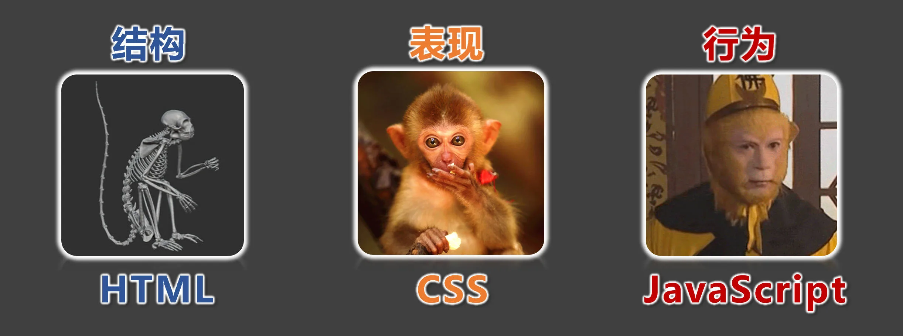

- CSS 的全称为：层叠样式表 ( Cascading Style Sheets ) 。
- CSS 也是一种标记语言，用于给 HTML 结构设置样式，例如：文字大小、颜色、元素宽高等等。

> 简单理解： CSS 可以美化 HTML , 让 HTML 更漂亮。
>
> 核心思想： HTML 搭建结构， CSS 添加样式，实现了：结构与样式的分离。

#### 2.CSS的编写位置

##### 2.1行内样式

- 写在标签的 style 属性中，（又称：内联样式）。

- 语法：

```html
<h1 style="color:red;font-size:60px;">欢迎来到尚硅谷学习</h1>
```

- 注意点：

> 1. style 属性的值不能随便写，写要符合 CSS 语法规范，是 名:值; 的形式。
> 2. 行内样式表，只能控制当前标签的样式，对其他标签无效。

- 存在的问题：

> 书写繁琐、样式不能复用、并且没有体现出：结构与样式分离 的思想，不推荐大量使用，只有对当前元素添加简单样式时，才偶尔使用。

```html
<!DOCTYPE html>
<html lang="zh-CN">
<head>
    <meta charset="UTF-8">
    <title>位置1_行内样式</title>
</head>
<body>
<h1 style="color: green;font-size: 80px;">欢迎来到尚硅谷学习</h1>
<h2 style="color: green;font-size: 80px;">欢迎学习前端</h2>
</body>
</html>
```

##### 2.2内部样式

- 写在html 页面内部，将所有的 CSS 代码提取出来，单独放在 `<style>` 标签中。

- 语法：

  ```html
  	<style>
          h1{
              color: green;
              font-size: 40px;
          }
      </style>
  ```


- 注意点：

  > 1. `<style>` 标签理论上可以放在 HTML 文档的任何地方，但一般都放在`<head> `标签中。
  > 2. 此种写法：样式可以复用、代码结构清晰。

- 存在的问题：

  > 1. 并没有实现：结构与样式完全分离。
  > 2. 多个HTML 页面无法复用样式。

  `内部样式.html`

  ```html
  <!DOCTYPE html>
  <html lang="zh-CN">
  <head>
      <meta charset="UTF-8">
      <title>位置2_内部样式</title>
      <style>
          h1{
              color: green;
              font-size: 40px;
          }
          h2{
              color: red;
              font-size: 60px;
          }
          p{
              color: blue;
              font-size: 80px;
          }
          img{
              width: 200px;
          }
      </style>
  </head>
  <body>
      <h1>欢迎来到尚硅谷学习</h1>
      <h2>欢迎学习前端</h2>
      <p>北京欢迎你</p>
      <p>上海欢迎你</p>
      <p>深圳欢迎你</p>
      <p>武汉欢迎你</p>
      <p>西安欢迎你</p>
      
  </body>
  </html>
  ```

##### 2.3外部样式

- 写在单独的.css 文件中，随后在 HTML 文件中引入使用。

- 语法：

  1. 新建一个扩展名为 .css 的样式文件，把所有CSS 代码都放入此文件中。

     ```css
     h1{
         color: green;
         font-size: 40px;
     }
     ```


2. 在 HTML 文件中引入 .css 文件。

   ```html
   <link rel="stylesheet" href="./xxx.css">
   ```


- 注意点：

  > 1. `<link> `标签要写在`<head> `标签中。
  > 2. `<link> `标签属性说明：
  >    `href `：引入的文档来自于哪里。
  >    `rel` ：( `relation` ：关系）说明引入的文档与当前文档之间的关系。
  > 3. 外部样式的优势：样式可以复用、结构清晰、可触发浏览器的缓存机制，提高访问速
  >    度 ，实现了结构与样式的完全分离。
  > 4. 实际开发中，几乎都使用外部样式，这是最推荐的使用方式！

`position3.css`

```css
h1 {
    color: green;
    font-size: 40px;
}

h2 {
    color: red;
    font-size: 60px;
}

p {
    color: blue;
    font-size: 80px;
}

img {
    width: 200px;
}
```

`外部样式.html`

```html
<!DOCTYPE html>
<html lang="zh-CN">
<head>
    <meta charset="UTF-8">
    <title>位置3_外部样式</title>
    <link rel="stylesheet" href="./position3.css">
</head>
<body>
<h1>欢迎来到尚硅谷学习</h1>
<h2>欢迎学习前端</h2>
<p>北京欢迎你</p>
<p>上海欢迎你</p>
<p>深圳欢迎你</p>
<p>武汉欢迎你</p>
<p>西安欢迎你</p>
<p>成都欢迎你</p>

</body>
</html>
```

#### 3.样式表的优先级

优先级规则：行内样式 > 内部样式 = 外部样式

> 1. 内部样式、外部样式，这二者的优先级相同，且：后面的 会覆盖 前面的（简记：“后来者居上”）。
> 2. 同一个样式表中，优先级也和编写顺序有关，且：后面的 会覆盖 前面的（简记：“后来者居上”）。

| 分类     | 优点                                                         | 缺点                                                        | 使用频率 | 作用范围 |
| -------- | ------------------------------------------------------------ | ----------------------------------------------------------- | -------- | -------- |
| 行内样式 | 优先级最高                                                   | 1. 结构与样式未分离<br/>2. 代码结构混乱<br/>3. 样式不能复用 | 很低     | 当前标签 |
| 内部样式 | 1. 样式可复用<br/>2. 代码结构清晰                            | 1. 结构与样式未彻底分离<br/>2. 样式不能多页面复用           | 一般     | 当前页面 |
| 外部样式 | 1. 样式可多页面复用<br/>2. 代码结构清晰<br/>3. 可触发浏览器的缓存机制<br/>4. 结构与样式彻底分离 | 需要引入才能使用                                            | 最高     | 多个页面 |

`index.css`

```css
h1 {
    color: blue;
}
```

`优先级.html`

```html
<!DOCTYPE html>
<html lang="zh-CN">
<head>
    <meta charset="UTF-8">
    <title>优先级</title>
    <style>
        h1 {
            color: red;
            font-size: 100px;
        }

        h1 {
            color: blue;
            font-size: 40px;
        }
    </style>
</head>
<body>
<h1>欢迎来到尚硅谷学习</h1>
</body>
</html>
```

#### 4.CSS语法规范

CSS 语法规范由两部分构成：

- 选择器：找到要添加样式的元素。

- 声明块：设置具体的样式（声明块是由一个或多个声明组成的），声明的格式为： 属性名: 属性值;

  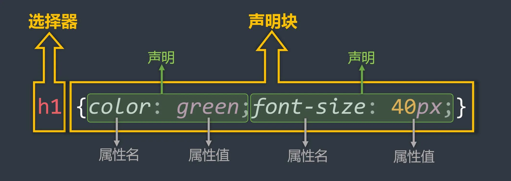

- 注释的写法：

  ```html
      <style>
          /* 给所有的h1加样式 */
          h1 {
              /* 字体颜色为红色 */
              color: blue;
              font-size: 40px;
          }
      </style>
  ```

  `语法规范.html`

  ```html
  <!DOCTYPE html>
  <html lang="zh-CN">
  <head>
      <meta charset="UTF-8">
      <title>语法规范</title>
      <style>
          /* 给所有的h1加样式 */
          h1 {
              /* 字体颜色为红色 */
              color: blue;
              font-size: 40px;
          }
      </style>
  </head>
  <body>
      <h1>欢迎来到尚硅谷学习</h1>
  </body>
  </html>
  ```

#### 5.CSS代码风格

- 展开风格 —— 开发时推荐，便于维护和调试。

  ```css
   		h1 {
              color: red;
              font-size: 100px;
          }
  ```


- 紧凑风格 —— 项目上线时推荐，可减小文件体积。

  ```css
  h1{color:red;font-size:100px;}
  ```


- 备注：

  > 项目上线时，我们会通过工具将【展开风格】的代码，变成【紧凑风格】，这样可以减小文件体积，节约网络流量，同时也能让用户打开网页时速度更快。

  `bootstrap.css`

  `bootstrap.min.css`

  `代码风格.html`

```html
<!DOCTYPE html>
<html lang="zh-CN">
<head>
    <meta charset="UTF-8">
    <title>代码风格</title>
    <style>
        /* 展开风格 */
        h1 {
            color: red;
            font-size: 100px;
        }

        /* 紧凑风格 */
        /* h1{color:red;font-size:100px;} */
    </style>
</head>
<body>
<h1>欢迎来到尚硅谷学习</h1>
</body>
</html>
```

### 二、CSS选择器

#### 1.CSS基本选择器

1. 通配选择器
2. 元素选择器
3. 类选择器
4. id 选择器

##### 1.1通配选择器

- 作用：可以选中所有的 HTML 元素。

- 语法：

  ```css
  * {
  属性名: 属性值;
  }
  ```


- 举例：

  ```css
  /* 选中所有元素 */
  * {
  	color: orange;
  	font-size: 40px;
  }
  ```

  > 备注：目前来看通配选择器貌似有点鸡肋，但后面清除样式时，会对我们有很大帮助，后面会详细讲。

  `通配选择器.html`

  ```html
  <!DOCTYPE html>
  <html lang="zh-CN">
  <head>
      <meta charset="UTF-8">
      <title>01_通配选择器</title>
      <style>
          * {
              color: orange;
              font-size: 40px;
          }-
      </style>
  </head>
  <body>
      <h1>欢迎来到土味官网，土的味道我知道</h1>
      <br>
      <h2>土味情话</h2>
      <h3>作者：优秀的网友们</h3>
      <p>万水千山总是情，爱我多点行不行！</p>
      <p>草莓、蓝莓、蔓越莓，今天你想我了没？</p>
      <p>我心里给你留了一块地，我的死心塌地！</p>
  </body>
  </html>
  ```

##### 1.2元素选择器

- 作用：为页面中 某种元素 统一设置样式。

- 语法：

  ```html
  标签名 {
  	属性名: 属性值;
  }
  ```


- 举例：

  ```css
  /* 选中所有h1元素 */
  h1 {
  	color: orange;
  	font-size: 40px;
  }
  /* 选中所有p元素 */
  p {
  	color: blue;
  	font-size: 60px;
  }
  ```


- 备注：元素选择器无法实现差异化设置，例如上面的代码中，所有的p 元素效果都一样。

`元素选择器.html`

```html
<!DOCTYPE html>
<html lang="zh-CN">
<head>
    <meta charset="UTF-8">
    <title>02_元素选择器</title>
    <style>
        h2 {
            color: chocolate;
        }

        h3 {
            color: green;
        }

        p {
            color: red;
        }

        h1 {
            font-size: 50px;
        }
    </style>
</head>
<body>
<h1>欢迎来到土味官网，土的味道我知道</h1>
<br>
<h2>土味情话</h2>
<h3>作者：优秀的网友们</h3>
<p>万水千山总是情，爱我多点行不行！</p>
<p>草莓、蓝莓、蔓越莓，今天你想我了没？</p>
<p>我心里给你留了一块地，我的死心塌地！</p>
<br>
<h2>反杀土味情话</h2>
<h3>作者：更优秀的网友们</h3>
<p>一寸光阴一寸金，劝你死了这条心！</p>
<p>西瓜、南瓜、哈密瓜，把你打成大傻瓜！</p>
<p>我心里只有一块地，我的玛莎拉蒂！</p>
</body>
</html>
```

##### 1.3类选择器

- 作用：根据元素的class 值，来选中某些元素。

  > class 翻译过来有：种类、类别的含义，所以class 值，又称：类名。

- 语法：

  ```
  .类名 {
  	属性名: 属性值;
  }
  ```


- 举例：

  ```css
  /* 选中所有class值为speak的元素 */
  .speak {
  	color: red;
  }
  /* 选中所有class值为answer的元素 */
  .answer {
  	color: blue;
  }
  ```


- 注意点：

  > 1. 元素的class 属性值不带. ，但CSS 的类选择器要带. 。
  >
  > 2. class 值，是我们自定义的，按照标准：不要使用纯数字、不要使用中文、尽量使用英文与数字的组合，若由多个单词组成，使用-
  >    做连接，例如： left-menu ，且命名要有意义，做到 “见名知意”。
  >
  > 3. 一个元素不能写多个class 属性，下面是 错误示例：
  >
  >    ```html
  >    <!-- 该写法错误，元素的属性不能重复，后写的会失效 -->
  >    <h1 class="speak" class="big">你好啊</h1>
  >    ```
  >
  > 
  >
  > 4. 一个元素的class 属性，能写多个值，要用空格隔开，例如：
  >
  >    ```html
  >    <!-- 该写法正确，class属性，能写多个值 -->
  >    <h1 class="speak big">你好啊</h1>
  >    ```

>

`类选择器.html`

```html
<!DOCTYPE html>
<html lang="zh-CN">
<head>
    <meta charset="UTF-8">
    <title>03_类选择器</title>
    <style>
        /* 选中页面中所有类名为speak的元素 */
        .speak {
            color: red;
        }

        /* 选中页面中所有类名为answer的元素 */
        .answer {
            color: green;
        }

        /* 选中页面中所有类名为big的元素 */
        .big {
            font-size: 60px;
        }
    </style>
</head>
<body>
<h1>欢迎来到土味官网，土的味道我知道</h1>
<br>
<h2>土味情话</h2>
<h3>作者：优秀的网友们</h3>
<p class="speak big">我对你说：万水千山总是情，爱我多点行不行！</p>
<p class="speak">我对你说：草莓、蓝莓、蔓越莓，今天你想我了没？</p>
<p class="speak">我对你说：我心里给你留了一块地，我的死心塌地！</p>
<span class="speak">哈哈</span>
<br>
<h2>反杀土味情话</h2>
<h3>作者：更优秀的网友们</h3>
<p class="answer">你回答我：一寸光阴一寸金，劝你死了这条心！</p>
<p class="answer">你回答我：西瓜、南瓜、哈密瓜，把你打成大傻瓜！</p>
<p class="answer">你回答我：我心里只有一块地，我的玛莎拉蒂！</p>
</body>
</html>
```

##### 1.4ID选择器

- 作用：根据元素的id 属性值，来精准的选中某个元素。

- 语法：

  ```
  #id值 {
  	属性名: 属性值;
  }
  ```


- 举例：

  ```css
  /* 选中id值为earthy的那个元素 */
  #earthy {
  	color: red;
  	font-size: 60px;
  }
  ```


- 注意：

  > - id 属性值：尽量由字母、数字、下划线( _ )、短杠( - )组成，最好以字母开头、不要包含空格、区分大小写。
  > - 一个元素只能拥有一个id 属性，多个元素的id 属性值不能相同。
  > - 一个元素可以同时拥有id 和class 属性。

`ID选择器.html`

```html
<!DOCTYPE html>
<html lang="zh-CN">
<head>
    <meta charset="UTF-8">
    <title>04_ID选择器</title>
    <style>
        #earthy {
            color: red;
        }

        #turn-earthy {
            color: blue;
        }

        .turn {
            font-size: 60px;
        }
    </style>
</head>
<body>
<h1>欢迎来到土味官网，土的味道我知道</h1>
<br>
<h2 id="earthy">土味情话</h2>
<h3>作者：优秀的网友们</h3>
<p>我对你说：万水千山总是情，爱我多点行不行！</p>
<p>我对你说：草莓、蓝莓、蔓越莓，今天你想我了没？</p>
<p>我对你说：我心里给你留了一块地，我的死心塌地！</p>
<span>哈哈</span>
<br>
<h2 id="turn-earthy" class="turn">反杀土味情话</h2>
<h3>作者：更优秀的网友们</h3>
<p>你回答我：一寸光阴一寸金，劝你死了这条心！</p>
<p>你回答我：西瓜、南瓜、哈密瓜，把你打成大傻瓜！</p>
<p>你回答我：我心里只有一块地，我的玛莎拉蒂！</p>
</body>
</html>
```

##### 1.5基本选择器总结

| 基本选择器 | 特点                                                  | 用法               |
| ---------- | ----------------------------------------------------- | ------------------ |
| 通配选择器 | 选中所有标签，一般用于清除样式。                      | * {color:red}      |
| 元素选择器 | 选中所有同种标签，但是不能差异化选择。                | h1 {color:red}     |
| 类选择器   | 选中所有特定类名（ class 值）的元素 —— 使用频率很高。 | .say {color:red}   |
| ID 选择器  | 选中特定id 值的那个元素（唯一的）。                   | #earthy{color:red} |

#### 2.CSS复合选择器

CSS选择器整体分类两大类：

一、基本选择器：

1. 通配选择器
2. 元素选择器
3. 类选择器
4. ID 选择器

二、复合选择器：

1. 交集选择器
2. 并集选择器
3. 后代选择器
4. 子元素选择器
5. .....

> 1. 复合选择器建立在基本选择器之上，由多个基础选择器，通过不同的方式组合而成。
> 2. 复合选择器可以在复杂结构中，快速而准确的选中元素。

##### 2.1交集选择器

- 作用：选中同时符合多个条件的元素。

  > 交集有并且的含义（通俗理解：即......又...... 的意思），例如：年轻且长得帅。

- 语法：选择器1选择器2选择器3...选择器n {}

- 举例：

  ```css
  /* 选中：类名为beauty的p元素，为此种写法用的非常多！！！！ */
  p.beauty {
  	color: blue;
  }
  /* 选中：类名包含rich和beauty的元素 */
  .rich.beauty {
  	color: green;
  }
  ```


- 注意：

  1. 有标签名，标签名必须写在前面。
  2. id 选择器、通配选择器，理论上可以作为交集的条件，但实际应用中几乎不用 —— 因为没有意义。
  3. 交集选择器中不可能出现两个元素选择器，因为一个元素，不可能即是p 元素又是span 元素。
  4. 用的最多的交集选择器是：元素选择器配合类名选择器，例如： p.beauty 。

  `交集选择器.html`

  ```html
  <!DOCTYPE html>
  <html lang="zh-CN">
  <head>
      <meta charset="UTF-8">
      <title>01_交集选择器</title>
      <style>
          /* 选中类名为rich的元素*/
          .rich {
              color: gold;
          }
          /* 选中类名为beauty的元素*/
          .beauty {
              color: red;
          }
          /* 选中类名为beauty的p元素，这种形式（元素配合类选择器）以后用的很多！！ */
          p.beauty {
              color: green;
          }
          /* 选中同时具备rich和beauty类名的元素 */
          .rich.beauty {
              color: orange;
          }
      </style>
  </head>
  <body>
      <h2 class="rich">土豪张三</h2>
      <h2 class="beauty">明星李四</h2>
      <h2 class="rich beauty">土豪明星王五</h2>
      <hr>
      <p class="beauty">小狗旺财</p>
      <p class="beauty">小猪佩奇</p>
  </body>
  </html>
  ```

##### 2.2并集选择器

- 作用：选中多个选择器对应的元素，又称：分组选择器。

  > 所谓并集就是或者的含义（通俗理解：要么......要么...... 的意思），例如：给我转10万块钱或者我报警。

- 语法：选择器1, 选择器2, 选择器3, ... 选择器n {}

  > 多个选择器通过, 连接，此处, 的含义就是：或。

- 举例：

  ```css
  /* 选中id为peiqi，或类名为rich，或类名为beauty的元素 */
  #peiqi,
  .rich,
  .beauty {
  	font-size: 40px;
  	background-color: skyblue;
  	width: 200px;
  }
  ```


- 注意：

  1. 并集选择器，我们一般竖着写。
  2. 任何形式的选择器，都可以作为并集选择器的一部分 。
  3. 并集选择器，通常用于集体声明，可以缩小样式表体积。

`并集选择器.html`

```html
<!DOCTYPE html>
<html lang="zh-CN">
<head>
    <meta charset="UTF-8">
    <title>02_并集选择器</title>
    <style>
        .rich {
            color: gold;
        }

        .beauty {
            color: red;
        }

        .dog {
            color: blue;
        }

        .pig {
            color: green;
        }

        /* 选中类名为：rich或beauty或dog或pig或id为suxi的元素*/
        .rich,
        .beauty,
        .dog,
        .pig,
        #suxi {
            font-size: 40px;
            background-color: gray;
            width: 180px;
        }
    </style>
</head>
<body>
<h2 class="rich">土豪张三</h2>
<h2 class="beauty">明星李四</h2>
<h2>破产王五（不加任何样式）</h2>
<hr>
<p class="dog">小狗旺财</p>
<p class="pig">小猪佩奇</p>
<p id="suxi">小羊苏西</p>
</body>
</html>
```

##### 2.3HTML元素间的关系

分为：①父元素、②子元素、③祖先元素、④后代元素、⑤兄弟元素。

1. 父元素：直接包裹某个元素的元素，就是该元素的父元素。

   > 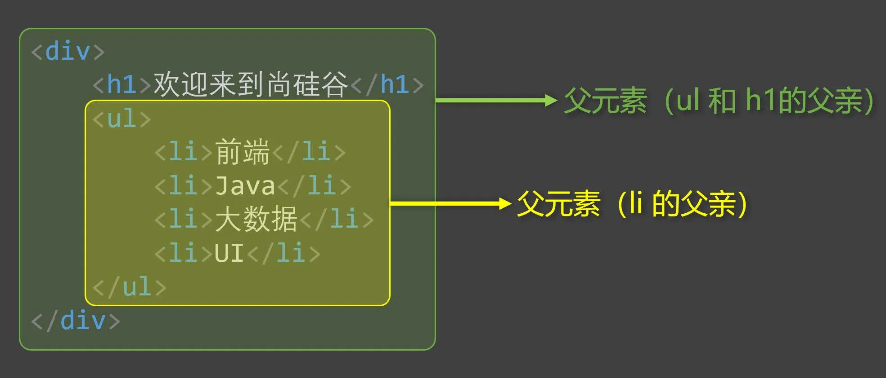

2. 子元素：被父元素直接包含的元素（简记：儿子元素）。

   > 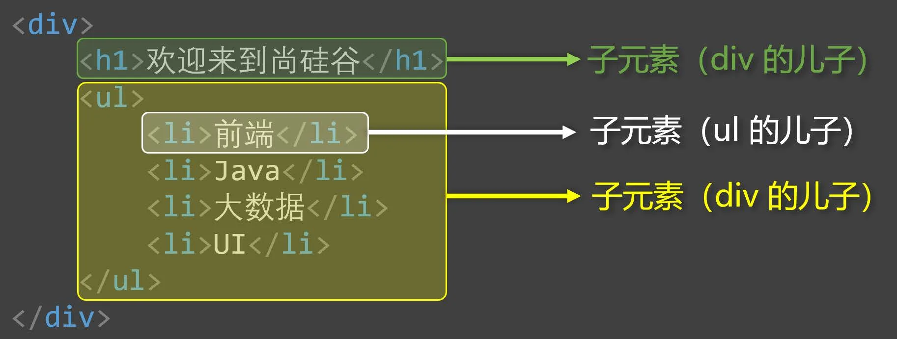

3. 祖先元素：父亲的父亲......，一直往外找，都是祖先。

   > 备注：父元素，也算是祖先元素的一种。
   >
   > 例如：张三的父亲，也算是张三的祖先，但一般还是称呼：父亲。
   >
   > 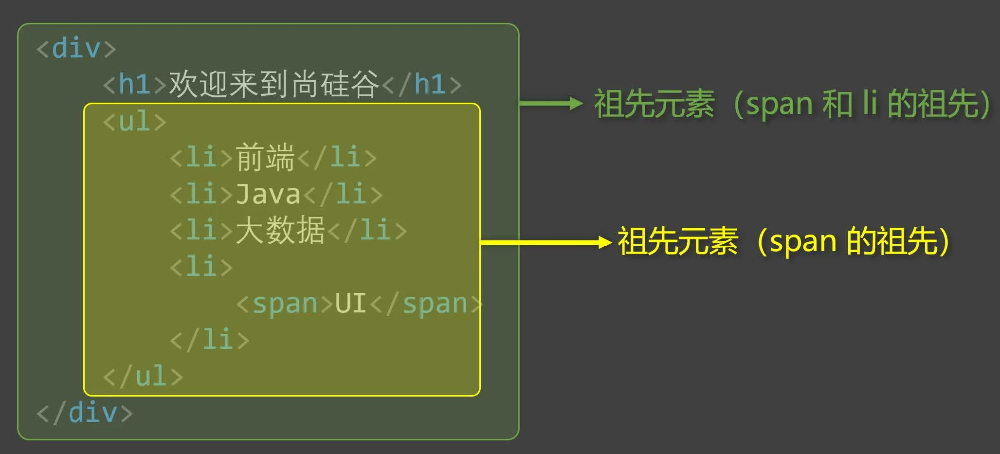

4. 后代元素：儿子的儿子......，一直往里找，都是后代。

   > 备注：子元素，也算是后代元素的一种。
   >
   > 例如：张三的儿子，也算是张三的后代，但一般还是称呼：儿子。
   >
   > 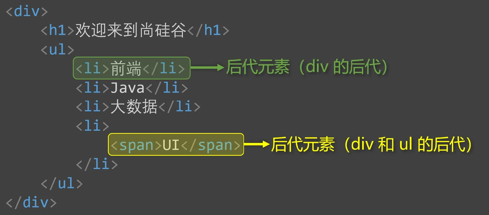

5. 兄弟元素：具有相同父元素的元素，互为兄弟元素。

   > 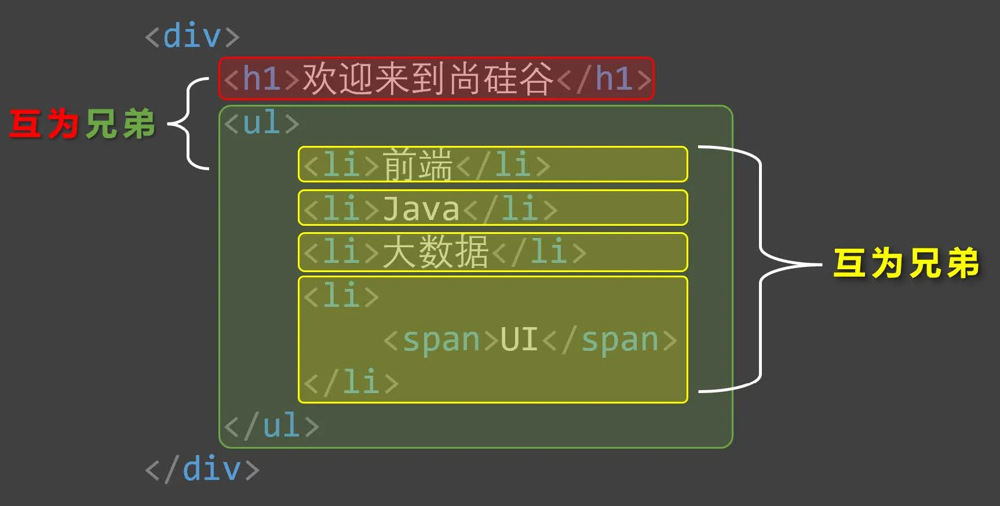

##### 2.4后代选择器

- 作用：选中指定元素中，符合要求的后代元素。

- 语法：选择器1 选择器2 选择器3 ...... 选择器n {} （先写祖先，再写后代）

  > 选择器之间，用空格隔开，空格可以理解为：" xxx 中的"，其实就是后代的意思。
  >
  > 选择器1234....n ，可以是我们之前学的任何一种选择器。

- 举例：

  ```css
  /* 选中ul中的所有li */
  ul li {
  	color: red;
  }
  /* 选中ul中所有li中的a */
  ul li a {
  	color: orange;
  }
  /* 选中类名为subject元素中的所有li */
  .subject li {
  	color: blue;
  }
  /* 选中类名为subject元素中的所有类名为front-end的li */
  .subject li.front-end {
  	color: blue;
  }
  ```


- 注意：

  1. 后代选择器，最终选择的是后代，不选中祖先。
  2. 儿子、孙子、重孙子，都算是后代。
  3. 结构一定要符合之前讲的HTML 嵌套要求，例如：不能p 中写h1 ~ h6 。

`后代选择器.html`

```html
<!DOCTYPE html>
<html lang="zh-CN">
<head>
    <meta charset="UTF-8">
    <title>03_后代选择器</title>
    <style>
        ul li {
            color: red;
        }

        ol li {
            color: green;
        }

        ul li a {
            color: orange;
        }

        ol li a {
            color: gray;
        }

        .subject li.front-end {
            color: blue;
        }

        .subject div.front-end {
            color: chocolate;
        }
    </style>
</head>
<body>
<ul>
    <li>抽烟</li>
    <li>喝酒</li>
    <li>
        <a href="#">烫头</a>
    </li>
</ul>
<hr>
<ol>
    <li>张三</li>
    <li>李四</li>
    <li>
        <a href="#">王五</a>
    </li>
</ol>
<hr>
<ol class="subject">
    <li class="front-end">前端</li>
    <div class="front-end">学科介绍：学好前端，挂帅杨帆！</div>
    <li>Java</li>
    <li>大数据</li>
    <li>UI</li>
</ol>
</body>
</html>
```

##### 2.5子代选择器

- 作用：选中指定元素中，符合要求的子元素（儿子元素）。（先写父，再写子）

  > 子代选择器又称：子元素选择器、子选择器。

- 语法：选择器1 > 选择器2 > 选择器3 > ...... 选择器n {}

  > 选择器之间，用> 隔开， > 可以理解为：" xxx 的子代"，其实就是儿子的意思。
  >
  > 选择器1234....n ，可以是我们之前学的任何一种选择器。

- 举例：

  ```css
  /* div中的子代a元素 */
  div>a {
  	color: red;
  }
  /* 类名为persons的元素中的子代a元素 */
  .persons>a{
  	color: red;
  }
  ```


- 注意：

  1. 子代选择器，最终选择的是子代，不是父级。
  2. 子、孙子、重孙子、重重孙子 ...... 统称后代！，子就是指儿子。

  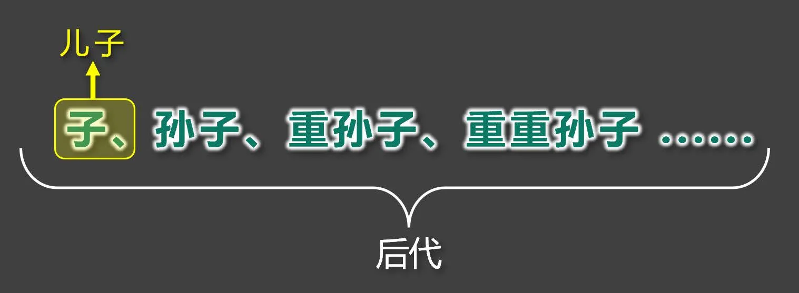

`子代选择器.html`

```html
<!DOCTYPE html>
<html lang="zh-CN">
<head>
    <meta charset="UTF-8">
    <title>04_子代选择器</title>
    <style>
        div > a {
            color: red;
        }

        div > p > a {
            color: skyblue;
        }

        .foot > a {
            color: chocolate;
        }
    </style>
</head>
<body>
<div>
    <a href="#">张三</a>
    <a href="#">李四</a>
    <a href="#">王五</a>
    <p>
        <a href="#">赵六</a>
    <div class="foot">
        <a href="#">孙七</a>
    </div>
    </p>
</div>
</body>
</html>
```

##### 2.6兄弟选择器

- 相邻兄弟选择器：

  - 作用：选中指定元素后，符合条件的相邻兄弟元素。

    > 所谓相邻，就是紧挨着他的下一个，简记：睡在我下铺的兄弟。

  - 语法： 选择器1+选择器2 {} 。

  - 示例：

    ```css
    /* 选中div后相邻的兄弟p元素 */
    div+p {
        color:red;
    }
    ```


- 通用兄弟选择器：

  - 作用：选中指定元素后，符合条件的所有兄弟元素。（简记：睡在我下铺的所有兄弟）

  - 语法： 选择器1~选择器2 {} 。

  - 实例：

    ```css
    /* 选中div后的所有的兄弟p元素 */
    div~p {
        color:red;
    }
    ```


- 注意：两种兄弟选择器，选择的是下面的兄弟。

`兄弟选择器.html`

```html
<!DOCTYPE html>
<html lang="zh-CN">
<head>
    <meta charset="UTF-8">
    <title>05_兄弟选择器</title>
    <style>
        /* 选中div后紧紧相邻的兄弟p元素（睡在我下铺的兄弟）—— 相邻兄弟选择器 */
        /* div+p { 
            color: red;
        } */

        /* 选中div后所有的兄弟p元素（睡在我下铺的所有兄弟）—— 通用兄弟选择器 */
        div ~ p {
            color: red;
        }

        li ~ li {
            color: orange;
        }
    </style>
</head>
<body>
<div>尚硅谷</div>
<p>前端</p>
<p>Java</p>
<p>大数据</p>
<p>UI</p>
<ul>
    <li>主页</li>
    <li>秒杀</li>
    <li>订单</li>
    <li>我的</li>
</ul>
</body>
</html>
```

##### 2.7属性选择器

- 作用：选中属性值符合一定要求的元素。

- 语法：

  1. [属性名] 选中具有某个属性的元素。
  2. [属性名="值"] 选中包含某个属性，且属性值等于指定值的元素。
  3. [属性名^="值"] 选中包含某个属性，且属性值以指定的值开头的元素。
  4. [属性名$="值"] 选中包含某个属性，且属性值以指定的值结尾的元素。
  5. [属性名*=“值”] 选择包含某个属性，属性值包含指定值的元素。

- 举例：

  ```css
  /* 选中具有title属性的元素 */
  div[title]{color:red;}
  /* 选中title属性值为atguigu的元素 */
  div[title="atguigu"]{color:red;}
  /* 选中title属性值以a开头的元素 */
  div[title^="a"]{color:red;}
  /* 选中title属性值以u结尾的元素 */
  div[title$="u"]{color:red;}
  /* 选中title属性值包含g的元素 */
  div[title*="g"]{color:red;}
  ```

`属性选择器.html`

```html
<!DOCTYPE html>
<html lang="zh-CN">
<head>
    <meta charset="UTF-8">
    <title>06_属性选择器</title>
    <style>
        /* 第一种写法：选中具有title属性的元素 */
        /* [title] {
            color: red;
        } */

        /* 第二种写法：选中具有title属性，且属性值为atguigu1的元素 */
        /* [title="atguigu1"] {
            color: red;
        } */

        /* 第三种写法：选中具有title属性，且属性值以字母a开头的元素 */
        /* [title^="a"] {
            color: red;
        }  */

        /* 第四种写法：选中具有title属性，且属性值以字母u结尾的元素 */
        /* [title$="u"] {
            color: red;
        }  */

        /* 第五种写法：选中具有title属性，且属性值包含字母u的元素 */
        /* [title*="u"] {
            color: red;
        } */
    </style>
</head>
<body>
<div title="atguigu1">尚硅谷1</div>
<div title="atguigu2">尚硅谷2</div>
<div title="guigu">尚硅谷3</div>
<div title="guigu" class="school">尚硅谷4</div>
</body>
</html>
```

##### 2.8伪类选择器

- 作用：选中特殊状态的元素。

  > 如何理解“伪” ? — 虚假的，不是真的。
  >
  > 如何理解“伪类”？ — 像类( class )，但不是类，是元素的一种特殊状态。

  `伪类选择器_概念.html`

  ```html
  <!DOCTYPE html>
  <html lang="zh-CN">
  <head>
      <meta charset="UTF-8">
      <title>07_伪类选择器_概念</title>
      <style>
          /* 什么是伪类？ —— 很像类，但不是类（class），是元素特殊状态的一种描述 */
          
          /* 选中的是没有访问过的a元素 */
          a:link {
              color: orange;
          }
          /* 选中的是访问过的a元素 */
          a:visited {
              color: gray;
          }
      </style>
  </head>
  <body>
      <a href="https://www.baidu.com">去百度</a>
      <a href="https://www.jd.com">去京东</a>
  </body>
  </html>
  ```


- 常用的伪类选择器：

  一、动态伪类：

    1. :link 超链接未被访问的状态。

    2. :visited 超链接访问过的状态。

    3. :hover 鼠标悬停在元素上的状态。

    4. :active 元素激活的状态。

       > 什么是激活？—— 按下鼠标不松开。
       >
       > 注意点：遵循LVHA 的顺序，即： link 、visited 、hover 、active 。

    5. :focus 获取焦点的元素。

       > 表单类元素才能使用:focus 伪类。
       >
       > 当用户：点击元素、触摸元素、或通过键盘的 “ tab ” 键等方式，选择元素时，就是获得焦点。

  `伪类选择器_动态伪类.html`

  ```html
  <!DOCTYPE html>
  <html lang="zh-CN">
  <head>
      <meta charset="UTF-8">
      <title>08_伪类选择器_动态伪类</title>
      <style>
          /* 选中的是没有访问过的a元素 */
          a:link {
              color: orange;
          }
          /* 选中的是访问过的a元素 */
          a:visited {
              color: gray;
          }
          /* 选中的是鼠标悬浮状态的a元素 */
          a:hover {
              color: skyblue;
          }
          /* 选中的是激活状态的a元素 */
          a:active {
              color: green;
          }
          /* 选中的是鼠标悬浮的span元素 */
          span:hover {
              color: green;
          }
          /* 选中的是激活的span元素 */
          span:active {
              color: red;
          }
          /* 选中的是获取焦点状态的input元素、获取焦点状态的select元素 */
          input:focus,select:focus {
              color: orange;
              background-color: green;
          }
      </style>
  </head>
  <body>
      <a href="https://www.baidu.com">去百度</a>
      <a href="https://www.jd.com">去京东</a>
      <span>尚硅谷</span>
      <br>
      <input type="text">
      <br>
      <input type="text">
      <br>
      <input type="text">
      <select>
          <option value="beijing">北京</option>
          <option value="shanghai">上海</option>
      </select>
  </body>
  </html>
  ```

  二、结构伪类：

    - 常用的：

      1. :first-child 所有兄弟元素中的第一个。
      2. :last-child 所有兄弟元素中的最后一个。
      3. :nth-child(n) 所有兄弟元素中的第 n 个。
      4. :first-of-type 所有同类型兄弟元素中的第一个。
      5. :last-of-type 所有同类型兄弟元素中的最后一个。
      6. :nth-of-type(n) 所有同类型兄弟元素中的 第n个 。

      关于n 的值：

      > 1. 0 或不写：什么都选不中 —— 几乎不用。
      > 2. n ：选中所有子元素 —— 几乎不用。
      > 3. 1~正无穷的整数 ：选中对应序号的子元素。
      > 4. 2n 或 even ：选中序号为偶数的子元素。
      > 5. 2n+1 或 odd ：选中序号为奇数的子元素。
      > 6. -n+3 ：选中的是前3 个。

    - 了解即可：

      1. :nth-last-child(n) 所有兄弟元素中的倒数第 n 个。
      2. :nth-last-of-type(n) 所有同类型兄弟元素中的 倒数第n个 。
      3. :only-child 选择没有兄弟的元素（独生子女）。
      4. :only-of-type 选择没有同类型兄弟的元素。
      5. :root 根元素。
      6. :empty 内容为空元素（空格也算内容）。

  `伪类选择器_结构伪类_1.html`

  ```html
  <!DOCTYPE html>
  <html lang="zh-CN">
  <head>
      <meta charset="UTF-8">
      <title>09_伪类选择器_结构伪类_1</title>
      <style>
          /* 选中的是div的第一个儿子p元素（按照所有兄弟计算的） —— 看结构1 */
          /* div>p:first-child {
              color: red;
          } */
  
          /* 选中的是div的第一个儿子p元素（按照所有兄弟计算的） —— 看结构2 */
          /* div>p:first-child {
              color: red;
          } */
  
          /* 选中的是div的后代p元素，且p的父亲是谁无所谓，但p必须是其父亲的第一个儿子（按照所有兄弟计算的） —— 看结构3 */
          /* div p:first-child {
              color: red;
          } */
  
          /* 选中的是p元素，且p的父亲是谁无所谓，但p必须是其父亲的第一个儿子（按照所有兄弟计算的） —— 看结构3 */
          p:first-child {
              color: red;
          }
      </style>
  </head>
  <body>
      <!-- 结构1 -->
      <!-- <div>
          <p>张三：98分</p>
          <p>李四：88分</p>
          <p>王五：78分</p>
          <p>赵六：68分</p>
      </div> -->
  
      <!-- 结构2 -->
      <!-- <div>
          <span>张三：98分</span>
          <p>李四：88分</p>
          <p>王五：78分</p>
          <p>赵六：68分</p>
      </div> -->
  
      <!-- 结构3 -->
      <p>测试1</p>
      <div>
          <p>测试2</p>
          <marquee>
              <p>测试3</p>
              <p>张三：98分</p>
          </marquee>
          <p>李四：88分</p>
          <p>王五：78分</p>
          <p>赵六：68分</p>
      </div>
  </body>
  </html>
  ```

  `伪类选择器_结构伪类_2.html`

  ```html
  <!DOCTYPE html>
  <html lang="zh-CN">
  <head>
      <meta charset="UTF-8">
      <title>10_伪类选择器_结构伪类_2</title>
      <style>
          /* 选中的是div的第一个儿子p元素（按照所有兄弟计算的）—— 结构1*/
          /* div>p:first-child {
              color: red;
          } */
  
          /* 选中的是div的最后一个儿子p元素（按照所有兄弟计算的）—— 结构1*/
          /* div>p:last-child {
              color: red;
          } */
          
          /* 选中的是div的第n个儿子p元素（按照所有兄弟计算的）—— 结构1 */
          /* div>p:nth-child(3) {
              color: red;
          } */
      
          /* 选中的是div的偶数个儿子p元素（按照所有兄弟计算的）—— 结构2 */
          /* 关于n的值 —— 结构2：
                  1. 0或不写：什么都选不中 —— 几乎不用。
                  2. n ：选中所有子元素  —— 几乎不用。
                  3. 1 ~ 正无穷的整数，选中对应序号的子元素。
                  4. 2n 或 even  ：选中序号为偶数的子元素。
                  5. 2n+1 或 odd ：选中序号为奇数的子元素。
                  6. -n+3 : 选中前三个。
           */
          /* div>p:nth-child(2n) {
              color: red;
          } */
      
          /* 选中的是div的第一个儿子p元素（按照所有同类型兄弟计算的）—— 结构3 */
          /* div>p:first-of-type{
              color: red;
          } */
  
          /* 选中的是div的最后一个儿子p元素（按照所有同类型兄弟计算的）—— 结构3 */
          /* div>p:last-of-type{
              color: red;
          } */
          
          /* 选中的是div的第n个儿子p元素（按照所有同类型兄弟计算的）—— 结构3 */
          /* div>p:nth-of-type(5) {
              color: red;
          } */
      </style>
  </head>
  <body>
      <!-- 结构1 -->
      <!-- <div>
          <p>张三：98分</p>
          <p>李四：88分</p>
          <p>王五：78分</p>
          <p>赵六：68分</p>
          <p>孙七：58分</p>
          <p>老八：48分</p>
      </div> -->
  
      <!-- 结构2 -->
      <!-- <div>
          <p>第1个</p>
          <p>第2个</p>
          <p>第3个</p>
          <p>第4个</p>
          <p>第5个</p>
          <p>第6个</p>
          <p>第7个</p>
          <p>第8个</p>
          <p>第9个</p>
          <p>第10个</p>
      </div> -->
  
      <!-- 结构3 -->
      <!-- <div>
          <span>测试1</span>
          <p>张三：98分</p>
          <p>李四：88分</p>
          <p>王五：78分</p>
          <span>测试2</span>
          <p>赵六：68分</p>
          <span>测试3</span>
          <p>孙七：58分</p>
          <span>测试4</span>
          <p>老八：48分</p>
          <span>测试5</span>
      </div> -->
  </body>
  </html>
  ```

  `伪类选择器_结构伪类_3.html`

  ```html
  <!DOCTYPE html>
  <html lang="zh-CN">
  <head>
      <meta charset="UTF-8">
      <title>11_伪类选择器_结构伪类_3</title>
      <style>
          /* 选中div中倒数第n个的儿子p元素（按照所有兄弟）—— 看结构1 */
          /* div>p:nth-last-child(3) {
              color: red;
          } */
  
          /* 选中div中倒数第n个的儿子p元素（按照所有同类型的兄弟）—— 看结构1 */
          /* div>p:nth-last-of-type(2) {
              color: red;
          } */
          
          /* 选中的是没有兄弟的span元素 —— 看结构2 */
          /* span:only-child {
              color: red;
          } */
  
          /* 选中的是没有同类型兄弟的span元素 —— 看结构2 */
          /* span:only-of-type {
              color: red;
          } */
  
          /* 选中的是根元素 */
          /* :root {
              background-color: gray;
          } */
  
          /* 选中的是没有内容的div元素 */
          /* div:empty {
              width: 100px;
              height: 100px;
              background-color: red;
          } */
  
      </style>
  </head>
  <body>
      <!-- 结构1 -->
      <!-- <div>
          <span>测试1</span>
          <p>张三：98分</p>
          <p>李四：88分</p>
          <p>王五：78分</p>
          <p>赵六：68分</p>
          <p>孙七：58分</p>
          <p>老八：48分</p>
          <span>测试2</span>
      </div> -->
      
      <!-- 结构2 -->
      <!-- <div>
          <span>测试1</span>
      </div>
      <div>
          <span>测试2</span>
          <p>张三：98分</p>
          <p>李四：88分</p>
          <p>王五：78分</p>
          <p>赵六：68分</p>
          <p>孙七：58分</p>
          <p>老八：48分</p>
      </div> -->
  
      <!-- 结构3 -->
      <div> </div>
  </body>
  </html>
  ```

  三、否定伪类：

      1. :not(选择器) 排除满足括号中条件的元素。

  `伪类选择器_否定伪类.html`

  ```html
  <!DOCTYPE html>
  <html lang="zh-CN">
  <head>
      <meta charset="UTF-8">
      <title>12_伪类选择器_否定伪类</title>
      <style>
          /* 选中的是div的儿子p元素，但是排除类名为fail的元素 */
          /* div>p:not(.fail) {
              color: red;
          } */
  
          /* 选中的是div的儿子p元素，但是排除title属性值以“你要加油”开头的 */
          /* div>p:not([title^="你要加油"]) {
              color: red;
          } */
  
          /* 选中的是div的儿子p元素，但排除第一个儿子p元素 */
          div>p:not(:first-child) {
              color: red;
          }
      </style>
  </head>
  <body>
      <div>
          <p>张三：98分</p>
          <p>李四：88分</p>
          <p>王五：78分</p>
          <p>赵六：68分</p>
          <p class="fail" title="你要加油啊！孙七">孙七：58分</p>
          <p class="fail" title="你要加油啊！老八">老八：48分</p>
      </div>
  </body>
  </html>
  ```

  四、UI伪类：

      1. :checked 被选中的复选框或单选按钮。
      2. :enable 可用的表单元素（没有 disabled 属性）。
      3. :disabled 不可用的表单元素（有disabled 属性）。

  `伪类选择器_UI伪类.html`

  ```html
  <!DOCTYPE html>
  <html lang="zh-CN">
  <head>
      <meta charset="UTF-8">
      <title>13_伪类选择器_UI伪类</title>
      <style>
          /* 选中的是勾选的复选框或单选按钮 */
          input:checked {
              width: 100px;
              height: 100px;
          }
          /* 选中的是被禁用的input元素 */
          input:disabled {
              background-color: gray;
          }
          /* 选中的是可用的input元素 */
          input:enabled {
              background-color: green;
          }
  
      </style>
  </head>
  <body>
      <input type="checkbox">
      <input type="radio" name="gender">
      <input type="radio" name="gender">
      <input type="text">
      <input type="text" disabled>
  </body>
  </html>
  ```

  五、目标伪类（了解）：

      1. :target 选中锚点指向的元素。

  `伪类选择器_目标伪类.html`

  ```html
  <!DOCTYPE html>
  <html lang="zh-CN">
  <head>
      <meta charset="UTF-8">
      <title>14_伪类选择器_目标伪类</title>
      <style>
          div {
              background-color: gray;
              height: 300px;
          }
          div:target {
              background-color: green;
          }
      </style>
  </head>
  <body>
      <a href="#one">去看第1个</a>
      <a href="#two">去看第2个</a>
      <a href="#three">去看第3个</a>
      <a href="#four">去看第4个</a>
      <a href="#five">去看第5个</a>
      <a href="#six">去看第6个</a>
  
      <div id="one">第1个</div>
      <br>
      <div id="two">第2个</div>
      <br>
      <div id="three">第3个</div>
      <br>
      <div id="four">第4个</div>
      <br>
      <div id="five">第5个</div>
      <br>
      <div id="six">第6个</div>
  </body>
  </html>
  ```

  六、语言伪类（了解）：

      1. :lang() 根据指定的语言选择元素（本质是看lang 属性的值）。

  `伪类选择器_语言伪类.html`

  ```html
  <!DOCTYPE html>
  <html lang="zh-CN">
  <head>
      <meta charset="UTF-8">
      <title>15_伪类选择器_语言伪类</title>
      <style>
          div:lang(en) {
              color: red;
          }
          :lang(zh-CN) {
              color: green;
          }
      </style>
  </head>
  <body>
      <div>尚硅谷1</div>
      <div lang="en">尚硅谷2</div>
      <p>前端</p>
      <span>你好</span>
  </body>
  </html>
  ```

##### 2.9 伪元素选择器

- 作用：选中元素中的一些特殊位置。
- 常用伪元素：
  - :first-letter 选中元素中的第一个文字。
  - :first-line 选中元素中的第一行文字。
  - :selection 选中被鼠标选中的内容。
  - :placeholder 选中输入框的提示文字。
  - :before 在元素最开始的位置，创建一个子元素（必须用 content 属性指定内容）。
  - :after 在元素最后的位置，创建一个子元素（必须用 content 属性指定内容）。

`伪元素选择器.html`

```html
<!DOCTYPE html>
<html lang="zh-CN">
<head>
    <meta charset="UTF-8">
    <title>16_伪元素选择器</title>
    <style>
        /* 什么是伪元素？ —— 很像元素，但不是元素（element），是元素中的一些特殊位置 */

        /* 选中的是div中的第一个文字 */
        div::first-letter {
            color: red;
            font-size: 40px;
        }

        /* 选中的是div中的第一行文字 */
        div::first-line {
            background-color: yellow;
        }

        /* 选中的是div中被鼠标选择的文字 */
        div::selection {
            background-color: green;
            color: orange;
        }

        /* 选中的是input元素中的提示文字 */
        input::placeholder {
            color: skyblue;
        }

        /* 选中的是p元素最开始的位置，随后创建一个子元素 */
        p::before {
            content: "￥";
        }

        /* 选中的是p元素最后的位置，随后创建一个子元素 */
        p::after {
            content: ".00"
        }
    </style>
</head>
<body>
<div>Lorem ipsum dolor sit amet consectetur adipisicing elit. Sunt quibusdam amet eligendi velit dolore sequi,
    exercitationem consequatur, quis maiores tempore accusantium ipsum aspernatur iusto fugiat fuga natus est placeat.
    Accusamus maiores culpa et sunt dolorum incidunt. Ducimus in odio tempora minima provident deleniti, ex voluptatem
    facere, molestias unde exercitationem pariatur rem vero ut quidem quaerat aliquam, nam debitis perspiciatis. Facere?
</div>
<br>
<input type="text" placeholder="请输入您的用户名">
<p>199</p>
<p>299</p>
<p>399</p>
<p>499</p>
</body>
</html>
```

#### 3.选择器的优先级（权重）

通过不同的选择器，选中相同的元素 ，并且为相同的样式名设置不同的值时，就发生了样式的冲突。

到底应用哪个样式，此时就需要看优先级了。

- 简单描述：

  行内样式 > ID选择器 > 类选择器 > 元素选择器 > 通配选择器。

  `选择器优先级_简单聊.html`

  ```html
  <!DOCTYPE html>
  <html lang="zh-CN">
  <head>
      <meta charset="UTF-8">
      <title>选择器优先级_简单聊</title>
      <style>
          /* 行内 > ID选择器 > 类选择器 > 元素选择器 > 通配选择器 */
          
          /* #atguigu {
              color: red;
          } */
          /* h2 {
              color: orange;
          } */
          /* .slogan {
              color: green;
          } */
          /* h2 {
              color: gray;
          } */
          /* * {
              color: purple;
          } */
      </style>
  </head>
  <body>
      <h2 class="slogan" id="atguigu">尚硅谷，让天下没有难学的技术！</h2>
  </body>
  </html>
  ```


- 详细描述：

  1. 计算方式：每个选择器，都可计算出一组权重，格式为： (a,b,c)

     > - a : ID 选择器的个数。
     > - b : 类、伪类、属性 选择器的个数。
     > - c : 元素、伪元素 选择器的个数
     > - 例如：
     >
     > | 选择器 | 权重 |
     >      > | ------------------------ | ------- |
     > | ul>li | (0,0,2) |
     > | div ul>li p a span | (0,0,6) |
     > | #atguigu .slogan | (1,1,0) |
     > | #atguigu .slogan a | (1,1,1) |
     > | #atguigu .slogan a:hover | (1,2,1) |

  2. 比较规则：按照从左到右的顺序，依次比较大小，当前位胜出后，后面的不再对比，例如：

     > - (1,0,0) > (0,2,2)
     > - (1,1,0) > (1,0,3)
     > - (1,1,3) > (1,1,2)

  3. 特殊规则：

     1. 行内样式权重大于所有选择器。
     2. !important 的权重，大于行内样式，大于所有选择器，权重最高！

  4. 图示：

     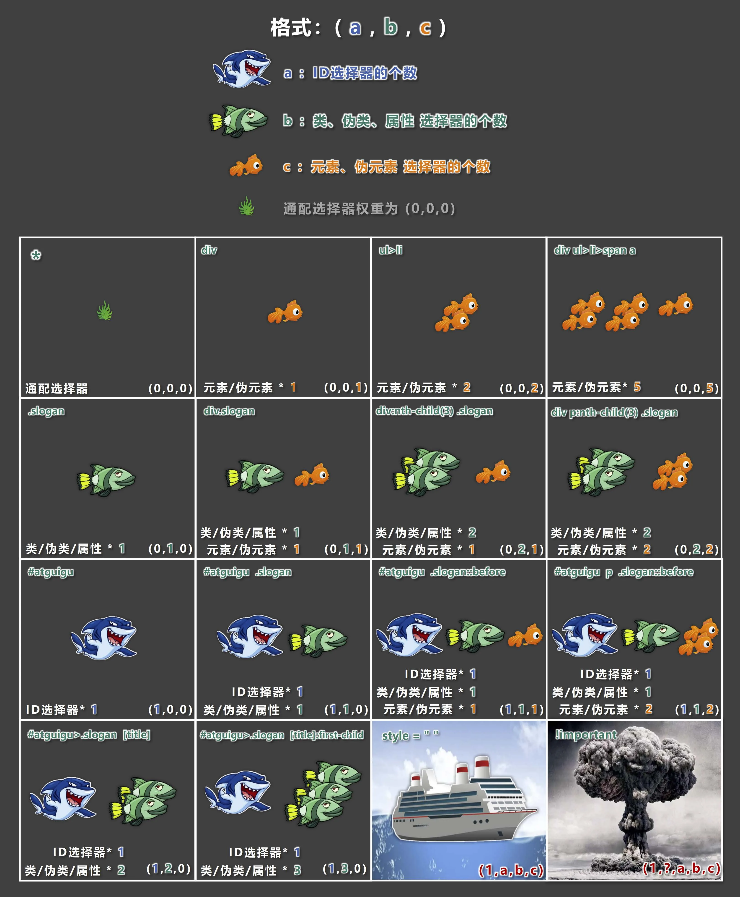

  选择器总结

  | 选择器         | 语法                                                         | 作用                                                         |
  | -------------- | ------------------------------------------------------------ | ------------------------------------------------------------ |
  | 通配选择器     | `* {属性名: 属性值;}`                                        | 可以选中所有的 HTML 元素                                     |
  | 元素选择器     | `标签名 {属性名: 属性值;}`                                   | 作用：为页面中 某种元素 统一设置样式                         |
  | 类选择器       | `.类名 {属性名: 属性值;}`                                    | 作用：根据元素的class 值，来选中某些元素                     |
  | ID 选择器      | `#id值 {属性名: 属性值;}`                                    | 作用：根据元素的id 属性值，来精准的选中某个元素              |
  | 交集选择器     | 选择器1选择器2选择器3...选择器n {}<br/>例`p.beauty`          | 作用：选中同时符合多个条件的元素                             |
  | 并集选择器     | 选择器1, 选择器2, 选择器3, ... 选择器n {}<br/>例`#peiqi,.rich,.beauty` | 作用：选中多个选择器对应的元素，又称：分组选择器             |
  | 后代选择器     | 选择器1 选择器2 选择器3 ...... 选择器n {} （先写祖先，再写后代）<br/>例`ul li` | 作用：选中指定元素中，符合要求的后代元素                     |
  | 子元素选择器   | 语法：选择器1 > 选择器2 > 选择器3 > ...... 选择器n {}<br/>例`div>a` | 作用：选中指定元素中，符合要求的子元素（儿子元素）。（先写父，再写子） |
  | 相邻兄弟选择器 | 选择器1+选择器2 {}<br/>例`div+p`                             | 作用：选中指定元素后，符合条件的相邻兄弟元素                 |
  | 通用兄弟选择器 | 选择器1~选择器2 {}<br/>例`div~p`                             | 作用：选中指定元素后，符合条件的所有兄弟元素                 |
  | 属性选择器     | 2.7属性选择器                                                | 作用：选中属性值符合一定要求的元素                           |
  | 伪类选择器     | 2.8伪类选择器                                                | 作用：选中特殊状态的元素                                     |
  | 伪元素选择器   | 2.9伪元素选择器                                              | 作用：选中元素中的一些特殊位置                               |

  `选择器优先级_详细聊.html`

```html
<!DOCTYPE html>
<html lang="zh-CN">
<head>
    <meta charset="UTF-8">
    <title>选择器优先级_详细聊</title>
    <style>
        #atguigu {
            color: orange;
        }

        .container span.slogan {
            color: red;
        }

        div > p > span:nth-child(1) {
            color: green;
        }

        .slogan {
            color: purple !important;
        }
    </style>
</head>
<body>
<div class="container">
    <p>
        <span class="slogan" id="atguigu" style="color: blue;">尚硅谷，让天下没有难学的技术！</span>
        <span>欢迎同学们来学习！</span>
    </p>
</div>
</body>
</html>
```

### 三、CSS三大特性

#### 1.层叠性

概念：如果发生了样式冲突，那就会根据一定的规则（选择器优先级），进行样式的层叠（覆盖）。

> 什么是样式冲突？ ——— 元素的同一个样式名，被设置了不同的值，这就是冲突。

#### 2.继承性

- 概念：元素会自动拥有其父元素、或其祖先元素上所设置的某些样式。

- 规则：优先继承离得近的。

- 常见的可继承属性：

  > text-?? ， font-?? ， line-?? 、color ......

- 备注：参照[MDN](https://developer.mozilla.org/zh-CN/) 网站，可查询属性是否可被继承。

#### 3.优先级

- 简单聊： !important > 行内样式 > ID选择器 > 类选择器 > 元素选择器 > * > 继承的样式。

- 详细聊：需要计算权重。

  > 计算权重时需要注意：并集选择器的每一个部分是分开算的！

  `index.css`

  ```css
  #atguigu {
      color: red;
  }
  ```

  `选择器优先级_详细聊.html`

  ```html
  <!DOCTYPE html>
  <html lang="zh-CN">
  <head>
      <meta charset="UTF-8">
      <title>CSS_三大特性</title>
      <link rel="stylesheet" href="./index.css">
      <style>
          h2 {
              color: green;
          }
          div {
              color: red;
              font-size: 40px;
              background-color: skyblue;
          }
          p {
              color: purple;
              background-color: inherit;
          }
          * {
              color: gray;
          }
          /* div {} */
          /* p {} */
          /* span {} */
      </style>
  </head>
  <body>
      <h2 id="atguigu">尚硅谷</h2>
      <hr>
      <div>
          我是div中的文字
          <span>我是span中的文字1</span>
          <span>我是span中的文字2</span>
          <span>我是span中的文字3</span>
          <p>
              <span>我是span中的文字4</span>
          </p>
      </div>
  </body> 
  </html>
  ```

### 四、CSS常用属性

#### 1.像素的概念

- 概念：我们的电脑屏幕是，是由一个一个“小点”组成的，每个“小点”，就是一个像素（px）。

- 规律：像素点越小，呈现的内容就越清晰、越细腻。

  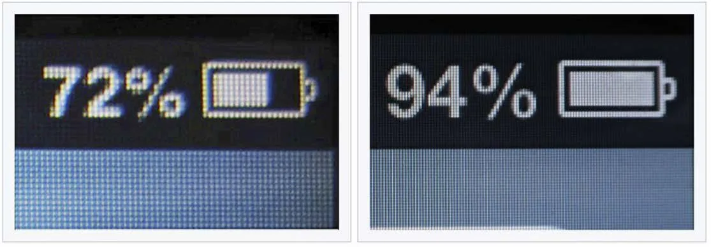

> 注意点：如果电脑设置中开启了缩放，那么就会影响一些工具的测量结果，但这无所谓，因为我们工作中都是参考详细的设计稿，去给元素设置宽高。

`像素.html`

```html
<!DOCTYPE html>
<html lang="zh-CN">
<head>
    <meta charset="UTF-8">
    <title>像素</title>
    <style>
        .atguigu1 {
            width: 1cm;
            height: 1cm;
            background-color: red;
        }

        .atguigu2 {
            width: 1mm;
            height: 1mm;
            background-color: green;
        }

        .atguigu3 {
            width: 100px;
            height: 100px;
            background-color: blue;
        }
    </style>
</head>
<body>
<div class="atguigu1"></div>
<br>
<div class="atguigu2"></div>
<br>
<div class="atguigu3"></div>
</body>
</html>
```

#### 2.颜色的表示

##### 2.1表示方式一：颜色名

- 编写方式：直接使用颜色对应的英文单词，编写比较简单，例如：

  1. 红色：red
  2. 绿色：green
  3. 蓝色：blue
  4. 紫色：purple
  5. 橙色：orange
  6. 灰色：gray
     ......

  > 1. 颜色名这种方式，表达的颜色比较单一，所以用的并不多。
  >
  > 2. 具体颜色名参考MDN 官方文档：
  >
  >    https://developer.mozilla.org/en-US/docs/Web/CSS/named-color

`颜色名.html`

```html
<!DOCTYPE html>
<html lang="zh-CN">
<head>
    <meta charset="UTF-8">
    <title>颜色_第1种表示_颜色名</title>
    <style>
        h2 {
            color: red;
        }
    </style>
</head>
<body>
<h2>尚硅谷</h2>
</body>
</html>
```

##### 2.2表示方式二：rgb 或 rgba

- 编写方式：使用 红、黄、蓝 这三种光的三原色进行组合。

  - r 表示 红色
  - g 表示 绿色
  - b 表示 蓝色
  - a 表示 透明度

- 举例：

  ```css
  /* 使用 0~255 之间的数字表示一种颜色 */
  color: rgb(255, 0, 0);/* 红色 */
  color: rgb(0, 255, 0);/* 绿色 */
  color: rgb(0, 0, 255);/* 蓝色 */
  color: rgb(0, 0, 0);/* 黑色 */
  color: rgb(255, 255, 255);/* 白色 */
  /* 混合出任意一种颜色 */
  color:rgb(138, 43, 226) /* 紫罗兰色 */
  color:rgba(255, 0, 0, 0.5);/* 半透明的红色 */
  /* 也可以使用百分比表示一种颜色（用的少） */
  color: rgb(100%, 0%, 0%);/* 红色 */
  color: rgba(100%, 0%, 0%,50%);/* 半透明的红色 */
  ```


- 小规律：

  > 1. 若三种颜色值相同，呈现的是灰色，值越大，灰色越浅。
  > 2. rgb(0, 0, 0) 是黑色， rgb(255, 255,255) 是白色。
  > 3. 对于rbga 来说，前三位的rgb 形式要保持一致，要么都是0~255 的数字，要么都是百分比。

`rgb或rgba.html`

```html
<!DOCTYPE html>
<html lang="zh-CN">
<head>
    <meta charset="UTF-8">
    <title>颜色_第2种表示_rgb或rgba</title>
    <style>
        .atguigu1 {
            color: rgb(255, 0, 0);
        }

        .atguigu2 {
            color: rgb(0, 255, 0);
        }

        .atguigu3 {
            color: rgb(0, 0, 255);
        }

        .atguigu4 {
            color: rgb(138, 43, 226);
        }

        .atguigu5 {
            color: rgb(100%, 0%, 0%);
        }

        .atguigu6 {
            color: rgba(255, 0, 0, 0.5);
        }

        .atguigu7 {
            color: rgba(59, 79, 189, 0.505)
        }
    </style>
</head>
<body>
<h2 class="atguigu1">尚硅谷1</h2>
<h2 class="atguigu2">尚硅谷2</h2>
<h2 class="atguigu3">尚硅谷3</h2>
<h2 class="atguigu4">尚硅谷4</h2>
<h2 class="atguigu5">尚硅谷5</h2>
<h2 class="atguigu6">尚硅谷6</h2>
<h2 class="atguigu7">尚硅谷7</h2>
</body>
</html>
```

##### 2.3表示方式三：HEX 或 HEXA

HEX 的原理同与 rgb 一样，依然是通过：红、绿、蓝色 进行组合，只不过要用 6位（分成3组） 来
表达，格式为：# rr gg bb

> 每一位数字的取值范围是： 0 ~ f ，即：（ 0, 1, 2, 3, 4, 5, 6, 7, 8, 9, a, b, c,d, e, f ）
>
> 所以每一种光的最小值是： 00 ，最大值是： ff

```css
color: #ff0000

; /* 红色 */
color: #00ff00

; /* 绿色 */
color: #0000ff

; /* 蓝色 */
color: #000000

; /* 黑色 */
color: #ffffff

; /* 白色 */
/* 如果每种颜色的两位都是相同的，就可以简写*/
color: #ff9988

; /* 可简为：#f98 */
/* 但要注意前三位简写了，那么透明度就也要简写 */
color: #ff998866

; /* 可简为：#f986 */
```

> 注意点： IE 浏览器不支持HEXA ，但支持HEX 。

`HEX或HEXA.html`

```html
<!DOCTYPE html>
<html lang="zh-CN">
<head>
    <meta charset="UTF-8">
    <title>颜色_第3种表示_HEX或HEXA</title>
    <style>
        .atguigu1 {
            color: #ff0000;
        }

        .atguigu2 {
            color: #00ff00;
        }

        .atguigu3 {
            color: #0000ff;
        }

        .atguigu4 {
            color: #87ceebff;
        }

        .atguigu5 {
            color: #D41504;
        }
    </style>
</head>
<body>
<h2 class="atguigu1">尚硅谷1</h2>
<h2 class="atguigu2">尚硅谷2</h2>
<h2 class="atguigu3">尚硅谷3</h2>
<h2 class="atguigu4">尚硅谷4</h2>
<h2 class="atguigu5">尚硅谷5</h2>
</body>
</html>
```

##### 2.4表示方式四：HSL 或 HSLA

- HSL 是通过：色相、饱和度、亮度，来表示一个颜色的，格式为： hsl(色相,饱和度,亮度)

  - 色相：取值范围是0~360 度，具体度数对应的颜色如下图：

    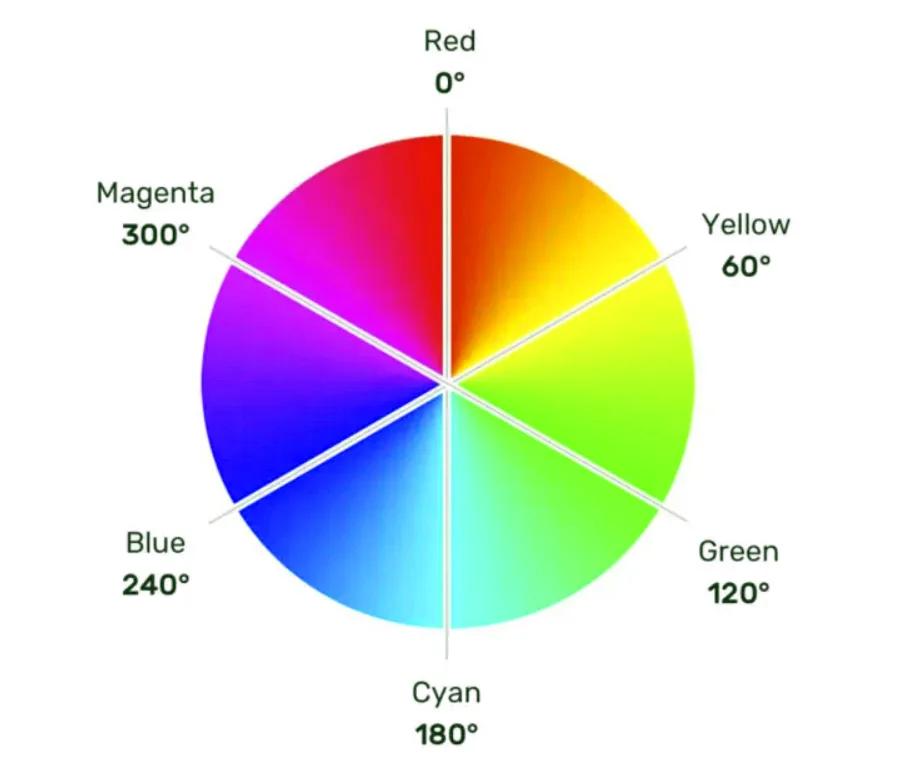

  - 饱和度：取值范围是0%~100% 。（向色相中对应颜色中添加灰色， 0% 全灰， 100% 没有灰）

  - 亮度：取值范围是0%~100% 。（ 0% 亮度没了，所以就是黑色。100% 亮度太强，所以就是白色了）

- HSLA 其实就是在HSL 的基础上，添加了透明度

`HSL或HSLA.html`

```html
<!DOCTYPE html>
<html lang="zh-CN">
<head>
    <meta charset="UTF-8">
    <title>颜色_第4种表示_HSL或HSLA</title>
    <style>
        .atguigu1 {
            color: hsl(0, 100%, 50%);
        }

        .atguigu2 {
            color: hsl(60, 100%, 50%);
        }

        .atguigu3 {
            color: hsl(120, 100%, 50%);
        }

        .atguigu4 {
            color: hsl(180, 100%, 50%);
        }

        .atguigu5 {
            color: hsl(0, 100%, 50%);
        }

        .atguigu6 {
            color: hsla(0, 100%, 50%, 67.8%);
        }
    </style>
</head>
<body>
<h2 class="atguigu1">尚硅谷1</h2>
<h2 class="atguigu2">尚硅谷2</h2>
<h2 class="atguigu3">尚硅谷3</h2>
<h2 class="atguigu4">尚硅谷4</h2>
<h2 class="atguigu5">尚硅谷5</h2>
<h2 class="atguigu6">尚硅谷6</h2>
</body>
</html>
```

#### 3.CSS字体属性

##### 3.1字体大小

- 属性名： font-size

- 作用：控制字体的大小。

- 语法：

  ```css
  div {
  	font-size: 40px;
  }
  ```


- 注意点：

  > 1. Chrome 浏览器支持的最小文字为12px ，默认的文字大小为16px ，并且0px 会自动消失。
  > 2. 不同浏览器默认的字体大小可能不一致，所以最好给一个明确的值，不要用默认大小。
  > 3. 通常以给 body 设置font-size 属性，这样body 中的其他元素就都可以继承了。

- 借助控制台看样式：

  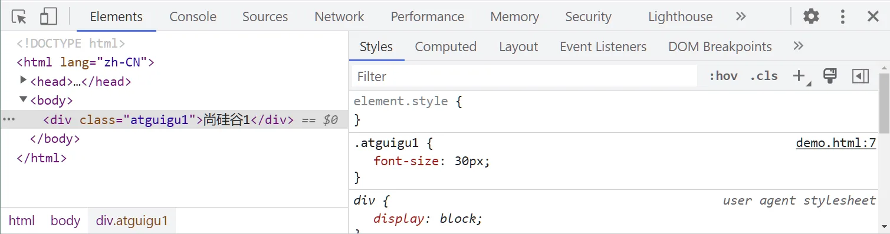

`字体大小.html`

```html
<!DOCTYPE html>
<html lang="zh-CN">
<head>
    <meta charset="UTF-8">
    <title>01_字体大小</title>
    <style>
        /* body {
            font-size: 20px;
        } */
        .atguigu1 {
            font-size: 40px;
        }

        .atguigu2 {
            font-size: 30px;
        }

        .atguigu3 {
            font-size: 20px;
        }

        .atguigu4 {
            font-size: 12px;
        }

        .atguigu5 {
            /* 浏览器能够接受的最小字体是12px */
            font-size: 3px;
        }

        .atguigu7 {
            font-size: 30px;
        }

    </style>
</head>
<body>
<div class="atguigu1">尚硅谷1</div>
<div class="atguigu2">尚硅谷2</div>
<div class="atguigu3">尚硅谷3</div>
<div class="atguigu4">尚硅谷4</div>
<div class="atguigu5">尚硅谷5</div>
<div>尚硅谷6</div>
<div class="atguigu7">尚硅谷7</div>
</body>
</html>
```

##### 3.2 字体族

- 属性名： font-family

- 作用：控制字体类型。

- 语法：

  ```css
  div {
  	font-family: "STCaiyun","Microsoft YaHei",sans-serif
  }
  ```


- 注意：

  > 1. 使用字体的英文名字兼容性会更好，具体的英文名可以自行查询，或在电脑的设置里去寻找。
  > 2. 如果字体名包含空格，必须使用引号包裹起来。
  > 3. 可以设置多个字体，按照从左到右的顺序逐个查找，找到就用，没有找到就使用后面的，且通常在最后写上serif （衬线字体）或sans-serif
  >    （非衬线字体）。
  > 4. windows 系统中，默认的字体就是微软雅黑。

`字体族.html`

```html
<!DOCTYPE html>
<html lang="zh-CN">
<head>
    <meta charset="UTF-8">
    <title>02_字体族</title>
    <style>
        .atguigu1 {
            font-size: 100px;
            font-family: "微软雅黑";
        }

        .atguigu2 {
            font-size: 100px;
            font-family: "楷体";
        }

        .atguigu3 {
            font-size: 100px;
            font-family: "宋体";
        }

        .atguigu4 {
            font-size: 100px;
            font-family: "华文彩云";
        }

        .atguigu5 {
            font-size: 100px;
            font-family: "翩翩体-简", "华文彩云", "华文琥珀", "微软雅黑";
        }

        .atguigu6 {
            font-size: 100px;
            font-family: "HanziPen SC", "STCaiyun", "STHupo", "Microsoft YaHei", sans-serif;
        }
    </style>
</head>
<body>
<div class="atguigu1">尚硅谷1</div>
<div class="atguigu2">尚硅谷2</div>
<div class="atguigu3">尚硅谷3</div>
<div class="atguigu4">尚硅谷4</div>
<div class="atguigu5">尚硅谷5</div>
<div class="atguigu6">尚硅谷6</div>
</body>
</html>
```

##### 3.3 字体风格

- 属性名： font-style

- 作用：控制字体是否为斜体。

- 常用值：

  1. normal ：正常（默认值）
  2. italic ：斜体（使用字体自带的斜体效果）
  3. oblique ：斜体（强制倾斜产生的斜体效果）

  > 实现斜体时，更推荐使用italic 。

- 语法：

  ```csws
  div {
  	font-style: italic;
  }
  ```

`字体风格.html`

```html
<!DOCTYPE html>
<html lang="zh-CN">
<head>
    <meta charset="UTF-8">
    <title>03_字体风格</title>
    <style>
        .atguigu1 {
            font-size: 100px;
            font-style: normal;
        }

        .atguigu2 {
            font-size: 100px;
            font-style: italic;
        }

        .atguigu3 {
            font-size: 100px;
            font-style: oblique;
        }

        em {
            font-size: 100px;
            font-style: normal;
        }
    </style>
</head>
<body>
<div class="atguigu1">尚硅谷1</div>
<div class="atguigu2">尚硅谷2</div>
<div class="atguigu3">尚硅谷3</div>
<em>尚硅谷4</em>
</body>
</html>
```

##### 3.4 字体粗细

- 属性名： font-weight

- 作用：控制字体的粗细。

- 常用值：

  - 关键词：

    > 1. lighter ：细
    > 2. normal ： 正常
    > 3. bold ：粗
    > 4. bolder ：很粗 （多数字体不支持）

  - 数值：

    > 1. 100~1000 且无单位，数值越大，字体越粗 （或一样粗，具体得看字体设计时的精确程度）。
    > 2. 100~300 等同于lighter ， 400~500 等同于normal ， 600 及以上等同于bold 。

- 语法：

  ```css
  div {
  	font-weight: bold;
  }
  div {
  	font-weight: 600;
  }
  ```

`字体粗细.html`

```html
<!DOCTYPE html>
<html lang="zh-CN">
<head>
    <meta charset="UTF-8">
    <title>04_字体粗细</title>
    <style>
        div {
            font-size: 100px;
        }

        .atguigu1 {
            font-weight: lighter;
        }

        .atguigu2 {
            font-weight: normal;
        }

        .atguigu3 {
            font-weight: bold;
        }

        .atguigu4 {
            font-weight: bolder;
        }

        .atguigu5 {
            font-weight: 600;
        }
    </style>
</head>
<body>
<div class="atguigu1">尚硅谷1</div>
<div class="atguigu2">尚硅谷2</div>
<div class="atguigu3">尚硅谷3</div>
<div class="atguigu4">尚硅谷4</div>
<div class="atguigu5">尚硅谷5</div>
</body>
</html>
```

##### 3.5 字体复合写法

- 属性名： font ，可以把上述字体样式合并成一个属性。
- 作用：将上述所有字体相关的属性复合在一起编写。
- 编写规则：
  1. 字体大小、字体族必须都写上。
  2. 字体族必须是最后一位、字体大小必须是倒数第二位。
  3. 各个属性间用空格隔开。
- 实际开发中更推荐复合写法，但这也不是绝对的，比如只想设置字体大小，那就直接用fontsize属性。

`字体复合属性.html`

```html
<!DOCTYPE html>
<html lang="zh-CN">
<head>
    <meta charset="UTF-8">
    <title>05_字体复合属性</title>
    <style>
        .atguigu {
            font: bold italic 100px "STCaiyun", "STHupo", sans-serif;
        }
    </style>
</head>
<body>
<div class="atguigu">尚硅谷</div>
</body>
</html>
```

#### 4.CSS文本属性

##### 4.1文本颜色

- 属性名： color

- 作用：控制文字的颜色。

- 可选值：

  1. 颜色名
  2. rgb 或rgba
  3. HEX 或HEXA （十六进制）
  4. HSL 或HSLA

  > 开发中常用的是： rgb/rgba 或 HEX/HEXA （十六进制）。

- 举例：

  ```css
  div {
  	color: rgb(112,45,78);
  }
  ```

`文本颜色.html`

```html
<!DOCTYPE html>
<html lang="zh-CN">
<head>
    <meta charset="UTF-8">
    <title>01_文本颜色</title>
    <style>
        div {
            font-size: 90px;
        }

        .atguigu1 {
            color: red;
        }

        .atguigu2 {
            color: rgb(255, 0, 0);
        }

        .atguigu3 {
            color: rgba(255, 0, 0, .5);
        }

        .atguigu4 {
            color: #00f;
        }

        .atguigu5 {
            color: #00f8;
        }

        .atguigu6 {
            color: hsl(0, 100%, 50%);
        }

        .atguigu7 {
            color: hsla(0, 100%, 50%, .5);
            background-color: orange;
        }
    </style>
</head>
<body>
<div class="atguigu1">尚硅谷1</div>
<div class="atguigu2">尚硅谷2</div>
<div class="atguigu3">尚硅谷3</div>
<div class="atguigu4">尚硅谷4</div>
<div class="atguigu5">尚硅谷5</div>
<div class="atguigu6">尚硅谷6</div>
<div class="atguigu7">尚硅谷7</div>
</body>
</html>
```

##### 4.2 文本间距

- 字母间距： letter-spacing
- 单词间距： word-spacing （通过空格识别词）
- 属性值为像素（ px ），正值让间距增大，负值让间距缩小。

`文本间距.html`

```html
<!DOCTYPE html>
<html lang="zh-CN">
<head>
    <meta charset="UTF-8">
    <title>02_文本间距</title>
    <style>
        div {
            font-size: 30px;
        }

        .atguigu2 {
            /* 字母间距 */
            letter-spacing: 20px;
        }

        .atguigu3 {
            /* 单词间距 */
            word-spacing: 20px;
        }
    </style>
</head>
<body>
<div>You got a dream, you gotta protect it.尚硅谷1</div>
<div class="atguigu2">You got a dream, you gotta protect it.尚硅谷2</div>
<div class="atguigu3">You got a dream, you gotta protect it.尚硅谷3</div>
</body>
</html>
```

##### 4.3 文本修饰

- 属性名： text-decoration

- 作用：控制文本的各种装饰线。

- 可选值：

  1. none ： 无装饰线（常用）
  2. underline ：下划线（常用）
  3. overline ： 上划线
  4. line-through ： 删除线

  可搭配如下值使用：

      1. dotted ：虚线
      2. wavy ：波浪线
      3. 也可以指定颜色

- 举例：

  ```css
  a {
  	text-decoration: none;
  }
  ```

`文本修饰.html`

```html
<!DOCTYPE html>
<html lang="zh-CN">
<head>
    <meta charset="UTF-8">
    <title>03_文本修饰</title>
    <style>
        div {
            font-size: 40px;
        }

        .atguigu1 {
            /* 上划的绿色虚线 */
            text-decoration: overline dotted green;
        }

        .atguigu2 {
            /* 下划的红色波浪线 */
            text-decoration: underline wavy red;
        }

        .atguigu3 {
            /* 删除线 */
            text-decoration: line-through;
        }

        .atguigu4, ins, del {
            font-size: 40px;
            /* 没有各种线 */
            text-decoration: none;
        }
    </style>
</head>
<body>
<div class="atguigu1">尚硅谷1</div>
<div class="atguigu2">尚硅谷2</div>
<div class="atguigu3">尚硅谷3</div>
<a class="atguigu4" href="https://www.baidu.com">尚硅谷4</a>
<ins>测试1</ins>
<del>测试2</del>
</body>
</html>
```

##### 4.4 文本缩进

- 属性名： text-indent 。

- 作用：控制文本首字母的缩进。

- 属性值： css 中的长度单位，例如： px

- 举例：

  ```css
  div {
  	text-indent:40px;
  }
  ```

  > 后面我们会学习css 中一些新的长度单位，目前我们只知道像素( px )。

`文本缩进.html`

```html
<!DOCTYPE html>
<html lang="zh-CN">
<head>
    <meta charset="UTF-8">
    <title>04_文本缩进</title>
    <style>
        div {
            font-size: 60px;
            text-indent: 120px;
        }
    </style>
</head>
<body>
<div>欢迎来到尚硅谷学习！欢迎来到尚硅谷学习！欢迎来到尚硅谷学习！欢迎来到尚硅谷学习！欢迎来到尚硅谷学习！</div>
</body>
</html>
```

##### 4.5 文本对齐_水平

- 属性名： text-align 。

- 作用：控制文本的水平对齐方式。

- 常用值：

  1. left ：左对齐（默认值）
  2. right ：右对齐
  3. center ：居中对齐

- 举例：

  ```css
  div {
  	text-align: center;
  }
  ```

`文本颜色.html`

```html
<!DOCTYPE html>
<html lang="zh-CN">
<head>
    <meta charset="UTF-8">
    <title>05_文本对齐_水平</title>
    <style>
        div {
            font-size: 40px;
            background-color: orange;
            text-align: right;
        }
    </style>
</head>
<body>
<div>尚硅谷</div>
</body>
</html>
```

##### 4.6 细说 font-size

1. 由于字体设计原因，文字最终呈现的大小，并不一定与 font-size 的值一致，可能大，也可能小。

> 例如： font-size 设为40px ，最终呈现的文字，可能比 40px 大，也可能比 40px小。

2. 通常情况下，文字相对字体设计框，并不是垂直居中的，通常都靠下 一些。

`细说font-size.html`

```html
<!DOCTYPE html>
<html lang="zh-CN">
<head>
    <meta charset="UTF-8">
    <title>06_细说font-size</title>
    <style>
        div {
            font-size: 40px;
            background-color: skyblue;
            font-family: "翩翩体-简";
        }
    </style>
</head>
<body>
<div>atguigux尚硅谷</div>
<span style="font-size: 40px; font-family: 微软雅黑;">尚</span>
<span style="font-size: 40px; font-family: 隶书;">尚</span>
<span style="font-size: 40px; font-family: 翩翩体-简;">尚</span>
</body>
</html>
```

##### 4.7 行高

- 属性名： line-height

- 作用：控制一行文字的高度。

- 可选值：

  1. normal ：由浏览器根据文字大小决定的一个默认值。
  2. 像素( px )。
  3. 数字：参考自身font-size 的倍数（很常用）。
  4. 百分比：参考自身font-size 的百分比。

- 备注：由于字体设计原因，文字在一行中，并不是绝对垂直居中，若一行中都是文字，不会太影响观感。

- 举例：

  ```html
  div {
  	line-height: 60px;
  	line-height: 1.5;
  	line-height: 150%;
  }
  ```

  `行高.html`

  ```html
  <!DOCTYPE html>
  <html lang="zh-CN">
  
  <head>
      <meta charset="UTF-8">
      <title>07_行高</title>
      <style>
          #d1 {
              font-size: 40px;
              background-color: skyblue;
  
              /* 第一种写法，值为像素 */
              /* line-height: 40px; */
  
              /* 第二种写法，值为normal */
              /* line-height: normal; */
  
              /* 第三种写法，值为数值 —— 用的比较多 */
              /* line-height: 1.5; */
  
              /* 第四种写法，值为百分比 */
              /* line-height: 150%; */
  
          }
      </style>
  </head>
  
  <body>
      <div id="d1">
          atguigux尚硅谷让天下没有难掉的头发atguigu尚硅谷让天下没有难掉的头发atguigu尚硅谷让天下没有难掉的头发atguigu尚硅谷让天下没有难掉的头发atguigu尚硅谷让天下没有难掉的头发atguigu尚硅谷让天下没有难掉的头发atguigu尚硅谷让天下没有难掉的头发
      </div>
  </body>
  
  </html>
  ```


- 行高注意事项：

  1. line-height 过小会怎样？—— 文字产生重叠，且最小值是0 ，不能为负数。
  2. line-height 是可以继承的，且为了能更好的呈现文字，最好写数值。
  3. line-height 和height 是什么关系？

  - 设置了height ，那么高度就是height 的值。
  - 不设置height 的时候，会根据line-height 计算高度。

  `行高_注意事项.html`

  ```html
  <!DOCTYPE html>
  <html lang="zh-CN">
  <head>
      <meta charset="UTF-8">
      <title>08_行高_注意事项</title>
      <style>
          /* 注意点1：行高过小会怎样？ —— 文字重叠，且最小值是0，不能为负数。 */
          #d1 {
              font-size: 40px;
              background-color: skyblue;
              line-height: 0px;
          }
  
          /* 注意点2：行高是可以继承的 */
          #d2 {
              font-size: 40px;
              background-color: orange;
              line-height: 1.5;
          }
          span {
              font-size: 200px;
              color: red;
          }
  
          /* 注意点3：line-height和height是什么关系 
              设置了height，高度就是height的值。
              没有设置height，高度就是line-height*行数
          */
          #d3 {
              font-size: 40px;
              background-color: yellowgreen;
              line-height: 100px;
          }
  
          #d4 {
              font-size: 40px;
              background-color: skyblue;
              line-height: 0px;
          }
  
          /* 行高的应用场景1：调整多行文字的间距 */
          #d5 {
              font-size: 40px;
              background-color: skyblue;
              line-height: 100px;
          }
  
          /* 行高的应用场景2：单行文字的垂直居中 */
          #d6 {
              font-size: 40px;
              background-color: skyblue;
              height: 300px;
              line-height: 300px;
          }
  
      </style>
  </head>
  <body>
      <!-- <div id="d1">atguigu尚硅谷让天下没有难学的技术atguigu尚硅谷让天下没有难学的技术atguigu尚硅谷让天下没有难学的技术atguigu尚硅谷让天下没有难学的技术atguigu尚硅谷让天下没有难学的技术atguigu尚硅谷让天下没有难学的技术atguigu尚硅谷让天下没有难学的技术</div> -->
      <!-- <div id="d2">atguigu尚硅谷让天下没有难学的技术atguigu尚硅谷让天下没有难学的技术atguigu尚硅谷让天下没有难学的技术atguigu<span>尚硅谷</span>让天下没有难学的技术atguigu尚硅谷让天下没有难学的技术atguigu尚硅谷让天下没有难学的技术atguigu尚硅谷让天下没有难学的技术</div> -->
      <!-- <div id="d3">atguigu尚硅谷让天下没有难学的技术atguigu尚硅谷让天下没有难学的技术atguigu尚硅谷让天下没有难学的技术atguigu尚硅谷让天下没有难学的技术</div> -->
      <!-- <div id="d4">atguigu尚硅谷让天下没有难学的技术atguigu尚硅谷让天下没有难学的技术atguigu尚硅谷让天下没有难学的技术atguigu尚硅谷让天下没有难学的技术</div> -->
      <!-- <div id="d5">atguigu尚硅谷让天下没有难学的技术atguigu尚硅谷让天下没有难学的技术atguigu尚硅谷让天下没有难学的技术atguigu尚硅谷让天下没有难学的技术</div> -->
      <div id="d6">atguigu尚硅谷让天下没有难学的技术x</div>
  </body>
  </html>
  ```


- 应用场景：

  1. 对于多行文字：控制行与行之间的距离。

  2. 对于单行文字：让height 等于line-height ，可以实现文字垂直居中。

     > 备注：由于字体设计原因，靠上述办法实现的居中，并不是绝对的垂直居中，但如果一行中都是文字，不会太影响观感。

##### 4.8 文本对齐_垂直

1. 顶部：无需任何属性，在垂直方向上，默认就是顶部对齐。

2. 居中：对于单行文字，让height = line-height 即可。

   > 问题：多行文字垂直居中怎么办？—— 后面我们用定位去做。

3. 底部：对于单行文字，目前一个临时的方式：

   让line-height = ( height × 2 ) - font-size - x 。

   备注： x 是根据字体族，动态决定的一个值。

   > 问题：垂直方向上的底部对齐，更好的解决办法是什么？—— 后面我们用定位去做。

`文本对齐_垂直<.html`

```html
<!DOCTYPE html>
<html lang="zh-CN">
<head>
    <meta charset="UTF-8">
    <title>09_文本对齐_垂直</title>
    <style>
        div {
            font-size: 40px;
            height: 400px;
            line-height: 745px;
            background-color: skyblue;
        }
    </style>
</head>
<body>
<div>atguigu尚硅谷</div>
</body>
</html>
```

##### 4.9 vertical-align

- 属性名： vertical-align 。

- 作用：用于指定同一行元素之间，或 表格单元格 内文字的 垂直对齐方式。

- 常用值：

  1. baseline （默认值）：使元素的基线与父元素的基线对齐。

  2. top ：使元素的顶部与其所在行的顶部对齐。

  3. middle ：使元素的中部与父元素的基线加上父元素字母x 的一半对齐。

  4. bottom ：使元素的底部与其所在行的底部对齐。

     > 特别注意： vertical-align 不能控制块元素。

`vertical-align.html`

```html
<!DOCTYPE html>
<html lang="zh-CN">
<head>
    <meta charset="UTF-8">
    <title>10_vertical-align</title>
    <style>
        div {
            font-size: 100px;
            height: 300px;
            background-color: skyblue;
        }

        span {
            font-size: 40px;
            background-color: orange;
            vertical-align: middle;
        }

        img {
            height: 30px;
            vertical-align: top;
        }

        .san {
            vertical-align: bottom;
        }
    </style>
</head>
<body>
<div>
    atguigu尚硅谷x<span>x前端</span>
</div>
<hr>
<div>
    atguigu尚硅谷x
</div>
<hr>
<table border="1" cellspacing="0">
    <caption>人员信息</caption>
    <thead>
    <tr>
        <th>姓名</th>
        <th>年龄</th>
        <th>性别</th>
    </tr>
    </thead>
    <tbody>
    <tr height="200">
        <td class="san">张三</td>
        <td>18</td>
        <td>男</td>
    </tr>
    <tr>
        <td>李四</td>
        <td>20</td>
        <td>女</td>
    </tr>
    </tbody>
</table>
</body>
</html>
```

#### 5.CSS列表属性

| CSS 属性名          | 功能               | 属性值                                                       |
| ------------------- | ------------------ | ------------------------------------------------------------ |
| list-style-type     | 设置列表符号       | 常用值如下：<br/>none ：不显示前面的标识（很常用！）<br/>square ：实心方块<br/>disc ：圆形<br/>decimal ：数字<br/>lower-roman ：小写罗马字<br/>upper-roman ：大写罗马字<br/>lower-alpha ：小写字母<br/>upper-alpha ：大写字母 |
| list-style-position | 设置列表符号的位置 | inside ：在 li 的里面<br/>outside ：在 li 的外边             |
| list-style-image    | 自定义列表符号     | url(图片地址)                                                |
| list-style          | 复合属性           | 没有数量、顺序的要求                                         |

`列表相关属性.html`

```html
<!DOCTYPE html>
<html lang="zh-CN">
<head>
    <meta charset="UTF-8">
    <title>列表相关属性</title>
    <style>
        ul {
            /* 列表符号 */
            /* list-style-type: decimal; */
            /* 列表符号的位置 */
            /* list-style-position: inside; */
            /* 自定义列表符号 */
            /* list-style-image: url("../images/video.gif"); */
            /* 复合属性 */
            list-style: decimal url("../images/video.gif") inside;
        }

        li {
            background-color: skyblue;
        }
    </style>
</head>
<body>
<ul>
    <li>《震惊！两男子竟然在教室做出这种事》</li>
    <li>《一夜暴富指南》</li>
    <li>《给成功男人的五条建议》</li>
</ul>
</body>
</html>
```

#### 6.CSS表格属性

6.1边框相关属性（其他元素也能用）：

| CSS 属性名   | 功能         | 属性值                                                       |
| ------------ | ------------ | ------------------------------------------------------------ |
| border-width | 边框宽度     | CSS 中可用的长度值                                           |
| border-color | 边框颜色     | CSS 中可用的颜色值                                           |
| border-style | 边框风格     | none 默认值<br/>solid 实线<br/>dashed 虚线<br/>dotted 点线<br/>double 双实线 |
| border       | 边框复合属性 | 没有数量、顺序的要求                                         |

> 注意：
>
> 1. 以上4 个边框相关的属性，其他元素也可以用，这是我们第一次遇见它们。
> 2. 在后面的盒子模型中，我们会详细讲解边框相关的知识。

`边框相关属性.html`

```html
<!DOCTYPE html>
<html lang="zh-CN">
<head>
    <meta charset="UTF-8">
    <title>01_边框相关属性</title>
    <style>
        table {
            /* border-width: 2px; */
            /* border-color: green; */
            /* border-style: solid; */
            border: 2px green solid;
        }

        td, th {
            border: 2px orange solid;
        }

        h2 {
            border: 3px red solid;
        }

        span {
            border: 3px purple dashed;
        }
    </style>
</head>
<body>
<h2>边框相关的属性，不仅仅是表格能用，其他元素也能用</h2>
<span>你要加油呀！</span>
<table>
    <caption>人员信息</caption>
    <thead>
    <tr>
        <th>序号</th>
        <th>姓名</th>
        <th>年龄</th>
        <th>性别</th>
        <th>政治面貌</th>
    </tr>
    </thead>
    <tbody>
    <tr>
        <td>1</td>
        <td>张三</td>
        <td>18</td>
        <td>男</td>
        <td>党员</td>
    </tr>
    <tr>
        <td>2</td>
        <td>李四</td>
        <td>19</td>
        <td>女</td>
        <td>团员</td>
    </tr>
    <tr>
        <td>3</td>
        <td>王五</td>
        <td>20</td>
        <td>男</td>
        <td>群众</td>
    </tr>
    <tr>
        <td>4</td>
        <td>赵六</td>
        <td>21</td>
        <td>女</td>
        <td>党员</td>
    </tr>
    </tbody>
</table>
</body>
</html>
```

6.2表格独有属性（只有table 标签才能使用）：

| CSS 属性名      | 功能                 | 属性值                                                       |
| --------------- | -------------------- | ------------------------------------------------------------ |
| table-layout    | 设置列宽度           | auto ：自动，列宽根据内容计算（默认值）。<br/>fixed ：固定列宽，平均分。 |
| border-spacing  | 单元格间距           | CSS 中可用的长度值。<br/>生效的前提：单元格边框不能合并。    |
| border-collapse | 合并单元格边框       | collapse ：合并<br/>separate ：不合并                        |
| empty-cells     | 隐藏没有内容的单元格 | show ：显示，默认<br/>hide ：隐藏<br/>生效前提：单元格不能合并。 |
| caption-side    | 设置表格标题位置     | top ：上面（默认值）<br/>bottom ：在表格下面                 |

> 以上5 个属性，只有表格才能使用，即： <table> 标签。

`表格独有属性.html`

```html
<!DOCTYPE html>
<html lang="zh-CN">
<head>
    <meta charset="UTF-8">
    <title>02_表格独有属性</title>
    <style>
        table {
            border: 2px green solid;
            width: 500px;
            /* 控制表格的列宽 */
            table-layout: fixed;
            /* 控制单元格间距（生效的前提是：不能合并边框） */
            border-spacing: 10px;
            /* 合并相邻的单元格的边框 */
            border-collapse: collapse;
            /* 隐藏没有内容的单元格（生效的前提是：不能合并边框） */
            empty-cells: hide;
            /* 设置表格标题的位置 */
            caption-side: top;
        }

        td, th {
            border: 2px orange solid;
        }

        .number {
            width: 50px;
            height: 50px;
        }
    </style>
</head>
<body>
<table>
    <caption>人员信息</caption>
    <thead>
    <tr>
        <th class="number">序号</th>
        <th>姓名</th>
        <th>年龄</th>
        <th>性别</th>
        <th>政治面貌</th>
    </tr>
    </thead>
    <tbody>
    <tr>
        <td>1</td>
        <td>张三</td>
        <td>18</td>
        <td>男</td>
        <td>党员</td>
    </tr>
    <tr>
        <td>2</td>
        <td>李四</td>
        <td>19</td>
        <td>女</td>
        <td>团员</td>
    </tr>
    <tr>
        <td>3</td>
        <td>王五</td>
        <td>20</td>
        <td></td>
        <td>群众</td>
    </tr>
    <tr>
        <td>4</td>
        <td>赵六</td>
        <td>21</td>
        <td>女</td>
        <td>党员</td>
    </tr>
    </tbody>
</table>
</body>
</html>
```

#### 7.CSS背景属性

| css 属性名          | 功能             | 属性值                                                       |
| ------------------- | ---------------- | ------------------------------------------------------------ |
| background-color    | 设置背景颜色     | 符合CSS 中颜色规范的值。<br/>默认背景颜色是 transparent 。   |
| background-image    | 设置背景图片     | url(图片的地址)                                              |
| background-repeat   | 设置背景重复方式 | repeat ：重复，铺满整个元素，默认值。<br/>repeat-x ：只在水平方向重复。<br/>repeat-y ：只在垂直方向重复。<br/>no-repeat ：不重复。 |
| background-position | 设置背景图位置   | 通过关键字设置位置：<br/>写两个值，用空格隔开<br/>水平： left 、center 、right<br/>垂直: top 、center 、bottom<br/>如果只写一个值，另一个方向的值取 center<br/>通过长度指定坐标位置：<br/>以元素左上角，为坐标原点，设置图片左上角的<br/>位置。<br/>两个值，分别是x 坐标和y 坐标。<br/>只写一个值，会被当做 x 坐标， y 坐标取<br/>center |
| background          | 复合属性         | 没有数量和顺序要求                                           |

`背景相关属性.html`

```html
<!DOCTYPE html>
<html lang="zh-CN">
<head>
    <meta charset="UTF-8">
    <title>背景相关属性</title>
    <style>
        body {
            background-color: gray;
        }

        div {
            width: 400px;
            height: 400px;
            border: 5px black solid;
            font-size: 20px;
            /* 设置背景颜色，默认值是transparent */
            background-color: skyblue;
            /* 设置背景图片 */
            background-image: url(../images/悟空.jpg);
            /* 设置背景图片的重复方式 */
            background-repeat: no-repeat;
            /* 控制背景图片的位置——第一种写法：用关键词 */
            background-position: center;
            /* 控制背景图片的位置——第二种写法：用具体的像素值 */
            background-position: 100px 200px;
            /* 复合属性 */
            background: url(../images/悟空.jpg) no-repeat 100px 200px;

        }
    </style>
</head>
<body>
<div>你好啊！</div>
</body>
</html>
```

#### 8.CSS鼠标属性

| CSS 属性名 | 功能               | 属性值                                                       |
| ---------- | ------------------ | ------------------------------------------------------------ |
| cursor     | 设置鼠标光标的样式 | pointer ：小手<br/>move ：移动图标<br/>text ：文字选择器<br/>crosshair ：十字架<br/>wait ：等待<br/>help ：帮助 |

> 扩展：自定义鼠标图标
>
> ```html
> /* 自定义鼠标光标 */
> cursor: url("./arrow.png"),pointer;
> ```

`鼠标相关属性.html`

```html
<!DOCTYPE html>
<html lang="zh-CN">
<head>
    <meta charset="UTF-8">
    <title>鼠标相关属性</title>
    <style>
        div {
            width: 400px;
            height: 400px;
            background-color: skyblue;
            cursor: url("../images/arrow.png"), pointer;
        }

        button {
            cursor: pointer;
        }

        input {
            cursor: move;
        }
    </style>
</head>
<body>
<div>
    把鼠标放进来看一看
    <input type="text">
    <a href="#">百度</a>
    <button>点我</button>
</div>
</body>
</html>
```

### 五、CSS盒子模型

#### 1.CSS 长度单位

1. px ：像素。
2. em ：相对元素font-size 的倍数。
3. rem ：相对根字体大小，html标签就是根。
4. % ：相对父元素计算。

> 注意： CSS 中设置长度，必须加单位，否则样式无效！

`选择器优先级_详细聊.html`

```html
<!DOCTYPE html>
<html lang="zh-CN">
<head>
    <meta charset="UTF-8">
    <title>01_CSS中常用的长度单位</title>
    <style>
        html {
            font-size: 40px;
        }

        #d1 {
            /* 第一种长度单位：px（像素） */
            width: 200px;
            height: 200px;
            font-size: 20px;
            background-color: skyblue;
        }

        #d2 {
            /* 第二种长度单位：em（相对于当前元素或其父元素的font-size的倍数） */
            width: 10em;
            height: 10em;
            font-size: 20px;
            background-color: orange;
        }

        #d3 {
            /* 第三种长度单位：rem（相对于根元素的font-size的倍数） */
            width: 5rem;
            height: 5rem;
            font-size: 20px;
            background-color: green;
        }

        #d4 {
            width: 200px;
            height: 200px;
            font-size: 20px;
            background-color: gray;
        }

        .inside {
            /* 第四种长度单位：%（相对其父元素的百分比） */
            width: 50%;
            height: 25%;
            font-size: 150%;
            background-color: orange;
        }

        .test {
            font-size: 20px;
            text-indent: 2em;
            background-color: yellowgreen;
        }
    </style>
</head>
<body>
<div id="d1">1</div>
<hr>
<div id="d2">2</div>
<hr>
<div id="d3">3</div>
<hr>
<div id="d4">
    <div class="inside">4</div>
</div>
<hr>
<div class="test">好好学习，天天向上</div>
</body>
</html>
```

#### 2.元素的显示模式

- 块元素（block）

  > 又称：块级元素
  > 特点：
  >
  > 1. 在页面中独占一行，不会与任何元素共用一行，是从上到下排列的。
  > 2. 默认宽度：撑满父元素。
  > 3. 默认高度：由内容撑开。
  > 4. 可以通过CSS 设置宽高。

- 行内元素（inline）

  > 又称：内联元素
  > 特点:
  >
  > 1. 在页面中不独占一行，一行中不能容纳下的行内元素，会在下一行继续从左到右排列。
  > 2. 默认宽度：由内容撑开。
  > 3. 默认高度：由内容撑开。
  > 4. 无法通过CSS 设置宽高。

- 行内块元素（inline-block）

  > 又称：内联块元素
  > 特点：
  >
  > 1. 在页面中不独占一行，一行中不能容纳下的行内元素，会在下一行继续从左到右排列。
  > 2. 默认宽度：由内容撑开。
  > 3. 默认高度：由内容撑开。
  > 4. 可以通过CSS 设置宽高。

注意：元素早期只分为：行内元素、块级元素，区分条件也只有一条："是否独占一行"，如果按照这种分类方式，行内块元素应该算作行内元素。

`选择器优先级_详细聊.html`

```html
<!DOCTYPE html>
<html lang="zh-CN">
<head>
    <meta charset="UTF-8">
    <title>02_元素的显示模式</title>
    <style>
        div {
            width: 200px;
            height: 200px;
        }

        #d1 {
            background-color: skyblue;
        }

        #d2 {
            background-color: orange;
        }

        #d3 {
            background-color: green;
        }

        .one {
            background-color: skyblue;
        }

        .two {
            background-color: orange;
        }

        span {
            width: 200px;
            height: 200px;
        }

        img {
            width: 200px;
        }
    </style>
</head>
<body>
<div id="d1">山回路转不见君</div>
<div id="d2">雪上空留马行处</div>
<div id="d3">风里雨里我在尚硅谷等你</div>
<hr>
<span class="one">人之初</span>
<span class="two">性本善</span>
<span class="one">人之初</span>
<span class="two">性本善</span>
<span class="one">人之初</span>
<span class="two">性本善</span>
<span class="one">人之初</span>
<span class="two">性本善</span>
<span class="one">人之初</span>
<span class="two">性本善</span>
<span class="one">人之初</span>
<span class="two">性本善</span>
<span class="one">人之初</span>
<span class="two">性本善</span>
<span class="one">人之初</span>
<span class="two">性本善</span>
<span class="one">人之初</span>
<span class="two">性本善</span>
<span class="one">人之初</span>
<span class="two">性本善</span>
<span class="one">人之初</span>
<span class="two">性本善</span>
<span class="one">人之初</span>
<span class="two">性本善</span>
<span class="one">人之初</span>
<span class="two">性本善</span>
<span class="one">人之初</span>
<span class="two">性本善</span>
<span class="one">人之初</span>
<span class="two">性本善</span>
<span class="one">人之初</span>
<span class="two">性本善</span>
<span class="one">人之初</span>
<span class="two">性本善</span>
<span class="one">人之初</span>
<span class="two">性本善</span>
<span class="one">人之初</span>
<span class="two">性本善</span>
<span class="one">人之初</span>
<span class="two">性本善</span>
<hr>


</body>
</html>
```

#### 3.总结各元素的显示模式

- 块元素（block）

```html
  > 1. 主体结构标签： <html> 、<body>
  > 2. 排版标签： <h1> ~ <h6> 、<hr> 、<p> 、<pre> 、<div>
  > 3. 列表标签： <ul> 、<ol> 、<li> 、<dl> 、<dt> 、<dd>
  > 4. 表格相关标签： <table> 、<tbody> 、<thead> 、<tfoot> 、<tr> 、<caption>
  > 5. `<form>`与`<option>`
```

- 行内元素（inline）

```html
  > 1. 文本标签：` <br>` 、<em> 、<strong> 、<sup> 、<sub> 、
    <del> 、
        <ins>
            > 2. <a> 与<label>
```

- 行内块元素（inline-block）

```html
  > 1. 图片： 
  > 2. 单元格： <td> 、<th>
  > 3. 表单控件： <input> 、<textarea> 、<select> 、<button>
  > 4. 框架标签： <iframe>
```

`总结各元素的显示模式.html`

```html
<!DOCTYPE html>
<html lang="zh-CN">
<head>
    <meta charset="UTF-8">
    <title>03_总结各元素的显示模式</title>
    <style>
        #s1 {
            background-color: skyblue;
        }

        #d2 {
            background-color: orange;
        }
    </style>
</head>
<body>
<span id="s1">123</span><br><br>
<div id="d2">456</div>
</body>
</html>
```

#### 4.修改元素的显示模式

通过CSS 中的 display 属性可以修改元素的默认显示模式，常用值如下：

| 值           | 描述                       |
| ------------ | -------------------------- |
| none         | 元素会被隐藏。             |
| block        | 元素将作为块级元素显示。   |
| inline       | 元素将作为内联元素显示。   |
| inline-block | 元素将作为行内块元素显示。 |

`修改元素的显示模式.html`

```html
<!DOCTYPE html>
<html lang="zh-CN">
<head>
    <meta charset="UTF-8">
    <title>04_修改元素的显示模式</title>
    <style>
        div {
            width: 200px;
            height: 200px;
            font-size: 20px;
            display: inline-block;
        }

        #d1 {
            background-color: skyblue;
        }

        #d2 {
            background-color: orange;
        }

        #d3 {
            background-color: green;
        }

        a {
            width: 200px;
            height: 200px;
            font-size: 20px;
            display: block;
        }

        #s1 {
            background-color: skyblue;
        }

        #s2 {
            background-color: orange;
        }

        #s3 {
            background-color: green;
        }
    </style>
</head>
<body>
<div id="d1">你好1</div>
<div id="d2">你好2</div>
<div id="d3">你好3</div>
<hr>
<a id="s1" href="https://www.baidu.com">去百度</a>
<a id="s2" href="https://www.jd.com">去京东</a>
<a id="s3" href="https://www.toutiao.com">去百头条</a>
</body>
</html>
```

#### 5.盒子模型的组成

CSS 会把所有的 HTML 元素都看成一个盒子，所有的样式也都是基于这个盒子。

1. margin（外边距）： 盒子与外界的距离。
2. border（边框）： 盒子的边框。
3. padding（内边距）： 紧贴内容的补白区域。
4. content（内容）：元素中的文本或后代元素都是它的内容。

图示如下：

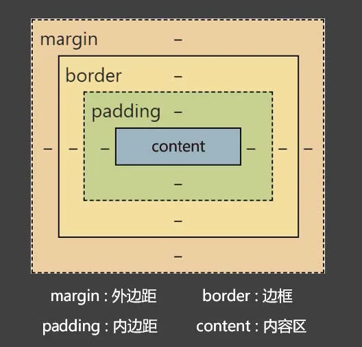

盒子的大小 = content + 左右 padding + 左右 border 。

> 注意：外边距margin 不会影响盒子的大小，但会影响盒子的位置。

`盒子模型的组成部分.html`

```html
<!DOCTYPE html>
<html lang="zh-CN">
<head>
    <meta charset="UTF-8">
    <title>05_盒子模型的组成部分</title>
    <style>
        div {
            /* 内容区的宽 */
            width: 400px;
            /* 内容区的高 */
            height: 400px;
            /* 内边距，设置的背景颜色会填充内边距区域 */
            padding: 20px;
            /* 边框，设置的背景颜色会填充边框区域 */
            border: 10px solid transparent;
            /* 外边距 */
            margin: 50px;

            font-size: 20px;
            background-color: gray;
        }
    </style>
</head>
<body>
<div>你好啊</div>
</body>
</html>
```

#### 6.盒子内容区（content）

| CSS 属性名 | 功能                   | 属性值 |
| ---------- | ---------------------- | ------ |
| width      | 设置内容区域宽度       | 长度   |
| max-width  | 设置内容区域的最大宽度 | 长度   |
| min-width  | 设置内容区域的最小宽度 | 长度   |
| height     | 设置内容区域的高度     | 长度   |
| max-height | 设置内容区域的最大高度 | 长度   |
| min-height | 设置内容区域的最小高度 | 长度   |

> 注意：
> max-width 、min-width 一般不与 width 一起使用。
>
> max-height 、min-height 一般不与 height 一起使用。

`盒子的内容区_content.html`

```html
<!DOCTYPE html>
<html lang="zh-CN">
<head>
    <meta charset="UTF-8">
    <title>06_盒子的内容区_content</title>
    <style>
        div {
            width: 800px;
            /* min-width: 600px; */
            /* max-width: 1000px; */

            height: 200px;
            /* min-height: 50px; */
            /* max-height: 400px; */
            background-color: skyblue;
        }
    </style>
</head>
<body>
<div>Lorem ipsum dolor sit amet consectetur adipisicing elit. Impedit, atque optio, dicta error modi voluptatibus velit,
    nemo nesciunt dignissimos exercitationem incidunt ratione consectetur eos totam quisquam! Dolores minima magni
    necessitatibus, debitis sit, et tenetur temporibus quasi exercitationem porro, eligendi ipsam facilis adipisci
    praesentium aspernatur maxime quis itaque tempore enim saepe eveniet. Error soluta nobis facilis ut quia officia
    voluptas amet odio recusandae! Eos suscipit ab nihil. Perspiciatis ut impedit ea porro maiores ullam qui libero
    ipsam! Unde veniam id nostrum aliquid ex voluptas eum officia minus optio deserunt hic praesentium animi nihil,
    quisquam eveniet vitae nam doloribus non asperiores a expedita at saepe accusamus. Incidunt deleniti culpa est,
    consequuntur quis dolore amet vel tempore sequi beatae nulla accusamus fugit nihil mollitia. Aliquam consequatur,
    tempora suscipit porro distinctio illum autem architecto obcaecati vitae pariatur exercitationem hic totam et iusto,
    ut doloremque facilis voluptatibus, quo doloribus reiciendis placeat. Voluptatibus esse doloremque exercitationem
    blanditiis aliquid quo voluptate beatae labore itaque nostrum harum nemo unde ea deleniti rem quis nesciunt
    consequatur, vel modi a magnam atque! Necessitatibus, eligendi! Ipsum consequuntur officiis reiciendis laboriosam
    atque saepe inventore facere repellendus incidunt, nobis et deserunt! Sunt minima odio voluptas voluptatibus. At id
    nesciunt tempora quam consequatur omnis eos odit numquam! Possimus, consequuntur, nam maiores veniam ipsam
    consequatur repellat aspernatur earum soluta nisi voluptates molestiae amet magni facilis omnis natus nostrum
    placeat accusamus quasi sint facere perspiciatis tempora vel voluptatibus. Expedita voluptas quia cupiditate optio
    harum sapiente pariatur fuga corporis quas doloribus. Praesentium aut illum blanditiis, eaque placeat aliquid
    voluptatibus minima perferendis rerum aliquam veniam porro cum quia! Maiores, soluta dignissimos. Voluptatem
    delectus laudantium, temporibus, vel totam amet fugiat ducimus provident labore quos eligendi consequatur numquam
    dolore aspernatur fuga atque ut nobis! Quisquam alias labore culpa, nulla ut temporibus inventore, earum, quod ipsum
    ea amet iusto. Recusandae nihil laboriosam quis porro nemo nesciunt sed qui facere sint officia, omnis dolorum quam
    corrupti molestiae aspernatur, dolor ipsam voluptatem vitae fuga error. Cumque, neque eius quos ut est itaque
    tempora voluptatum repellendus. Nihil quas molestiae qui! Nihil ea atque veniam modi iure maxime in ipsam quisquam
    pariatur magni adipisci autem non id, ab labore odio nesciunt nostrum nemo laborum. Ea adipisci dignissimos, qui,
    omnis et eaque neque reiciendis ipsum at iure, numquam consectetur ipsa inventore doloribus minus dolorum optio
    nostrum doloremque praesentium magnam iusto sit voluptatum ut? Omnis, atque ratione soluta vitae veritatis officia
    quae iste placeat, commodi magni sit. Voluptates, temporibus perspiciatis. Omnis velit nemo vero minus alias est
    eveniet deserunt unde, at quo. Saepe, debitis impedit! Sint unde maxime eius voluptas blanditiis nobis aspernatur
    error temporibus nisi iste eligendi vitae, consectetur numquam culpa, debitis veritatis consequuntur aliquid. Labore
    porro, voluptatibus consequatur facilis, nulla, dignissimos aliquam similique ullam odio nesciunt animi commodi
    praesentium perspiciatis est eum error explicabo exercitationem tempora? Cupiditate debitis veniam, temporibus dicta
    amet tempore modi voluptatum optio ratione alias quidem earum in, maxime est quo vero recusandae beatae? Architecto,
    veniam pariatur. Numquam officia qui, dicta quaerat eius, cupiditate sequi dolorem dolorum molestias beatae tempora?
    Similique exercitationem corporis illo debitis eligendi cumque voluptate mollitia doloribus perspiciatis alias amet
    quam aut sapiente voluptatem tempora, numquam repellat id repudiandae totam ipsam quae velit. Ad reiciendis nulla
    mollitia quaerat doloremque, ducimus suscipit architecto voluptatem molestias iusto quibusdam expedita ab soluta
    corporis. Esse pariatur totam nisi voluptates neque ad eligendi, molestiae minima culpa sed ex perferendis natus
    rerum iusto quos iure, recusandae commodi magnam consectetur officiis adipisci veritatis quae tempore. Reprehenderit
    eius architecto id harum eos distinctio blanditiis nihil quod natus sunt, fuga aliquam odit dolore. Nostrum incidunt
    dicta quidem quas fugit fuga officia sit! Harum nam maiores eum tempore animi officia earum repudiandae reiciendis
    pariatur? Fuga repudiandae quia voluptatibus nobis omnis recusandae tempora ipsa reiciendis a obcaecati in et fugit
    amet cupiditate architecto, provident nostrum quisquam maxime? Praesentium earum modi consequuntur pariatur autem
    molestiae ea expedita dicta perferendis provident quis eveniet ducimus dolorum exercitationem enim dolorem,
    asperiores nesciunt nemo eaque nulla mollitia. Quae at eius eligendi laudantium quod natus dicta quam dolorem
    voluptatibus, facere quasi labore vitae magni sequi sunt nobis optio officiis pariatur deserunt reiciendis ipsa.
    Harum veniam eum ducimus cum odit reprehenderit fuga? Necessitatibus dolorem perspiciatis reiciendis quibusdam
    maiores fuga tempore distinctio et saepe, accusamus, nostrum deleniti assumenda, vel recusandae iusto ut nesciunt
    consequuntur vero unde sed debitis nihil? Impedit facere quod non optio officia eius, rerum culpa consequatur
    repellendus. Explicabo, vel nihil placeat optio expedita corrupti fugiat magni voluptatum deserunt, autem hic
    deleniti porro molestiae. Vero, culpa. Corrupti soluta nesciunt praesentium culpa nihil ratione eligendi excepturi
    quam ex totam incidunt nostrum minima eius provident repudiandae ipsam exercitationem, veniam nam. Explicabo
    cupiditate nulla similique labore, tenetur unde architecto esse neque quae repellat corporis pariatur iusto dicta
    provident dignissimos minus quaerat ipsa, aut consectetur. Odit iure aut rem corrupti perspiciatis repudiandae
    debitis recusandae officiis exercitationem quam quisquam, cumque rerum!
</div>
</body>
</html>
```

#### 7.关于默认宽度

所谓的默认宽度，就是不设置width 属性时，元素所呈现出来的宽度。
总宽度 = 父的content — 自身的左右margin 。
内容区的宽度 = 父的content — 自身的左右margin — 自身的左右border — 自身的左右padding 。

`关于默认宽度.html`

```html
<!DOCTYPE html>
<html lang="zh-CN">
<head>
    <meta charset="UTF-8">
    <title>07_关于默认宽度</title>
    <style>
        div {
            height: 200px;
            margin: 50px;
            border: 5px solid black;
            padding: 5px;
            background-color: gray;
        }
    </style>
</head>
<body>
<div>你好啊</div>
</body>
</html>
```

#### 8.盒子内边距（padding）

| CSS 属性名     | 功能     | 属性值                    |
| -------------- | -------- | ------------------------- |
| padding-top    | 上内边距 | 长度                      |
| padding-right  | 右内边距 | 长度                      |
| padding-bottom | 下内边距 | 长度                      |
| padding-left   | 左内边距 | 长度                      |
| padding        | 复合属性 | 长度，可以设置 1 ~ 4 个值 |

padding 复合属性的使用规则：

1. padding: 10px; 四个方向内边距都是 10px 。
2. padding: 10px 20px; 上10px ，左右20px 。（上下、左右）
3. padding: 10px 20px 30px; 上10px ，左右20px ，下30px 。（上、左右、下）
4. padding: 10px 20px 30px 40px; 上10px ，右20px ，下30px ，左40px 。（上、右、下、左）

> 注意点：
>
> 1. padding 的值不能为负数。
> 2. 行内元素 的 左右内边距是没问题的，上下内边距不能完美的设置。
> 3. 块级元素、行内块元素，四个方向内边距都可以完美设置。

`选择器优先级_详细聊.html`

```html
<!DOCTYPE html>
<html lang="zh-CN">
<head>
    <meta charset="UTF-8">
    <title>08_盒子的内边距_padding</title>
    <style>
        #d1 {
            width: 400px;
            height: 400px;

            /* 左侧内边距 */
            /* padding-left: 20px; */

            /* 上内边距 */
            /* padding-top: 30px; */

            /* 右侧内边距 */
            /* padding-right: 40px; */

            /* 底内边距 */
            /* padding-bottom: 50px; */

            /* 复合属性，写一个值，含义：四个方向的内边距是一样的 */
            /* padding: 20px; */

            /* 复合属性，写两个值，含义：上下、左右 */
            /* padding: 10px 20px; */

            /* 复合属性，写三个值，含义：上、左右、下 */
            /* padding: 10px 20px 30px; */

            /* 复合属性，写四个值，含义：上、右、下、左 */
            /* padding: 10px 20px 30px 40px; */


            font-size: 20px;
            background-color: skyblue;
        }

        span {
            background-color: orange;
            font-size: 20px;
            padding-left: 20px;
            padding-right: 20px;
            padding-top: 20px;
            padding-bottom: 20px;
        }

        img {
            width: 200px;
            padding: 50px;
        }
    </style>
</head>
<body>
<div id="d1">你好啊</div>
<hr>
<span>我很好</span>
<div>Lorem ipsum dolor sit amet, consectetur adipisicing elit. Sunt, sint.</div>
<hr>

<div>小姐姐很想你呀</div>
</body>
</html>
```

#### 9.盒子边框（border）

| CSS 属性名                                                   | 功能                                    | 属性值                                                       |
| ------------------------------------------------------------ | --------------------------------------- | ------------------------------------------------------------ |
| border-style                                                 | 边框线风格<br/>复合了四个方向的边框风格 | none ： 默认值<br/>solid ： 实线<br/>dashed ： 虚线<br/>dotted ： 点线<br/>double ： 双实线<br/>...... |
| border-width                                                 | 边框线宽度<br/>复合了四个方向的边框宽度 | 长度，默认3px                                                |
| border-color                                                 | 边框线颜色<br/>复合了四个方向的边框颜色 | 颜色，默认黑色                                               |
| border                                                       | 复合属性                                | 值没有顺序和数量要求。                                       |
| border-left<br/>border-left-style<br/>border-left-width<br/>border-left-color<br/><br/>border-right<br/>border-right-style<br/>border-right-width<br/>border-right-color<br/><br/>border-top<br/>border-top-style<br/>border-top-width<br/>border-top-color<br/><br/>border-bottom<br/>border-bottom-style<br/>border-bottom-width<br/>border-bottom-color | 分别设置各个方向的边框                  | 同上                                                         |

> 边框相关属性共 20 个。
> border-style 、border-width 、border-color 其实也是复合属性。

`盒子的边框_border.html`

```html
<!DOCTYPE html>
<html lang="zh-CN">
<head>
    <meta charset="UTF-8">
    <title>09_盒子的边框_border</title>
    <style>
        div {
            width: 400px;
            height: 400px;
            background-color: skyblue;

            border-left-width: 10px;
            border-right-width: 20px;
            border-top-width: 30px;
            border-bottom-width: 40px;

            border-left-color: red;
            border-right-color: orange;
            border-top-color: green;
            border-bottom-color: tomato;

            border-left-style: solid;
            border-right-style: dashed;
            border-top-style: double;
            border-bottom-style: dotted;

            /* border-color: red; */
            /* border-width: 80px; */
            /* border-style: dashed; */

            border-left: 50px solid purple;
            border-right: 60px dashed orange;
            border-top: 70px double green;
            border-bottom: 80px dotted gray;

            /* border: 10px solid red; */
        }
    </style>
</head>
<body>
<div>你好啊</div>
</body>
</html>
```

#### 10.盒子外边距_margin

| CSS 属性名    | 功能                                               | 属性值         |
| ------------- | -------------------------------------------------- | -------------- |
| margin-left   | 左外边距                                           | CSS 中的长度值 |
| margin-right  | 右外边距                                           | CSS 中的长度值 |
| margin-top    | 上外边距                                           | CSS 中的长度值 |
| margin-bottom | 下外边距                                           | CSS 中的长度值 |
| margin        | 复合属性，可以写1~4 个值，规律同padding （顺时针） | CSS 中的长度值 |

`盒子的外边距_margin.html`

```html
<!DOCTYPE html>
<html lang="zh-CN">
<head>
    <meta charset="UTF-8">
    <title>10_盒子的外边距_margin</title>
    <style>
        div {
            width: 400px;
            height: 400px;

            /* margin-left: 10px; */
            /* margin-right: 20px; */
            /* margin-top: 30px; */
            /* margin-bottom: 40px; */

            /* margin: 50px; */
            /* margin: 10px 20px; */
            /* margin: 10px 20px 30px; */
            /* margin: 10px 20px 30px 40px; */

            background-color: skyblue;
        }
    </style>
</head>
<body>
<div>你好啊</div>
</body>
</html>
```

##### 10.1 margin 注意事项

> 1. 子元素的margin ，是参考父元素的content 计算的。（因为是父亲的content 中承装着子元素）
> 2. 上margin 、左margin ：影响自己的位置；下margin 、右margin ：影响后面兄弟元素的位置。
> 3. 块级元素、行内块元素，均可以完美地设置四个方向的margin ；但行内元素，左右margin 可以完美设置，上下margin 设置无效。
> 4. margin 的值也可以是 auto ，如果给一个块级元素设置左右margin 都为 auto ，该块级元素会在父元素中水平居中。
> 5. margin 的值可以是负值。

`margin的注意事项1.html`

```html
<!DOCTYPE html>
<html lang="zh-CN">
<head>
    <meta charset="UTF-8">
    <title>11_margin的注意事项1</title>
    <style>
        .outer {
            width: 400px;
            height: 400px;
            padding: 50px;
            background-color: gray;
        }

        .inner {
            width: 100px;
            height: 100px;
            margin: 100px;
            background-color: orange;
        }
    </style>
</head>
<body>
<!-- 子元素的margin是参考父元素的content计算的。 -->
<div class="outer">
    <div class="inner"></div>
</div>
</body>
</html>
```

`margin的注意事项2.html`

```html
<!DOCTYPE html>
<html lang="zh-CN">
<head>
    <meta charset="UTF-8">
    <title>12_margin的注意事项2</title>
    <style>
        .box {
            width: 200px;
            height: 200px;
        }

        .box1 {
            background-color: skyblue;
        }

        .box2 {
            background-color: orange;
            margin-top: 50px;
            margin-bottom: 50px;
        }

        .box3 {
            background-color: green;
        }

        .second {
            margin-left: 50px;
            margin-right: 50px;
        }
    </style>
</head>
<body>
<!-- 上margin、左margin会影响自身的位置，下margin、右margin会影响兄弟元素的位置 -->
<div class="box box1">1</div>
<div class="box box2">2</div>
<div class="box box3">3</div>
<hr>

</body>
</html>
```

`margin的注意事项3.html`

```html
<!DOCTYPE html>
<html lang="zh-CN">
<head>
    <meta charset="UTF-8">
    <title>13_margin的注意事项3</title>
    <style>
        #d1 {
            width: 400px;
            height: 400px;
            margin: 50px;
            background-color: deepskyblue;
        }

        img {
            margin: 50px;
        }

        .one {
            background-color: skyblue;
        }

        .two {
            background-color: orange;
            margin-left: 50px;
            margin-right: 50px;
            margin-top: 3000px;
            margin-bottom: 3000px;
        }

        .three {
            background-color: green;
        }
    </style>
</head>
<body>
<!-- 对于行内元素来说，左右的margin是可以完美设置的，上下的margin设置后是无效的。 -->
<div id="d1">我是一个块级元素</div>
<div>我是一段文字</div>
<hr>

<div>我是一段文字</div>
<hr>
<span class="one">人之初</span><span class="two">性本善</span><span class="three">性相近</span>
<div>我是一段文字</div>
</body>
</html>
```

`margin的注意事项4.html`

```html
<!DOCTYPE html>
<html lang="zh-CN">
<head>
    <meta charset="UTF-8">
    <title>14_margin的注意事项4</title>
    <style>
        div {
            width: 800px;
            height: 100px;
            /* margin-left: auto; */
            /* margin-right: auto; */
            margin: 100px auto;
            background-color: deepskyblue;
        }

        span {
            background-color: purple;
            margin: 0 auto;
        }
    </style>
</head>
<body>
<!-- margin的值也可以是auto，给一个块级元素左右margin设置auto可以实现该元素在其父元素内水平居中 -->
<div>你好啊</div>
<span>好好学习</span>
</body>
</html>
```

`margin的注意事项5.html`

```html
<!DOCTYPE html>
<html lang="zh-CN">
<head>
    <meta charset="UTF-8">
    <title>15_margin的注意事项5</title>
    <style>
        .box {
            width: 200px;
            height: 200px;
        }

        .box1 {
            background-color: skyblue;
        }

        .box2 {
            margin-top: -200px;
            background-color: orange;
        }
    </style>
</head>
<body>
<div class="box box1">1</div>
<div class="box box2">2</div>
</body>
</html>
```

##### 10.2 margin 塌陷问题

什么是 margin 塌陷？

 第一个子元素的上margin 会作用在父元素上，最后一个子元素的下margin 会作用在父元素上。

如何解决 margin 塌陷？

- 方案一： 给父元素设置不为 0 的padding 。
- 方案二： 给父元素设置宽度不为 0 的border 。
- 方案三：给父元素设置 css 样式 overflow:hidden

`margin塌陷问题.html`

```html
<!DOCTYPE html>
<html lang="zh-CN">
<head>
    <meta charset="UTF-8">
    <title>16_margin塌陷问题</title>
    <style>
        .outer {
            width: 400px;
            /* height: 400px; */
            background-color: gray;
            /* border: 10px solid transparent; */
            /* padding: 10px; */
            overflow: hidden;
        }

        .inner1 {
            width: 100px;
            height: 100px;
            background-color: orange;
            /* 下面这行代码是有问题的 */
            margin-top: 50px;
        }

        .inner2 {
            width: 100px;
            height: 100px;
            background-color: green;
            margin-bottom: 50px;
        }
    </style>
</head>
<body>
<div class="outer">
    <div class="inner1">inner1</div>
    <div class="inner2">inner2</div>
</div>
<div>我是一段测试的文字</div>
</body>
</html>
```

##### 10.3 margin 合并问题

什么是 margin 合并？
上面兄弟元素的下外边距和下面兄弟元素的上外边距会合并，取一个最大的值，而不是相加。
如何解决 margin 塌陷？
无需解决，布局的时候上下的兄弟元素，只给一个设置上下外边距就可以了。

`margin合并问题.html`

```html
<!DOCTYPE html>
<html lang="zh-CN">
<head>
    <meta charset="UTF-8">
    <title>17_margin合并问题</title>
    <style>
        .box {
            width: 200px;
            height: 200px;
        }

        .box1 {
            background-color: deepskyblue;
            /* margin-bottom: 110px; */
        }

        .box2 {
            background-color: orange;
            margin-top: 110px;
        }

        .test {
            width: 200px;
            height: 200px;
            display: inline-block;
        }

        .testa {
            background-color: purple;
            margin-right: 50px;
        }

        .testb {
            background-color: tomato;
            margin-left: 50px;
        }
    </style>
</head>
<body>
<div class="box box1">1</div>
<div class="box box2">2</div>
<hr>
<div class="test testa">a</div>
<div class="test testb">b</div>
</body>
</html>
```

#### 11.处理内容溢出

| CSS 属性名 | 功能                         | 属性值                                                       |
| ---------- | ---------------------------- | ------------------------------------------------------------ |
| overflow   | 溢出内容的处理方式           | visible ：显示，默认值<br/>hidden ：隐藏<br/>scroll ：显示滚动条，不论内容是否溢出<br/>auto ：自动显示滚动条，内容不溢出不显示 |
| overflow-x | 水平方向溢出内容的处理方式   | 同 overflow                                                  |
| overflow-y | 垂直方向溢出内容给的处理方式 | 同 overflow                                                  |

> 注意：
>
> 1. overflow-x 、 overflow-y 不能一个是hidden ，一个是visible ，是实验性属性，不建议使用。
> 2. overflow 常用的值是 hidden 和 auto ，除了能处理溢出的显示方式，还可以解决很多疑难杂症。

`处理内容的溢出.html`

```html
<!DOCTYPE html>
<html lang="zh-CN">
<head>
    <meta charset="UTF-8">
    <title>18_处理内容的溢出</title>
    <style>
        #d1 {
            width: 400px;
            height: 200px;
            background-color: skyblue;
            overflow: auto;
            /* overflow-x: visible; */
            /* overflow-y: hidden; */
        }

        #d2 {
            width: 1000px;
            background-color: orange;
        }
    </style>
</head>
<body>
<div id="d1">
    Lorem ipsum dolor sit amet consectetur adipisicing elit. Quo accusantium veritatis reiciendis id
    molestiae magnam aspernatur esse blanditiis est. Maiores reprehenderit porro dignissimos, perspiciatis suscipit
    <div id="d2">Lorem ipsum dolor sit amet, consectetur adipisicing elit. Consectetur alias provident quia, reiciendis
        incidunt rerum, perspiciatis quam nobis omnis quae maxime in esse architecto doloremque numquam tenetur eum
        quasi velit excepturi ut id inventore. Consequuntur, ad iure velit maiores obcaecati voluptatibus expedita
        molestiae natus sit mollitia veritatis vero aliquid adipisci?
    </div>
    ullam perferendis nam inventore sapiente earum voluptatem dolores ut quae fuga. Itaque delectus cum et illum
    enim dicta similique nemo pariatur, recusandae molestias. Repellendus ratione recusandae minima ea quis eligendi
    quae amet. Animi, nulla. Perferendis libero nihil eligendi ea! Accusantium molestias numquam reprehenderit
    quibusdam delectus, repellat impedit ratione. Iste nam autem vero magni facilis at ex ullam, officiis, corrupti
    voluptate tempora. Quibusdam, aperiam eveniet illo quidem excepturi, neque, repellat totam beatae in quas
    provident natus!
</div>
</body>

</html>
```

#### 12.隐藏元素的方式

方式一：visibility 属性
visibility 属性默认值是 show ，如果设置为 hidden ，元素会隐藏。
元素看不见了，还占有原来的位置（元素的大小依然保持）。
方式二： display 属性
设置 display:none ，就可以让元素隐藏。
彻底地隐藏，不但看不见，也不占用任何位置，没有大小宽高。

`选择器优先级_详细聊.html`

```html
<!DOCTYPE html>
<html lang="zh-CN">
<head>
    <meta charset="UTF-8">
    <title>19_隐藏元素的两种方式</title>
    <style>
        .box {
            width: 200px;
            height: 200px;
        }

        .box1 {
            background-color: skyblue;
            display: none;
            /* visibility: hidden; */
        }

        .box2 {
            background-color: orange;
        }
    </style>
</head>
<body>
<div class="box box1">1</div>
<div class="box box2">2</div>
</body>
</html>
```

#### 13.样式的继承

有些样式会继承，元素如果本身设置了某个样式，就使用本身设置的样式；但如果本身没有设置某个样式，会从父元素开始一级一级继承（优先继承离得近的祖先元素）。

**会继承的 css 属性**

字体属性、文本属性（除了vertical-align）、文字颜色 等。

**不会继承的 css 属性**

边框、背景、内边距、外边距、宽高、溢出方式 等。

> 一个规律：能继承的属性，都是不影响布局的，简单说：都是和盒子模型没关系的。

`样式的继承.html`

```html
<!DOCTYPE html>
<html lang="zh-CN">
<head>
    <meta charset="UTF-8">
    <title>20_样式的继承</title>
    <link rel="stylesheet" href="./index.css">
    <style>
        /* body {
            
        } */
        #d1 {
            height: 600px;
            padding: 50px;
            background-color: gray;
        }

        #d2 {
            height: 400px;
            padding: 50px;
            background-color: orange;
            font-size: 40px;
            color: yellow;
            font-weight: bold;
        }

        #d3 {
            height: 200px;
            background-color: green;
        }
    </style>
</head>
<body>
<div id="d1">
    <div id="d2">
        <div id="d3" style="font-family: 隶书;">你好啊</div>
    </div>
</div>
</body>
</html>
```

#### 14.默认样式

元素一般都些默认的样式，例如：

1. `<a> 元素：下划线、字体颜色、鼠标小手。`
2. `<h1> ~ <h6> 元素： 文字加粗、文字大小、上下外边距。`
3. `<p> 元素：上下外边距`
4. `<ul> 、ol 元素：左内边距`
5. body 元素： 8px 外边距（4个方向）
   ......

优先级：元素的默认样式 > 继承的样式，所以如果要重置元素的默认样式，选择器一定要直接选择器到该元素。

`元素的默认样式.html`

```html
<!DOCTYPE html>
<html lang="zh-CN">
<head>
    <meta charset="UTF-8">
    <title>21_元素的默认样式</title>
    <style>
        body {
            margin: 0;
        }

        #d1 {
            font-size: 50px;
            color: orange;
            background-color: gray;
        }

        a {
            color: black;
            text-decoration: none;
            cursor: default;
        }
    </style>
</head>
<body>
<div id="d1">
    <a href="https://www.baidu.com">去百度</a>
    <span>你好啊</span>
</div>
<hr>
<h1>一级标题</h1>
<h2>二级标题</h2>
<hr>
<p>我是一个段落</p>
<hr>
<ul>
    <li>张三</li>
    <li>李四</li>
</ul>
</body>
</html>
```

#### 15.布局小技巧

1. 行内元素、行内块元素，可以被父元素当做文本处理。

   > 即：可以像处理文本对齐一样，去处理：行内、行内块在父元素中的对齐。
   >
   > 例如： text-align 、line-height 、text-indent 等。

   `布局技巧1.html`

   ```html
   <!DOCTYPE html>
   <html lang="zh-CN">
   <head>
       <meta charset="UTF-8">
       <title>22_布局技巧1</title>
       <style>
           .outer {
               width: 400px;
               height: 400px;
               background-color: gray;
               overflow: hidden;
           }
           .inner {
               width: 200px;
               height: 100px;
               background-color: orange;
               margin: 0 auto;
               margin-top: 150px;
               text-align: center;
               line-height: 100px;
           }
       </style>
   </head>
   <body>
       <div class="outer">
           <div class="inner">inner</div>
       </div>
   </body>
   </html>
   ```


2. 如何让子元素，在父亲中 水平居中：

   - 若子元素为块元素，给父元素加上： margin:0 auto; 。
   - 若子元素为行内元素、行内块元素，给父元素加上： text-align:center 。

   `布局技巧2.html`

   ```html
   <!DOCTYPE html>
   <html lang="zh-CN">
   <head>
       <meta charset="UTF-8">
       <title>23_布局技巧2</title>
       <style>
           .outer {
               width: 400px;
               height: 400px;
               background-color: gray;
               text-align: center;
               line-height: 400px;
           }
           .inner {
               background-color: orange;
               font-size: 20px;
           }
       </style>
   </head>
   <body>
       <div class="outer">
           <span class="inner">出来玩啊？</span>
       </div>
   </body>
   </html>
   ```


3. 如何让子元素，在父亲中 垂直居中：

   - 若子元素为块元素，给子元素加上： margin-top ，值为：(父元素content －子元素盒子总高) / 2。

   - 若子元素为行内元素、行内块元素：

     让父元素的height = line-height ，每个子元素都加上： vertical-align:middle; 。

   - 补充：若想绝对垂直居中，父元素font-size 设置为0 。

   `布局技巧3.html`

   ```html
   <!DOCTYPE html>
   <html lang="zh-CN">
   <head>
       <meta charset="UTF-8">
       <title>24_布局技巧3</title>
       <style>
           .outer {
               width: 400px;
               height: 400px;
               background-color: gray;
               text-align: center;
               line-height: 400px;
               font-size: 0px;
               text-indent: 20px;
           }
           img {
               vertical-align: middle;
           }
           span {
               font-size: 40px;
               vertical-align: middle;
               background-color: orange;
           }
       </style>
   </head>
   <body>
       <div class="outer">
           <span>出来玩啊？</span>
           
       </div>
   </body>
   </html>
   ```

#### 16.元素之间的空白问题

产生的原因：
行内元素、行内块元素，彼此之间的换行会被浏览器解析为一个空白字符。
解决方案：

1. 方案一： 去掉换行和空格（不推荐）。
2. 方案二： 给父元素设置 font-size:0 ，再给需要显示文字的元素，单独设置字体大小（推荐）。

`元素之间的空白问题.html`

```html
<!DOCTYPE html>
<html lang="zh-CN">
<head>
    <meta charset="UTF-8">
    <title>25_元素之间的空白问题</title>
    <style>
        div {
            height: 200px;
            background-color: gray;
            font-size: 0px;
        }

        .s1 {
            background-color: skyblue;
        }

        .s2 {
            background-color: orange;
        }

        .s3 {
            background-color: green;
        }

        span {
            font-size: 20px;
        }
    </style>
</head>
<body>
<div>
    <span class="s1">人之初</span>
    <span class="s2">性本善</span>
    <span class="s3">性相近</span>
    <hr>
    
    
    
</div>
</body>
</html>
```

#### 17.行内块的幽灵空白问题

产生原因：

 行内块元素与文本的基线对齐，而文本的基线与文本最底端之间是有一定距离的。

解决方案：

1. 方案一： 给行行内块设置vertical ，值不为 baseline 即可，设置为 middel 、bottom 、top 均可。

2. 方案二： 若父元素中只有一张图片，设置图片为 display:block 。
3. 方案三： 给父元素设置 font-size: 0 。如果该行内块内部还有文本，则需单独设置fontsize。

`行内块的幽灵空白问题.html`

```html
<!DOCTYPE html>
<html lang="zh-CN">
<head>
    <meta charset="UTF-8">
    <title>26_行内块的幽灵空白问题</title>
    <style>
        div {
            width: 600px;
            background-color: skyblue;
            /* font-size: 0; */
        }

        img {
            height: 200px;
            /* vertical-align: bottom; */
            /* display: block; */
        }
    </style>
</head>
<body>
<div>
    
</div>
</body>
</html>
```

### 六、浮动

#### 1.浮动的简介

在最初，浮动是用来实现文字环绕图片效果的，现在浮动是主流的页面布局方式之一。

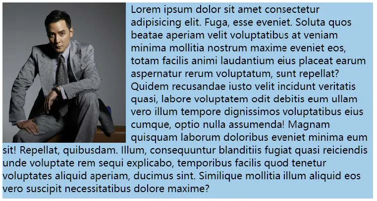

`浮动_简介.html`

```html
<!DOCTYPE html>
<html lang="zh-CN">
<head>
    <meta charset="UTF-8">
    <title>01_浮动_简介</title>
    <style>
        div {
            width: 600px;
            height: 400px;
            background-color: skyblue;
        }

        img {
            width: 200px;
            float: right;
            /* margin-right: 0.5em; */
        }

        .test::first-letter {
            font-size: 80px;
            float: left;
        }
    </style>
</head>
<body>
<div>
    
    Lorem ipsum dolor sit amet consectetur adipisicing elit. Sint, minus magnam accusamus eum laborum ducimus possimus
    beatae fugit illum molestias odit et asperiores adipisci sunt dolorem qui autem enim excepturi alias ab unde
    temporibus. Sapiente labore a magnam commodi itaque architecto quos doloribus voluptates perferendis rem, earum
    consectetur. Tempora inventore ducimus veritatis voluptatem deleniti rem laboriosam. Officiis, impedit explicabo!
    Impedit labore ea et vero rerum nihil in cum qui, itaque blanditiis eius nemo est? Tempora explicabo voluptates
    consectetur officia aperiam eos impedit veritatis necessitatibus quidem deleniti ea, in odit cum ex harum voluptas,
    quos eveniet quae voluptate aspernatur quod! Nostrum?
</div>
<hr>
<div class="test">
    Lorem ipsum dolor sit amet consectetur, adipisicing elit. Quaerat voluptate impedit provident, debitis nostrum
    cumque iste ab ipsum tempora dicta neque aliquid error in dolorum qui iure. Quibusdam eligendi ea id! Accusamus
    praesentium vitae quidem iusto placeat provident alias tempore quasi quos, nesciunt rem, molestias quisquam?
    Quisquam laborum nulla ea veniam, nesciunt, dolores modi officia animi laboriosam minima exercitationem. Reiciendis
    enim sint at nisi quae obcaecati, vel iusto non libero officia possimus explicabo quis harum inventore sapiente
    accusantium id quidem cupiditate et expedita maiores perferendis! Reiciendis, distinctio doloribus! Quia harum iste
    doloremque pariatur obcaecati doloribus quasi iusto minima magnam iure!
</div>
</body>
</html>
```

#### 2.元素浮动后的特点

1. 🤢脱离文档流。
2. 😊不管浮动前是什么元素，浮动后：默认宽与高都是被内容撑开（尽可能小），而且可以设置宽高。
3. 😊不会独占一行，可以与其他元素共用一行。
4. 😊不会margin 合并，也不会margin 塌陷，能够完美的设置四个方向的margin 和padding 。
5. 😊不会像行内块一样被当做文本处理（没有行内块的空白问题）。

`元素浮动后的特点.html`

```html
<!DOCTYPE html>
<html lang="zh-CN">
<head>
    <meta charset="UTF-8">
    <title>02_元素浮动后的特点</title>
    <style>
        .outer {
            width: 800px;
            height: 400px;
            padding: 10px;
            background-color: gray;
            text-align: center;
        }

        .box {
            font-size: 20px;
            padding: 10px;
        }

        .box1 {
            background-color: skyblue;
        }

        .box2 {
            background-color: orange;
            float: left;
            /* width: 200px; */
            /* height: 200px; */
            /* margin-left: 20px; */
            /* margin-right: 20px; */
            /* margin-top: 20px; */
            /* margin-bottom: 20px; */
        }

        .box3 {
            background-color: green;
            float: left;
        }
    </style>
</head>
<body>
<div class="outer">
    <div class="box box1">盒子1</div>
    <div class="box box2">盒子2</div>
    <div class="box box3">盒子3</div>
</div>
</body>
</html>
```

#### 3.浮动小练习

练习1：盒子1右浮动，效果如下

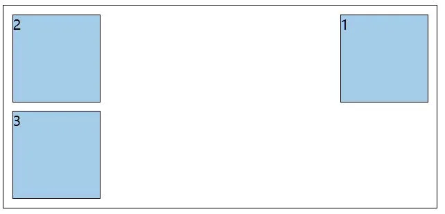

练习2：盒子1左浮动，效果如下

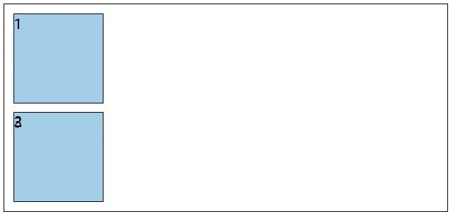

练习3：所有盒子都浮动，效果如下

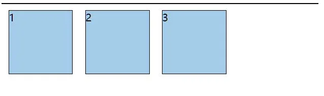

练习4：所有盒子浮动后，盒子3落下来，效果如下

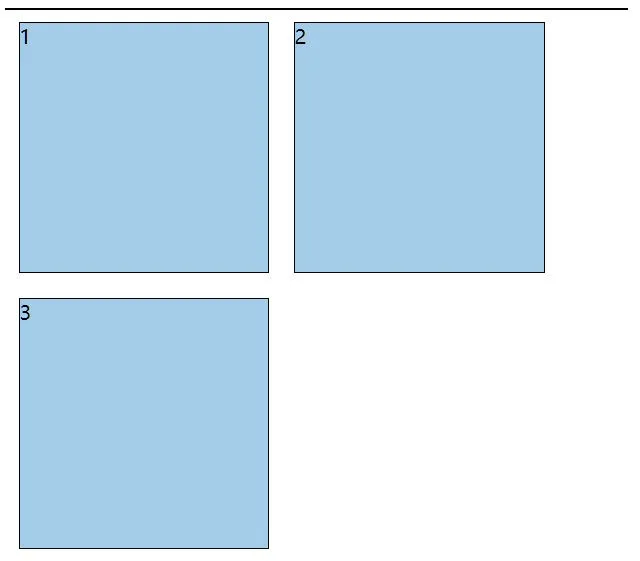

练习5：所有盒子浮动后，盒子3卡住了，效果如下

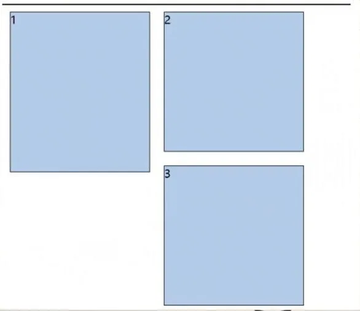

`浮动的小练习.html`

```html
<!DOCTYPE html>
<html lang="zh-CN">
<head>
    <meta charset="UTF-8">
    <title>03_浮动的小练习</title>
    <style>
        .outer {
            width: 500px;
            background-color: gray;
            border: 1px solid black;
        }

        .box {
            width: 200px;
            height: 200px;
            background-color: skyblue;
            border: 1px solid black;
            margin: 10px;
            float: left;
        }

        .box1 {
            height: 230px;
        }
    </style>
</head>
<body>
<div class="outer">
    <div class="box box1">1</div>
    <div class="box box2">2</div>
    <div class="box box3">3</div>
</div>
</body>
</html>
```

#### 4.解决浮动产生的影响

##### 4.1 元素浮动后会有哪些影响

对兄弟元素的影响： 后面的兄弟元素，会占据浮动元素之前的位置，在浮动元素的下面；对前面的兄弟无影响。

对父元素的影响： 不能撑起父元素的高度，导致父元素高度塌陷；但父元素的宽度依然束缚浮动的元素。

`浮动后的影响.html`

```html
<!DOCTYPE html>
<html lang="zh-CN">
<head>
    <meta charset="UTF-8">
    <title>04_浮动后的影响</title>
    <style>
        .outer {
            width: 500px;
            background-color: gray;
            border: 1px solid black;
        }

        .box {
            width: 100px;
            height: 100px;
            background-color: skyblue;
            border: 1px solid black;
            margin: 10px;
        }

        .box1, .box2, .box3 {
            float: left;
        }
    </style>
</head>
<body>
<div class="outer">
    <div class="box box1">1</div>
    <div class="box box2">2</div>
    <div class="box box3">3</div>
</div>
<!-- <div style="background-color:orange">Lorem ipsum dolor sit amet consectetur adipisicing elit. Assumenda expedita rem similique at laboriosam, magnam, ipsam inventore odit odio ipsum ex ad beatae quia, consequuntur quam dolore modi atque? Doloribus libero eos ut consequatur, assumenda amet quidem est quae doloremque maxime id cumque explicabo aliquam. Quas, explicabo illo neque rem dolores impedit aspernatur suscipit vel, dolore incidunt totam aliquam laborum! Fuga in rerum repudiandae suscipit, labore optio iste ratione nobis velit dolorem laborum doloribus perferendis porro enim, sequi, delectus nulla quam? Recusandae quidem nobis voluptatum quam quaerat itaque aliquam reiciendis molestias ratione nesciunt exercitationem quisquam laborum sit error magnam optio atque, debitis tempore. Quibusdam repellendus perspiciatis id consequuntur saepe suscipit enim temporibus, ipsa minima dolores laudantium inventore recusandae nam. Quo harum sunt reprehenderit nisi? Error quia quibusdam possimus tempore incidunt. Doloribus vitae quis nisi quod, aperiam molestias id quibusdam voluptate recusandae iure tempore hic doloremque similique corrupti expedita non odit a natus. Eius, harum iste, dolor omnis, saepe dolore illo aliquid impedit officia explicabo itaque dicta eos exercitationem at tempora perspiciatis voluptate ad eaque mollitia maiores obcaecati numquam. Veniam ex facere fugit ullam est velit officiis a autem perferendis ratione aliquid dolor voluptate magnam, illo alias sequi totam, ab nemo?</div> -->
</body>
</html>
```

##### 4.2 解决浮动产生的影响（清除浮动）

解决方案：

1. 方案一： 给父元素指定高度。

2. 方案二： 给父元素也设置浮动，带来其他影响。

3. 方案三： 给父元素设置 overflow:hidden 。

4. 方案四： 在所有浮动元素的最后面，添加一个块级元素，并给该块级元素设置 clear:both 。

5. 方案五： 给浮动元素的父元素，设置伪元素，通过伪元素清除浮动，原理与方案四相同。===> 推荐使用

  ```css
.parent::after {
    content: "";
    display: block;
    clear: both;
}
  ```

> 布局中的一个原则：设置浮动的时候，兄弟元素要么全都浮动，要么全都不浮动。

`解决浮动后的影响.html`

```html
<!DOCTYPE html>
<html lang="zh-CN">
<head>
    <meta charset="UTF-8">
    <title>05_解决浮动后的影响</title>
    <style>
        .outer {
            width: 500px;
            background-color: gray;
            border: 1px solid black;
            /* 第一种解决方案 */
            /* height: 122px; */

            /* 第二种解决方案 */
            /* float: left; */

            /* 第三种解决方案 */
            /* overflow: scroll; */

        }

        .box {
            width: 100px;
            height: 100px;
            background-color: skyblue;
            border: 1px solid black;
            margin: 10px;
        }

        .box1, .box2, .box3, .box4 {
            float: left;
        }

        .mofa {
            /* 第四种解决方案 */
            clear: both;
        }

        /* 第五种解决方案 */
        .outer::after {
            content: '';
            display: block;
            clear: both;
        }
    </style>
</head>
<body>
<div class="outer">
    <div class="box box1">1</div>
    <div class="box box2">2</div>
    <div class="box box3">3</div>
    <div class="box box4">4</div>
    <!-- <div class="mofa"></div> -->
</div>
<div style="background-color:orange">Lorem ipsum dolor sit amet consectetur adipisicing elit. Assumenda expedita rem
    similique at laboriosam, magnam, ipsam inventore odit odio ipsum ex ad beatae quia, consequuntur quam dolore modi
    atque? Doloribus libero eos ut consequatur, assumenda amet quidem est quae doloremque maxime id cumque explicabo
    aliquam. Quas, explicabo illo neque rem dolores impedit aspernatur suscipit vel, dolore incidunt totam aliquam
    laborum! Fuga in rerum repudiandae suscipit, labore optio iste ratione nobis velit dolorem laborum doloribus
    perferendis porro enim, sequi, delectus nulla quam? Recusandae quidem nobis voluptatum quam quaerat itaque aliquam
    reiciendis molestias ratione nesciunt exercitationem quisquam laborum sit error magnam optio atque, debitis tempore.
    Quibusdam repellendus perspiciatis id consequuntur saepe suscipit enim temporibus, ipsa minima dolores laudantium
    inventore recusandae nam. Quo harum sunt reprehenderit nisi? Error quia quibusdam possimus tempore incidunt.
    Doloribus vitae quis nisi quod, aperiam molestias id quibusdam voluptate recusandae iure tempore hic doloremque
    similique corrupti expedita non odit a natus. Eius, harum iste, dolor omnis, saepe dolore illo aliquid impedit
    officia explicabo itaque dicta eos exercitationem at tempora perspiciatis voluptate ad eaque mollitia maiores
    obcaecati numquam. Veniam ex facere fugit ullam est velit officiis a autem perferendis ratione aliquid dolor
    voluptate magnam, illo alias sequi totam, ab nemo?
</div>
</body>
</html>
```

#### 5.浮动布局小练习

整体效果如下：

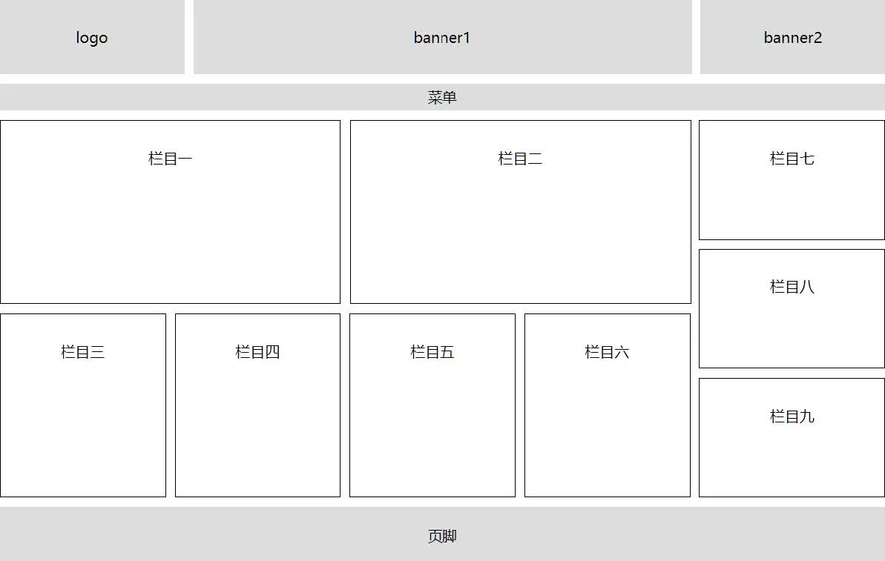

具体标注如下：

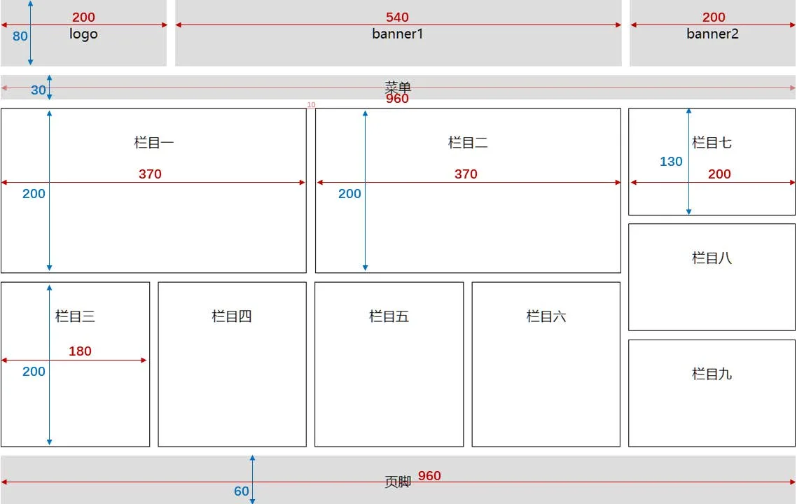

`浮动布局小练习.html`

```html
<!DOCTYPE html>
<html lang="zh-CN">
<head>
    <meta charset="UTF-8">
    <title>06_浮动布局小练习</title>
    <style>
        * {
            margin: 0;
            padding: 0;
        }

        .leftfix {
            float: left;
        }

        .rightfix {
            float: right;
        }

        .clearfix::after {
            content: '';
            display: block;
            clear: both;
        }

        .container {
            width: 960px;
            margin: 0 auto;
            text-align: center;
        }

        .logo {
            width: 200px;
        }

        .banner1 {
            width: 540px;
            margin: 0 10px;
        }

        .banner2 {
            width: 200px;
        }

        .logo, .banner1, .banner2 {
            height: 80px;
            line-height: 80px;
            background-color: #ccc;
        }

        .menu {
            height: 30px;
            background-color: #ccc;
            margin-top: 10px;
            line-height: 30px;
        }

        .item1, .item2 {
            width: 368px;
            height: 198px;
            line-height: 198px;
            border: 1px solid black;
            margin-right: 10px;
        }

        .content {
            margin-top: 10px;
        }

        .item3, .item4, .item5, .item6 {
            width: 178px;
            height: 198px;
            line-height: 198px;
            border: 1px solid black;
            margin-right: 10px;
        }

        .bottom {
            margin-top: 10px;
        }

        .item7, .item8, .item9 {
            width: 198px;
            height: 128px;
            line-height: 128px;
            border: 1px solid black;
        }

        .item8 {
            margin: 10px 0;
        }

        .footer {
            height: 60px;
            background-color: #ccc;
            margin-top: 10px;
            line-height: 60px;
        }
    </style>
</head>
<body>
<div class="container">
    <!-- 头部 -->
    <div class="page-header clearfix">
        <div class="logo leftfix">logo</div>
        <div class="banner1 leftfix">banner1</div>
        <div class="banner2 leftfix">banner2</div>
    </div>
    <!-- 菜单 -->
    <div class="menu">菜单</div>
    <!-- 内容区 -->
    <div class="content clearfix">
        <!-- 左侧 -->
        <div class="left leftfix">
            <!-- 上 -->
            <div class="top clearfix">
                <div class="item1 leftfix">栏目一</div>
                <div class="item2 leftfix">栏目二</div>
            </div>
            <!-- 下 -->
            <div class="bottom clearfix">
                <div class="item3 leftfix">栏目三</div>
                <div class="item4 leftfix">栏目四</div>
                <div class="item5 leftfix">栏目五</div>
                <div class="item6 leftfix">栏目六</div>
            </div>
        </div>
        <!-- 右侧 -->
        <div class="right rightfix">
            <div class="item7">栏目七</div>
            <div class="item8">栏目八</div>
            <div class="item9">栏目九</div>
        </div>
    </div>
    <!-- 页脚 -->
    <div class="footer">页脚</div>
</div>
</body>
</html>
```

#### 6.浮动相关属性

| CSS 属性 | 功能                                        | 属性值                                                       |
| -------- | ------------------------------------------- | ------------------------------------------------------------ |
| float    | 设置浮动                                    | left : 设置左浮动<br/>right : 设置右浮动<br/>none ：不浮动，默认值 |
| clear    | 清除浮动<br/>清除前面兄弟元素浮动元素的响应 | left ：清除前面左浮动的影响<br/>right ：清除前面右浮动的影响<br/>both ：清除前面左右浮动的影响 |

### 七、定位

#### 1.相对定位

##### 1.1 如何设置相对定位？

- 给元素设置 position:relative 即可实现相对定位。
- 可以使用 left 、right 、top 、bottom 四个属性调整位置。

##### 1.2 相对定位的参考点在哪里？

- 相对自己原来的位置

##### 1.3 相对定位的特点：

1. 不会脱离文档流，元素位置的变化，只是视觉效果上的变化，不会对其他元素产生任何影响。

2. 定位元素的显示层级比普通元素高，无论什么定位，显示层级都是一样的。

   默认规则是：

    - 定位的元素会盖在普通元素之上。
    - 都发生定位的两个元素，后写的元素会盖在先写的元素之上。

3. left 不能和right 一起设置， top 和bottom 不能一起设置。

4. 相对定位的元素，也能继续浮动，但不推荐这样做。

5. 相对行为的元素，也能通过margin 调整位置，但不推荐这样做。

   > 注意：绝大多数情况下，相对定位，会与绝对定位配合使用。

`相对定位.html`

```html
<!DOCTYPE html>
<html lang="zh-CN">
<head>
    <meta charset="UTF-8">
    <title>01_相对定位</title>
    <style>
        .outer {
            width: 500px;
            background-color: skyblue;
            border: 1px solid black;
            padding: 20px;
        }

        .box {
            width: 200px;
            height: 200px;
            font-size: 20px;
        }

        .box1 {
            background-color: #888;
        }

        .box2 {
            background-color: orange;
            position: relative;
            top: 10px;
            left: 10px;
            /* left: 100px; */
            /* margin-left: 50px; */
            /* float: right; */
        }

        .box3 {
            background-color: green;
            /* position: relative; */
            /* top: -50px; */
        }
    </style>
</head>
<body>
<div class="outer">
    <div class="box box1">1</div>
    <div class="box box2">2</div>
    <div class="box box3">3</div>
</div>
</body>
</html>
```

#### 2.绝对定位

##### 2.1 如何设置绝对定位？

- 给元素设置 position: absolute 即可实现绝对定位。
- 可以使用 left 、right 、top 、bottom 四个属性调整位置。

##### 2.2 绝对定位的参考点在哪里？

- 参考它的包含块。

  > 什么是包含块？
  >
  > 1. 对于没有脱离文档流的元素：包含块就是父元素；
  > 2. 对于脱离文档流的元素：包含块是第一个拥有定位属性的祖先元素（如果所有祖先都没定位，那包含块就是整个页面）。

##### 2.3 绝对定位元素的特点：

1. 脱离文档流，会对后面的兄弟元素、父元素有影响。

2. left 不能和right 一起设置， top 和bottom 不能一起设置。

3. 绝对定位、浮动不能同时设置，如果同时设置，浮动失效，以定位为主。

4. 绝对定位的元素，也能通过margin 调整位置，但不推荐这样做。

5. 无论是什么元素（行内、行内块、块级）设置为绝对定位之后，都变成了定位元素。

   > 何为定位元素？ —— 默认宽、高都被内容所撑开，且能自由设置宽高。

`选择器优先级_详细聊.html`

```html
<!DOCTYPE html>
<html lang="zh-CN">
<head>
    <meta charset="UTF-8">
    <title>02_绝对定位</title>
    <style>
        .outer {
            width: 500px;
            background-color: skyblue;
            border: 1px solid black;
            padding: 20px;
            position: relative;
        }

        .box {
            width: 200px;
            height: 200px;
            font-size: 20px;
        }

        .box1 {
            background-color: #888;
        }

        .box2 {
            background-color: orange;
            position: absolute;
            top: 220px;
            left: 20px;
        }

        .box3 {
            background-color: green;
        }

        .outer:hover .box2 {
            left: 220px;
        }
    </style>
</head>
<body>
<div class="outer">
    <div class="box box1">1</div>
    <div class="box box2">2</div>
    <div class="box box3">3</div>
</div>
<div>Lorem ipsum dolor sit amet consectetur adipisicing elit. Quisquam, ab! Natus perferendis sit debitis non
    reiciendis, quis commodi veniam, quasi consequatur ipsum repellat rem quas quia minus iure error facere alias,
    accusantium praesentium illo. Eum, voluptas molestiae reprehenderit et incidunt atque dolor excepturi fugiat? Omnis
    autem quo deleniti reprehenderit quod adipisci beatae iusto quia laborum aspernatur, delectus ipsum consequuntur
    officia repudiandae aperiam incidunt cumque. Officia, mollitia? Ipsam, tempore. Nesciunt eos provident nam
    assumenda, magni atque maiores necessitatibus consequuntur facere earum quo aspernatur voluptatibus adipisci ex,
    deleniti optio deserunt dignissimos debitis nihil expedita, quae pariatur distinctio fuga omnis! Nulla quam, beatae
    velit distinctio vitae neque quis minima adipisci ducimus maxime veniam labore officia corrupti excepturi in odio
    quo quod hic, repellat repellendus. Molestiae atque commodi quidem, totam ullam animi veritatis ipsa, praesentium
    porro aspernatur nesciunt numquam labore! Nobis mollitia illo inventore repudiandae ex optio maxime suscipit
    praesentium tempore debitis impedit eaque, amet voluptate magnam doloribus, ducimus voluptas hic esse accusamus
    accusantium provident. Nam unde, tempora inventore labore numquam nulla, veniam magni minus obcaecati sit suscipit
    ducimus neque fugit fugiat quod rem sequi quas laudantium officia, dicta eum nobis non saepe? Voluptate saepe labore
    exercitationem ea illum laudantium iure, nisi doloribus recusandae ad explicabo voluptas accusantium molestias eius
    totam repellendus sunt quod esse incidunt nesciunt aspernatur a debitis illo. Eos ullam itaque, odit amet corrupti
    laborum sint quasi illum ipsa temporibus nam neque quibusdam natus ab magni modi laboriosam nihil numquam dolores
    facere veniam necessitatibus exercitationem architecto iste! Exercitationem officia ipsa officiis enim eveniet harum
    commodi quaerat dolor, laborum cumque delectus consectetur? Dicta, esse id! Sunt laudantium asperiores soluta sint
    dolor qui aut excepturi laborum et harum, quia iure autem maxime dolorum suscipit earum porro officia dolores odit,
    laboriosam aspernatur delectus dolore vel quas! Ratione cumque, aspernatur consequatur in, vitae quasi cupiditate
    tempore possimus deserunt sequi odit blanditiis! Laboriosam voluptatem dolorem maxime quam soluta delectus
    molestiae! Deleniti consectetur accusantium vitae neque! Dolorum voluptatum, est quo enim voluptatem doloremque
    soluta quibusdam, cum repellendus consequuntur alias vero possimus eos voluptatibus minima maxime recusandae
    eligendi, saepe distinctio. Omnis nisi magni aliquam consequuntur alias laudantium, nihil iure eum minima in rerum
    reiciendis provident iste recusandae velit praesentium adipisci, nobis tempore, blanditiis eius. Est doloribus
    blanditiis accusamus adipisci enim quis cumque incidunt autem magni asperiores laudantium, dolores accusantium,
    voluptatibus totam voluptates similique saepe neque. Magni ullam minus tempore quas a adipisci, soluta veritatis,
    qui quidem hic molestiae optio recusandae, labore fugit eos? Qui totam nisi quibusdam ad hic iusto placeat cum
    repellendus, eaque soluta repellat quisquam, voluptatibus alias ut molestias sint? Illum reprehenderit corporis,
    reiciendis ab dolores cupiditate ratione in autem vel deserunt odio illo. Cum, quis eveniet rem porro, itaque
    voluptate nesciunt harum beatae fuga ex laborum dolore et. Quasi, beatae. Nemo molestiae sapiente unde quibusdam aut
    voluptatibus id labore possimus praesentium molestias odio, laborum quasi a, iusto sint repellendus sunt. Aperiam
    architecto ratione accusantium necessitatibus, cumque, vitae doloremque, omnis eos recusandae placeat asperiores
    provident! Magnam dolorem ratione, laborum atque impedit nesciunt est similique temporibus laudantium. Quisquam
    aliquam perspiciatis excepturi quod aspernatur, maxime autem molestiae asperiores illo, consequatur doloremque
    obcaecati deleniti incidunt eius dolorum assumenda iusto officiis et nesciunt quae! Quo placeat saepe ipsum fugiat
    at debitis enim iure officia, numquam reprehenderit tenetur maxime commodi repudiandae quaerat, sequi doloremque
    eligendi ab aliquam quod voluptatem molestias deserunt explicabo. Culpa voluptate dolores eius cupiditate tempora
    explicabo at dolorem molestias nobis soluta iure, maxime quae repellendus minus harum. Sed, iusto dolore. Nemo ab
    sit veniam odit, cupiditate harum accusantium enim cumque maxime eos eius repudiandae pariatur culpa, sed magni
    maiores excepturi natus neque perferendis. Minima qui laboriosam magni ex quisquam vero at, reiciendis alias harum
    in architecto rem porro voluptate accusamus quo dolorem commodi, fugiat, recusandae cumque inventore culpa! Modi,
    quaerat nulla. Nostrum cum incidunt rerum totam aspernatur recusandae voluptate dolor voluptatibus illo, molestiae
    laudantium eveniet voluptatum ullam dolores eius dignissimos tempore dolore dicta praesentium animi dolorem ex unde,
    consequatur impedit? Deserunt reiciendis illo veritatis, at recusandae repellendus! Architecto soluta consequatur
    voluptatum amet ipsam odio necessitatibus distinctio facilis, quo voluptatem officia voluptates quidem consequuntur
    accusantium vel officiis earum quos modi. Enim aliquid laboriosam consequuntur esse libero, et soluta quibusdam quos
    voluptas quod id, quis assumenda quasi vitae necessitatibus explicabo incidunt officiis eius totam ad ullam? Numquam
    ratione assumenda libero deleniti mollitia, eligendi neque fuga totam accusamus labore non doloribus earum.
    Quibusdam quaerat, iusto error in exercitationem quas asperiores officiis animi, ab provident ad, quisquam quae
    inventore laboriosam corrupti tempore. Facere sint tempore distinctio ut autem facilis culpa aut sunt, similique
    labore molestiae possimus, tenetur ad dolorem fugit, consequatur nobis totam error ea assumenda velit reprehenderit.
    Veritatis ut iure non, atque impedit quos minima delectus nesciunt doloremque eum reprehenderit aspernatur!
    Praesentium eum quas, ipsam mollitia explicabo fugiat a quo ratione quidem, in iste? Sed, voluptatum aspernatur
    doloremque vel tenetur sapiente eligendi ipsa itaque nulla possimus nesciunt nostrum omnis! Tempora asperiores
    deleniti fugiat quibusdam praesentium. Veritatis, excepturi ipsum accusantium corrupti velit adipisci praesentium
    impedit expedita fugit nisi alias odio officiis dolorum nesciunt, aperiam molestias non, quisquam facilis veniam
    deleniti perferendis fuga sapiente deserunt at? Illo distinctio, vitae doloribus delectus sapiente facilis
    excepturi, optio praesentium, facere dolorem commodi repellendus ex aliquam accusamus. Dolores nisi optio deserunt
    exercitationem autem. Ad ducimus magnam nemo, quos placeat est mollitia eligendi obcaecati assumenda et voluptas
    temporibus beatae non, omnis sapiente labore maiores quibusdam? Alias repudiandae adipisci neque impedit temporibus
    commodi voluptate. Molestiae nam dignissimos quo dicta sunt fugiat voluptatem voluptatum! Excepturi, aperiam sequi?
    Dignissimos porro odit, assumenda distinctio culpa, veniam molestiae vitae nihil reiciendis quae consequatur aperiam
    ipsa modi aliquid deleniti iure atque fuga nemo doloribus provident. Ab corporis veniam iste harum repellat,
    similique officiis hic temporibus. Asperiores aliquid corporis omnis repellat amet blanditiis minima quaerat
    voluptatum dolore corrupti repudiandae consectetur velit distinctio eligendi aspernatur eum facere, tempora ad iusto
    quis accusamus tenetur dolorum. Earum non reprehenderit labore provident quas nisi at ipsam aperiam possimus? Omnis
    quae, debitis consequuntur cupiditate fuga magnam illum. Voluptatem laboriosam quam enim ipsa, odit consectetur
    sequi esse excepturi, sit quae quibusdam.
</div>
</body>
</html>
```

#### 3.固定定位

##### 3.1 如何设置为固定定位？

- 给元素设置 position: fixed 即可实现固定定位。
- 可以使用 left 、right 、top 、bottom 四个属性调整位置。

##### 3.2 固定定位的参考点在哪里？

- 参考它的视口

  > 什么是视口？—— 对于PC 浏览器来说，视口就是我们看网页的那扇“窗户”。

##### 3.3 固定定位元素的特点

1. 脱离文档流，会对后面的兄弟元素、父元素有影响。
2. left 不能和right 一起设置， top 和bottom 不能一起设置。
3. 固定定位和浮动不能同时设置，如果同时设置，浮动失效，以固定定位为主。
4. 固定定位的元素，也能通过margin 调整位置，但不推荐这样做。
5. 无论是什么元素（行内、行内块、块级）设置为固定定位之后，都变成了定位元素。

`选择器优先级_详细聊.html`

```html
<!DOCTYPE html>
<html lang="zh-CN">
<head>
    <meta charset="UTF-8">
    <title>03_固定定位</title>
    <style>
        .outer {
            width: 500px;
            background-color: skyblue;
            border: 1px solid black;
            padding: 20px;
            position: relative;
        }

        .box {
            width: 200px;
            height: 200px;
            font-size: 20px;
        }

        .box1 {
            background-color: #888;
        }

        .box2 {
            background-color: orange;
            position: fixed;
            bottom: 0;
            right: 0;
            /* margin-right: 100px; */
            /* margin-bottom: 100px; */
        }

        .box3 {
            background-color: green;
        }
    </style>
</head>
<body>
<div class="outer">
    <div class="box box1">1</div>
    <span class="box box2">哥哥需要视频聊天吗？点我哦，即可开始</span>
    <div class="box box3">3</div>
</div>
<div>Lorem ipsum dolor, sit amet consectetur adipisicing elit. Assumenda fugiat magni, obcaecati quasi eveniet pariatur
    quis maxime facilis voluptate incidunt necessitatibus consequatur ipsam beatae porro dolor vero, non modi? Accusamus
    veniam deserunt, autem doloribus commodi odio libero hic exercitationem ab quam laudantium sint delectus adipisci
    nihil quod at est quibusdam voluptates sit quos eveniet nisi? Autem illo veritatis reiciendis exercitationem
    officiis dolorem eos obcaecati nihil saepe doloremque quos omnis adipisci iste debitis deleniti maxime reprehenderit
    iusto, cumque natus asperiores. Ratione in error harum cumque sunt totam, iste numquam, ex earum asperiores
    explicabo tempore! In porro officiis dicta quam quisquam corporis quasi deserunt ex tenetur itaque recusandae nihil
    tempora sit, perferendis doloribus hic, quis enim dolorem distinctio provident eius. Dicta magni doloremque odio
    necessitatibus sunt expedita maiores. Odit beatae ducimus quia nisi, eveniet illo quis sint sapiente explicabo,
    corrupti temporibus blanditiis quibusdam delectus voluptatibus veritatis! Labore sit, quasi fugiat consequuntur in,
    impedit dolor nesciunt, aperiam debitis repellat delectus est. Ea repudiandae obcaecati numquam quam expedita
    laudantium, tempora consequatur veniam cumque corrupti perferendis perspiciatis delectus iste rem eum possimus
    mollitia facere eveniet. Deleniti quia omnis possimus cupiditate odio! Nostrum aliquam laborum explicabo laboriosam.
    Perspiciatis quos quis officiis neque cupiditate laborum provident qui velit laboriosam quibusdam voluptas est ut
    voluptates nihil voluptatum, libero quaerat et molestiae dignissimos distinctio assumenda corporis dolor labore.
    Vitae eveniet error, labore autem, iusto, quos sint explicabo aut libero totam aperiam repellat nihil dolores. Dolor
    eum consectetur quia incidunt deleniti eos illum atque accusamus reiciendis voluptas molestiae nobis quod,
    dignissimos veritatis, placeat doloribus et facere id blanditiis esse rem numquam. Sunt, cum eum error reiciendis
    placeat praesentium cupiditate accusamus impedit minima tempora adipisci magnam corporis, fugit beatae consequuntur
    vitae! Soluta sapiente nulla eaque, corporis quae qui at porro quod libero ipsam delectus esse placeat est
    temporibus repellat quam dolorum dolorem incidunt provident animi vel beatae deserunt. Quis sit eius magni deleniti
    earum et asperiores voluptates porro ab. Ex, provident omnis odio enim explicabo veniam adipisci odit ipsam
    deleniti, minus, consequatur officiis? Deleniti tenetur nobis exercitationem! Id, porro aliquid ad explicabo
    repellendus fuga quas adipisci accusamus eligendi dignissimos velit dicta dolorem temporibus at. Dolore aspernatur
    quae eligendi, reiciendis animi et numquam accusantium doloremque vitae in porro, nam aperiam commodi eaque cumque.
    Magnam dolorum ratione tempore impedit, exercitationem alias officiis, sunt facilis voluptatum est doloribus! Vel
    saepe, recusandae dicta aut provident aliquid eligendi distinctio voluptatibus at quasi numquam ratione doloribus
    veniam. Doloremque veritatis suscipit odio dolorem possimus perferendis nihil quis natus laboriosam obcaecati,
    recusandae voluptatum aperiam quaerat quidem omnis quam deleniti. Inventore alias ratione magnam sed officia
    corrupti quae consectetur porro temporibus placeat quod nesciunt labore veniam, odit dolorem fugiat laudantium,
    aperiam amet ipsam ex. Mollitia illum aliquam cupiditate, vel explicabo tenetur vero fuga deleniti asperiores
    praesentium aspernatur, quo nam totam ea reiciendis atque repellat dolorem obcaecati expedita at officiis. Sequi
    iusto magnam quasi quas omnis facilis neque eum quibusdam beatae, dolorem id dolores debitis aliquam, ab, rerum
    fugiat eius sit magni doloribus amet libero nihil? Atque id veritatis rem, alias facere numquam quam ducimus officia
    vero ipsam quae dolores omnis sed! Laudantium error delectus illo aperiam aliquam, magni nemo dolorem aliquid
    blanditiis sequi, tenetur enim ut labore consequuntur quod? Expedita velit obcaecati laudantium minima maiores odio
    impedit soluta consectetur autem illo quam eveniet eum sapiente rerum modi deleniti distinctio ipsum optio corrupti
    laboriosam, dicta labore repudiandae, quas saepe? Unde itaque quasi iusto amet temporibus sit quibusdam iure iste
    quos omnis ducimus pariatur animi numquam aspernatur nulla vitae voluptatibus, est ratione repellat consequatur
    reprehenderit reiciendis ex! Nemo laboriosam quam voluptates eum velit, modi accusamus pariatur magni cupiditate
    corrupti, deleniti voluptate commodi voluptatibus eveniet porro recusandae quo voluptatem quas sed praesentium
    repudiandae cum adipisci ipsum minus! Doloribus nostrum, saepe tempora, nobis maxime exercitationem vero nesciunt
    temporibus aliquam pariatur eum quas quos quis distinctio recusandae inventore obcaecati illum quia. Illum aliquid
    provident dolore, aperiam autem suscipit praesentium impedit cumque voluptatem perspiciatis blanditiis vitae
    consequatur nemo soluta esse excepturi totam. Nihil accusantium expedita natus quibusdam possimus, totam ut beatae
    labore rerum nulla, dolorum assumenda ea atque a quia eius est unde non, dignissimos sequi deserunt blanditiis
    nobis! Accusantium quae molestiae error non! Quos ratione hic perferendis rem quisquam. Ut placeat sapiente delectus
    ullam cum nam dicta architecto quidem molestias eaque corrupti, suscipit reiciendis. Placeat, cumque obcaecati
    laborum odit voluptatum rerum asperiores iste, repudiandae laudantium rem, deleniti esse ullam atque numquam ipsa
    quaerat quisquam. Modi, quae. Pariatur quos aut accusantium, voluptatum qui sit distinctio officiis voluptas amet
    nam incidunt voluptates, rerum doloremque nihil corporis deleniti cum unde aliquam soluta itaque laborum ipsum
    tempora animi mollitia. Sint consectetur dolorum nihil autem enim voluptas excepturi omnis doloribus voluptates
    molestiae natus, aliquam animi distinctio. Nihil impedit, eos odit mollitia natus saepe et hic nisi vel a enim
    consequatur laborum nam asperiores dolor accusantium tempore, recusandae laudantium eligendi vitae. Iste, eius!
    Tempora odit voluptatibus totam et rerum a atque itaque, laborum nulla. Voluptates similique at dignissimos sunt
    quas officia eligendi nihil, tenetur placeat labore. In eius deleniti deserunt? Exercitationem eos, ipsam libero
    repudiandae iure est eum aliquam fugiat officiis minus corrupti id placeat delectus repellendus totam provident
    error quisquam debitis facere tempora, maxime consectetur? A, itaque officiis ipsam porro corporis temporibus
    placeat similique veniam sit possimus iure sapiente repudiandae delectus aperiam dolorem consectetur quibusdam fugit
    architecto incidunt sequi cum exercitationem odio dignissimos? Fugiat officia nostrum quo aliquam ab minus maiores
    doloremque culpa nulla vel voluptatem laboriosam omnis explicabo nihil asperiores architecto non odio dicta quos
    quis, minima suscipit incidunt exercitationem! Excepturi recusandae, nostrum ullam architecto unde, dicta porro
    perferendis voluptas a possimus nobis voluptate eos tempore sit! Voluptas sint explicabo dignissimos laboriosam
    velit in eius veniam saepe esse ipsa illum aspernatur excepturi accusamus error dolores officia quo, temporibus
    animi! Ullam, eius atque rem quidem enim dolorum cupiditate culpa nostrum nisi in adipisci! Accusantium, at sequi a
    ipsa perspiciatis asperiores expedita quisquam cupiditate architecto rerum! Debitis dolore totam iusto id, vel, odit
    exercitationem perspiciatis ullam necessitatibus dicta, illo quasi deserunt magni minima commodi minus delectus
    consectetur! Esse expedita ad qui?
</div>
</body>
</html>
```

#### 4.粘性定位

##### 4.1 如何设置为粘性定位？

- 给元素设置 position:sticky 即可实现粘性定位。
- 可以使用 left 、right 、top 、bottom 四个属性调整位置，不过最常用的是top 值。

##### 4.2 粘性定位的参考点在哪里？

- 离它最近的一个拥有“滚动机制”的祖先元素，即便这个祖先不是最近的真实（例如： 添加了`overflow: scroll`属性）可滚动祖先。

##### 4.3 粘性定位元素的特点

- 不会脱离文档流，它是一种专门用于窗口滚动时的新的定位方式。
- 最常用的值是top 值。
- 粘性定位和浮动可以同时设置，但不推荐这样做。
- 粘性定位的元素，也能通过margin 调整位置，但不推荐这样做。

> 粘性定位和相对定位的特点基本一致，不同的是：粘性定位可以在元素到达某个位置时将其固定。

`选择器优先级_详细聊.html`

```html
<!DOCTYPE html>
<html lang="zh-CN">
<head>
    <meta charset="UTF-8">
    <title>04_粘性定位</title>
    <style>
        * {
            margin: 0;
            padding: 0;
        }

        body {
            height: 2000px;
        }

        .page-header {
            height: 100px;
            text-align: center;
            line-height: 100px;
            background-color: orange;
            font-size: 20px;
        }

        /* .content { */
        /* height: 200px; */
        /* overflow: auto; */
        /* overflow: scroll; */
        /* } */
        .item {
            background-color: gray;
        }

        .first {
            background-color: skyblue;
            font-size: 40px;
            position: sticky;
            top: 0px;
            /* float: right; */
            /* margin-right: 100px; */
        }
    </style>
</head>
<body>
<!-- 头部 -->
<div class="page-header">头部</div>
<!-- 内容区 -->
<div class="content">
    <!-- 每一项 -->
    <div class="item">
        <div class="first">A</div>
        <h2>A1</h2>
        <h2>A2</h2>
        <h2>A3</h2>
        <h2>A4</h2>
        <h2>A5</h2>
        <h2>A6</h2>
        <h2>A7</h2>
        <h2>A8</h2>
    </div>
    <div class="item">
        <div class="first">B</div>
        <h2>B1</h2>
        <h2>B2</h2>
        <h2>B3</h2>
        <h2>B4</h2>
        <h2>B5</h2>
        <h2>B6</h2>
        <h2>B7</h2>
        <h2>B8</h2>
    </div>
    <div class="item">
        <div class="first">C</div>
        <h2>C1</h2>
        <h2>C2</h2>
        <h2>C3</h2>
        <h2>C4</h2>
        <h2>C5</h2>
        <h2>C6</h2>
        <h2>C7</h2>
        <h2>C8</h2>
    </div>
</div>
</body>
</html>
```

#### 5.定位层级

1. 定位元素的显示层级比普通元素高，无论什么定位，显示层级都是一样的。
2. 如果位置发生重叠，默认情况是：后面的元素，会显示在前面元素之上。
3. 可以通过 css 属性 z-index 调整元素的显示层级。
4. z-index 的属性值是数字，没有单位，值越大显示层级越高。
5. 只有定位的元素设置 z-index 才有效。
6. 如果z-index 值大的元素，依然没有覆盖掉z-index 值小的元素，那么请检查其包含块的层级。

`定位的层级.html`

```html
<!DOCTYPE html>
<html lang="zh-CN">
<head>
    <meta charset="UTF-8">
    <title>05_定位的层级</title>
    <style>
        .outer {
            width: 500px;
            background-color: skyblue;
            border: 1px solid black;
            padding: 20px;
            position: relative;
            z-index: 11;
        }

        .box {
            width: 200px;
            height: 200px;
            font-size: 20px;
        }

        .box1 {
            background-color: #888;
        }

        .box2 {
            background-color: orange;
            position: relative;
            top: -150px;
            left: 50px;
        }

        .box3 {
            background-color: green;
            position: absolute;
            top: 130px;
            left: 130px;
        }

        .box4 {
            background-color: red;
            position: fixed;
            top: 200px;
            left: 200px;
            z-index: 50;
        }

        .box5 {
            background-color: purple;
            position: fixed;
            top: 300px;
            left: 300px;
            z-index: 10;
        }
    </style>
</head>
<body>
<div class="outer">
    <div class="box box1">1</div>
    <div class="box box2">2</div>
    <div class="box box3">3</div>
    <div class="box box4">4</div>
</div>
<div class="box box5">5</div>
</body>
</html>
```

#### 6.定位的特殊应用

> 注意：
>
> 1. 发生固定定位、绝对定位后，元素都变成了定位元素，默认宽高被内容撑开，且依然可以设置宽高。
> 2. 发生相对定位后，元素依然是之前的显示模式。
> 3. 以下所说的特殊应用，只针对 绝对定位 和 固定定位 的元素，不包括相对定位的元素。

让定位元素的宽充满包含块

1. 块宽想与包含块一致，可以给定位元素同时设置 left 和 right 为0 。
2. 高度想与包含块一致， top 和 bottom 设置为 0 。

让定位元素在包含块中居中

- 方案一：

  ```css
  left:0;
  right:0;
  top:0;
  bottom:0;
  margin:auto;
  ```


- 方案二：

  ```
  left: 50%;
  top: 50%;
  margin-left: 负的宽度一半;
  margin-top: 负的高度一半;
  ```

> 注意：该定位的元素必须设置宽高！！！

`定位可以越过padding.html`

```html
<!DOCTYPE html>
<html lang="zh-CN">
<head>
    <meta charset="UTF-8">
    <title>06_定位可以越过padding</title>
    <style>
        .outer {
            width: 800px;
            height: 600px;
            padding: 20px;
            background-color: #888;
            position: relative;
        }

        .inner {
            width: 200px;
            height: 200px;
            background-color: orange;
            position: absolute;
            top: 0;
            left: 0;
        }
    </style>
</head>
<body>
<div class="outer">
    <div class="inner"></div>
</div>
</body>
</html>
```

`定位的特殊应用1.html`

```html
<!DOCTYPE html>
<html lang="zh-CN">
<head>
    <meta charset="UTF-8">
    <title>07_定位的特殊应用1</title>
    <style>
        .outer {
            height: 400px;
            background-color: #888;
            position: relative;
        }

        .inner {
            background-color: orange;
            font-size: 20px;
            padding: 20px;
            border: 10px solid black;
            position: absolute;
            left: 0;
            right: 0;
            top: 0;
            bottom: 0;
        }
    </style>
</head>
<body>
<div class="outer">
    <div class="inner">你好啊</div>
</div>
</body>
</html>
```

`定位的特殊应用2.html`

```html
<!DOCTYPE html>
<html lang="zh-CN">
<head>
    <meta charset="UTF-8">
    <title>Document</title>
    <style>
        .outer {
            width: 800px;
            height: 400px;
            background-color: #888;
            position: relative;
        }

        .inner {
            width: 400px;
            height: 100px;
            background-color: orange;
            font-size: 20px;
            position: absolute;
            /* 方案一 */
            top: 0;
            bottom: 0;
            left: 0;
            right: 0;
            margin: auto;

            /* 方案二 */
            /* left: 50%;
            top: 50%;
            margin-left: -200px;
            margin-top: -50px; */
        }
    </style>
</head>
<body>
<div class="outer">
    <div class="inner">你好啊</div>
</div>
</body>
</html>
```

### 八、布局

#### 1.版心

- 在PC 端网页中，一般都会有一个固定宽度且水平居中的盒子，来显示网页的主要内容，这是网页的版心。
- 版心的宽度一般是960 ~ 1200 像素之间。
- 版心可以是一个，也可以是多个。

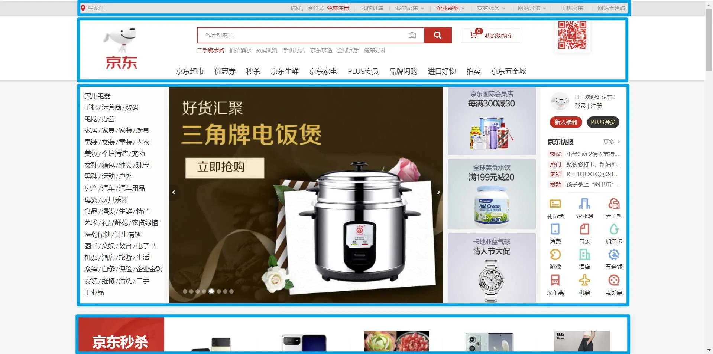

#### 2.常用布局名词

| 位置               |                           |
| ------------------ | ------------------------- |
| 顶部导航条         | topbar                    |
| 页头               | header 、page-header      |
| 导航               | nav 、 navigator 、navbar |
| 搜索框             | search 、search-box       |
| 横幅、广告、宣传图 | banner                    |
| 主要内容           | content 、main            |
| 侧边栏             | aside 、 sidebar          |
| 页脚               | footer 、page-footer      |

#### 3.重置默认样式

很多元素都有默认样式，比如：

1. p 元素有默认的上下margin 。
2. h1~h6 标题也有上下margin ，且字体加粗。
3. body 元素有默认的8px 外边距。
4. 超链接有默认的文字颜色和下划线。
5. ul 元素有默认的左pading 。
6. .......

`reset.css`

`normalize.css`

`重置默认样式.html`

```html
<!DOCTYPE html>
<html lang="zh-CN">
<head>
    <meta charset="UTF-8">
    <title>01_重置默认样式</title>
    <!-- <link rel="stylesheet" href="./reset.css"> -->
    <!-- <link rel="stylesheet" href="./normalize.css"> -->
    <style>
        .demo {
            background-color: gray;
        }
    </style>
</head>
<body>
<div class="demo">123</div>
<h1>一级标题</h1>
<h2>二级标题</h2>
<h3>三级标题</h3>
<h4>四级标题</h4>
<a href="#">去百度</a>
<ul>
    <li>张三</li>
    <li>李四</li>
    <li>王五</li>
</ul>
</body>
</html>
```

`尚品汇.html`

```html
<!DOCTYPE html>
<html lang="zh-CN">
<head>
    <meta charset="UTF-8">
    <title>尚品汇</title>
    <!-- 引入页签图标 -->
    <link rel="shortcut icon" href="../favicon.ico" type="image/x-icon">
    <!-- 引入重置样式 -->
    <link rel="stylesheet" href="./css/reset.css">
    <!-- 引入样式 -->
    <link rel="stylesheet" href="./css/index.css">
</head>
<body>
<!-- 顶部导航条 -->
<div class="topbar">
    <!-- 版心 -->
    <div class="container clearfix">
        <!-- 左侧的欢迎区 -->
        <div class="welcome leftfix">
            <span class="hello">尚品汇欢迎您</span>
            <span>请</span>
            <a href="#" class="login">登录</a>
            <a href="#" class="register">免费注册</a>
        </div>
        <!-- 右侧的导航区 -->
        <div class="topbar-nav rightfix">
            <ul class="list clearfix">
                <li><a href="#">我的订单</a></li>
                <li><a href="#">我的购物车</a></li>
                <li><a href="#">我的尚品汇</a></li>
                <li><a href="#">尚品汇会员</a></li>
                <li><a href="#">企业采购</a></li>
                <li><a href="#">关注尚品汇</a></li>
                <li><a href="#">合作招商</a></li>
                <li><a href="#">商家后台</a></li>
            </ul>
        </div>
    </div>
</div>

<!-- 头部 -->
<div class="header">
    <div class="container clearfix">
        <!-- 左侧logo区 -->
        <div class="logo leftfix">
            
        </div>
        <!-- 右侧搜索区 -->
        <div class="search rightfix">
            <form action="#">
                <input type="text">
                <button></button>
            </form>
        </div>
    </div>
</div>

<!-- 主导航 -->
<div class="main-nav">
    <div class="container clearfix">
        <div class="all-types leftfix">全部商品分类</div>
        <ul class="main-nav-list leftfix clearfix">
            <li><a href="#">尚品超市</a></li>
            <li><a href="#">优惠券</a></li>
            <li><a href="#">买啥</a></li>
            <li><a href="#">尚品家电</a></li>
            <li><a href="#">尚品生鲜</a></li>
            <li><a href="#">plus会员</a></li>
            <li><a href="#">进口好物</a></li>
            <li><a href="#">品牌闪购</a></li>
            <li><a href="#">拍卖</a></li>
            <li><a href="#">五金店</a></li>
        </ul>
    </div>
</div>

<!-- 主要内容区 -->
<div class="main-content">
    <div class="container clearfix">
        <ul class="slide-nav leftfix">
            <li>
                <!-- 一级菜单 -->
                <a href="#">手机/运营商/数码</a>
                <!-- 二级菜单 --></a>
                <div class="second-menu">
                    <dl class="clearfix">
                        <dt><a href="#">电子书刊</a></dt>
                        <dd><a href="#">电子书</a></dd>
                        <dd><a href="#">网络原创</a></dd>
                        <dd><a href="#">数字杂志</a></dd>
                        <dd><a href="#">多媒体图书</a></dd>
                    </dl>
                    <dl class="clearfix">
                        <dt><a href="#">音像</a></dt>
                        <dd><a href="#">音乐</a></dd>
                        <dd><a href="#">影视</a></dd>
                        <dd><a href="#">教育音像</a></dd>
                    </dl>
                    <dl class="clearfix">
                        <dt><a href="#">英文原版</a></dt>
                        <dd><a href="#">少儿</a></dd>
                        <dd><a href="#">商务投资</a></dd>
                        <dd><a href="#">英语学习考试</a></dd>
                        <dd><a href="#">文学</a></dd>
                        <dd><a href="#">传记</a></dd>
                        <dd><a href="#">励志</a></dd>
                    </dl>
                    <dl class="clearfix">
                        <dt><a href="#">文艺</a></dt>
                        <dd><a href="#">小说</a></dd>
                        <dd><a href="#">文学</a></dd>
                        <dd><a href="#">青春文学</a></dd>
                        <dd><a href="#">传记</a></dd>
                        <dd><a href="#">艺术</a></dd>
                    </dl>
                    <dl class="clearfix">
                        <dt><a href="#">少儿</a></dt>
                        <dd><a href="#">胎教</a></dd>
                        <dd><a href="#">0-2岁</a></dd>
                        <dd><a href="#">3-6岁</a></dd>
                        <dd><a href="#">7-10岁</a></dd>
                        <dd><a href="#">11-14岁</a></dd>
                    </dl>
                    <dl class="clearfix">
                        <dt><a href="#">人文社科</a></dt>
                        <dd><a href="#">历史</a></dd>
                        <dd><a href="#">哲学</a></dd>
                        <dd><a href="#">国学</a></dd>
                        <dd><a href="#">政治/军事</a></dd>
                        <dd><a href="#">法律</a></dd>
                        <dd><a href="#">人文社科</a></dd>
                        <dd><a href="#">心理学</a></dd>
                        <dd><a href="#">文化</a></dd>
                        <dd><a href="#">社会科学</a></dd>
                    </dl>
                    <dl class="clearfix">
                        <dt><a href="#">经管励志</a></dt>
                        <dd><a href="#">经济</a></dd>
                        <dd><a href="#">金融与投资</a></dd>
                        <dd><a href="#">管理</a></dd>
                        <dd><a href="#">励志与成功</a></dd>
                    </dl>
                    <dl class="clearfix">
                        <dt><a href="#">生活</a></dt>
                        <dd><a href="#">健康与保健</a></dd>
                        <dd><a href="#">家庭与育儿</a></dd>
                        <dd><a href="#">旅游</a></dd>
                        <dd><a href="#">烹饪美食</a></dd>
                    </dl>
                    <dl class="clearfix">
                        <dt><a href="#">科技</a></dt>
                        <dd><a href="#">工业技术</a></dd>
                        <dd><a href="#">科普读物</a></dd>
                        <dd><a href="#">建筑</a></dd>
                        <dd><a href="#">医学</a></dd>
                        <dd><a href="#">科学与自然</a></dd>
                        <dd><a href="#">计算机与互联网</a></dd>
                        <dd><a href="#">电子通信</a></dd>
                    </dl>
                    <dl class="clearfix">
                        <dt><a href="#">教育</a></dt>
                        <dd><a href="#">中小学教辅</a></dd>
                        <dd><a href="#">教育与考试</a></dd>
                        <dd><a href="#">外语学习</a></dd>
                        <dd><a href="#">大中专教材</a></dd>
                        <dd><a href="#">科学与自然</a></dd>
                        <dd><a href="#">字典词典</a></dd>
                    </dl>
                    <dl class="clearfix">
                        <dt><a href="#">艺术与收藏</a></dt>
                        <dd><a href="#">经济管理</a></dd>
                        <dd><a href="#">文化与艺术</a></dd>
                    </dl>
                    <dl class="clearfix">
                        <dt><a href="#">其他</a></dt>
                        <dd><a href="#">工具书</a></dd>
                        <dd><a href="#">杂志期刊</a></dd>
                        <dd><a href="#">套装书</a></dd>
                        <dd><a href="#">打折图书</a></dd>
                    </dl>
                </div>
            </li>
            <li>
                <a href="#">电脑/办公</a>
                <div class="second-menu">
                    <dl class="clearfix">
                        <dt><a href="#">手机通讯</a></dt>
                        <dd><a href="#">手机</a></dd>
                        <dd><a href="#">对讲机</a></dd>
                    </dl>
                    <dl class="clearfix">
                        <dt><a href="#">运营商</a></dt>
                        <dd><a href="#">合约机</a></dd>
                        <dd><a href="#">选号中心</a></dd>
                        <dd><a href="#">装宽带</a></dd>
                    </dl>
                    <dl class="clearfix">
                        <dt><a href="#">手机配件</a></dt>
                        <dd><a href="#">移动电源</a></dd>
                        <dd><a href="#">蓝牙耳机</a></dd>
                        <dd><a href="#">充电器</a></dd>
                        <dd><a href="#">数据线</a></dd>
                        <dd><a href="#">苹果周边</a></dd>
                    </dl>
                </div>
            </li>
            <li>
                <a href="#">家具/家居/家装/厨具</a>
                <div class="second-menu">
                    <dl class="clearfix">
                        <dt><a href="#">大家电</a></dt>
                        <dd><a href="#">平板电视</a></dd>
                        <dd><a href="#">空调</a></dd>
                        <dd><a href="#">冰箱</a></dd>
                        <dd><a href="#">洗衣机</a></dd>
                        <dd><a href="#">迷你音响</a></dd>
                    </dl>
                    <dl class="clearfix">
                        <dt><a href="#">厨卫家电</a></dt>
                        <dd><a href="#">燃气灶</a></dd>
                        <dd><a href="#">油烟机</a></dd>
                        <dd><a href="#">热水器</a></dd>
                        <dd><a href="#">消毒柜</a></dd>
                        <dd><a href="#">洗碗机</a></dd>
                    </dl>
                    <dl class="clearfix">
                        <dt><a href="#">厨卫小电</a></dt>
                        <dd><a href="#">料理机</a></dd>
                        <dd><a href="#">榨汁机</a></dd>
                        <dd><a href="#">电饭煲</a></dd>
                        <dd><a href="#">压力锅</a></dd>
                        <dd><a href="#">豆浆机</a></dd>
                        <dd><a href="#">咖啡机</a></dd>
                        <dd><a href="#">微波炉</a></dd>
                        <dd><a href="#">电磁炉</a></dd>
                    </dl>
                    <dl class="clearfix">
                        <dt><a href="#">生活电器</a></dt>
                        <dd><a href="#">取暖电器</a></dd>
                        <dd><a href="#">净化器</a></dd>
                        <dd><a href="#">加湿器</a></dd>
                        <dd><a href="#">扫地机器人</a></dd>
                        <dd><a href="#">吸尘器</a></dd>
                        <dd><a href="#">挂烫机</a></dd>
                        <dd><a href="#">电话机</a></dd>
                        <dd><a href="#">电风扇</a></dd>
                    </dl>
                    <dl class="clearfix">
                        <dt><a href="#">个护健康</a></dt>
                        <dd><a href="#">剃须刀</a></dd>
                        <dd><a href="#">脱毛器</a></dd>
                        <dd><a href="#">口腔护理</a></dd>
                        <dd><a href="#">电吹风</a></dd>
                        <dd><a href="#">美容仪</a></dd>
                        <dd><a href="#">理发器</a></dd>
                        <dd><a href="#">按摩椅</a></dd>
                        <dd><a href="#">血压计</a></dd>
                    </dl>
                </div>
            </li>
            <li>
                <a href="#">男装/女装/童装/内衣</a>
                <div class="second-menu">
                    <dl class="clearfix">
                        <dt><a href="#">摄影摄像</a></dt>
                        <dd><a href="#">数码现货即</a></dd>
                        <dd><a href="#">拍立得</a></dd>
                        <dd><a href="#">镜头</a></dd>
                        <dd><a href="#">户外器材</a></dd>
                        <dd><a href="#">数码相框</a></dd>
                    </dl>
                    <dl class="clearfix">
                        <dt><a href="#">数码配件</a></dt>
                        <dd><a href="#">存储卡</a></dd>
                        <dd><a href="#">读卡器</a></dd>
                        <dd><a href="#">滤镜</a></dd>
                        <dd><a href="#">相机包</a></dd>
                        <dd><a href="#">数码支架</a></dd>
                    </dl>
                    <dl class="clearfix">
                        <dt><a href="#">智能设备</a></dt>
                        <dd><a href="#">智能手环</a></dd>
                        <dd><a href="#">智能眼镜</a></dd>
                        <dd><a href="#">健康监测</a></dd>
                        <dd><a href="#">体感车</a></dd>
                        <dd><a href="#">无人机</a></dd>
                    </dl>
                </div>
            </li>
            <li>
                <a href="#">美妆/个护清洁/宠物</a>
                <div class="second-menu">
                    <dl class="clearfix">
                        <dt><a href="#">宠物生活</a></dt>
                        <dd><a href="#">宠物粮食</a></dd>
                        <dd><a href="#">宠物零食</a></dd>
                        <dd><a href="#">医疗保健</a></dd>
                        <dd><a href="#">宠物玩具</a></dd>
                        <dd><a href="#">出行装备</a></dd>
                    </dl>
                    <dl class="clearfix">
                        <dt><a href="#">生活日用</a></dt>
                        <dd><a href="#">保暖防护</a></dd>
                        <dd><a href="#">收纳用品</a></dd>
                        <dd><a href="#">雨伞雨具</a></dd>
                        <dd><a href="#">浴室用品</a></dd>
                        <dd><a href="#">洗漱用品</a></dd>
                    </dl>
                </div>
            </li>
            <li>
                <a href="#">女鞋/箱包/钟表/珠宝</a>
                <div class="second-menu">
                    <dl class="clearfix">
                        <dt><a href="#">电脑整机</a></dt>
                        <dd><a href="#">笔记本电脑</a></dd>
                        <dd><a href="#">台式机</a></dd>
                        <dd><a href="#">超极本</a></dd>
                        <dd><a href="#">游戏本</a></dd>
                        <dd><a href="#">平板电脑</a></dd>
                        <dd><a href="#">平板配件</a></dd>
                    </dl>
                    <dl class="clearfix">
                        <dt><a href="#">电脑配件</a></dt>
                        <dd><a href="#">CPU</a></dd>
                        <dd><a href="#">主板</a></dd>
                        <dd><a href="#">显卡</a></dd>
                        <dd><a href="#">硬盘</a></dd>
                        <dd><a href="#">SSD固态硬盘</a></dd>
                        <dd><a href="#">内存</a></dd>
                    </dl>
                </div>
            </li>
            <li>
                <a href="#">男鞋/运动/户外</a>
                <div class="second-menu">
                    <dl class="clearfix">
                        <dt><a href="#">刀剪菜板</a></dt>
                        <dd><a href="#">菜刀</a></dd>
                        <dd><a href="#">剪刀</a></dd>
                        <dd><a href="#">多功能刀</a></dd>
                        <dd><a href="#">道具套装</a></dd>
                    </dl>
                    <dl class="clearfix">
                        <dt><a href="#">水具酒具</a></dt>
                        <dd><a href="#">塑料杯</a></dd>
                        <dd><a href="#">运动水壶</a></dd>
                        <dd><a href="#">保温杯</a></dd>
                        <dd><a href="#">保温壶</a></dd>
                    </dl>
                </div>
            </li>
            <li>
                <a href="#">房产/汽车/汽车用品</a>
                <div class="second-menu">
                    <dl class="clearfix">
                        <dt><a href="#">清洁用品</a></dt>
                        <dd><a href="#">纸巾湿巾</a></dd>
                        <dd><a href="#">清洁工具</a></dd>
                        <dd><a href="#">驱虫用品</a></dd>
                        <dd><a href="#">家庭清洁</a></dd>
                        <dd><a href="#">皮具护理</a></dd>
                    </dl>
                    <dl class="clearfix">
                        <dt><a href="#">面部护肤</a></dt>
                        <dd><a href="#">洁面乳</a></dd>
                        <dd><a href="#">面膜</a></dd>
                        <dd><a href="#">防晒</a></dd>
                        <dd><a href="#">隔离</a></dd>
                        <dd><a href="#">爽肤水</a></dd>
                    </dl>
                </div>
            </li>
            <li>
                <a href="#">母婴/玩具乐器</a>
                <div class="second-menu">
                    <dl class="clearfix">
                        <dt><a href="#">男装</a></dt>
                        <dd><a href="#">衬衫</a></dd>
                        <dd><a href="#">针织衫</a></dd>
                        <dd><a href="#">夹克</a></dd>
                        <dd><a href="#">风衣</a></dd>
                        <dd><a href="#">牛仔裤</a></dd>
                    </dl>
                    <dl class="clearfix">
                        <dt><a href="#">女装</a></dt>
                        <dd><a href="#">雪纺衫</a></dd>
                        <dd><a href="#">休闲裤</a></dd>
                        <dd><a href="#">小西装</a></dd>
                        <dd><a href="#">皮衣</a></dd>
                        <dd><a href="#">羽绒服</a></dd>
                    </dl>
                </div>
            </li>
            <li>
                <a href="#">食品/酒类/生鲜/特产</a>
                <div class="second-menu">
                    <dl class="clearfix">
                        <dt><a href="#">钟表</a></dt>
                        <dd><a href="#">男表</a></dd>
                        <dd><a href="#">瑞士表</a></dd>
                        <dd><a href="#">女表</a></dd>
                        <dd><a href="#">风衣</a></dd>
                        <dd><a href="#">智能手表</a></dd>
                        <dd><a href="#">闹钟</a></dd>
                    </dl>
                </div>
            </li>
            <li>
                <a href="#">艺术/礼品鲜花/农资绿植</a>
                <div class="second-menu">
                    <dl class="clearfix">
                        <dt><a href="#">流行男鞋</a></dt>
                        <dd><a href="#">休闲鞋</a></dd>
                        <dd><a href="#">商务鞋</a></dd>
                        <dd><a href="#">功能鞋</a></dd>
                        <dd><a href="#">布鞋</a></dd>
                        <dd><a href="#">人字拖</a></dd>
                    </dl>
                    <dl class="clearfix">
                        <dt><a href="#">时尚女鞋</a></dt>
                        <dd><a href="#">高跟鞋</a></dd>
                        <dd><a href="#">凉鞋</a></dd>
                        <dd><a href="#">雪地靴</a></dd>
                        <dd><a href="#">筒靴</a></dd>
                        <dd><a href="#">内增高</a></dd>
                    </dl>
                </div>
            </li>
            <li>
                <a href="#">医药保健/计生情趣</a>
                <div class="second-menu">
                    <dl class="clearfix">
                        <dt><a href="#">营养辅食</a></dt>
                        <dd><a href="#">维生素</a></dd>
                        <dd><a href="#">面条</a></dd>
                        <dd><a href="#">益生菌</a></dd>
                        <dd><a href="#">钙铁锌硒</a></dd>
                        <dd><a href="#">DHA</a></dd>
                    </dl>
                    <dl class="clearfix">
                        <dt><a href="#">妈妈专区</a></dt>
                        <dd><a href="#">孕妇装</a></dd>
                        <dd><a href="#">孕妇护肤</a></dd>
                        <dd><a href="#">防辐射服</a></dd>
                        <dd><a href="#">产后塑身</a></dd>
                        <dd><a href="#">月子装</a></dd>
                    </dl>
                </div>
            </li>
            <li>
                <a href="#">图书/文娱/教育/电子书</a>
                <div class="second-menu">
                    <dl class="clearfix">
                        <dt><a href="#">流行皮包</a></dt>
                        <dd><a href="#">钱包</a></dd>
                        <dd><a href="#">手包</a></dd>
                        <dd><a href="#">钥匙包</a></dd>
                        <dd><a href="#">手提包</a></dd>
                        <dd><a href="#">公文包</a></dd>
                    </dl>
                    <dl class="clearfix">
                        <dt><a href="#">婚庆</a></dt>
                        <dd><a href="#">婚庆首饰</a></dd>
                        <dd><a href="#">婚纱摄影</a></dd>
                        <dd><a href="#">婚宴</a></dd>
                        <dd><a href="#">婚庆服务</a></dd>
                        <dd><a href="#">婚纱礼服</a></dd>
                    </dl>
                </div>
            </li>
            <li>
                <a href="#">机票/酒店/旅游/生活</a>
                <div class="second-menu">
                    <dl class="clearfix">
                        <dt><a href="#">地方特产</a></dt>
                        <dd><a href="#">北京</a></dd>
                        <dd><a href="#">新疆</a></dd>
                        <dd><a href="#">四川</a></dd>
                        <dd><a href="#">福建</a></dd>
                        <dd><a href="#">重庆</a></dd>
                    </dl>
                    <dl class="clearfix">
                        <dt><a href="#">进口食品</a></dt>
                        <dd><a href="#">饼干果干</a></dd>
                        <dd><a href="#">巧克力</a></dd>
                        <dd><a href="#">牛奶</a></dd>
                        <dd><a href="#">调味食品</a></dd>
                        <dd><a href="#">休闲零食</a></dd>
                    </dl>
                </div>
            </li>
            <li>
                <a href="#">众筹/白条/保险/企业金融</a>
                <div class="second-menu">
                    <dl class="clearfix">
                        <dt><a href="#">木手串</a></dt>
                        <dd><a href="#">小叶紫檀</a></dd>
                        <dd><a href="#">黄花梨</a></dd>
                        <dd><a href="#">禅香木</a></dd>
                        <dd><a href="#">金丝楠</a></dd>
                    </dl>
                    <dl class="clearfix">
                        <dt><a href="#">钻石</a></dt>
                        <dd><a href="#">裸钻</a></dd>
                        <dd><a href="#">钻戒</a></dd>
                        <dd><a href="#">耳饰</a></dd>
                        <dd><a href="#">手镯</a></dd>
                        <dd><a href="#">手链</a></dd>
                    </dl>
                </div>
            </li>
            <li>
                <a href="#">安装/维修/清洗/二手</a>
                <div class="second-menu">
                    <dl class="clearfix">
                        <dt><a href="#">二手家电</a></dt>
                        <dd><a href="#">洗衣机</a></dd>
                        <dd><a href="#">烘干机</a></dd>
                        <dd><a href="#">烤箱</a></dd>
                        <dd><a href="#">微波炉</a></dd>
                    </dl>
                    <dl class="clearfix">
                        <dt><a href="#">上门清洗</a></dt>
                        <dd><a href="#">油烟机</a></dd>
                        <dd><a href="#">橱柜</a></dd>
                        <dd><a href="#">灶台</a></dd>
                        <dd><a href="#">锅</a></dd>
                        <dd><a href="#">燃气灶</a></dd>
                    </dl>
                </div>
            </li>
        </ul>
        <div class="banner leftfix">
            
        </div>
        <div class="slide-other leftfix">
            <div class="message">
                <div class="title clearfix">
                    <span class="leftfix">尚品快报</span>
                    <a href="#" class="rightfix">更多&nbsp;&gt;</a>
                </div>
                <ul class="msg-list">
                    <li><a href="#">[特惠] 毛衣+直筒裤才是YYDS</a></li>
                    <li><a href="#">[特惠] 毛衣+直筒裤才是YYDS</a></li>
                    <li><a href="#">[特惠] 毛衣+直筒裤才是YYDS</a></li>
                    <li><a href="#">[特惠] 毛衣+直筒裤才是YYDS</a></li>
                </ul>
            </div>
            <div class="other-nav">
                <ul class="other-nav-list clearfix">
                    <li>
                        <div class="picture"></div>
                        <span>话费</span>
                    </li>
                    <li>
                        <div class="picture"></div>
                        <span>话费</span>
                    </li>
                    <li>
                        <div class="picture"></div>
                        <span>话费</span>
                    </li>
                    <li>
                        <div class="picture"></div>
                        <span>话费</span>
                    </li>
                </ul>
                <ul class="other-nav-list clearfix">
                    <li>
                        <div class="picture"></div>
                        <span>话费</span>
                    </li>
                    <li>
                        <div class="picture"></div>
                        <span>话费</span>
                    </li>
                    <li>
                        <div class="picture"></div>
                        <span>话费</span>
                    </li>
                    <li>
                        <div class="picture"></div>
                        <span>话费</span>
                    </li>
                </ul>
                <ul class="other-nav-list clearfix">
                    <li>
                        <div class="picture"></div>
                        <span>话费</span>
                    </li>
                    <li>
                        <div class="picture"></div>
                        <span>话费</span>
                    </li>
                    <li>
                        <div class="picture"></div>
                        <span>话费</span>
                    </li>
                    <li>
                        <div class="picture"></div>
                        <span>话费</span>
                    </li>
                </ul>
            </div>
        </div>
    </div>
</div>

<!-- 秒杀 -->
<div class="seckill">
    <div class="container clearfix">
        
        
        
        
        
    </div>
</div>

<!-- 楼层 -->
<div class="floor">
    <div class="container">
        <!-- 上部分 -->
        <div class="floor-nav clearfix">
            <span class="floor-name leftfix">家用电器</span>
            <ul class="floor-nav-list rightfix clearfix">
                <li><a href="#">热门</a></li>
                <li><a href="#">大家电</a></li>
                <li><a href="#">生活电器</a></li>
                <li><a href="#">厨房电器</a></li>
                <li><a href="#">应季电器</a></li>
                <li><a href="#">空气/净水</a></li>
                <li><a href="#">高端电器</a></li>
            </ul>
        </div>
        <!-- 下部分 -->
        <div class="floor-info clearfix">
            <div class="item item1">
                <ul class="item1-list clearfix">
                    <li><a href="#">节能补贴</a></li>
                    <li><a href="#">4K电视</a></li>
                    <li><a href="#">空气净化器</a></li>
                    <li><a href="#">IH电饭煲</a></li>
                    <li><a href="#">滚筒洗衣机</a></li>
                    <li><a href="#">电热水器</a></li>
                </ul>
                
            </div>
            <div class="item item2">
                
            </div>
            <div class="item item3">
                
                
            </div>
            <div class="item item4">
                
            </div>
            <div class="item item5">
                
                
            </div>
        </div>
    </div>
</div>

<!-- 楼层 -->
<div class="floor">
    <div class="container">
        <!-- 上部分 -->
        <div class="floor-nav clearfix">
            <span class="floor-name leftfix">家用电器</span>
            <ul class="floor-nav-list rightfix clearfix">
                <li><a href="#">热门</a></li>
                <li><a href="#">大家电</a></li>
                <li><a href="#">生活电器</a></li>
                <li><a href="#">厨房电器</a></li>
                <li><a href="#">应季电器</a></li>
                <li><a href="#">空气/净水</a></li>
                <li><a href="#">高端电器</a></li>
            </ul>
        </div>
        <!-- 下部分 -->
        <div class="floor-info clearfix">
            <div class="item item1">
                <ul class="item1-list clearfix">
                    <li><a href="#">节能补贴</a></li>
                    <li><a href="#">4K电视</a></li>
                    <li><a href="#">空气净化器</a></li>
                    <li><a href="#">IH电饭煲</a></li>
                    <li><a href="#">滚筒洗衣机</a></li>
                    <li><a href="#">电热水器</a></li>
                </ul>
                
            </div>
            <div class="item item2">
                
            </div>
            <div class="item item3">
                
                
            </div>
            <div class="item item4">
                
            </div>
            <div class="item item5">
                
                
            </div>
        </div>
    </div>
</div>

<!-- 页脚 -->
<div class="footer">
    <div class="container">
        <!-- 顶部链接 -->
        <div class="top-links clearfix">
            <ul class="links-list">
                <li><a href="#">购物指南</a></li>
                <li><a href="#">购物流程</a></li>
                <li><a href="#">会员介绍</a></li>
                <li><a href="#">生活旅行</a></li>
                <li><a href="#">常见问题</a></li>
                <li><a href="#">大家电</a></li>
                <li><a href="#">联系客服</a></li>
            </ul>
            <ul class="links-list">
                <li><a href="#">配送方式</a></li>
                <li><a href="#">上门自提</a></li>
                <li><a href="#">211限时达</a></li>
                <li><a href="#">配送服务查询</a></li>
                <li><a href="#">配送费收取标准</a></li>
            </ul>
            <ul class="links-list">
                <li><a href="#">支付方式</a></li>
                <li><a href="#">货到付款</a></li>
                <li><a href="#">在线支付</a></li>
                <li><a href="#">生活旅行</a></li>
                <li><a href="#">分期付款</a></li>
                <li><a href="#">公司转账</a></li>
            </ul>
            <ul class="links-list">
                <li><a href="#">售后服务</a></li>
                <li><a href="#">售后政策</a></li>
                <li><a href="#">价格保护</a></li>
                <li><a href="#">退款说明</a></li>
                <li><a href="#">返修/退换货</a></li>
                <li><a href="#">取消订单</a></li>
            </ul>
            <ul class="links-list">
                <li><a href="#">特色服务</a></li>
                <li><a href="#">夺宝岛</a></li>
                <li><a href="#">DIY装机</a></li>
                <li><a href="#">延保服务</a></li>
                <li><a href="#">尚品汇E卡</a></li>
                <li><a href="#">尚品汇通信</a></li>
                <li><a href="#">尚品鱼座智能</a></li>
            </ul>
            <ul class="links-list">
                <li><a href="#">自营覆盖区县</a></li>
                <li><a href="#">尚品汇已向全国2661个区县</a></li>
                <li><a href="#">提供自 营配送服务，支持货到</a></li>
                <li><a href="#">付款、POS 机刷卡和售后上门</a></li>
                <li><a href="#">常见问题</a></li>
                <li><a href="#">服务</a></li>
                <li><a href="#">查看详情</a></li>
            </ul>
        </div>
        <!-- 分隔线 -->
        <div class="line"></div>
        <!-- 底部链接 -->
        <div class="bottom-links">
            <ul class="bottom-links-list clearfix">
                <li><a href="#">关于我们</a></li>
                <li><a href="#">联系我们</a></li>
                <li><a href="#">联系客服</a></li>
                <li><a href="#">合作招商</a></li>
                <li><a href="#">商家帮助</a></li>
                <li><a href="#">营销中心</a></li>
                <li><a href="#">手机尚品</a></li>
                <li><a href="#">友情链接</a></li>
                <li><a href="#">销售联盟</a></li>
                <li><a href="#">隐私政策</a></li>
            </ul>
            <div class="copyright">京ICP备12345678901</div>
        </div>
    </div>
</div>

</body>
</html>
```
