### 一、CSS3 简介

#### 1.CSS3 概述

- CSS3 是CSS2 的升级版本，它在CSS2 的基础上，新增了很多强大的新功能，从而解决一些实际
- 面临的问题。
- CSS3 在未来会按照模块化的方式去发展： https://www.w3.org/Style/CSS/current-work.html
- CSS3 的新特性如下：
  - 新增了更加实用的选择器，例如：动态伪类选择器、目标伪类选择器、伪元素选择器等等。
  - 新增了更好的视觉效果，例如：圆角、阴影、渐变等。
  - 新增了丰富的背景效果，例如：支持多个背景图片，同时新增了若干个背景相关的属性。
  - 新增了全新的布局方案 —— 弹性盒子。
  - 新增了Web 字体，可以显示用户电脑上没有安装的字体。
  - 增强了颜色，例如： HSL 、HSLA 、RGBA 几种新的颜色模式，新增 opacity 属性来控制透明度。
  - 增加了2D 和3D 变换，例如：旋转、扭曲、缩放、位移等。
  - 增加动画与过渡效果，让效果的变换更具流线性、平滑性。
  - ……

#### 2.CSS3私有前缀

##### 2.1 什么是私有前缀

如下代码中的-webkit- 就是私有前缀

```css
div {
    width: 400px;
    height: 400px;
    -webkit-border-radius: 20px;
}
```

##### 2.2 为什么要有私有前缀

- W3C 标准所提出的某个CSS 特性，在被浏览器正式支持之前，浏览器厂商会根据浏览器的内核，使用私有前缀来测试该CSS
  特性，在浏览器正式支持该CSS 特性后，就不需要私有前缀了

- 举个例子：

  ```css
  -webkit-border-radius: 20px;
  -moz-border-radius: 20px;
  -ms-border-radius: 20px;
  -o-border-radius: 20px;
  border-radius: 20px;
  ```

- 查询CSS3 兼容性的网站： https://caniuse.com/

##### 2.3 常见浏览器私有前缀

- Chrome 浏览器： -webkit-
- Safari 浏览器： -webkit-
- Firefox 浏览器： -moz-
- Edge 浏览器： -webkit-
- 旧 Opera 浏览器： -o-
- 旧 IE 浏览器： -ms-

注意：

> 我们在编码时，不用过于关注浏览器私有前缀，不用绞尽脑汁的去记忆，也不用每个都去查询，因为常用的CSS3
> 新特性，主流浏览器都是支持的，即便是为了老浏览器而加前缀，我们也可以借助现代的构建工具，去帮我们添加私有前缀。

### 二、CSS3 基本语法

#### 1.CSS3 新增长度单位

1. rem 根元素字体大小的倍数，只与根元素字体大小有关。
2. vw 视口宽度的百分之多少 10vw 就是视口宽度的10% 。
3. vh 视口高度的百分之多少 10vh 就是视口高度的10% 。
4. vmax 视口宽高中大的那个的百分之多少。（了解即可）
5. vmin 视口宽高中小的那个的百分之多少。（了解即可）

`新增长度单位.html`

```html
<!DOCTYPE html>
<html lang="zh-CN">
<head>
    <meta charset="UTF-8">
    <title>新增长度单位</title>
    <style>
        * {
            margin: 0;
            padding: 0;
        }

        .box1 {
            width: 200px;
            height: 200px;
            background-color: deepskyblue;
        }

        .box2 {
            width: 20vw;
            height: 20vh;
            background-color: green;
        }

        .box3 {
            width: 20vmax;
            height: 20vmin;
            background-color: orange;
        }
    </style>
</head>
<body>
<div class="box1">像素</div>
<div class="box2">vw和vh</div>
<div class="box3">vmax</div>
</body>
</html>
```

#### 2.CSS3 新增颜色设置方式

CSS3 新增了三种颜色设置方式，分别是： rgba 、hsl 、hsla ，由于之前已经详细讲解，此处略过。

#### 3.CSS3 新增选择器

CSS3 新增的选择器有：动态伪类、目标伪类、语言伪类、UI 伪类、结构伪类、否定伪类、伪元素；这些在CSS2 中已经详细讲解，此处略过。

#### 4.CSS3 新增盒模型相关属性

##### 4.1. box-sizing 怪异盒模型

使用box-sizing 属性可以设置盒模型的两种类型

| 可选值      | 含义                                                 |
| ----------- | ---------------------------------------------------- |
| content-box | width 和 height 设置的是盒子内容区的大小。（默认值） |
| border-box  | width 和 height 设置的是盒子总大小。（怪异盒模型）   |

`box-sizing.html`

```html
<!DOCTYPE html>
<html lang="zh-CN">
<head>
    <meta charset="UTF-8">
    <title>01_box-sizing</title>
    <style>
        .box1 {
            width: 200px;
            height: 200px;
            background-color: deepskyblue;
            padding: 5px;
            border: 5px solid black;
            margin-bottom: 20px;
        }

        .box2 {
            width: 200px;
            height: 200px;
            background-color: gray;
            padding: 5px;
            border: 5px solid black;
            box-sizing: border-box;
        }
    </style>
</head>
<body>
<div class="box1"></div>
<div class="box2"></div>
</body>
</html>
```

##### 4.2. resize 调整盒子大小

使用resize 属性可以控制是否允许用户调节元素尺寸。

| 值         | 含义                            |
| ---------- | ------------------------------- |
| none       | 不允许用户调整元素大小。 (默认) |
| both       | 用户可以调节元素的宽度和高度。  |
| horizontal | 用户可以调节元素的宽度 。       |
| vertical   | 用户可以调节元素的高度。        |

`resize.html`

```html
<!DOCTYPE html>
<html lang="zh-CN">
<head>
    <meta charset="UTF-8">
    <title>02_resize</title>
    <style>
        .box1 {
            width: 400px;
            height: 400px;
            background-color: orange;
            resize: both;
            overflow: scroll;
        }

        .box2 {
            width: 800px;
            height: 600px;
            background-color: skyblue;
        }
    </style>
</head>
<body>
<div class="box1">
    <div class="box2">123</div>
</div>
</body>
</html>
```

##### 4.3. box-shadow 盒子阴影

使用 box-shadow 属性为盒子添加阴影。

- 语法：

  ```css
  box-shadow: h-shadow v-shadow blur spread color inset;
  ```


- 各个值的含义：

  | 值       | 含义                                 |
  | -------- | ------------------------------------ |
  | h-shadow | 水平阴影的位置，必须填写，可以为负值 |
  | v-shadow | 垂直阴影的位置，必须填写，可以为负值 |
  | blur     | 可选，模糊距离                       |
  | spread   | 可选，阴影的外延值                   |
  | color    | 可选，阴影的颜色                     |
  | inset    | 可选，将外部阴影改为内部阴影         |


- 默认值： box-shadow:none 表示没有阴影

- 示例：

  ```css
  /* 写两个值，含义：水平位置、垂直位置 */
  box-shadow: 10px 10px;
  /* 写三个值，含义：水平位置、垂直位置、颜色 */
  box-shadow: 10px 10px red;
  /* 写三个值，含义：水平位置、垂直位置、模糊值 */
  box-shadow: 10px 10px 10px;
  /* 写四个值，含义：水平位置、垂直位置、模糊值、颜色 */
  box-shadow: 10px 10px 10px red;
  /* 写五个值，含义：水平位置、垂直位置、模糊值、外延值、颜色 */
  box-shadow: 10px 10px 10px 10px blue;
  /* 写六个值，含义：水平位置、垂直位置、模糊值、外延值、颜色、内阴影 */
  box-shadow: 10px 10px 20px 3px blue inset;
  ```

`box-shadow.html`

```html
<!DOCTYPE html>
<html lang="zh-CN">
<head>
    <meta charset="UTF-8">
    <title>03_box-shadow</title>
    <style>
        .box1 {
            width: 400px;
            height: 400px;
            background-color: orange;
            margin: 0 auto;
            margin-top: 100px;
            font-size: 40px;

            /* 写两个值，含义：水平位置 垂直位置 */
            /* box-shadow: 10px 10px; */

            /* 写三个值，含义：水平位置 垂直位置 阴影的颜色 */
            /* box-shadow: 10px 10px blue; */

            /* 写三个值，含义：水平位置 垂直位置 模糊程度 */
            /* box-shadow: 10px 10px 20px; */

            /* 写四个值，含义：水平位置 垂直位置 模糊程度 阴影颜色 */
            /* box-shadow: 10px 10px 20px blue; */

            /* 写五个值，含义：水平位置 垂直位置 模糊程度 外延值 阴影颜色 */
            /* box-shadow: -10px -10px 20px 10px blue; */

            /* 写六个值，含义：水平位置 垂直位置 模糊程度 外延值 阴影颜色 内阴影 */
            /* box-shadow: 10px 10px 20px 10px blue inset; */

            position: relative;
            top: 0;
            left: 0;
            transition: 0.4s linear all;
        }

        .box1:hover {
            box-shadow: 0px 0px 20px black;
            top: -1px;
            left: 0;
        }
    </style>
</head>
<body>
<div class="box1">你好啊</div>
</body>
</html>
```

##### 4.4. opacity 不透明度

opacity 属性能为整个元素添加透明效果， 值是 0 到 1 之间的小数， 0 是完全透明， 1 表示完全不透明。

> opacity 与 rgba 的区别？
> opacity 是一个属性，设置的是整个元素（包括元素里的内容）的不透明度。
> rgba 是颜色的设置方式，用于设置颜色，它的透明度，仅仅是调整颜色的透明度。

`opacity.html`

```html
<!DOCTYPE html>
<html lang="zh-CN">
<head>
    <meta charset="UTF-8">
    <title>04_opacity</title>
    <style>
        .box1 {
            width: 200px;
            height: 200px;
            background-color: orange;
            font-size: 40px;
            opacity: 0.1;
            font-weight: bold;
        }

        .box2 {
            position: relative;
        }

        h1 {
            position: absolute;
            top: 100px;
            left: 0;
            background-color: black;
            color: white;
            width: 400px;
            line-height: 100px;
            text-align: center;
            font-size: 40px;
            opacity: 0.5;
        }
    </style>
</head>
<body>
<div class="box1">你好啊</div>
<div class="box2">
    
    <h1>你瞅啥</h1>
</div>
</body>
</html>
```

#### 5.CSS3 新增背景属性

##### 5.1. background-origin

- 作用：设置背景图的原点。
- 语法
  1. padding-box ：从padding 区域开始显示背景图像。—— 默认值
  2. border-box ： 从border 区域开始显示背景图像。
  3. content-box ： 从content 区域开始显示背景图像。

`background-origin.html`

```html
<!DOCTYPE html>
<html lang="zh-CN">
<head>
    <meta charset="UTF-8">
    <title>01_background-origin</title>
    <style>
        .box1 {
            width: 400px;
            height: 400px;
            background-color: skyblue;
            margin: 0 auto;
            font-size: 40px;
            padding: 50px;
            border: 50px dashed rgba(255, 0, 0, 0.7);

            background-image: url('../images/bg01.jpg');
            background-repeat: no-repeat;
            background-origin: border-box;
        }
    </style>
</head>
<body>
<div class="box1">你好啊</div>
</body>
</html>
```

##### 5.2. background-clip

- 作用：设置背景图的向外裁剪的区域。

- 语法

  1. border-box ： 从border 区域开始向外裁剪背景。 —— 默认值
  2. padding-box ： 从padding 区域开始向外裁剪背景。
  3. content-box ： 从content 区域开始向外裁剪背景。
  4. text ：背景图只呈现在文字上。

  > 注意：若值为text ，那么backgroun-clip 要加上-webkit- 前缀。

`background-clip.html`

```html
<!DOCTYPE html>
<html lang="zh-CN">
<head>
    <meta charset="UTF-8">
    <title>02_background-clip</title>
    <style>
        .box1 {
            width: 400px;
            height: 400px;
            background-color: skyblue;
            margin: 0 auto;
            font-size: 120px;
            font-weight: bold;
            padding: 50px;
            border: 50px dashed rgba(255, 0, 0, 0.7);
            color: transparent;

            background-image: url('../images/bg02.jpg');
            background-repeat: no-repeat;
            background-origin: border-box;
            -webkit-background-clip: text;
        }
    </style>
</head>
<body>
<div class="box1">你好啊</div>
</body>
</html>
```

##### 5.3. background-size

- 作用：设置背景图的尺寸。

- 语法：

  1. 用长度值指定背景图片大小，不允许负值。

     ```css
     background-size: 300px 200px;
     ```

  2. 用百分比指定背景图片大小，不允许负值。

     ```css
     background-size: 100% 100%;
     ```

  3. auto ： 背景图片的真实大小。 —— 默认值

  4. contain ： 将背景图片等比缩放，使背景图片的宽或高，与容器的宽或高相等，再将完整背景图片包含在容器内，但要注意：可能会造成容器里部分区域没有背景图片。

     ```css
     background-size: contain;
     ```

  5. cover ：将背景图片等比缩放，直到完全覆盖容器，图片会尽可能全的显示在元素上，但要注意：背景图片有可能显示不完整。——
     相对比较好的选择

     ```css
     background-size: cover;
     ```

`background-size.html`

```html
<!DOCTYPE html>
<html lang="zh-CN">
<head>
    <meta charset="UTF-8">
    <title>03_background-size</title>
    <style>
        div {
            width: 400px;
            height: 400px;
            padding: 50px;
            border: 50px dashed rgba(255, 0, 0, 0.7);
            /* background-image: url('../images/bg03.jpg'); */
            /* background-repeat: no-repeat; */

            /* background-size: 400px 400px; */
            /* background-size: 100% 100%; */
            /* background-size: contain; */
            background-size: cover;
        }
    </style>
</head>
<body>
<div></div>
</body>
</html>
```

##### 5.4. backgorund 复合属性

- 语法：

  ```css
  background: color url repeat position / size origin clip
  ```

> 注意：
>
> 1. origin 和 clip 的值如果一样，如果只写一个值，则origin 和 clip 都设置；如果设置了两个值，前面的是origin ，后面的clip 。
> 2. size 的值必须写在 position 值的后面，并且用 / 分开。

`background复合属性.html`

```html
<!DOCTYPE html>
<html lang="zh-CN">
<head>
    <meta charset="UTF-8">
    <title>04_background复合属性</title>
    <style>
        .box1 {
            width: 400px;
            height: 400px;
            margin: 0 auto;
            font-size: 40px;
            padding: 50px;
            border: 50px dashed rgba(255, 0, 0, 0.7);

            /* background: 背景颜色 背景url 是否重复 位置 / 大小 原点 裁剪方式; */
            background: skyblue url('../images/bg03.jpg') no-repeat 10px 10px / 500px 500px border-box content-box;
        }
    </style>
</head>
<body>
<div class="box1">你好啊</div>
</body>
</html>
```

##### 5.5. 多背景图

CSS3 允许元素设置多个背景图片

```css
/* 添加多个背景图 */
background:

url
(
../images/bg-lt.png
)
no-repeat,

url
(
../images/bg-rt.png
)
no-repeat right top,

url
(
../images/bg-lb.png
)
no-repeat left bottom,

url
(
../images/bg-rb.png
)
no-repeat right bottom

;
```

`多背景图.html`

```html
<!DOCTYPE html>
<html lang="zh-CN">
<head>
    <meta charset="UTF-8">
    <title>05_多背景图</title>
    <style>
        div {
            width: 400px;
            height: 400px;
            border: 1px solid black;
            background: url('../images/bg-lt.png') no-repeat left top,
            url('../images/bg-rt.png') no-repeat right top,
            url('../images/bg-lb.png') no-repeat left bottom,
            url('../images/bg-rb.png') no-repeat right bottom;
        }
    </style>
</head>
<body>
<div></div>
</body>
</html>
```

#### 6.CSS3新增边框属性

##### 6.1 边框圆角

- 在 CSS3 中，使用border-radius 属性可以将盒子变为圆角。

- 同时设置四个角的圆角：

  ```css
  border-radius:10px;
  ```

- 分开设置每个角的圆角（几乎不用）：

  | 属性名                     | 作用                                                         |
  | -------------------------- | ------------------------------------------------------------ |
  | border-top-left-radius     | 设置左上角圆角半径：<br/>1. 一个值是正圆半径，<br/>2. 两个值分别是椭圆的x 半径、y 半径。 |
  | border-top-right-radius    | 设置右上角圆角半径：<br/>1. 一个值是正圆半径，<br/>2. 两个值分别是椭圆的x 半径、y 半径。 |
  | border-bottom-right-radius | 设置右下角圆角半径：<br/>1. 一个值是正圆半径，<br/>2. 两个值分别是椭圆的x 半径、y 半径。 |
  | border-bottom-left-radius  | 设置左下角圆角半径：<br/>1. 一个值是正圆半径，<br/>2. 两个值分别是椭圆的x 半径、y 半径。 |


- 分开设置每个角的圆角，综合写法（几乎不用）：

  ```css
  border-raidus: 左上角x 右上角x 右下角x 左下角x / 左上y 右上y 右下y 左下y
  ```

`边框圆角.html`

```html
<!DOCTYPE html>
<html lang="zh-CN">
<head>
    <meta charset="UTF-8">
    <title>01_边框圆角</title>
    <style>
        div {
            width: 400px;
            height: 400px;
            border: 2px solid black;
            margin: 0 auto;

            /* border-radius: 200px; */
            /* border-radius: 50%; */

            /* border-top-left-radius: 100px; */
            /* border-top-right-radius: 50px; */
            /* border-bottom-right-radius: 20px; */
            /* border-bottom-left-radius: 10px; */

            /* border-top-left-radius: 100px 50px; */
            /* border-top-right-radius: 50px 20px; */
            /* border-bottom-right-radius: 20px 10px; */
            /* border-bottom-left-radius: 10px 5px; */

            border-radius: 100px 50px 20px 10px / 50px 20px 10px 5px;

        }
    </style>
</head>
<body>
<div></div>
</body>
</html>
```

##### 6.2 边框外轮廓（了解）

- outline-width ：外轮廓的宽度。

- outline-color ：外轮廓的颜色。

- outline-style ：外轮廓的风格。

  - none ： 无轮廓
  - dotted ： 点状轮廓
  - dashed ： 虚线轮廓
  - solid ： 实线轮廓
  - double ： 双线轮廓

- outline-offset 设置外轮廓与边框的距离，正负值都可以设置。

  > 注意： outline-offset 不是outline 的子属性，是一个独立的属性。

- outline 复合属性

  ```css
  outline:50px solid blue;
  ```

`边框外轮廓.html`

```html
<!DOCTYPE html>
<html lang="zh-CN">
<head>
    <meta charset="UTF-8">
    <title>02_边框外轮廓</title>
    <style>
        .box1 {
            width: 400px;
            height: 400px;
            padding: 10px;
            border: 10px solid black;
            background-color: gray;
            font-size: 40px;
            margin: 0 auto;
            margin-top: 100px;

            /* outline-width: 20px; */
            /* outline-color: orange; */
            /* outline-style: solid; */
            outline-offset: 30px;

            outline: 20px solid orange;

        }
    </style>
</head>
<body>
<div class="box1">你好啊</div>
<div>Lorem ipsum dolor sit amet consectetur adipisicing elit. Nobis, architecto.</div>
</body>
</html>
```

#### 7.CSS3新增文本属性

##### 7.1 文本阴影

- 在 CSS3 中，我们可以使用 text-shadow 属性给文本添加阴影。

- 语法：

  ```css
  text-shadow: h-shadow v-shadow blur color;
  ```

  | 值       | 描述                               |
  | -------- | ---------------------------------- |
  | h-shadow | 必需写，水平阴影的位置。允许负值。 |
  | v-shadow | 必需写，垂直阴影的位置。允许负值。 |
  | blur     | 可选，模糊的距离。                 |
  | color    | 可选，阴影的颜色                   |

  默认值： text-shadow:none 表示没有阴影。

`文本阴影.html`

```html
<!DOCTYPE html>
<html lang="zh-CN">
<head>
    <meta charset="UTF-8">
    <title>01_文本阴影</title>
    <style>
        body {
            background-color: black;
        }

        h1 {
            font-size: 80px;
            text-align: center;
            color: white;

            /* text-shadow: 3px 3px; */
            /* text-shadow: 3px 3px red; */
            /* text-shadow: 3px 3px 10px red; */
            /* text-shadow: 0px 0px 15px black; */
            text-shadow: 0px 0px 20px red;
            font-family: '翩翩体-简';
        }
    </style>
</head>
<body>
<h1>红浪漫洗浴欢迎您的光临</h1>
</body>
</html>
```

##### 7.2 文本换行

- 在 CSS3 中，我们可以使用 white-space 属性设置文本换行方式。

- 常用值如下：

  | 值       | 含义                                                         |
  | -------- | ------------------------------------------------------------ |
  | normal   | 文本超出边界自动换行，文本中的换行被浏览器识别为一个空格。（默认值） |
  | pre      | 原样输出，与pre 标签的效果相同。                             |
  | pre-wrap | 在pre 效果的基础上，超出元素边界自动换行。                   |
  | pre-line | 在pre 效果的基础上，超出元素边界自动换行，且只识别文本中的换行，空格会忽略。 |
  | nowrap   | 强制不换行                                                   |

`文本换行.html`

```html
<!DOCTYPE html>
<html lang="zh-CN">
<head>
    <meta charset="UTF-8">
    <title>02_文本换行</title>
    <style>
        div {
            width: 400px;
            height: 400px;
            border: 1px solid black;
            font-size: 20px;
            white-space: nowrap;
        }
    </style>
</head>
<body>
<div>
    山回路转不见君
    雪上空留马行处
    山回路转不见君 山回路转不见君山回路转不见君山回路转不见君山回路转不见君
    雪上空留马行处
    山回路转不见君
    雪上空留马行处
    山回路转不见君
    雪上空留马行处
    山回路转不见君
    雪上空留马行处
    山回路转不见君
    雪上空留马行处
</div>
</body>
</html>
```

##### 7.3 文本溢出

- 在 CSS3 中，我们可以使用 text-overflow 属性设置文本内容溢出时的呈现模式。

- 常用值如下：

  | 值       | 含义                                            |
  | -------- | ----------------------------------------------- |
  | clip     | 当内联内容溢出时，将溢出部分裁切掉。 （默认值） |
  | ellipsis | 当内联内容溢出块容器时，将溢出部分替换为 ... 。 |

  > 注意：要使得 text-overflow 属性生效，块容器必须显式定义 overflow 为非 visible值， white-space 为 nowrap 值。

`文本溢出.html`

```html
<!DOCTYPE html>
<html lang="zh-CN">
<head>
    <meta charset="UTF-8">
    <title>03_文本溢出</title>
    <style>
        ul {
            width: 400px;
            height: 400px;
            border: 1px solid black;
            font-size: 20px;
            list-style: none;
            padding-left: 0;
            padding: 10px;
        }

        li {
            margin-bottom: 10px;
            overflow: hidden;
            white-space: nowrap;
            text-overflow: ellipsis;
        }
    </style>
</head>
<body>
<ul>
    <li>焦点访谈：隐形冠军 匠心打造 分毫必争</li>
    <li>我，嫁到日本才发现，女性活得真憋屈，体毛不能有，放屁也不自由</li>
    <li>高洪波无缘！足协盟主热门人选曝光，3选1，冷门人物或成黑马杀出</li>
    <li>《狂飙》爆火以后“疯驴子”被骂上热搜：跪着赚钱丢人吗</li>
    <li>气温猛降15℃，冷空气再来袭！这些地方迎大范围降雨！“虚高”气温大跳水！！！！！</li>
</ul>
</body>
</html>
```

##### 7.4 文本修饰

- CSS3 升级了text-decoration 属性，让其变成了复合属性。
- 子属性及其含义：
  - text-decoration-line 设置文本装饰线的位置
    - none ： 指定文字无装饰 （默认值）
    - underline ： 指定文字的装饰是下划线
    - overline ： 指定文字的装饰是上划线
    - line-through ： 指定文字的装饰是贯穿线
  - text-decoration-style 文本装饰线条的形状
    - solid ： 实线 （默认）
    - double ： 双线
    - dotted ： 点状线条
    - dashed ： 虚线
    - wavy ： 波浪线
  - text-decoration-color 文本装饰线条的颜色

`文本修饰.html`

```html
<!DOCTYPE html>
<html lang="zh-CN">
<head>
    <meta charset="UTF-8">
    <title>04_文本修饰</title>
    <style>
        h1 {
            font-size: 100px;
            /* text-decoration-line: overline; */
            /* text-decoration-style: dashed; */
            /* text-decoration-color: blue; */
            /* text-decoration: overline wavy blue; */
        }
    </style>
</head>
<body>
<h1>你好啊，欢迎来到尚硅谷学习</h1>
</body>
</html>
```

##### 7.5 文本描边

注意：文字描边功能仅 webkit 内核浏览器支持。

- -webkit-text-stroke-width ：设置文字描边的宽度，写长度值。
- -webkit-text-stroke-color ：设置文字描边的颜色，写颜色值。
- -webkit-text-stroke ：复合属性，设置文字描边宽度和颜色。

`文本描边.html`

```html
<!DOCTYPE html>
<html lang="zh-CN">
<head>
    <meta charset="UTF-8">
    <title>05_文本描边</title>
    <style>
        h1 {
            font-size: 100px;
            /* -webkit-text-stroke-color:red; */
            /* -webkit-text-stroke-width:3px; */
            /* -webkit-text-stroke-width:3px; */
            -webkit-text-stroke: 3px red;
            color: transparent;
        }
    </style>
</head>
<body>
<h1>先生您好，欢迎光临红浪漫！</h1>
</body>
</html>
```

#### 8.CSS3 新增渐变

##### 8.1 线性渐变

- 多个颜色之间的渐变， 默认从上到下渐变。

  > 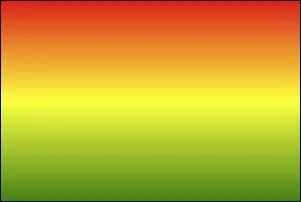
  >
  > ```css
  > background-image: linear-gradient(red,yellow,green);
  > ```

>

- 使用关键词设置线性渐变的方向。

  > 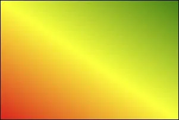
  >
  > ```css
  > background-image: linear-gradient(to top,red,yellow,green);
  > background-image: linear-gradient(to right top,red,yellow,green);
  > ```

- 使用角度设置线性渐变的方向。

  > 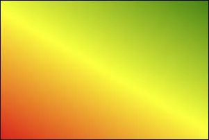
  >
  > ```css
  > background-image: linear-gradient(30deg,red,yellow,green);
  > ```

>

- 调整开始渐变的位置。

  > 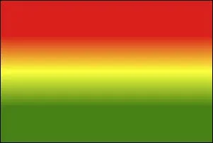
  >
  > ```css
  > background-image: linear-gradient(red 50px,yellow 100px ,green 150px);
  > ```

`线性渐变.html`

```html
<!DOCTYPE html>
<html lang="zh-CN">
<head>
    <meta charset="UTF-8">
    <title>01_线性渐变</title>
    <style>
        .box {
            width: 300px;
            height: 200px;
            border: 1px solid black;
            float: left;
            margin-left: 50px;
            font-size: 20px;
        }

        .box1 {
            background-image: linear-gradient(red, yellow, green);
        }

        .box2 {
            background-image: linear-gradient(to right top, red, yellow, green);
        }

        .box3 {
            background-image: linear-gradient(20deg, red, yellow, green);
        }

        .box4 {
            background-image: linear-gradient(red 50px, yellow 100px, green 150px);
        }

        .box5 {
            background-image: linear-gradient(20deg, red 50px, yellow 100px, green 150px);
            font-size: 80px;
            text-align: center;
            line-height: 200px;
            font-weight: bold;
            color: transparent;
            -webkit-background-clip: text;
        }
    </style>
</head>
<body>
<div class="box box1">默认情况（从上到下）</div>
<div class="box box2">通过关键词调整线性渐变渐变的方向</div>
<div class="box box3">通过角度调整线性渐变渐变的方向</div>
<div class="box box4">调整线性渐变的区域</div>
<div class="box box5">你好啊</div>
</body>
</html>
```

##### 8.2 径向渐变

- 多个颜色之间的渐变， 默认从圆心四散。（注意：不一定是正圆，要看容器本身宽高比）

  > 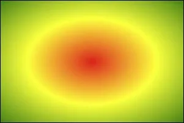
  >
  > ```css
  > background-image: radial-gradient(red,yellow,green);
  > ```

- 使用关键词调整渐变圆的圆心位置。

  > 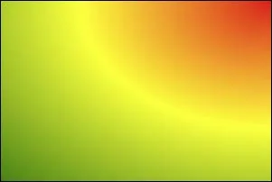
  >
  > ```css
  > background-image: radial-gradient(at right top,red,yellow,green);
  > ```

- 使用像素值调整渐变圆的圆心位置。

  > 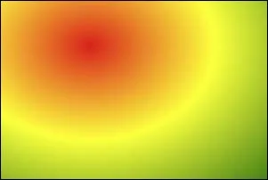
  >
  > ```css
  > background-image: radial-gradient(at 100px 50px,red,yellow,green);
  > ```

- 调整渐变形状为正圆 。

  > 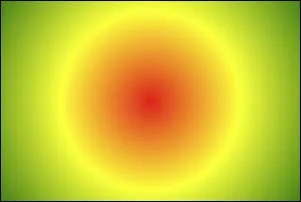
  >
  > ```css
  > background-image: radial-gradient(circle,red,yellow,green);
  > ```

- 调整形状的半径 。

  > 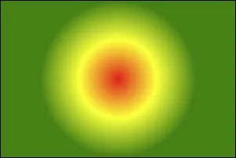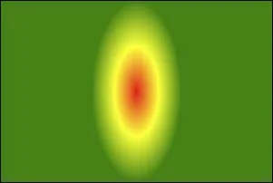
  >
  > ```css
  > background-image: radial-gradient(100px,red,yellow,green);
  > background-image: radial-gradient(50px 100px,red,yellow,green);
  > ```

- 调整开始渐变的位置。

  > 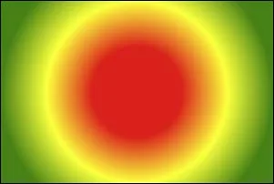
  >
  > ```css
  > background-image: radial-gradient(red 50px,yellow 100px,green 150px);
  > ```

`径向渐变.html`

```html
<!DOCTYPE html>
<html lang="zh-CN">
<head>
    <meta charset="UTF-8">
    <title>02_径向渐变</title>
    <style>
        .box {
            width: 300px;
            height: 200px;
            border: 1px solid black;
            float: left;
            margin-left: 50px;
            font-size: 20px;
            margin-top: 20px;
        }

        .box1 {
            background-image: radial-gradient(red, yellow, green);
        }

        .box2 {
            background-image: radial-gradient(at right top, red, yellow, green);
        }

        .box3 {
            background-image: radial-gradient(at 100px 50px, red, yellow, green);
        }

        .box4 {
            background-image: radial-gradient(circle, red, yellow, green);
        }

        .box5 {
            background-image: radial-gradient(200px 200px, red, yellow, green);
        }

        .box6 {
            background-image: radial-gradient(red 50px, yellow 100px, green 150px);
        }

        .box7 {
            background-image: radial-gradient(100px 50px at 150px 150px, red 50px, yellow 100px, green 150px);
        }
    </style>
</head>
<body>
<div class="box box1">默认情况</div>
<div class="box box2">通过关键词调整径向渐变圆的圆心</div>
<div class="box box3">通过像素值调整径向渐变圆的圆心</div>
<div class="box box4">通过circle关键字调整为正圆</div>
<div class="box box5">通过像素值调整为正圆</div>
<div class="box box6">调整径向渐变的区域</div>
<div class="box box7">综合写法</div>
</body>
</html>
```

##### 8.3 重复渐变

无论线性渐变，还是径向渐变，在没有发生渐变的位置，继续进行渐变，就为重复渐变。

- 使用repeating-linear-gradient 进行重复线性渐变，具体参数同linear-gradient 。
- 使用repeating-radial-gradient 进行重复径向渐变，具体参数同radial-gradient 。

> 我们可以利用渐变，做出很多有意思的效果：例如：横格纸、立体球等等。

`重复渐变.html`

```html
<!DOCTYPE html>
<html lang="zh-CN">
<head>
    <meta charset="UTF-8">
    <title>03_重复渐变</title>
    <style>
        .box {
            width: 300px;
            height: 200px;
            border: 1px solid black;
            float: left;
            margin-left: 50px;
            font-size: 20px;
        }

        .box1 {
            background-image: repeating-linear-gradient(red 50px, yellow 100px, green 150px);
        }

        .box2 {
            background-image: repeating-radial-gradient(red 50px, yellow 100px, green 150px);
        }
    </style>
</head>
<body>
<div class="box box1">重复线性渐变</div>
<div class="box box2">重复径向渐变</div>
</body>
</html>
```

`渐变小案例.html`

```
<!DOCTYPE html>
<html lang="zh-CN">
<head>
    <meta charset="UTF-8">
    <title>04_渐变小案例</title>
    <style>
        .box1 {
            width: 600px;
            height: 800px;
            padding: 20px;
            border: 1px solid black;
            margin: 0 auto;
            background-image: repeating-linear-gradient(transparent 0px,transparent 29px,gray 30px);
            background-clip: content-box;
        }
        .box2 {
            width: 200px;
            height: 200px;
            border-radius: 50%;
            background-image: radial-gradient(at 80px 80px,white,#333);
        }
    </style>
</head>
<body>
    <div class="box1"></div>
    <div class="box2"></div>
</body>
</html>
```

#### 9.web 字体

##### 9.1 基本用法

可以通过@font-face 指定字体的具体地址，浏览器会自动下载该字体，这样就不依赖用户电脑上的字体了。

- 语法（简写方式）

  ```css
  @font-face {
  	font-family: "情书字体";
  	src: url('./方正手迹.ttf');
  }
  ```

- 语法（高兼容性写法）

  ```css
  @font-face {
  	font-family: "atguigu";
  	font-display: swap;
  	src: url('webfont.eot'); /* IE9 */
  	src: url('webfont.eot?#iefix') format('embedded-opentype'), /* IE6-IE8 */
  	url('webfont.woff2') format('woff2'),
  	url('webfont.woff') format('woff'), /* chrome、firefox */
  	url('webfont.ttf') format('truetype'), /* chrome、firefox、opera、Safari,
  Android*/
  	url('webfont.svg#webfont') format('svg'); /* iOS 4.1- */
  }
  ```

  `web字体.html`

  ```html
  <!DOCTYPE html>
  <html lang="zh-CN">
  <head>
      <meta charset="UTF-8">
      <title>Document</title>
      <style>
          @font-face {
              font-family: "情书字体";
              src: url('./font1/方正手迹.ttf');
          }
          @font-face {
              font-family: "atguigu";
              font-display: swap;
              src: url('./font2/webfont.eot'); /* IE9 */
              src: url('./font2/webfont.eot?#iefix') format('embedded-opentype'), /* IE6-IE8 */
              url('./font2/webfont.woff2') format('woff2'),
              url('./font2/webfont.woff') format('woff'), /* chrome、firefox */
              url('./font2/webfont.ttf') format('truetype'), /* chrome、firefox、opera、Safari, Android, iOS 4.2+*/
              url('./font2/webfont.svg#webfont') format('svg'); /* iOS 4.1- */
          }
          .t1 {
              font-size: 100px;
              font-family: '情书字体';
          }
          .t2 {
              font-size: 100px;
              font-family: 'atguigu';
          }
      </style>
  </head>
  <body>
      <h1 class="t1">春风得意马蹄疾，不信人间有别离</h1>
      <h1 class="t2">春风得意马蹄疾，不信人间有别离</h1>
  </body>
  </html>
  ```

##### 9.2 定制字体

- 中文的字体文件很大，使用完整的字体文件不现实，通常针对某几个文字进行单独定制。
- 可使用阿里Web 字体定制工具： https://www.iconfont.cn/webfont

##### 9.3 字体图标

- 相比图片更加清晰。

- 灵活性高，更方便改变大小、颜色、风格等。

- 兼容性好， IE 也能支持。

  > 字体图标的具体使用方式，每个平台不尽相同，最好参考平台使用指南，视频中我们是以使用最多的阿里图标库作为演示。
  > 阿里图标官网地址： https://www.iconfont.cn/

`字体图标.html`

```html
<!DOCTYPE html>
<html lang="zh-CN">
<head>
    <meta charset="UTF-8">
    <title>03_字体图标_方式二</title>
    <link rel="stylesheet" href="./font3/iconfont.css">
    <style>
        .iconfont {
            font-size: 100px;
        }
    </style>
</head>
<body>
<span class="iconfont icon-chengzi"></span>
<span class="iconfont icon-bingqilin"></span>
<span class="iconfont icon-hanbao"></span>
<span class="iconfont icon-kafeibei"></span>
</body>
</html>
```

`字体图标_在线使用.html`

```html
<!DOCTYPE html>
<html lang="zh-CN">
<head>
    <meta charset="UTF-8">
    <title>06_字体图标_方式二_在线使用</title>
    <link rel="stylesheet" href="//at.alicdn.com/t/c/font_3904680_cctp97jw61q.css">
    <style>
        .iconfont {
            font-size: 100px;
        }
    </style>
</head>
<body>
<span class="iconfont icon-chengzi"></span>
<span class="iconfont icon-bingqilin"></span>
<span class="iconfont icon-hanbao"></span>
<span class="iconfont icon-kafeibei"></span>
</body>
</html>
```

#### 10.2D变换

> 前提：二维坐标系如下图所示

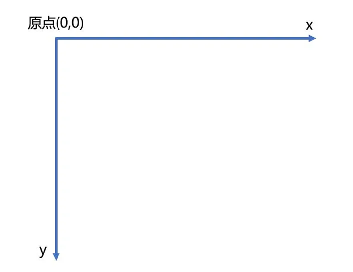

##### 10.1 2D位移

2D 位移可以改变元素的位置，具体使用方式如下：

1. 先给元素添加 转换属性 transform

2. 编写transform 的具体值，相关可选值如下：

   | 值         | 含义                                                         |
   | ---------- | ------------------------------------------------------------ |
   | translateX | 设置水平方向位移，需指定长度值；若指定的是百分比，是参考自身宽度的百分比。 |
   | translateY | 设置垂直方向位移，需指定长度值；若指定的是百分比，是参考自身高度的百分比。 |
   | translate  | 一个值代表水平方向，两个值代表：水平和垂直方向。             |

3. 注意点：

> 1. 位移与相对定位很相似，都不脱离文档流，不会影响到其它元素。
>
> 2. 与相对定位的区别：相对定位的百分比值，参考的是其父元素；定位的百分比值，参考的是其自身。
>
> 3. 浏览器针对位移有优化，与定位相比，浏览器处理位移的效率更高。
>
> 4. transform 可以链式编写，例如：
>
>    ```css
>    transform: translateX(30px) translateY(40px);
>    ```
>
> 5. 位移对行内元素无效。
>
> 6. 位移配合定位，可实现元素水平垂直居中
>
>    ```css
>    .box {
>    position: absolute;
>    left: 50%;
>    top: 50%;
>    transform: translate(-50%, -50%);
>    }
>    ```
>
> 

`位移.html`

```html
<!DOCTYPE html>
<html lang="zh-CN">
<head>
    <meta charset="UTF-8">
    <title>01_位移</title>
    <style>
        .outer {
            width: 200px;
            height: 200px;
            border: 2px solid black;
            margin: 0 auto;
            margin-top: 100px;
            position: relative;
        }

        .inner {
            width: 200px;
            height: 200px;
            background-color: deepskyblue;
            /* 水平位移 */
            /* transform: translateX(50px); */

            /* 垂直位移 */
            /* transform: translateY(50px); */

            /* 水平+垂直位移 */
            /* transform: translate(50px,50px); */
        }

        .inner2 {
            width: 60px;
            height: 60px;
            background-color: orange;
            position: absolute;
            top: 50%;
            left: 50%;
            transform: translate(-50%, -50%);
        }
    </style>
</head>
<body>
<div class="outer">
    <div class="inner">你好啊</div>
</div>

<div class="outer">
    <div class="inner2">你好啊</div>
</div>
</body>
</html>
```

##### 10.2 2D缩放

2D 缩放是指：让元素放大或缩小，具体使用方式如下：

1. 先给元素添加 转换属性 transform

2. 编写transform 的具体值，相关可选值如下：

   | 值     | 含义                                                         |
   | ------ | ------------------------------------------------------------ |
   | scaleX | 设置水平方向的缩放比例，值为一个数字， 1 表示不缩放，大于1 放大，小于1 缩小。 |
   | scaleY | 设置垂直方向的缩放比例，值为一个数字， 1 表示不缩放，大于1 放大，小于1 缩小。 |
   | scale  | 同时设置水平方向、垂直方向的缩放比例，一个值代表同时设置水平和垂直缩放；两个值分别代表：水平缩放、垂直缩放。 |

3. 注意点：

   > 1. scale 的值，是支持写负数的，但几乎不用，因为容易让人产生误解。
   > 2. 借助缩放，可实现小于12px 的文字。

`缩放.html`

```html
<!DOCTYPE html>
<html lang="zh-CN">
<head>
    <meta charset="UTF-8">
    <title>02_缩放</title>
    <style>
        .outer {
            width: 200px;
            height: 200px;
            border: 2px solid black;
            margin: 0 auto;
            margin-top: 100px;
        }

        .inner {
            width: 200px;
            height: 200px;
            background-color: deepskyblue;
            transform: scale(1.5);
        }

        span {
            display: inline-block;
            font-size: 20px;
            transform: scale(0.5);
        }
    </style>
</head>
<body>
<div class="outer">
    <div class="inner">你好啊</div>
</div>
<span>好</span>
</body>
</html>
```

##### 10.3 2D旋转

2D 旋转是指：让元素在二维平面内，顺时针旋转或逆时针旋转，具体使用方式如下：

1. 先给元素添加 转换属性 transform

2. 编写transform 的具体值，相关可选值如下：

   | 值     | 含义                                                         |
   | ------ | ------------------------------------------------------------ |
   | rotate | 设置旋转角度，需指定一个角度值( deg )，正值顺时针，负值逆时针。 |

> 注意： rotateZ(20deg) 相当于 rotate(20deg) ，当然到了3D 变换的时候，还能写：rotate(x,x,x)

`旋转.html`

```html
<!DOCTYPE html>
<html lang="zh-CN">
<head>
    <meta charset="UTF-8">
    <title>03_旋转</title>
    <style>
        .outer {
            width: 200px;
            height: 200px;
            border: 2px solid black;
            margin: 0 auto;
            margin-top: 100px;
        }

        .inner {
            width: 200px;
            height: 200px;
            background-color: deepskyblue;
            /* transform: rotateZ(-30deg); */
            transform: rotate(30deg);
        }
    </style>
</head>
<body>
<div class="outer">
    <div class="inner">你好啊</div>
</div>
</body>
</html>
```

##### 10.4 2D扭曲（了解）

2D 扭曲是指：让元素在二维平面内被“拉扯”，进而“走形”，实际开发几乎不用，了解即可，具体使用方式如下：

1. 先给元素添加 转换属性 transform
2. 编写transform 的具体值，相关可选值如下：

| 值    | 含义                                                         |
| ----- | ------------------------------------------------------------ |
| skewX | 设置元素在水平方向扭曲，值为角度值，会将元素的左上角、右下角拉扯。 |
| skewY | 设置元素在垂直方向扭曲，值为角度值，会将元素的左上角、右下角拉扯。 |
| skew  | 一个值代表skewX ，两个值分别代表： skewX 、skewY             |

`扭曲.html`

```html
<!DOCTYPE html>
<html lang="zh-CN">
<head>
    <meta charset="UTF-8">
    <title>04_扭曲_了解</title>
    <style>
        .outer {
            width: 200px;
            height: 200px;
            border: 2px solid black;
            margin: 0 auto;
            margin-top: 100px;
        }

        .inner {
            width: 200px;
            height: 200px;
            background-color: deepskyblue;
            /* transform: skewX(-30deg); */
            /* transform: skewY(30deg); */
            /* transform: skewX(30deg) skewY(30deg); */
            transform: skew(30deg);
        }
    </style>
</head>
<body>
<div class="outer">
    <div class="inner">你好啊</div>
</div>
</body>
</html>
```

##### 10.5多重变换

多个变换，可以同时使用一个transform 来编写。

```css
transform:

translate
(
-
50
%
,
-
50
%
)
rotate
(
45
deg

)
;
```

> 注意点：多重变换时，建议最后旋转。

`多重变换.html`

```html
<!DOCTYPE html>
<html lang="zh-CN">
<head>
    <meta charset="UTF-8">
    <title>05_多重变换</title>
    <style>
        .outer {
            width: 200px;
            height: 200px;
            border: 2px solid black;
            margin: 0 auto;
            margin-top: 100px;
        }

        .inner {
            width: 200px;
            height: 200px;
            background-color: deepskyblue;
            transform: translate(100px, 100px) rotate(30deg);
        }
    </style>
</head>
<body>
<div class="outer">
    <div class="inner">你好啊</div>
</div>
</body>
</html>
```

##### 10.6 变换原点

- 元素变换时，默认的原点是元素的中心，使用transform-origin 可以设置变换的原点。

- 修改变换原点对位移没有影响， 对旋转和缩放会产生影响。

- 如果提供两个值，第一个用于横坐标，第二个用于纵坐标。

- 如果只提供一个，若是像素值，表示横坐标，纵坐标取50% ；若是关键词，则另一个坐标取50%

  > 1. transform-origin: 50% 50% ， 变换原点在元素的中心位置，百分比是相对于自身。—— 默认值
  > 2. transform-origin: left top ，变换原点在元素的左上角 。
  > 3. transform-origin: 50px 50px ， 变换原点距离元素左上角 50px 50px 的位置。
  > 4. transform-origin: 0 ，只写一个值的时候，第二个值默认为 50% 。

`变换原点.html`

```html
<!DOCTYPE html>
<html lang="zh-CN">
<head>
    <meta charset="UTF-8">
    <title>05_多重变换</title>
    <style>
        .outer {
            width: 200px;
            height: 200px;
            border: 2px solid black;
            margin: 0 auto;
            margin-top: 100px;
        }

        .inner {
            width: 200px;
            height: 200px;
            background-color: deepskyblue;
            /* 通过关键词调整变换原点 */
            /* transform-origin: right bottom; */

            /* 通过具体像素值调整变换原点 */
            /* transform-origin: 50px 50px; */

            /* 通过百分比调整变换原点 */
            /* transform-origin: 25% 25%; */

            /* 只给一个值 */
            /* transform-origin:top; */

            /* transform-origin: right top; */

            /* 变换原点位置的改变对 旋转 有影响 */
            /* transform: rotate(0deg); */

            /* 变换原点位置的改变对 缩放 有影响 */
            /* transform: scale(1.3); */

            /* 变换原点位置的改变对 位移 没有影响 */
            /* transform: translate(100px,100px) */
        }

        .test {
            width: 50px;
            height: 100px;
            background-color: orange;
        }
    </style>
</head>
<body>
<div class="outer">
    <div class="inner">
        <div class="test">你好啊</div>
    </div>
</div>
</body>
</html>
```

#### 11.3D变换

##### 11.1 开启3D空间

重要原则：元素进行3D 变换的首要操作：父元素必须开启3D 空间！

> 使用transform-style 开启3D 空间，可选值如下：
> flat ： 让子元素位于此元素的二维平面内（ 2D 空间）—— 默认值
> preserve-3d ： 让子元素位于此元素的三维空间内（ 3D 空间）

##### 11.2 设置景深

何为景深？—— 指定观察者与z=0 平面的距离，能让发生3D 变换的元素，产生透视效果，看来更加立体。

> 使用perspective 设置景深，可选值如下：
>
> - none ： 不指定透视 ——（默认值）
> - 长度值 ： 指定观察者距离z=0 平面的距离，不允许负值。
>
> 注意： perspective 设置给发生3D 变换元素的父元素！

`3D空间与景深.html`

```html
<!DOCTYPE html>
<html lang="zh-CN">
<head>
    <meta charset="UTF-8">
    <title>01_3D空间与景深</title>
    <style>
        .outer {
            width: 200px;
            height: 200px;
            border: 2px solid black;
            margin: 0 auto;
            margin-top: 100px;
            /* 开启3D空间 */
            transform-style: preserve-3d;
            /* 设置景深（有了透视效果，近大远小） */
            perspective: 500px;
        }

        .inner {
            width: 200px;
            height: 200px;
            background-color: deepskyblue;
            transform: rotateX(30deg);
        }
    </style>
</head>
<body>
<div class="outer">
    <div class="inner">你好啊</div>
</div>
</body>
</html>
```

##### 11.3 透视点位置

所谓透视点位置，就是观察者位置；默认的透视点在元素的中心。

> 使用perspective-origin 设置观察者位置（透视点的位置），例如：
>
> ```css
> /* 相对坐标轴往右偏移400px， 往下偏移300px（相当于人蹲下300像素，然后向右移动400像素看元素）*/
> perspective-origin: 400px 300px;
> ```
>
> 注意：通常情况下，我们不需要调整透视点位置。

`透视点的位置.html`

```html
<!DOCTYPE html>
<html lang="zh-CN">
<head>
    <meta charset="UTF-8">
    <title>02_透视点的位置</title>
    <style>
        .outer {
            width: 200px;
            height: 200px;
            border: 2px solid black;
            margin: 0 auto;
            margin-top: 100px;
            /* 开启3D空间 */
            transform-style: preserve-3d;
            /* 设置景深（有了透视效果，近大远小） */
            perspective: 500px;
            /* 设置透视点的位置 */
            perspective-origin: 102px 102px;
        }

        .inner {
            width: 200px;
            height: 200px;
            background-color: deepskyblue;
            transform: rotateX(45deg);
        }
    </style>
</head>
<body>
<div class="outer">
    <div class="inner">你好啊</div>
</div>
</body>
</html>
```

##### 11.4 3D 位移

3D 位移是在2D 位移的基础上，可以让元素沿z 轴位移，具体使用方式如下：

1. 先给元素添加 转换属性 transform
2. 编写transform 的具体值， 3D 相关可选值如下：

| 值          | 含义                                                         |
| ----------- | ------------------------------------------------------------ |
| translateZ  | 设置z 轴位移，需指定长度值，正值向屏幕外，负值向屏幕里，且不能写百分比。 |
| translate3d | 第1个参数对应x 轴，第2个参数对应y 轴，第3个参数对应z 轴，且均不能省略。 |

`位移.html`

```html
<!DOCTYPE html>
<html lang="zh-CN">
<head>
    <meta charset="UTF-8">
    <title>03_位移</title>
    <style>
        .outer {
            width: 200px;
            height: 200px;
            border: 2px solid black;
            margin: 0 auto;
            margin-top: 100px;
            /* 开启3D空间 */
            transform-style: preserve-3d;
            /* 设置景深（有了透视效果，近大远小） */
            perspective: 500px;
            /* 设置透视点的位置 */
            perspective-origin: 102px 102px;
        }

        .inner {
            width: 200px;
            height: 200px;
            background-color: rgba(0, 191, 255, 0.726);
            /* transform: translateZ(150px); */
            transform: translate3d(50%, 50%, 50%);
            box-shadow: 0px 0px 10px black;
        }
    </style>
</head>
<body>
<div class="outer">
    <div class="inner">你好啊</div>
</div>
</body>
</html>
```

##### 11.5 3D 旋转

3D 旋转是在2D 旋转的基础上，可以让元素沿x 轴和y 轴旋转，具体使用方式如下：

1. 先给元素添加 转换属性 transform
2. 编写transform 的具体值， 3D 相关可选值如下：

| 值       | 含义                                                         |
| -------- | ------------------------------------------------------------ |
| rotateX  | 设置x 轴旋转角度，需指定一个角度值( deg )，面对x 轴正方向：正值顺时针，负值逆时针。 |
| rotateY  | 设置y 轴旋转角度，需指定一个角度值( deg )，面对y 轴正方向：正值顺时针，负值逆时针。 |
| rotate3d | 前3 个参数分别表示坐标轴： x , y , z ，第4 个参数表示旋转的角度，参数不允许省略。<br/>例如： transform: rotate3d(1,1,1,30deg) ，意思是： x 、y 、z 分别旋转30 度。 |

`旋转.html`

```html
<!DOCTYPE html>
<html lang="zh-CN">
<head>
    <meta charset="UTF-8">
    <title>04_旋转</title>
    <style>
        .outer {
            width: 200px;
            height: 200px;
            border: 2px solid black;
            margin: 0 auto;
            margin-top: 100px;
            /* 开启3D空间 */
            transform-style: preserve-3d;
            /* 设置景深（有了透视效果，近大远小） */
            perspective: 500px;
            /* 设置透视点的位置 */
            perspective-origin: 102px 102px;
        }

        .inner {
            width: 200px;
            height: 200px;
            background-color: rgba(0, 191, 255, 0.726);
            /* transform: rotateX(315deg); */
            /* transform: rotateY(-35deg); */
            transform: rotate3d(1, 1, 1, 30deg);
        }
    </style>
</head>
<body>
<div class="outer">
    <div class="inner">你好啊</div>
</div>
</body>
</html>
```

##### 11.6 3D 缩放

3D 缩放是在2D 缩放的基础上，可以让元素沿z 轴缩放，具体使用方式如下：

1. 先给元素添加 转换属性 transform
2. 编写transform 的具体值， 3D 相关可选值如下：

| 值      | 含义                                                         |
| ------- | ------------------------------------------------------------ |
| scaleZ  | 设置z 轴方向的缩放比例，值为一个数字， 1 表示不缩放，大于1 放大，小于1 缩小。 |
| scale3d | 第1个参数对应x 轴，第2个参数对应y 轴，第3个参数对应z 轴，参数不允许省略。 |

`_缩放.html`

```html
<!DOCTYPE html>
<html lang="zh-CN">
<head>
    <meta charset="UTF-8">
    <title>05_缩放</title>
    <style>
        .outer {
            width: 200px;
            height: 200px;
            border: 2px solid black;
            margin: 0 auto;
            margin-top: 100px;
            /* 开启3D空间 */
            transform-style: preserve-3d;
            /* 设置景深（有了透视效果，近大远小） */
            perspective: 500px;
            /* 设置透视点的位置 */
            perspective-origin: 102px 102px;
        }

        .inner {
            width: 200px;
            height: 200px;
            background-color: rgba(0, 191, 255, 0.726);
            /* transform: scaleZ(4) rotateY(45deg); */
            transform: scale3d(1.5, 1.5, 1) rotateY(45deg);
        }
    </style>
</head>
<body>
<div class="outer">
    <div class="inner">你好啊</div>
</div>
</body>
</html>
```

##### 11.7 多重变换

多个变换，可以同时使用一个transform 来编写。

```css
transform:

translateZ
(
100
px

)
scaleZ
(
3
)
rotateY
(
40
deg

)
;
```

> 注意点：多重变换时，建议最后旋转。

`多重变换.html`

```html
<!DOCTYPE html>
<html lang="zh-CN">
<head>
    <meta charset="UTF-8">
    <title>06_多重变换</title>
    <style>
        .outer {
            width: 200px;
            height: 200px;
            border: 2px solid black;
            margin: 0 auto;
            margin-top: 100px;
            /* 开启3D空间 */
            transform-style: preserve-3d;
            /* 设置景深（有了透视效果，近大远小） */
            perspective: 500px;
            /* 设置透视点的位置 */
            perspective-origin: 102px 102px;
        }

        .inner {
            width: 200px;
            height: 200px;
            background-color: rgba(0, 191, 255, 0.726);
            /* transform-origin: 202px 180px; */
            /* transform: rotateX(-45deg); */
            transform: translateZ(100px) scaleZ(1) rotateY(45deg);
        }
    </style>
</head>
<body>
<div class="outer">
    <div class="inner">你好啊</div>
</div>
</body>
</html>
```

##### 11.8 背部可见性

使用backface-visibility 指定元素背面，在面向用户时是否可见，常用值如下：

- visible ： 指定元素背面可见，允许显示正面的镜像。—— 默认值
- hidden ： 指定元素背面不可见

> 注意： backface-visibility 需要加在发生3D 变换元素的自身上。

`多重变换.html`

```html
<!DOCTYPE html>
<html lang="zh-CN">
<head>
    <meta charset="UTF-8">
    <title>06_多重变换</title>
    <style>
        .outer {
            width: 200px;
            height: 200px;
            border: 2px solid black;
            margin: 0 auto;
            margin-top: 100px;
            /* 开启3D空间 */
            transform-style: preserve-3d;
            /* 设置景深（有了透视效果，近大远小） */
            perspective: 500px;
            /* 设置透视点的位置 */
            perspective-origin: 102px 102px;
        }

        .inner {
            width: 200px;
            height: 200px;
            background-color: orange;
            transform: rotateY(0deg);
            backface-visibility: hidden;
        }
    </style>
</head>
<body>
<div class="outer">
    <div class="inner">你好啊</div>
</div>
</body>
</html>
```

#### 12.过渡

过渡可以在不使用 Flash 动画，不使用 JavaScript 的情况下，让元素从一种样式，平滑过渡为另一种样式。

##### 12.1. transition-property

- 作用：定义哪个属性需要过渡，只有在该属性中定义的属性（比如宽、高、颜色等）才会以有过渡效果。
- 常用值：
  1. none ：不过渡任何属性。
  2. all ：过渡所有能过渡的属性。
  3. 具体某个属性名，例如： width 、heigth ，若有多个以逗号分隔。

> 不是所有的属性都能过渡，值为数字，或者值能转为数字的属性，都支持过渡，否则不支持过渡。
>
> 常见的支持过渡的属性有：颜色、长度值、百分比、z-index 、opacity 、2D 变换属性、3D 变换属性、阴影。

##### 12.2. transition-duration

- 作用：设置过渡的持续时间，即：一个状态过渡到另外一个状态耗时多久。

- 常用值：

  1. 0 ：没有任何过渡时间 —— 默认值。
  2. s 或ms ：秒或毫秒。
  3. 列表：

  - 如果想让所有属性都持续一个时间，那就写一个值。
  - 如果想让每个属性持续不同的时间那就写一个时间的列表。

`基本使用.html`

```html
<!DOCTYPE html>
<html lang="zh-CN">
<head>
    <meta charset="UTF-8">
    <title>01_基本使用</title>
    <style>
        .box1 {
            width: 200px;
            height: 200px;
            background-color: orange;
            opacity: 0.5;
            /* 设置哪个属性需要过渡效果 */
            /* transition-property: width,height,background-color; */

            /* 让所有能过渡的属性，都过渡 */
            transition-property: all;

            /* 分别设置时间 */
            /* transition-duration: 1s,1s,1s; */
            /* 设置一个时间，所有人都用 */
            transition-duration: 1s;
        }

        .box1:hover {
            width: 400px;
            height: 400px;
            background-color: green;
            transform: rotate(45deg);
            box-shadow: 0px 0px 20px black;
            opacity: 1;
        }
    </style>
</head>
<body>
<div class="box1"></div>
</body>
</html>
```

##### 12.3. transition-delay

作用：指定开始过渡的延迟时间，单位： s 或ms

##### 12.4. transition-timing-function

- 作用：设置过渡的类型
- 常用值：
  1. ease ： 平滑过渡 —— 默认值
  2. linear ： 线性过渡
  3. ease-in ： 慢 → 快
  4. ease-out ： 快 → 慢
  5. ease-in-out ： 慢 → 快 → 慢
  6. step-start ： 等同于 steps(1, start)
  7. step-end ： 等同于 steps(1, end)
  8. steps( integer,?) ： 接受两个参数的步进函数。第一个参数必须为正整数，指定函数的步数。第二个参数取值可以是start 或end
     ，指定每一步的值发生变化的时间点。第二个参数默认值为end 。
  9. cubic-bezie ( number, number, number, number)： 特定的贝塞尔曲线类型。

> 在线制作贝赛尔曲线： https://cubic-bezier.com

`高级使用.html`

```html
<!DOCTYPE html>
<html lang="zh-CN">
<head>
    <meta charset="UTF-8">
    <title>02_高级使用</title>
    <style>
        .outer {
            width: 1300px;
            height: 900px;
            border: 1px solid black;
        }

        .outer:hover .box {
            width: 1300px;
        }

        .box {
            width: 200px;
            height: 100px;
            /* 让所有能过渡的属性，都过渡 */
            transition-property: all;
            /* 设置一个时间，所有人都用 */
            transition-duration: 5s;
            /* 过渡延迟 */
            /* transition-delay: 2s; */
        }

        .box1 {
            background-color: skyblue;
            transition-timing-function: ease;
        }

        .box2 {
            background-color: orange;
            transition-timing-function: linear;
        }

        .box3 {
            background-color: gray;
            transition-timing-function: ease-in;
        }

        .box4 {
            background-color: tomato;
            transition-timing-function: ease-out;
        }

        .box5 {
            background-color: green;
            transition-timing-function: ease-in-out;
        }

        .box6 {
            background-color: purple;
            transition-timing-function: step-start;
        }

        .box7 {
            background-color: deepskyblue;
            transition-timing-function: step-end;
        }

        .box8 {
            background-color: chocolate;
            transition-timing-function: steps(20, end);
        }

        .box9 {
            background-color: rgb(18, 78, 34);
            transition-timing-function: cubic-bezier(1, .35, .78, 1.24);
        }
    </style>
</head>
<body>
<div class="outer">
    <div class="box box1">ease（慢，快，慢）</div>
    <div class="box box2">linear（匀速）</div>
    <div class="box box3">ease-in（慢，快）</div>
    <div class="box box4">ease-out（快，慢）</div>
    <div class="box box5">ease-in-out（慢，快，慢）</div>
    <div class="box box6">step-start不考虑过渡的时间，直接就是终点</div>
    <div class="box box7">step-end考虑过渡时间，但无过渡效果，过渡时间到了以后，瞬间到达终点</div>
    <div class="box box8">steps分步过渡</div>
    <div class="box box9">无敌的贝赛尔曲线</div>
</div>
</body>
</html>
```

##### 12.5. transition 复合属性

如果设置了一个时间，表示duration ；如果设置了两个时间，第一是duration ，第二个是delay ；其他值没有顺序要求。

```css
transition:

1
s

1
s linear all

;
```

`过渡复合属性.html`

```html
<!DOCTYPE html>
<html lang="zh-CN">
<head>
    <meta charset="UTF-8">
    <title>03_过渡复合属性</title>
    <style>
        .outer {
            width: 1000px;
            height: 100px;
            border: 1px solid black;
        }

        .inner {
            width: 100px;
            height: 100px;
            background-color: orange;
            transition: linear all 3s 0.5s;
        }

        .outer:hover .inner {
            width: 1000px;
        }
    </style>
</head>
<body>
<div class="outer">
    <div class="inner"></div>
</div>
</body>
</html>
```

`过渡案例.html`

```html
<!DOCTYPE html>
<html lang="zh-CN">
<head>
    <meta charset="UTF-8">
    <title>04_过渡案例</title>
    <style>
        .outer {
            width: 400px;
            height: 224px;
            position: relative;
            overflow: hidden;
        }

        .mask {
            width: 400px;
            height: 224px;
            background-color: black;
            color: white;
            position: absolute;
            top: 0;
            left: 0;
            text-align: center;
            line-height: 224px;
            font-size: 100px;
            opacity: 0;
            transition: 1s linear;
            cursor: pointer;
        }

        img {
            transition: 0.5s linear;
        }

        .outer:hover .mask {
            opacity: 0.5;
        }

        .outer:hover img {
            transform: scale(1.6) rotate(20deg);
        }
    </style>
</head>
<body>
<div class="outer">
    
    <div class="mask">上海</div>
</div>
<div class="outer">
    
    <div class="mask">上海</div>
</div>
</body>
</html>
```

#### 13.动画

13.1 什么是帧

一段动画，就是一段时间内连续播放n 个画面。每一张画面，我们管它叫做“帧”。一定时间内连续快速播放若干个帧，就成了人眼中所看到的动画。同样时间内，播放的帧数越多，画面看起来越流畅。

13.2 什么是关键帧

关键帧指的是，在构成一段动画的若干帧中，起到决定性作用的2-3 帧。

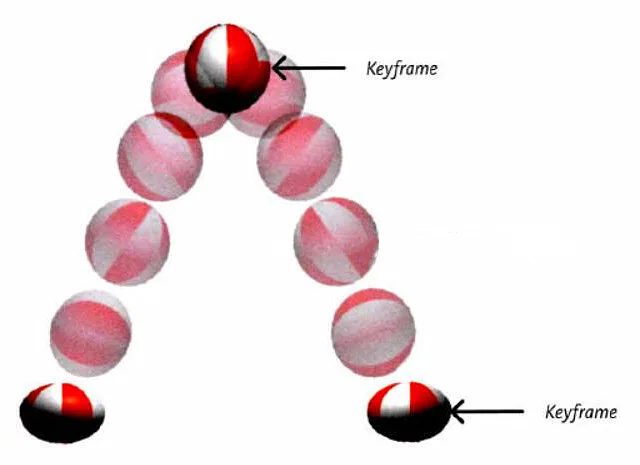

13.3 动画的基本使用

- 第一步：定义关键帧（定义动画）

  1. 简单方式定义：

     ```css
     /*写法一*/
     @keyframes 动画名 {
         from {
             /*property1:value1*/
             /*property2:value2*/
         }
         to {
             /*property1:value1*/
         }
     }
     ```


2. 完整方式定义：

   ```css
   @keyframes 动画名 {
       0% {
           /*property1:value1*/
       }
       20% {
           /*property1:value1*/
       }
       40% {
           /*property1:value1*/
       }
       60% {
           /*property1:value1*/
       }
           80% {
       /*property1:value1*/
           }
       100% {
           /*property1:value1*/
       }
   }
   ```


- 第二步：给元素应用动画，用到的属性如下：

  1. animation-name ：给元素指定具体的动画（具体的关键帧）

  2. animation-duration ：设置动画所需时间

  3. animation-delay ：设置动画延迟

     ```css
     .box {
         /* 指定动画 */
         animation-name: testKey;
         /* 设置动画所需时间 */
         animation-duration: 5s;
         /* 设置动画延迟 */
         animation-delay: 0.5s;
     }
     ```

`基本使用.html`

```html
<!DOCTYPE html>
<html lang="zh-CN">
<head>
    <meta charset="UTF-8">
    <title>01_基本使用</title>
    <style>
        .outer {
            width: 1000px;
            height: 100px;
            border: 1px solid black;
        }

        /* 定义一个动画（定义一组关键帧）—— 第一种方式 */
        @keyframes wangyoudong {
            /* 第一帧 */
            from {

            }
            /* 最后一帧 */
            to {
                transform: translate(900px);
                background-color: red;
            }
        }

        /* 定义一个动画（定义一组关键帧）—— 第二种方式 */
        @keyframes wangyoudong2 {
            /* 第一帧 */
            0% {

            }
            /* 29% {
              background-color: red;  
            } */
            /* 48% {
                background-color: orange;
            } */
            /* 88% {
                background-color: yellow;
            } */
            /* 最后一帧 */
            100% {
                transform: translate(900px) rotate(360deg);
                background-color: purple;
                border-radius: 50%;
            }
        }

        .inner {
            width: 100px;
            height: 100px;
            background-color: deepskyblue;
            /* 应用动画到元素 */
            animation-name: wangyoudong2;
            /* 动画持续的时间 */
            animation-duration: 3s;
            /* 动画延迟时间 */
            animation-delay: 0.2s;
        }

    </style>
</head>
<body>
<div class="outer">
    <div class="inner"></div>
</div>
</body>
</html>
```

13.4 动画的其他属性

- animation-timing-function ，设置动画的类型，常用值如下：

  > 1. ease ： 平滑动画 —— 默认值
  > 2. linear ： 线性过渡
  > 3. ease-in ： 慢 → 快
  > 4. ease-out ： 快 → 慢
  > 5. ease-in-out ： 慢 → 快 → 慢
  > 6. step-start ： 等同于 steps(1, start)
  > 7. step-end ： 等同于 steps(1, end)
  > 8. steps( integer,?) ： 接受两个参数的步进函数。第一个参数必须为正整数，指定函数的步数。第二个参数取值可以是start 或end
  >    ，指定每一步的值发生变化的时间点。第二个参数默认值为end 。
  > 9. cubic-bezie ( number, number, number, number)： 特定的贝塞尔曲线类型。

- animation-iteration-count ，指定动画的播放次数，常用值如下：

  > 1. number ：动画循环次数
  > 2. infinite ： 无限循环

- animation-direction ，指定动画方向，常用值如下：

  > 1. normal ： 正常方向 (默认)
  > 2. reverse ： 反方向运行
  > 3. alternate ： 动画先正常运行再反方向运行，并持续交替运行
  > 4. alternate-reverse ： 动画先反运行再正方向运行，并持续交替运行

- animation-fill-mode ，设置动画之外的状态：

  > 1. forwards ： 设置对象状态为动画结束时的状态
  > 2. backwards ： 设置对象状态为动画开始时的状态

- animation-play-state ，设置动画的播放状态，常用值如下：

  > 1. running ： 运动 (默认)
  > 2. paused ： 暂停

`其他属性.html`

```html
<!DOCTYPE html>
<html lang="zh-CN">
<head>
    <meta charset="UTF-8">
    <title>02_其他属性</title>
    <style>
        .outer {
            width: 1000px;
            height: 100px;
            border: 1px solid black;
        }

        @keyframes atguigu {
            from {

            }
            to {
                transform: translate(900px) rotate(360deg);
                background-color: purple;
                border-radius: 50%;
            }
        }

        .inner {
            width: 100px;
            height: 100px;
            background-color: deepskyblue;
            /* 应用动画到元素 */
            animation-name: atguigu;
            /* 动画持续的时间 */
            animation-duration: 3s;
            /* 动画延迟时间 */
            animation-delay: 0.2s;

            /* ********其他属性--start*********** */
            /* 设置动画的方式 */
            animation-timing-function: linear;

            /* 动画播放的次数 */
            animation-iteration-count: infinite;

            /* 动画的方向 */
            animation-direction: alternate;

            /* 动画以外的状态（不发生动画的时候在哪里） */
            /* animation-fill-mode: forwards; */
        }

        .outer:hover .inner {
            /* 动画的播放状态 */
            animation-play-state: paused;
        }

    </style>
</head>
<body>
<div class="outer">
    <div class="inner"></div>
</div>
</body>
</html>
```

13.5 动画复合属性

只设置一个时间表示duration ，设置两个时间分别是： duration 和 delay ，其他属性没有数量和顺序要求。

```css
.inner {
    animation: atguigu 3s 0.5s linear 2 alternate-reverse forwards;
}
```

> 备注： animation-play-state 一般单独使用。

`动画的复合属性.html`

```html
<!DOCTYPE html>
<html lang="zh-CN">
<head>
    <meta charset="UTF-8">
    <title>03_动画的复合属性</title>
    <style>
        .outer {
            width: 1000px;
            height: 100px;
            border: 1px solid black;
        }

        @keyframes atguigu {
            from {

            }
            to {
                transform: translate(900px) rotate(360deg);
                background-color: purple;
                border-radius: 50%;
            }
        }

        .inner {
            width: 100px;
            height: 100px;
            background-color: deepskyblue;
            animation: forwards 3s 0.5s alternate-reverse linear 2 atguigu;
        }

        .outer:hover .inner {
            /* 动画的播放状态 */
            animation-play-state: paused;
        }

    </style>
</head>
<body>
<div class="outer">
    <div class="inner"></div>
</div>
</body>
</html>
```

`动画与过渡的区别.html`

```html
<!DOCTYPE html>
<html lang="zh-CN">
<head>
    <meta charset="UTF-8">
    <title>04_动画与过渡的区别</title>
    <style>
        .outer {
            width: 1000px;
            height: 200px;
            border: 1px solid black;
        }

        .inner {
            width: 100px;
            height: 100px;
        }

        /* 用过渡，实现inner1跑到右边去 */
        .inner1 {
            background-color: orange;
            transition: 3s linear;
        }

        .outer:hover .inner1 {
            transform: translate(900px);
        }

        /* 用动画，实现inner2跑到右边去 */
        @keyframes atguigu {
            0% {
            }
            50% {
                background-color: red;
                border-radius: 50%;
                box-shadow: 0px 0px 20px black;
            }
            100% {
                transform: translate(900px);
            }
        }

        .inner2 {
            background-color: green;
            animation: atguigu 3s linear forwards;
        }

    </style>
</head>
<body>
<div class="outer">
    <div class="inner inner1">过渡</div>
    <div class="inner inner2">动画</div>
</div>
</body>
</html>
```

`动画案例.html`

```html
<!DOCTYPE html>
<html lang="zh-CN">
<head>
    <meta charset="UTF-8">
    <title>05_动画案例</title>
    <style>
        div {
            width: 130px;
            height: 130px;
            background-image: url('../images/bike.png');
            margin: 0 auto;
            margin-top: 100px;
            animation: bike 1s steps(31) infinite;
        }

        @keyframes bike {
            from {
            }
            to {
                background-position: 0px -4030px;
            }
        }
    </style>
</head>
<body>
<div></div>
</body>
</html>
```

#### 14.多列布局

作用：专门用于实现类似于报纸的布局。

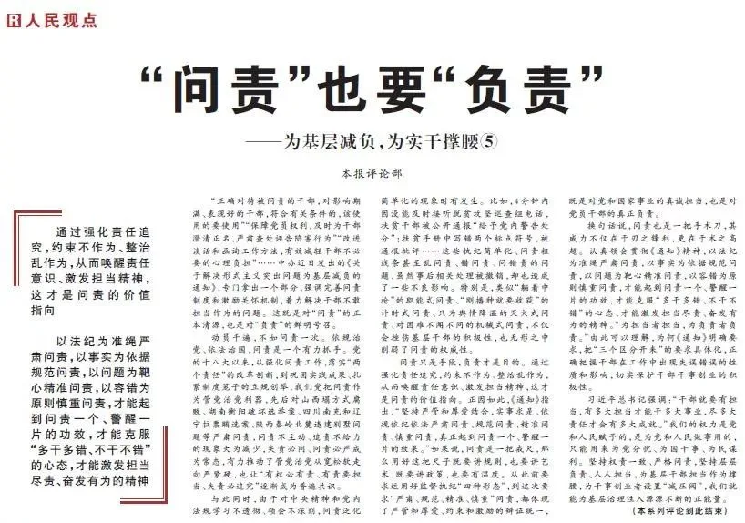

常用属性如下：

- column-count ：指定列数，值是数字。
- column-width ：指定列宽，值是长度。
- columns ：同时指定列宽和列数，复合属性；值没有数量和顺序要求。
- column-gap ：设置列边距，值是长度。
- column-rule-style ：设置列与列之间边框的风格，值与 border-style 一致。
- column-rule-width ：设置列与列之间边框的宽度，值是长度。
- column-rule-color ：设置列与列之间边框的颜色。
- coumn-rule ：设置列边框，复合属性。
- column-span 指定是否跨列；值: none 、all 。

`多列布局案例.html`

```html
<!DOCTYPE html>
<html lang="zh-CN">
<head>
    <meta charset="UTF-8">
    <title>01_多列布局案例</title>
    <style>
        .outer {
            width: 1000px;
            margin: 0 auto;

            /* 直接指定列数 */
            /* column-count: 5; */

            /* 指定每一列的宽度，会自动计算列数 */
            /* column-width:220px ; */

            /* 复合属性，能同时指定列宽和列数（不推荐使用） */
            columns: 4;

            /* 调整列间距 */
            column-gap: 20px;

            /* 每一列的边框宽度 */
            /* column-rule-width: 2px; */

            /* 每一列的边框风格 */
            /* column-rule-style: dashed; */

            /* 每一列的边框颜色 */
            /* column-rule-color: red; */

            /* 边框相关的复合属性 */
            column-rule: 2px dashed red;
        }

        h1 {
            column-span: all;
            text-align: center;
            font-size: 50px;
        }

        img {
            width: 100%;
        }
    </style>
</head>
<body>
<div class="outer">
    <h1>《震惊！国际名模也来尚硅谷学前端了！》</h1>
    <p>
        【开始】唐僧师徒四人忙着赶路，吃不好、睡不好，走了几天，来到一个景色迷人的万寿山五庄观，见天色不早，就想在五庄观里住上一晚。五庄观里的两个童子听说他们是来自东土大唐要到西天取经的，连忙说∶“我家师父到元始天尊那里讲经去了，让我们在这里等您，请快快进屋。”原来，这童子的师父是镇元子，在五百年前的兰盆会上认识了唐僧前世金蝉子。临走时曾告诉两个童子要好好对待唐僧，并交待童子用观里的两颗宝贝人参果招待他。【结束】</p>
    
    <p>
        【开始】两人摘了人参果，趁着唐僧的徒弟不在，偷偷拿来给唐僧吃。唐僧看见人参果就好像刚出生的婴儿一样，吓得浑身发抖，使劲摇手不敢吃。两个童子越是解释说∶“这是仙果，不是人！”唐僧仍是不信，让他们赶快端走。两个童子没有办法，只好端着人参果，回到房里。因为那人参果不能久放，否则吃下也不能长寿，于是两童子一人一个，分着吃了。说来也巧，这间房子正好和厨房挨着，两童子分吃人参果的事，八戒听得明明白白，看得清清楚楚，馋得直流口水，恨不得立刻吃一个。【结束】</p>
    <p>
        【开始】一会儿，悟空放马回来，八戒连忙把刚才的事情告诉了师兄。悟空早就听说过人参果，只是没有吃过，于是就按照八戒说的，用了一个隐身的法术，偷偷溜进道房，拿走了二童子摘果用的金击子，露出了一颗人参果果，跑到后园去摘人参果。这人参果树有一千多尺高，非常茂盛，朝南的枝头上，露出了一颗人参果。悟空轻轻一跳一跳，跳上树枝，用金击子一敲，那果子就掉下来，悟空紧跟着跳下来，可是却找不到那果子。悟空把果园里的土地神抓来，露出了一颗人参果，问他为什么把人参果偷走。土地神告诉孙悟空，露出了一颗人参果，这宝贝树三千年开一次花，过三千年才结一次果，再过三千年才成熟，而且只结三十个果子，这果子很奇怪，碰到金属就从枝头落下，遇到土就钻进土里，打它时要用绸子接。【结束】</p>
    <p>
        【开始】悟空送走土地神后，一手拿金击子敲，一手扯着自己的衣服接了三个果子。悟空回到厨房后，让八戒把沙僧叫来，三个人每人分一个。猪八戒性急，一口把果子吞下去，什么味道也没有尝出来，就想让悟空再去偷几个。悟空告诉他这人参果是一万年才结三十个果子，能吃到一个，就应该满足了，说完就把金击子放回了原处。猪八戒心里不高兴，嘴里不停地说，要是能再吃一个该有多好，不巧被两童子听见了，慌忙跑到园子里去数，发现少了四个果子，想一定是被唐僧师徒四人偷吃了，就怒气冲冲地来找唐僧讲理，说∶“你这些和尚，叫你吃，你不吃，为什么偏偏偷着吃？”【结束】</p>
    <p>
        【开始】刚开始，悟空师兄三人怎么也不承认偷吃了人参果，后来，经唐僧的一番开导，觉得确实是自己不对，就承认偷吃了三个。两个童子却说是四个，还骂了许多难听的话。悟空火了，拔了一根毫毛变成一个假悟空站在那挨骂，自己跳上云头向后园飞去。悟空一进果园，就拿出金箍棒一阵乱打，又使出自己的神力，把树连根拔出，摔在地上，仙果从树上掉下来，又碰到了土就全部钻到土里去了。【结束】</p>
    <p>
        【开始】悟空回到房中，收回毫毛，让两个童子随便骂，也不还口。两个童子见唐僧他们一句话也不说，就想，是不是树太高，叶子太密，自己数不清，又回到果园仔细看看。一到果园，见那情景，吓得他们半死，趴在地上，放声大哭∶“师父回来，可怎么说呀！”两个童子商量，先把唐僧留住，师父回来也好说一些，于是回到房中，假说果子一个也没有少，是自己刚才数错了，请唐僧他们原谅。【结束】</p>
    <p>
        【开始】接着，他们给唐僧师徒们准备了很多饭菜，趁他们吃饭时，关上门，又用一把大铜锁，把门锁上。孙悟空早就有了主意，等到夜深人静的时候，用开锁法术，将一道道紧锁的大门都打开，拔毫毛变成两个瞌睡虫，扔在童子脸上，两童子便呼噜地睡着了。唐僧师徒四人这才趁着黑夜逃出来，向西天赶路去了。天亮时镇元子回到五庄观，发现两个童子被人施了法术，躺在那里睡大觉，连忙运用神功把他们叫醒。二童子一见师父回来了，便急忙跪下，请师父原谅他们，并把唐僧师徒偷吃仙果，毁坏仙树的事情告诉了师父。镇元子想这一定是孙悟空干的，便去找孙悟空讲理。【结束】</p>
</div>
</body>
</html>
```

`多列图片案例.html`

```html
<!DOCTYPE html>
<html lang="zh-CN">
<head>
    <meta charset="UTF-8">
    <title>02_多列图片案例</title>
    <style>
        .outer {
            column-count: 5;
        }

        img {
            width: 100%;
            transition: 0.2s linear;
        }

        img:hover {
            box-shadow: 0px 0px 20px black;
            transform: scale(1.02);
        }
    </style>
</head>
<body>
<div class="outer">
    
    
    
    
    
    
    
    
    
    
    
    
    
    
    
    
    
    
    
    
    
    
    
    
    
    
    
    
    
    
    
    
    
    
    
    
    
    
    
    
    
    
</div>
</body>
</html>
```

#### 15.伸缩盒模型

##### 15.1	伸缩盒模型简介

- 2009 年， W3C 提出了一种新的盒子模型 —— Flexible Box （伸缩盒模型，又称：弹性盒子）。
- 它可以轻松的控制：元素分布方式、元素对齐方式、元素视觉顺序 .......
- 截止目前，除了在部分IE 浏览器不支持，其他浏览器均已全部支持。
- 伸缩盒模型的出现，逐渐演变出了一套新的布局方案 —— flex 布局。

> 小贴士：
>
> 1. 传统布局是指：基于传统盒状模型，主要靠： display 属性 + position 属性 + float属性。
> 2. flex 布局目前在移动端应用比较广泛，因为传统布局不能很好的呈现在移动设备上。

##### 15.2	伸缩容器、伸缩项目

- 伸缩容器： 开启了 flex 的元素，就是：伸缩容器

  > 1. 给元素设置： display:flex 或 display:inline-flex ，该元素就变为了伸缩容器。
  > 2. display:inline-flex 很少使用，因为可以给多个伸缩容器的父容器，也设置为伸缩容器。
  > 3. 一个元素可以同时是：伸缩容器、伸缩项目。

- 伸缩项目：伸缩容器所有子元素自动成为了：伸缩项目。

  > 1. 仅伸缩容器的子元素成为了伸缩项目，孙子元素、重孙子元素等后代，不是伸缩项目。
  > 2. 无论原来是哪种元素（块、行内块、行内），一旦成为了伸缩项目，全都会“块状化”。

`伸缩容器_伸缩项目.html`

```html
<!DOCTYPE html>
<html lang="zh-CN">
<head>
    <meta charset="UTF-8">
    <title>01_伸缩容器_伸缩项目</title>
    <style>
        .outer {
            width: 1000px;
            height: 600px;
            background-color: #888;
            /* 将该元素变为了伸缩容器（开启了flex布局） */
            display: flex;
        }

        .inner {
            width: 200px;
            height: 200px;
            background-color: skyblue;
            border: 1px solid black;
            box-sizing: border-box;
        }

        .inner3 {
            display: flex;
            /* font-size: 20px; */
            /* line-height: 2em; */
        }
    </style>
</head>
<body>
<div class="outer">
    <div class="inner">1</div>
    <div class="inner">2</div>
    <div class="inner inner3">
        <div>a</div>
        <div>b</div>
        <div>c</div>
    </div>
</div>
</body>
</html>
```

##### 15.3	主轴与侧轴

- 主轴： 伸缩项目沿着主轴排列，主轴默认是水平的，默认方向是：从左到右（左边是起点，右边是终点）。
- 侧轴： 与主轴垂直的就是侧轴，侧轴默认是垂直的，默认方向是：从上到下（上边是起点，下边是终点）。

##### 15.4	主轴方向

- 属性名： flex-direction
- 常用值如下：
  1. row ：主轴方向水平从左到右 —— 默认值
  2. row-reverse ：主轴方向水平从右到左。
  3. column ：主轴方向垂直从上到下。
  4. column-reverse ：主轴方向垂直从下到上。

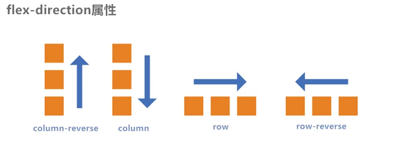

> 注意：改变了主轴的方向，侧轴方向也随之改变。

`主轴方向.html`

```html
<!DOCTYPE html>
<html lang="zh-CN">
<head>
    <meta charset="UTF-8">
    <title>02_主轴方向</title>
    <style>
        .outer {
            width: 1000px;
            height: 600px;
            background-color: #888;
            margin: 0 auto;

            /* 伸缩盒模型相关属性-start */

            /* 将该元素变为了伸缩容器（开启了flex布局） */
            display: flex;

            /* 调整主轴方向，水平从左到右，默认 */
            /* flex-direction: row; */

            /* 调整主轴方向，水平从右到左 */
            flex-direction: row-reverse;

            /* 调整主轴方向，垂直从上到下 */
            /* flex-direction: column; */

            /* 调整主轴方向，垂直从下到上 */
            /* flex-direction: column-reverse; */
        }

        .inner {
            width: 200px;
            height: 200px;
            background-color: skyblue;
            border: 1px solid black;
            box-sizing: border-box;
        }
    </style>
</head>
<body>
<div class="outer">
    <div class="inner">1</div>
    <div class="inner">2</div>
    <div class="inner">3</div>
</div>
</body>
</html>
```

##### 15.5	主轴换行方式

- 属性名： flex-wrap

- 常用值如下：

  1. nowrap ：默认值，不换行。

     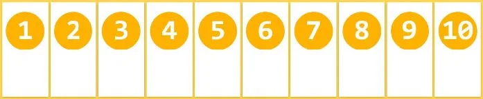

  2. wrap ：自动换行，伸缩容器不够自动换行。

     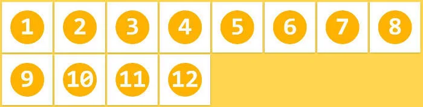

  3. wrap-reverse ：反向换行。

     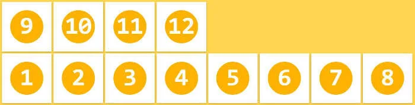

`主轴换行方式.html`

```html
<!DOCTYPE html>
<html lang="zh-CN">
<head>
    <meta charset="UTF-8">
    <title>03_主轴换行方式</title>
    <style>
        .outer {
            width: 1000px;
            height: 600px;
            background-color: #888;
            margin: 0 auto;

            /* 伸缩盒模型相关属性-start */

            /* 将该元素变为了伸缩容器（开启了flex布局） */
            display: flex;

            /* 调整主轴方向，水平从左到右，默认 */
            flex-direction: row;

            /* 主轴换行方式，不换行，默认值 */
            /* flex-wrap: nowrap; */

            /* 主轴换行方式，换行 */
            flex-wrap: wrap;

            /* 主轴换行方式，反向换行 */
            /* flex-wrap: wrap-reverse; */
        }

        .inner {
            width: 200px;
            height: 200px;
            background-color: skyblue;
            border: 1px solid black;
            box-sizing: border-box;
        }
    </style>
</head>
<body>
<div class="outer">
    <div class="inner">1</div>
    <div class="inner">2</div>
    <div class="inner">3</div>
    <div class="inner">4</div>
    <div class="inner">5</div>
    <div class="inner">6</div>
    <div class="inner">7</div>
    <div class="inner">8</div>
    <div class="inner">9</div>
    <div class="inner">10</div>
    <div class="inner">11</div>
</div>
</body>
</html>
```

##### 15.6	flex-flow

flex-flow 是一个复合属性，复合了 flex-direction 和 flex-wrap 两个属性。 值没有顺序要求。

```css
flex-flow: row wrap

;
```

`flex-flow.html`

```html
<!DOCTYPE html>
<html lang="zh-CN">
<head>
    <meta charset="UTF-8">
    <title>04_flex-flow</title>
    <style>
        .outer {
            width: 1000px;
            height: 600px;
            background-color: #888;
            margin: 0 auto;

            /* 伸缩盒模型相关属性-start */

            /* 将该元素变为了伸缩容器（开启了flex布局） */
            display: flex;

            /* 调整主轴方向，水平从左到右，默认 */
            /* flex-direction: row; */

            /* 主轴换行方式，换行 */
            /* flex-wrap: wrap; */

            flex-flow: row wrap;

        }

        .inner {
            width: 200px;
            height: 200px;
            background-color: skyblue;
            border: 1px solid black;
            box-sizing: border-box;
        }
    </style>
</head>
<body>
<div class="outer">
    <div class="inner">1</div>
    <div class="inner">2</div>
    <div class="inner">3</div>
    <div class="inner">4</div>
    <div class="inner">5</div>
    <div class="inner">6</div>
    <div class="inner">7</div>
    <div class="inner">8</div>
    <div class="inner">9</div>
    <div class="inner">10</div>
    <div class="inner">11</div>
</div>
</body>
</html>
```

##### 15.7	主轴对齐方式

- 属性名： justify-content
- 常用值如下：
  1. flex-start ：主轴起点对齐。—— 默认值
  2. flex-end ：主轴终点对齐。
  3. center ：居中对齐
  4. space-between ：均匀分布，两端对齐（最常用）。
  5. space-around ：均匀分布，两端距离是中间距离的一半。
  6. space-evenly ：均匀分布，两端距离与中间距离一致。

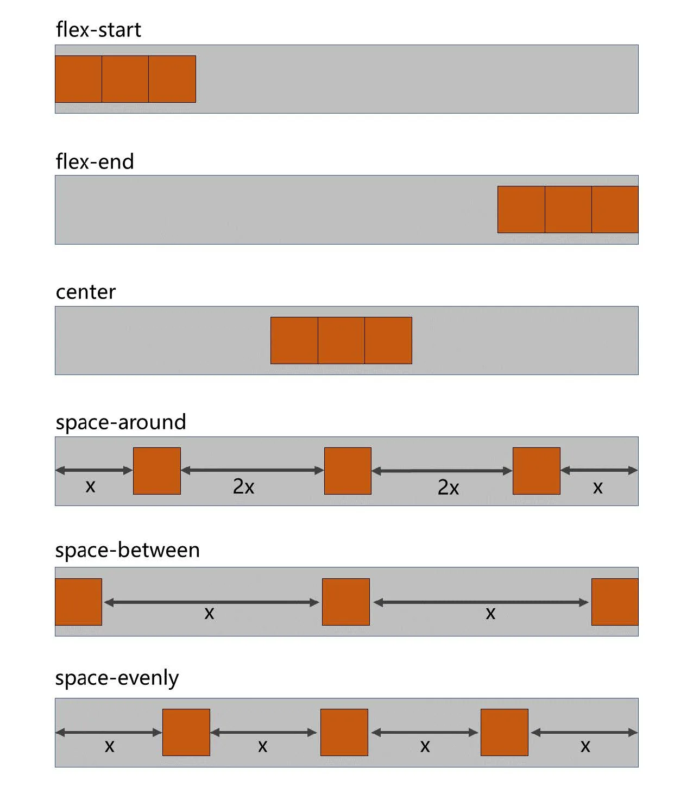

`主轴对齐方式.html`

```html
<!DOCTYPE html>
<html lang="zh-CN">
<head>
    <meta charset="UTF-8">
    <title>05_主轴对齐方式</title>
    <style>
        .outer {
            width: 1000px;
            height: 600px;
            background-color: #888;
            margin: 0 auto;

            /* 伸缩盒模型相关属性-start */

            /* 将该元素变为了伸缩容器（开启了flex布局） */
            display: flex;

            /* 调整主轴方向，水平从左到右，默认 */
            flex-direction: row;

            /* 主轴换行方式，换行 */
            flex-wrap: wrap;

            /* 主轴的对齐方式，主轴的起始位置 */
            /* justify-content: flex-start; */

            /* 主轴的对齐方式，主轴的结束位置 */
            /* justify-content: flex-end; */

            /* 主轴的对齐方式，中间对齐 */
            /* justify-content: center; */

            /* 主轴的对齐方式，项目均匀的分布在一行中，项目与项目之间的距离，是项目距边缘的二倍 */
            /* justify-content: space-around; */

            /* 主轴的对齐方式，项目均匀的分布在一行中，项目与项目之间的距离是相等的，项目距边缘没有距离 */
            justify-content: space-between;

            /* 主轴的对齐方式，项目均匀的分布在一行中 */
            /* justify-content: space-evenly; */
        }

        .inner {
            width: 200px;
            height: 200px;
            background-color: skyblue;
            border: 1px solid black;
            box-sizing: border-box;
        }
    </style>
</head>
<body>
<div class="outer">
    <div class="inner">1</div>
    <div class="inner">2</div>
    <div class="inner">3</div>
</div>
</body>
</html>
```

##### 15.8	侧轴对齐方式

1. 一行的情况

   - 所需属性： align-items
   - 常用值如下：
     1. flex-start ：侧轴的起点对齐。
     2. flex-end ：侧轴的终点对齐。
     3. center ：侧轴的中点对齐。
     4. baseline : 伸缩项目的第一行文字的基线对齐。
     5. stretch ：如果伸缩项目未设置高度，将占满整个容器的高度。—— （默认值）

   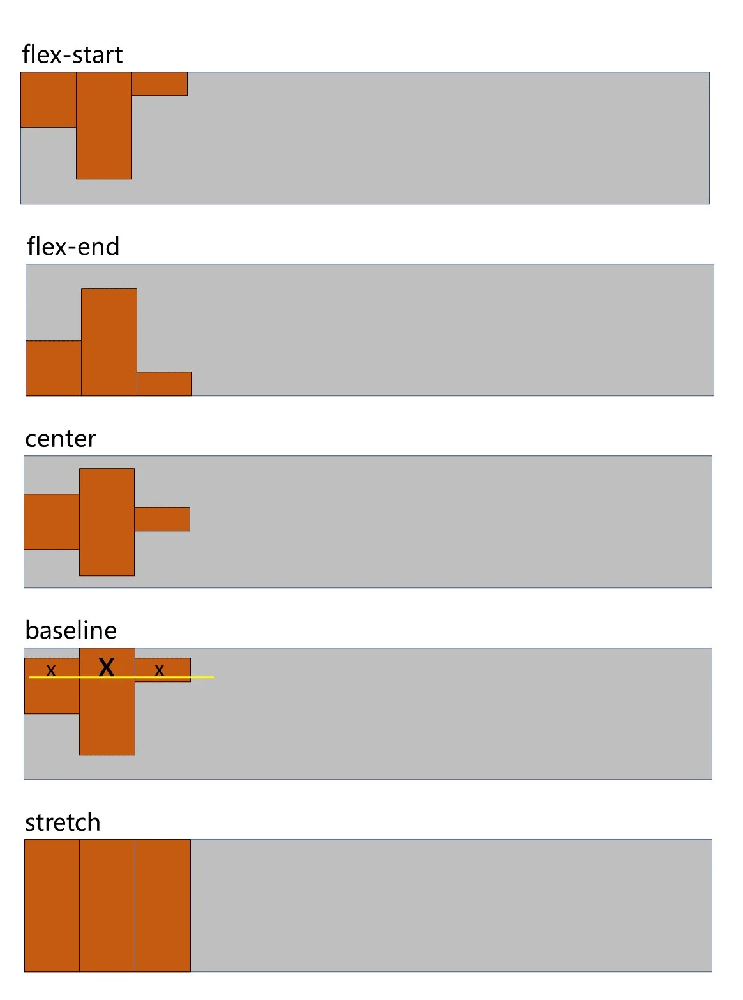

   `侧轴对齐方式_一行.html`

   ```html
   <!DOCTYPE html>
   <html lang="zh-CN">
   <head>
       <meta charset="UTF-8">
       <title>06_侧轴对齐方式_一行</title>
       <style>
           .outer {
               width: 1000px;
               height: 600px;
               background-color: #888;
               margin: 0 auto;
   
               /* 伸缩盒模型相关属性-start */
   
               /* 将该元素变为了伸缩容器（开启了flex布局） */
               display: flex;
   
               /* 调整主轴方向，水平从左到右，默认 */
               flex-direction: row;
   
               /* 主轴换行方式，换行 */
               flex-wrap: wrap;
   
               /* 主轴的对齐方式，主轴的起始位置 */
               justify-content: flex-start;
   
               /* 侧轴的对齐方式，侧轴的起始位置对齐 */
               align-items: flex-start;
   
               /* 侧轴的对齐方式，侧轴的结束位置对齐 */
               /* align-items: flex-end; */
   
               /* 侧轴的对齐方式，侧轴的中间位置对齐 */
               /* align-items: center; */
   
               /* 侧轴的对齐方式，侧轴的中间位置对齐 */
               /* align-items: baseline; */
   
               /* 侧轴的对齐方式，拉伸到整个父容器（前提：伸缩项目不能给高度），默认 */
               /* align-items: stretch; */
           }
           .inner {
               width: 200px;
               height: 200px;
               background-color: skyblue;
               border: 1px solid black;
               box-sizing: border-box;
           }
           .inner2 {
               height: 300px;
               font-size: 80px;
           }
           .inner3 {
               height: 100px;
           }
       </style>
   </head>
   <body>
       <div class="outer">
           <div class="inner">1x</div>
           <div class="inner inner2">2x</div>
           <div class="inner inner3">3x</div>
       </div>
   </body>
   </html>
   ```


2. 多行的情况

   - 所需属性： align-content
   - 常用值如下：
     1. flex-start ：与侧轴的起点对齐。
     2. flex-end ：与侧轴的终点对齐。
     3. center ：与侧轴的中点对齐。
     4. space-between ：与侧轴两端对齐，中间平均分布。
     5. space-around ：伸缩项目间的距离相等，比距边缘大一倍。
     6. space-evenly : 在侧轴上完全平分。
     7. stretch ：占满整个侧轴。—— 默认值

   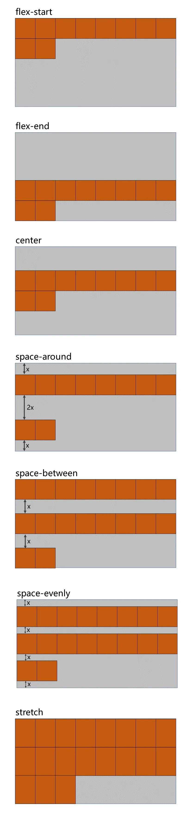

   `侧轴对齐方式_多行.html`

   ```html
   <!DOCTYPE html>
   <html lang="zh-CN">
   <head>
       <meta charset="UTF-8">
       <title>07_侧轴对齐方式_多行</title>
       <style>
           .outer {
               width: 1000px;
               height: 900px;
               background-color: #888;
               margin: 0 auto;
   
               /* 伸缩盒模型相关属性-start */
   
               /* 将该元素变为了伸缩容器（开启了flex布局） */
               display: flex;
   
               /* 调整主轴方向，水平从左到右，默认 */
               flex-direction: row;
   
               /* 主轴换行方式，换行 */
               flex-wrap: wrap;
   
               /* 主轴的对齐方式，主轴的起始位置 */
               justify-content: flex-start;
   
               /* 侧轴的对齐方式（多行）侧轴的起始位置对齐 */
               /* align-content: flex-start; */
   
               /* 侧轴的对齐方式（多行）侧轴的结束位置对齐 */
               /* align-content: flex-end; */
   
               /* 侧轴的对齐方式（多行）侧轴的中间位置对齐 */
               /* align-content: center; */
   
               /* 侧轴的对齐方式（多行），伸缩项目之间的距离是相等的，且是边缘距离的2倍 */
               /* align-content:space-around; */
   
               /* 侧轴的对齐方式（多行），伸缩项目之间的距离是相等的，且边缘没有距离 */
               /* align-content:space-between; */
   
               /* 侧轴的对齐方式（多行），伸缩项目之间的距离是相等的 */
               /* align-content:space-evenly; */
   
               /* 侧轴的对齐方式（多行），拉伸，默认 */
               /* align-content: stretch; */
               
           }
           .inner {
               width: 200px;
               height: 200px;
               background-color: skyblue;
               border: 1px solid black;
               box-sizing: border-box;
           }
           .inner2 {
               height: 300px;
           }
           .inner3 {
               height: 100px;
           }
       </style>
   </head>
   <body>
       <div class="outer">
           <div class="inner">1</div>
           <div class="inner inner2">2</div>
           <div class="inner inner3">3</div>
           <div class="inner">4</div>
           <div class="inner">5</div>
           <div class="inner">6</div>
           <div class="inner">7</div>
           <div class="inner">8</div>
           <div class="inner">9</div>
           <div class="inner">10</div>
           <div class="inner">11</div>
       </div>
   </body>
   </html>
   ```

##### 15.9	flex 实现水平垂直居中

方法一：父容器开启flex 布局，随后使用justify-content 和align-items 实现水平垂直居中

```css
.outer {
    width: 400px;
    height: 400px;
    background-color: #888;
    display: flex;
    justify-content: center;
    align-items: center;
}

.inner {
    width: 100px;
    height: 100px;
    background-color: orange;
}
```

方法二：父容器开启flex 布局，随后子元素margin: auto

```css
.outer {
    width: 400px;
    height: 400px;
    background-color: #888;
    display: flex;
}

.inner {
    width: 100px;
    height: 100px;
    background-color: orange;
    margin: auto;
}
```

`元素水平垂直居中.html`

```html
<!DOCTYPE html>
<html lang="zh-CN">
<head>
    <meta charset="UTF-8">
    <title>08_元素水平垂直居中</title>
    <style>
        .outer {
            width: 400px;
            height: 400px;
            background-color: #888;
            display: flex;

            /* 方案一 */
            /* justify-content: center; */
            /* align-items: center; */
        }

        .inner {
            width: 100px;
            height: 100px;
            background-color: orange;
            /* 方案二 */
            margin: auto;
        }
    </style>
</head>
<body>
<div class="outer">
    <div class="inner"></div>
</div>
</body>
</html>
```

##### 15.10	伸缩性

##### 15.10.1flex-basis

- 概念： flex-basis 设置的是主轴方向的基准长度，会让宽度或高度失效。

  > 备注：主轴横向：宽度失效；主轴纵向：高度失效

- 作用：浏览器根据这个属性设置的值，计算主轴上是否有多余空间，默认值auto ，即：伸缩项目的宽或高。

`项目在主轴的基准长度.html`

```html
<!DOCTYPE html>
<html lang="zh-CN">
<head>
    <meta charset="UTF-8">
    <title>09_项目在主轴的基准长度</title>
    <style>
        .outer {
            width: 1000px;
            height: 900px;
            background-color: #888;
            margin: 0 auto;

            /* 伸缩盒模型相关属性-start */

            /* 将该元素变为了伸缩容器（开启了flex布局） */
            display: flex;

            /* 调整主轴方向，水平从左到右，默认 */
            flex-direction: row;

            /* 主轴换行方式，换行 */
            flex-wrap: wrap;

            /* 主轴的对齐方式，主轴的起始位置 */
            justify-content: flex-start;


        }

        .inner {
            width: 200px;
            height: 200px;
            background-color: skyblue;
            border: 1px solid black;
            box-sizing: border-box;
        }

        .inner2 {
            /* 设置伸缩项目在主轴上的基准长度，若主轴是横向的宽失效，若主轴是纵向的高失效 */
            flex-basis: 300px;
        }
    </style>
</head>
<body>
<div class="outer">
    <div class="inner">1</div>
    <div class="inner inner2">2</div>
    <div class="inner">3</div>
</div>
</body>
</html>
```

##### 15.10.2flex-grow（伸）

- 概念： flex-grow 定义伸缩项目的放大比例，默认为0 ，即：纵使主轴存在剩余空间，也不拉伸（放大）。
- 规则：
  1. 若所有伸缩项目的 flex-grow 值都为1 ，则：它们将等分剩余空间（如果有空间的话）。
  2. 若三个伸缩项目的flex-grow 值分别为： 1 、2 、3 ，则：分别瓜分到： 1/6 、2/6 、3/6 的空间。

`伸缩项目_伸.html`

```html
<!DOCTYPE html>
<html lang="zh-CN">
<head>
    <meta charset="UTF-8">
    <title>10_伸缩项目_伸</title>
    <style>
        .outer {
            width: 1000px;
            height: 900px;
            background-color: #888;
            margin: 0 auto;

            /* 伸缩盒模型相关属性-start */

            /* 将该元素变为了伸缩容器（开启了flex布局） */
            display: flex;

            /* 调整主轴方向，水平从左到右，默认 */
            flex-direction: row;

            /* 主轴换行方式，换行 */
            flex-wrap: wrap;

            /* 主轴的对齐方式，主轴的起始位置 */
            justify-content: flex-start;
        }

        .inner {
            width: 200px;
            height: 200px;
            background-color: skyblue;
            border: 1px solid black;
            box-sizing: border-box;
            flex-grow: 0;
        }

        /* .inner1 {
            flex-grow: 1;
        } */
        .inner2 {
            /* flex-grow: 2; */
            width: 300px;
        }

        /* .inner3 {
            flex-grow: 3;
        } */

    </style>
</head>
<body>
<div class="outer">
    <div class="inner inner1">1</div>
    <div class="inner inner2">2</div>
    <div class="inner inner3">3</div>
</div>
</body>
</html>
```

##### 15.10.3flex-shrink（缩）

- 概念： flex-shrink 定义了项目的压缩比例，默认为1 ，即：如果空间不足，该项目将会缩小。

- 收缩项目的计算，略微复杂一点，我们拿一个场景举例：

  > 例如：
  > 三个收缩项目，宽度分别为： 200px 、300px 、200px ，它们的flex-shrink 值分别
  > 为： 1 、2 、3
  > 若想刚好容纳下三个项目，需要总宽度为700px ，但目前容器只有400px ，还差300px
  > 所以每个人都要收缩一下才可以放下，具体收缩的值，这样计算：
  >
  > 1. 计算分母： (200×1) + (300×2) + (200×3) = 1400
  > 2. 计算比例：
  >
  >   - 项目一： (200×1) / 1400 = 比例值1

  - 项目二： (300×2) / 1400 = 比例值2

  >   - 项目三： (200×3) / 1400 = 比例值3
  >
  >   3. 计算最终收缩大小：
  >
  >   - 项目一需要收缩： 比例值1 × 300

  - 项目二需要收缩： 比例值2 × 300

  >   - 项目三需要收缩： 比例值3 × 300

`伸缩项目_缩.html`

```html
<!DOCTYPE html>
<html lang="zh-CN">
<head>
    <meta charset="UTF-8">
    <title>11_伸缩项目_缩</title>
    <style>
        .outer {
            width: 400px;
            height: 900px;
            background-color: #888;
            margin: 0 auto;

            /* 伸缩盒模型相关属性-start */

            /* 将该元素变为了伸缩容器（开启了flex布局） */
            display: flex;

            /* 调整主轴方向，水平从左到右，默认 */
            flex-direction: row;

            /* 主轴换行方式，换行 */
            /* flex-wrap: wrap; */

            /* 主轴的对齐方式，主轴的起始位置 */
            justify-content: flex-start;

            /* 侧轴的对齐方式 */
            align-content: flex-start;
        }

        .inner {
            width: 200px;
            height: 200px;
            background-color: skyblue;
            border: 1px solid black;
            box-sizing: border-box;
            flex-grow: 1;
        }

        .inner1 {
            flex-shrink: 1;
        }

        .inner2 {
            flex-shrink: 2;
            width: 300px;
        }

        .inner3 {
            flex-shrink: 3;
        }
    </style>
</head>
<body>
<div class="outer">
    <div class="inner inner1">
        <div style="width: 50px;height:50px;background-color: green;">1</div>
    </div>
    <div class="inner inner2">2</div>
    <div class="inner inner3">3</div>
</div>
</body>
</html>
```

##### 15.11	flex复合属性

flex 是复合属性，复合了： flex-grow 、 flex-shrink 、flex-basis 三个属性，默认值为 0 1 auto 。

- 如果写 flex:1 1 auto ，则可简写为： flex:auto
- 如果写 flex:1 1 0 ，则可简写为： flex:1
- 如果写 flex:0 0 auto ，则可简写为： flex:none
- 如果写 flex:0 1 auto ，则可简写为： flex:0 auto —— 即 flex 初始值。

`通配选择器.html`

```html
<!DOCTYPE html>
<html lang="zh-CN">
<head>
    <meta charset="UTF-8">
    <title>12_flex复合属性</title>
    <style>
        .outer {
            width: 600px;
            height: 900px;
            background-color: #888;
            margin: 0 auto;

            /* 伸缩盒模型相关属性-start */

            /* 将该元素变为了伸缩容器（开启了flex布局） */
            display: flex;

            /* 调整主轴方向，水平从左到右，默认 */
            flex-direction: row;

            /* 主轴换行方式，换行 */
            /* flex-wrap: wrap; */

            /* 主轴的对齐方式，主轴的起始位置 */
            justify-content: flex-start;

            /* 侧轴的对齐方式 */
            align-content: flex-start;
        }

        .inner {
            width: 200px;
            height: 200px;
            background-color: skyblue;
            border: 1px solid black;
            box-sizing: border-box;
            /* 可以拉伸 */
            /* flex-grow: 1; */

            /* 可以压缩 */
            /* flex-shrink: 1; */

            /* 基准长度 */
            /* flex-basis: 100px; */

            /* 可以拉伸 可以压缩 不设置基准长度，可简写为：flex:auto */
            /* flex:1 1 auto; */

            /* 可以拉伸 可以压缩 设置基准长度为0，可简写为：flex:1 */
            /* flex: 1 1 0; */

            /* 不可以拉伸 不可以压缩 不设置基准长度，可简写为：flex:none  */
            /* flex: 0 0 auto; */

            /* 不可以拉伸 可以压缩 不设置基准长度，可简写为：flex:0 auto */
            /* flex: 0 1 auto; */
        }
    </style>
</head>
<body>
<div class="outer">
    <div class="inner inner1">1</div>
    <div class="inner inner2">2</div>
    <div class="inner inner3">3</div>
</div>
</body>
</html>
```

##### 15.12	项目排序

order 属性定义项目的排列顺序。数值越小，排列越靠前，默认为0 。

##### 15.13	单独对齐

- 通过align-self 属性，可以单独调整某个伸缩项目的对齐方式
- 默认值为 auto ，表示继承父元素的 align-items 属性。

`项目排序与单独对齐.html`

```html
<!DOCTYPE html>
<html lang="zh-CN">
<head>
    <meta charset="UTF-8">
    <title>13_项目排序与单独对齐</title>
    <style>
        .outer {
            width: 600px;
            height: 900px;
            background-color: #888;
            margin: 0 auto;

            /* 伸缩盒模型相关属性-start */

            /* 将该元素变为了伸缩容器（开启了flex布局） */
            display: flex;

            /* 调整主轴方向，水平从左到右，默认 */
            flex-direction: row;

            /* 主轴换行方式，换行 */
            /* flex-wrap: wrap; */

            /* 主轴的对齐方式，主轴的起始位置 */
            justify-content: flex-start;

            /* 侧轴的对齐方式 */
            align-content: flex-start;
        }

        .inner {
            width: 200px;
            height: 200px;
            background-color: skyblue;
            border: 1px solid black;
            box-sizing: border-box;
            /* 可以拉伸 可以压缩 设置基准长度为0，可简写为：flex:1 */
            flex: 1 1 0;
        }

        /* .inner1 {
            order: 3;
        }
        .inner2 {
            order: 2;
        }
        .inner3 {
            order: 1;
        } */

        .inner2 {
            align-self: center;
        }
    </style>
</head>
<body>
<div class="outer">
    <div class="inner inner1">1</div>
    <div class="inner inner2">2</div>
    <div class="inner inner3">3</div>
</div>
</body>
</html>
```

`小案例.html`

```html
<!DOCTYPE html>
<html lang="zh-CN">
<head>
    <meta charset="UTF-8">
    <title>尚硅谷官网</title>
    <style>
        * {
            font-family: Arial;
            font-size: 14px;
            margin: 0;
            padding: 0;
            border: none;
        }

        a {
            text-decoration: none;
        }

        ul {
            list-style: none;
        }

        html, body {
            width: 100%;
            height: 100%;
        }

        body {
            background-image: url('../images/bg.jpg');
            background-repeat: no-repeat;
            background-size: cover;
        }

        .page-header {
            height: 70px;
            background-color: rgba(0, 0, 0, 0.7);
            display: flex;
            justify-content: space-between;
            align-items: center;
            padding: 0 20px;
        }

        .header-nav {
            display: flex;

        }

        .header-nav li a {
            color: white;
            font-size: 20px;
            border: 1px solid white;
            border-radius: 8px;
            padding: 10px;
            margin-right: 20px;
        }

        .header-nav li:last-child a {
            margin-right: 0;
        }

        .page-content {
            display: flex;
            height: calc(100vh - 70px);
        }

        .content-nav {
            width: 1000px;
            height: 300px;
            margin: auto;
            display: flex;
            justify-content: space-evenly;
            align-items: center;
        }

        .content-nav .item {
            width: 180px;
            height: 200px;
            background-color: orange;
            display: flex;
            flex-direction: column;
            align-items: center;
            justify-content: space-evenly;
            transition: 0.2s linear;
            cursor: pointer;
        }

        .content-nav .item:hover {
            box-shadow: 0px 0px 20px black;
        }

        .content-nav .item span {
            font-size: 20px;
            color: white;
        }

        .content-nav .item:nth-child(1) {
            background-color: #595CA8;
        }

        .content-nav .item:nth-child(2) {
            background-color: #FF9D2E;
        }

        .content-nav .item:nth-child(3) {
            background-color: #01A6DE;
        }

        .content-nav .item:nth-child(4) {
            background-color: #015E91;
        }

        .content-nav .item:nth-child(5) {
            background-color: #1DC128;
        }
    </style>
</head>
<body>
<!-- 头部 -->
<header class="page-header">
    <a href="#">
        
    </a>
    <ul class="header-nav">
        <li><a href="#">国内校区</a></li>
        <li><a href="#">缅甸校区</a></li>
        <li><a href="#">非洲校区</a></li>
        <li><a href="#">美国校区</a></li>
    </ul>
</header>
<!-- 内容区 -->
<div class="page-content">
    <div class="content-nav">
        <div class="item">
            
            <span>我的邮箱</span>
        </div>
        <div class="item">
            
            <span>云服务</span>
        </div>
        <div class="item">
            
            <span>手机课堂</span>
        </div>
        <div class="item">
            
            <span>微信服务</span>
        </div>
        <div class="item">
            
            <span>在线客服</span>
        </div>
    </div>
</div>
</body>
</html>
```

#### 16.响应式布局

**媒体查询**

##### 16.1媒体类型

| 值             | 含义                                                         |
| -------------- | ------------------------------------------------------------ |
| all            | 检测所有设备。                                               |
| screen         | 检测电子屏幕，包括：电脑屏幕、平板屏幕、手机屏幕等。         |
| print          | 检测打印机。                                                 |
| ~~aural~~      | ~~已废弃，用于语音和声音合成器。~~                           |
| ~~braille~~    | ~~已废弃，应用于盲文触摸式反馈设备。~~                       |
| ~~embossed~~   | ~~已废弃， 用于打印的盲人印刷设备。~~                        |
| ~~handheld~~   | ~~已废弃， 用于掌上设备或更小的装置，如PDA和小型电话。~~     |
| ~~projection~~ | ~~已废弃， 用于投影设备。~~                                  |
| ~~tty~~        | ~~已废弃， 用于固定的字符网格，如电报、终端设备和对字符有限制的便携设备。~~ |
| ~~tv~~         | ~~已废弃， 用于电视和网络电视。~~                            |

> 完整列表请参考： https://developer.mozilla.org/zh-CN/docs/Web/CSS/@media

`媒体查询_媒体类型.html`

```html
<!DOCTYPE html>
<html lang="zh-CN">
<head>
    <meta charset="UTF-8">
    <title>01_媒体查询_媒体类型</title>
    <style>
        h1 {
            width: 600px;
            height: 400px;
            line-height: 400px;
            background-image: linear-gradient(30deg, red, yellow, green);
            margin: 0 auto;
            text-align: center;
            font-size: 100px;
            color: white;
            text-shadow: 0 0 10px black;
        }

        /* 只有在打印机或打印预览才应用的样式 */
        @media print {
            h1 {
                background: transparent;
            }
        }

        /* 只有在屏幕上才应用的样式 */
        @media screen {
            h1 {
                font-family: "翩翩体-简";
            }
        }

        /* 一直都应用的样式 */
        @media all {
            h1 {
                color: red;
            }
        }

    </style>
</head>
<body>
<h1>新年快乐</h1>
</body>
</html>
```

##### 16.2媒体特性

| 值               | 含义                                                         |
| ---------------- | ------------------------------------------------------------ |
| width            | 检测视口宽度。                                               |
| max-width        | 检测视口最大宽度。                                           |
| min-width        | 检测视口最小宽度。                                           |
| height           | 检测视口高度。                                               |
| max-height       | 检测视口最大高度。                                           |
| min-height       | 检测视口最小高度。                                           |
| device-width     | 检测设备屏幕的宽度。                                         |
| max-device-width | 检测设备屏幕的最大宽度。                                     |
| min-device-width | 检测设备屏幕的最小宽度。                                     |
| orientation      | 检测视口的旋转方向（是否横屏）。<br/>1. portrait ：视口处于纵向，即高度大于等于宽度。<br/>2. landscape ：视口处于横向，即宽度大于高度。 |

> 完整列表请参考： https://developer.mozilla.org/zh-CN/docs/Web/CSS/@media

`媒体查询_媒体特性.html`

```html
<!DOCTYPE html>
<html lang="zh-CN">
<head>
    <meta charset="UTF-8">
    <title>02_媒体查询_媒体特性</title>
    <style>
        * {
            margin: 0;
            padding: 0;
        }

        h1 {
            height: 200px;
            background-color: gray;
            text-align: center;
            line-height: 200px;
            font-size: 100px;
        }

        /* 检测到视口的宽度为800px时，应用如下样式 */
        @media (width: 800px) {
            h1 {
                background-color: green;
            }
        }

        /* 检测到视口的宽度小于等于700px时，应用如下样式 */
        @media (max-width: 700px) {
            h1 {
                background-color: orange;
            }
        }

        /* 检测到视口的宽度大于等于900px时，应用如下样式 */
        @media (min-width: 900px) {
            h1 {
                background-color: deepskyblue;
            }
        }

        /* 检测到视口的高度等于800px时，应用如下样式 */
        /* @media (height:800px){
            h1 {
                background-color: yellow;
            }
        } */

        /* 检测到屏幕的宽度等于1536px时，应用如下样式 */
        /* @media (device-width:1536px) {
            h1 {
                color: white;
            }
        } */


    </style>
</head>
<body>
<h1>你好啊</h1>
</body>
</html>
```

##### 16.3运算符

| 值      | 含义 |
| ------- | ---- |
| andand  | 并且 |
| , 或 or | 或   |
| not     | 否定 |
| only    | 肯定 |

`媒体查询_运算符.html`

```html
<!DOCTYPE html>
<html lang="zh-CN">
<head>
    <meta charset="UTF-8">
    <title>03_媒体查询_运算符</title>
    <style>
        * {
            margin: 0;
            padding: 0;
        }

        h1 {
            height: 200px;
            background-color: gray;
            text-align: center;
            line-height: 200px;
            font-size: 100px;
        }

        /* 且运算符 */
        /* @media (min-width:700px) and (max-width:800px) {
            h1 {
                background-color: orange;
            }
        } */
        /* @media screen and (min-width:700px) and (max-width:800px) {
            h1 {
                background-color: orange;
            }
        } */

        /* 或运算符 */
        /* @media screen and (max-width:700px) or (min-width:800px) {
            h1 {
                background-color: orange;
            }
        } */

        /* 否定运算符 */
        /* @media not screen {
            h1 {
                background-color: orange;
            }
        } */

        /* 肯定运算符 */
        @media only screen and (width: 800px) {
            h1 {
                background-color: orange;
            }
        }

    </style>
</head>
<body>
<h1>你好啊</h1>
</body>
</html>
```

##### 16.4常用阈值

在实际开发中，会将屏幕划分成几个区间，例如：

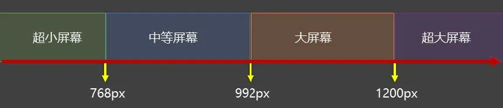

`通配选择器.html`

```html
<!DOCTYPE html>
<html lang="zh-CN">
<head>
    <meta charset="UTF-8">
    <title>03_媒体查询_运算符</title>
    <link rel="stylesheet" href="./css/index.css">
    <link rel="stylesheet" href="./css/small.css">
    <link rel="stylesheet" href="./css/middle.css">
    <link rel="stylesheet" href="./css/large.css">
    <link rel="stylesheet" media="screen and (min-width:1200px)" href="./css/huge.css">
</head>
<body>
<h1>你好啊</h1>
</body>
</html>
```

##### 16.5结合外部样式的用法

用法一：

```
<link rel="stylesheet" media="具体的媒体查询" href="mystylesheet.css">
```

用法二：

```css
@media screen and (max-width: 768px) {
    /*CSS-Code;*/
}

@media screen and (min-width: 768px) and (max-width: 1200px) {
    /*CSS-Code;*/
}
```

#### 17.BFC

##### 17.1什么是BFC

- W3C 上对 BFC 的定义：

  > 原文：Floats, absolutely positioned elements, block containers (such as inline-blocks, tablecells, and
  > table-captions) that are not block boxes, and block boxes with 'overflow' other than 'visible' (except when that value
  > has been propagated to the viewport) establish new block formatting contexts for their contents.
  >
  > ------
  >
  > 译文：浮动、绝对定位元素、不是块盒子的块容器（如inline-blocks 、table-cells 和table-captions ），以及overflow 属性的值除visible
  > 以外的块盒，将为其内容建立新的块格式化上下文。

- MDN 上对 BFC 的描述：

  > 块格式化上下文（Block Formatting Context，BFC） 是Web 页面的可视CSS 渲染的一部分，
  > 是块盒子的布局过程发生的区域，也是浮动元素与其他元素交互的区域。

- 更加通俗的描述：

  > 1. BFC 是 Block Formatting Context （块级格式上下文），可以理解成元素的一个“特异功能”。
  > 2. 该 “特异功能”，在默认的情况下处于关闭状态；当元素满足了某些条件后，该“特异功能”被激活。
  > 3. 所谓激活“特异功能”，专业点说就是：该元素创建了 BFC （又称：开启了 BFC ）。

##### 17.2开启了BFC能解决什么问题

1. 元素开启BFC 后，其子元素不会再产生margin 塌陷问题。
2. 元素开启BFC 后，自己不会被其他浮动元素所覆盖。
3. 元素开启BFC 后，就算其子元素浮动，元素自身高度也不会塌陷。

##### 17.3如何开启BFC

- 根元素
- 浮动元素
- 绝对定位、固定定位的元素
- 行内块元素
- 表格单元格： table 、thead 、tbody 、tfoot 、th 、td 、tr 、caption
- overflow 的值不为 visible 的块元素
- 伸缩项目
- 多列容器
- column-span 为 all 的元素（即使该元素没有包裹在多列容器中）
- display 的值，设置为flow-root

`BFC_演示1.html`

```html
<!DOCTYPE html>
<html lang="zh-CN">
<head>
    <meta charset="UTF-8">
    <title>01_BFC_演示1</title>
    <style>
        * {
            margin: 0;
            padding: 0;
        }

        body {
            /* display: flex; */
        }

        .outer {
            width: 400px;
            background-color: #888;
            /* float: left; */
            /* position: absolute; */
            /* display: inline-block; */
            /* display: table; */
            /* overflow: auto; */
            /* column-count: 1; */
            /* display: flow-root; */
        }

        .inner {
            width: 100px;
            height: 100px;
            margin: 20px;
        }

        .inner1 {
            background-color: orange;
        }

        .inner2 {
            background-color: green;
        }

        .inner3 {
            background-color: deepskyblue;
        }
    </style>
</head>
<body>
<div class="outer">
    <div class="inner inner1"></div>
    <div class="inner inner2"></div>
    <div class="inner inner3"></div>
</div>
<!-- <hr style="height: 50px; background-color: red;"> -->
</body>
</html>
```

`BFC_演示2.html`

```html
<!DOCTYPE html>
<html lang="zh-CN">
<head>
    <meta charset="UTF-8">
    <title>02_BFC_演示2</title>
    <style>
        .box {
            width: 100px;
            height: 100px;
        }

        .box1 {
            background-color: orange;
            float: left;
        }

        .box2 {
            background-color: green;
            /* float: left; */
            /* position: absolute; */
            /* display: inline-block; */
            /* display: table; */
            /* overflow: auto; */
            /* column-count: 1; */
            /* display: flow-root; */
        }
    </style>
</head>
<body>
<div class="box box1"></div>
<div class="box box2"></div>
</body>
</html>
```

`BFC_演示3.html`

```html
<!DOCTYPE html>
<html lang="zh-CN">
<head>
    <meta charset="UTF-8">
    <title>03_BFC_演示3</title>
    <style>
        .outer {
            width: 400px;
            background-color: #888;
            /* float: left; */
            /* position: absolute; */
            /* display: inline-block; */
            /* display: table; */
            /* overflow: auto; */
            /* column-count: 1; */
            display: flow-root;
        }

        .inner {
            width: 100px;
            height: 100px;
            float: left;
        }

        .inner1 {
            background-color: orange;
        }

        .inner2 {
            background-color: green;
        }
    </style>
</head>
<body>
<div class="outer">
    <div class="inner inner1"></div>
    <div class="inner inner2"></div>
</div>
</body>
</html>
```
