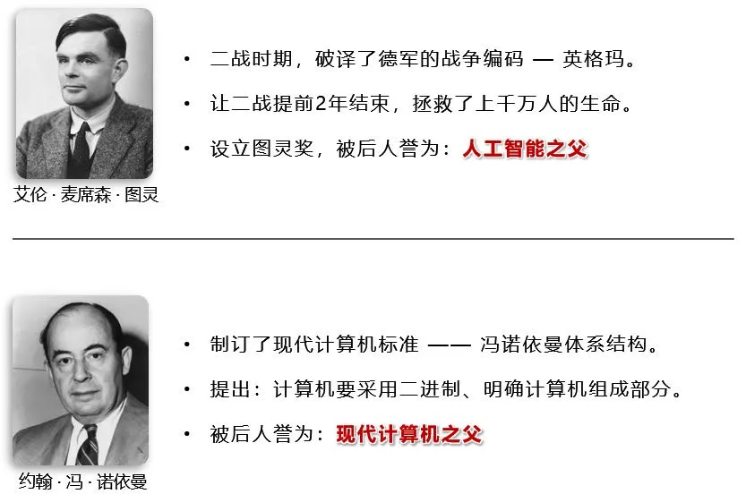
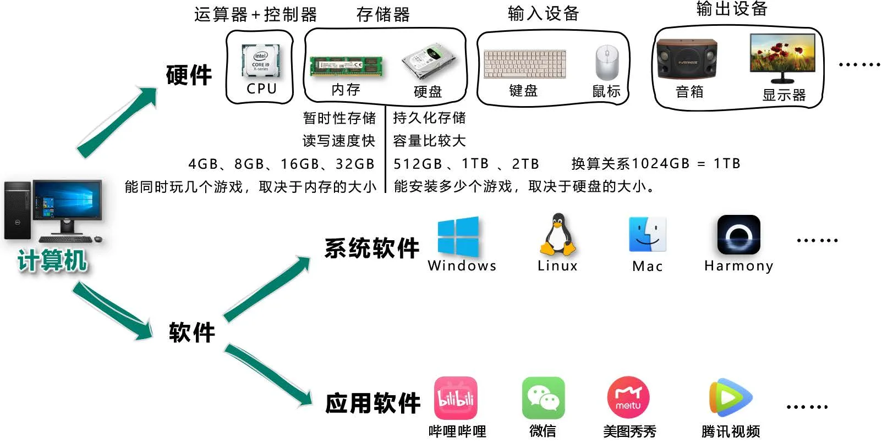
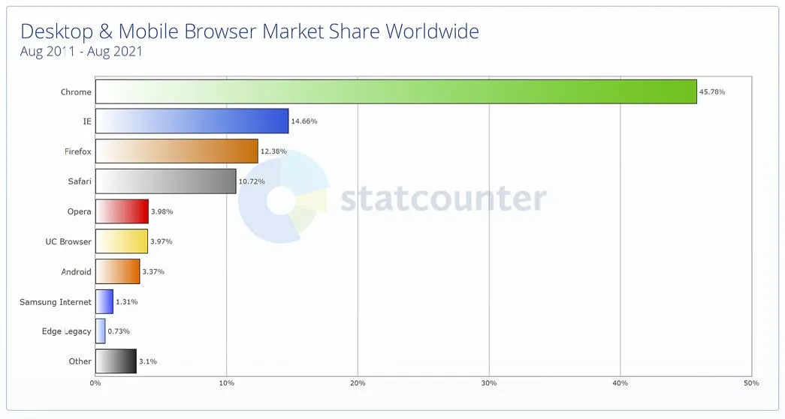
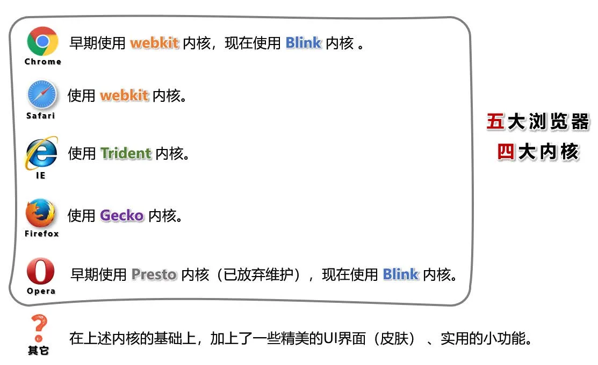
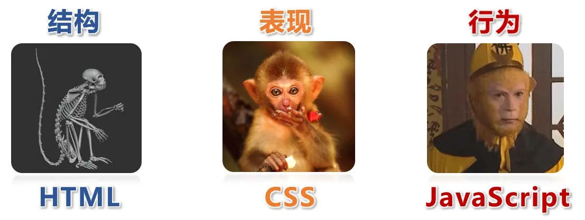
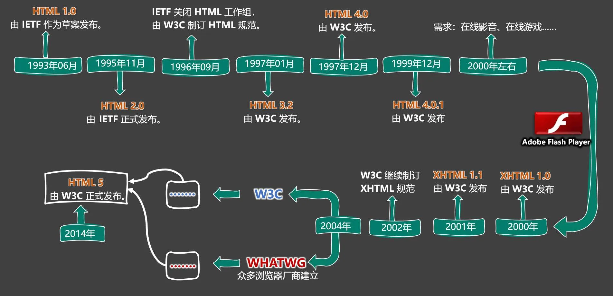
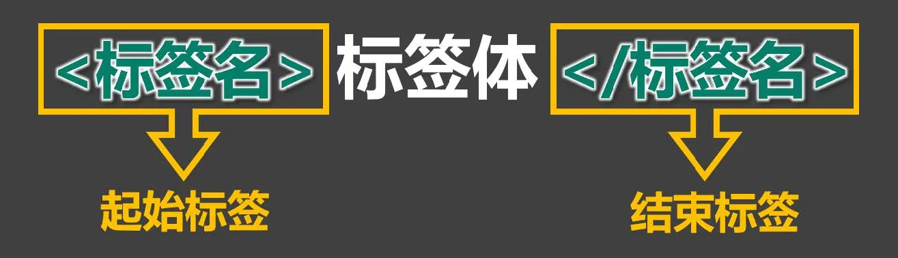
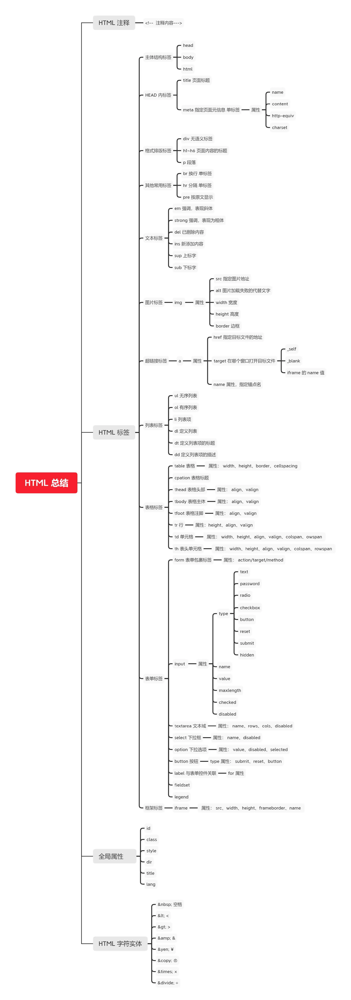

### 一、前序知识

#### 1.认识两位先驱



#### 2.计算机基础知识

1. 计算机俗称电脑，是现代一种用于高速计算的电子计算机器，可以进行数值计算、逻辑计算，还具有存储记忆功能。
2. 计算机由 硬件 + 软件组成：

- 硬件：看得见摸得着的物理部件。
- 软件：可以指挥硬件工作的指令。

3. 软件的分类：
   1. 系统软件：Windows、Linux、Android、Harmony 等。
   2. 应用软件：微信、QQ、王者荣耀、PhotoShop 等。
4. 整体图示：



#### 3.C/S架构与B/S架构

1. 上面提到的应用软件，又分为两大类：
2. C/S架构，特点：需要安装、偶尔更新、不跨平台、开发更具针对性。
3. B/S架构，特点：无需安装、无需更新、可跨平台、开发更具通用性。

> 名词解释：C => client（客户端）、B => browser（浏览器）、S => server（服务器）。
>
> 服务器 ：为软件提供数据的设备（在背后默默的付出）。

 2. 前端工程师，主要负责编写 B/S架构中的网页（呈现界面、实现交互）。

> 备注：大前端时代，我们可以用前端的技术栈，做出一个C/S架构的应用、甚至搭建一个服务器😎。

#### 4.浏览器相关知识

浏览器是网页运行的平台，常见的浏览器有： `谷歌(Chrome)` 、`Safari` 、`IE` 、`火狐(Firefox)` 、`欧朋(Opera)` 等，以上这些是常用的五大浏览器。

##### 1.各大浏览器市场份额：



##### 2.常见浏览器的内核：



#### 5.网页相关概念

1. 网址：我们在浏览器中输入的地址。
2. 网页：浏览器所呈现的每一个页面。
3. 网站：多个网页构成了一个网站。
4. 网页标准：



### 二、HTML 简介

##### 1.什么是 HTML？

全称：HyperText Markup Language（超文本标记语言）。

> 超文本：暂且简单理解为 “超级的文本”，和普通文本比，内容更丰富。
>
> 标 记：文本要变成超文本，就需要用到各种标记符号。
>
> 语 言：每一个标记的写法、读音、使用规则，组成了一个标记语言。

##### 2.相关国际组织（了解）

1. IETF

   > 全称：Internet Engineering Task
   > Force（国际互联网工程任务组），成立于1985年底，是一个权威的互联网技术标准化组织，主要负责互联网相关技术规范的研发和制定，当前绝大多数国际互联网技术标准均出自IETF。官网： https://www.ietf.org

2. W3C

   > 全称：World Wide Web
   > Consortium（万维网联盟），创建于1994年，是目前Web技术领域，最具影响力的技术标准机构。共计发布了200多项技术标准和实施指南，对互联网技术的发展和应用起到了基础性和根本性的支撑作用，官网： https://www.w3.org

3. WHATWF

   > 全称：Web Hypertext Application Technology Working Group（网页超文本应用技术工作小组）成立于2004年，是一个以推动网络HTML
   > 5 标准为目的而成立的组织。由Opera、Mozilla基金会、苹果，等这些浏览器厂商组成。官网： https://whatwg.org/

#### 3.HTML 发展历史（了解）

从 HTML 1.0 开始发展，期间经历了很多版本，目前HTML的最新标准是：HMTL 5，具体发展史如图（了解即可）。



### 三、准备工作

#### 1.常用电脑设置

1. 查看文件夹内容的几种布局。
2. 展示文件扩展名（文件后缀）。
3. 使用指定程序打开文件。
4. 配置文件的默认打开方式。

#### 2.安装Chrome浏览器

1. 下载地址： https://www.google.cn/chrome 。
2. 若上述地址打不开，或无法安装，请使用资料中的离线安装包。
3. 详细步骤请参考视频。

### 四、HTML 入门

#### 1.HTML 初体验

1. 第一步：鼠标右键 => 新建 => 文本文档 => 输入以下内容，并保存。

   ```html
   <marquee>尚硅谷，让天下没有难学的技术！</marquee>
   ```

2. 第二步：修改后缀为`.html` ，然后双击打开即可。

   > 这里的后缀名，使用.htm 也可以，但推荐使用更标准的.html 。

3. 程序员写的叫 源代码，要交给浏览器进行渲染。

4. 借助浏览器看网页的 源代码，具体操作：

   > 在网页空白处：鼠标右键 ==> 查看网页源代码

#### 2.HTML 标签

1. 标签 又称 元素，是HTML的基本组成单位。

2. 标签分为：双标签 与 单标签 （绝大多数都是双标签）。

3. 标签名不区分大小写，但推荐小写，因为小写更规范。

4. 双标签：

   > 
   >
   > 示例代码：
   >
   > ```html
   > <marquee>尚硅谷，让天下没有难学的技术！</marquee>
   > ```

5. 单标签：

   > 
   >
   > 示例代码：
   >
   > ```html
   > <marquee>尚硅谷，让天下没有难学的技术！</marquee>
   > ```

6. 标签之间的关系：并列关系、嵌套关系，可以使用`tab` 键进行缩进：

   ```html
   <marquee>
       尚硅谷，让天下没有难学的技术！
       <input>
   </marquee>
   <input>
   ```

#### 3.HTML 标签属性

1. 用于给标签提供**附加信息**。

2. 可以写在：**起始标签** 或 **单标签**中，形式如下：

   > 
   >
   > 示例代码：
   >
   > ```html
   > <marquee loop="1" bgcolor="orange">尚硅谷，让天下没有难学的技术！</marquee>
   > <input type="password">
   > ```

3. 有些特殊的属性，没有属性名，只有属性值，例如：

   ```html
   <input disabled>
   ```

4. 注意点：

   > 1. 不同的标签，有不同的属性；也有一些通用属性（在任何标签内都能写，后面会详细总结）。
   >
   > 2. 属性名、属性值不能乱写，都是W3C规定好的。
   >
   > 3. 属性名、属性值，都不区分大小写，但推荐小写。
   >
   > 4. 双引号，也可以写成单引号，甚至不写都行，但还是推荐写双引号。
   >
   > 5. 标签中不要出现同名属性，否则后写的会失效，例如：
   >
   >    ```html
   >    <input type="text" type="password">
   >    ```

#### 4.HTML 基本结构

1. 在网页中，如何查看某段结构的具体代码？—— 点击鼠标右键，选择“检查”。

2. 【检查】 和 【查看网页源代码】的区别：

   > 【查看网页源代码】看到的是：程序员编写的源代码。
   > 【检查】看到的是：经过浏览器 “处理” 后的源代码。
   > 备注：日常开发中，【检查】用的最多。

3. 网页的 **基本结构** 如下：

   > 1. 想要呈现在网页中的内容写在body 标签中。
   >
   > 2. head 标签中的内容不会出现在网页中。
   >
   > 3. head 标签中的title 标签可以指定网页的标题。
   >
   > 4. 图示：
   >
   >    
   >
   > 5. 代码：
   >
   >    ```html
   >    <html>
   >        <head>
   >             <title>网页标题</title>
   >        </head>
   >        <body>
   >            ......
   >        </body>
   >    </html>
   >    ```

`HTML基本结构.html`

```html
<html>
<head>
    <title>我是一个标题</title>
</head>
<body>
<marquee loop="1">尚硅谷</marquee>
<marquee>尚硅谷123</marquee>
</body>
</html>
```

#### 5.安装 VSCode

1. 安装中文语言包。

2. 使用 VSCode打开文件夹的两种方式。

3. 调整字体大小。

4. 设置主题。

5. 安装图标主题： `vscode-icons` 。

   > 备注：详细安装步骤请参考视频。

#### 6.安装 Live Server 插件

1. 可以更加方便的打开网页。

2. 打开网页的方式更贴近项目上线。

3. 代码出现改动后，可以自动刷新。

4. 根据自己的情况，去配置一下 VSCode 的自动保存。

   > <strong style="color:#ff0000">注意1：务必使用VSCode打开的是文件夹，否则 Live Server 插件无法正常工作！</strong>
   >
   > <strong style="color:#ff0000">注意2：打开的网页必须是标准的HTML结构，否则无法自动刷新！</strong>

#### 7.HTML 注释

1. 特点：注释的内容会被浏览器所忽略，不会呈现到页面中，但源代码中依然可见。

2. 作用：对代码进行解释和说明。

3. 写法：

   ```html
   <!-- 下面的文字只能滚动一次 -->
   <marquee loop="1">尚硅谷</marquee>
   <!-- 下面的文字可以无限滚动 -->
   <marquee>尚硅谷123</marquee>
   ```

4. 注释不可以嵌套，以下这么写是错的（反例）。

   ```html
   <!--
   我是一段注释
   <!-- 我是一段注释 -->
   -->
   ```

`HTML注释.html`

```html
<html>
<head>
    <title>HTML注释</title>
</head>
<body>
<marquee loop="1">
    尚硅谷
    <!-- 下面的输入框是可以滚动的，且只能滚动一次 -->
    <input type="text">
</marquee>
<!-- 下面的输入框是不可以滚动的 -->
<!-- <input type="text"> -->
</body>
</html>
```

#### 8.HTML 文档声明

1. 作用：告诉浏览器当前网页的版本。

2. 写法：

   - 旧写法：要依网页所用的HTML版本而定，写法有很多。

     > 具体有哪些写法请参考 ： W3C官网-文档声明（了解即可，千万别背！）

   - 新写法：一切都变得简单了！W3C 推荐使用 HTML 5 的写法。

     > ```html
     > 
     > ```

   > <!DOCTYPE html>
   > 或
   > <!DOCTYPE HTML>
   > 或
   > <!doctype html>
   > ```

3. 注意：文档声明，必须在网页的第一行，且在`html` 标签的外侧。

#### 9.HTML 字符编码

1. 计算机对数据的操作：

- 存储时，对数据进行：编码。
- 读取时，对数据进行：解码。

2. 编码、解码，会遵循一定的规范 —— 字符集。

3. 字符集有很多中，常见的有（了解）：

   > 1. `ASCII` ：大写字母、小写字母、数字、一些符号，共计128个。
   > 2. `ISO 8859-1` ：在 ASCII 基础上，扩充了一些希腊字符等，共计是256个。
   > 3. `GB2312` ：继续扩充，收录了 6763 个常用汉字、682个字符。
   > 4. `GBK` ：收录了的汉字和符号达到 20000+ ，支持繁体中文。
   > 5. `UTF-8` ：包含世界上所有语言的：所有文字与符号。—— 很常用。

4. 使用原则是怎样的？

   > 原则1：存储时，务必采用合适的字符编码 。
   >
   > <strong style="color:#ff0000">否则：无法存储，数据会丢失！</strong>
   >
   > 原则2：存储时采用哪种方式编码 ，读取时就采用哪种方式解码。
   >
   > <strong style="color:#ff0000">否则：数据错乱（乱码）！</strong>
   >
   > 例如下面文字中，包含有：中文、英文、泰文
   >
   > ```
   > 我爱你
   > I love you!
   > ฉันรักเธอนะ
   > ```
   >
   > 若使用 `ISO8859-1` 编码存储，在存入的那一刻，就出问题了，因为`ISO8859-1` 仅支持英文！
   >
   > 为保证所有的输入，都能正常存储和读取，现在几乎全都采用： `UFT-8` 编码。
   >
   > 所以我们编写`html` 文件时，也都统一用`UFT-8` 编码。

5. 总结：

   - 平时编写代码时，统一采用UTF-8 编码（最稳妥）。

   - 为了让浏览器在渲染html 文件时，不犯错误，可以通过meta 标签配合charset 属性指定字符编码。

     ```html
         <head>
             <meta charset="UTF-8">
         </head>
     ```

`HTML字符编码.html`

```html
<!DOCTYPE html>
<html>
<head>
    <meta charset="UTF-8">
    <title>HTML注释</title>
</head>
<body>
<marquee loop="1">
    尚硅谷 ซิลิคอนวัลเลย์ ကျွန်မကို ချစ်တယ်။
    <!-- 下面的输入框是可以滚动的，且只能滚动一次 -->
    <input type="text">
</marquee>
<!-- 下面的输入框是不可以滚动的 -->
<!-- <input type="text"> -->
</body>
</html>
```

#### 10.HTML 设置语言

1. 主要作用：

- [x] 让浏览器显示对应的翻译提示。
- [x] 有利于搜索引擎优化。

2. 具体写法：

3. 扩展知识： `lang` 属性的编写规则（作为一个课外扩展知识，了解即可）

   > 1. 第一种写法（ 语言-国家/地区 ），例如：
   >    `zh-CN` ：中文-中国大陆（简体中文）
   >    `zh-TW` ：中文-中国台湾（繁体中文）
   >    `zh` ：中文
   >    `en-US` ：英语-美国
   >    `en-GB` ：英语-英国
   > 2. 第二种写法（ 语言—具体种类）已不推荐使用，例如：
   >    `zh-Hans` ：中文—简体
   >    `zh-Hant` ：中文—繁体
   > 3. `W3School`
   >    上的说明： [《语言代码参考手册》](https://www.w3school.com.cn/tags/html_ref_language_codes.asp)、[《国家/地区代码参考手册》](https://www.w3school.com.cn/tags/html_ref_country_codes.asp)
   > 4. `W3C`官网上的说明： [《Language tags in HTML》](https://www.w3.org/International/articles/language-tags/)

`HTML设置语言.html`

```html
<!DOCTYPE html>
<html lang="zh-CN">
<head>
    <meta charset="UTF-8">
    <title>HTML设置语言</title>
</head>
<body>
<marquee>我爱你</marquee>
<marquee>I love you</marquee>
<marquee>ฉันรักเธอนะ</marquee>
<input type="text">
<input type="text">
</body>
</html>
```

#### 11.HTML标准结构

- HTML标准结构如下：

  `HTML标准结构.html`

  ```HTML
  <!DOCTYPE html>
  <html lang="zh-CN">
  <head>
      <meta charset="UTF-8">
      <title>Document</title>
  </head>
  <body>
      <input type="text">
  </body>
  </html>
  ```

- 输入`!` ，随后回车即可快速生成标准结构。

  > 生成的结构中，有两个meta标签，我们暂时用不到，可以先删掉。

- 配置VScode 的内置插件emmet ，可以对生成结构的属性进行定制。

- 在存放代码的文件夹中，存放一个favicon.ico 图片，可配置网站图标。

### 五、`HTML` 基础

#### 1.开发者文档

- W3C官网： www.w3c.org
- W3School： [w3school 在线教程](https://www.w3school.com.cn/)
- MDN： [MDN Web Docs (mozilla.org)](https://developer.mozilla.org/zh-CN/) —— 平时用的最多。

#### 2.排版标签

| 标签名  |                    标签含义                    | 单 / 双 标签 |
| :-----: | :--------------------------------------------: | :----------: |
| h1 ~ h6 |                      标题                      |      双      |
|    p    |                      段落                      |      双      |
|   div   | 没有任何含义，用于整体布局（生活中的包装袋）。 |      双      |

1. h1 最好写一个， h2~h6 能适当多写。
2. h1~h6 不能互相嵌套，例如： h1 标签中最好不要写h2 标签了。
3. p 标签很特殊！它里面不能有： h1~h6 、p 、div 标签（暂时先这样记，后面会说规律）。

`HTML排版标签.html`

```HTML
<!DOCTYPE html>
<html lang="zh-CN">
<head>
    <meta charset="UTF-8">
    <title>HTML排版标签</title>
</head>
<body>
<!-- 
    <h1>我是一级标题</h1>
    <h2>我是二级标题</h2>
    <h3>我是三级标题</h3>
    <h4>我是四级标题</h4>
    <h5>我是五级标题</h5>
    <h6>我是六级标题</h6>
    <div>
        <p>我是一个段落</p>
        <p>我是一个段落</p>
        <p>我是一个段落</p>
    </div>
 -->
<h1>把个人信息“安全堤”筑牢</h1>
<h4>2022-06-21 07:34 · 1347条评论</h4>
<div>
    <p>
        置身移动互联时代，人们在享受智能设备带来便利的同时，也在一些场景中面临个人信息泄露风险。随着时间推移，这样的风险日益呈现出新的表现形式。</p>
    <p>
        一些APP声称看视频、玩游戏甚至走路都能赚钱，但用户想提现却难上加难，还容易泄露个人信息；新型不法软件图标透明、没有名称，在手机屏幕上十分隐蔽，不仅不停推送广告，还会收集并转卖用户隐私信息；个人信息安全和隐私保护话题引发关注，正说明其涉及群众切身利益，问题不容小视。</p>
</div>
</body>
</html>
```

#### 3.语义化标签

- 概念：用特定的标签，去表达特定的含义。
- 原则：标签的默认效果不重要（后期可以通过CSS 随便控制效果），语义最重要！
- 举例：对于h1 标签，效果是文字很大（不重要），语义是网页主要内容（很重要）。
- 优势：
  - 代码结构清晰可读性强。
  - 有利于 SEO（搜索引擎优化）。
  - 方便设备解析（如屏幕阅读器、盲人阅读器等）。

`HTML语义化标签.html`

```html
<!DOCTYPE html>
<html lang="zh-CN">

<head>
    <meta charset="UTF-8">
    <title>HTML语义化标签</title>
</head>

<body>
<h1>把个人信息“安全堤”筑牢</h1>
<h4>2022-06-21 07:34 · 1347条评论</h4>
<div>
    <p>
        置身移动互联时代，人们在享受智能设备带来便利的同时，也在一些场景中面临个人信息泄露风险。随着时间推移，这样的风险日益呈现出新的表现形式。</p>
    <p>
        一些APP声称看视频、玩游戏甚至走路都能赚钱，但用户想提现却难上加难，还容易泄露个人信息；新型不法软件图标透明、没有名称，在手机屏幕上十分隐蔽，不仅不停推送广告，还会收集并转卖用户隐私信息；个人信息安全和隐私保护话题引发关注，正说明其涉及群众切身利益，问题不容小视。
    </p>
</div>
</body>

</html>
```

#### 4.块级元素 与 行内元素

1. 块级元素：独占一行（排版标签都是块级元素）。

2. 行内元素：不独占一行（目前只学了： input ，稍后会学习更多）。

3. 使用原则：

   > 1. 块级元素 中能写 行内元素 和 块级元素（简单记：块级元素中几乎什么都能写）。
   > 2. 行内元素 中能写 行内元素，但不能写 块级元素。
   > 3. 一些特殊的规则：
   >
   >   - h1~h6 不能互相嵌套。

    - p 中不要写块级元素。

   >备注： marquee 元素设计的初衷是：让文字有动画效果，但如今我们可以通过CSS 来实现了，而且还可以实现的更加炫酷，所以marquee
   >标签已经：过时了（废弃了），不推荐使用。我们只是在开篇的时候，用他做了一个引子而已，在后续的学习过程中，这些已经废弃的标签，我们直接跳过。

`块级元素与行内元素.html`

```html
<!DOCTYPE html>
<html lang="zh-CN">
<head>
    <meta charset="UTF-8">
    <title>块级元素与行内元素</title>
</head>
<body>
<!-- 块级元素，特点：独占一行 -->
<!-- <marquee>尚硅谷</marquee>
<marquee>尚硅谷</marquee>
<h1>尚硅谷</h1>
<h1>尚硅谷</h1>
<p>尚硅谷</p>
<p>尚硅谷</p>
<div>尚硅谷</div>
<div>尚硅谷</div> -->

<!-- 行内元素，特点：不独占一行 -->
<!-- <input type="text">
<input type="text">
<span>尚硅谷</span>
<span>尚硅谷</span> -->

<!-- 规则1：块级元素中能写：行内元素、块级元素（几乎什么都能写） -->
<!-- <div>
    <span>尚硅谷1</span>
    <input type="text">
    <div>尚硅谷2</div>
</div> -->

<!-- 规则2：行内元素中能写：行内元素，但不能写：块级元素 -->
<!-- <span>
    <span>尚硅谷1</span>
    <input type="text">
    <span>尚硅谷2</span>
</span>
<span>尚硅谷4</span> -->

<!-- 特殊规则：h1-h6不能互相嵌套 -->
<!-- <h1>
    尚硅谷1
    <h2>尚硅谷2</h2>
</h1> -->

<!-- 特殊规则：p标签中不能写块元素 -->
<p>
<h1>尚硅谷</h1>
</p>

</body>
</html>
```

#### 5.文本标签常用的

1. 用于包裹：词汇、短语等。
2. 通常写在排版标签里面。
3. 排版标签更宏观（大段的文字），文本标签更微观（词汇、短语）。
4. 文本标签通常都是行内元素。

| 标签名 |             标签语义             | 单 / 双 标签 |
| :----: | :------------------------------: | :----------: |
|   em   |         要着重阅读的内容         |      双      |
| strong |  十分重要的内容（语气比em要强）  |      双      |
|  span  | 没有语义，用于包裹短语的通用容器 |      双      |

> 生活中的例子： div 是大包装袋， span 是小包装袋。

`块级元素与行内元素.html`

```html
<!DOCTYPE html>
<html lang="zh-CN">
<head>
    <meta charset="UTF-8">
    <title>HTML_常用的文本标签</title>
    <style>
        span {
            color: red;
        }
    </style>
</head>
<body>
<p>
    预防电信诈骗，请安装：<em>国家反诈中心app</em>。
</p>
<p>
    当我们出门的时候，一定要<strong>关好门窗</strong>！
</p>
<p>
    前端三个框架为：<span>Angular、React、Vue</span>。
</p>
</body>
</html>
```

#### 6.文本标签不常用的

| 标签名     | 标签语义                                                     | 单 / 双标签 |
| ---------- | ------------------------------------------------------------ | ----------- |
| cite       | 作品标题（书籍、歌曲、电影、电视节目、绘画、雕塑）           | 双          |
| dfn        | 特殊术语 ，或专属名词                                        | 双          |
| del 与 ins | 删除的文本 【与】 插入的文本                                 | 双          |
| sub 与 sup | 下标文字 【与】 上标文字                                     | 双          |
| code       | 一段代码                                                     | 双          |
| samp       | 从正常的上下文中，将某些内容提取出来，例如：标识设备输出     | 双          |
| kbd        | 键盘文本，表示文本是通过键盘输入的，经常用在与计算机相关的手册中 | 双          |
| abbr       | 缩写，最好配合上title 属性                                   | 双          |
| bdo        | 更改文本方向，要配合dir 属性，可选值: ltr （默认值）、rtl    | 双          |
| var        | 标记变量，可以与code 标签一起使用                            | 双          |
| small      | 附属细则，例如：包括版权、法律文本。—— 很少使用              | 双          |
| b          | 摘要中的关键字、评论中的产品名称。—— 很少使用                | 双          |
| i          | 本意是：人物的思想活动、所说的话等等。现在多用于：呈现字体图标（后面要讲的内容）。 | 双          |
| u          | 与正常内容有反差文本，例如：错的单词、不合适的描述等。——很少使用 | 双          |
| q          | 短引用 —— 很少使                                             | 双          |
| blockquote | 长引用 —— 很少使用                                           | 双          |
| address    | 地址信息                                                     | 双          |

> 备注：
>
> 1. 这些不常用的文本标签，编码时不用过于纠结（酌情而定，不用也没毛病）。
> 2. blockquote 与 address 是块级元素，其他的文本标签，都是行内元素。
> 3. 有些语义感不强的标签，我们很少使用，例如：
>    `small 、b 、u 、q 、blockquote`
> 4. HTML标签太多了！记住那些：重要的、语义感强的标签即可；截止目前，有这些：
>    `h1~h6 、p 、div 、em 、strong 、span`

`块级元素与行内元素.html`

```html
<!DOCTYPE html>
<html lang="zh-CN">
<head>
    <meta charset="UTF-8">
    <title>HTML_不常用的文本标签</title>
</head>
<body>
<p>
    这首<cite>《光辉岁月》</cite>，非常的好听！
</p>

<p>
    <dfn>耗子尾汁</dfn>，是一个网络流行语，意思同<dfn>好自为之</dfn>。
</p>

<p>
    商品原价：
    <del>199</del>
    ，限时秒杀：
    <ins>99</ins>
</p>

<p>
    水的化学方程式是：H<sub>2</sub>O，8的三次方是这么写的：8<sup>3</sup>
</p>

<p>
    等过一段我们学习了JS，你就会发现这段代码很有意思：<code>alert(1)</code>
</p>

<p>
    手机突然提示，<samp>支付宝到账100万元！</samp>
</p>

<p>
    保存的快捷键是：<kbd>ctrl + s</kbd>
</p>

<p>
    <abbr title="英雄联盟">LOL</abbr>这个游戏非常好玩
</p>

<p>
    你是年少的欢喜，这句话反过来念就是：<bdo dir="rtl">你是年少的欢喜</bdo>
</p>

<p>
    等过一段我们学习了JS，我们就知道要这样定义变量了：<code>let <var>a</var> = 1</code>
</p>

<p>
    <small>本网站所有资料、图表仅供参考，涉及投资项目所造成的盈亏与本网站无关。</small>
</p>

<p>
    我也买过<b>罗技GPW二代</b>这个鼠标，确实很好用！
</p>

<p>
    猪头声嘶力竭的喊着：<i>“燕子，没有你我怎么活啊！”</i>
</p>

<p>
    张三把“你好”的英文写成了：<u>heelo</u>，这是不对的！
</p>

<p>
    屈原曾经说过：<q>路漫漫其修远兮，吾将上下而求索</q>
</p>

<p>
    有一首歌，歌词是这样的：
<blockquote>后来，我总算学会了如何去爱；可惜你早已远去消失在人海；后来终于在眼泪中明白，有些人一旦错过就不在；</blockquote>
</p>

<p>
    我们的学校地址是：
<address>北京宏福科技园</address>
</p>

</body>
</html>
```

#### 7.图片标签

1. 基本使用

   | 标签名 | 标签语义 | 常用属性                                                     | 单 / 双 标签 |
   | :----: | :------: | :----------------------------------------------------------- | :----------: |
   |  img   |   图片   | src ：图片路径（又称：图片地址）—— 图片的具体位置<br/>alt ：图片描述<br/>width ：图片宽度，单位是像素，例如： 200px 或 200<br/>height ：图片高度， 单位是像素，例如： 200px 或200 |      单      |

   总结：

   > 1. 像素（ px ）是一种单位，学到CSS 时，我们会详细讲解。
   > 2. 尽量不同时修改图片的宽和高，可能会造成比例失调。
   > 3. 暂且认为img 是行内元素（学到CSS 时，会认识一个新的元素分类，目前咱们只知道：块、行内）。
   > 4. alt 属性的作用：
   >
   >   - 搜索引擎通过alt 属性，得知图片的内容。—— 最主要的作用。

    - 当图片无法展示时候，有些浏览器会呈现alt 属性的值。

   > - 盲人阅读器会朗读alt 属性的值。

2. 路径的分类

   相对路径：以当前位置作为参考点，去建立路径。

   | 符号 | 含义   | 举例（在测试.html 中）                                 |
   | ---- | ------ | ------------------------------------------------------ |
   | ./   | 同级   | 引入【怪兽.jpg】： ``            |
   | /    | 下一级 | 引入【喜羊羊.jpg】： `羊.jpg">` |
   | ../  | 上一级 | 引入【奥特曼.jpg】： ``       |

   > 注意点：
   >
   > - 相对路径中的 ./ 可以省略不写。
   >
   > - 相对路径依赖的是当前位置，后期若调整了文件位置，那么文件中的路径也要修改。

   绝对路径：以根位置作为参考点，去建立路径。

    1. 本地绝对路径： E:/a/b/c/奥特曼.jpg 。（很少使用）

    2. 网络绝对路径： http://www.atguigu.com/images/index_new/logo.png 。

       > 注意点：
       >
       > 使用本地绝对路径，一旦更换设备，路径处理起来比较麻烦，所以很少使用。
       >
       > 使用网络绝对路径，确实方便，但要注意：若服务器开启了防盗链，会造成图片引入失败。

   ```html
   <!DOCTYPE html>
   <html lang="zh-CN">
   <head>
       <meta charset="UTF-8">
       <title>HTML_图片标签</title>
   </head>
   <body>
       *(原图缺失)*
       *(原图缺失)*
   </body>
   </html>
   ```


3. 常见图片格式

   1. jpg 格式：

      > 概述：扩展名为.jpg 或 .jpeg ，是一种有损的压缩格式（把肉眼不容易观察出来的细节丢弃了）。
      >
      > 主要特点：支持的颜色丰富、占用空间较小、不支持透明背景、不支持动态图。
      >
      > 使用场景：对图片细节没有极高要求的场景，例如：网站的产品宣传图等 。—— 该格式网页中很常见。

   2. png 格式：

      > 概述：扩展名为.png ，是一种无损的压缩格式，能够更高质量的保存图片。
      >
      > 主要特点：支持的颜色丰富、占用空间略大、支持透明背景、不支持动态图。
      >
      > 使用场景：①想让图片有透明背景；②想更高质量的呈现图片；例如 ：公司logo图、重要配图等。

   3. bmp 格式：

      > 概述：扩展名为.bmp ，不进行压缩的一种格式，在最大程度上保留图片更多的细节。
      >
      > 主要特点：支持的颜色丰富、保留的细节更多、占用空间极大、不支持透明背景、不支持动态图。
      >
      > 使用场景：对图片细节要求极高的场景，例如：一些大型游戏中的图片 。（网页中很少使用）

   4. gif 格式：

      > 概述：扩展名为.gif ，仅支持256种颜色，色彩呈现不是很完整。
      >
      > 主要特点：支持的颜色较少、支持简单透明背景、支持动态图。
      >
      > 使用场景：网页中的动态图片。

   5. webp 格式：

      > 概述：扩展名为.webp ，谷歌推出的一种格式，专门用来在网页中呈现图片。
      >
      > 主要特点：具备上述几种格式的优点，但兼容性不太好，一旦使用务必要解决兼容性问题。
      >
      > 使用场景：网页中的各种图片。

   6. base64 格式

      > 1. 本质：一串特殊的文本，要通过浏览器打开，传统看图应用通常无法打开。
      > 2. 原理：把图片进行base64 编码，形成一串文本。
      > 3. 如何生成：靠一些工具或网站。
      > 4. 如何使用：直接作为img 标签的src 属性的值即可，并且不受文件位置的影响。
      > 5. 使用场景：一些较小的图片，或者需要和网页一起加载的图片。

图片的格式非常多，上面这些，只是一些常见的、我们前端人员常接触到的。

`演示base64图片.html`

```html
<!DOCTYPE html>
<html lang="zh-CN">

<head>
    <meta charset="UTF-8">
    <title>演示base64图片</title>
</head>

<body>
*(原图缺失)*
*(原图缺失)*

<!-- base64图片 -->
<img src="data:image/png;base64,iVBORw0KGgoAAAANSUhEUgAAAFAAAABQCAYAAACOEfKtAAAABGdBTUEAALGPC/xhBQAAAAZiS0dEAP8A/wD/oL2nkwAAEB5JREFUeNrtnGmMVVUSgN/v8cdARGEUZAmKyNrohGjcEo0a97jEGDXqD43RUfYRjDExrtFonIxOxhhBTYxGorgByr41yNY7TdMLNA29AE3T3SC4/Kg535lbL9XHe9973dDQ4PtR6XffO3c5362qU6dOnU51dHZKXnouqTyEPMA8wDzAPMC85AHmAeYB5gHmJQ8wDzAPMA8wL3mAeYB5gHmAeTlDALZ3dPxf2tvlkJF2Ff3dyZ8aIAAOHTokbW1t0nrwoLS2tsbKQfebCm2tcL6XAO4ZC5COAuLAgQOyf//+tHCMxIGLBWak3WpnoKkdvQAzdbym1ZPzAAGoffv2peV44MUB61BgRjp5huMEGfa72wAPuofXDmqn0KRctI1zgNXS0tJr8OKgZZOcrMXdq0t/I4jdArjPdbKpqSnd6S4ddRdOemP83hIDLhvA7sDrDrjDhw//QTozaBzPwnPxLPa+3CcngJ3uBlxgz5490tjY6CECw3ZaP1ttbHM3sxoXmq2FlwvAXOB1Bxpy5MgRL3Eg6Ys+m8IL753KVX2BZwWQzc3NXbSqxR0D9wAA3A35DVGft2vXrkR4PQWYDV4SOIXHffn7yy+/pL/jLxZF/3hOniVp0MoJIFB2794tDQ0N/m99fb3/azUS4fPevXvTGopwk+LiYnnkkUdkzpw5/jgOXjaA2bSvu/CQ3377Td555x156qmnZPv27f5YNZJrq5XFPQPHfJ/KxXQVGIIW1dTUSHV1tf8MVEACDlGtVHhr166Va665RkaOHCkLFizw36kpJwEMIfKwdEihaCdVegKP83799Vf/fJMnT5Zbb71VNm3a1AUi1+kyWEbg1C3xzKlsIyeAAIgovLKyMtm8ebNs3LhRahxIhWg1DwhAvummm2TEiBHy5JNP+oexwDJB5KHpwM8//+w1jBfDvSsqKqS0tNTLtm3bpK6uzl+Hdr///ruHkg2efQmY7osvviiXXnqp3H333V5Jjh071gWiwuP5YaDKQ38zAtzrTJKGyM6dO6W2ttarOib5008/yYoVK2T58uX+uzjte/3112X48OFy3XXX+c6qL8wEEFEzX7RokTz//PNy7733ypVXXinjxo2TUaNGyYUXXigXXXSRjB49WiZMmCBXXXWV3HffffLCCy/Ijz/+6M8HQi4AaYfruf/++2XSpEny9ttvd9FChBfIS+UFVlZW+v7yGdipJNOlAyG8HTt2SEV5uRQVFXmAa9askaVLl3qIXAyAdmC5/fbb5bLLLvNtMMGkkdgOKkDm+rfddpsMGjRIzj77bBk4cKCcd955MnjwYBkyZIiXCy64IC0cn3/++b49n7kvGnr06NGsABGAoRS33HKLB6mab7UQTa+qqvICQLQQLqk4eIygCo4TgccJ0OfBtm7d6s23sLBQVq1cKRs2bEiPyhbgF1984duoRuUivO2ZM2fKWWed5aEgSeCQoUOHehk2bFha+vfvL1OmTPFgcglh1B/Sv8WLF//BxyK4KRggQESZ0MJUXMiCNoXwoF7utK/EvaktW7Z4gOvXr/dayI11JLZmrCNVrvAQ2qOxmGu/fv1kwIABaQ20QC1Uq4G051yugQZ2JxbEH4bmi6CN6tMR4AGRz6kw6oZ0HDx8GNqHeVmA69at821tOGMhJs0+4sTGjdzrpZdekhtuuEEuvvjitDmjXYBF+Aww4OIPb7zxRnn55Zf9s+rgExfiZNPGOMEFKQ8AwgSIXQAyEADDwqNRpXsgr30lJd58GYHxgZgnEBmhOdfOUnhjFmImkGE7PV9jMTScAeurr76STz/9VD7++GP55JNP5LPPPpNvv/3WhyKYExqvAfHxxIkMLOoD7QwFxVImAETSAOk8DwE4jfM8PPfwwIvTPh6cvxpUaxDNNfieQSHUxmwS157rxMWCdFKlI8ondne6F8LD7AHDfUOAjAsKDy5IikGj2TUGGOAQtXEaaNzFKIX2EWwyaGC6q1at8n/RQAUIAEA//PDD/jgJShy4TGK1OJy1JCVZuzNzsaY8ffp0D0lHcW2DZSo83ARsUsz5rFNU+1azzQRv2bJlstKNwqi2nZHQ0ccee0zmzZvnO5INjhU7LbQ+NRzhLchsGeuk+XMIkZGY2HPq1Klp7UunvFx7DeQR2DChSDW6B+RAbVq1jh/xeXHwVq9e7X0SQeuSJUvSQaVCpJOAvfnmm/2b2h+lwXIBp/BCiRugwlRYpjxiNm3EDXDtBx980PcTP2jhci59gQuCYsHHA+SDkg3Bqc+z8AicCROImRYuXOjPswkGhA69+uqr8sADD6ShhhAttBCczq1VLMhM2hgHMhtE1bRp06bJW2+95TWxS/baCdeHiRVcVao1ivztlwoOrWO01QEDswUeWvfDDz94eN98841vh4MFomqhQnj00Ufl8ccf98d0NIQWwgvB2URFHMhwhM+mjSFENVWmjMzX+Y1jBaeQUQ4UCS7w8eI+pzrdBfB7aBggFBrHhCloHcEyJonPA55qHvAWOp+BCeMHQ4h0EsfL9Oihhx7y96FDCiA0UwstSXIBmZQaCzWRQYJz0DxeNNfSmC+UJncPtUTltMkd+1GYzDGxHeaJpiFA4xhwarJoHfC+//57D2+584MkHHgJOx08YAHR+kM6B1wekKQCL4DO8H02eFwjTkKQcWYd+karhQDBx9Hne+65R5544gl/bggvnftz4vMD7nponoZvwEyl837uJqin17JocEAYKFTjvvvuOx+4ApOBhwsfZrLtzseX6gRb/aHVRDrLLIGMB+bCgKUgk+BpDlLTaTYvmQlkkkkDg8GC8/B1V199tbzxxhseqg4UoajGKidSfDUuzkUbUbKUTSJoCovRBhVVv4cmYs7FbnABEKHPEfcgeo6uf5AbJIiOg0gn6QhhAjnCyy+/3HeCe+mshTYhOM0IWbEw9frqd0OQmh7Dr3HOBx984KeHd9xxh1cWzNhqmwWnc/lw+Ral0WWO2GwMcGik82M/1JvvLTh7XoO7IH7Om3IAUTuqabJ3333XawDZ4BkzZniwmhyl87RVgLwQFdroZ4VpQQIQcKpxvBSUgFzhtddeK9dff728//77aZMNqxssOF0LScqXwuKEViaghQDElLWjYScROoVm0A6NQBvGjh3rU//PPPOMfPTRR948CO45z5p46AutxvGZ+zIIMk+eNWuW17aCggK56667ZO7cuf56Cs4G3aHoUma24oETCtD7QtcJzdj+AaLxYRozoi3AIDB/5ZVXfEfp8CWXXCJXXHGF3HnnnfL000/739DaDz/8MJ1MAMh7770nr732mp89MCCg1ePHj/eJXI7JiuOKuE+HWeNNqr1R8cndDNrXq7UxtdGcUZMTFqT1YdbHAbHJwQcsIx0LUG+++aYfIYFISn/ixIkyZswYn7pC0Fq+4zfa0JZziBCYDPAygaVuIW6EjhP97ZQUF6GFmICuHVRHA4umyaw/s35NU2jaVsMhXchi1Gdg03m4JjL4jt84T7XaLr/aQSwcpePWYzS9lku5Sq9pIBAp5WCKB0T1i6qRoWgWqCbI+Nq0EaN1JtEXpql2jQb0RSjEpOBbP/NbLqbb6+VtQCQkYm5NB3UdQdPiVvheocWB0zm6TuCt8B2/0Ya2mim2mh8G940xAbjGqsTDfaY+UCHSScxMtUQ7aYHFaZtNGyk8na+rcMz3tKGtamMI0camXhuDObYmQDpiQrRTWmAJROaRCqAi6qR2tDIwxTDfFgdOJ/NxEDNpojXpdKlKBJWRt7Ob8E5ahapfKnUPuM0Bo+OlRmNC0XxbWVR9kATPikK05mx9YggxLe4YiH4q1wN4J7XElwckKEUDPAg372aJtDTyY1bSPk5zb2qyMfASAaKFkSmHg5iPUd1fLENnWadNjTSZGxw1HQMiUqxmGEmYuCw2Pq/Imq+BFw4oleoL0cIIooLEZA8eh9ad8iJzHlxDHTpY5CBu2bzZAyk2yd04kOHvHhwugYHK+EA14apIqh08/J2OsicC3imv0leQjH74o3LWnR1IxMNheQEJTLw08pP4TD/oMAAxIDGaazjkjnc4qXPmSthCcN8R3e+M2ydCp8hs4COpct1VWycly5bJxvnzZeuiRVK0dIkUr1guJatXS2nhOilbv17KN2zwUrG+UCrcXHcbJSYrV0jl4sVSU1goTS4saXUzi/bIx51ocH12p9Lho0elra5WSidPkKJhA6Vk1AgpGTNaisaNlS0TxsvmiRNkU4H762RrwQQpcXPh8oIC2T6pQGpcm7qRw6Xh7+OkvaJcOo8d+/Nt9ep0AA+WlUjV4P5Sc85fpObcflJ97rmyY+BAqXJ/qwYMkB0D+ku1k1r3eeegQVI/ZIjsGTpUGgcPluaB50jL3/4qhzYUSsefDaAPdSirpUbn3/+Ssin/kIppU6R82lQpmz5dyp1UzJghlbNmSuU/Z0nVs89K9exnpWb2bKl77jmpf26O7J4zW1r++x9pczOgjl4y2z7pA9X/1RPwVm6XXbsbpH5vo+x2IBqammWPm+g3skDvRtFm6pSptW5vlwPk+IDOJiAyQQh7WkhlRSV2Hb24Xy7VF+ARk/nUFWktlkjd33qmXOQJyUizMEWqnm0HZn9KK7XUumQZyAFSU649bdpi1jXOCICaOwQWwjoKM4Rd0TFx2x431dLqV9JOgGm1W81idm0qRA872udxsJcgpk4lPDrrM9NRltrn8KL0U73VPt0ZBcCExfI48at9DrxW/fcGxFMDMFpf1ZQ+msZE328fCCoc7MadsGwjad+waiG/6bnp9iysn0CIpwSgLSXWtL2uodh1EwXYHEHYF2lgHEQL0h5zDrk+a8pt3cg4971kAvnBqGZG1y2YepFE8Pm6DBqYqe4lk+AacAUHom0UunHwtAOoeUGbHQYki0NkWPguLFLaG7OxMdP+4lAAhXbzgrqYMv4wx4WjPgOQILk+2kLhtc+BIhnAfhJSTTbZmU6/Gy2MrXvJAlL9IDU9vBDd56z+8LQBqOkrNE7XhPm8Zu1amT9/vu9cUtlG3LJkCDJpnRdYBNJU+JM71B0AVkNPC4CajVbt0k17LKBTNqfmHK4fh2u7mYorkzYvApCKMirMOM/utvdprr4OUGvrajVIjrSPpCclGtTBaBxoJVxN00ElqS4wCeihqP7x888/TxfBd9HC4/CFJw0gnVeAWm1AcnTe3Lm+ukA3NOqaRa1ZhE+qxAorVeOA6vYxBhIAcj7tT5QWpk6W+dZFJRzejNG+qAYRDST77Es7tEIh2uijYmtswjgxrtDSaqfGjpz/5Zdf+mtxbnM0Q1HpacLhpAD0xZem3AIouk2MEdgDNDukbGmHru+GK2txBUuhdtptZ5zz9ddfpysltFZRfWV7Xwe4I+o8HWctg7prOkN4QWlxuJHPlnXoQpGtOrCrbCHUMAgHEOcwiLC+gj8Eug2L+jRAnLTdDUU4URhtUmQAYVUtLChKqofRpcv0glJQiaAvSUvmdNDge+oEAa3/KkBNHpA9Bfg/xTf44yGrdiQAAAAASUVORK5CYII="
     alt="">
</body>

</html>
```

#### 8.超链接

主要作用：从当前页面进行跳转。

可以实现：①跳转到指定页面、②跳转到指定文件（也可触发下载）、③跳转到锚点位置、④唤起指定应用。

| 标签名 | 标签语义 | 常用属性                                                     | 单 / 双 标签 |
| :----: | :------: | :----------------------------------------------------------- | :----------: |
|   a    |  超链接  | href ： 指定要跳转到的具体目标。<br/>target ： 控制跳转时如何打开页面，常用值如下:<br/>`_self ：在本窗口打开。`<br/>`_blank ：在新窗口打开。`<br/>id ： 元素的唯一 标识，可用于设置锚点。<br/>name ： 元素的名字，写在a 标签中，也能设置锚点。 |      双      |

1. 跳转到页面

   ```html
   <!-- 跳转其他网页 -->
   <a href="https://www.jd.com/" target="_blank">去京东</a>
   <!-- 跳转本地网页 -->
   <a href="./10_HTML排版标签.html" target="_self">去看排版标签</a>
   ```

   > 注意点：
   >
   > 1. 代码中的多个空格、多个回车，都会被浏览器解析成一个空格！
   > 2. 虽然a 是行内元素，但a 元素可以包裹除它自身外的任何元素！
   >
   > 想展示多个回车或空格，怎么办呢？ —— 后面会讲。

   `超链接_跳转页面.html`

   ```html
   <!DOCTYPE html>
   <html lang="zh-CN">
   <head>
       <meta charset="UTF-8">
       <title>超链接_跳转页面</title>
   </head>
   <body>
       <a href="https://miaosha.jd.com/" target="_self">去秒杀</a>
       <a href="https://www.baidu.com/" target="_blank">去百度</a>
       <a href="./10_HTML排版标签.html">去排版标签</a>
   
       <a href="./10_HTML排版标签.html">
           *(原图缺失)*
       </a>
   </body>
   </html>
   ```


2. 跳转到文件

   ```html
   <!-- 浏览器能直接打开的文件 -->
   <a href="./resource/自拍.jpg">看自拍</a>
   <a href="./resource/小电影.mp4">看小电影</a>
   <a href="./resource/小姐姐.gif">看小姐姐</a>
   <a href="./resource/如何一夜暴富.pdf">点我一夜暴富</a>
   <!-- 浏览器不能打开的文件，会自动触发下载 -->
   <a href="./resource/内部资源.zip">内部资源</a>
   <!-- 强制触发下载 -->
   <a href="./resource/小电影.mp4" download="电影片段.mp4">下载电影</a>
   ```

   > 注意1：若浏览器无法打开文件，则会引导用户下载。
   >
   > 注意2：若想强制触发下载，请使用download 属性，属性值即为下载文件的名称。

   `超链接_跳转文件.html`

   ```html
   <!DOCTYPE html>
   <html lang="zh-CN">
   <head>
       <meta charset="UTF-8">
       <title>超链接_跳转文件</title>
   </head>
   <body>
       <!-- 都是浏览器可以直接打开的文件 -->
       <a href="./resource/我的自拍.jpg">看自拍</a>
       <a href="./resource/小电影.mp4">看小电影</a>
       <a href="./resource/小姐姐.gif">看小姐姐</a>
       <a href="./resource/如何一夜暴富.pdf">如何一夜暴富</a>
   
       <!-- 浏览器不可以直接打开的文件 -->
       <a href="./resource/内部资源.zip">内部资源</a>
   
       <!-- 浏览器可以打开，但要强制触发下载 -->
       <a href="./resource/小电影.mp4" download="好看">下载小电影</a>
   
       <a href="https://www.baidu.com/img/PCtm_d9c8750bed0b3c7d089fa7d55720d6cf.png">点我看百度logo</a>
   </body>
   </html>
   ```


3. 跳转到锚点

   什么是锚点？—— 网页中的一个标记点。

   具体使用方式：

    - 第一步：设置锚点

      ```html
      <!-- 第一种方式：a标签配合name属性 -->
      <a name="test1"></a>
      <!-- 第二种方式：其他标签配合id属性 -->
      <h2 id="test2">我是一个位置</h2>
      ```

      > 注意点：
      >
      > 1. 具有 href 属性的 a 标签是超链接，具有 name 属性的 a 标签是锚点。
      > 2. name 和id 都是区分大小写的，且id 最好别是数字开头。

    - 第二步：跳转锚点

      ```html
      <!-- 跳转到test1锚点-->
      <a href="#test1">去test1锚点</a>
      <!-- 跳到本页面顶部 -->
      <a href="#">回到顶部</a>
      <!-- 跳转到其他页面锚点 -->
      <a href="demo.html#test1">去demo.html页面的test1锚点</a>
      <!-- 刷新本页面 -->
      <a href="">刷新本页面</a>
      <!-- 执行一段js,如果还不知道执行什么，可以留空，javascript:; -->
      <a href="javascript:alert(1);">点我弹窗</a>
      ```

      `超链接_跳转锚点.html`

      ```html
      <!DOCTYPE html>
      <html lang="zh-CN">
      <head>
          <meta charset="UTF-8">
          <title>超链接_跳转锚点</title>
      </head>
      <body>
          <a href="#htl">看灰太狼</a>
          <a href="#atm">看奥特曼</a>
      
          <p>我是一只羊，一只很肥美的羊</p>
          *(原图缺失)*
      
          <a name="htl"></a>
          <p>我是一只狼，一只很邪恶的狼</p>
          *(原图缺失)*
      
          <p id="atm">我是一只奥特曼，一只很能打的奥特曼</p>
          *(原图缺失)*
      
          <p>我是一只怪兽，一只很丑的怪兽</p>
          *(原图缺失)*
      
          <p>整体的介绍完毕了</p>
          <a href="#">回到顶部</a>
          <a href="">刷新页面</a>
          <a href="javascript:;">点我弹窗</a>
      </body>
      </html>
      ```


4. 唤起指定应用

   通过a 标签，可以唤起设备应用程序。

   ```html
   <!-- 唤起设备拨号 -->
   <a href="tel:10010">电话联系</a>
   <!-- 唤起设备发送邮件 -->
   <a href="mailto:10010@qq.com">邮件联系</a>
   <!-- 唤起设备发送短信 -->
   <a href="sms:10086">短信联系</a>
   ```

   `超链接_唤起指定应用.html`

   ```html
   <!DOCTYPE html>
   <html lang="zh-CN">
   <head>
       <meta charset="UTF-8">
       <title>超链接_唤起指定应用</title>
   </head>
   <body>
       <a href="tel:10010">电话联系</a>
       <a href="mailto:1234567@qq.com">邮件联系</a>
       <a href="sms:10086">短信联系</a>
   </body>
   </html>
   ```

#### 9.列表

1. 有序列表

   概念：有顺序或侧重顺序的列表。

   ```html
       <h2>要把大象放冰箱拢共分几步？</h2>
       <ol>
           <li>把冰箱门打开</li>
           <li>把大象放进去</li>
           <li>把冰箱门关上</li>
       </ol>
   ```


2. 无序列表

   概念：无顺序或不侧重顺序的列

   ```html
       <h2>我想去的几个城市</h2>
       <ul>
           <li>成都</li>
           <li>上海</li>
           <li>西安</li>
           <li>武汉</li>
       </ul>
   ```


3. 列表嵌套

   概念：列表中的某项内容，又包含一个列表（注意：嵌套时，请务必把解构写完整）。

   ```html
       <h2>我想去的几个城市</h2>
       <ul>
           <li>成都</li>
           <li>
               <span>上海</span>
               <ul>
                   <li>外滩</li>
                   <li>东方明珠</li>
                   <li>迪士尼乐园</li>
                   <li>杜莎夫人蜡像馆</li>
               </ul>
           </li>
           <li>西安</li>
           <li>武汉</li>
       </ul>
   ```

   > 注意： li 标签最好写在 ul 或 ol 中，不要单独使用。


4. 自定义列表

   1. 概念：所谓自定义列表，就是一个包含术语名称以及术语描述的列表。
   2. 一个dl 就是一个自定义列表，一个dt 就是一个术语名称，一个dd 就是术语描述（可以有多个）。

   ```html
       <h2>如何更好的学习</h2>
       <dl>
           <dt>做好笔记</dt>
           <dd>笔记是我们以后复习的一个抓手</dd>
           <dt>多加练习</dt>
           <dd>只有敲出来的代码，才是自己的</dd>
           <dt>别怕出错</dt>
           <dd>错很正常的，改正后并记住，就是经验</dd>
       </dl>
   ```

   `列表.html`

   ```html
   <!DOCTYPE html>
   <html lang="zh-CN">
   <head>
       <meta charset="UTF-8">
       <title>列表</title>
   </head>
   <body>
       <h2>要把大象放冰箱拢共分几步？</h2>
       <ol>
           <li>把冰箱门打开</li>
           <li>把大象放进去</li>
           <li>把冰箱门关上</li>
       </ol>
   
       <h2>我想去的几个城市</h2>
       <ul>
           <li>成都</li>
           <li>上海</li>
           <li>西安</li>
           <li>武汉</li>
       </ul>
   
       <h2>如何更好的学习</h2>
       <dl>
           <dt>做好笔记</dt>
           <dd>笔记是我们以后复习的一个抓手</dd>
           <dt>多加练习</dt>
           <dd>只有敲出来的代码，才是自己的</dd>
           <dt>别怕出错</dt>
           <dd>错很正常的，改正后并记住，就是经验</dd>
       </dl>
   
   </body>
   </html>
   ```

`列表_注意事项.html`

```html
<!DOCTYPE html>
<html lang="zh-CN">
<head>
    <meta charset="UTF-8">
    <title>列表_注意事项</title>
</head>
<body>
<h2>要把大象放冰箱拢共分几步？</h2>
<ol>
    <li>把冰箱门打开</li>
    <li>把大象放进去</li>
    <li>把冰箱门关上</li>
    <li>
        <a href="https://www.baidu.com">去百度</a>
    </li>
</ol>

<h2>我想去的几个城市</h2>
<ul>
    <li>成都</li>
    <li>
        <span>上海</span>
        <ul>
            <li>外滩</li>
            <li>东方明珠</li>
            <li>迪士尼乐园</li>
            <li>杜莎夫人蜡像馆</li>
        </ul>
    </li>
    <li>西安</li>
    <li>武汉</li>
</ul>

<h2>如何更好的学习</h2>
<dl>
    <dt>做好笔记</dt>
    <dd>笔记是我们以后复习的一个抓手</dd>
    <dd>笔记可以是电子版，也可以是纸质版</dd>
    <dt>多加练习</dt>
    <dd>只有敲出来的代码，才是自己的</dd>
    <dt>别怕出错</dt>
    <dd>错很正常的，改正后并记住，就是经验</dd>
</dl>

</body>
</html>
```

#### 10.表格

1. 基本结构

   1. 一个完整的表格由：表格标题、表格头部、表格主体、表格脚注，四部分组成。

      *(原图缺失)*

   2. 表格涉及到的标签：

      `table` ：表格
      `caption` ：表格标题
      `thead` ：表格头部

      `tbody` ：表格主体
      `tfoot` ：表格注脚
      `tr` ：每一行
      `th 、td` ：每一个单元格（备注：表格头部中用th ，表格主体、表格脚注中用： td ）

      *(原图缺失)*

      *(原图缺失)*

      *(原图缺失)*

   3. 具体编码：

      `表格_整体结构.html`

      ```html
      <!DOCTYPE html>
      <html lang="zh-CN">
      <head>
          <meta charset="UTF-8">
          <title>表格_整体结构</title>
      </head>
      <body>
          <table border="1">
              <!-- 表格标题 -->
              <caption>学生信息</caption>
              <!-- 表格头部 -->
              <thead>
                  <tr>
                      <th>姓名</th>
                      <th>性别</th>
                      <th>年龄</th>
                      <th>民族</th>
                      <th>政治面貌</th>
                  </tr>
              </thead>
              <!-- 表格主体 -->
              <tbody>
                  <tr>
                      <td>张三</td>
                      <td>男</td>
                      <td>18</td>
                      <td>汉族</td>
                      <td>团员</td>
                  </tr>
                  <tr>
                      <td>李四</td>
                      <td>女</td>
                      <td>20</td>
                      <td>满族</td>
                      <td>群众</td>
                  </tr>
                  <tr>
                      <td>王五</td>
                      <td>男</td>
                      <td>19</td>
                      <td>回族</td>
                      <td>党员</td>
                  </tr>
                  <tr>
                      <td>赵六</td>
                      <td>女</td>
                      <td>21</td>
                      <td>壮族</td>
                      <td>团员</td>
                  </tr>
              </tbody>
              <!-- 表格脚注 -->
              <tfoot>
                  <tr>
                      <td></td>
                      <td></td>
                      <td></td>
                      <td></td>
                      <td>共计：4人</td>
                  </tr>
              </tfoot>
          </table>
      </body>
      </html>
      ```


2. 常用属性

   | 标签名 | 标签语义   | 常用属性                                                     | 单 / 双 标签 |
   | ------ | ---------- | ------------------------------------------------------------ | ------------ |
   | table  | 表格       | width ：设置表格宽度。<br/>height ：设置表格最小高度，表格最终高度可能比设置<br/>的值大。<br/>border ：设置表格边框宽度。<br/>cellspacing ： 设置单元格之间的间距。 | 双           |
   | thead  | 表格头部   | height ：设置表格头部高度。<br/>align ： 设置单元格的水平对齐方式，可选值如下：<br/>1. left ：左对齐<br/>2. center ：中间对齐<br/>3. right ：右对齐<br/>valign ：设置单元格的垂直对齐方式，可选值如下：<br/>1. top ：顶部对齐<br/>2. middle ：中间对齐<br/>3. bottom ：底部对齐 | 双           |
   | tbody  | 表格主体   | 常用属性与thead 相同                                         | 双           |
   | tr     | 行         | 常用属性与thead 相同。                                       | 双           |
   | tfoot  | 表格脚注   | 常用属性与thead 相同                                         | 双           |
   | td     | 普通单元格 | width ：设置单元格的宽度，同列所有单元格全都受影<br/>响。<br/>heigth ：设置单元格的高度，同行所有单元格全都受影<br/>响。<br/>align ：设置单元格的水平对齐方式。<br/>valign ：设置单元格的垂直对齐方式。<br/>rowspan ：指定要跨的行数。<br/>colspan ：指定要跨的列数。 | 双           |
   | th     | 表头单元格 | 常用属性与td 相同。                                          | 双           |

   注意点：

   > 1. 元素的border 属性可以控制表格边框，但border 值的大小，并不控制单元格
   >    边框的宽度，只能控制表格最外侧边框的宽度，这个问题如何解决？—— 后期靠CSS 控制。
   > 2. 默认情况下，每列的宽度，得看这一列单元格最长的那个文字。
   > 3. 给某个th 或td 设置了宽度之后，他们所在的那一列的宽度就确定了。
   > 4. 给某个th 或td 设置了高度之后，他们所在的那一行的高度就确定了。

   `表格_常用属性.html`

   ```html
   <!DOCTYPE html>
   <html lang="zh-CN">
   <head>
       <meta charset="UTF-8">
       <title>表格_常用属性</title>
   </head>
   <body>
       <table border="1" width="500" height="500" cellspacing="0">
           <!-- 表格标题 -->
           <caption>学生信息</caption>
           <!-- 表格头部 -->
           <thead height="50" align="center" valign="middle">
               <tr>
                   <th width="50" height="50" align="right" valign="bottom">姓名</th>
                   <th>性别</th>
                   <th>年龄</th>
                   <th>民族</th>
                   <th>政治面貌</th>
               </tr>
           </thead>
           <!-- 表格主体 -->
           <tbody height="520" align="center" valign="middle">
               <tr height="50" align="center" valign="middle">
                   <td>张三</td>
                   <td>男</td>
                   <td>18</td>
                   <td>汉族</td>
                   <td>团员</td>
               </tr>
               <tr>
                   <td>李四</td>
                   <td>女</td>
                   <td>20</td>
                   <td>满族</td>
                   <td>群众</td>
               </tr>
               <tr>
                   <td>王五</td>
                   <td>男</td>
                   <td>19</td>
                   <td>回族</td>
                   <td>党员</td>
               </tr>
               <tr>
                   <td align="right" valign="top">赵六</td>
                   <td>女</td>
                   <td>21</td>
                   <td>壮族</td>
                   <td>团员</td>
               </tr>
           </tbody>
           <!-- 表格脚注 -->
           <tfoot height="50" align="center" valign="middle">
               <tr>
                   <td></td>
                   <td></td>
                   <td></td>
                   <td></td>
                   <td>共计：4人</td>
               </tr>
           </tfoot>
       </table>
   </body>
   </html>
   ```


3. 跨行跨列

   1. rowspan ：指定要跨的行数。

   2. colspan ：指定要跨的列数。

   课程表效果：

   *(原图缺失)*

   编写思路：
   *(原图缺失)*

   `块级元素与行内元素.html`

```html
<!DOCTYPE html>
<html lang="zh-CN">
<head>
    <meta charset="UTF-8">
    <title>表格_跨行与跨列</title>
</head>
<body>
<table border="1" cellspacing="0">
    <caption>课程表</caption>
    <thead>
    <tr>
        <th>项目</th>
        <th colspan="5">上课</th>
        <th colspan="2">活动与休息</th>
    </tr>
    </thead>
    <tbody>
    <tr>
        <td>星期</td>
        <td>星期一</td>
        <td>星期二</td>
        <td>星期三</td>
        <td>星期四</td>
        <td>星期五</td>
        <td>星期六</td>
        <td>星期日</td>
    </tr>
    <tr>
        <td rowspan="4">上午</td>
        <td>3-2</td>
        <td>3-3</td>
        <td>3-4</td>
        <td>3-5</td>
        <td>3-6</td>
        <td>3-7</td>
        <td rowspan="4">休息</td>
    </tr>
    <tr>
        <td>4-2</td>
        <td>4-3</td>
        <td>4-4</td>
        <td>4-5</td>
        <td>4-6</td>
        <td>4-7</td>
    </tr>
    <tr>
        <td>5-2</td>
        <td>5-3</td>
        <td>5-4</td>
        <td>5-5</td>
        <td>5-6</td>
        <td>5-7</td>
    </tr>
    <tr>
        <td>6-2</td>
        <td>6-3</td>
        <td>6-4</td>
        <td>6-5</td>
        <td>6-6</td>
        <td>6-7</td>
    </tr>
    <tr>
        <td rowspan="2">下午</td>
        <td>7-2</td>
        <td>7-3</td>
        <td>7-4</td>
        <td>7-5</td>
        <td>7-6</td>
        <td>7-7</td>
        <td rowspan="2">休息</td>
    </tr>
    <tr>
        <td>8-2</td>
        <td>8-3</td>
        <td>8-4</td>
        <td>8-5</td>
        <td>8-6</td>
        <td>8-7</td>
    </tr>
    </tbody>
</table>
</body>
</html>
```

#### 11.常用标签补充

| 标签名 | 标签含义                                   | 单 / 双 标签 |
| ------ | ------------------------------------------ | ------------ |
| br     | 换行                                       | 单           |
| hr     | 分隔                                       | 单           |
| pre    | 按原文显示（一般用于在页面中嵌入大段代码） | 双           |

> 注意点：
>
> 1. 不要用 `<br>` 来增加文本之间的行间隔，应使用<p> 元素，或后面即将学到的 CSSmargin 属性。
> 2. `<hr>` 的语义是分隔，如果不想要语义，只是想画一条水平线，那么应当使用CSS 完成。

`补充几个常用的标签.html`

```html
<!DOCTYPE html>
<html lang="zh-CN">
<head>
    <meta charset="UTF-8">
    <title>补充几个常用的标签</title>
</head>
<body>
<!-- 换行标签 -->
<a href="https://www.baidu.com">去百度</a>
<br>
<a href="https://www.jd.com">去京东</a>
<!-- 分割线 -->
<div>第一章</div>
<p>xxxxxx，就这样最后王子和公主就在一起了！</p>
<hr>
<div>第二章</div>
<p>一个月黑风高的晚上，xxxxxxxxxxxxxx</p>
<!-- 按原文显示 -->
<pre>
        I      Love      You
           I   Love   You
               Love
    </pre>
</body>
</html>
```

#### 12.表单

概念：一个包含交互的区域，用于收集用户提供的数据。

1. 基本结构

   简单梳理：

   | 标签名 | 标签语义 | 常用属性                                                     | 单 / 双标签 |
   | ------ | -------- | ------------------------------------------------------------ | ----------- |
   | form   | 表单     | action ：用于指定表单的提交地址（需要与后端人员沟通后确定）。<br/>target ：用于控制表单提交后，如何打开页面，常用值如下：<br/>_self ：在本窗口打开。<br/>_blank ：在新窗口打开。<br/>method ：用于控制表单的提交方式，暂时只需了解，在后面<br/>Ajax 的课程中，会详细讲解。 | 双          |
   | input  | 输入框   | type ：设置输入框的类型，目前用到的值是text ，表示普通文本。<br/>name ：用于指定提交数据的名字，（需要与后端人员沟通后确定）。 | 单          |
   | button | 按钮     | 本小节暂不涉及                                               | 双          |

   > 在本小节，我们先记住表单的整体形式，稍后会对表单控件进行详细讲解。

   示例代码：

   ```html
    <form action="https://www.baidu.com/s">
           <input type="text" name="wd">
           <button>去百度搜索</button>
       </form>
   ```

   `块级元素与行内元素.html`

   ```html
   <!DOCTYPE html>
   <html lang="zh-CN">
   <head>
       <meta charset="UTF-8">
       <title>表单_基本结构</title>
   </head>
   <body>
       <form action="https://www.baidu.com/s">
           <input type="text" name="wd">
           <button>去百度搜索</button>
       </form>
       <hr>
       <form action="https://search.jd.com/search" target="_self" method="get">
           <input type="text" name="keyword">
           <button>去京东搜索</button>
       </form>
       <hr>
       <a href="https://search.jd.com/search?keyword=手机">搜索手机</a>
   </body>
   </html>
   ```


2. 常用表单控件

   1. 文本输入框

      ```html
      <input type="text">
      ```

      > 常用属性如下：
      >
      > name 属性：数据的名称。
      >
      > value 属性：输入框的默认输入值。
      >
      > maxlength 属性：输入框最大可输入长度。

   2. 密码输入框

      ```html
      <input type="password">
      ```

      > 常用属性如下：
      >
      > name 属性：数据的名称。
      >
      > value 属性：输入框的默认输入值（一般不用，无意义）。
      >
      > maxlength 属性：输入框最大可输入长度。

   3. 单选框

      ```html
      <input type="radio" name="sex" value="female">女
      <input type="radio" name="sex" value="male">男
      ```

      > 常用属性如下：
      >
      > name 属性：数据的名称，注意：想要单选效果，多个radio 的 name 属性值要保持一致。
      >
      > value 属性：提交的数据值。
      >
      > checked 属性：让该单选按钮默认选中。

   4. 复选框

      ```html
      <input type="checkbox" name="hobby" value="smoke">抽烟
      <input type="checkbox" name="hobby" value="drink">喝酒
      <input type="checkbox" name="hobby" value="perm">烫头
      ```

      > 常用属性如下：
      >
      > name 属性：数据的名称。
      >
      > value 属性：提交的数据值。
      >
      > checked 属性：让该复选框默认选中。

   5. 隐藏域

      ```html
      <input type="hidden" name="tag" value="100">
      ```

      > 用户不可见的一个输入区域，作用是： 提交表单的时候，携带一些固定的数据。
      >
      > name 属性：指定数据的名称。
      >
      > value 属性：指定的是真正提交的数据。

   6. 提交按钮

      ```html
      <input type="submit" value="点我提交表单">
      <button>点我提交表单</button>
      ```

      > 注意：
      >
      > 1. button 标签 type 属性的默认值是 submit 。
      > 2. button 不要指定name 属性
      > 3. input 标签编写的按钮，使用value 属性指定按钮文字。

   7. 重置按钮

      ```html
      <input type="reset" value="点我重置">
      <button type="reset">点我重置</button>
      ```

      > 注意点：
      >
      > 1. button 不要指定name 属性
      > 2. input 标签编写的按钮，使用value 属性指定按钮文字。

   8. 普通按钮

      ```html
      <input type="button" value="普通按钮">
      <button type="button">普通按钮</button>
      ```

      > 注意点：普通按钮的type 值为button ，若不写type 值是submit 会引起表单的提交。

   9. 文本域

      ```html
      <textarea name="msg" rows="22" cols="3">我是文本域</textarea>
      ```

      > 常用属性如下：
      >
      > 1. rows 属性：指定默认显示的行数，会影响文本域的高度。
      > 2. cols 属性：指定默认显示的列数，会影响文本域的宽度。
      > 3. 不能编写type 属性，其他属性，与普通文本输入框一致。

   10. 下拉框

       ```html
       <select name="from">
           <option value="黑">黑龙江</option>
           <option value="辽">辽宁</option>
           <option value="吉">吉林</option>
           <option value="粤" selected>广东</option>
       </select>
       ```

       > 常用属性及注意事项：
       >
       > 1. name 属性：指定数据的名称。
       > 2. option 标签设置value 属性， 如果没有value 属性，提交的数据是option 中间的文字；如果设置了value 属性，提交的数据就是value
       >    的值（建议设置 value 属性）
       > 3. option 标签设置了 selected 属性，表示默认选中。

   `表单_常用控件.html`

   ```html
   <!DOCTYPE html>
   <html lang="zh-CN">
   <head>
       <meta charset="UTF-8">
       <title>表单_常用控件</title>
   </head>
   <body>
       <form action="https://search.jd.com/search">
           <!-- 文本输入框 -->
           账户：<input type="text" name="account" value="zhangsan" maxlength="10"><br>
           <!-- 密码输入框 -->
           密码：<input type="password" name="pwd" value="123" maxlength="6"><br>
           <!-- 单选框 -->
           性别：
           <input type="radio" name="gender" value="male">男 
           <input type="radio" name="gender" value="female" checked>女<br>
           <!-- 多选框 -->
           爱好：
           <input type="checkbox" name="hobby" value="smoke" checked>抽烟
           <input type="checkbox" name="hobby" value="drink">喝酒
           <input type="checkbox" name="hobby" value="perm" checked>烫头<br>
           其他：
           <textarea name="other" cols="23" rows="3"></textarea><br>
           籍贯：
           <select name="place">
               <option value="冀">河北</option>
               <option value="鲁">山东</option>
               <option value="晋" selected>山西</option>
               <option value="粤">广东</option>
           </select>
           <!-- 隐藏域 -->
           <input type="hidden" name="from" value="toutiao">
           <br>
           <!-- 确认按钮_第一种写法 -->
           <button type="submit">确认</button>
           <!-- 确认按钮_第二种写法 -->
           <!-- <input type="submit" value="确认"> -->
           <!-- 重置按钮_第一种写法 -->
           <!-- <button type="reset">重置</button> -->
           <!-- 重置按钮_第二种写法 -->
           <input type="reset" value="点我重置">
           <!-- 普通按钮_第一种写法 -->
           <input type="button" value="检测账户是否被注册">
           <!-- 普通按钮_第二种写法 -->
           <!-- <button type="button">检测账户是否被注册</button> -->
       </form>
   </body>
   </html>
   ```


3. 禁用表单控件

   给表单控件的标签设置 disabled 既可禁用表单控件。

   > input 、textarea 、button 、select 、option 都可以设置 disabled 属性

   `表单_禁用表单控件.html`

   ```html
   <!DOCTYPE html>
   <html lang="zh-CN">
   <head>
       <meta charset="UTF-8">
       <title>表单_禁用表单控件</title>
   </head>
   <body>
       <form action="https://search.jd.com/search">
           <!-- 文本输入框 -->
           账户：<input disabled type="text" name="account" value="zhangsan" maxlength="10"><br>
           <!-- 密码输入框 -->
           密码：<input type="password" name="pwd" value="123" maxlength="6"><br>
           <!-- 单选框 -->
           性别：
           <input type="radio" name="gender" value="male">男 
           <input type="radio" name="gender" value="female" checked>女<br>
           <!-- 多选框 -->
           爱好：
           <input type="checkbox" name="hobby" value="smoke" checked>抽烟
           <input type="checkbox" name="hobby" value="drink">喝酒
           <input type="checkbox" name="hobby" value="perm" checked>烫头<br>
           其他：
           <textarea name="other" cols="23" rows="3"></textarea><br>
           籍贯：
           <select name="place">
               <option value="冀">河北</option>
               <option value="鲁">山东</option>
               <option value="晋" selected>山西</option>
               <option value="粤">广东</option>
           </select>
           <!-- 隐藏域 -->
           <input type="hidden" name="from" value="toutiao">
           <br>
           <!-- 确认按钮_第一种写法 -->
           <button type="submit">确认</button>
           <!-- 确认按钮_第二种写法 -->
           <!-- <input type="submit" value="确认"> -->
           <!-- 重置按钮_第一种写法 -->
           <!-- <button type="reset">重置</button> -->
           <!-- 重置按钮_第二种写法 -->
           <input type="reset" value="点我重置">
           <!-- 普通按钮_第一种写法 -->
           <input disabled type="button" value="检测账户是否被注册">
           <!-- 普通按钮_第二种写法 -->
           <!-- <button type="button">检测账户是否被注册</button> -->
       </form>
   </body>
   </html>
   ```


4. label 标签

   label 标签可与表单控件相关联，关联之后点击文字，与之对应的表单控件就会获取焦点。

   两种与label 关联方式如下：

     1. 让label 标签的for 属性的值等于表单控件的id 。
     2. 把表单控件套在 label 标签的里面。

   `表单_禁用表单控件.html`

   ```html
   <!DOCTYPE html>
   <html lang="zh-CN">
   <head>
       <meta charset="UTF-8">
       <title>表单_label标签</title>
   </head>
   <body>
       <form action="https://search.jd.com/search">
           <label for="zhanghu">账户：</label>
           <input id="zhanghu" type="text" name="account" maxlength="10"><br>
           <label>
               密码：
               <input id="mima" type="password" name="pwd" maxlength="6">
           </label>
           <br>
           性别：
           <input type="radio" name="gender" value="male" id="nan">
           <label for="nan">男</label> 
           <label>
               <input type="radio" name="gender" value="female" id="nv">女
           </label>
           <br>
           爱好：
           <label>
               <input type="checkbox" name="hobby" value="smoke">抽烟
           </label>
           <label>
               <input type="checkbox" name="hobby" value="drink">喝酒
           </label>
           <label>
               <input type="checkbox" name="hobby" value="perm">烫头
           </label><br>
           <label for="qita">其他：</label>
           <textarea id="qita" name="other" cols="23" rows="3"></textarea><br>
           籍贯：
           <select name="place">
               <option value="冀">河北</option>
               <option value="鲁">山东</option>
               <option value="晋">山西</option>
               <option value="粤">广东</option>
           </select>
           <input type="hidden" name="from" value="toutiao">
           <br>
           <input type="submit" value="确认">
           <input type="reset" value="点我重置">
           <input type="button" value="检测账户是否被注册">
       </form>
   </body>
   </html>
   ```


5. fieldset 与 legend 的使用（了解）

   fieldset 可以为表单控件分组、legend 标签是分组的标题。

   示例：

   ```html
   	<fieldset>
               <legend>主要信息</legend>
               <label for="zhanghu">账户：</label>
               <input id="zhanghu" type="text" name="account" maxlength="10"><br>
               <label>
                   密码：
                   <input id="mima" type="password" name="pwd" maxlength="6">
               </label>
               <br>
               性别：
               <input type="radio" name="gender" value="male" id="nan">
               <label for="nan">男</label> 
               <label>
                   <input type="radio" name="gender" value="female" id="nv">女
               </label>
           </fieldset>
   ```

   `表单_fieldset与legend.html`

   ```html
   <!DOCTYPE html>
   <html lang="zh-CN">
   <head>
       <meta charset="UTF-8">
       <title>表单_fieldset与legend</title>
   </head>
   <body>
       <form action="https://search.jd.com/search">
           <!-- 主要信息 -->
           <fieldset>
               <legend>主要信息</legend>
               <label for="zhanghu">账户：</label>
               <input id="zhanghu" type="text" name="account" maxlength="10"><br>
               <label>
                   密码：
                   <input id="mima" type="password" name="pwd" maxlength="6">
               </label>
               <br>
               性别：
               <input type="radio" name="gender" value="male" id="nan">
               <label for="nan">男</label> 
               <label>
                   <input type="radio" name="gender" value="female" id="nv">女
               </label>
           </fieldset>
           <br>
           <fieldset>
               <legend>附加信息</legend>
               爱好：
               <label>
                   <input type="checkbox" name="hobby" value="smoke">抽烟
               </label>
               <label>
                   <input type="checkbox" name="hobby" value="drink">喝酒
               </label>
               <label>
                   <input type="checkbox" name="hobby" value="perm">烫头
               </label><br>
               <label for="qita">其他：</label>
               <textarea id="qita" name="other" cols="23" rows="3"></textarea><br>
               籍贯：
               <select name="place">
                   <option value="冀">河北</option>
                   <option value="鲁">山东</option>
                   <option value="晋">山西</option>
                   <option value="粤">广东</option>
               </select>
           </fieldset>
           <input type="hidden" name="from" value="toutiao">
           <br>
           <input type="submit" value="确认">
           <input type="reset" value="点我重置">
           <input type="button" value="检测账户是否被注册">
       </form>
   </body>
   </html>
   ```


6. 表单总结

| 标签名   | 标签语义           | 常用属性                                                     | 单 / 双标签 |
| -------- | ------------------ | ------------------------------------------------------------ | ----------- |
| form     | 表单               | action 属性： 表单要提交的地址。<br/>target 属性： 要跳转的新地址打开位置; 值: _self 、_blank<br/>method 属性： 请求方式，值： get 、post | 双          |
| input    | 多种形式的表单控件 | type 属性： 指定表单控件的类型。<br/>值： text 、password 、radio 、checkbox 、hidden 、submit 、reset、button 等。<br/>name 属性： 指定数据名称<br/>value 属性：<br/>对于输入框：指定默认输入的值；<br/>对于单选和复选框：实际提交的数据；<br/>对于按钮：显示按钮文字。<br/>disabled 属性： 设置表单控件不可用。<br/>maxlength 属性： 用于输入框，设置最大可输入长度。<br/>checked 属性： 用于单选按钮和复选框，默认选中 | 单          |
| textarea | 文本域             | name 属性： 指定数据名称<br/>rows 属性： 指定默认显示的行数，影响文本域的高度。<br/>cols 属性： 指定默认显示的列数，影响文本域的宽度。<br/>disabled 属性： 设置表单控件不可用。 | 双          |
| select   | 下拉框             | name 属性： 指定数据名称<br/>disabled 属性： 设置整个下拉框不可用。 | 双          |
| option   | 下拉框的选项       | disabled 属性： 设置拉下选项不可用。<br/>value 属性： 该选项事件提交的数据<br/>（不指定value，会把标签中的内容作为提交数据）<br/>selected 属性： 默认选中。 | 双          |
| button   | 按钮               | disabled 属性： 设置按钮不可用。<br/>type 属性： 设置按钮的类型，值： submit （默认）、reset 、button | 双          |
| label    | 与表单控件做关联   | for 属性： 值与要关联的表单控件的ID值相同。                  | 双          |
| fieldset | 表单控件分组       |                                                              | 双          |
| legend   | 分组名称           |                                                              | 双          |

*(原图缺失)*

#### 13.框架标签

| 标签名 | 功能和语义                   | 属性                                                         | 单 / 双标签 |
| ------ | ---------------------------- | ------------------------------------------------------------ | ----------- |
| iframe | 框架（在网页中嵌入其他文件） | name ：框架名字，可以与 target 属性配合。<br/>width ： 框架的宽。<br/>height ： 框架的高度。<br/>frameborder ：是否显示边框，值：0或者1。 | 双          |

> iframe 标签的实际应用：
>
> 1. 在网页中嵌入广告。
> 2. 与超链接或表单的 target 配合，展示不同的内容。

`框架标签.html`

```html
<!DOCTYPE html>
<html lang="zh-CN">
<head>
    <meta charset="UTF-8">
    <title>框架标签</title>
</head>
<body>
<!-- 利用iframe嵌入一个普通网页 -->
<!-- <iframe src="https://www.toutiao.com" width="900" height="300" frameborder="0"></iframe> -->

<!-- 利用iframe嵌入一个广告网页 -->
<!-- <iframe width="300" height="250" src="https://pos.baidu.com/xchm?conwid=300&conhei=250&rdid=5841072&dc=3&di=u5841072&s1=2619619085&s2=735691552&dri=1&dis=0&dai=24&ps=2557x1059&enu=encoding&exps=110283,110277,110273,110261,110254,110011&ant=0&psi=ec321235870ce038&dcb=___adblockplus_&dtm=HTML_POST&dvi=0.0&dci=-1&dpt=none&tpr=1675046784135&ti=%E7%BD%91%E6%98%93%E6%96%B0%E9%97%BB&ari=2&ver=0129&dbv=2&drs=4&pcs=1519x763&pss=1519x11348&cfv=0&cpl=5&chi=2&cce=true&cec=UTF-8&tlm=1675046701&prot=2&rw=763&ltu=https%3A%2F%2Fnews.163.com%2F&ecd=1&fpt=TSqlzRKQUoc9+DbwoBg+b3cB10ATMyxUj3wjiV0jemwIVBo7z2ECouhUiVZq9IXN5cuofEzg/QDLSl5smhScYpTN+HQc3+QhnKv3H8MhzCYvAEcKDXAQAxK1FTXUdEd7J70MlzGWjb5DY6rlVbwmYbud1lCLmHxH5enja3K/dBHQzpLvsZCQqnanh/vBkkBTauX5z2jCEQvudlFgU1sHGA2kmnPoF0fHQA756T+sNKjATCqWL62CuVSrPm52Es2xtwueTF6sREr61IdA4wcZwEObe67hCIHPeGk5UX48Fw06RMTjgGDr6oQhyEpAeW3u9Gi0qHTYg8wBI1yoBmmwhuh0MpxtrJcLm0tGY4ODYGriOVhYwo/vU1cGOPrxvZG39yCve9+xcc7sVW4DBkCezA==|2UoaY428DIL/VGPLaRon4l5i5WbAevIWwjj0W0sj4LU=|10|d42cad75cac5486feb0f88674f9a220a&dft=0&uc=1536x834&pis=-1x-1&sr=1536x864&tcn=1675046784&qn=75c4f389da0f062c&ft=1" frameborder="0"></iframe> -->

<!-- 利用iframe嵌入其他内容 -->
<!-- <iframe src="./resource/如何一夜暴富.pdf" frameborder="0"></iframe> -->

<!-- 与超链接的target属性配合使用 -->
<a href="https://www.toutiao.com" target="container">点我看新闻</a>
<a href="https://www.taobao.com" target="container">点我看淘宝</a><br>
<!-- 与表单的target属性配合使用 -->
<form action="https://so.toutiao.com/search" target="container">
    <input type="text" name="keyword">
    <input type="submit" value="搜索">
</form>


<iframe name="container" frameborder="0" width="900" height="300"></iframe>

</body>
</html>
```

#### 14.HTML实体

在HTML 中我们可以用一种特殊的形式的内容，来表示某个符号，这种特殊形式的内容，就是HTML 实
体。比如小于号 < 用于定义 HTML 标签的开始。如果我们希望浏览器正确地显示这些字符，我们必须
在HTML 源码中插入字符实体。

> 字符实体由三部分组成：一个& 和 一个实体名称（或者一个# 和 一个实体编号），最后加上一个分号; 。

常见字符实体总结：

|      | 描述              | 实体名称   | 实体编号         |
| ---- | ----------------- | ---------- | ---------------- |
|      | 空格              | `&nbsp;`   | `&#160;`         |
| <    | 小于号            | `&lt;`     | `&#60;`          |
| >    | 大于号            | `&gt;`     | `&#62;`          |
| &    | 和号              | `&amp;`    | `&#38;`          |
| "    | 引号              | `&quot;`   | `&#34;`          |
| ´    | 反引号            | `&acute;`  | `&#180;`         |
| ￠   | 分（cent）        | `&cent;`   | `&#162;`         |
| £    | 镑（pound）       | `&pound;`  | `&pound; &#163;` |
| ¥    | 元（yen）         | `&yen;`    | `&#165;`         |
| €    | 欧元（euro）      | `&euro;`   | `&#8364;`        |
| ©    | 版权（copyright） | `&copy;`   | `&#169;`         |
| ®    | 注册商标          | `&reg;`    | `&#174;`         |
| ™    | 商标              | `&trade;`  | `&#8482;`        |
| ×    | 乘号              | `&times`   | `&#215;`         |
| ÷    | 除号              | `&divide;` | `&#247;`         |

完整实体列表，请参考： [HTML Standard (whatwg.org)](https://html.spec.whatwg.org/multipage/named-characters.html#named-character-references)

`块级元素与行内元素.html`

```html
<!DOCTYPE html>
<html lang="zh-CN">
<head>
    <meta charset="UTF-8">
    <title>HTML字符实体</title>
</head>
<body>
<div>我 美女</div>
<div>我&nbsp;&nbsp;&nbsp;&nbsp;美女</div>
<div>我&#160;&#160;&#160;&#160;美女</div>
<div>我们学习过很多的标题标签，其中&lt;h1&gt;是最厉害的一个！</div>
<div>我们今天学习了一个可以表示空格的字符实体，它是：&amp;nbsp;</div>
<div>我们今天学习了一个可以表示&的字符实体，它是：&amp;amp;</div>
<div>当前商品的价格是：￥199</div>
<div>当前商品的价格是：¥199</div>
<div>当前商品的价格是：&yen;199</div>
<div>©版权所有</div>
<div>&copy;版权所有</div>
<div>2 * 2 = 4</div>
<div>2 x 2 = 4</div>
<div>2 × 2 = 4</div>
<div>2 &times; 2 = 4</div>
<div>2 / 2 = 1</div>
<div>2 ÷ 2 = 1</div>
<div>2 &divide; 2 = 1</div>
</body>
</html>
```

#### 15.HTML全局属性

常用的全局属性：

| 属性名 | 含义                                                         |
| ------ | ------------------------------------------------------------ |
| id     | 给标签指定唯一标识，注意： id 是不能重复的。<br/>作用：可以让label 标签与表单控件相关联；也可以与 CSS 、JavaScript 配合使用。 |
| class  | 给标签指定类名，随后通过CSS 就可以给标签设置样式。           |
| style  | 给标签设置CSS 样式。                                         |
| dir    | 内容的方向，值: ltr 、rtl                                    |
| title  | 给标签设置一个文字提示，一般超链接和图片用得比较多。         |
| lang   | 给标签指定语言，具体规范和可选值请参考【10. HTML 设置语言】。 |

完整的全局属性，请参考： [全局属性 - HTML（超文本标记语言） | MDN (mozilla.org)](https://developer.mozilla.org/zh-CN/docs/Web/HTML/Global_attributes)

`HTML全局属性.html`

```html
<!DOCTYPE html>
<html lang="zh-CN">
<head>
    <meta charset="UTF-8">
    <title>HTML全局属性</title>
    <style>
        .student {
            color: red;
        }
    </style>
</head>
<body>
<div id="hello1">你好啊！</div>
<div id="hello2">你好啊2！</div>
<div class="student">张三</div>
<div class="student">李四</div>
<div style="color:green">旺财</div>
<bdo dir="rtl">你是年少的欢喜</bdo>
<div dir="rtl">你是年少的欢喜</div>
<div title="英雄联盟">LOL</div>
<a href="https://www.baidu.com" title="去百度">去百度</a>
<div lang="en">hello</div>
</body>
</html>
```

#### 16.meta 元信息

1. 配置字符编码

   ```html
   <meta charset="utf-8">
   ```

2. 针对IE 浏览器的兼容性配置。

   ```html
   <meta http-equiv="X-UA-Compatible" content="IE=edge">
   ```

3. 针对移动端的配置（移动端课程中会详细讲解）

   ```html
   <meta name="viewport" content="width=device-width, initial-scale=1.0">
   ```

4. 配置网页关键字

   ```html
   <meta name="keywords" content="8-12个以英文逗号隔开的单词/词语">
   ```

5. 配置网页描述信息

   ```html
   <meta name="description" content="80字以内的一段话，与网站内容相关">
   ```

6. 针对搜索引擎爬虫配置：

   ```html
   <meta name="robots" content="此处可选值见下表">
   ```

   | 值        | 描述                               |
   | --------- | ---------------------------------- |
   | index     | 允许搜索爬虫索引此页面。           |
   | noindex   | 要求搜索爬虫不索引此页面。         |
   | follow    | 允许搜索爬虫跟随此页面上的链接。   |
   | nofollow  | 要求搜索爬虫不跟随此页面上的链接。 |
   | all       | 与 index, follow 等价              |
   | none      | 与 noindex, nofollow 等价          |
   | noarchive | 要求搜索引擎不缓存页面内容。       |
   | nocache   | noarchive 的替代名称。             |


7. 配置网页作者：

   ```html
   <meta name="author" content="tony">
   ```

8. 配置网页生成工具

   ```html
   <meta name="generator" content="Visual Studio Code">
   ```

9. 配置定义网页版权信息：

   ```html
   <meta name="copyright" content="2023-2027©版权所有">
   ```

10. 配置网页自动刷新

    ```html
    <meta http-equiv="refresh" content="10;url=http://www.baidu.com">
    ```

完整的网页元信息，请参考： [文档级元数据元素 | MDN](https://developer.mozilla.org/zh-CN/docs/Web/HTML/Element/meta)

`meta元信息.html`

```html
<!DOCTYPE html>
<html lang="zh-CN">
<head>
    <!-- 配置字符编码 -->
    <meta charset="UTF-8">
    <!-- 针对IE浏览器的一个兼容性设置 -->
    <meta http-equiv="X-UA-Compatible" content="IE=edge">
    <!-- 针对移动端的一个配置 -->
    <meta name="viewport" content="width=device-width, initial-scale=1.0">
    <!-- 配置网页的关键字 -->
    <meta name="keywords" content="网上购物,电商购物,皮鞋,化妆品">
    <!-- 配置网页描述信息 -->
    <meta name="description" content="哈哈购物网成立于2003年，致力于打造国内优质的电商购物平台....">
    <!-- 自动刷新 -->
    <meta http-equiv="refresh" content="3">
    <title>meta元信息</title>
</head>
<body>
<h1>你好啊</h1>
</body>
</html>
```

#### 17.HTML总结


