# 01、Java基础入门

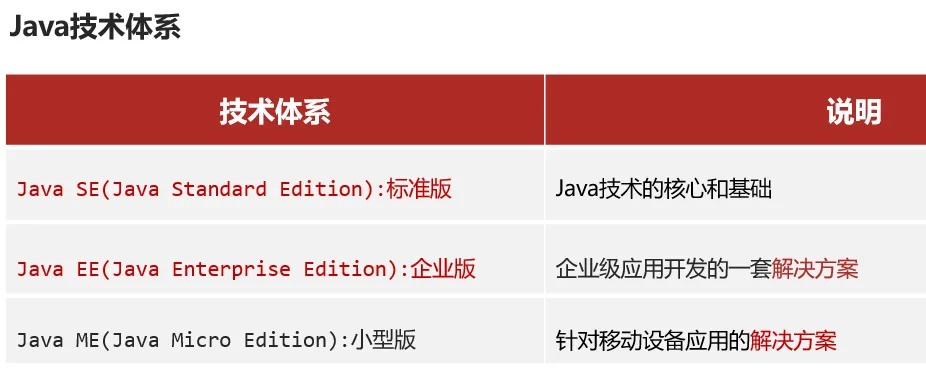
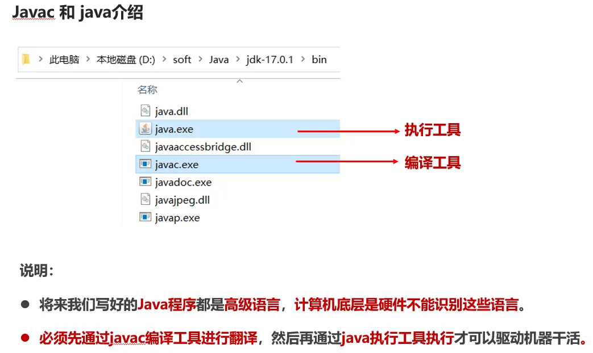

| 常用命令   | 作用                                                         |
| ---------- | ------------------------------------------------------------ |
| **盘符：** | 切换到某个盘下：D：， C:                                     |
| **dir**    | 查看当前路径下的文件信息                                     |
| **cd**     | 进入单级目录: **cd itheima**  进入多级目录: **cd   D:\itheima\JavaSE\第一天**  回退到上一级目录：**cd ..**   回退到盘符根目录：**cd \** |
| **cls**    | 清屏                                                         |

## **Java** **程序开发的三个步骤**

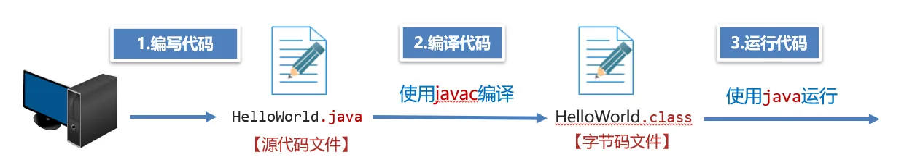

开发 Java 程序，需要三个步骤：**编写代码，编译代码，运行代码**

**注意：编写代码时文件名称必须与代码中的类名称一致。**

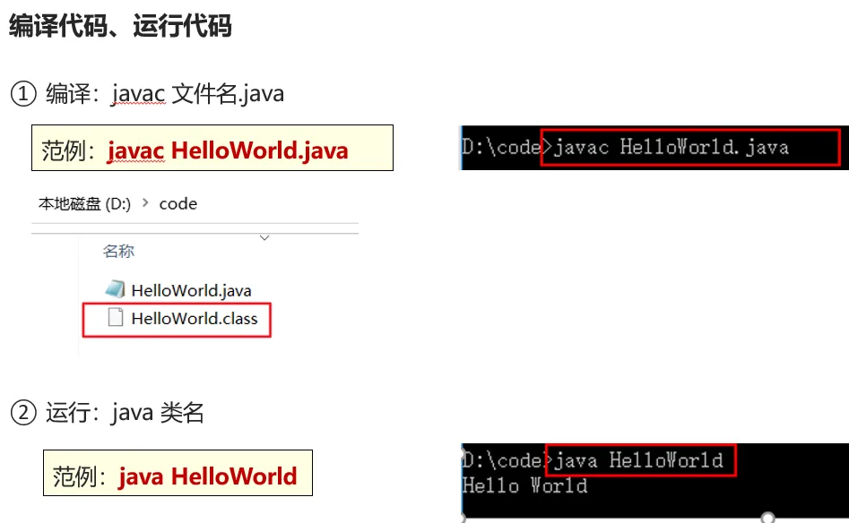

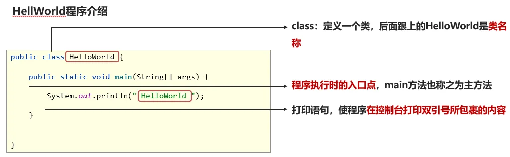

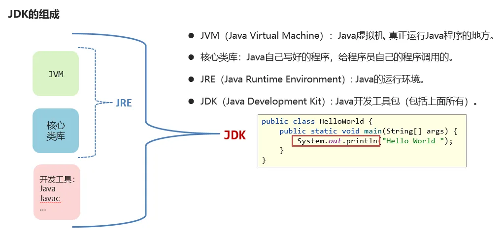

为各种平台提供了jvm

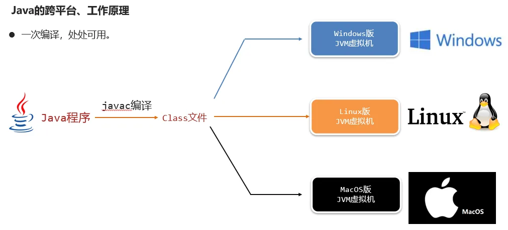

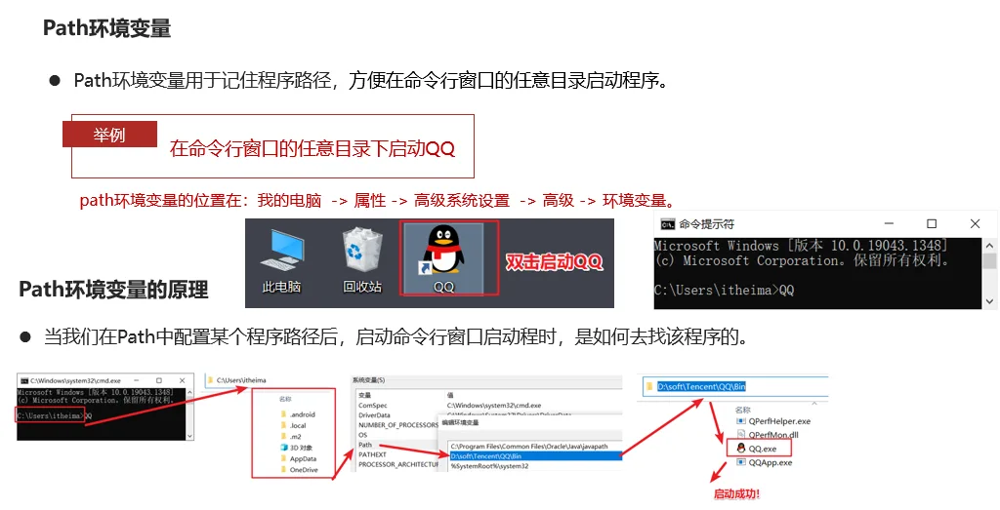

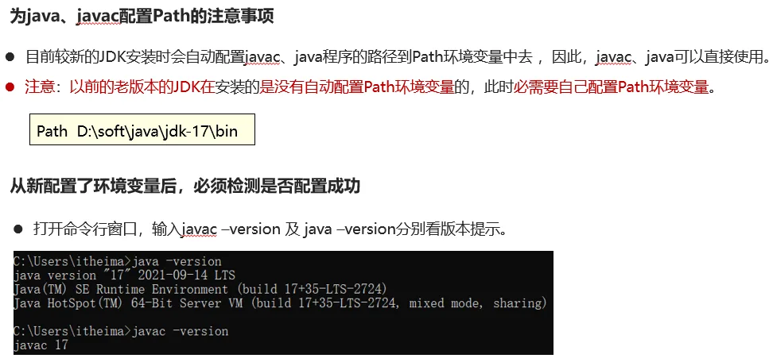
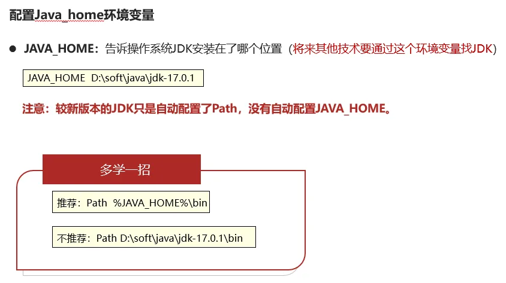

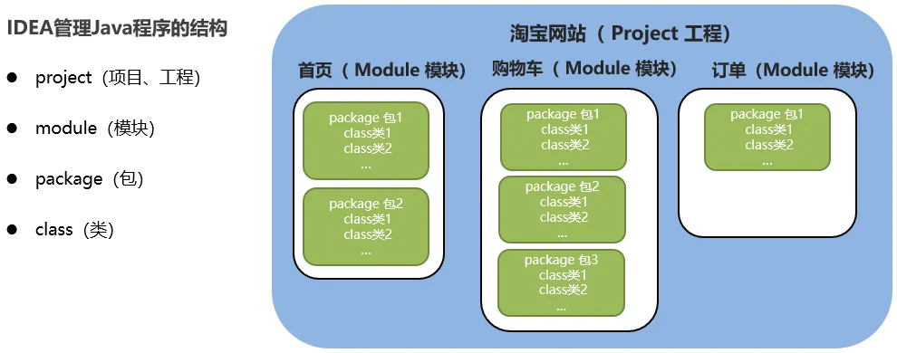

**导入模块**

一、点击模块中的.iml进行关联导入

二、复制模块后点击模块中的.iml进行导入

三、新建模块，然后将src下的代码复制粘贴

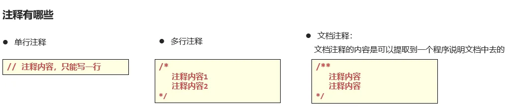

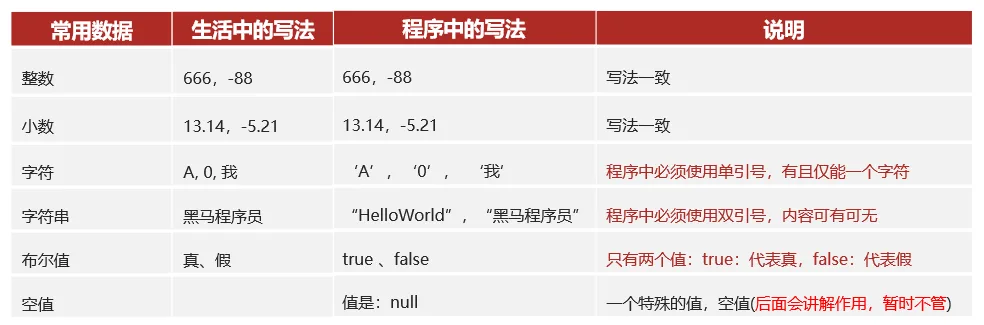

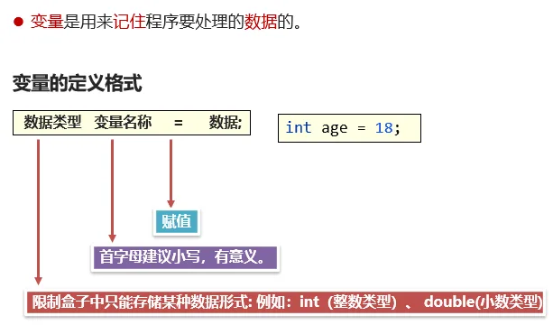
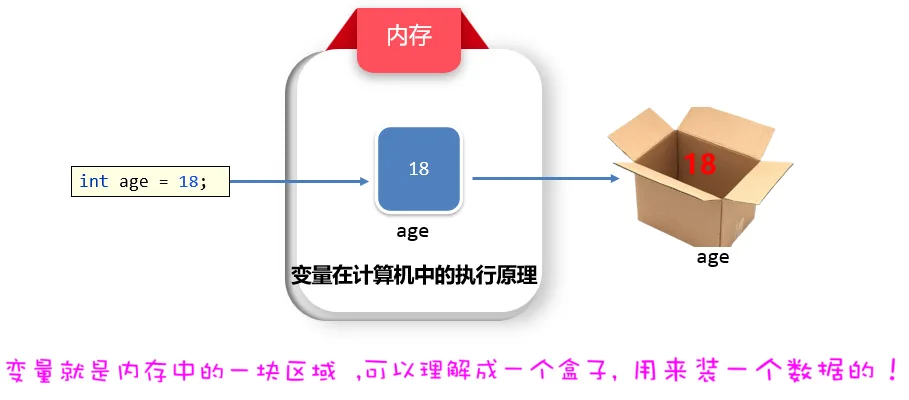

Java语言自己用到的一些词，有特殊作用的，我们称之为关键字，我们就不能用来为做为：类名、变量名

| **abstract**   | **assert**       | **boolean**   | **break**      | **byte**   |
| -------------- | ---------------- | ------------- | -------------- | ---------- |
| **case**       | **catch**        | **char**      | **class**      | **const**  |
| **continue**   | **default**      | **do**        | **double**     | **else**   |
| **enum**       | **extends**      | **final**     | **finally**    | **float**  |
| **for**        | **goto**         | **if**        | **implements** | **import** |
| **instanceof** | **int**          | **interface** | **long**       | **native** |
| **new**        | **package**      | **private**   | **protected**  | **public** |
| **return**     | **strictfp**     | **short**     | **static**     | **super**  |
| **switch**     | **synchronized** | **this**      | **throw**      | **throws** |
| **transient**  | **try**          | **void**      | **volatile**   | **while**  |

# 02-二进制、运算符、数据类型、Scanner

l计算机中数据最小的组成单元：使用8个二进制位为一组，称之为一个字节（byte,简称B）

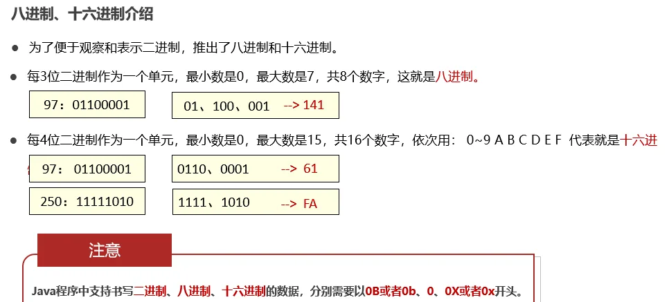

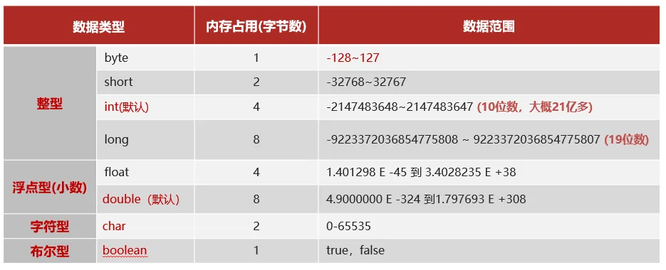

## **类型转换**

**类型范围小**的变量，可以**直接赋值**给**类型范围大**的变量。

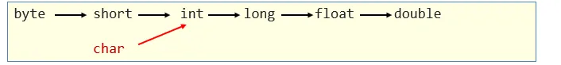

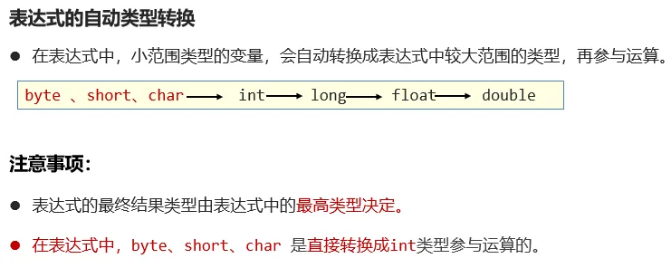

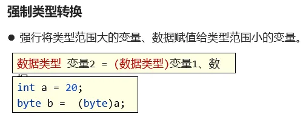

强制类型转换**可能**造成数据(丢失)溢出；

浮点型强转成整型，直接丢掉小数部分，保留整数部分返回

## **运算符**

| 符号 | 作用 | 说明                                                |
| ---- | ---- | --------------------------------------------------- |
| +    | 加   | 参考小学一年级                                      |
| -    | 减   | 参考小学一年级                                      |
| *    | 乘   | 参考小学二年级，与“×”相同                           |
| /    | 除   | 与“÷”相同，注意：在Java中两个整数相除结果还是整数。 |
| %    | 取余 | 获取的是两个数据做除法的余数                        |

“+”符号与字符串运算的时候是用作连接符的，其结果依然是一个字符串

**识别技巧：能算则算，不能算就在一起。**

++ 、-- 只能操作变量，不能操作字面量的。

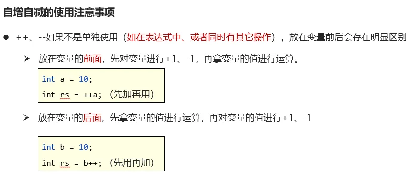

| 符号 | 用法 | 作用       | 底层代码形式          |
| ---- | ---- | ---------- | --------------------- |
| +=   | a+=b | 加后赋值   | a = (a的类型)(a + b); |
| -=   | a-=b | 减后赋值   | a = (a的类型)(a - b); |
| *=   | a*=b | 乘后赋值   | a = (a的类型)(a * b); |
| /=   | a/=b | 除后赋值   | a = (a的类型)(a / b); |
| %=   | a%=b | 取余后赋值 | a = (a的类型)(a % b); |

**注意：扩展的赋值运算符隐含了强制类型转换。**

| 符号 | 例子    | 作用                   | 结果                          |
| ---- | ------- | ---------------------- | ----------------------------- |
| >    | a>b     | 判断a是否大于b         | 成立返回true、不成立返回false |
| >=   | a>=b    | 判断a是否大于或者等于b | 成立返回true、不成立返回false |
| <    | a<b     | 判断a是否小于b         | 成立返回true、不成立返回false |
| <=   | a<=b    | 判断a是否小于或者等于b | 成立返回true、不成立返回false |
| ==   | a==b    | 判断a是否等于b         | 成立返回true、不成立返回false |
| !=   | a !=  b | 判断a是否不等于b       | 成立返回true、不成立返回false |

判断数据是否满足条件，最终会返回一个判断的结果，这个结果是布尔类型的值：true或者false。

| 符号   | 叫法     | 例子            | 运算逻辑                                                     |
| ------ | -------- | --------------- | ------------------------------------------------------------ |
| **&**  | 逻辑与   | 2  > 1 & 3 > 2  | 多个条件必须都是true,  结果才是true； 有一个是false，结果就是false |
| **\|** | 逻辑或   | 2  > 1 \| 3 < 5 | 多个条件中只要有一个是true,  结果就是true;                   |
| **!**  | 逻辑非   | !  (2 > 1)      | 就是取反：你真我假，你假我真。!true == false、!false == true |
| **^**  | 逻辑异或 | 2  > 1 ^ 3 > 1  | 前后条件的结果相同，就直接返回false，前后条件的结果不同，才返回true |

| 符号     | 叫法   | 例子               | 运算逻辑                                                     |
| -------- | ------ | ------------------ | ------------------------------------------------------------ |
| **&&**   | 短路与 | 2  > 10 && 3 > 2   | 判断结果与“&”一样，过程不同：**左边为**  **false****，右边则不执行。** |
| **\|\|** | 短路或 | 2  > 1 \| \| 3 < 5 | 判断结果与“\|”一样，过程不同：**左边为**  **true****， 右边则不执行。** |

注意：在java中， “&” 、 “|”:  无论左边是 false还是 true，右边都要执行。

**三元运算符介绍**

条件表达式 **?** 值1 **:** 值2 ;

执行流程：首先计算**关系表达式的值，**如果值为**true**，返回**值1**，如果为**false**，返回**值2**。

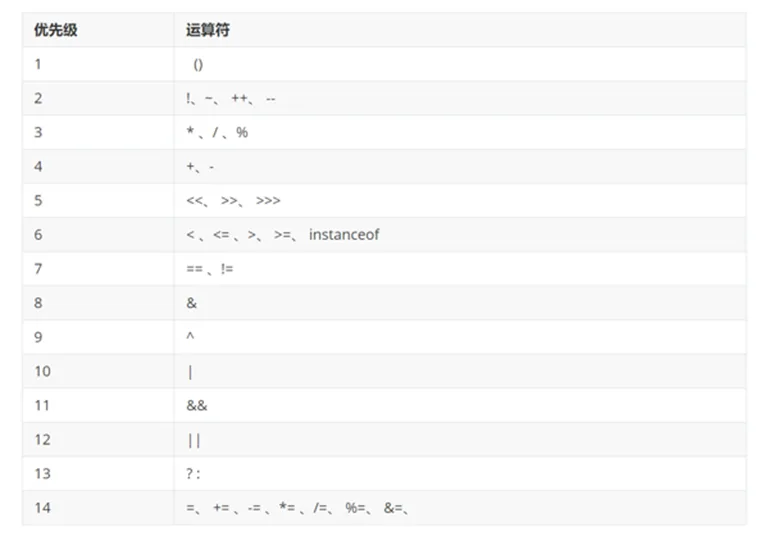

# 03-循环控制

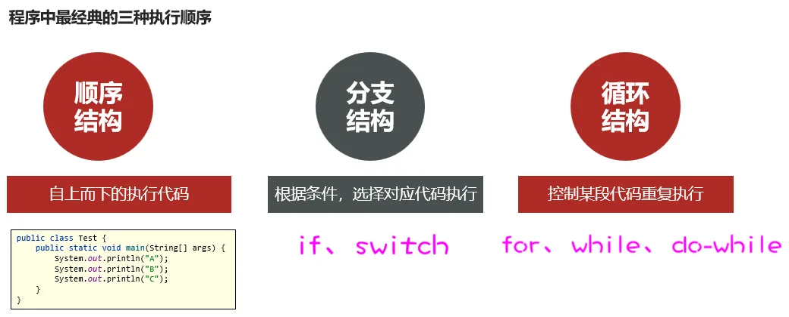

## **分支结构**

根据条件（真或假）来决定执行某段代码。

可以根据条件，选择执行某段程序。

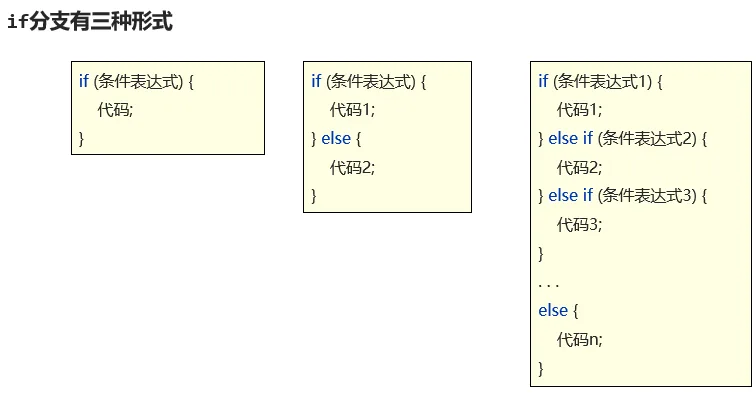

if(条件){}，()后不能跟“;”否则{}中的代码将不受if的控制了。

如果if语句的{}中只有一行代码的情况，{}可以省略不写（但是不推荐省略）。

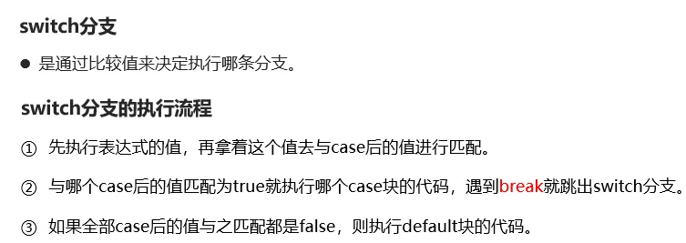

if在功能上远远强大于switch。

当前条件是区间的时候，应该使用if分支结构。

当条件是与一个一个的值比较的时候，switch分支更合适：格式良好，性能较好，代码优雅。

①表达式类型只能是byte、short、int、char，JDK5开始支持枚举，JDK7开始支持String、不支持double、float、long。

②case给出的值不允许重复，且只能是字面量，不能是变量。

③正常使用switch的时候，不要忘记写break，否则会出现穿透现象。

当存在多个case分支的代码相同时，可以把相同的代码放到一个case块中，其他的case块都通过穿透性穿透到该case块执行代码即可，这样可以简化代码。

## **循环结构**

控制一段代码反复执行很多次。

批量产生数据

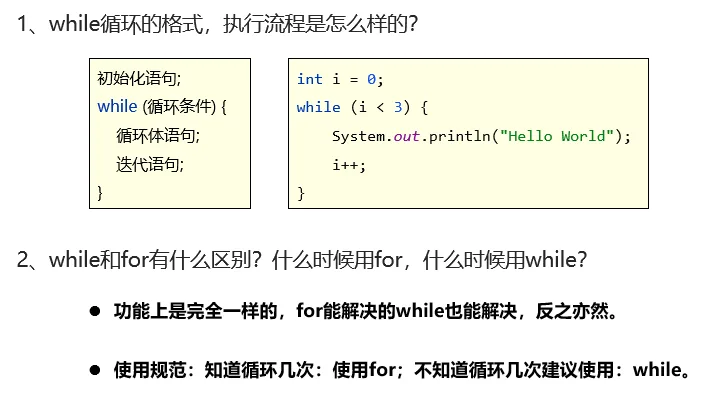

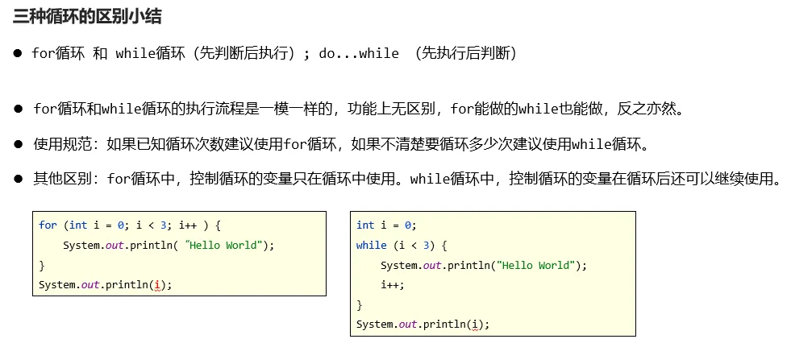

**循环嵌套的特点**

外部循环每循环一次，内部循环会全部执行完一轮。

break  : 跳出并结束当前所在循环的执行。

continue: 用于跳出当前循环的当次执行，直接进入循环的下一次执行。

# 04、数组

## **数组的定义和访问**

**数组的静态初始化**

定义数组的时候直接给数组赋值。

数据类型[] 数组名 = new 数据类型[]{元素1，元素2 ，元素3… };

数据类型[] 数组名 = { 元素1，元素2 ，元素3，… };

“数据类型[] 数组名”也可写成 “数据类型 数组名[] ”。

什么类型的数组只能存放什么类型的数据。

**数组的动态初始化**

定义数组时先不存入具体的元素值，只确定数组存储的数据类型和数组的长度

静态初始化和动态初始化数组的写法是独立的，不可以混用。

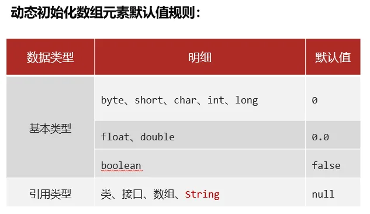

## **数组在计算机中的执行原理**

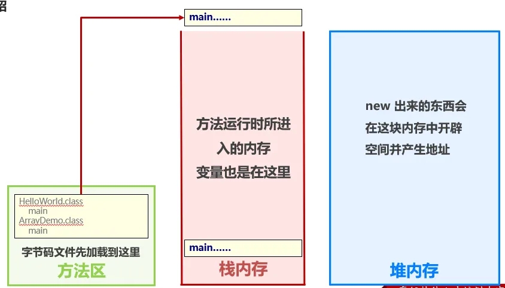
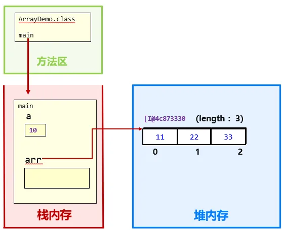

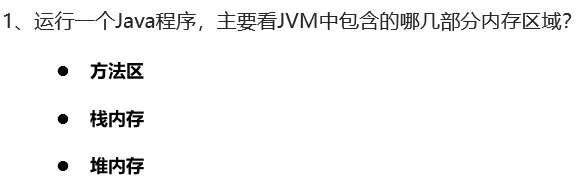

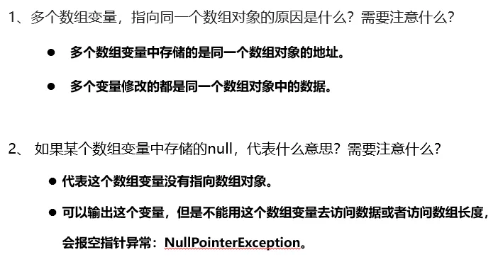

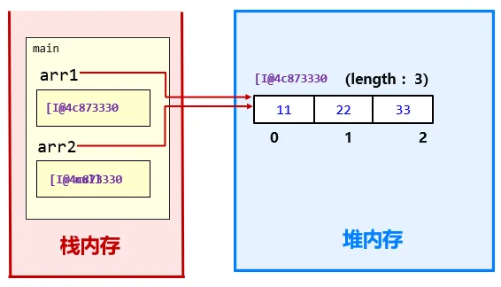

# 05、方法

## **方法的其他形式**

方法是一种语法结构，它可以把一段代码封装成一个功能，以便重复调用。

方法的修饰符：暂时都使用public static 修饰。

方法申明了具体的返回值类型，内部必须使用return返回对应类型的数据。

形参列表可以有多个，甚至可以没有； 如果有多个形参，多个形参必须用“，”隔开，且不能给初始化值。

**提高代码的复用性，提高开发效率，使程序逻辑更清晰。**

方法定义时：需要按照方法解决的实际业务需求，来设计合理的方法形式解决问题。

如果方法不需要返回数据，返回值类型必须申明成void（无返回值申明）, 此时方法内部不可以使用return返回数据。

方法如果不需要接收数据，则不需要定义形参，且调用方法时也不可以传数据给方法了。

没有参数，且没有返回值类型（void）申明的方法，称为无参数、无返回值的方法，依次类推。

## **方法使用时的常见问题**

方法在类中的位置放前放后无所谓，但一个方法不能定义在另一个方法里面。

方法的返回值类型写void（无返回申明）时，方法内不能使用return返回数据，如果方法的返回值类型写了具体类型，方法内部则必须使用return返回对应类型的数据。

return语句的下面，不能编写代码，属于无效的代码，执行不到这儿。

方法不调用就不会执行, 调用方法时，传给方法的数据，必须严格匹配方法的参数情况。

调用有返回值的方法，有3种方式：1、可以定义变量接收结果 2、或者直接输出调用，3、甚至直接调用；

调用无返回值的方法，只有1种方式：1、只能直接调用。

## **方法在计算机中的执行原理**

方法被调用的时候，是进入到栈内存中运行。

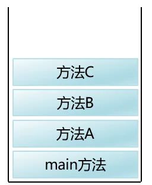

**先进后出。**

**保证一个方法调用完另一个方法后，可以回来。**

## **Java的参数传递机制**

**Java**的参数传递机制都是：值传递

所谓值传递：指的是在传输实参给方法的形参的时候，传输的是实参变量中存储的值的副本。

实参：在方法内部定义的变量。

形参：定义方法时“(…)”中所声明的参数。

**基本类型的参数传输存储的数据值。**

**引用类型的参数传输存储的地址值。**

## **方法重载**

一个类中，出现多个方法的名称相同，但是它们的形参列表是不同的，那么这些方法就称为方法重载了。

一个类中，只要一些方法的名称相同、形参列表不同，那么它们就是方法重载了，其它的都不管（如：修饰符，返回值类型是否一样都无所谓）。

形参列表不同指的是：形参的个数、类型、顺序不同，不关心形参的名称。

1、什么是方法重载？

一个类中，多个方法的名称相同，但它们形参列表不同。

2、方法重载需要注意什么？

一个类中，只要一些方法的名称相同、形参列表不同，那么它们就是方法重载了，其它的都不管（如：修饰符，返回值类型是否一样都无所谓）。

形参列表不同指的是：形参的个数、类型、顺序不同，不关心形参的名称。

3、方法重载有啥应用场景？

开发中我们经常需要为处理一类业务，提供多种解决方案，此时用方法重载来设计是很专业的。

## 补充知识：方法中单独使用return关键字

return; 可以用在无返回值的方法中，作用是：立即跳出并结束当前方法的执行。

1.在无返回值的方法中，如果要直接跳出并结束当前方法的执行，怎么解决？

**return;** **跳出并立即结束所在方法的执行。**

**break;** **跳出并结束当前所在循环的执行。**

**continue;** **结束当前所在循环的当次继续，进入下一次执行。**

# 07-面向对象基础

## **深刻认识面向对象**

对象本质上是一种特殊的数据结构。

class也就是类，也称为对象的设计图（或者对象的模板）。

## **对象在计算机中的执行原理**

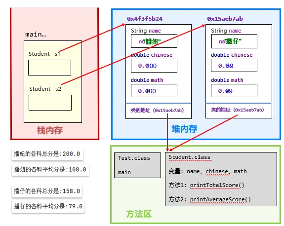

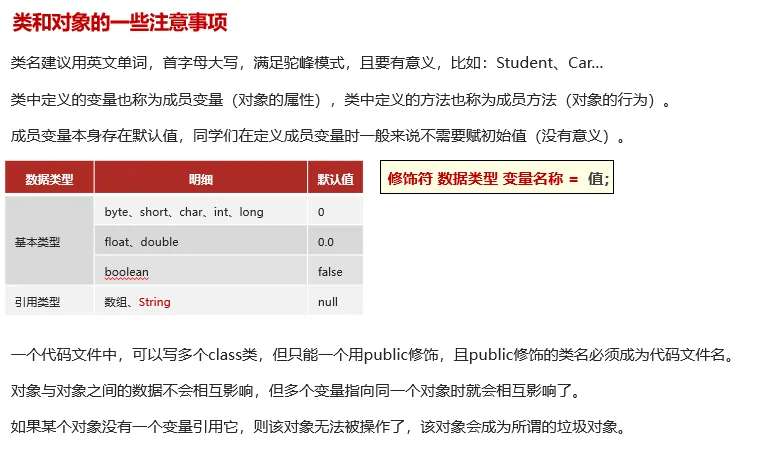

## **this**

this就是一个变量，可以用在方法中，来拿到当前对象。

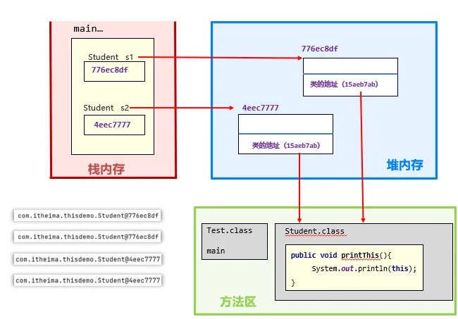

this主要用来解决：变量名称冲突问题的。

this就是一个变量， 可以用在方法中 ，用来拿到当前对象；哪个对象调用方法，this就指向哪个对象，也就是拿到哪个对象。

方法里的this到底是如何拿到调用它的对象:将地址传给this，带有this的方法会自动填一个形参：

类名 this

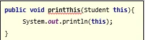

## **构造器**

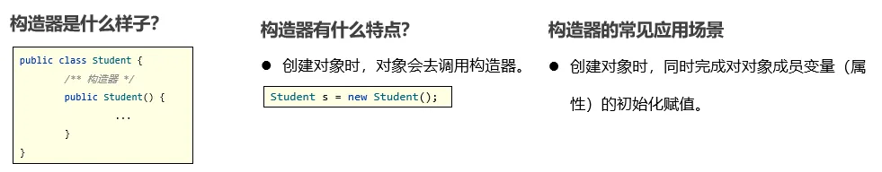

类在设计时，如果不写构造器，Java是会为类自动生成一个无参构造器的。

一旦定义了有参数构造器，Java就不会帮我们的类自动生成无参构造器了，此时就建议自己手写一个无参数构造器出来了。

可以有多个构造器，形参不同即可。

方便创建对象的时候，可以将对象的属性进行初始化赋值。

## **封装**

就是用类设计对象处理某一个事物的数据时，应该把要处理的数据，以及处理这些数据的方法，设计到一个对象中去。

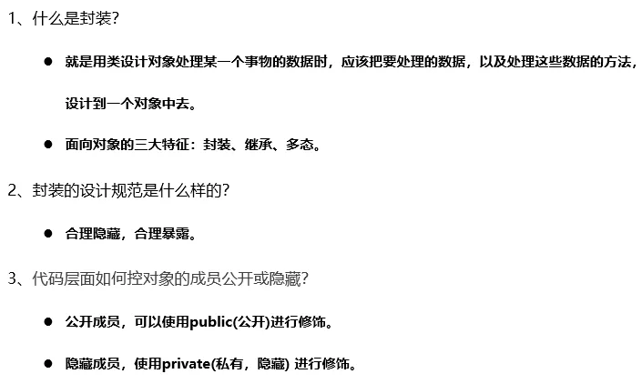

## 实体JavaBean

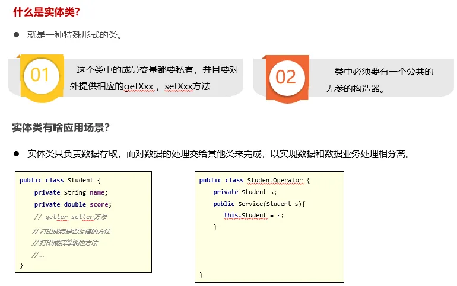

1.什么是实体类？ 有啥特点？

成员变量必须私有，且要为他们提供get、set方法；必须有无参数构造器 。

仅仅只是一个用来保存数据的java类，可以用它创建对象，保存某个事物的数据。

2.实体类有啥应用场景？

**实体类对应的是软件开发里现在比较流行的开发方式，数据和数据的业务处理相分离**

## **成员变量、局部变量的区别小结**

| 区别         | 成员变量                   | 局部变量                                   |
| ------------ | -------------------------- | ------------------------------------------ |
| 类中位置不同 | 类中，方法外               | 常见于方法中                               |
| 初始化值不同 | 有默认值, 不需要初始化赋值 | 没有默认值，使用之前必须完成赋值           |
| 内存位置不同 | 堆内存                     | 栈内存                                     |
| 作用域不同   | 整个对象                   | 在所归属的大括号中                         |
| 生命周期不同 | 与对象共存亡               | 随着方法的调用而生，随着方法的运行结束而亡 |

# 08-面 向对象基础应用：常用API

## **包**

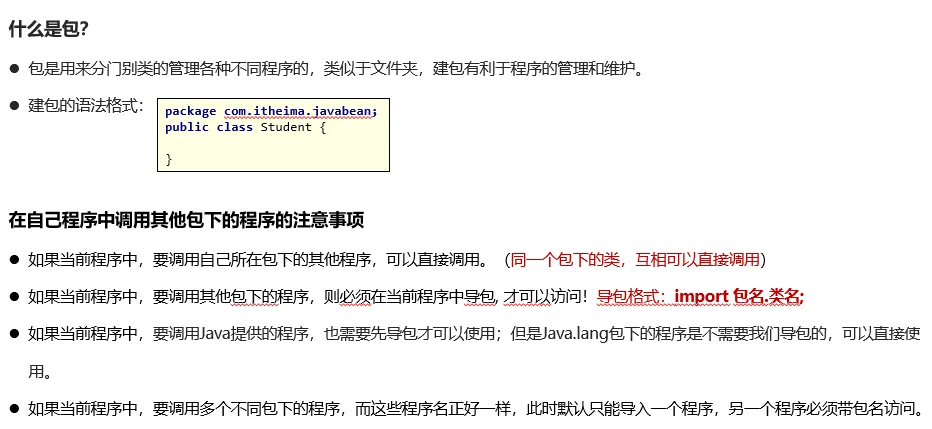

## **String**

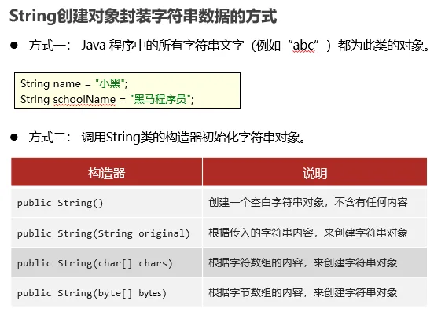

| 方法名                                                       | 说明                                                     |
| ------------------------------------------------------------ | -------------------------------------------------------- |
| public int length()                                          | 获取字符串的长度返回（就是字符个数）                     |
| public char charAt(int index)                                | 获取某个索引位置处的字符返回                             |
| public char[] toCharArray()：                                | 将当前字符串转换成字符数组返回                           |
| public boolean equals(Object anObject)                       | 判断当前字符串与另一个字符串的内容一样，一样返回true     |
| public boolean equalsIgnoreCase(String anotherString)        | 判断当前字符串与另一个字符串的内容是否一样(忽略大小写)   |
| public String substring(int beginIndex, int endIndex)        | 根据开始和结束索引进行截取，得到新的字符串（包前不包后） |
| public String substring(int beginIndex)                      | 从传入的索引处截取，截取到末尾，得到新的字符串返回       |
| public String replace(CharSequence target, CharSequence replacement) | 使用新值，将字符串中的旧值替换，得到新的字符串           |
| public boolean contains(CharSequence s)                      | 判断字符串中是否包含了某个字符串                         |
| public boolean startsWith(String prefix)                     | 判断字符串是否以某个字符串内容开头，开头返回true，反之   |
| public String[] split(String regex)                          | 把字符串按照某个字符串内容分割，并返回字符串数组回来     |

1、String有哪几点注意事项？

**String是不可变字符串对象，每次试图改变字符串对象实际上是新产生了新的字符串对象了，变量每次都是指向了新的字符串对象，之前字符串对象的内容确实是没有改变的，因此说String的对象是不可变的。

**

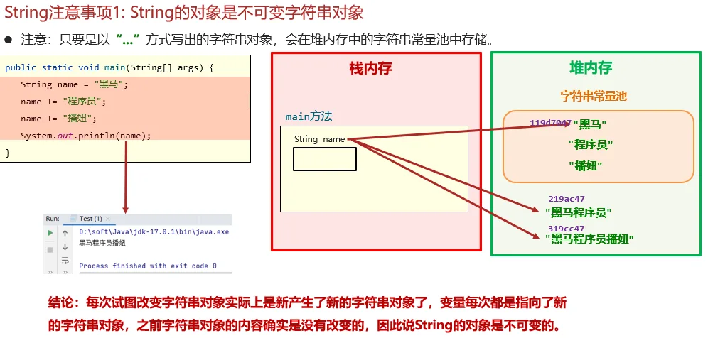

**只要是以“...”方式写出的字符串对象，会存储到字符串常量池，且相同内容的字符串只存储一份，通过构造器实现的则不会**

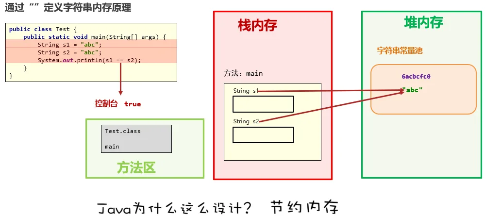

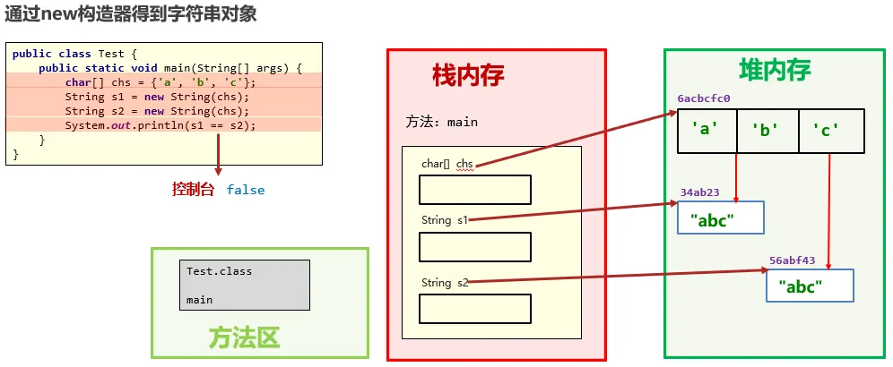

**但通过new方式创建字符串对象，每new一次都会产生一个新的对象放在堆内存中。**

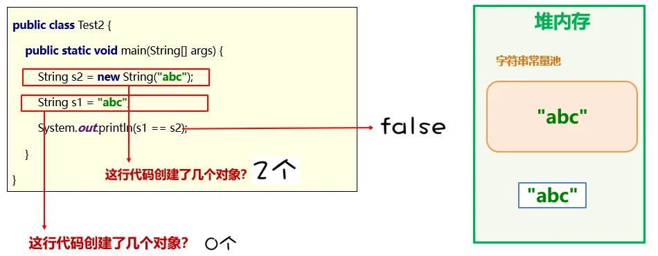

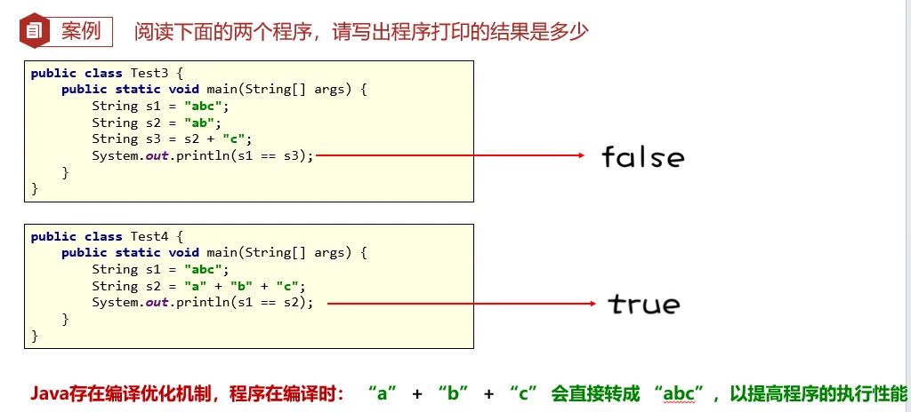

运算放在堆内存，赋值放在常量池，所以不相等。

## **ArrayList**

集合是一种容器，用来装数据的，类似于数组。集合大小可变，开发中用的更多。

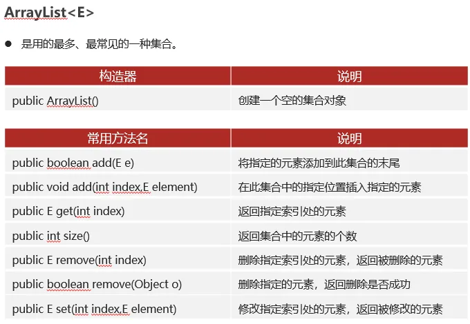

1、集合是什么，有什么特点？

**一种容器，用来存储数据的**

**集合的大小可变。**

2、ArrayList是什么? 怎么使用？

是集合中最常用的一种，ArrayList是泛型类，可以约束存储的数据类型。

**创建对象，调用无参数构造器初始化对象：public ArrayList();**

**调用相应的增删改查数据的方法**

1、 从集合中遍历元素，并筛选出元素删除它，应该如何操作才能不出bug？

**方式一：每次删除一个数据后，索引-1。**

**方式二：从集合后面遍历然后删除，可以避免漏掉元素。**

3、ArrayList提供了哪些常用方法？
