# `Java`三大平台

`JavaSE`、`JavaME`、`JavaE E`

## `JavaSE`

Java语言的标准版，用于桌面应用的开发。是其他两个版本的基础。

## `JavaME`

Java语言的小型版，用于嵌入式消费类电子设备或者小型移动设备的开发。

其中最为主要的还是小型移动设备的开发（手机）。渐渐的没落了，已经被安卓和IOS给替代了。但是，安卓也是可以用Java来开发的。

## `JavaEE`

用于Web方向的网站开发。（主要从事后台服务器的开发）

在服务器领域，Java是当之无愧的龙头老大。

## `Java`的主要特性

- 面向对象
- 安全性
- 多线程
- 简单易用
- 开源
- 跨平台

## Java语言跨平台的原理

编写源代码文件，用`javac`编译程序把文件进行编译，然后在某个`Java虚拟机`上执行编译过的字节码。

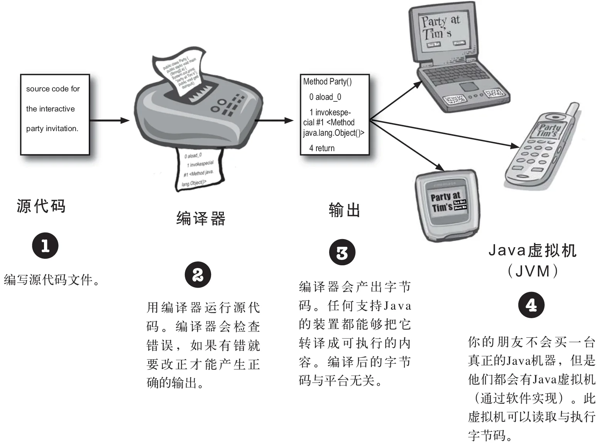

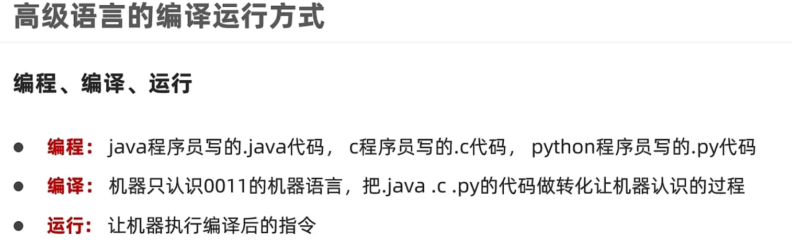

高级语言的编译运行方式

- 编译型
- 解释型
- 混合型，半编译，半解释

### 编译型语言

典型的如`C`、`C++`、`Pascal`等语言，都属于编译型语言。它是编译的时候直接编译成机器可以执行或调用的程序，如`exe`、`dll`或`ocx`
等类型。如将`C`语言可直接编译成`exe`程序，运行时直接运行`exe`程序就可以了，无需重新编译，所以程序执行效率较高。

**编译过程**就好比有个翻译师，你说一句，翻译师就会直接将你这句话翻译出来，从而传达给别人。

编译型语言不是跨平台的。

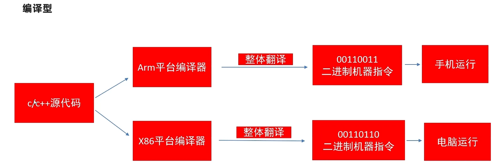

### 解释型语言

典型的如`Java`、`Python`、`Matlab`等语言，都属于解释型语言。这类程序不需要编译，运行时使用一个专门的解释器去翻译，每一条语句都是执行的时候才翻译，所以这类程序每执行一次就要翻译一次，运行效率较称低。

**解释过程**就好比将你所说的话先全部记到一张纸上，然后将通过一些翻译软件等，将这张纸上的全部内容翻译出来，再传达给别人。

交由个平台的解释器运行。

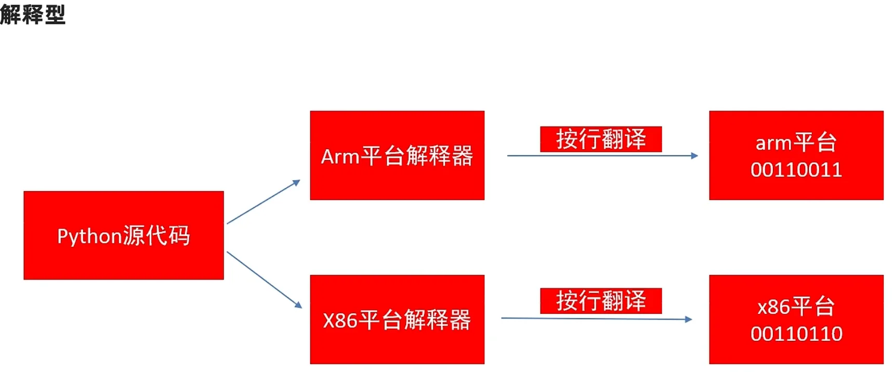

- 操作系统本身其实是不认识Java语言的。
- 但是针对于不同的操作系统，`Java`交由虚拟机运行，Java提供了不同的虚拟机。

虚拟机会把Java语言翻译成操作系统能看得懂的语言。**即先生成一个二进制字节码文件，随后再一行一行的翻译。**

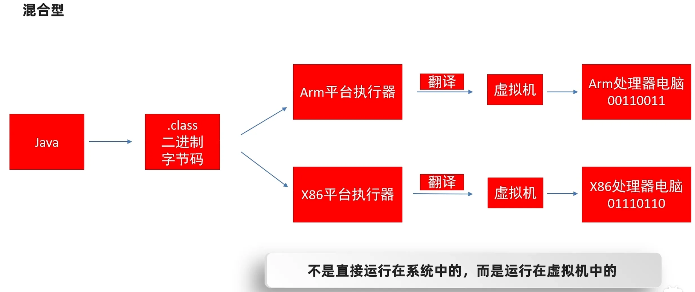

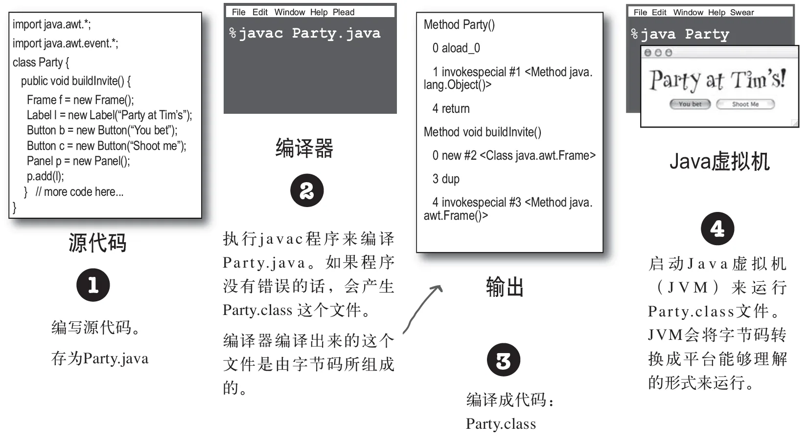

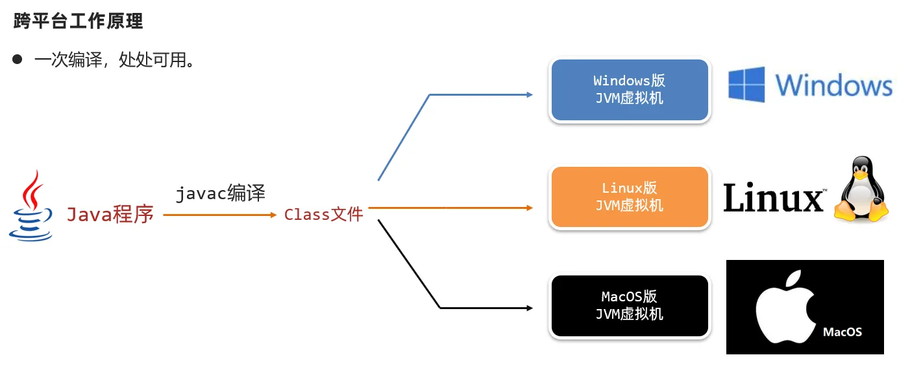

## `JRE`和`JDK`

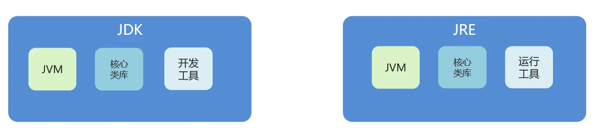

`JVM（Java Virtual Machine）`，`Java`虚拟机

`JRE（Java Runtime Environment）`，`Java`运行环境，包含了`JVM`和`Java`的核心类库`（Java API）`

`JDK（Java Development Kit）`称为`Java`开发工具，包含了`JRE`和开发工具

总结：我们只需安装`JDK`即可，它包含了`java`的运行环境和虚拟机。`JDK`包含了`JRE`。

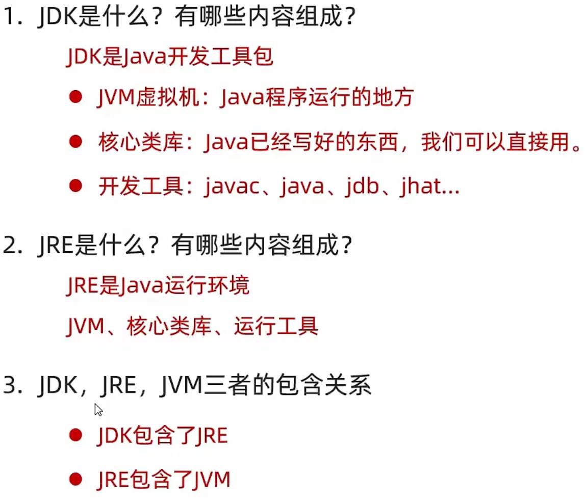

# 认识`Java`

## `main`

不管你的程序有多大（也可以说不管有多少个类），一定都会有一个`main()`
来作为程序的起点。每个Java程序最少都会有一个类以及一个`main()`。每个应用程序只有一个`main()`函数。

> 当Java虚拟机启动执行时，它会寻找你在命令列所指定的类。然后它会锁定main方法：
>
> 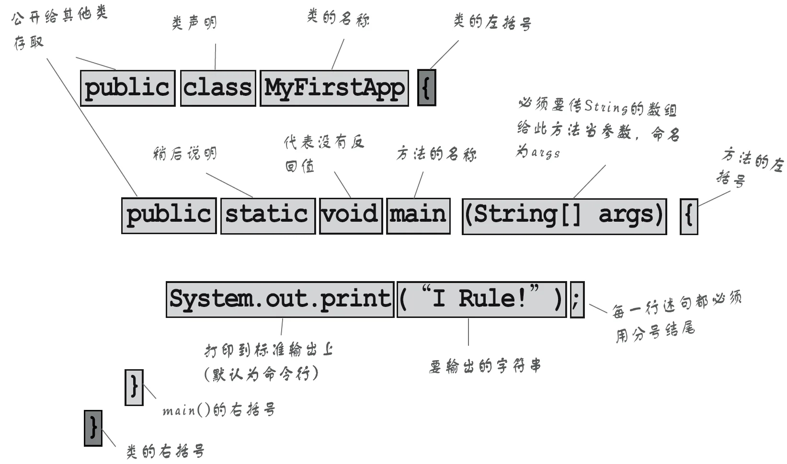
>
> 接着Java虚拟机就会执行main方法在花括号间的函数所有指令。在Java中的所有东西都会属于某个类。你会建立源文件（扩展名为，java)
> ,然后将它编译成新的类文件（扩展名为.class)。真正被执行的是类。

Main()的两种用途：

- 测试真正的类
- 启动你的Java应用程序

## `Java`特性

1、简单性 2、面向对象 3、分布式 4、健壮性 5、安全性 6、体系结构中立 7、可移植性 8、解释型 9、高性能 10、多线程 11、动态性

## `Java`内存

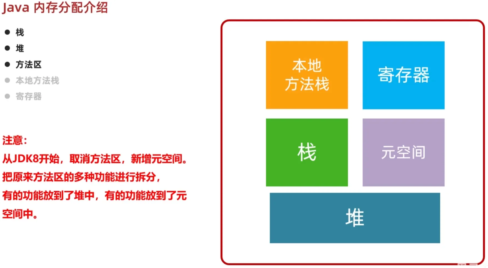

Java的内存需要划分为5个部分：

1.1 栈（Stack）
数据存储在随机存取存储器（random-access memory,RAM)里，处理器可以通过栈指针(stack pointer)直接操作该数据。具体来说，栈指针向下移动将申请一块新的内存，向上移动则会释放这块内存。这是一种极其迅速和高效的内存分配方式，其效率仅次于寄存器。只不过Java系统在创建应用程序时就必须明确栈上所有对象的生命周期。这种限制约束了程序的灵活性，因此虽然有一些数据会保存在栈上（尤其是对象用)，对象本身却并非如此。
栈:方法调用和局部变量
`局部变量（局部变量）：方法的参数，或者方法 { } 内部的变量`
作用域：一旦超出作用域，立刻从栈内存中消失

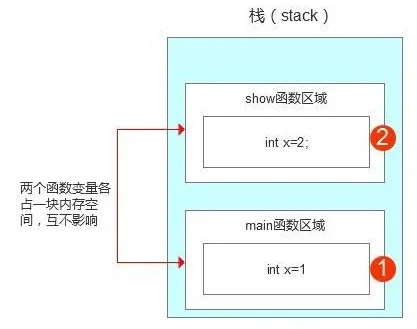

1.2 堆
堆(heap)
这是一个通用的内存池（使用的也是RAM空间），用于存放所有Java对象。与栈不同的是，编译器并不关心位于堆上的对象需要存在多久。因此，堆的使用是非常灵活的。比如，当你需要一个对象时，可以随时使用new来创建这个对象，那么当这段代码被执行时，Java会在难上为该对象分配内存空间。然而这种灵活性是有代价的：分配和清理堆存储要比栈存储花费更多的时间（如果你可以像C++那样在栈上创建对象的话)。好消息是，随着时间的推移，Java的堆内存分配机制已经变得非常高效了，所以你并不需要太过关注此类问题。
堆：凡是 new 出来的东西，都在堆内存中。所有对象，以及创建的`实例变量`。
堆内存中的东西都有一个地址值：16进制
堆内存里面的数据，都有默认值，规则如下：
① 如果是整数 默认值为0
② 如果是浮点数 默认值为0.0
③ 如果是字符 默认值为’\u0000’
④ 如果是布尔型 默认值为false
⑤ 如果是引用类型 默认值为null

> 当一个新建对象带有对象引用的变量时，此时真正的问题是：是否需要保留对象带有的所有对象的空间？不是这样的。无论如何，Java会留下空间给实例变量的值。但是引用变量的值并不是对象本身，所以若CellPhone带有Antenna,Java只会留下Antenna引用量而不是对象本身所用到的空间。
> 那么Antenna对象会取得在堆上的空间吗？我们得先知道Antenna对象是在何时创建的。这要看实例变量是如何声明的。如果有声明变量但没有给它赋值，则只会留下变量的空间。
>
> private Antenna ant;
>
> 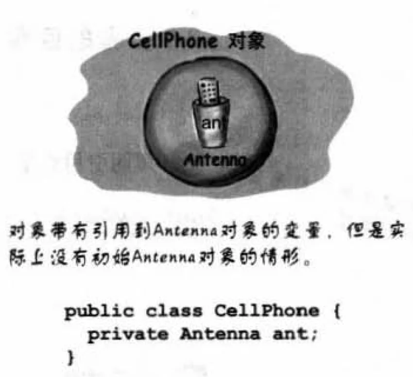
>
> private Antenna ant new Antenna();
>
> 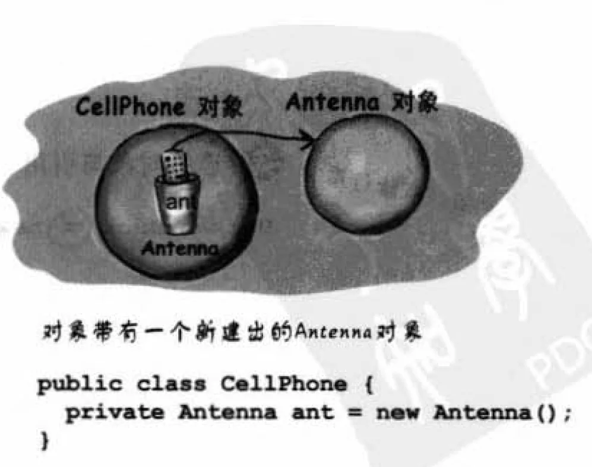

1.3 方法区（Method Area）
方法区：存储.class相关信息，包含方法的信息
注意：方法区只是储存了.class的死信息，一旦运行，还是要在栈里运行

1.4 本地方法栈（Native Method Stack）
本地方法栈与操作系统相关

1.5 寄存器（Pc Register）
寄存器（register)。这是速度最快的数据存储方式，因为它保存数据的位置不同于其他方式：数据会直接保存在中央处理器(central
processing unit,CPU)
里，然而寄存器的数量是有限的，所以只能按需分配。此外，你不能直接控制寄存器的分配、甚至你在程序中都找不到寄存器存在过的证据(
C和C++是例外，它们允许你向编译器申请分配寄存器)。

# Java的基本程序设计结构

Java中的所有函数都是某个类的方法(标准术语将其称为方法，而不是成员函数)。因此，Java中的main方法必须有一个外壳(shell)
类。Java中的main方法必须是静态的。如果main方法正常退出，那么Java应用程序的退出码为0，表示成功地运行了程序。如果希望在终止程序时返回其他的退出码，那就需要使用`System.exit()`
方法。

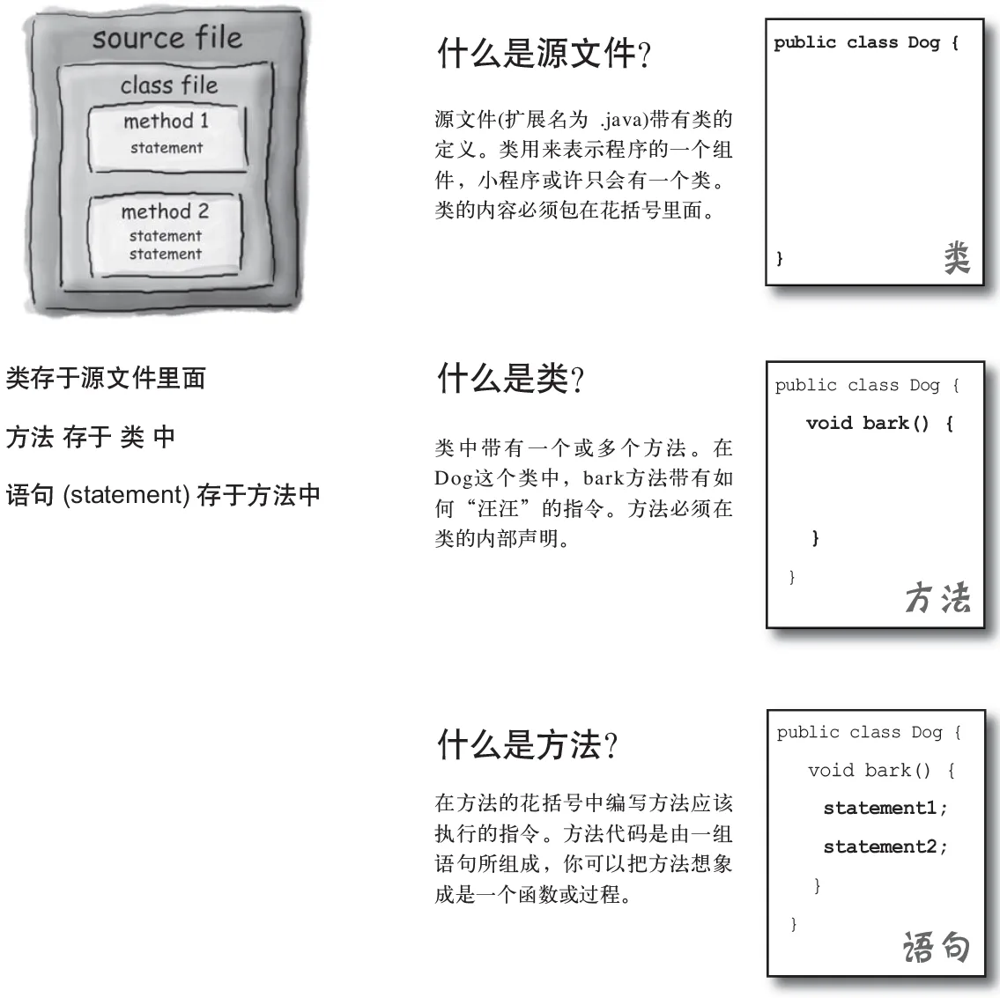

## 注释

三种类型

单行注释：`//`，注释内容从`//`开始到本行结尾

多行注释：`/* */`，在`/* `和` */`之间的所有内容

文档注释：`/** */`，在`/** `和` */`之间的所有内容

后两种方式不能嵌套，即不能在`/* */`中再添加`/* */`，因为没有意义。

## 数据类型

### 基本数据类型的四类八种

| 数据类型 |  关键字   | 字节(byte)/内存占用 | 所占位数(bit)    |                           取值范围                           |
| :------: | :-------: | :-----------------: | ---------------- | :----------------------------------------------------------: |
|   整数   |  `byte`   |          1          | 8                |                  -2^7 ~ 2^7-1 (-128 ~ 127)                   |
|          |  `short`  |          2          | 16               |                -2^15 ~2^15-1 (-32768 ~ 32767)                |
|          |   `int`   |          4          | 32               |          -2^31 ~ 2^31-1 (-2147483648 ~ 2147483647)           |
|          |  `long`   |          8          | 64               | -2^63 ~ 2^63-1 ( -9223372036854775808 ~ 9223372036854775807) |
|  浮点数  |  `float`  |          4          | 32               |       ±3.4E+38 (大约±3.40282347E+38F(有效位数为6~7位))       |
|          | `double`  |          8          | 64               |  ±1.7E+308 (大约±1.79769313486231570E+308(有效位数为15位))   |
|   字符   |  `char`   |          2          | 16               |                           0-65535                            |
|   布尔   | `boolean` |  由Java虚拟机决定   | 由Java虚拟机决定 |                         true，false                          |

#### 说明

 e+38表示是乘以10的38次方，同样，e-45表示乘以10的负45次方。

 在java中整数默认是int类型，浮点数默认是double类型。

整数类型和小数类型的取值范围大小关系：

double > float > long > int > short > byte

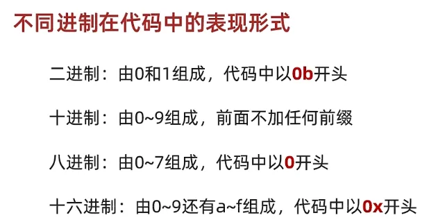

#### **注意点**

- 如果要定义 一个整数类型的变量，不知道选择哪种数据类型了，默认使用int。
- 如果要定义 一个小数类型的变量，不知道选择哪种数据类型了，默认使用double。
- 如果要定义一个long类型的变量，那么在数据值的后面需要加上L后缀。（大小写都可以，建议大写。）
- 如果要定义一个float类型的变量，那么在数据值的后面需要加上F后缀。（大小写都可以）
- 在Java中，整型值和布尔值之间不能相互转换。且整数表达式`x=0`不能转换为布尔值。

### `Unicode`和`char`类型

#### `ASCII`码

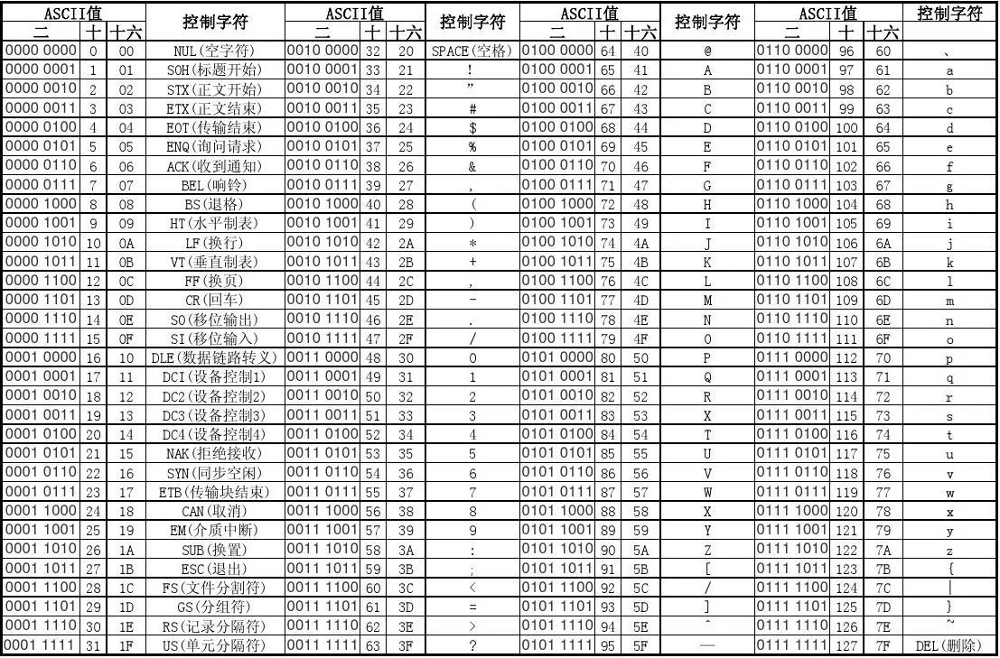

在计算机中，1字节对应 8 位二进制数，而每位二进制数有 0、1 两种状态，因此 1 字节可以组合出 256 种状态。如果这 256
中状态每一个都对应一个符号，就能通过 1 字节的数据表示 256 个字符。美国人于是就制定了一套编码（其实就是个字典），描述英语中的字符和这
8 位二进制数的对应关系，这被称为 ASCII 码。

ASCII 码一共定义了 128 个字符，例如大写的字母 A 是 65（这是十进制数，对应二进制是0100 0001）。这 128 个字符只使用了 8
位二进制数中的后面 7 位，最前面的一位统一规定为 0。

#### 问题

英语用 128 个字符来编码完全是足够的，但是用来表示其他语言，128 个字符是远远不够的。于是，一些欧洲的国家就决定，将 ASCII
码中闲置的最高位利用起来，这样一来就能表示 256 个字符。但是，这里又有了一个问题，那就是不同的国家的字符集可能不同，就算它们都能用
256 个字符表示全，但是同一个码点（也就是 8 位二进制数）表示的字符可能可能不同。例如，144 在阿拉伯人的 ASCII 码中是 گ，而在俄罗斯的
ASCII 码中是 ђ。

因此，ASCII 码的问题在于尽管所有人都在 0 - 127 号字符上达成了一致，但对于 128 - 255
号字符上却有很多种不同的解释。与此同时，亚洲语言有更多的字符需要被存储，一个字节已经不够用了。

#### Unicode

最终，美国人意识到他们应该提出一种标准方案来展示世界上所有语言中的所有字符，出于这个目的，Unicode诞生了。

Unicode可以看成就是一个字符集，它对世界上大部分的文字系统进行了整理、编码，为每一个字符而非字形定义唯一的整数，这个整数称为码点（Code
Point）。码点（Code Point）是指与一个编码表中的某个字符对应的代码值。

#### Unicode 编码方案

当前的 Unicode 字符分为17组编排，每组称为一个**平面**（Plane），而每一个平面拥有65536（即2^16）个码点。然而当前只用了少数平面。在表示一个
Unicode 的字符时，通常会用“U+”然后紧接着一组十六进制的数字来表示这一个字符。

| 平面                | 始末字符值              | 中文名称                      | 英文名称                                         |
| :------------------ | :---------------------- | :---------------------------- | :----------------------------------------------- |
| 0号平面             | `U+0000` - `U+FFFF`     | **基本多文种平面**            | Basic Multilingual Plane，简称**BMP**            |
| 1号平面             | `U+10000` - `U+1FFFF`   | **多文种补充平面**            | Supplementary Multilingual Plane，简称**SMP**    |
| 2号平面             | `U+20000` - `U+2FFFF`   | **表意文字补充平面**          | Supplementary Ideographic Plane，简称**SIP**     |
| 3号平面             | `U+30000` - `U+3FFFF`   | **表意文字第三平面**          | Tertiary Ideographic Plane，简称**TIP**          |
| 4号平面 至 13号平面 | `U+40000` - `U+DFFFF`   | （尚未使用）                  |                                                  |
| 14号平面            | `U+E0000` - `U+EFFFF`   | **特别用途补充平面**          | Supplementary Special-purpose Plane，简称**SSP** |
| 15号平面            | `U+F0000` - `U+FFFFF`   | 保留作为**私人使用区（A区）** | Private Use Area-A，简称**PUA-A**                |
| 16号平面            | `U+100000` - `U+10FFFF` | 保留作为**私人使用区（B区）** | Private Use Area-B，简称**PUA-B**                |

#### UTF

UTF是 Unicode/UCS Transformation Format 的缩写，是将 Unicode 码点映射到唯一字节序列的算法，根据映射方法的的不同，有
UTF-8、UTF-16 和 UTF-32 等具体的编码格式。

##### UTF-16

[RFC 2781 - UTF-16，ISO 10646 的编码](https://datatracker.ietf.org/doc/html/rfc2781)

Unicode 的第一个平面称为**基本多语言平面**（Basic Multilingual Plane, **BMP**），或称第零平面（Plane 0），其他平面称为**辅助平面

**（Supplementary Planes）。

UTF-16编码采用不同长度的编码表示所有Unicode码点。在基本多语言平面中，每个字符用16位表示，通常称为代码单元(code unit)
；而辅助字符编码为一对连续的代码单元。采用这种编码对表示的各个值落入基本多语言平面中未用的2048个值范围内，通常称为替代区域（surrogate
area)(`U+D800` ~ `U+DBFF`用于第一个代码单元，U+DC00 ~ `U+DFFF`用于第二个代码单元)
。这样设计十分巧妙，我们可以从中迅速知道一个代码单元是一个字符的编码，还是一个辅助字符的第一或第二部分。由于基本平面内，从`U+D800`
到`U+DFFF`之间的码点区段是永久保留不映射到Unicode字符。UTF-16就利用保留下来的`0xD800`-`0xDFFF区`块的码点来对辅助平面的字符的码点进行编码。

| Unicode 编码范围        | UTF-16 编码形式（二进制）                       |
| :---------------------- | :---------------------------------------------- |
| `U+000000` - `U+00FFFF` | `xxxx xxxx` `xxxx xxxx`                         |
| `U+010000` - `U+10FFFF` | `1101 10yy` `yyyy yyyy` `1101 11xx` `xxxx xxxx` |

可以看到，UTF-16 用二个字节来表示基本平面，用四个字节来表示辅助平面。

基本平面中的码点，UTF-16编码为16位的单个码元，数值等价于对应的码点。

辅助平面中的码点，在UTF-16中被编码为**一对**16位长的码元（即32位，4字节），称作*代理对*（Surrogate Pair），具体方法是：

1. Unicode 码点减去 `0x10000`，得到的值的范围为20位长的 `0...0xFFFFF`
2. 将高位的10位的值（值的范围为 `0...0x3FF`）加上 `0xD800`（`11011000 00000000`） 得到第一个码元或称作高位代理（high
   surrogate），值的范围是 `0xD800...0xDBFF`。由于高位代理比低位代理的值要小，所以为了避免混淆使用，Unicode标准现在称高位代理为
   **前导代理**（lead surrogates）。
3. 将低位的10位的值（值的范围也是 `0...0x3FF`）加上 `0xDC00` （`11011100 00000000`） 得到第二个码元或称作低位代理（low
   surrogate），现在值的范围是 `0xDC00...0xDFFF`。由于低位代理比高位代理的值要大，所以为了避免混淆使用，Unicode标准现在称低位代理为
   **后尾代理**（trail surrogates）。

由于前导代理、后尾代理、BMP中的有效字符的码点，三者互不重叠，搜索是简单的：一个字符编码的一部分不可能与另一个字符编码的不同部分相重叠。这意味着UTF-16是自同步（self-synchronizing）的：可以通过仅检查一个码元来判定给定字符的下一个字符的起始码元。

##### UTF-8

**UTF-8**是一种可变长度字符编码格式，它的码元是8位的，即 UTF-8 把 Unicode 码点映射为字节序列。其编码形式如下表

| 码点的位数 | 码点范围               | 字节序列 | Byte 1     | Byte 2     | Byte 3     | Byte 4     |
| :--------- | :--------------------- | :------- | :--------- | :--------- | :--------- | :--------- |
| 7          | `U+0000` - `U+007F`    | 1        | `0xxxxxxx` |            |            |            |
| 11         | `U+0080` - `U+07FF`    | 2        | `110xxxxx` | `10xxxxxx` |            |            |
| 16         | `U+0800` - `U+FFFF`    | 3        | `1110xxxx` | `10xxxxxx` | `10xxxxxx` |            |
| 21         | `U+10000` - `U+10FFFF` | 4        | `11110xxx` | `10xxxxxx` | `10xxxxxx` | `10xxxxxx` |

每个使用 UTF-8 存储的字符，除了第一个字节外，其余字节的最高两位都是以"10"开始。

在ASCII码的范围，用一个字节表示，超出 ASCII 码的范围就用多个字节表示，这就形成了我们上面看到的UTF-8的表示方法。这样的好处是当文本文件中只有
ASCII 字符（ASCII 编码与其在 Unicode 中的编码相同）时，存储的文件每个字符都为一个字节，与旧的普通 ASCII
文件无异，读取的时候也是如此，所以能与以前的 ASCII 文件兼容。

大于 ASCII
码的，就会由第一字节的前几位表示该字符编码字节序列的长度，比如110xxxxx前三位的二进制表示告诉我们这是个2字节长的序列；1110xxxx是个3字节长的的序列，依此类推；xxx的位置由字符编码的二进制表示的位填入。越靠右的x具有越少的特殊意义。只用最短的那个足够表达一个字符编码数的多字节串。在多字节串中，第一个字节的开头"
1"的数目就是该字符编码字节的数目。

##### Java中的char类型

Java 中的 `char` 类型的长度为2字节，其存放的是 Unicode 码点，范围为`U+0000` - `U+FFFF` ，即 Java 中的 `char` 类型只能表示
Unicode 标准中的基本平面（**BMP**）的字符。由于早期的 Unicode 标准（1991年到1995年，Unicode
2.0以前）使用了固定16位长的编码形式，`char`类型长度设计为16位也就不难理解了。

另外 Java 中的字符串使用了UTF-16 的编码（The Java programming language represents text in sequences of 16-bit code units,
using the UTF-16 encoding.），此处指的是 Java 语言的**内码**是UTF-16 编码。所谓内码，指的是程序内部使用的字符编码，特别是某种语言的字符和字符串在内存里用的编码；相对地，
**外码**是程序与外部交互时外部使用的字符编码。

## 变量与常量

### 字面量

作用：告诉程序员，数据在程序中的书写格式。

| **字面量类型** | **说明**                                  | **程序中的写法**           |
| -------------- | ----------------------------------------- | -------------------------- |
| 整数           | 不带小数的数字                            | 666，-88                   |
| 小数           | 带小数的数字                              | 13.14，-5.21               |
| 字符           | 必须使用单引号，有且仅能一个字符          | ‘A’，‘0’，   ‘我’          |
| 字符串         | 必须使用双引号，内容可有可无              | “HelloWorld”，“黑马程序员” |
| 布尔值         | 布尔值，表示真假，只有两个值：true，false | true 、false               |
| 空值           | 一个特殊的值，空值                        | 值是：null                 |

### 变量

Java中有两种变量，分别是基本数据类型（又称（primitive主数据类型））和引用数据类型。变量就像是杯子，是一种容器，承装某些事物。

- **基本数据类型**

primitive主数据类型用来保存基本类型的值，包括整数、布尔和浮点数等。

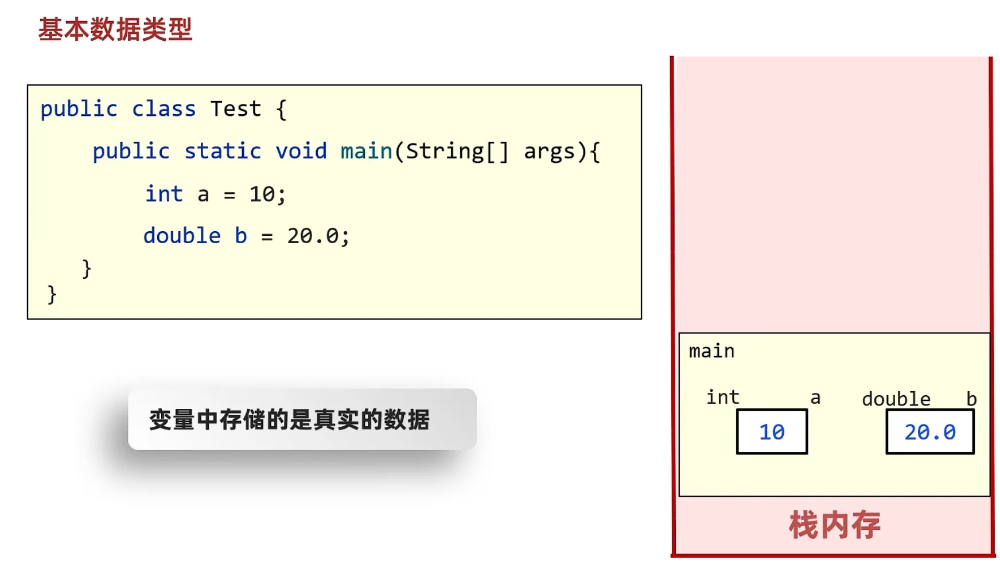

- **引用数据类型**

对象引用保存的是对象的引用

- 事实上没有对象变量这样的东西存在。
- 只有引用(reference)到对象的变量。
- 对象引用变量保存的是存取对象的方法。
- 它并不是对象的容器，而是`类似指向对象的指针`。或者可以说是`地址`
  。但在Java中我们不会也不该知道引用变量中实际装载的是什么，它只是用来代表单一的对象。`只有Java虚拟机才会知道如何使用引用来取得该对象。`

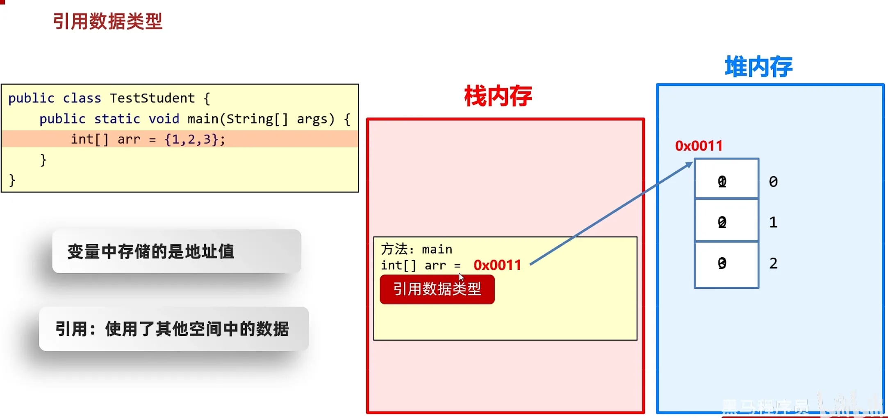


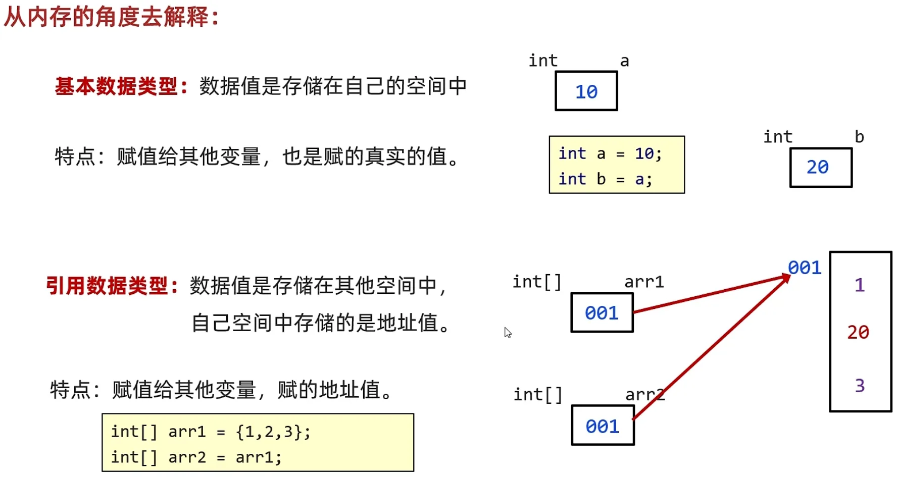

> 变量分类
>
> - 局部变量
> - 实例变量（成员变量）
> - 静态变量

- 局部变量

>- `在方法体内声明的变量被称为局部变量，该变量只能在该方法内使用，类中的其他方法并不知道该变量。`
>
>- 局部变量声明在方法、构造方法或者语句块中。
>- 局部变量在方法、构造方法、或者语句块被执行的时候创建，当它们执行完成后，将会被销毁。
>- 访问修饰符不能用于局部变量。
>- 局部变量只在声明它的方法、构造方法或者语句块中可见。
>- 局部变量是在栈上分配的。
>- 局部变量没有默认值，所以局部变量被声明后，必须经过初始化，才可以使用。

- 实例变量（成员变量）

>- `在类内部但在方法体外声明的变量称为成员变量，或者实例变量，或者字段。之所以称为实例变量，是因为该变量只能通过类的实例（对象）来访问。`
>- 成员变量声明在一个类中，但在方法、构造方法和语句块之外。
>- 当一个对象被实例化之后，每个成员变量的值就跟着确定。
>- 成员变量在对象创建的时候创建，在对象被销毁的时候销毁。
>- 成员变量的值应该至少被一个方法、构造方法或者语句块引用，使得外部能够通过这些方式获取实例变量信息。
>- 成员变量可以声明在使用前或者使用后。
>- 访问修饰符可以修饰成员变量。
>- 成员变量对于类中的方法、构造方法或者语句块是可见的。一般情况下应该把成员变量设为私有。通过使用访问修饰符可以使成员变量对子类可见；成员变量具有默认值。数值型变量的默认值是 0，布尔型变量的默认值是 false，引用类型变量的默认值是 null。变量的值可以在声明时指定，也可以在构造方法中指定。

- 静态变量

>- `通过static关键字声明的变量被称为静态变量（类变量），它可以直接被类访问`
>
>- 静态变量在类中以 static 关键字声明，但必须在方法构造方法和语句块之外。
>- 无论一个类创建了多少个对象，类只拥有静态变量的一份拷贝。
>- 静态变量除了被声明为常量外很少使用。
>- 静态变量储存在静态存储区。
>- 静态变量在程序开始时创建，在程序结束时销毁。
>- 与成员变量具有相似的可见性。但为了对类的使用者可见，大多数静态变量声明为 public 类型。
>- 静态变量的默认值和实例变量相似。
>- 静态变量还可以在静态语句块中初始化。

>- 注一：`成员变量又分为类变量（静态变量）和实例变量（非静态变量）。`
>- 注二：成员变量虽然有默认值，但是建议显示地对其赋予初值，这样可以提高程序代码的可读性。
>- 注三：如果局部变量名和成员变量名相同，则在这个方法中成员变量被隐藏，想要访问则需使用 this
>  关键字。但是建议不要定义与成员变量同名的局部变量，比如说如果在构造器中这么做，可能造成无法初始化某些成员变量的错误，而这种错误又很难被检测出来。
>- 注四：变量名可大小写混写，首字符小写，字间分隔符用字的首字母大写。**不用下划线**，少用美元符号。给变量命名是尽量做到**见名知意**。更多java代码规范，参见：[Google Java 编程风格指南](http://www.hawstein.com/posts/google-java-style.html)。
>- 注五：局部变量没有默认值，但成员变量有默认值。

### 变量声明

在Java中，每个变量都有一个类型(type)。在声明变量时，先指定变量的类型，然后是变量名。变量名对大小写敏感。

`double salary;`
`int vacationDays;`
`long earthPopulation;`
`boolean done;`

### 变量初始化

要想对一个已经声明过的变量进行赋值，就需要将变量名放在等号)左侧，再把一个适
当取值的Java表达式放在等号的右侧。
int vacationDays;
vacationDays =12;
也可以将变量的声明和初始化放在同一行中。例如：
int vacationDays 12;
最后，在Java中可以将声明放在代码中的任何地方。

#### 变量的注意事项

- 变量名不能重复
- 在一条语句中，可以定义多个变量。
- 变量在使用之前必须要赋值。
- 变量只能存一个值。

#### 标识符（类、变量等的名称）

- 必须由数字、字母、下划线`_`、美元符号`$`组成。
- 数字不能开头
- 不能是关键字
- 区分大小写的。

#### 小驼峰命名法

适用于变量名和方法名

* 如果是一个单词，那么全部小写，比如：name

* 如果是多个单词，那么从第二个单词开始，首字母大写，比如：firstName、maxAge

#### 大驼峰命名法

适用于类名

* 如果是一个单词，那么首字母大写。比如：Demo、Test。

* 如果是多个单词，那么每一个单词首字母都需要大写。比如：HelloWorld

不管起什么名字，都要做到见名知意。

### 常量

在`Java`中，利用关键字`final`指示常量。

关键字fial表示这个变量只能被赋值一次。一旦被赋值之后，就不能够再更改了。习惯上，常量名使用全大写。

在Java中，经常希望某个常量可以在一个类的多个方法中使用，通常将这些常量称为类常量(class constant)。可以使用关键字static
final设置一个类常量。

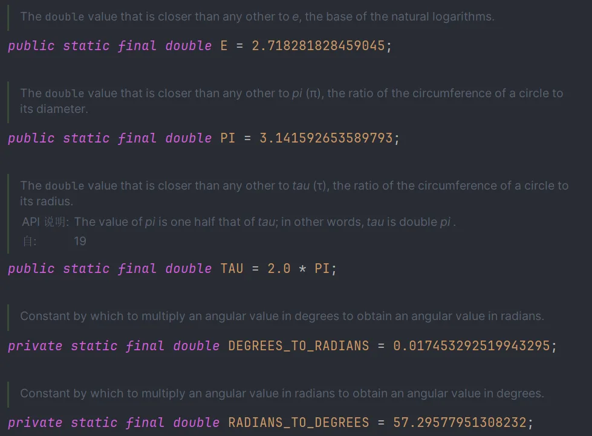

### 枚举类型

有时候，变量的取值只在一个有限的集合内。
针对这种情况，可以自定义枚举类型。枚举类型包括有限个命名的值。例如，
`enum Size {SMALL,MEDIUM,LARGE,EXTRA LARGE }`
现在，可以声明这种类型的变量：
`Size s Size.MEDIUM;`
Size类型的变量只能存储这个类型声明中给定的某个枚举值，或者特殊值null,null表示这个变量没有设置任何值。

## 运算符

 就是对常量或者变量进行操作的符号。

 比如： `+ -  *  /`

### 表达式

 用运算符把常量或者变量连接起来的，符合Java语法的式子就是表达式。

 比如：a + b 这个整体就是表达式。

 而其中+是算术运算符的一种，所以这个表达式也称之为算术表达式。

### 算术运算符

分类：分类：

```java
+ - * / %
```

运算特点：

```java
+ - * :跟小学数学中一模一样没有任何区别.
/：
1.整数相除结果只能得到整除，如果结果想要是小数，必须要有小数参数。
2.小数直接参与运算，得到的结果有可能是不精确的。
%：取模、取余。
   他做的也是除法运算，只不过获取的是余数而已。
```

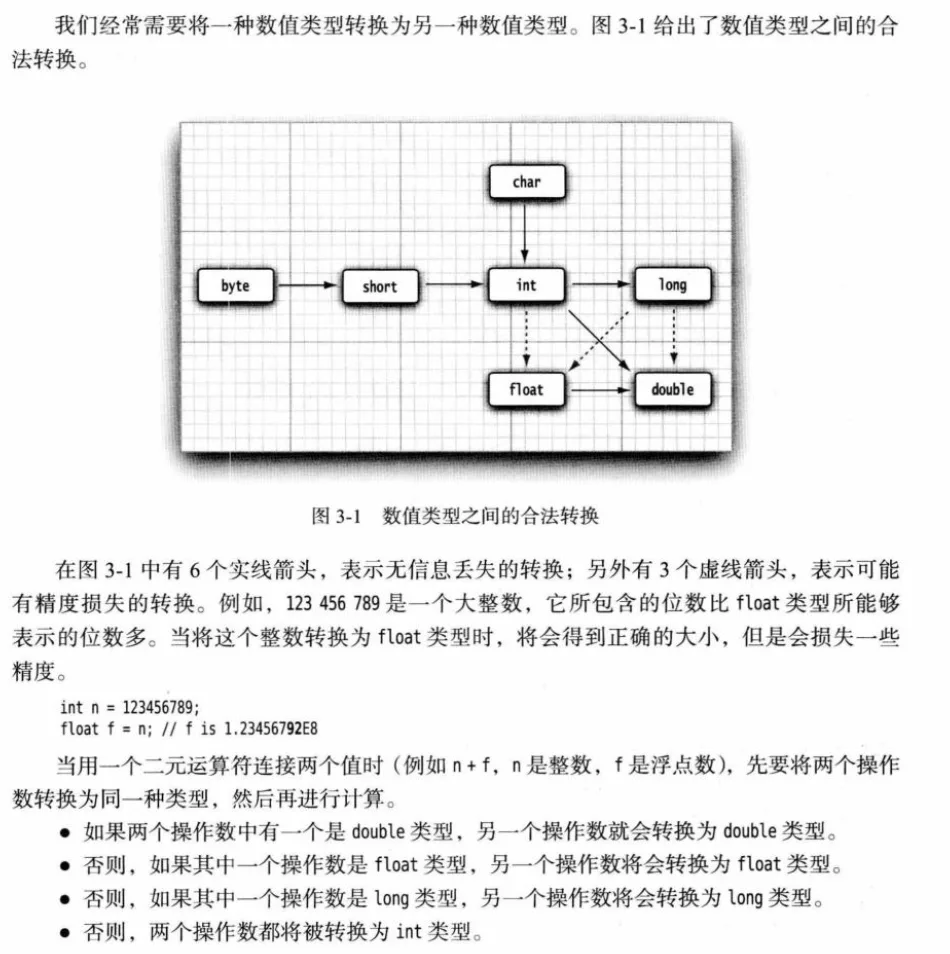

### 扩展赋值运算符

分类：

 +=、-=、*=、/=、%=

运算规则：

 就是把左边跟右边进行运算，把最终的结果赋值给左边，对右边没有任何影响。

注意点：

 扩展的赋值运算符中隐层还包含了一个强制转换。

### 关系运算符

又叫比较运算符，其实就是拿着左边跟右边进行了判断而已。

分类：

| 符号 | 解释                                                         |
| ---- | ------------------------------------------------------------ |
| ==   | 就是判断左边跟右边是否相等，如果成立就是true，如果不成立就是false |
| !=   | 就是判断左边跟右边是否不相等，如果成立就是true，如果不成立就是false |
| >    | 就是判断左边是否大于右边，如果成立就是true，如果不成立就是false |
| >=   | 就是判断左边是否大于等于右边，如果成立就是true，如果不成立就是false |
| <    | 就是判断左边是否小于右边，如果成立就是true，如果不成立就是false |
| <=   | 就是判断左边是否小于等于右边，如果成立就是true，如果不成立就是false |

注意点：

* 关系运算符最终的结果一定是布尔类型的。要么是true，要么是false
* 在写==的时候，千万不要写成=

### 逻辑运算符

& 和 | 的使用：

&：逻辑与（而且）

 两边都为真，结果才是真，只要有一个为假，那么结果就是假。

|：逻辑或（或者）

 两边都为假，结果才是假，只要有一个为真，那么结果就是真。

代码示例：

```java
// &  //两边都是真，结果才是真。
System.out.println(true & true);//true
System.out.println(false & false);//false
System.out.println(true & false);//false
System.out.println(false & true);//false

System.out.println("===================================");

// | 或  //两边都是假，结果才是假，如果有一个为真，那么结果就是真。
System.out.println(true | true);//true
System.out.println(false | false);//false
System.out.println(true | false);//true
System.out.println(false | true);//true
```

^（异或）的使用：

 在以后用的不多，了解一下即可。

计算规则：如果两边相同，结果为false，如果两边不同，结果为true

可以理解为无进位相加。

> 性质：
>
> 1. 0^N=N    N^N=0
> 2. B^A  = A^B    (B^A) ^C  = B^ (A^C)
> 3. 同一批数运算的结果，与顺序无关，结果固定。
>    下列代码实现顺序交换：（arr[i]=甲，arr[j]=乙）
>      arr[i] = arr[i] ^ arr[j];
>      arr[j] = arr[i] ^ arr[j];
>      arr[i] = arr[i] ^ arr[j]; 
>      原理（关键arr[i]和arr[j]所指向的内存中的内容不能是同一个，即地址不能相同，但值可以）
>      arr[i]=甲^乙，arr[j]=乙；即arr[i]=甲 ^乙，arr[j]=乙
>      arr[i]=甲^乙， arr[j]=乙^ （甲^乙）= （乙^ 乙）^甲=甲； 即arr[i]=甲^乙， arr[j]=甲
>      arr[i]=（甲^乙 ）^甲= （甲^ 甲）^乙=乙， arr[j]=甲；即arr[i]==乙， arr[j]=甲

代码示例：

```java
//^   //左右不相同，结果才是true，左右相同结果就是false
System.out.println(true ^ true);//false
System.out.println(false ^ false);//false
System.out.println(true ^ false);//true
System.out.println(false ^ true);//true
```

!（取反）的使用：

 是取反，也叫做非。

计算规则：false取反就是true，true取反就是false

温馨提示：**取反最多只用一个。**

代码示例：

```java
System.out.println(!false);//true
System.out.println(!true);//false
System.out.println(!!false);//注意点：取反最多只用一个。
```

短路逻辑运算符

分类： && ||

&&：

 运算结果跟&是一模一样的，只不过具有短路效果。

||：

 运算结果跟|是一模一样的。只不过具有短路效果。

逻辑核心：

 当左边不能确定整个表达式的结果，右边才会执行。

 当左边能确定整个表达式的结果，那么右边就不会执行了。从而提高了代码的运行效率。

总结：

 && 和 & 、||和|的运行结果都是一模一样的。

 但是短路逻辑运算符可以提高程序的运行效率。

建议：

 最为常用： && || ！

### 三元运算符

又叫做：三元表达式或者问号冒号表达式。

格式：

 关系表达式 ？ 表达式1 ：表达式2 ；

计算规则：

* 计算关系表达式的值。
* 如果关系表达式的值为真，那么执行表达式1。
* 如果关系表达式的值为假，那么执行表达式2。

注意点：

 三元运算符的最终结果一定要被使用，要么赋值给一个变量，要么直接打印出来。

### 位运算符

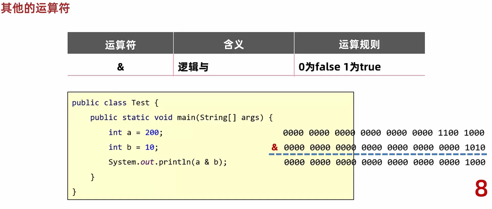

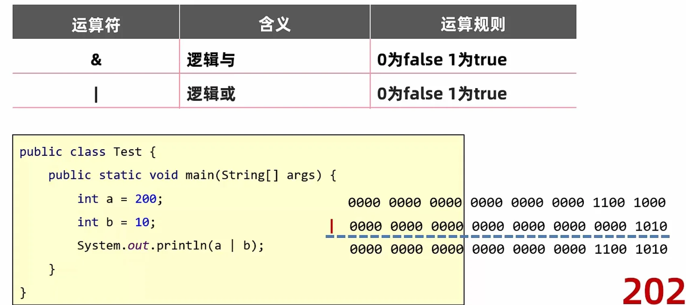

左移一次，原数乘2

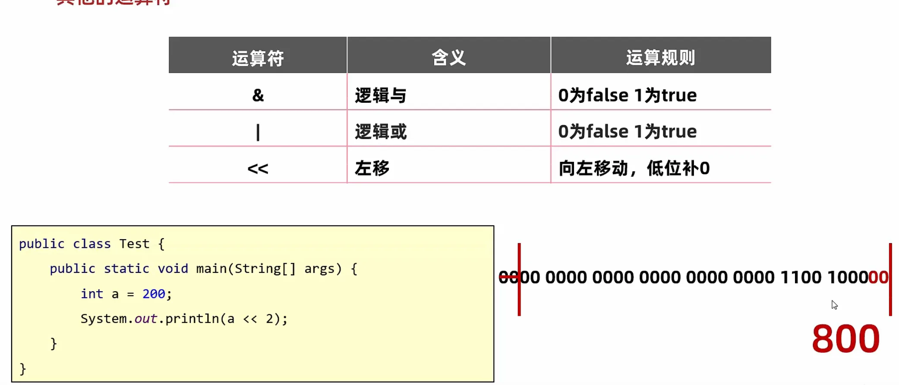

右移一次，原数除2

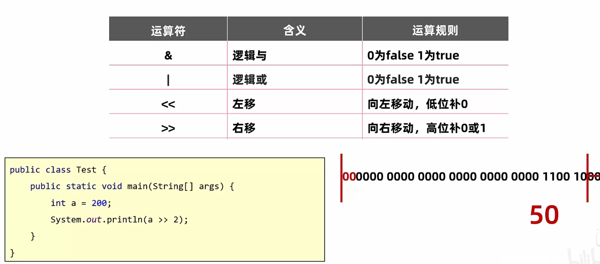

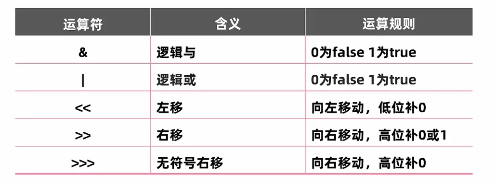

### 运算级别

如果不使用圆括号，就按照给出的运算符优先级次序进行计算。同一个级别的运算符按照从左到右的次序进行计算（但右结合运算符除外）。

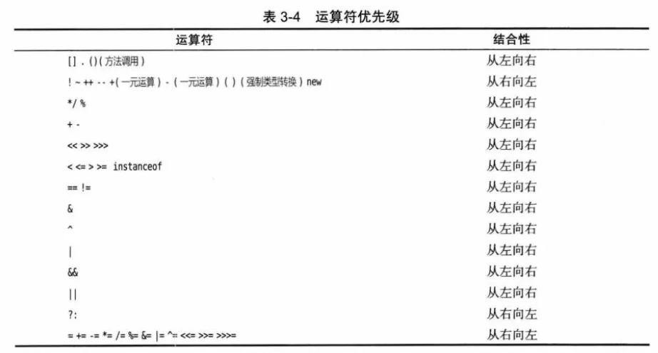

### 隐式转换（自动类型提升，前面补0）

把一个取值范围小的数据，变为取值范围大的数据。

#### 什么时候转换？

数据类型不一样，不能进行计算，需要转成一样的才可以进行计算。

#### 转换规则1

取值范围小的，和取值范围大的进行运算，小的会先提升为大的，再进行运算

#### 转换规则2

`byte` `short` `char`三种类型的数据在运算的时候，都会直接先提升为`int`， 然后再进行运算

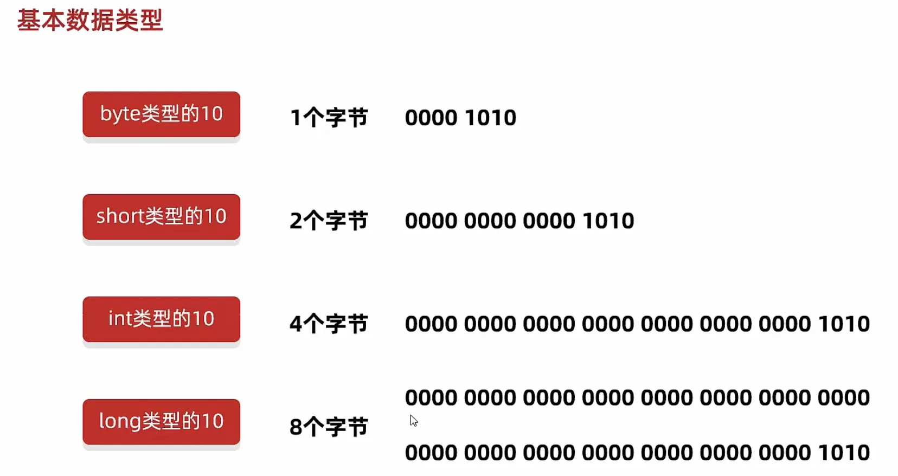

### 强制数据转换（前面去0）

把一个取值范围较大的变量，赋值给取值范围较小的变量。这种情况下不允许直接赋值，如果非要赋值，则必须进行强制转换。

格式 目标数据类型 变量名 = （目标数据类型）被强转变量

但有可能会出现数据溢出、丢失等等现象。

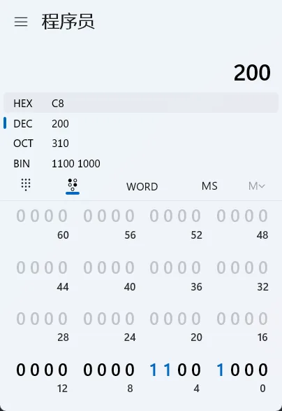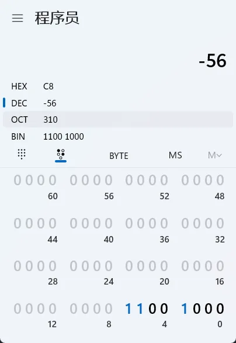

### 截尾和舍入

将float或double转型为整型值时，总是对该数值执行截尾。如果想要对结果进行舍入，就需要使用java.lang.Math中的round()方法。

### 原码、反码、补码

#### 前提知识

**机器数**

一个数在计算机中的二进制表示形式，叫做这个数的机器数。机器数是带符号的，在计算机用机器数的**最高位**存放符号，正数为0，负数为1。并将
**8位**数作为一个字节。

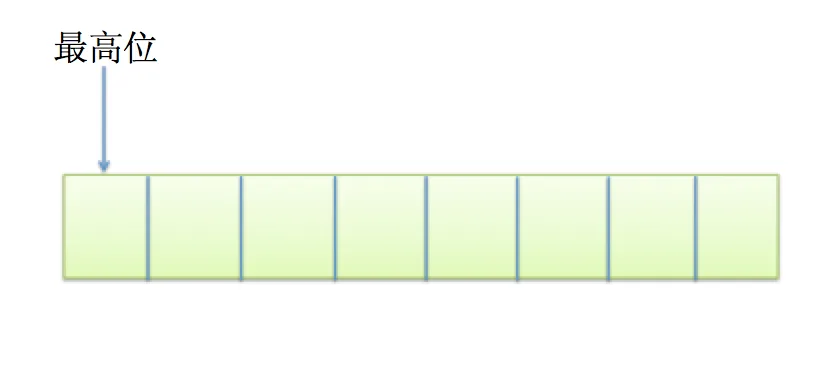

所以一个字节能存储的最大值是`01111111`转换后为+127

所以一个字节能存储的最小值是`11111111`转换后为-128

与`byte`的取值范围一样-2^7 ~ 2^7-1

#### 原码

原码：十进制数据的二进制表现形式，最左边是符号位，0为正，1为负

[+1]原= 0000 0001

[-1]原= 1000 0001

利用源码对正数运算时不会出现问题。但是复数进行计算时会有问题。

例如[-0]原= 1000 0000 所以0+1=[-0]+[+1]= 1000 0000+0000 0001=1000 0001=[-1]

#### 反码

反码：正数的补码反码是其本身，负数的反码是符号位保持不变，其余位取反。为了解决原码不能计算负数而设计的。

计算规则：正数的反码不变，**等于原码**。负数的反码在原码的基础上，符号位不变。数值取反，0变1,1变0。

原码
-56=10111000
反码
-56=11000111

-56+1=11000111+0000 0001=11001000=-55

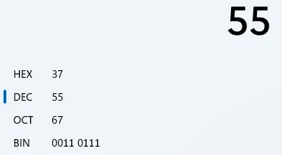

但由于0有两种表现形式，因此当数据计算跨**0**后，计算会出现问题。

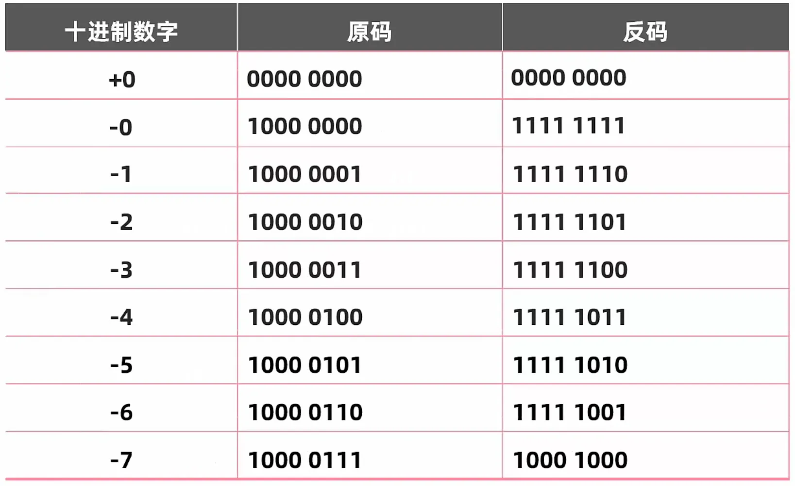

例如-4+7=11111011+00000111=00000010=2。

#### 补码

补码：正数的补码是其本身，负数的补码是在其反码的基础上+1。目的是将两个0错开一位。

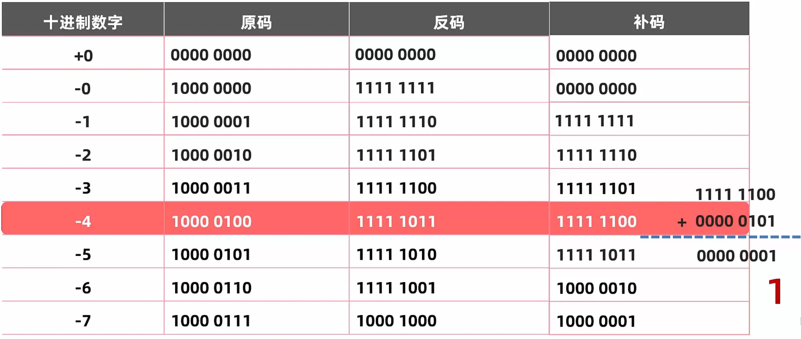

-128=无[原码]=无[补码]=10000000

所以计算机内的数据都是按照补码进行运算的。因此`byte`的取值范围为-2^7 ~ 2^7-1

#### 总结

##### 原码

十进制数据的二进制表现形式，最左边是符号位，0为正，1为负。

##### 原码的弊端

利用原码进行计算的时候，如果是正数完全没有问题。
但是如果是负数计算，结果就出错，实际运算的方向，跟正确的运算方向是相反的。

##### 反码出现的目的

为了解决原码不能计算负数的问题而出现的。

##### 反码的计算规则

正数的反码不变，负数的反码在原码的基础上，符号位不变。数值取反，0变1,1变0。

##### 反码的弊端

负数运算的时候，如果结果不跨0，是没有任何问题的，但是如果结果跨0，跟实际结果会有1的偏差。

##### 补码出现的目的

为了解决负数计算时跨0的问题而出现的。

##### 补码的计算规则

正数的补码不变，负数的补码在反码的基础上+1。
另外补码还能多记录一个特殊的值-128，该数据在1个字节下，没有原码和反码。

##### 补码的注意点

计算机中的存储和计算都是以补码的形式进行的。

## 字符串

从概念上讲，Java字符串就是Unicode字符序列。例如，字符串"Java\u22122"
由5个Unicode字符J、a、v、a和TM组成。Java没有内置的字符串类型，而是在标准Java类库中提供了一个预定义类，很自然地叫做String。

**注释：类似于C和C++,Java字符串中的代码单元和代码点从0开始计数。**

String类的`substring`方法可以从一个较大的字符串提取出一个子串。

### String类的特点

- 字符串不可变，它们的值在创建后不能被更改
- 虽然 String 的值是不可变的，但是它们可以被共享
- 字符串效果上相当于字符数组( char[] )，但是底层原理是字节数组( byte[] )

### String类的构造方法

- 常用的构造方法

  | 方法名                        | 说明                                      |
  | ----------------------------- | ----------------------------------------- |
  | `public   String()`           | 创建一个空白字符串对象，不含有任何内容    |
  | `public   String(char[] chs)` | 根据字符数组的内容，来创建字符串对象      |
  | `public   String(byte[] bys)` | 根据字节数组的内容，来创建字符串对象      |
  | `String s =   “abc”;`         | 直接赋值的方式创建字符串对象，内容就是abc |

### 创建字符串对象两种方式的区别

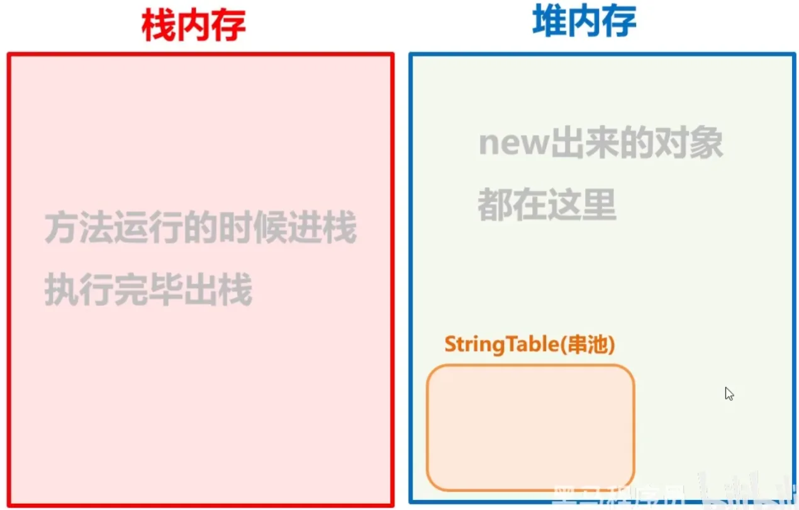

- 通过构造方法创建

  通过 `new` 创建的字符串对象，每一次 `new` 都会申请一个内存空间，虽然内容相同，但是地址值不同

- 直接赋值方式创建

  以`“”`方式给出的字符串，只要字符序列相同(顺序和大小写)，无论在程序代码中出现几次，`JVM` 都只会建立一个 `String`
  对象，并在字符串池中维护

  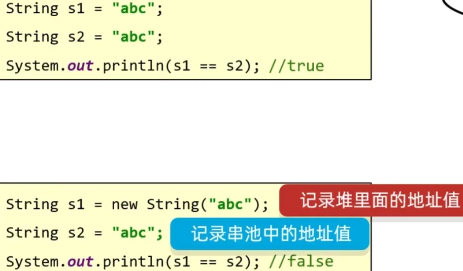

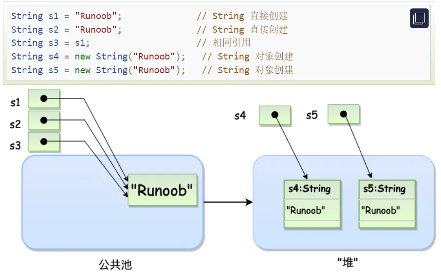

> 注意点：String str = new String("Hello"); 会产生几个对象？
> 如果字符串池里面没有“Hello”对象，会在字符串池里面生成一个对象，然后再生成一个字符串对象，str指向这个对象；如果字符串池里面已经有了“Hello”对象，则只会生成一个对象，str指向这个对象。
>
> 所以会有两个对象。

面试题（Java8）：

题1： String str =new String(“ab”) 会创建几个对象？

```java
public class StringNewTest {
    public static void main(String[] args) {
        String str = new String("ab");
    }
}
```

`javap -v StringNewTest.class` [反编译](https://so.csdn.net/so/search?q=反编译&spm=1001.2101.3001.7020)后， 部分片段如下：

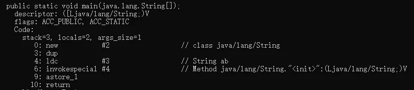

根据反编译后字节码分析：

1. 一个对象是：new关键字在堆空间创建的；
2. 另一个对象是：字符串常量池中的对象"ab"。 （如果前后文中还有代码，并且已经有 ab 常量在常量池存在时，ab
   将不再创建，因为在常量池只能存在一份相同的对象）

结论是至多是2个对象。

题2：String str =new String(“a”) + new String(“b”) 会创建几个对象 ?

```java
public class StringNewTest {
    public static void main(String[] args) {
        String str = new String("a") + new String("b");
    }
}
```

javap -v StringNewTest.class 反编译后， 部分片段如下：

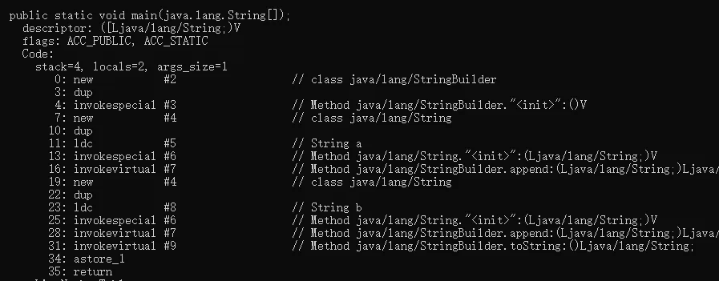

根据反编译后字节码分析：

对象1： new StringBuilder()
对象2： new String(“a”)
对象3： 常量池中的"a"
对象4： new String(“b”)
对象5： 常量池中的"b"

深入剖析： StringBuilder 的 toString() 方法中有 new String(value, 0, count) ，
对象6 ：new String(“ab”)

Java11则又做了优化：

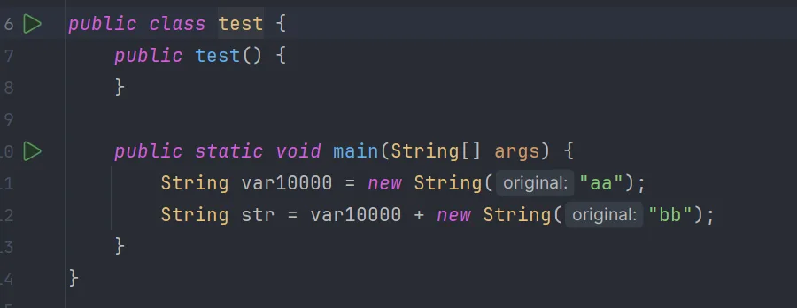

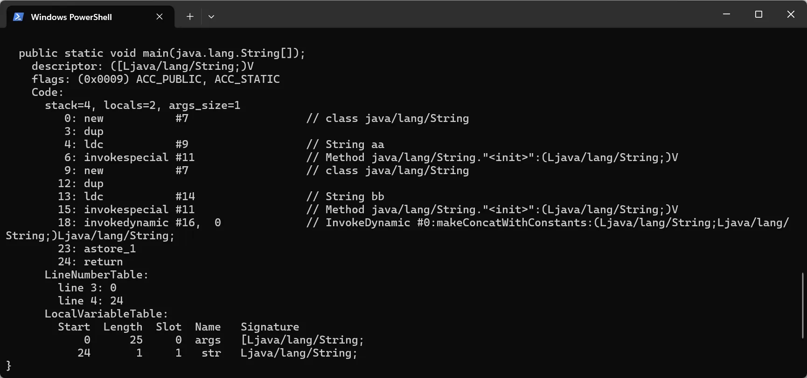


**强调一下：**
StringBuilder 的 toString()
的调用，在[字符串常量池](https://so.csdn.net/so/search?q=字符串常量池&spm=1001.2101.3001.7020)中，没有生成"ab"。
如果前后文中还有代码，并且已经常量在常量池存在时，相同的常量 将不再创建，因为在常量池只能存在一份相同的对象。

结论是至多是6个对象。

题3：String str =“a”+ “b” 会创建几个对象 ?

```java
public class StringNewTest {
    public static void main(String[] args) {
        String str = "a" + "b";
    }
}
```

javap -v StringNewTest.class 反编译后， 部分片段如下：

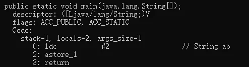

"a" + "b" 在编译时，就已经编译为 ab， 被放到常量池中。
所以只有一个对象 ：ab

注意：
如果前后文中还有代码，并且已经有 ab 常量在常量池存在时，ab 将不再创建，因为在常量池只能存在一份相同的对象。

**字符串拼接操作的总结**

- **常量** 与 **常量** 的拼接结果在 常量池，原理是 **编译期** 优化；
- 常量池 中不会存在相同内容的常量；
- 只要其中一个是变量，结果在堆中。 如： String s2 = s1+"DEF" ;
- 变量拼接的原理 是StringBuilder 。
- 如果拼接的结果是调用 intern() 方法，则主动将常量池中 **还没有的字符串** 对象放入池中，并返回地址。

### 拼接

当将一个字符串与一个非字符串的值进行拼接时，后者会转换成字符串（任何一个Java对象都可以转换成字符串)。

字符串的+操作

* 当+操作中出现字符串时，此时就是字符串的连接符，会将前后的数据进行拼接，并产生一个新的字符串。
* 当连续进行+操作时，从左到右逐个执行的。

```java
案例：
1 + 2 + "abc" + 2 + 1
//“3abc21”
```

* 当+操作中出现了字符，会拿着字符到计算机内置的ASCII码表中去查对应的数字，然后再进行计算。

```java
案例：
char c = 'a';
int result = c + 0;
System.out.println(result);//97
```

### 不可变字符串

String类没有提供修改字符串中某个字符的方法。

由于不能修改Java字符串中的单个字符，所以在Java文档中将String类对象称为是不可变的(immutable)
。不过，可以修改字符串变量，让它引用另外一个字符串。不可变字符串却有一个优点：编译器可以让字符串共享。

为了弄清具体的工作方式，可以想象将各种字符串存放在公共的存储池中。字符串变量指向存储池中相应的位置。如果复制一个字符串变量，原始字符串与复制的字符串共享相同的字符。

总而言之，Java的设计者认为共享带来的高效率远远胜过于提取子串、拼接字符串所带来的低效率。可以看看你自己的程序，我们发现：大多数情况下都不会修改字符串，而只是需要对字符串进行比较。

### 检测字符串是否相等

可以使用equals方法检测两个字符串是否相等。对于表达式：
`s.equals(t)`
如果字符串s与字符串t相等，则返回true;否则，返回false。需要注意的是，s与t可以是字符串变量，也可以是字符串字面量。要想检测两个字符串是否相等，而不区分大小写，可以使用equalsIgnoreCase方法。

String字符串可以使用“`==`”和equals()方法比较。当两个字符串使用“`==`
”进行比较时，比较的是两个字符串在内存中的地址。当两个字符串使用equals方法比较时，比较的是两个字符串的值是否相等。

### 空串与Null串

空串"是长度为0的字符串。可以调用以下代码检查一个字符串是否为空：
if (str.length()==0)
或
if (str.equals(""))
空串是一个Java对象，有自己的串长度(0)和内容（空）。不过，String变量还可以存放一个特殊的值，名为null,表示目前没有任何对象与该变量关联。要检查一个字符串是否为ull,要使用以下条件：
if (str ==null)
有时要检查一个字符串既不是null也不是空串，这种情况下就需要使用以下条件：
if (str !=null && str.length()!=0)

### 码点与代码单元

Java字符串由char值序列组成。char数据类型是一个采用UTF-16编码表示Unicode码点的代码单元。最常用的Unicode字符使用一个代码单元就可以表示，而辅助字符需要`一对`
代码单元表示。

**所以代码单元指的是一个char字符，码点指的是实际的一个具有现实意义的字符。
我们可以这样认为：一个char字符我们可以称之为代码单元，一个Unicode字符我们称之为码点。**

例如，一个雪人字符（☃），是一个Unicode码点，也就是一个Unicode编码所代表的符号，在UTF-8中用3个代码单元表示，在UTF-16中用一个代码单元表示。

Length方法将返回采用UTF-16编码表示给定字符串所需要的代码单元数量。

```java
//🍷Hello 需要7个char字符进行存储，其中🍷占两个
String test="🍷Hello";
//得到的是代码单元的数量 7 🍷占两个代码单元(两个char)
System.out.println(test.length());
```

要想得到实际的长度，即码点数量，可以调用

```java
// String.codePointCount用来计算字符串中的真实Unicode的数量，也就是码点数量
// 所以它的结果应该是6
int cpCount = greeting.codePointCount(0,greeting.length());
```

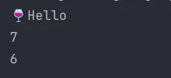

调用`charAt(n)`将返回位置n的代码单元。

要想得到第i个码点，应该使用下列语句

```java
int index = greeting.offsetByCodePoints(0, 1);
int cp = greeting.codePointAt(index);
```

#### 遍历一个字符串

对于**有非常规字符的字符串**，使用charAt来遍历会出现问题。

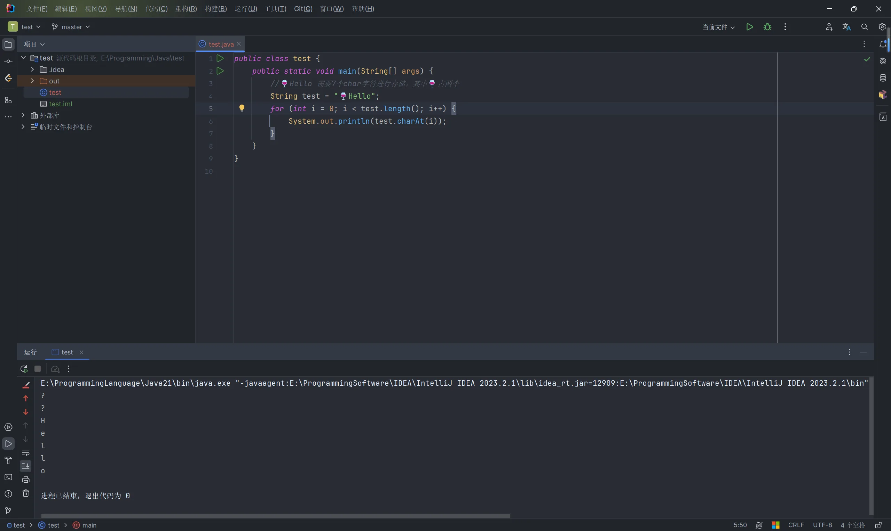

所以应当使用码点来遍历。

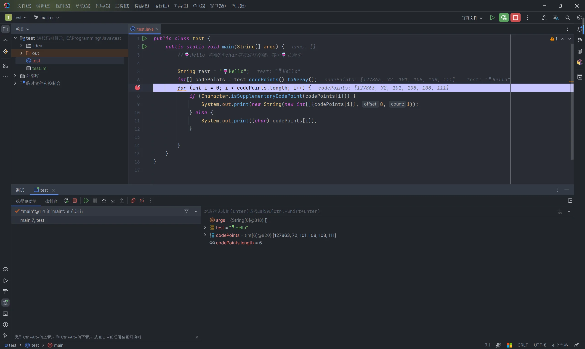

#### 将码点数组转为字符串

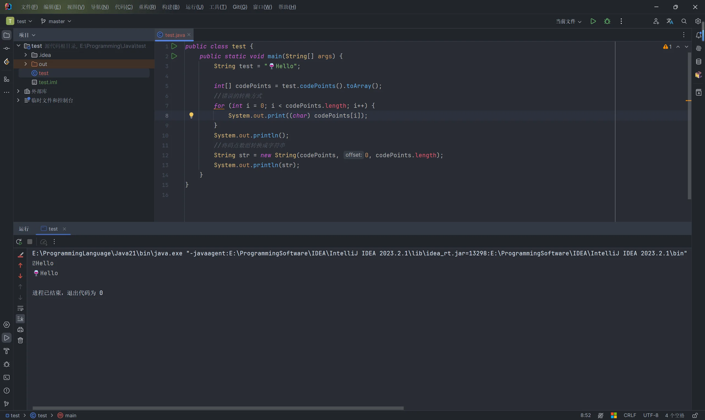

### 构建字符串

#### `StringBuilder`

`StringBuilder` 可以看成是一个容器，创建之后里面的内容是可变的。

当我们在拼接字符串和反转字符串的时候会使用到

在字符串构建完成时就调用`toString`方法，将可以得到一个String对象，其中包含了构建器中的字符序列。

##### 基本使用

```java
public class StringBuilderDemo3 {
    public static void main(String[] args) {
        //1.创建对象
        StringBuilder sb = new StringBuilder("abc");

        //2.添加元素
        /*sb.append(1);
        sb.append(2.3);
        sb.append(true);*/

        //反转
        sb.reverse();

        //获取长度
        int len = sb.length();
        System.out.println(len);

        //打印
        //普及：
        //因为StringBuilder是Java已经写好的类
        //java在底层对他做了一些特殊处理。
        //打印对象不是地址值而是属性值。
        System.out.println(sb);
    }
}
```

##### 链式编程

```java
public class StringBuilderDemo4 {
    public static void main(String[] args) {
        //1.创建对象
        StringBuilder sb = new StringBuilder();

        //2.添加字符串
        sb.append("aaa").append("bbb").append("ccc").append("ddd");

        System.out.println(sb);//aaabbbcccddd

        //3.再把StringBuilder变回字符串
        String str = sb.toString();
        System.out.println(str);//aaabbbcccddd

    }
}
```

#### `StringJoiner`

* `StringJoiner`跟`StringBuilder`一样，也可以看成是一个容器，创建之后里面的内容是可变的。
* 作用：提高字符串的操作效率，而且代码编写特别简洁，但是目前市场上很少有人用。
* `JDK8`出现的

基本使用：

```java
//1.创建一个对象，并指定中间的间隔符号
StringJoiner sj = new StringJoiner("---");
//2.添加元素
sj.add("aaa").add("bbb").add("ccc");
//3.打印结果
System.out.println(sj);//aaa---bbb---ccc
```

```java
//1.创建对象
StringJoiner sj = new StringJoiner(", ","[","]");
//2.添加元素
sj.add("aaa").add("bbb").add("ccc");
int len = sj.length();
System.out.println(len);//15
//3.打印
System.out.println(sj);//[aaa, bbb, ccc]
String str = sj.toString();
System.out.println(str);//[aaa, bbb, ccc]
```

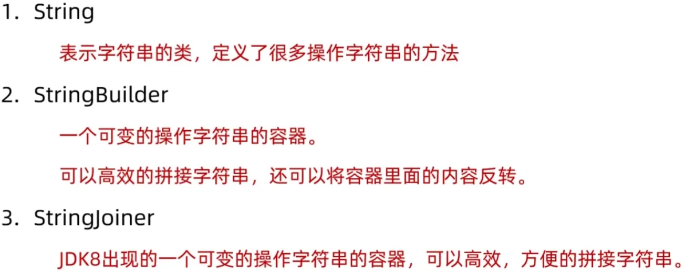

### 关于字符串的小扩展：

1. 字符串存储的内存原理

   `String s = “abc”；`直接赋值

   特点：

    此时字符串`abc`是存在字符串常量池中的。

    先检查字符串常量池中有没有字符串`abc`，如果有，不会创建新的，而是直接复用。如果没有abc，才会创建一个新的。

   所以，直接赋值的方式，代码简单，而且节约内存。

2. new出来的字符串

   看到new关键字，一定是在堆里面开辟了一个小空间。

   `String s1 = new String（“abc”）；`

   `String s2 = “abc”；`

   s1记录的是`new`出来的，在堆里面的地址值。

   s2是直接赋值的，所以记录的是字符串常量池中的地址值。

3. `==`号比较的到底是什么？

   如果比较的是基本数据类型：比的是具体的数值是否相等。

   如果比较的是引用数据类型：比的是地址值是否相等。

   结论：`==`只能用于比较基本数据类型。不能比较引用数据类型。

4.字符串拼接

无变量参与：

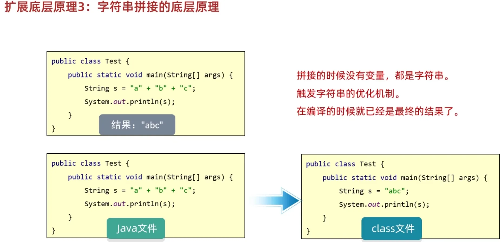

有变量参与：

`Jdk8`以前

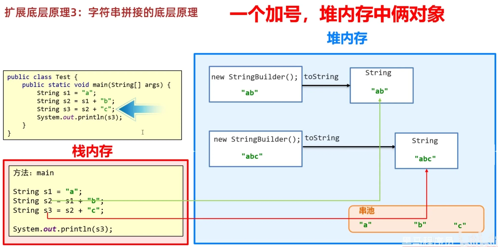

`Jdk8`以后，进行数组预估来拼接。


5.`StringBuilder`提高效率


## 输入与输出

### 读取输入

前面已经看到，将输出打印到“标准输出流”（即控制台窗口）是一件非常容易的事情，只要调用System.out.println即可。然而，读取“标准输入流”System.in就没有那么简单了。
要想通过控制台进行输入，首先需要构造一个与“标准输入流”System.in关联的Scanner对象。
Scanner in = new Scanner(System.in);

现在，就可以使用Scanner类的各种方法读取输入了。

例如：next() 与 nextLine()

next():

- 一定要读取到有效字符后才可以结束输入。
- 对输入有效字符之前遇到的空白，next() 方法会自动将其去掉。
- 只有输入有效字符后才将其后面输入的空白作为分隔符或者结束符。
- next() 不能得到带有空格的字符串。

nextLine()：

- 以Enter为结束符,也就是说 nextLine()方法返回的是输入回车之前的所有字符。
- 可以获得空白。

### 格式化输出

Java 中的 `System.out.format();`和 `System.out.printf();`方法用于格式化输出。

```java
import java.util.Date;
 
/**
 * 使用printf输出
 */
/**关键技术点
 * 使用java.io.PrintStream的printf方法实现C风格的输出
 * printf 方法的第一个参数为输出的格式,第二个参数是可变长的,表示待输出的数据对象
 */
public class Printf {
 
       public static void main(String[] args) {
              /*** 输出字符串 ***/
              // %s表示输出字符串，也就是将后面的字符串替换模式中的%s
              System.out.printf("%s", new Integer(1212));
              // %n表示换行
              System.out.printf("%s%n", "end line");
              // 还可以支持多个参数
              System.out.printf("%s = %s%n", "Name", "Zhangsan");
              // %S将字符串以大写形式输出
              System.out.printf("%S = %s%n", "Name", "Zhangsan");
              // 支持多个参数时，可以在%s之间插入变量编号，1$表示第一个字符串，3$表示第3个字符串
              System.out.printf("%1$s = %3$s %2$s%n", "Name", "san", "Zhang");
             
              /*** 输出boolean类型 ***/
              System.out.printf("true = %b; false = ", true);
              System.out.printf("%b%n", false);
 
              /*** 输出整数类型***/
              Integer iObj = 342;
              // %d表示将整数格式化为10进制整数
              System.out.printf("%d; %d; %d%n", -500, 2343L, iObj);
              // %o表示将整数格式化为8进制整数
              System.out.printf("%o; %o; %o%n", -500, 2343L, iObj);
              // %x表示将整数格式化为16进制整数
              System.out.printf("%x; %x; %x%n", -500, 2343L, iObj);
              // %X表示将整数格式化为16进制整数，并且字母变成大写形式
              System.out.printf("%X; %X; %X%n", -500, 2343L, iObj);
             
              /*** 输出浮点类型***/
              Double dObj = 45.6d;
              // %e表示以科学技术法输出浮点数
              System.out.printf("%e; %e; %e%n", -756.403f, 7464.232641d, dObj);
              // %E表示以科学技术法输出浮点数，并且为大写形式            
              System.out.printf("%E; %E; %E%n", -756.403f, 7464.232641d, dObj);
              // %f表示以十进制格式化输出浮点数
              System.out.printf("%f; %f; %f%n", -756.403f, 7464.232641d, dObj);
              // 还可以限制小数点后的位数
              System.out.printf("%.1f; %.3f; %f%n", -756.403f, 7464.232641d, dObj);
             
              /*** 输出日期类型***/
              // %t表示格式化日期时间类型，%T是时间日期的大写形式，在%t之后用特定的字母表示不同的输出格式
              Date date = new Date();
              long dataL = date.getTime();
              // 格式化年月日
              // %t之后用y表示输出日期的年份（2位数的年，如99）
              // %t之后用m表示输出日期的月份，%t之后用d表示输出日期的日号
              System.out.printf("%1$ty-%1$tm-%1$td; %2$ty-%2$tm-%2$td%n", date, dataL);
              // %t之后用Y表示输出日期的年份（4位数的年），
              // %t之后用B表示输出日期的月份的完整名， %t之后用b表示输出日期的月份的简称
              System.out.printf("%1$tY-%1$tB-%1$td; %2$tY-%2$tb-%2$td%n", date, dataL);
             
              // 以下是常见的日期组合
              // %t之后用D表示以 "%tm/%td/%ty"格式化日期
              System.out.printf("%1$tD%n", date);
              //%t之后用F表示以"%tY-%tm-%td"格式化日期
              System.out.printf("%1$tF%n", date);
             
              /*** 输出时间类型***/
              // 输出时分秒
              // %t之后用H表示输出时间的时（24进制），%t之后用I表示输出时间的时（12进制），
              // %t之后用M表示输出时间的分，%t之后用S表示输出时间的秒
              System.out.printf("%1$tH:%1$tM:%1$tS; %2$tI:%2$tM:%2$tS%n", date, dataL);
              // %t之后用L表示输出时间的秒中的毫秒
              System.out.printf("%1$tH:%1$tM:%1$tS %1$tL%n", date);
              // %t之后p表示输出时间的上午或下午信息
              System.out.printf("%1$tH:%1$tM:%1$tS %1$tL %1$tp%n", date);
             
              // 以下是常见的时间组合
              // %t之后用R表示以"%tH:%tM"格式化时间
              System.out.printf("%1$tR%n", date);
              // %t之后用T表示以"%tH:%tM:%tS"格式化时间
              System.out.printf("%1$tT%n", date);
              // %t之后用r表示以"%tI:%tM:%tS %Tp"格式化时间
              System.out.printf("%1$tr%n", date);
             
              /*** 输出星期***/
              // %t之后用A表示得到星期几的全称
              System.out.printf("%1$tF %1$tA%n", date);
              // %t之后用a表示得到星期几的简称
              System.out.printf("%1$tF %1$ta%n", date);
             
              // 输出时间日期的完整信息
              System.out.printf("%1$tc%n", date);
       }
}
/**
 *printf方法中,格式为"%s"表示以字符串的形式输出第二个可变长参数的第一个参数值;
 *格式为"%n"表示换行;格式为"%S"表示将字符串以大写形式输出;在"%s"之间用"n$"表示
 *输出可变长参数的第n个参数值.格式为"%b"表示以布尔值的形式输出第二个可变长参数
 *的第一个参数值.
 */
/**
 * 格式为"%d"表示以十进制整数形式输出;"%o"表示以八进制形式输出;"%x"表示以十六进制
 * 输出;"%X"表示以十六进制输出,并且将字母(A、B、C、D、E、F)换成大写.格式为"%e"表
 * 以科学计数法输出浮点数;格式为"%E"表示以科学计数法输出浮点数,而且将e大写;格式为
 * "%f"表示以十进制浮点数输出,在"%f"之间加上".n"表示输出时保留小数点后面n位.
 */
/**
 * 格式为"%t"表示输出时间日期类型."%t"之后用y表示输出日期的二位数的年份(如99)、用m
 * 表示输出日期的月份,用d表示输出日期的日号;"%t"之后用Y表示输出日期的四位数的年份
 * (如1999)、用B表示输出日期的月份的完整名,用b表示输出日期的月份的简称."%t"之后用D
 * 表示以"%tm/%td/%ty"的格式输出日期、用F表示以"%tY-%tm-%td"的格式输出日期.
 */
/**
 * "%t"之后用H表示输出时间的时(24进制),用I表示输出时间的时(12进制),用M表示输出时间
 * 分,用S表示输出时间的秒,用L表示输出时间的秒中的毫秒数、用 p 表示输出时间的是上午还是
 * 下午."%t"之后用R表示以"%tH:%tM"的格式输出时间、用T表示以"%tH:%tM:%tS"的格式输出
 * 时间、用r表示以"%tI:%tM:%tS %Tp"的格式输出时间.
 */
/**
 * "%t"之后用A表示输出日期的全称,用a表示输出日期的星期简称.
 */
```

输出结果

```java
1212end line
Name = Zhangsan
NAME = Zhangsan
Name = Zhang san
true = true; false = false
-500; 2343; 342
37777777014; 4447; 526
fffffe0c; 927; 156
FFFFFE0C; 927; 156
-7.564030e+02; 7.464233e+03; 4.560000e+01
-7.564030E+02; 7.464233E+03; 4.560000E+01
-756.403015; 7464.232641; 45.600000
-756.4; 7464.233; 45.600000
24-02-03; 24-02-03
2024-二月-03; 2024-2月-03
02/03/24
2024-02-03
16:24:00; 04:24:00
16:24:00 968
16:24:00 968 下午
16:24
16:24:00
04:24:00 下午
2024-02-03 星期六
2024-02-03 周六
周六 2月 03 16:24:00 CST 2024
```

或者是使用`String.format()`创建格式化字符串但不输出。

格式说明符语法图：


### 文件输入与输出

要想读取一个文件，需要构造一个Scanner对象：

`Scanner in = new Scanner(Path.of("myfile.txt"),StandardCharsets.UTF_8);`

要想写入文件，就需要构造一个PrintWriter对象。在构造器(constructor)中，需要提供文件名和字符编码：

`PrintWriter out = new PrintWriter("myfile.txt",StandardCharsets.UTF 8);`

### 键盘录入

#### 一，键盘录入方法：

​    `next（）`、`nextLine（）`、`nextInt（）`、`nextDouble（）`。

1）`next（）`、`nextLine（）`：

可以接受任意数据，但是都会返回一个字符串。

比如：键盘录入`abc`，那么会把`abc`看做字符串返回。

 键盘录入`123`，那么会把`123`看做字符串返回。

2）`nextInt（）`：

 只能接受整数。

比如：键盘录入123，那么会把123当做`int`类型的整数返回。

 键盘录入小数或者其他字母，就会报错。

3）`nextDouble（）`：

 能接收整数和小数，但是都会看做小数返回。

 录入字母会报错。

#### 二，方法底层细节 ：

第一个细节：

`next（），nextInt（），nextDouble（）`在接收数据的时候，会遇到空格，回车，制表符其中一个就会停止接收数据。

```java
Scanner sc = new Scanner(System.in);
double d = sc.nextDouble();
System.out.println(d);
//键盘录入：1.1 2.2//注意录入的时候1.1和2.2之间加空格隔开。
//此时控制台打印1.1
//表示nextDouble方法在接收数据的时候，遇到空格就停止了，后面的本次不接收。
```

```java
Scanner sc = new Scanner(System.in);
int i = sc.nextInt();
System.out.println(i);
//键盘录入：1 2//注意录入的时候1和2之间加空格隔开。
//此时控制台打印1
//表示nextInt方法在接收数据的时候，遇到空格就停止了，后面的本次不接收。
```

```java
Scanner sc = new Scanner(System.in);
String s = sc.next();
System.out.println(s);
//键盘录入：a b//注意录入的时候a和b之间加空格隔开。
//此时控制台打印a
//表示next方法在接收数据的时候，遇到空格就停止了，后面的本次不接收。
```

第二个细节：

`next（），nextInt（），nextDouble（）`在接收数据的时候，会遇到空格，回车，制表符其中一个就会停止接收数据。但是这些符号 +
后面的数据还在内存中并没有接收。如果后面还有其他键盘录入的方法，会自动将这些数据接收。

```java
Scanner sc = new Scanner(System.in);
String s1 = sc.next();
String s2 = sc.next();
System.out.println(s1);
System.out.println(s2);
//此时值键盘录入一次a b(注意a和b之间用空格隔开)
//那么第一个next();会接收a，a后面是空格，那么就停止，所以打印s1是a
//但是空格+b还在内存中。
//第二个next会去掉前面的空格，只接收b
//所以第二个s2打印出来是b
```

第三个细节：

`nextLine（）`方法是把一整行全部接收完毕。

```java
Scanner sc = new Scanner(System.in);
String s = sc.nextLine();
System.out.println(s);
//键盘录入a b(注意a和b之间用空格隔开)
//那么nextLine不会过滤前面和后面的空格，会把这一整行数据全部接收完毕。
```

#### 三、混用引起的后果

上面说的两套键盘录入不能混用，如果混用会有严重的后果。

代码示例：

```java
Scanner sc = new Scanner(System.in);//①
int i = sc.nextInt();//②
String s = sc.nextLine();//③
System.out.println(i);//④
System.out.println(s);//⑤
```

当代码运行到第二行，会让我们键盘录入，此时录入123。

但是实际上我们录的是123+回车。

而`nextInt`是遇到空格，回车，制表符都会停止。

所以`nextInt`只能接受123，回车还在内存中没有被接收。

此时就被`nextLine`接收了。

所以，如果混用就会导致`nextLine`接收不到数据。

#### 四、结论（如何使用）

键盘录入分为两套：

- `next（）、nextInt（）、nextDouble（）`这三个配套使用。

如果用了这三个其中一个，就不要用`nextLine（）`。

- `nextLine（）`单独使用。

如果想要整数，那么先接收，再使用`Integer.parseInt`进行类型转换。

```java
Scanner sc = new Scanner(System.in);
String s = sc.next();//键盘录入123
System.out.println("此时为字符串" + s);//此时123是字符串
int i = sc.nextInt();//键盘录入123
System.out.println("此时为整数：" + i);
```

```java
Scanner sc = new Scanner(System.in);
String s = sc.nextLine();//键盘录入123
System.out.println("此时为字符串" + s);//此时123是字符串
int i = Integer.parseInt(s);//想要整数再进行转换
System.out.println("此时为整数：" + i);
```

## 控制流程

### 块作用域

在深入学习控制结构之前，需要了解块(block)的概念。

块（即复合语句）是指由若干条Java语句组成的语句，并用一对大括号括起来。块确定了变量的作用域。一个块可以嵌套在另一个块中。

但是，不能在嵌套的两个块中声明同名的变量。

### 条件语句

在Java中，条件语句的形式为
if (condition){
statement
}

### 循环

#### 不确定循环

```java
while( 布尔表达式 ) {
  //循环内容
}
```

```java
do {
       //代码语句
}while(布尔表达式);
```

#### 确定循环

```java
for(初始化; 布尔表达式; 更新) {
    //代码语句
}
```

增强 for 循环

```java
for(声明语句 : 表达式)
{
   //代码句子
}
```

### 多重选择：switch语句

```java
switch(expression){
    case value :       
    //语句       
    break; //可选   
    case value :       
    //语句       
    break; //可选    
    //你可以有任意数量的case语句    
    default : //可选       
    //语句 
}
```

#### switch的扩展知识

- default的位置和省略情况

  default可以放在任意位置，也可以省略

- case穿透

  不写break会引发case穿透现象

- switch在JDK12的新特性

```java
int number = 10;
switch (number) {
    case 1 -> System.out.println("一");
    case 2 -> System.out.println("二");
    case 3 -> System.out.println("三");
    default -> System.out.println("其他");
}
```

- switch和if第三种格式各自的使用场景

当我们需要对一个范围进行判断的时候，用if的第三种格式

当我们把有限个数据列举出来，选择其中一个执行的时候，用switch语句

### break 关键字

break 主要用在循环语句或者 switch 语句中，用来跳出整个语句块。

break 跳出最里层的循环，并且继续执行该循环下面的语句。

### continue 关键字

continue 适用于任何循环控制结构中。作用是让程序立刻跳转到下一次循环的迭代。

在 for 循环中，continue 语句使程序立即跳转到更新语句。

在 while 或者 do…while 循环中，程序立即跳转到布尔表达式的判断语句。

## 大数

如果基本的整数和浮点数精度不能够满足需求，那么可以使用java.math包中两个很有用的类：`BigInteger`和`BigDecimal`
。这两个类可以处理包含任意长度数字序列的数值。`BigInteger`类实现任意精度的整数运算，`BigDecimal`实现任意精度的浮点数运算。

遗憾的是，不能使用人们熟悉的算术运算符（如：`+`和`*`）处理大数，而需要使用大数类中的add和multiply方法。

## 数组

### 声明数组

数组是一种数据结构，用来存储同一类型值的集合。通过一个整型下标(index,或称索引)
可以访问数组中的每一个值。例如，如果a是一个整型数组，a[i]就是数组中下标为i的整数。
在声明数组变量时，需要指出数组类型（数据元素类型紧跟[]）和数组变量的名字。下
面声明了整型数组a:
int[] a;
不过，这条语句只声明了变量a,并没有将a初始化为一个真正的数组。应该使用new操
作符创建数组。
`int[] a = new int[100];//or var a new int[100];`
这条语句声明并初始化了一个可以存储100个整数的数组。
数组长度不要求是常量：new int[n]会创建一个长度为n的数组。
一旦创建了数组，就不能再改变它的长度（不过，当然可以改变单个的数组元素）。如果程序运行中需要经常扩展数组的大小，就应该使用另一种数据结构一数组列表(
array list)。

```java
注释：可以使用下面两种形式定义一个数组变量：
int[]a;
或
int a[];
大多数Java应用程序员喜欢使用第一种风格，因为它可以将类型int[们（整型数组)与变量名清晰地分开。
```

### 数组的静态初始化

#### 完整格式

 数据类型[] 数组名 = new 数据类型[]{元素1，元素2，元素3，元素4...};

```java
int[] arr = new int[]{11,22,33};
double[] arr = new double[]{1.1,1.2,1.3};
```

#### 格式详解

 数据类型：限定了数组以后能存什么类型的数据。

 方括号：表示现在定义的是一个数组。

 数组名：其实就是名字而已，方便以后使用，在起名字的时候遵循小驼峰命名法。

 new：就是给数组在内存中开辟了一个`空间`。

 数据类型：限定了数组以后能存什么类型的数据。 前面和后面的数据类型一定要保持一致。

 方括号：表示现在定义的是一个数组。

 大括号：表示数组里面的元素。元素也就是存入到数组中的数据。多个元素之间，一定要用逗号隔开。

#### 注意点

* 等号前后的数据类型必须保持一致。
* 数组一旦创建之后，长度不能发生变化。

#### 简化格式

 数据类型[] 数组名 = {元素1，元素2，元素3，元素4...};

```java
int[] array = {1,2,3,4,5};
double[] array = {1.1,1.2,1.3};
```

### 数组的动态初始化

#### 格式

数据类型[] 数组名 = new 数据类型[数组的长度];
然后对每一个位置array[i]=x；进行赋值

#### 数组的默认初始化值

在动态定义数组时，`Java`会对每一种类型进行默认初始化。

整数类型：0

小数类型：0.0

布尔类型：false

字符类型：'\u0000'

引用类型：null

### 数组两种初始化方式的区别

静态初始化：int[] arr = {1,2,3,4,5};

动态初始化：int[] arr = new int[3];

静态初始化：手动指定数组的元素，系统会根据元素的个数，计算出数组的长度。

动态初始化：手动指定数组长度，由系统给出默认初始化值。

### 数组常见问题

当访问了数组中不存在的索引，就会引发索引越界异常。

 针对于任意一个数组，索引的范围：
最小索引：0
最大索引：数组名.length - 1

### 地址值

```java
int[] arr = {1,2,3,4,5};
System.out.println(arr);//[I@6d03e736
```

打印数组的时候，实际出现的是数组的地址值。

数组的地址值：就表示数组在内存中的位置。

以[I@6d03e736为例：

[ ：表示现在打印的是一个数组。

I：表示现在打印的数组是int类型的。

@：仅仅是一个间隔符号而已。

6d03e736：就是数组在内存中真正的地址值。（十六进制的）

但是，我们习惯性会把[I@6d03e736这个整体称之为数组的地址值。

### 内存

#### 两个数组指向不同空间的内存


1.只要是new出来的一定是在堆里面开辟了一个小空间
2.如果new了多次，那么在堆里面有多个小空间，每个小空间中都有各自的数据

#### 两个数组指向同一个空间的内存


当两个数组指向同一个小空间时，其中一个数组对小空间中的值发生了改变，那么其他数组再次访问的时候都是修改之后的结果了。

### 数组访问

可以直接访问、for循环访问或是for each循环访问。

```java
for(声明语句 : 表达式)
{
   //代码句子
}
```

但是，for each循环语句显得更加简洁、更不易出错，因为你不必为下标的起始值和终止值而操心。

> 注释：for each循环语句的循环变量将会遍历数组中的每个元素，而不是下标值。

### 数组拷贝

浅拷贝：直接进行地址值复制。

深拷贝：使用Arrays类的copyof方法或是其他方法。

`Arrays.copyOf`(T[] original,int newLength )：拷贝数组，其内部调用了System.arrayCopy()方法，从下标0开始，如果超过原数组长度，会用null进行填充。

`Integer[] arr2 = Arrays.copyOf(arr, 3);`

`System.arraycopy`使用的基本定义
public static void arraycopy(Object src, int srcPos, Object dest, int destPos, int length)
src:源数组;
srcPos:源数组要复制的起始位置;
dest:目的数组;
destPos:目的数组放置的起始位置;
length:复制的长度

`System.arraycopy(arr,0,arr2,1,3);`

### 数组排序

要想对数值型数组进行排序，可以使用Arrays类中的sort方法：

`Arrays.sort(a);`
这个方法使用了优化的快速排序（QuickSort)算法。快速排序算法对于大多数数据集合
来说都是效率比较高的。Arrays类还提供了另外一些很便捷的方法，在这一节最后的API注
释中将介绍这些方法。

### 多维数组

// 在定义时初始化
`type[][] arrayName = new type[][]{值 1,值 2,值 3,…,值 n};`
`type[][] arrayName = new type[][]{{值 1,值 2,值 3,…,值 n},…,{值 1,值 2,值 3,…,值 n}};`
// 给定空间，在赋值
`type[][] arrayName = new type[size1][size2];`

### 不规则数组

// 数组第二维长度为空，可变化
`type[][] arrayName = new type[size][];`


