# 对象与类

## 面向对象程序设计概述

面向对象程序设计(Object Oriented Programming)作为一种新方法，其本质是以建立模型体现出来的抽象思维过程和面向对象的方法。模型是用来反映现实世界中事物特征的。任何一个模型都不可能反映客观事物的一切具体特征，只能对事物特征和变化规律的一种抽象，且在它所涉及的范围内更普遍、更集中、更深刻地描述客体的特征。通过建立模型而达到的抽象是人们对客体认识的深化。

### 类

类`(class)`是构造对象的模板或蓝图。我们可以将类想象成制作小甜饼的模具，将对象想象为小甜饼。由类构造`(construct)`对象的过程称为创建类的实例`(instance)`。

`封装(encapsulation)`,有时称为数据隐藏)是处理对象的一个重要概念。**从形式上看，封装就是将数据和行为组合在一个包中，并对对象的使用者隐藏具体的实现方式。**`对象中的数据称为实例字段(instance field)`,`操作数据的过程称为方法（method)`。作为一个类的实例，特定对象都有一组特定的实例字段值。这些值的集合就是这个对象的当前状态(state)。无论何时，只要在对象上调用一个方法，它的状态就有可能发生改变。

实现封装的关键在于，绝对不能让类中的方法直接访问其他类的实例字段。程序只能通过对象的方法与对象数据进行交互。封装给对象赋予了“黑盒”特征，这是提高重用性和可靠性的关键。这意味着一个类可以完全改变存储数据的方式，只要仍旧使用同样的方法操作数据，其他对象就不会知道也不用关心这个类所发生的变化。

OOP的另一个原则会让用户自定义Java类变得更为容易，这就是：**可以通过扩展其他类来构建新类**。事实上，在Java中，所有的类都源自一个“神通广大的超类”，它就是Object。所有其他类都扩展自这个Object类。

在扩展一个已有的类时，这个扩展后的新类具有被扩展的类的全部属性和方法。你只需要在新类中提供适用于这个新类的新方法和数据字段就可以了。**通过扩展一个类来建立另外一个类的过程称为继承(inheritance)**。

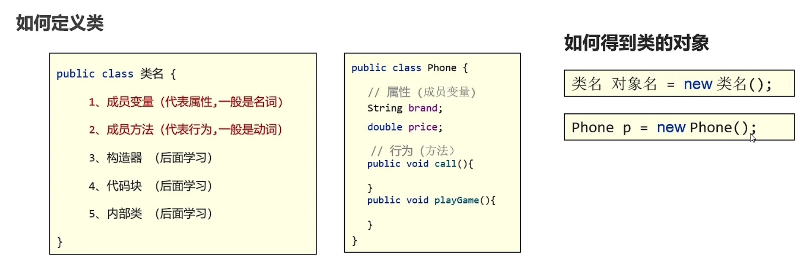

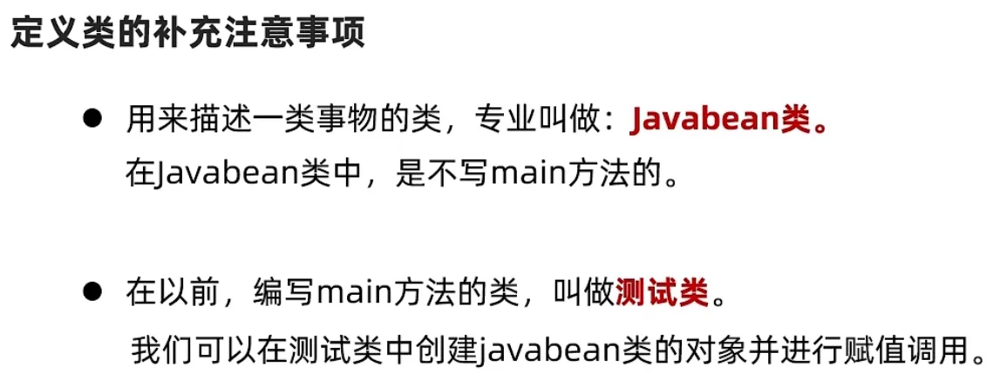

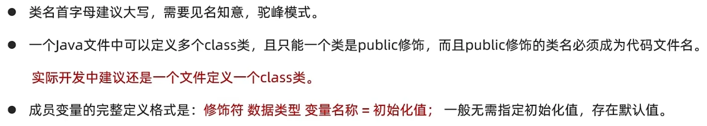

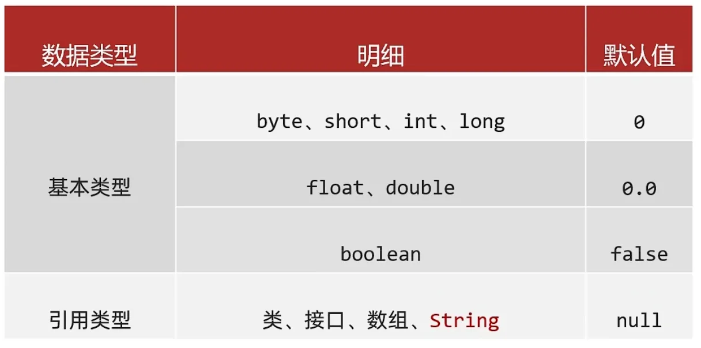

### 对象

同一个类的所有对象实例，由于支持相同的行为而具有家族式的相似性。对象的行为是用可调用的方法来定义的。
此外，每个对象都保存着描述当前状况的信息。这就是对象的状态。对象的状态可能会随着时间而发生改变，但这种改变不会是自发的。对象状态的改变必须通过调用方法实现**(如果不经过方法调用就可以改变对象状态，只能说明破坏了封装性)**。
但是，对象的状态并不能完全描述一个对象。每个对象都有一个唯一的标识(identity,或称身份)。需要注意，作为同一个类的实例，每个对象的标识总是不同的，状态也往往存在着差异。对象的这些关键特性会彼此相互影响。

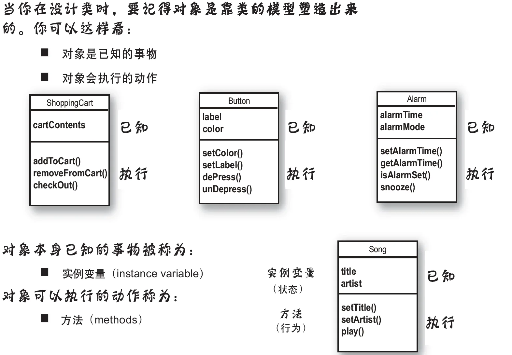

对象本身已知的事物称为`实例变量(instance variable)`。它们代表对象的`状态（数据）`，且该类型的每一个对象都会独立的拥有一份`该类型的值`。
所以你也可以把对象当作为`实例`。
对象可以执行的动作称为`方法`。在设计类时，你也会设计出操作对象数据的方法。对象带有读取或操作实例变量的方法是很常见的情形。举例来说，闹钟对象会有个变量来保存响铃时间，且会有getTime()与setTime()这两个方法来存取该时间。
因此说对象带有`实例变量和方法（也称成员变量于成员方法）`，但它们都是类设计中的部分。

实例变量永远都会有默认值，即便没有明确的赋值给它。

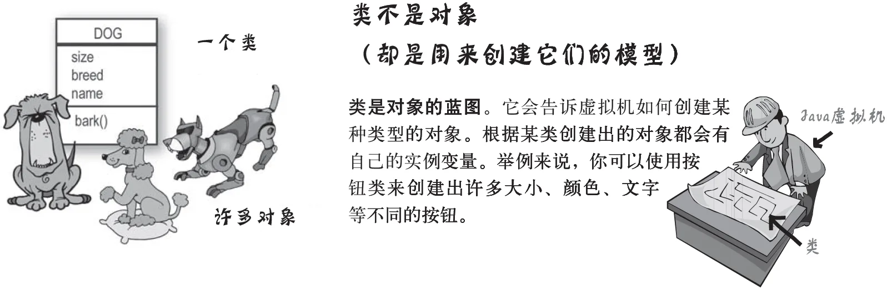

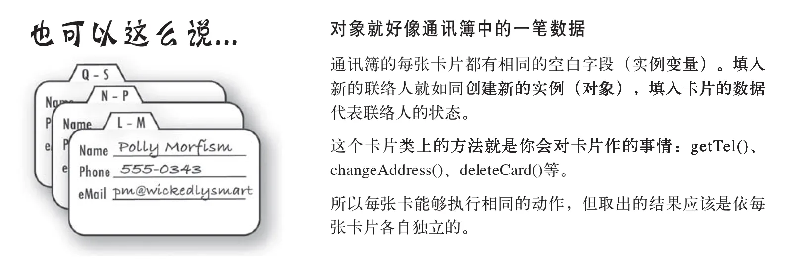

#### 一个对象的内存图

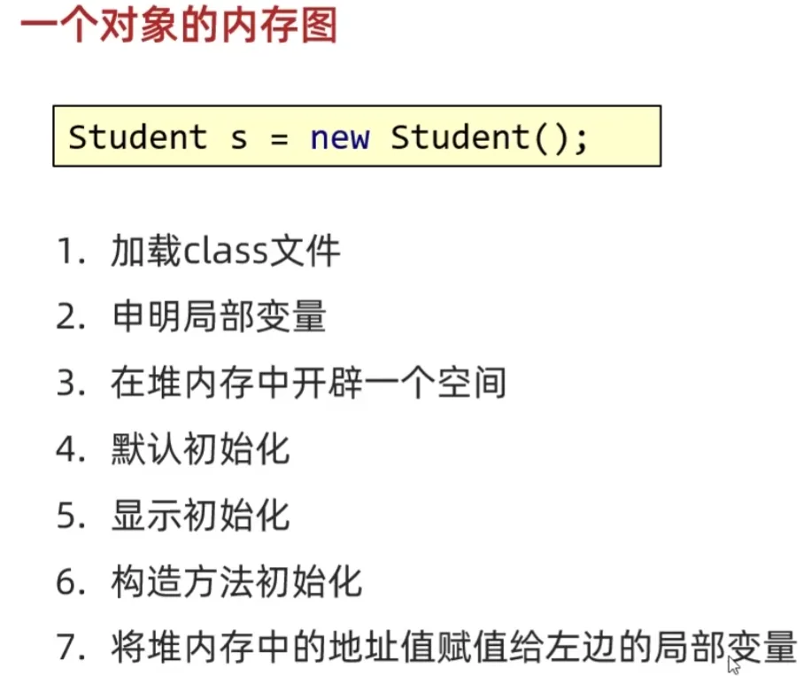

1.加载文件

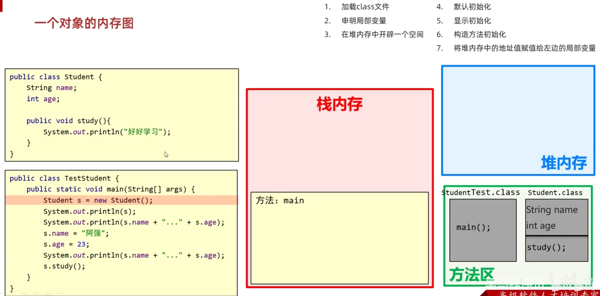

2.声明局部变量

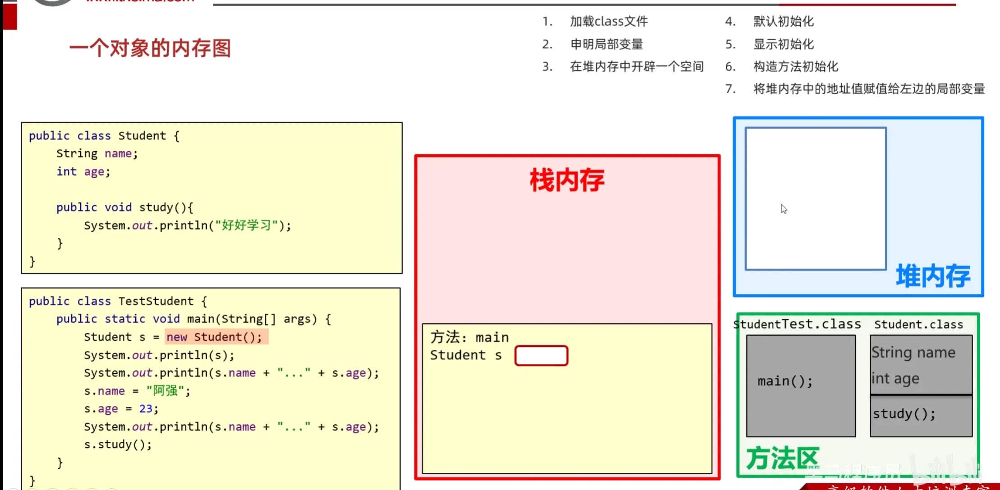

3.在堆内存开辟一个空间

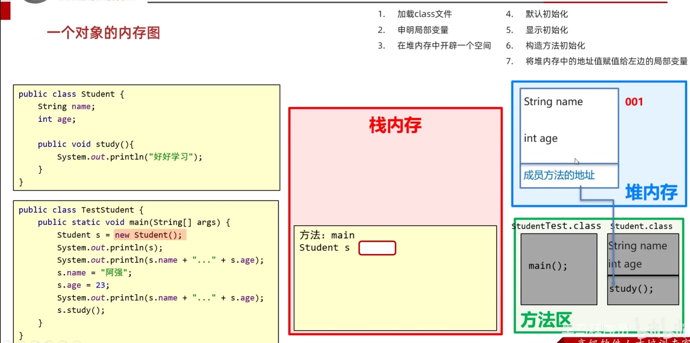

4.默认初始化

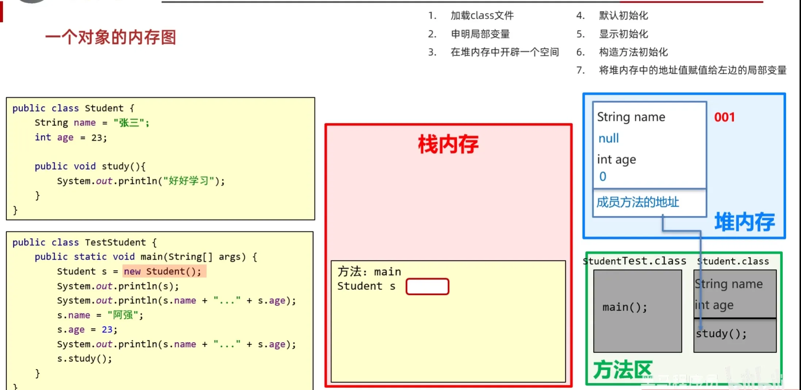

5.显式初始化

如果在类中直接给值，则会显式初始化，直接覆盖掉默认初始化的值。

6.构造方法初始化

如果调用了非空构造方法，则会运行该步。

7.将堆内存中的地址值赋值给左边的局部变量

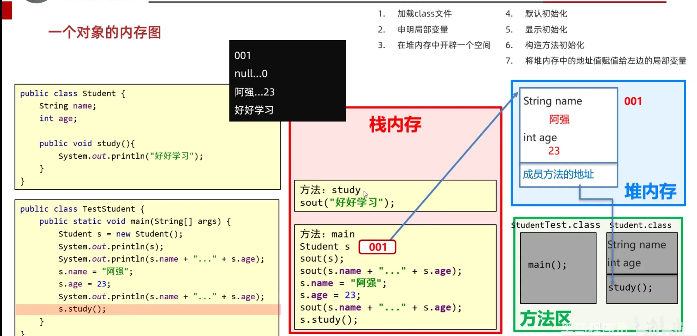

8.结束

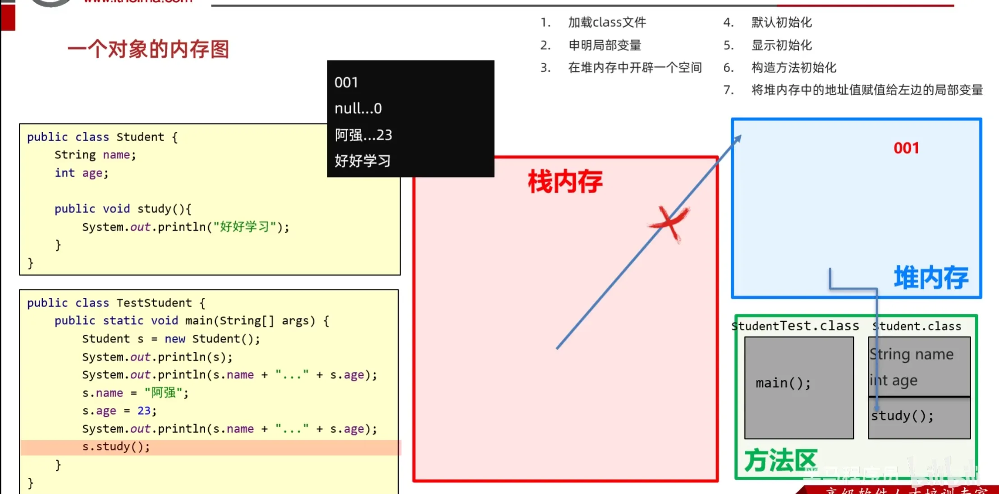

#### 两个对象的内存图

堆中的空间相互独立不受影响，并且`.class`文件只加载一次。

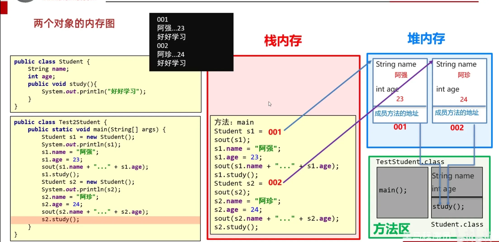

#### 两个引用指向同一个对象

将地址值共享。若地址值没有对象使用，则会被垃圾回收机制回收掉。

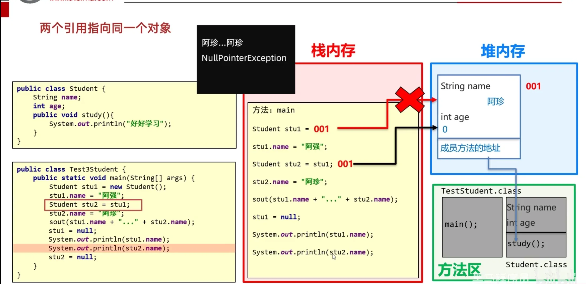

### 类之间的关系

在类之间，最常见的关系有

- 依赖（“uses-a”):
- 聚合（“has-a”):
- 继承（“is-a”)。

`依赖`(dependence),即“uses-a”关系，是一种最明显的、最常见的关系。因此，如果一个类的方法使用或操纵另一个类的对象，我们就说一个类依赖于另一个类。
应该尽可能地将相互依赖的类减至最少。这里的关键是，如果类A不知道B的存在，它就不会关心B的任何改变（这意味着B的改变不会导致A产生任何bug)。用软件工程的术语来说，就是尽可能减少类之间的耦合。

`聚合`(aggregation),即“has-a”关系，很容易理解，因为这种关系很具体。`包容`关系意味着类A的对象包含类B的对象。

`继承`(inheritance),即“is-a”关系，表示一个更特殊的类与一个更一般的类之间的关系。一般而言，如果类A扩展类B,类A不但包含从类B继承的方法，还会有一些额外的功能。

## 使用预定义类

 你必须指明程序代码中所使用到的类的完整名称，除非你使用的类来自于java.lang这个包。

一共有两种方法：

1. import
   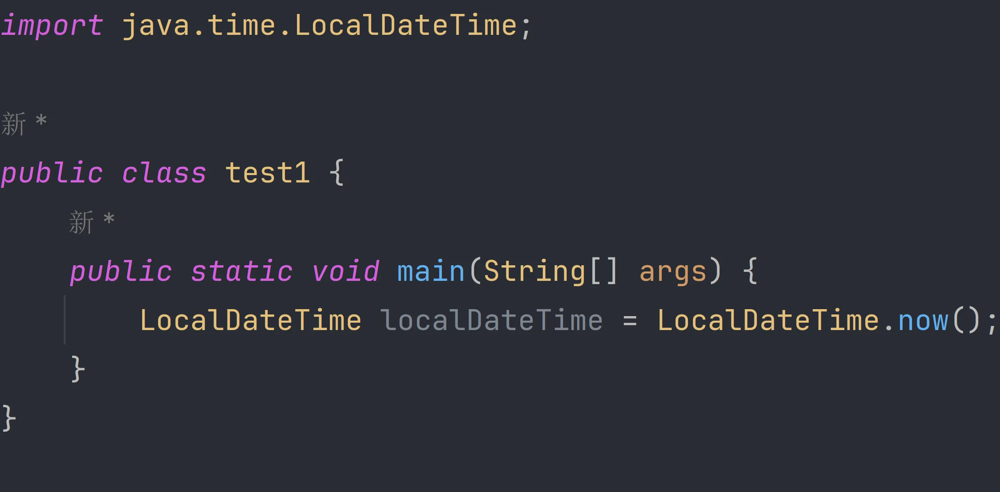

2. type

   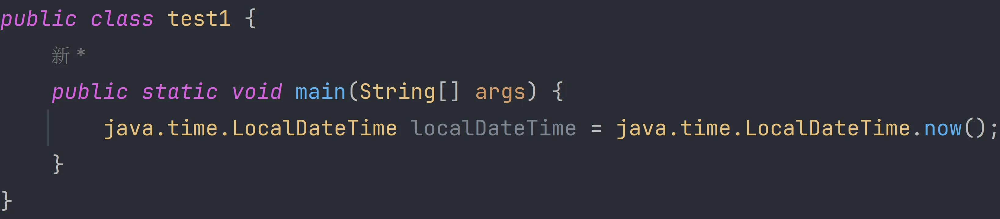

### 对象与对象变量

要想使用对象，首先必须构造对象，并指定其初始状态。然后对对象应用方法。

在Java程序设计语言中，要使用构造器（constructor,或称构造函数)构造新实例。构造器是一种特殊的方法，用来构造并初始化对象。

在Java中，任何对象变量的值都是对存储在另外一个地方的某个对象的引用。new操作符的返回值也是一个引用。下面的语句：

Date deadline = new Date()
也可以设置这个变量，让它引用一个已有的对象：
deadline = birthday;

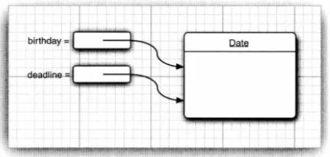

#### 对象引用（引用数据类型）

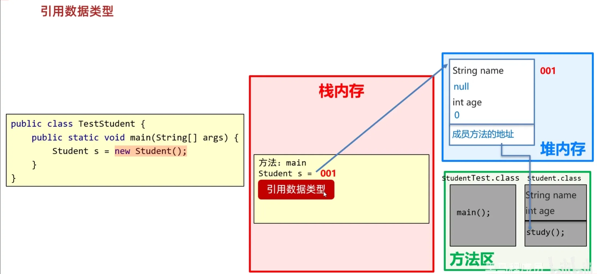

- 事实上没有对象变量这样的东西存在。
- 只有引用(reference)到对象的变量。
- 对象引用变量保存的是存取对象的方法。
- 它并不是对象的容器，而是类似指向对象的指针。或者可以说是地址。但在Java中我们不会也不该知道引用变量中实际装载的是什么，它只是用来代表单一的对象。只有Java虚拟机才会知道如何使用引用来取得该对象。

虽然primitive主数据类型变量是以字节来代表实际的变量值，**但对象引用变量却是以字节来表示取得对象的方法**。

对基本数据类型中的变量来说，变量值就是所代表的值（如5、-26.7或‘a’)。对引用变量来说，变量值是取得特定对象的位表示法。


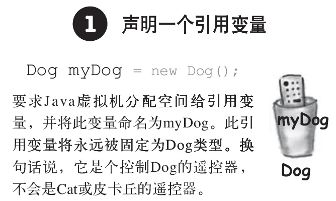

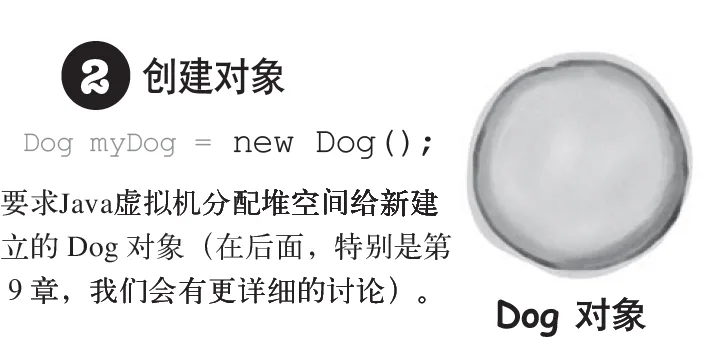

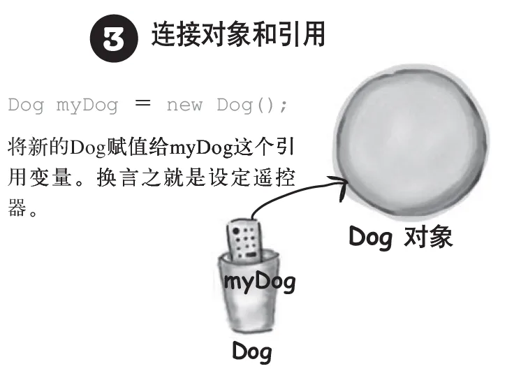

对于任意一个Java虚拟机来说，所有的引用大小都一样，但不同的Java虚拟机间可能会以不同的方式来表示引用，因此某个Java虚拟机的引用大小可能会大于或小于另一个Java虚拟机的引用。

当一个对象没有被引用时，就会被Java回收机制回收掉。

#### 更改器方法与访问器方法

更改器方法(mutator method):调用这个方法后，对象的状态会改变。
只访问对象而不修改对象的方法有时称为访问器方法（accessor method)。即访问员对象中的内容，然后创建新的对象并将值赋给新创建的数据。

#### 日期类API

##### Date类

接下来，我们学习一下Date类，Java中是由这个类的对象用来表示日期或者时间。

Date对象记录的时间是用毫秒值来表示的。Java语言规定，1970年1月1日0时0分0秒认为是时间的起点，此时记作0，那么1000（1秒=1000毫秒）就表示1970年1月1日0时0分1秒，依次内推。

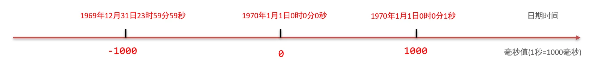

下面是Date类的构造方法，和常见的成员方法，利用这些API写代码尝试一下

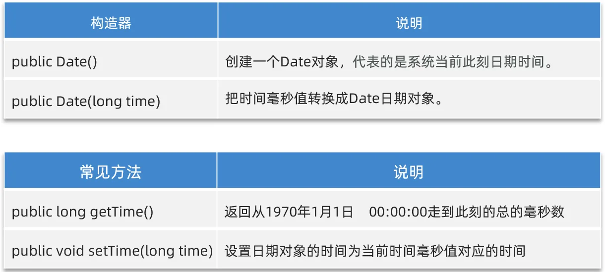

```java
public class Test1Date {
    public static void main(String[] args) {
        // 目标：掌握Date日期类的使用。
        // 1、创建一个Date的对象：代表系统当前时间信息的。
        Date d = new Date();
        System.out.println(d);

        // 2、拿到时间毫秒值。
        long time = d.getTime();
        System.out.println(time);

        // 3、把时间毫秒值转换成日期对象： 2s之后的时间是多少。
        time += 2 * 1000;
        Date d2 = new Date(time);
        System.out.println(d2);

        // 4、直接把日期对象的时间通过setTime方法进行修改
        Date d3 = new Date();
        d3.setTime(time);
        System.out.println(d3);
    }
}
```

##### SimpleDateFormat类

各位同学，前面我们打印Date对象时，发现打印输出的日期格式我们并不喜欢，是不是？你们喜欢那种格式呢？是不是像下面页面中这种格式啊？接下来我们学习的SimpleDateFormat类就可以转换Date对象表示日期时间的显示格式。

- 我们把Date对象转换为指定格式的日期字符串这个操作，叫做**日期格式化，**

- 反过来把指定格式的日期符串转换为Date对象的操作，叫做**日期解析。**


接下来，我们先演示一下日期格式化，需要用到如下的几个方法

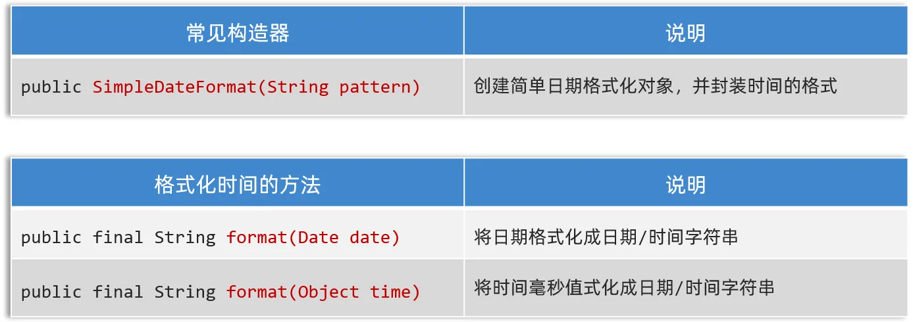

注意：创建SimpleDateFormat对象时，在构造方法的参数位置传递日期格式，而日期格式是由一些特定的字母拼接而来的。我们需要记住常用的几种日期/时间格式

```java
字母	   表示含义
yyyy	年
MM		月
dd		日
HH		时
mm		分
ss		秒
SSS		毫秒

"2022年12月12日" 的格式是 "yyyy年MM月dd日"
"2022-12-12 12:12:12" 的格式是 "yyyy-MM-dd HH:mm:ss"
按照上面的格式可以任意拼接，但是字母不能写错
```

最后，上代码演示一下

```java
public class Test2SimpleDateFormat {
    public static void main(String[] args) throws ParseException {
        // 目标：掌握SimpleDateFormat的使用。
        // 1、准备一些时间
        Date d = new Date();
        System.out.println(d);

        long time = d.getTime();
        System.out.println(time);

        // 2、格式化日期对象，和时间 毫秒值。
        SimpleDateFormat sdf = new SimpleDateFormat("yyyy年MM月dd日 HH:mm:ss EEE a");

        String rs = sdf.format(d);
        String rs2 = sdf.format(time);
        System.out.println(rs);
        System.out.println(rs2);
        System.out.println("----------------------------------------------");

        // 目标：掌握SimpleDateFormat解析字符串时间 成为日期对象。
        String dateStr = "2022-12-12 12:12:11";
        // 1、创建简单日期格式化对象 , 指定的时间格式必须与被解析的时间格式一模一样，否则程序会出bug.
        SimpleDateFormat sdf2 = new SimpleDateFormat("yyyy-MM-dd HH:mm:ss");
        Date d2 = sdf2.parse(dateStr);
        System.out.println(d2);
    }
}
```


> **日期格式化&解析案例**
>
> 

```java
public class Test3 {
    public static void main(String[] args) throws ParseException {
        // 目标：完成秒杀案例。
        // 1、把开始时间、结束时间、小贾下单时间、小皮下单时间拿到程序中来。
        String start = "2023年11月11日 0:0:0";
        String end = "2023年11月11日 0:10:0";
        String xj = "2023年11月11日 0:01:18";
        String xp = "2023年11月11日 0:10:57";

        // 2、把字符串的时间解析成日期对象。
        SimpleDateFormat sdf = new SimpleDateFormat("yyyy年MM月dd日 HH:mm:ss");
        Date startDt = sdf.parse(start);
        Date endDt = sdf.parse(end);
        Date xjDt = sdf.parse(xj);
        Date xpDt = sdf.parse(xp);

        // 3、开始判断小皮和小贾是否秒杀成功了。
        // 把日期对象转换成时间毫秒值来判断
        long startTime = startDt.getTime();
        long endTime = endDt.getTime();
        long xjTime = xjDt.getTime();
        long xpTime = xpDt.getTime();

        if(xjTime >= startTime && xjTime <= endTime){
            System.out.println("小贾您秒杀成功了~~");
        }else {
            System.out.println("小贾您秒杀失败了~~");
        }

        if(xpTime >= startTime && xpTime <= endTime){
            System.out.println("小皮您秒杀成功了~~");
        }else {
            System.out.println("小皮您秒杀失败了~~");
        }
    }
}
```

##### Calendar类

学完Date类和SimpleDateFormat类之后，我们再学习一个和日期相关的类，它是Calendar类。Calendar类表示日历，它提供了一些比Date类更好用的方法。

比如下面的案例，用Date类就不太好做，而用Calendar就特别方便。因为Calendar类提供了方法可以直接对日历中的年、月、日、时、分、秒等进行运算。


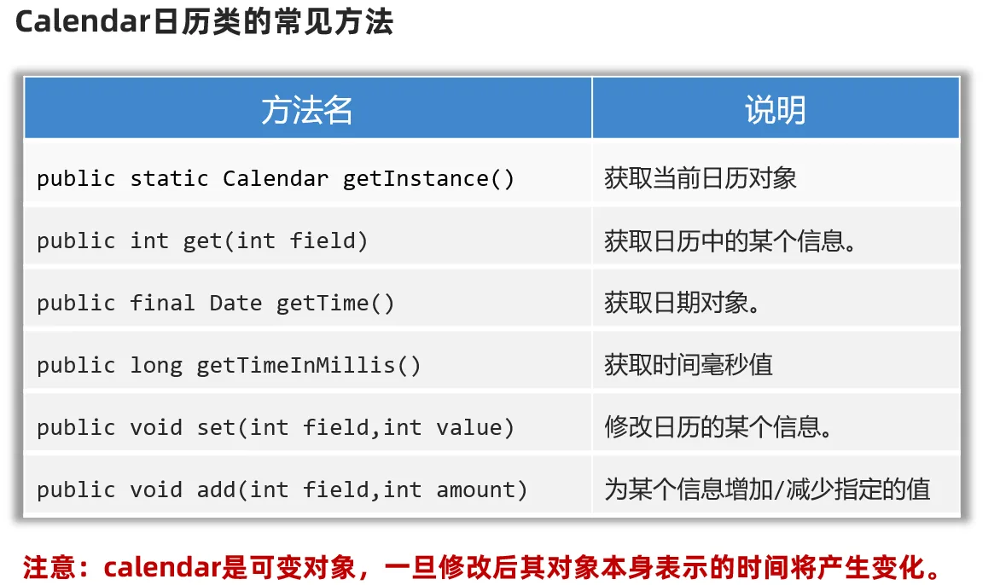

```java
public class Test4Calendar {
    public static void main(String[] args) {
        // 目标：掌握Calendar的使用和特点。
        // 1、得到系统此刻时间对应的日历对象。
        Calendar now = Calendar.getInstance();
        System.out.println(now);

        // 2、获取日历中的某个信息
        int year = now.get(Calendar.YEAR);
        System.out.println(year);

        int days = now.get(Calendar.DAY_OF_YEAR);
        System.out.println(days);

        // 3、拿到日历中记录的日期对象。
        Date d = now.getTime();
        System.out.println(d);

        // 4、拿到时间毫秒值
        long time = now.getTimeInMillis();
        System.out.println(time);

        // 5、修改日历中的某个信息
        now.set(Calendar.MONTH, 9); // 修改月份成为10月份。
        now.set(Calendar.DAY_OF_YEAR, 125); // 修改成一年中的第125天。
        System.out.println(now);

        // 6、为某个信息增加或者减少多少
        now.add(Calendar.DAY_OF_YEAR, 100);
        now.add(Calendar.DAY_OF_YEAR, -10);
        now.add(Calendar.DAY_OF_MONTH, 6);
        now.add(Calendar.HOUR, 12);
        now.set(2026, 11, 22);
        System.out.println(now);
    }
}
```

##### 为什么JDK8要新增日期类

```java
/**
 *  目标：搞清楚为什么要用JDK 8开始新增的时间类。
 */
public class Test {
    public static void main(String[] args) {
        // 传统的时间类（Date、SimpleDateFormat、Calendar）存在如下问题：
        // 1、设计不合理，使用不方便，很多都被淘汰了。
        Date d = new Date();
        //System.out.println(d.getYear() + 1900);

        Calendar c = Calendar.getInstance();
        int year = c.get(Calendar.YEAR);
        System.out.println(year);

        // 2、都是可变对象，修改后会丢失最开始的时间信息。

        // 3、线程不安全。

        // 4、不能精确到纳秒，只能精确到毫秒。
        // 1秒 = 1000毫秒
        // 1毫秒 = 1000微妙
        // 1微妙 = 1000纳秒
    }
}
```

##### JDK8日期、时间、日期时间

接下来，我们学习一下JDK8新增的日期类。为什么以前的Date类就可以表示日期，为什么要有新增的日期类呢？原因如下

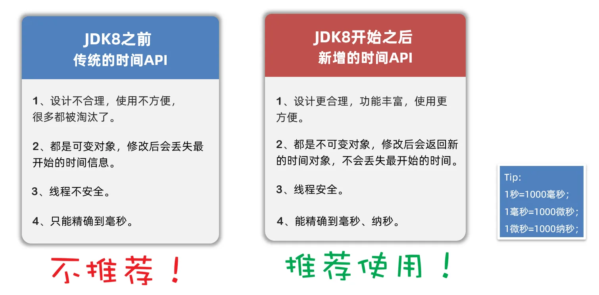

JDK8新增的日期类分得更细致一些，比如表示年月日用`LocalDate`类、表示时间秒用`LocalTime`类、而表示年月日时分秒用**`LocalDateTime`**类等；除了这些类还提供了对时区、时间间隔进行操作的类等。它们几乎把对日期/时间的所有操作都通过了API方法，用起来特别方便。

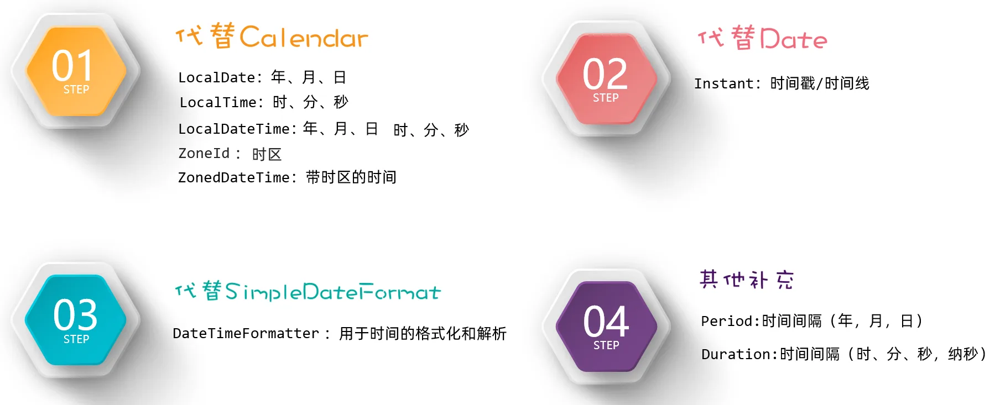

先学习表示日期、时间、日期时间的类；有LocalDate、LocalTime、以及LocalDateTime类。仔细阅读代码，你会发现这三个类的用法套路都是一样的。

- LocalDate类的基本使用

```java
public class Test1_LocalDate {
    public static void main(String[] args) {
        // 0、获取本地日期对象(不可变对象)
        LocalDate ld = LocalDate.now(); // 年 月 日
        System.out.println(ld);

        // 1、获取日期对象中的信息
        int year = ld.getYear(); // 年
        int month = ld.getMonthValue(); // 月(1-12)
        int day = ld.getDayOfMonth(); // 日
        int dayOfYear = ld.getDayOfYear();  // 一年中的第几天
        int dayOfWeek = ld.getDayOfWeek().getValue(); // 星期几
        System.out.println(year);
        System.out.println(day);
        System.out.println(dayOfWeek);

        // 2、直接修改某个信息: withYear、withMonth、withDayOfMonth、withDayOfYear
        LocalDate ld2 = ld.withYear(2099);
        LocalDate ld3 = ld.withMonth(12);
        System.out.println(ld2);
        System.out.println(ld3);
        System.out.println(ld);

        // 3、把某个信息加多少: plusYears、plusMonths、plusDays、plusWeeks
        LocalDate ld4 = ld.plusYears(2);
        LocalDate ld5 = ld.plusMonths(2);

        // 4、把某个信息减多少：minusYears、minusMonths、minusDays、minusWeeks
        LocalDate ld6 = ld.minusYears(2);
        LocalDate ld7 = ld.minusMonths(2);

        // 5、获取指定日期的LocalDate对象： public static LocalDate of(int year, int month, int dayOfMonth)
        LocalDate ld8 = LocalDate.of(2099, 12, 12);
        LocalDate ld9 = LocalDate.of(2099, 12, 12);

        // 6、判断2个日期对象，是否相等，在前还是在后： equals isBefore isAfter
        System.out.println(ld8.equals(ld9));// true
        System.out.println(ld8.isAfter(ld)); // true
        System.out.println(ld8.isBefore(ld)); // false
    }
}
```

- LocalTime类的基本使用

```java
public class Test2_LocalTime {
    public static void main(String[] args) {
        // 0、获取本地时间对象
        LocalTime lt = LocalTime.now(); // 时 分 秒 纳秒 不可变的
        System.out.println(lt);

        // 1、获取时间中的信息
        int hour = lt.getHour(); //时
        int minute = lt.getMinute(); //分
        int second = lt.getSecond(); //秒
        int nano = lt.getNano(); //纳秒

        // 2、修改时间：withHour、withMinute、withSecond、withNano
        LocalTime lt3 = lt.withHour(10);
        LocalTime lt4 = lt.withMinute(10);
        LocalTime lt5 = lt.withSecond(10);
        LocalTime lt6 = lt.withNano(10);

        // 3、加多少：plusHours、plusMinutes、plusSeconds、plusNanos
        LocalTime lt7 = lt.plusHours(10);
        LocalTime lt8 = lt.plusMinutes(10);
        LocalTime lt9 = lt.plusSeconds(10);
        LocalTime lt10 = lt.plusNanos(10);

        // 4、减多少：minusHours、minusMinutes、minusSeconds、minusNanos
        LocalTime lt11 = lt.minusHours(10);
        LocalTime lt12 = lt.minusMinutes(10);
        LocalTime lt13 = lt.minusSeconds(10);
        LocalTime lt14 = lt.minusNanos(10);

        // 5、获取指定时间的LocalTime对象：
        // public static LocalTime of(int hour, int minute, int second)
        LocalTime lt15 = LocalTime.of(12, 12, 12);
        LocalTime lt16 = LocalTime.of(12, 12, 12);

        // 6、判断2个时间对象，是否相等，在前还是在后： equals isBefore isAfter
        System.out.println(lt15.equals(lt16)); // true
        System.out.println(lt15.isAfter(lt)); // false
        System.out.println(lt15.isBefore(lt)); // true

    }
}
```

- LocalDateTime类的基本使用

```java
public class Test3_LocalDateTime {
    public static void main(String[] args) {
        // 0、获取本地日期和时间对象。
        LocalDateTime ldt = LocalDateTime.now(); // 年 月 日 时 分 秒 纳秒
        System.out.println(ldt);

        // 1、可以获取日期和时间的全部信息
        int year = ldt.getYear(); // 年
        int month = ldt.getMonthValue(); // 月
        int day = ldt.getDayOfMonth(); // 日
        int dayOfYear = ldt.getDayOfYear();  // 一年中的第几天
        int dayOfWeek = ldt.getDayOfWeek().getValue();  // 获取是周几
        int hour = ldt.getHour(); //时
        int minute = ldt.getMinute(); //分
        int second = ldt.getSecond(); //秒
        int nano = ldt.getNano(); //纳秒

        // 2、修改时间信息：
        // withYear withMonth withDayOfMonth withDayOfYear withHour
        // withMinute withSecond withNano
        LocalDateTime ldt2 = ldt.withYear(2029);
        LocalDateTime ldt3 = ldt.withMinute(59);

        // 3、加多少:
        // plusYears  plusMonths plusDays plusWeeks plusHours plusMinutes plusSeconds plusNanos
        LocalDateTime ldt4 = ldt.plusYears(2);
        LocalDateTime ldt5 = ldt.plusMinutes(3);

        // 4、减多少：
        // minusDays minusYears minusMonths minusWeeks minusHours minusMinutes minusSeconds minusNanos
        LocalDateTime ldt6 = ldt.minusYears(2);
        LocalDateTime ldt7 = ldt.minusMinutes(3);


        // 5、获取指定日期和时间的LocalDateTime对象：
        // public static LocalDateTime of(int year, Month month, int dayOfMonth, int hour,
        //                                  int minute, int second, int nanoOfSecond)
        LocalDateTime ldt8 = LocalDateTime.of(2029, 12, 12, 12, 12, 12, 1222);
        LocalDateTime ldt9 = LocalDateTime.of(2029, 12, 12, 12, 12, 12, 1222);

        // 6、 判断2个日期、时间对象，是否相等，在前还是在后： equals、isBefore、isAfter
        System.out.println(ldt9.equals(ldt8));
        System.out.println(ldt9.isAfter(ldt));
        System.out.println(ldt9.isBefore(ldt));

        // 7、可以把LocalDateTime转换成LocalDate和LocalTime
        // public LocalDate toLocalDate()
        // public LocalTime toLocalTime()
        // public static LocalDateTime of(LocalDate date, LocalTime time)
        LocalDate ld = ldt.toLocalDate();
        LocalTime lt = ldt.toLocalTime();
        LocalDateTime ldt10 = LocalDateTime.of(ld, lt);

    }
}
```

##### JDK8日期（时区）

接着，我们学习代表时区的两个类。由于世界各个国家与地区的经度不同，各地区的时间也有所不同，因此会划分为不同的时区。每一个时区的时间也不太一样。

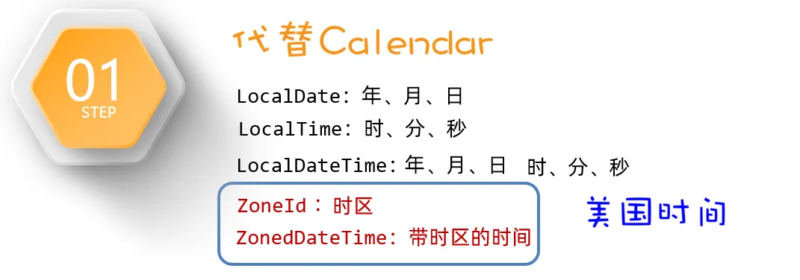

```java
public class Test4_ZoneId_ZonedDateTime {
    public static void main(String[] args) {
        // 目标：了解时区和带时区的时间。
        // 1、ZoneId的常见方法：
        // public static ZoneId systemDefault(): 获取系统默认的时区
        ZoneId zoneId = ZoneId.systemDefault();
        System.out.println(zoneId.getId());
        System.out.println(zoneId);

        // public static Set<String> getAvailableZoneIds(): 获取Java支持的全部时区Id
        System.out.println(ZoneId.getAvailableZoneIds());

        // public static ZoneId of(String zoneId) : 把某个时区id封装成ZoneId对象。
        ZoneId zoneId1 = ZoneId.of("America/New_York");

        // 2、ZonedDateTime：带时区的时间。
        // public static ZonedDateTime now(ZoneId zone): 获取某个时区的ZonedDateTime对象。
        ZonedDateTime now = ZonedDateTime.now(zoneId1);
        System.out.println(now);

        // 世界标准时间了
        ZonedDateTime now1 = ZonedDateTime.now(Clock.systemUTC());
        System.out.println(now1);

        // public static ZonedDateTime now()：获取系统默认时区的ZonedDateTime对象
        ZonedDateTime now2 = ZonedDateTime.now();
        System.out.println(now2);

        // Calendar instance = Calendar.getInstance(TimeZone.getTimeZone(zoneId1));
    }
}
```

##### JDK8日期（Instant类）

接下来，我们来学习Instant这个类。通过获取Instant的对象可以拿到此刻的时间，该时间由两部分组成：从1970-01-01 00:00:00 开始走到此刻的总秒数+不够1秒的纳秒数。


该类提供的方法如下图所示，可以用来获取当前时间，也可以对时间进行加、减、获取等操作。

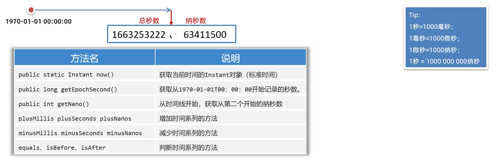

**作用：可以用来记录代码的执行时间，或用于记录用户操作某个事件的时间点。**

```java
/**
 * 目标：掌握Instant的使用。
 */
public class Test5_Instant {
    public static void main(String[] args) {
       // 1、创建Instant的对象，获取此刻时间信息
        Instant now = Instant.now(); // 不可变对象

        // 2、获取总秒数
        long second = now.getEpochSecond();
        System.out.println(second);

        // 3、不够1秒的纳秒数
        int nano = now.getNano();
        System.out.println(nano);

        System.out.println(now);

        Instant instant = now.plusNanos(111);

        // Instant对象的作用：做代码的性能分析，或者记录用户的操作时间点
        Instant now1 = Instant.now();
        // 代码执行。。。。
        Instant now2 = Instant.now();

        LocalDateTime l = LocalDateTime.now();
    }
}
```

##### JDK8日期（格式化器）

接下来，我们学习一个新增的日期格式化类，叫DateTimeFormater。它可以从来对日期进行格式化和解析。它代替了原来的SimpleDateFormat类。

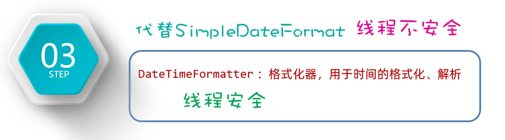

需要用到的方法，如下图所示

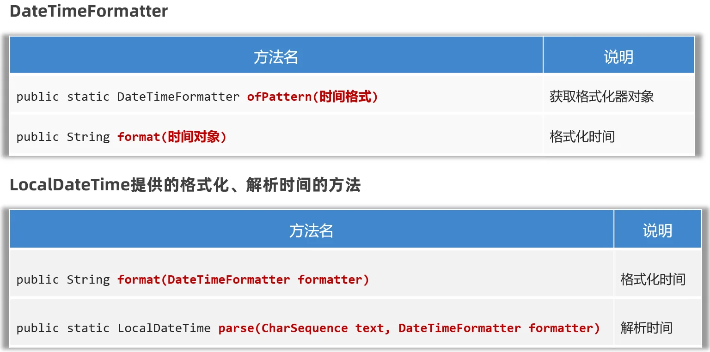

接下来，将上面的方法用代码来演示一下

```java
/**
 *  目标：掌握JDK 8新增的DateTimeFormatter格式化器的用法。
 */
public class Test6_DateTimeFormatter {
    public static void main(String[] args) {
        // 1、创建一个日期时间格式化器对象出来。
        DateTimeFormatter formatter = DateTimeFormatter.ofPattern("yyyy年MM月dd日 HH:mm:ss");

        // 2、对时间进行格式化
        LocalDateTime now = LocalDateTime.now();
        System.out.println(now);

        String rs = formatter.format(now); // 正向格式化
        System.out.println(rs);

        // 3、格式化时间，其实还有一种方案。
        String rs2 = now.format(formatter); // 反向格式化
        System.out.println(rs2);

        // 4、解析时间：解析时间一般使用LocalDateTime提供的解析方法来解析。
        String dateStr = "2029年12月12日 12:12:11";
        LocalDateTime ldt = LocalDateTime.parse(dateStr, formatter);
        System.out.println(ldt);
    }
}

```

##### JDK8日期（Period类）

除以了上新增的类，JDK8还补充了两个类，一个叫Period类、一个叫Duration类；这两个类可以用来对计算两个时间点的时间间隔。

其中Period用来计算日期间隔（年、月、日），Duration用来计算时间间隔（时、分、秒、纳秒）


先来演示Period类的用法，它的方法如下图所示。可以用来计算两个日期之间相隔的年、相隔的月、相隔的日。**只能两个计算LocalDate对象之间的间隔**

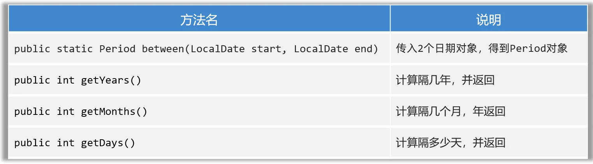

```java
/**
 * 目标：掌握Period的作用：计算机两个日期相差的年数，月数、天数。
 */
public class Test7_Period {
    public static void main(String[] args) {
        LocalDate start = LocalDate.of(2029, 8, 10);
        LocalDate end = LocalDate.of(2029, 12, 15);

        // 1、创建Period对象，封装两个日期对象。
        Period period = Period.between(start, end);

        // 2、通过period对象获取两个日期对象相差的信息。
        System.out.println(period.getYears());
        System.out.println(period.getMonths());
        System.out.println(period.getDays());
    }
}
```

##### JDK8日期（Duration类）

接下来，我们学习Duration类。它是用来表示两个时间对象的时间间隔。**可以用于计算两个时间对象相差的天数、小时数、分数、秒数、纳秒数；支持LocalTime、LocalDateTime、Instant等时间**

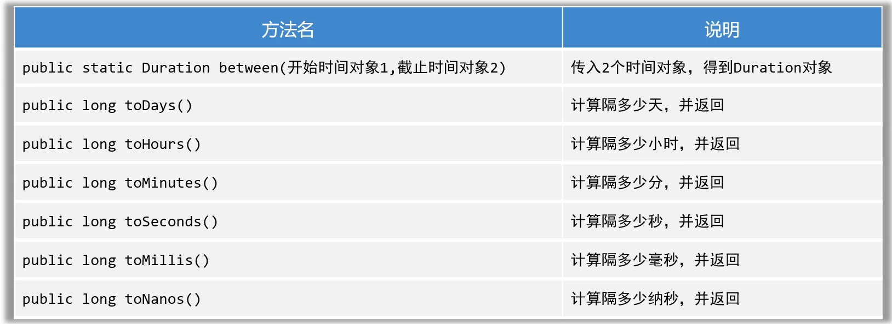

```java
public class Test8_Duration {
    public static void main(String[] args) {
        LocalDateTime start = LocalDateTime.of(2025, 11, 11, 11, 10, 10);
        LocalDateTime end = LocalDateTime.of(2025, 11, 11, 11, 11, 11);
        // 1、得到Duration对象
        Duration duration = Duration.between(start, end);

        // 2、获取两个时间对象间隔的信息
        System.out.println(duration.toDays());// 间隔多少天
        System.out.println(duration.toHours());// 间隔多少小时
        System.out.println(duration.toMinutes());// 间隔多少分
        System.out.println(duration.toSeconds());// 间隔多少秒
        System.out.println(duration.toMillis());// 间隔多少毫秒
        System.out.println(duration.toNanos());// 间隔多少纳秒

    }
}
```

## 用户自定义类

在Java中，最简单的类定义形式为：

```java
class ClassName
{
	field1;
	field2;
    ...
	constructory1;
	constructor2;
    ...
	method1;
	method2;
    ...
}
```

### 构造器

- 构造器与类同名。
- 每个类可以有一个以上的构造器。
- 构造器可以有0个、1个或多个参数。
- 构造器没有返回值。
- 构造器总是伴随着new操作符一起调用。

### 构造方法概述

构造方法是一种特殊的方法

* 作用：创建对象   Student stu = **new Student();**

* 格式：

  public class 类名{

  ​        修饰符 类名( 参数 ) {

  ​        }

  }

* 功能：主要是完成对象数据的初始化

### 构造方法的注意事项

* 构造方法的创建

如果没有定义构造方法，系统将给出一个默认的无参数构造方法
如果定义了构造方法，系统将不再提供默认的构造方法

* 构造方法的重载

如果自定义了带参构造方法，还要使用无参数构造方法，就必须再写一个无参数构造方法

* 推荐的使用方式

无论是否使用，都手工书写无参数构造方法

* 重要功能！

可以使用带参构造，为成员变量进行初始化

### 方法

#### 形参和实参

方法会运用形参。调用的一方会传入实参。

实参是传给方法的值。当它传入方法后就成了形参。

1. 形参：方法定义中的参数

​          等同于变量定义格式，例如：int number

2. 实参：方法调用中的参数

​          等同于使用变量或常量，例如： 10  number

`Java`是通过值传递的，也就是说通过拷贝传递。

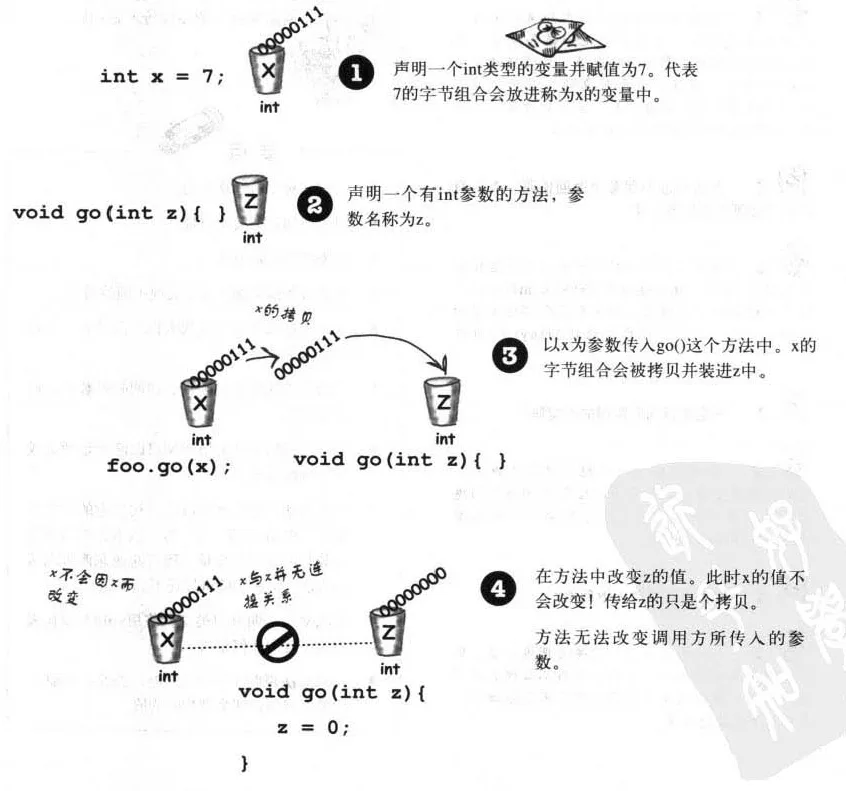

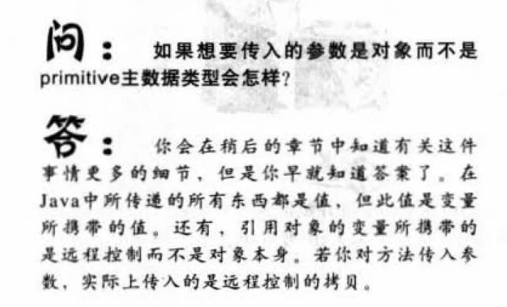

### 显示参数和隐式参数

显示参数：在方法中明确定义的参数为显示参数

隐式参数：未在方法是定义的，但的确又动态影响到程序运行的“参数”

也就是说，调用函数的对象就是隐式参数，显示参数就是我们通常所说的参数。

```java
public class FriendTest{
    public void newFriend({
        GirlFriend gFriend = new GirlFriend();
        gFriend.setName("木洺紫")；
        gFriend.setAge(12);
        gFriend.setHeight(170);
        gFriend.setWeight (100)
    }
}
```

这里的参数值，**“木洺紫”，“12”，“170”，“100”**

便为显示参数，这里的**调用对象gFriend便为隐式参数**。

### 方法重载

* 方法重载概念

  方法重载指同一个类中定义的多个方法之间的关系，满足下列条件的多个方法相互构成重载

  * **多个方法在同一个类中**
  * **多个方法具有相同的方法名**
  * **多个方法的参数不相同，类型不同或者数量不同**

* 注意：

  * **重载仅对应方法的定义，与方法的调用无关，调用方式参照标准格式**
  * **重载仅针对同一个类中方法的名称与参数进行识别，与返回值无关，换句话说不能通过返回值来判定两个方法是否相互构成重载**

### 方法调用的内存

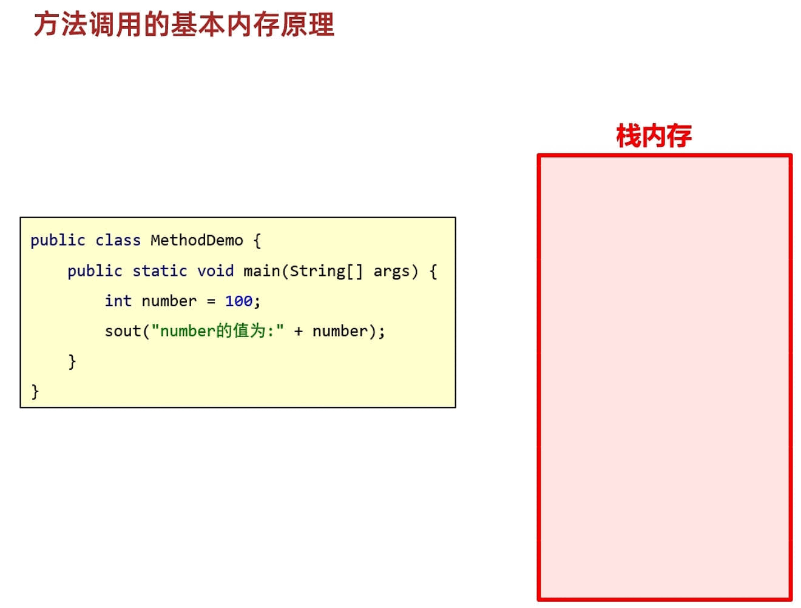

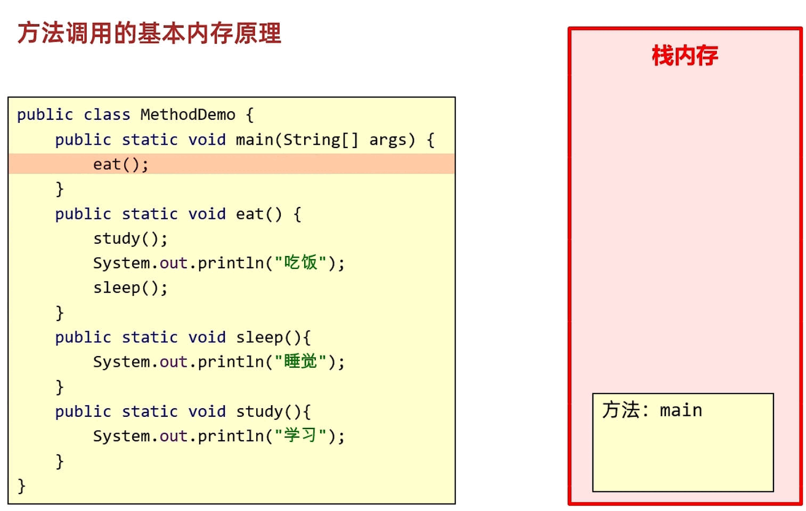

### 基本数据类型

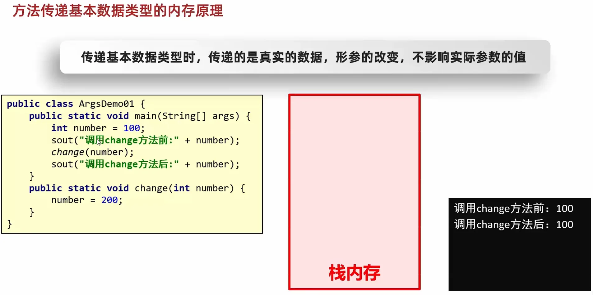

### 引用数据类型

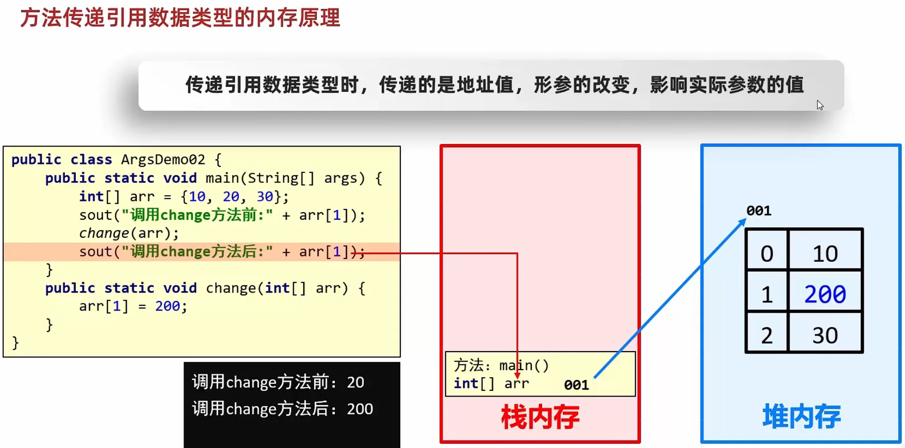

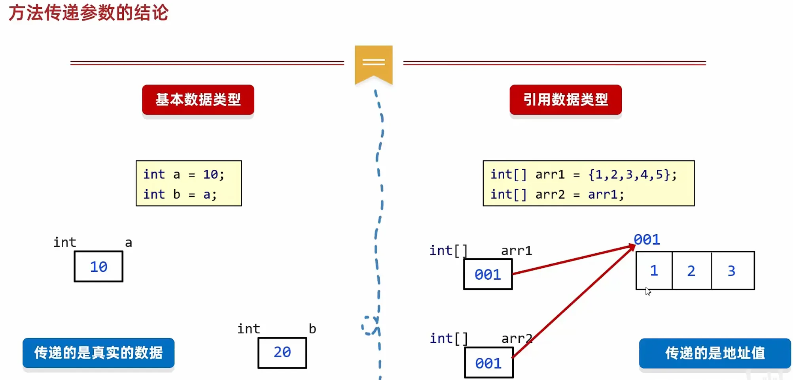

### 静态工厂方法

#### 一、什么是静态工厂方法？

对于类而言，在我们需要获取一个实例时，最传统的方法都是通过new新建一个对象，这是jvm通过调用构造函数帮我们实例化出来的对象。而静态工厂方法则是另外一种不通过new来获取一个实例的方法，我们可以通过一个类中公有的静态方法，来返回一个实例。
比如有这样一个People类：

```java
class People{
	String name;
	int age;
	int weight;
}
```

我们传统的获取实例都是通过new：

```java
People People=new People();
```

而静态工厂方法可以在类中添加一个公有静态方法来返回一个实例，还是以上面的People类为例子：

```java
class People{
	String name;
	int age;
	int weight;
	public static People getPeople(){
		return new People();
	}
}
```

这样我们就可以通过getPeople这个静态方法来获取一个实例：

```java
People firstPeople=People.getPeople();
```

#### 二、静态工厂方法的优势

总结的说，静态工厂方法有五大优势：

##### 1、静态工厂方法有名称

对于构造器来说，我们都知道，构造函数的命名只能是类名，而构造函数重载也只能通过参数的不同去区分调用不同的构造函数，一个类只能有一个带有指定参数的构造器，而若是两个构造器需要的参数是相同类型的话，开发人员通常会通过改变这两个参数的顺序来定义两个构造器，注意，这种情况只能适合多参构造函数，在单参构造器中则无法实现了。而静态工厂方法便显得简单许多，因为它能被我们定义成不同的名字，这使用起来会更加的方便，在某种程度上来说代码也会更易阅读。

还是以之前的Peple类做例子，当我们获取实例时想要对name和age初始化，需要定义这样的构造函数：

```java
class People{
	String name;
	int age;
	int weight;
	public People(String name,int age){
		this.name=name;
		this.age=age;
	}
}	
```

要是我们同时也需要对name和weight进行初始化，则需要改变参数中String和int类型的位置，以实现不同的构造器：

```java
public People(int weight,String name){
	this.name=name;
	this.age=age;
}
```

而这样有时候则会让我们不知道该调用哪个构造函数，又或者需要在两个不同的实例中初始化age和weight的值的时候，是没办法同时出现People(int age)和People(int weight)这样的两个构造函数的，因此我们需要通过静态工厂方法来实现：

```java
class People{
	String name;
	int age;
	int weight;
	public static People getNameWeightPeople(String name,int age){
		People nwp=new People();
		nwp.name=name;
		nwp.weight=weight;
		return nwp;
	}
	public static People getNameAgePeople(String name,int age){
		People nap=new People();
		nap.name=name;
		nap.age=age;
		return nap;
	}
	public static People getAgePeople(int age){
		People ap=new People();
		ap.age=age;
		return ap;
	}
	public static People getWeightPeople(int weight){
		People wp=new People();
		wp.weight=weight;
		return wp;
	}
}
```

这样我们便能通过静态工厂方法定义不同初始化属性但参数类型相同的方法来获取不同的实例对象了。

##### 2、静态工厂方法不用在每次调用的时候都创建一个新的对象

“如果程序经常请求创建相同的对象，并且创建对象的代价很高，则静态工厂方法能极大地提升程序的性能。”这是《Effective Java》这本书中对这一优势的说法。
如果我们的代码在调用某个类的时候只需要一个实例，但是并不关心这个实例是否是一个新的对象，此时通过静态工厂方法便可以很方便的实现，提升程序性能。
例如加载数据库驱动的时候：

```
Class.forName("com.mysql.jdbc.Driver");
```

我们通过这样的一句代码便能加载驱动，而我们根本不关心这个方法返回的实例，因此便可以不创建实例对象。

**3、静态工厂方法可以返回原返回类型的任何子类型对象**
这样子看起来貌似有点绕，简单的来说，在构造器中我们只能返回当前构造器所在类的对象，而通过静态工厂方法我们可以任意选择返回类型，因此便可以返回该类的任何子类型。
还是以People类为例子：

```java
class People{
	String name;
	int age;
	int weight;
	public static People getWomen(){
		return new Women();
	}	
}
class Women extends People{
}
```

##### 4、静态工厂方法所返回的对象可以随着每次调用而发生变化，这取决于参数值

也就是说，我们可以通过参数值的不同，来选择返回哪个实例（注意，这里说的是参数值而不是参数类型），而这个实例的类型只要是已经声明好的返回类型的子类型，就都是被允许的。
例如：

```java
class People{
	String name;
	int age;
	int weight;
	public static People getOne(int age){
		if(age>=18){
			return new Adult();
		}else {
			return new Child();
		}
	}
	
}
class Child extends People{
}
class Adult extends People{
}
```

在这个例子中，Child和Adult这两个类的存在对于客户端来说是不可见的，客户端永远不知道也不关心他们从这个静态工厂方法中得到的对象是一个什么类型，它们只关心这个对象是People的某个子类。

5、静态工厂方法返回的对象所属的类，在编写包含该静态工厂方法的类时可以不存在
这个优势构成了服务提供者框架的基础，服务提供者框架是指多个服务提供者实现一个服务，系统为服务提供者的客户端提供多个实现，并把它们从多个实现中解耦出来。
以JDBC的API为例，对于JDBC来说，Connection就是服务接口的一部分，DriverManager.registerDriver是提供者注册API，DriverManager.getConnection是服务访问API，Driver是服务提供者接口。
我们要通过jdbc获取一个mysql连接，是这样获取的：

```java
Class.forName("com.mysql.jdbc.Driver");   
Connection connection=DriverManager.getConnection("jdbc:mysql://localhost:3306/database","root","123456");  
```

这里我们获取的连接对象是Connection，按住Ctrl点进去我们可以发现Connection是一个接口，而接口又如何能操作数据库，所以我们这里得到的其实是Connection接口的实现类，而这个实现类是对我们不可见的，因为我们根本不需要去关心这个实现类是什么，我们只需要用这个Connection接口便可以实现对数据库的操作。而我们获取到的这个实现类，是通过DriverManager.getConnection这个方法得到的，我们通过查看这个方法的源码可以知道这个方法其实是一个静态工厂方法，而很明显Connection的实现类并不存在于包含这个静态工厂方法的DriverManager类中。

#### 三、静态工厂方法的缺点

1、类如果不含公有的或者受保护的构造器，就不能被子类化
这个很好理解，如果类不含上述的这两种构造器，当然就没办法被继承。但实际这样或许也是一个好处，因为这样能鼓励程序员使用复合，而不是继承，这正是不可变类型所需要的。

2、程序员很难发现静态工厂方法
因为静态工厂方法是自定义的，它们没有像构造器那样被明确规定如何实例化，因此程序员往往很难查明如何通过静态工厂方法实例化一个类，因此我们便需要遵守一些静态工厂方法的惯用名称。
以下列出一小部分：

①from——类型转换方法，只有单个参数。返回该类型的一个相对应实例，例如：

`Date d=Date.from(instant)`

②of——聚合方法，有多个参数，返回该类型的一个实例，把它们合并起来，例如：

`Set＜Rank＞ facecards=Enumset.of(JACK， QUEEN， KING);`

③valueOf——比from和of更烦琐的一种替代方法，例如:

`BigInteger prime = BigInteger.valueOf(Integer.MAX_VALUE);`

④ instance或者getInstance——返回的实例是通过方法的(如有)参数来描述的，但是不能说与参数具有同样的值，例如:

`Stackwalker luke -Stackwalker.getInstance(options);`

⑤create或者 newInstance——像 instance或者 getInstance一样，但 create或者 newInstance能够确保每次调用都返回一个新的实例，例如:

`Object newArray=Array.newInstance(classObject,arrayLen);`

⑥getType——像 getInstance一样，但是在工厂方法处于不同的类中的时候使用。Type表示工厂方法所返回的对象类型，例如:

`FileStore fs=Files.getFileStore(path);`

⑦newtype——像newInstance一样，但是在工厂方法处于不同的类中的时候使用。Type表示工厂方法所返回的对象类型，例如:

`BufferedReader br=Files.newBufferedReader(path);`

⑧type——getType和 newType的简版，例如：

`List<Complaint> litany=Collections.list(legacyLitany);`

四、总结
总而言之，静态工厂方法和公有构造器都各有用处，我们需要理解它们各自的长处。
往往静态工厂方法会更加合适，因此切忌第一反应就是提供公有的构造器，而不先考虑静态工厂

### final实例字段

可以将实例字段定义为final。这样的字段必须在构造对象时初始化。也就是说，必须确保在每一个构造器执行之后，这个字段的值已经设置，并且以后不能再修改这个字段。

## 静态字段与静态方法

### static关键字   

#### 概述

以前我们定义过如下类：

```java
public class Student {
    // 成员变量
    public String name;
    public char sex; // '男'  '女'
    public int age;

    // 无参数构造方法
    public Student() {

    }
    
    // 有参数构造方法
    public Student(String  a) {

    }
}
```

我们已经知道面向对象中，存在类和对象的概念，我们在类中定义了一些成员变量，例如name,age,sex ,结果发现这些成员变量，每个对象都存在（因为每个对象都可以访问）。

而像name ,age , sex确实是每个学生对象都应该有的属性，应该属于每个对象。

所以Java中成员（**变量和方法**）等是存在所属性的，Java是通过static关键字来区分的。**static关键字在Java开发非常的重要，对于理解面向对象非常关键。**

关于 `static` 关键字的使用，它可以用来修饰的成员变量和成员方法，被static修饰的成员是**属于类**的是放在静态区中，没有static修饰的成员变量和方法则是**属于对象**的。我们上面案例中的成员变量都是没有static修饰的，所以属于每个对象。

**静态变量是随着类的加载而加载的，优先于对象出现的**

#### 定义格式和使用 

static是静态的意思。 static可以修饰成员变量或者修饰方法。

##### 静态变量及其访问

有static修饰成员变量，说明这个成员变量是属于类的，这个成员变量称为**类变量**或者**静态成员变量**。 直接用  类名访问即可。因为类只有一个，所以静态成员变量在内存区域中也只存在一份。所有的对象都可以共享这个变量。

**如何使用呢**

例如现在我们需要定义传智全部的学生类，那么这些学生类的对象的学校属性应该都是“传智”，这个时候我们可以把这个属性定义成static修饰的静态成员变量。

**定义格式**

```java
修饰符 static 数据类型 变量名 = 初始值；    
```

**静态成员变量的访问:**

**格式：类名.静态变量**

##### 实例变量及其访问

无static修饰的成员变量属于每个对象的，  这个成员变量叫**实例变量**，之前我们写成员变量就是实例成员变量。

**需要注意的是**：实例成员变量属于每个对象，必须创建类的对象才可以访问。   

**格式：对象.实例成员变量**

##### 静态方法及其访问

有static修饰成员方法，说明这个成员方法是属于类的，这个成员方法称为**类方法或者**静态方法**。 直接用  类名访问即可。因为类只有一个，所以静态方法在内存区域中也只存在一份。所有的对象都可以共享这个方法。

与静态成员变量一样，静态方法也是直接通过**类名.方法名称**即可访问。

**静态成员变量的访问:**

**格式：类名.静态方法**

##### 实例方法及其访问

无static修饰的成员方法属于每个对象的，这个成员方法也叫做**实例方法**。

**需要注意的是**：实例方法是属于每个对象，必须创建类的对象才可以访问。  

**格式：对象.实例方法**

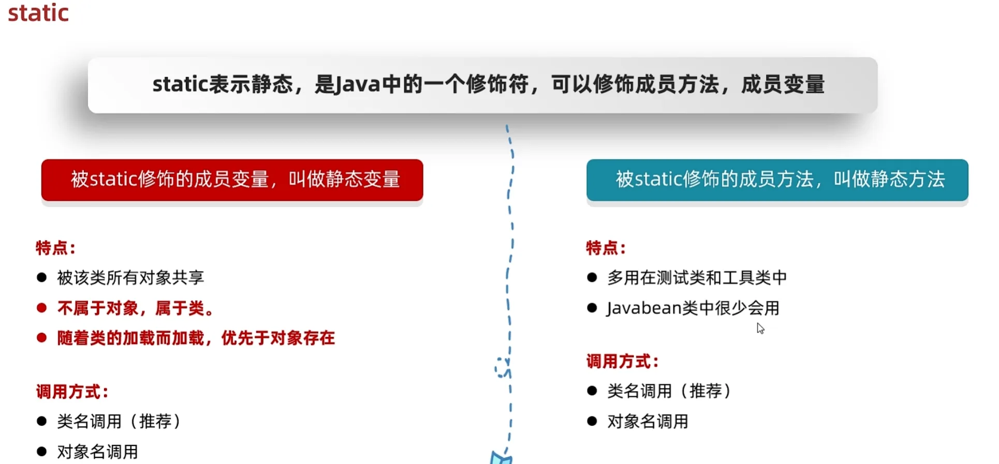

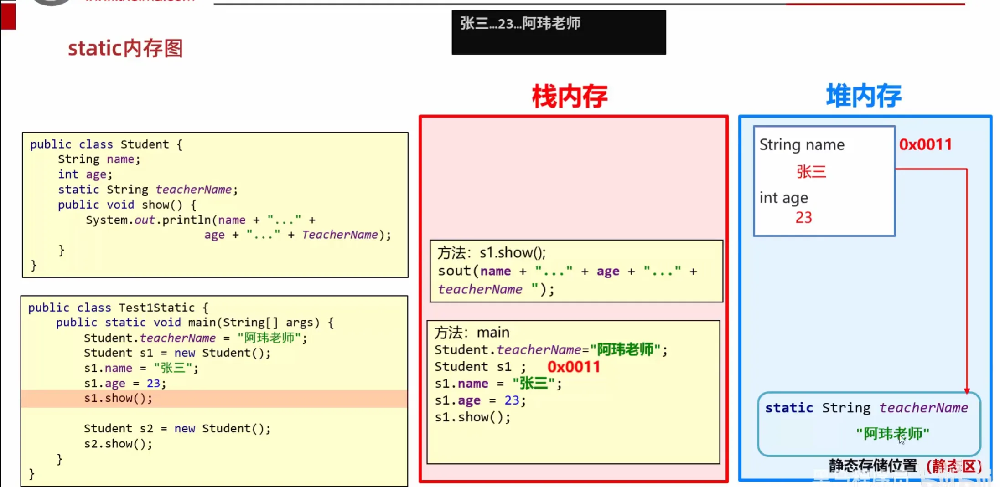

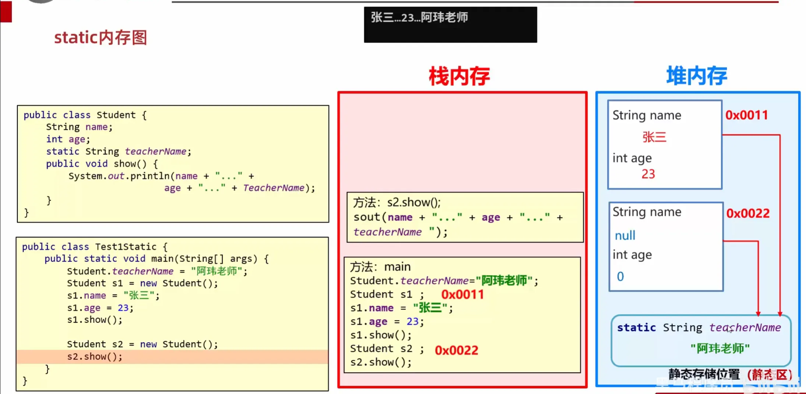

#### 小结

1.当 `static` 修饰成员变量或者成员方法时，该变量称为**静态变量**，该方法称为**静态方法**。该类的每个对象都**共享**同一个类的静态变量和静态方法。任何对象都可以更改该静态变量的值或者访问静态方法。但是不推荐这种方式去访问。因为静态变量或者静态方法直接通过类名访问即可，完全没有必要用对象去访问。

2.无`static`修饰的成员变量或者成员方法，称为**实例变量，实例方法**，实例变量和实例方法必须创建类的对象，然后通过对象来访问。

3.`static`修饰的成员属于类，会存储在静态区，是随着类的加载而加载的，且只加载一次，所以只有一份，节省内存。存储于一块固定的内存区域（静态区），所以，可以直接被类名调用。它优先于对象存在，所以，可以被所有对象共享。

4.无`static`修饰的成员，是属于对象，对象有多少个，他们就会出现多少份。所以必须由对象调用。

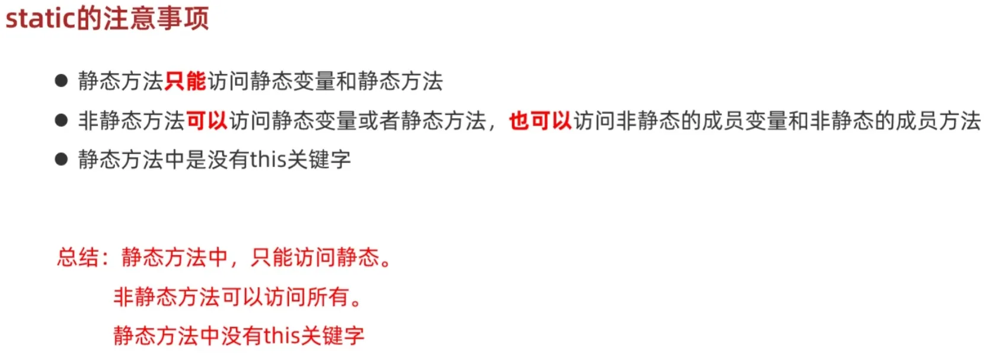

1.静态方法不能访问非静态

2.非静态可以访问所有

由于两者存在于内存的不同位置，，静态区中的数据先于对象的创建，因此静态无法访问非静态数据，但反过来可以。

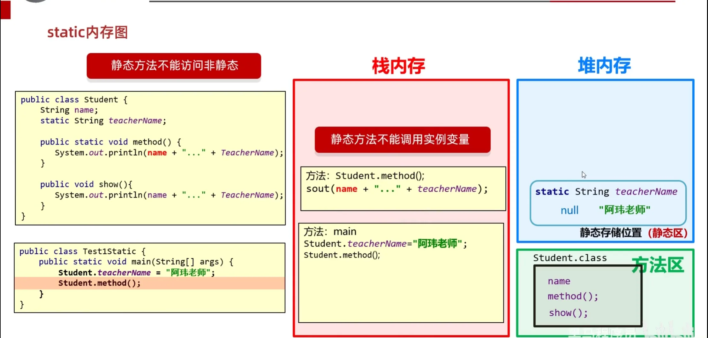

通常在工具类中使用。

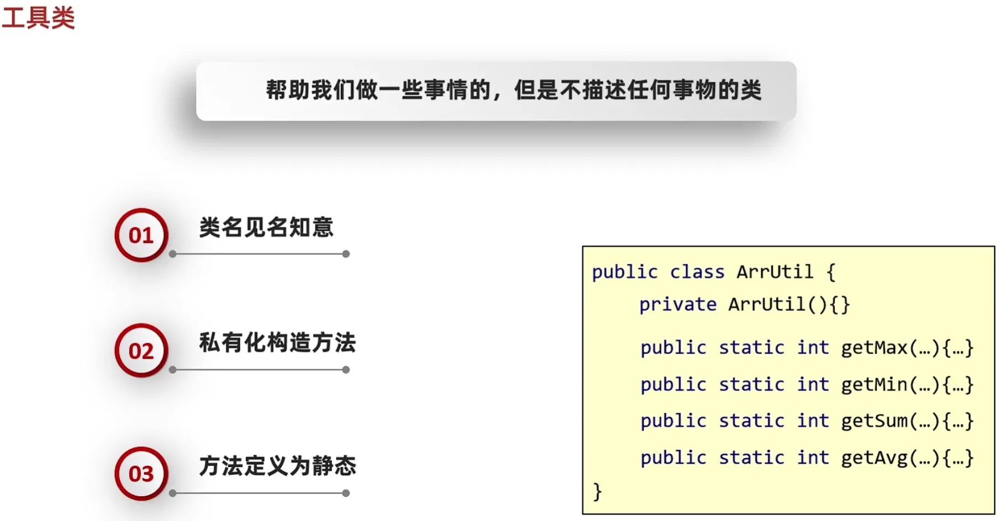

`this`的内存

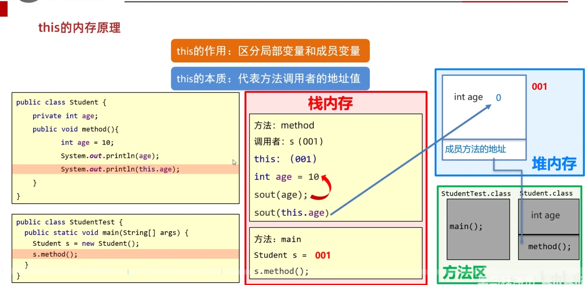

### 静态字段

如果将一个字段定义为static,每个类只有一个这样的字段。而对于非静态的实例字段，每个对象都有自己的一个副本。

现在，每一个Employee对象都有一个自己的id字段，但这个类的所有实例将共享一个nextId字段。换句话说，如果有1000个Employee类对象，则有1000个实例字段id,分别对应每一个对象。但是，只有一个静态字段nextId。,即使没有Employee对象，静态字段nextId也存在（`它的值对所有的实例来说都相同`）。`它属于类，而不属于任何单个的对象。`

> `静态变量会在该类的任何对象创建之前就完成初始化。`
> `静态变量会在该类的任何静态方法执行之前就初始化。`

### 静态常量

通过`static final`修饰的数据。常数变量的名称应该要都是大写字母 ，并且必须声明值或在静态初始化程序中赋值。

### 静态方法

静态方法是不在对象上执行的方法。可以认为静态方法是没有this参数的方法。

类的静态方法不能访问id实例字段，因为它不能在对象上执行操作。但是，静态方法可以访问静态字段。

在下面两种情况下可以使用静态方法：

- 方法不需要访问对象状态，因为它需要的所有参数都通过显式参数提供。
- 方法只需要访问类的静态字段。

> 静态方法是在无关特定类的实例情况下执行的，甚至也不会有该类的实例出现。因为静态方法是通过类的名称调用，所以静态方法无法引用到该类的任何实例变量和方法。因此，`静态方法不能调用非静态变量和非静态方法。`

## 对象构造

### 重载

有些类有多个构造器，这种功能叫做重载(overloading)。如果多个方法（比如，StringBuilder构造器方法）有相同的名字、不同的参数，便出现了重载。编译器必须挑选出具体调用哪个方法。它用各个方法首部中的参数类型与特定方法调用中所使用的值类型进行匹配，来选出正确的方法。如果编译器找不到匹配的参数，就会产生编译时错误，因为根本不存在匹配，或者没有一个比其他的更好（这个查找匹配的过程被称为重载解析(overloading resolution))。

### 默认字段初始化

如果在构造器中没有显式地为字段设置初值，那么就会被自动地赋为默认值：数值为0、布尔值为fa1se、对象引用为null。

### 无参数的构造器

如果写一个类时没有编写构造器，就会为你提供一个无参数构造器。这个构造器将所有的实例字段设置为默认值。于是，实例字段中的数值型数据设置为日，布尔型数据设置为false,所有对象变量将设置为null。
如果类中提供了至少一个构造器，但是没有提供无参数的构造器，那么构造对象时如果不提供参数就是不合法的。

> 警告：请记住，仅当类没有任何其他构造器的时候，你才会得到一个默认的无参数构造器。

### 显式字段初始化

在执行构造器之前先完成这个赋值操作。如果一个类的所有构造器都希望把某个特定的实例字段设置为同一个值，这个语法就特别有用。

### 初始化块

实际上，Java还有第三种机制，称为初始化块(initialization block)。在一个类的声明中，可以包含任意多个代码块。只要构造这个类的对象，这些块就会被执行。

```java
class A{
    // 静态初始化块
    static {
        System.out.println("static init block A");
    }
    // 普通初始化块
    {
        System.out.println("common init block A");
    }
    // 构造方法
    public A() {
        System.out.println("Constructor without params A");
    }
}
```

# 封装

告诉我们，如何正确设计对象的属性和方法

对象代表什么，就得封装对应的数据，并提供数据对应的行为，为了安全的保护数据。

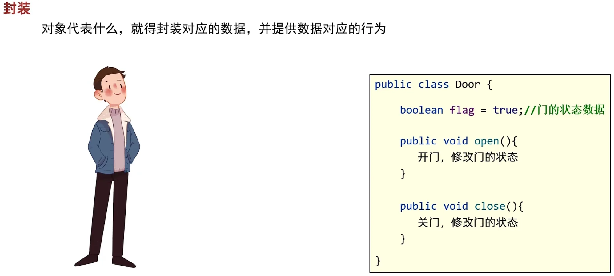

`private`关键字

- 是一个权限修饰符
- 可以修饰成员（成员变量和成员方法）
- 被`private`修饰的成员只能在本类中才能访问

1. `private`关键字是一个权限修饰符
2. 可以修饰成员（成员变量和成员方法)
3. 被`private`修饰的成员只能在本类中才能访问
4. 针对`private`修饰的成员变量，如果需要被其他类使用，提供相应的操作
5. 提供“`setXxx(参数)`”方法，用于给成员变量赋值，方法用`public`修饰
6. 提供“`getXxx()`”方法，用于获取成员变量的值，方法用`public`修饰


## `this`

this修饰的变量用于指代成员变量，其主要作用是（区分局部变量和成员变量的重名问题）

* 方法的形参如果与成员变量同名，不带this修饰的变量指的是形参，而不是成员变量
* 方法的形参没有与成员变量同名，不带this修饰的变量指的是成员变量

1.就近原则
`System.out.println(age);`
`System.out.println(this.age);`
2.`this`的作用？
可以区别成员变量和局部变量

## 构造方法

创造对象的时候，虚拟机会自动调用构造方法，作用是给成员变量进行初始化的。

- 如果没有定义构造方法，系统将给出一个默认的无参数构造方法
- 如果定义了构造方法，系统将不再提供默认的构造方法
- 带参构造方法，和无参数构造方法，两者方法名相同，但是参数不同，这叫做构造方法的重载
- 无论是否使用，都手动书写无参数构造方法，和带全部参数的构造方法


## 标准的`JavaBean`类

1. 类名需要见名知意
2. 成员变量使用private修饰
3. 提供至少两个构造方法
   - 无参构造方法
   - 带全部参数的构造方法
4. 成员方法
   - 提供每一个成员变量对应的`setXxx()/getXxx()`
   - 如果还有其他行为，也需要写上

# 继承

## 继承的含义

继承描述的是事物之间的所属关系，这种关系是：`is-a` 的关系。父类更通用，子类更具体。我们通过继承，可以使多种事物之间形成一种关系体系。

**继承**：就是子类继承父类的**属性**和**行为**，使得子类对象可以直接具有与父类相同的属性、相同的行为。子类可以直接访问父类中的**非私有**的属性和行为。

每一个类都直接或者间接的继承于Object。

`但一个类只能有一个父类。`


## 继承的好处

1. 提高**代码的复用性**（减少代码冗余，相同代码重复利用）。
2. 使类与类之间产生了关系。

## 类、超类和子类

### 定义子类

关键字extends表明正在构造的新类派生于一个已存在的类。这个已存在的类称为`超类(super class)`、`基类(base class)`或`父类(parent class)`;新类称为`子类(sub class)`、`派生类(derived class)`或`孩子类(child class)`。超类和子类是Java程序员最常用的两个术语，而了解其他语言的程序员可能更加偏爱使用父类和孩子类，这也能很贴切地体现“继承”。

通过 `extends` 关键字，可以声明一个子类继承另外一个父类，定义格式如下：

```java
class 父类 {
	...
}

class 子类 extends 父类 {
	...
}
```

**需要注意：Java是单继承的，一个类只能继承一个直接父类，跟现实世界很像，但是Java中的子类是更加强大的。**


但是`继承≠直接使用`，因此`private`的成员变量不能直接使用。

公共成员变量


私有成员变量


所有的方法都放在了虚方法表中。


### 子类不能继承的内容

#### 引入 

并不是父类的所有内容都可以给子类继承的：

**子类不能继承父类的构造方法。**

**值得注意的是子类可以继承父类的私有成员（成员变量，方法），只是子类无法直接访问而已，可以通过getter/setter方法访问父类的private成员变量。**

#### 演示代码

```java
public class Demo03 {
    public static void main(String[] args) {
        Zi z = new Zi();
        System.out.println(z.num1);
        System.out.println(z.getNum2());
        z.show1();
    }
}
class Fu {
    public int num1 = 10;
    private int num2 = 20;
    public int getNum2() {
        return num2;
    }

    public void setNum2(int num2) {
        this.num2 = num2;
    }
}
class Zi extends Fu {}
```

### 继承后的特点—成员变量

成员变量不重名：

如果子类父类中出现**不重名**的成员变量，这时的访问是**没有影响的**。

成员变量重名：

如果子类父类中出现**重名**的成员变量，这时的访问是**有影响的**。

子父类中出现了同名的成员变量时，子类会优先访问自己对象中的成员变量。如果此时想访问父类成员变量如何解决呢？我们可以使用super关键字。


#### super访问父类成员变量

子父类中出现了同名的成员变量时，在子类中需要访问父类中非私有成员变量时，需要使用`super` 关键字，修饰父类成员变量，类似于之前学过的 `this` 。

需要注意的是：**super代表的是父类对象的引用，this代表的是当前对象的引用。**

**使用格式：**

```java
super.父类成员变量名
```

子类方法需要修改，代码如下：

> 小贴士：Fu 类中的成员变量是非私有的，子类中可以直接访问。若Fu 类中的成员变量私有了，子类是不能直接访问的。通常编码时，我们遵循封装的原则，使用private修饰成员变量，那么如何访问父类的私有成员变量呢？对！可以在父类中提供公共的`getXxx`方法和`setXxx`方法。

### 继承后的特点—成员方法

同样适用就近原则。

成员方法不重名：

如果子类父类中出现**不重名**的成员方法，这时的调用是**没有影响的**。对象调用方法时，会先在子类中查找有没有对应的方法，若子类中存在就会执行子类中的方法，若子类中不存在就会执行父类中相应的方法。

成员方法重名：

如果子类父类中出现**重名**的成员方法，则创建子类对象调用该方法的时候，**子类对象会优先调用自己的方法**。

### 方法重写


#### 概念

**方法重写** ：子类中出现与父类一模一样的方法时（返回值类型，方法名和参数列表都相同），会出现覆盖效果，也称为重写或者复写。**声明不变，重新实现**。
子类继承了父类的方法，但是子类觉得父类的这方法不足以满足自己的需求，子类重新写了一个与父类同名的方法，以便覆盖父类的该方 法。

#### @Override重写注解

* @Override:注解，重写注解校验！

* 这个注解标记的方法，就说明这个方法必须是重写父类的方法，否则编译阶段报错。

* 建议重写都加上这个注解，一方面可以提高代码的可读性，一方面可以防止重写出错！

#### 注意事项

1. 方法重写是发生在子父类之间的关系。
2. 子类方法覆盖父类方法，必须要保证权限大于等于父类权限。
3. 子类方法覆盖父类方法，返回值类型、函数名和参数列表都要一模一样。


### 继承后的特点—构造方法

#### 引入

当类之间产生了关系，其中各类中的构造方法，又产生了哪些影响呢？
首先我们要回忆两个事情，构造方法的定义格式和作用。

1. 构造方法的名字是与类名一致的。所以子类是无法继承父类构造方法的。
2. 构造方法的作用是初始化对象成员变量数据的。所以子类的初始化过程中，必须先执行父类的初始化动作。子类的构造方法中默认有一个`super()` ，表示调用父类的构造方法，父类成员变量初始化后，才可以给子类使用。（**先有爸爸，才能有儿子**）

**继承后子类构方法器特点:子类所有构造方法的第一行都会默认先调用父类的无参构造方法。如果子类的构造器没有显式地调用超类的构造器，将自动地调用超类的无参数构造器。如果超类没有无参数的构造器，并且在子类的构造器中又没有显式地调用超类的其他构造器，Java编译器就会报告一个错误。**

`每个构造函数可以选择调用super()或this()，但不能同时调用！`

> - super(参数列表)执行的操作父类初始化，为了保证初始化的顺序，其需要放在构造方法的第一行 当第一行没有写super()语句时，编译器会自动在构造方法的第一行加上无参super()语句。
> - this关键字执行的操作也是初始化，为了保证初始化的顺序，其需要放在构造方法的第一行。
> - 一个对象不能被反复初始化，表现为this()和super()都要写在构造方法的第一行来执行初始化操作，所以注定两者不能同时出现在同一个构造方法中。

#### 小结

* 子类构造方法执行的时候，都会在`第一行`默认先调用父类无参数构造方法一次。
* 子类构造方法的第一行都隐含了一个`super()`去调用父类无参数构造方法，`super()`可以省略不写。这样就会出现“构造函数链”，即从该对象一直通过构造函数创建出直到`Object`的部分。


## 阻止继承：final类和方法

有时候，我们可能希望阻止人们利用某个类定义子类。不允许扩展的类被称为final类。如果在定义类的时候使用了final修饰符就表明这个类是final类。

1. 仅对本类可见—private。
2. 对外部完全可见一public。
3. 对本包和所有子类可见protected。
4. 对本包可见一默认，不需要修饰符。

## super(...)和this(...)

我们发现，子类有参数构造方法只是初始化了自己对象中的成员变量，而父类中的成员变量依然是没有数据的，怎么解决这个问题呢，我们可以借助与super(...)去调用父类构造方法，以便初始化继承自父类对象的name和age.


### super和this的用法格式

super和this完整的用法如下，其中this，super访问成员我们已经接触过了。

```java
this.成员变量    	--    本类的
super.成员变量    	--    父类的

this.成员方法名()  	--    本类的    
super.成员方法名()   --    父类的
```

接下来我们使用调用构造方法格式：

```java
super(...) -- 调用父类的构造方法，根据参数匹配确认
this(...) -- 调用本类的其他构造方法，根据参数匹配确认
```

### super(....)

**注意：**

**子类的每个构造方法中均有默认的super()，调用父类的空参构造。手动调用父类构造会覆盖默认的super()。**

**super() 和 this() 都必须是在构造方法的第一行，所以不能同时出现。**

super(..)是根据参数去确定调用父类哪个构造方法的。

### super(...)案例图解

**父类空间优先于子类对象产生**

在每次创建子类对象时，先初始化父类空间，再创建其子类对象本身。目的在于子类对象中包含了其对应的父类空间，便可以包含其父类的成员，如果父类成员非private修饰，则子类可以随意使用父类成员。代码体现在子类的构造七调用时，一定先调用父类的构造方法。理解图解如下：


### this(...)用法演示

this(...)

 *    默认是去找本类中的其他构造方法，根据参数来确定具体调用哪一个构造方法。
 *    为了借用其他构造方法的功能。

### 小结

* **子类的每个构造方法中均有默认的super()，调用父类的空参构造。手动调用父类构造会覆盖默认的super()。**

* **super() 和 this() 都必须是在构造方法的第一行，所以不能同时出现。**

* **super(..)和this(...)是根据参数去确定调用父类哪个构造方法的。**
* super(..)可以调用父类构造方法初始化继承自父类的成员变量的数据。
* this(..)可以调用本类中的其他构造方法。

## 继承的特点

1. Java只支持单继承，不支持多继承。

  ```java
// 一个类只能有一个父类，不可以有多个父类。
class A {}
class B {}
class C1 extends A {} // ok
// class C2 extends A, B {} // error
  ```

2. 一个类可以有多个子类。

  ```java
// A可以有多个子类
class A {}
class C1 extends A {}
class C2 extends  A {}
  ```

3. 可以多层继承。

  ```java
class A {}
class C1 extends A {}
class D extends C1 {}
  ```

  > 顶层父类是Object类。所有的类默认继承Object，作为父类。

## 继承的设计技巧

- 将公共操作和字段放在超类中。
- 不要使用受保护的字段。
- 使用继承实现“is-a" 关系。
- 除非所有继承的方法都有意义，否则不要使用继承。
- 在覆盖方法时，不要改变预期的行为。
- 使用多态，而不要使用类型信息。
- 不要滥用反射。

# 多态


## 多态的形式

**多态是继封装、继承之后，面向对象的第三大特性。**

**多态是出现在继承或者实现关系中的**。

**多态体现的格式**：

```java
父类类型 变量名 = new 子类/实现类构造器;
变量名.方法名();
```

**多态的前提**：有继承关系，子类对象是可以赋值给父类类型的变量。

“is-a”规则的另一种表述是替换原则（substitution principle)。它指出程序中出现超类对象的任何地方都可以使用子类对象替换。

在Java程序设计语言中，对象变量是多态的（polymorphic)。一个Employee类型的变量既可以引用一个Employee类型的对象，也可以引用Employee类的任何一个子类的对象（例如，Manager、Executive、Secretary等)。

## 多态的使用场景

如果没有多态，在下图中register方法只能传递学生对象，其他的Teacher和administrator对象是无法传递给register方法方法的，在这种情况下，只能定义三个不同的register方法分别接收学生，老师和管理员。


有了多态之后，方法的形参就可以定义为共同的父类Person。

**要注意的是：**

* 当一个方法的形参是一个类，我们可以传递这个类所有的子类对象。
* 当一个方法的形参是一个接口，我们可以传递这个接口所有的实现类对象（后面会学）。
* 而且多态还可以根据传递的不同对象来调用不同类中的方法。


## 多态的定义和前提

**多态**： 是指同一行为，具有多个不同表现形式。

从上面案例可以看出，Cat和Dog都是动物，都是吃这一行为，但是出现的效果（表现形式）是不一样的。

 **前提【重点】**

1. 有继承或者实现关系

2. 方法的重写【意义体现：不重写，无意义】

3. 父类引用指向子类对象【格式体现】

   > 父类类型：指子类对象继承的父类类型，或者实现的父接口类型。

## 多态的运行特点


调用成员变量时：编译看左边，运行看左边

调用成员方法时：编译看左边，运行看右边


## 多态的优势

在多态形式下，右边对象可以实现解耦合，便于扩展和维护

定义方法的时候，使用父类型作为参数，可以接收所有子类对象，体现多态的扩展性与便利。

## 多态的弊端

我们已经知道多态编译阶段是看左边父类类型的，如果子类有些独有的功能，此时**多态的写法就无法访问子类独有功能了**。

## 引用类型转换

### 为什么要转型

**多态的写法就无法访问子类独有功能了。**

当使用多态方式调用方法时，首先检查父类中是否有该方法，如果没有，则编译错误。也就是说，**不能调用**子类拥有，而父类没有的方法。编译都错误，更别说运行了。这也是多态给我们带来的一点"小麻烦"。所以，想要调用子类特有的方法，必须做向下转型。

回顾基本数据类型转换

- 自动转换: 范围小的赋值给范围大的.自动完成:double d = 5; 
- 强制转换: 范围大的赋值给范围小的,强制转换:int i = (int)3.14 

​     多态的转型分为向上转型（自动转换）与向下转型（强制转换）两种。

### 向上转型（自动转换）

- **向上转型**：多态本身是子类类型向父类类型向上转换（自动转换）的过程，这个过程是默认的。
  当父类引用指向一个子类对象时，便是向上转型。
  使用格式：

```java
父类类型  变量名 = new 子类类型();
如：Animal a = new Cat();
```

**原因是：父类类型相对与子类来说是大范围的类型，Animal是动物类，是父类类型。Cat是猫类，是子类类型。Animal类型的范围当然很大，包含一切动物。**所以子类范围小可以直接自动转型给父类类型的变量。

但会丢失除与父类对象共有的其他方法。

- 编译类型取决于=号左边，运行类型取决于=号右边；
- 子类可以调用父类的所有成员，但需遵守访问权限；
- 父类不能调用子类的特有成员；
- 最终的运行效果取决于子类的具体实现。

### 向下转型（强制转换）

- **向下转型**：父类类型向子类类型向下转换的过程，这个过程是强制的。
  一个已经向上转型的子类对象，将父类引用转为子类引用，可以使用强制类型转换的格式，便是向下转型。

使用格式：

```java
子类类型 变量名 = (子类类型) 父类变量名;
如:Aniaml a = new Cat();
   Cat c =(Cat) a;  
```

- 只能强制转换父类的引用，不能强制转换父类的对象；
- 父类的引用必须指向子类目标类型的对象；
- 向下转型后，父类可以调用子类类型中的所有成员。

```java
abstract class Animal {  
    abstract void eat();  
}  

class Cat extends Animal {  
    public void eat() {  
        System.out.println("吃鱼");  
    }  
    public void catchMouse() {  
        System.out.println("抓老鼠");  
    }  
}  

class Dog extends Animal {  
    public void eat() {  
        System.out.println("吃骨头");  
    }  
    public void watchHouse() {  
        System.out.println("看家");  
    }  
}

public class Test {
    public static void main(String[] args) {
        // 向上转型  
        Animal a = new Cat();  
        a.eat(); 				// 调用的是 Cat 的 eat

        // 向下转型  
        Cat c = (Cat)a;       
        c.catchMouse(); 		// 调用的是 Cat 的 catchMouse
    }  
}
```

### 转型的异常

转型的过程中，一不小心就会遇到这样的问题，请看如下代码：

```java
public class Test {
    public static void main(String[] args) {
        // 向上转型  
        Animal a = new Cat();  
        a.eat();               // 调用的是 Cat 的 eat

        // 向下转型  
        Dog d = (Dog)a;       
        d.watchHouse();        // 调用的是 Dog 的 watchHouse 【运行报错】
    }  
}
```

这段代码可以通过编译，但是运行时，却报出了 `ClassCastException` ，类型转换异常！这是因为，明明创建了Cat类型对象，运行时，当然不能转换成Dog对象的。

### `instanceof`关键字

为了避免`ClassCastException`的发生，Java提供了 `instanceof` 关键字，给引用变量做类型的校验，格式如下：

```java
变量名 instanceof 数据类型 
如果变量属于该数据类型或者其子类类型，返回true。
如果变量不属于该数据类型或者其子类类型，返回false。
```

所以，转换前，我们最好先做一个判断，代码如下：

```java
public class Test {
    public static void main(String[] args) {
        // 向上转型  
        Animal a = new Cat();  
        a.eat();               // 调用的是 Cat 的 eat

        // 向下转型  
        if (a instanceof Cat){
            Cat c = (Cat)a;       
            c.catchMouse();        // 调用的是 Cat 的 catchMouse
        } else if (a instanceof Dog){
            Dog d = (Dog)a;       
            d.watchHouse();       // 调用的是 Dog 的 watchHouse
        }
    }  
}
```

### `instanceof`新特性

JDK14的时候提出了新特性，把判断和强转合并成了一行

```java
//新特性
//先判断a是否为Dog类型，如果是，则强转成Dog类型，转换之后变量名为d
//如果不是，则不强转，结果直接是false
if(a instanceof Dog d){
    d.lookHome();
}else if(a instanceof Cat c){
    c.catchMouse();
}else{
    System.out.println("没有这个类型，无法转换");
}
```

## 理解方法调用

准确地理解如何在对象上应用方法调用非常重要。下面假设要调用x.f(ags),隐式参数x声明为类C的一个对象。下面是调用过程的详细描述：
1.编译器查看对象的声明类型和方法名。需要注意的是：有可能存在多个名字为f但参数类型不一样的方法。例如，可能存在方法f(int)和方法f(String)。编译器将会一一列举C类中所有名为千的方法和其超类中所有名为f而且可访问的方法（`超类的私有方法不可访问`）。
至此，编译器已知道所有可能被调用的候选方法。
2.接下来，编译器要确定方法调用中提供的参数类型。如果在所有名为f的方法中存在一个与所提供参数类型完全匹配的方法，就选择这个方法。这个过程称为重载解析(overloading resolution)。例如，对于调用x.f("Hello'"),编译器将会挑选f(String),而不是f(int)。由于允许类型转换(int可以转换double,Manager可以转换成Employee,等等)，所以情况可能会变得很复杂。如果编译器没有找到与参数类型匹配的方法，或者发现经过类型转换后有多个方法与之匹配，编译器就会报告一个错误。
至此，编译器已经知道需要调用的方法的名字和参数类型。

> 注释：前面曾经说过，方法的名字和参数列表称为方法的签名。例如，f(t)和f(String)是两个有相同名字、不同签名的方法。如果在子类中定义了一个与超类签名相同的方法，那么子类中的这个方法就会覆盖超类中这个相同签名的方法。
> 返回类型不是签名的一部分。不过在覆盖一个方法时，需要保证返回类型的兼容性。允许子类将覆盖方法的返回类型改为原返回类型的子类型。例如，假设Employee类

3.如果是private方法、static方法、final方法或者构造器，那么编译器将可以准确地知道应该调用哪个方法。这称为`静态绑定`(static binding)。与此对应的是，如果要调用的方法依赖于隐式参数的实际类型，那么必须在运行时使用动态绑定。在我们的示例中，编译器会利用动态绑定生成一个调用f(String)的指令。
4.程序运行并且采用`动态绑定`调用方法时，虚拟机必须调用与x所引用对象的实际类型对应的那个方法。假设×的实际类型是D,它是C类的子类。如果D类定义了方法f(String),就会调用这个方法；否则，将在D类的超类中寻找f(String),以此类推。
每次调用方法都要完成这个搜索，时间开销相当大。`因此，虚拟机预先为每个类计算了一个方法表（method table),其中列出了所有方法的签名和要调用的实际方法。`这样一来，在真正调用方法的时候，虚拟机仅查找这个表就行了。在前面的例子中，虚拟机搜索D类的方法表，寻找与调用f(Sting)相匹配的方法。这个方法既有可能是D.f(String),也有可能是X.f(String),这里的X是D的某个超类。这里需要提醒一点，如果调用是super.f(param),那么编译器将对隐式参数超类的方法表进行搜索。

> 这种多态其实是通过**动态绑定**（dynamic binding）技术来实现，是指**在执行期间判断所引用对象的实际类型，根据其实际的类型调用其相应的方法**。也就是说，只有程序运行起来，你才知道调用的是哪个子类的方法。这种多态可通过函数的重写以及向上转型来实现。
> 与动态绑定相对应的就是**静态绑定**，指的是**在JVM解析时便能够直接识别目标方法的情况**。
> **JVM 虚方法表**（Virtual Method Table）,也称为vtable,是**动态调度**用来依次调用**虚方法**的一种表结构，是一种特殊的**索引表**。
> 面向对象编程，会频繁地触发**动态分派**，如果每次动态分配的过程都要重新在类的方法 元数据中搜索合适的目标的方法，就可能影响到执行效率，所以JVM选择了 用**空间换取时间**的策略来实现动态绑定，**为每个类生成一张虚方法表**，然后直接通过虚方法表，使用索引来代替循环查找，快速定位目标方法。

# 抽象类

为此，Java提供了一种称为抽象方法(abstract method )的机制。这是一个不完整的方法，它只有一个声明,没有方法体。以下是抽象方法声明的语法：

`abstract void f();`

包含抽象方法的类称为抽象类。如果一个类包含一个或多个抽象方法，则该类必须被定义为抽象类,否则编译器会产生错误消息。`我们创建抽象类，是想通过一个公共接口来操作一组类`。

## abstract使用格式

**abstract是抽象的意思，用于修饰方法方法和类，修饰的方法是抽象方法，修饰的类是抽象类。**

### 抽象方法

使用`abstract` 关键字修饰方法，该方法就成了抽象方法，抽象方法只包含一个方法名，而没有方法体。

实现抽象的方法就如同覆盖过方法一样。抽象的方法没有内容，它只是为了标记出多态而存在。这表示在继承树结构下的第一个具体类必须要实现出所有的抽象方法。

定义格式：

```java
修饰符 abstract 返回值类型 方法名 (参数列表)；
```

代码举例：

```java
public abstract void run()；
```

### 抽象类

如果一个类包含抽象方法，那么该类必须是抽象类。**注意：抽象类不一定有抽象方法，但是有抽象方法的类必须定义成抽象类。**

定义格式：

```java
abstract class 类名字 { 
  
}
```

代码举例：

```java
public abstract class Animal {
    public abstract void run()；
}
```

### 抽象类的使用

**要求**：继承抽象类的子类**必须重写父类所有的抽象方法**。否则，该子类也必须声明为抽象类。

代码举例：

```java
// 父类,抽象类
abstract class Employee {
	private String id;
	private String name;
	private double salary;
	
	public Employee() {
	}
	
	public Employee(String id, String name, double salary) {
		this.id = id;
		this.name = name;
		this.salary = salary;
	}
	
	// 抽象方法
	// 抽象方法必须要放在抽象类中
	abstract public void work();
}

// 定义一个子类继承抽象类
class Manager extends Employee {
	public Manager() {
	}
	public Manager(String id, String name, double salary) {
		super(id, name, salary);
	}
	// 2.重写父类的抽象方法
	@Override
	public void work() {
		System.out.println("管理其他人");
	}
}

// 定义一个子类继承抽象类
class Cook extends Employee {
	public Cook() {
	}
	public Cook(String id, String name, double salary) {
		super(id, name, salary);
	}
	@Override
	public void work() {
		System.out.println("厨师炒菜多加点盐...");
	}
}

// 测试类
public class Demo10 {
	public static void main(String[] args) {
		// 创建抽象类,抽象类不能创建对象
		// 假设抽象类让我们创建对象,里面的抽象方法没有方法体,无法执行.所以不让我们创建对象
//		Employee e = new Employee();
//		e.work();
		
		// 3.创建子类
		Manager m = new Manager();
		m.work();
		
		Cook c = new Cook("ap002", "库克", 1);
		c.work();
	}
}
```

此时的方法重写，是子类对父类抽象方法的完成实现，我们将这种方法重写的操作，也叫做**实现方法**。

## 抽象类的特征

抽象类的特征总结起来可以说是 **有得有失**

**有得：抽象类得到了拥有抽象方法的能力。**

**有失：抽象类失去了创建对象的能力。**

其他成员（构造方法，实例方法，静态方法等）抽象类都是具备的。

## 抽象类的细节

不需要背，只要当idea报错之后，知道如何修改即可。

关于抽象类的使用，以下为语法上要注意的细节，虽然条目较多，但若理解了抽象的本质，无需死记硬背。

1. 抽象类**不能创建对象**，如果创建，编译无法通过而报错。只能创建其非抽象子类的对象。

   > 理解：假设创建了抽象类的对象，调用抽象的方法，而抽象方法没有具体的方法体，没有意义。

2. 抽象类中，可以有构造方法，是供子类创建对象时，初始化父类成员使用的。

   > 理解：子类的构造方法中，有默认的super()，需要访问父类构造方法。

3. 抽象类中，不一定包含抽象方法，但是有抽象方法的类必定是抽象类。

   > 理解：未包含抽象方法的抽象类，目的就是不想让调用者创建该类对象，通常用于某些特殊的类结构设计。

4. 抽象类的子类，必须重写抽象父类中**所有的**抽象方法，否则子类也必须定义成抽象类，编译无法通过而报错。 

   > 理解：假设不重写所有抽象方法，则类中可能包含抽象方法。那么创建对象后，调用抽象的方法，没有意义。

5. 抽象类存在的意义是为了被子类继承。

   > 理解：抽象类中已经实现的是模板中确定的成员，抽象类不确定如何实现的定义成抽象方法，交给具体的子类去实现。

## 抽象类存在的意义

	抽象类存在的意义是为了被子类继承，否则抽象类将毫无意义。抽象类可以强制让子类，一定要按照规定的格式进行重写。
