# Object:所有类的超类

Object类是Java中所有类的始祖，在Java中每个类都扩展了Object。

可以使用Object类型的变量引用任何类型的对象。

| 修饰符和类型                    | 方法                            | 说明                                                         |
| :------------------------------ | :------------------------------ | ------------------------------------------------------------ |
| `protected native Object`       | `clone()`                       | 创建并返回该对象的副本。                                     |
| `public boolean`                | `equals(Object obj)`            | 指示某个其他对象是否“等于”此对象。                           |
| `protected void`                | `finalize()`                    | 当垃圾收集确定不再有对该对象的引用时，由该对象的垃圾收集器调用。 |
| `public final native Class<?> ` | `getClass()`                    | 返回 this 的运行时类`Object`。                               |
| `public native int`             | `hashCode()`                    | 返回对象的哈希码值。                                         |
| `public final native void`      | `notify()`                      | 唤醒正在该对象的监视器上等待的单个线程。                     |
| `public final native void`      | `notifyAll()`                   | 唤醒在此对象监视器上等待的所有线程。                         |
| `public String toString()`      | `toString()`                    | 返回对象的字符串表示形式。                                   |
| `public final void`             | `wait()`                        | 导致当前线程等待，直到另一个线程调用 此对象的[`notify()`](https://docs.oracle.com/javase/8/docs/api/java/lang/Object.html#notify--)方法或 方法。[`notifyAll()`](https://docs.oracle.com/javase/8/docs/api/java/lang/Object.html#notifyAll--) |
| `public final void`             | `wait(long timeout)`            | 导致当前线程等待，直到另一个线程调用该 [`notify()`](https://docs.oracle.com/javase/8/docs/api/java/lang/Object.html#notify--)方法或 [`notifyAll()`](https://docs.oracle.com/javase/8/docs/api/java/lang/Object.html#notifyAll--)该对象的方法，或者经过指定的时间量。 |
| `public final void`             | `wait(long timeout, int nanos)` | 导致当前线程等待，直到另一个线程调用 此对象的[`notify()`](https://docs.oracle.com/javase/8/docs/api/java/lang/Object.html#notify--)方法或 [`notifyAll()`](https://docs.oracle.com/javase/8/docs/api/java/lang/Object.html#notifyAll--)方法，或者某个其他线程中断当前线程，或者已经过了一定的实际时间。 |

## equals方法

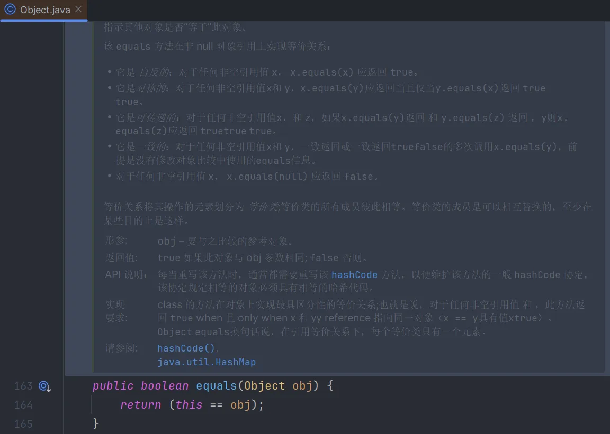

Object类中的equals方法用于检测一个对象是否等于另外一个对象。Object类中实现的equals方法将确定两个对象引用是否相等。这是一个合理的默认行为：如果两个对象引用相等，这两个对象肯定就相等。对于很多类来说，这已经足够了。

如果隐式和显式的参数不属于同一个类，equals方法将如何处理呢？

Java语言规范要求equals方法具有以下特性：
1)自反性。对于任何非空引用x，x.equals(x)应该返回true。
2)对称性。对于任何引用x和y，当且仅当y.equals(x)返回true，x.equals(y)也应该返回true。
3)传递性。对于任何引用x,y,z，有`x.equals(y)==true`，且`y.equals(z)==true`，则`x.equals(z)==true`。
4)一致性。如果x和y的引用的对象没有发生变化，反复调用x.equals(y)应该返回同样的结果。
5)对于任意非空引用x，x.equals(null)应该返回false。

就现在来看，有两种完全不同的情形：

- 如果子类可以有自己的相等性概念，则对称性需求将强制使用getClass 检测。
- 如果由超类决定相等性概念， 那么就可以使用instanceof 检测，这样可以在不同子类的对象之间进行相等性比较。

通俗的说就是，西瓜和香蕉都是水果，西瓜就是西瓜，香蕉就是香蕉，西瓜不可能是香蕉。那么就可以使用getclass。另外一种情况就是，项目经理和开发人员都是员工，一个经理可能是开发人员，开发人员也可能是经理，在员工中有内置的标识id，那么就可以用instanceof检测，如果都是员工，再根据超类中的id判断是否是同一个人。（这种情况下应该将超类的equals声明为final）

在标准Java 库中包含150 多个equals 方法的实现，包括使用instanceof 检测、
调用getClass、捕获ClassCastException 或者什么也不做等各种不同做法。可以查看Java.sql.Times tamp 类的API 文档，在这里实现人员不无尴尬地指出，他们让自己陷入了困境。Timestamp 类继承自java.util.Date, 而后者的equals 方法使用了一个instanceof 测试，这样一来就无法覆盖equals, 使之同时做到对称且正确。

> 下面给出编写一个完美的equals方法的建议：
>
> 1. 显式参数命名为otherObject, 稍后需要将它强制转换成另一个名为other 的变量。
>
> 2. 检测this 与otherObject 是否相等：
>    `if (this = otherObject) return true;`
>    这条语句只是一个优化。实际上，这是一种经常采用的形式。因为检查身份要比逐个比较字段开销小。
>
> 3. 检测otherObject 是否为null, 如果为null, 返回false。这项检测是很必要的。
>    `if (otherObject = null) return false;`
>
> 4. 比较this 与otherObject 的类。如果equals 的语义可以在子类中改变，就使用getClass 检测：
>    `if (getClass() != otherObject.getClass()) return false;`
>    如果所有的子类都有相同的相等性语义，可以使用instanceof 检测：
>    `if (! (otherObject instanceof ClassName)) return false;`
>
> 5. 将otherObject 强制转换为相应类类型的变从：
>    `ClassName other= (ClassName) otherObject`
>
> 6. 现在根据相等性概念的要求来比较字段。使用==比较基本类型字段，使用Objects.equals 比较对象字段。如果所有的字段都匹配．就返回true; 否则返回false。
>    return field1 = other. field1
>    && Objects .equals(field2, other. field2 )
>    &&...;
>    如果在子类中重新定义equals, 就要在其中包含一个super.equals(other) 调用。
>
> 提示：对于数组类型的字段，可以使用静态的Arrays.equals 方法检测相应的数组元素是否相等。

总之

1. 使用`==`来比对primitive主数据类型。
2. 使用`==`来判别两个引用是否都指向同一对象。
3. 使用`.equals`尽量确保两个对象一样。

## hashcode方法

散列码(hash code) 是由对象导出的一个整型值。散列码是没有规律的。如果x 和y 是两个不同的对象， x.hashCode( ）与y.hashCode ( ）基本上不会相同。

简单地说，hashCode() 方法通过哈希算法生成一个整数值。
相对的对象（通过equals方法判断）返回相同哈希值，不同对象返回不同哈希值不是必须的。

hashCode()方法的算法约定为：

- 在 Java 应用程序执行期间，在对同一对象多次调用 hashCode 方法时，必须一致地返回相同的整数，前提是将对象进行 equals 比较时所用的信息没有被修改。从某一应用程序的一次执行到同一应用程序的另一次执行，该整数无需保持一致。

- 两个相对的对象（通过equals方法判断）必须返回相同哈希值。
- 两个不相对的对象（通过equals方法判断），调用hashCode()方法返回值不是必须不相等。但开发者需了解，不同对象返回不同的哈希值会提升效率。

实际上，由 Object 类定义的 hashCode 方法确实会针对不同的对象返回不同的整数。（这一般是通过将该对象的内部地址转换成一个整数来实现的，但是 JavaTM 编程语言不需要这种实现技巧。）

## toString 方法

在Obj ect 中还有一个重要的方法，就是toString 方法，它会返回表示对象值的一个字符串。

> 提示：强烈建议为自定义的每一个类添加toString 方法。这样做不仅自己受益，所有使用这个类的程序员也会从这个日志记录支持中受益匪浅。

如果没有类中没有toString 方法，那么打印的是对象的地址值。

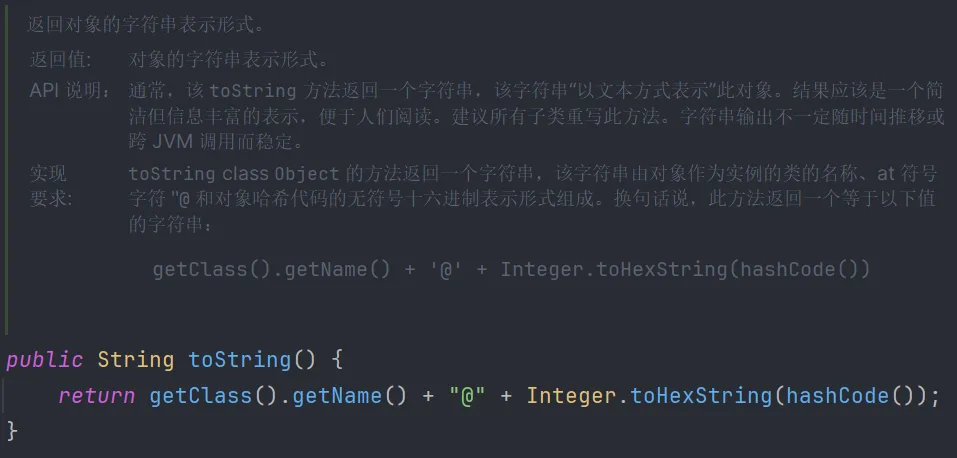

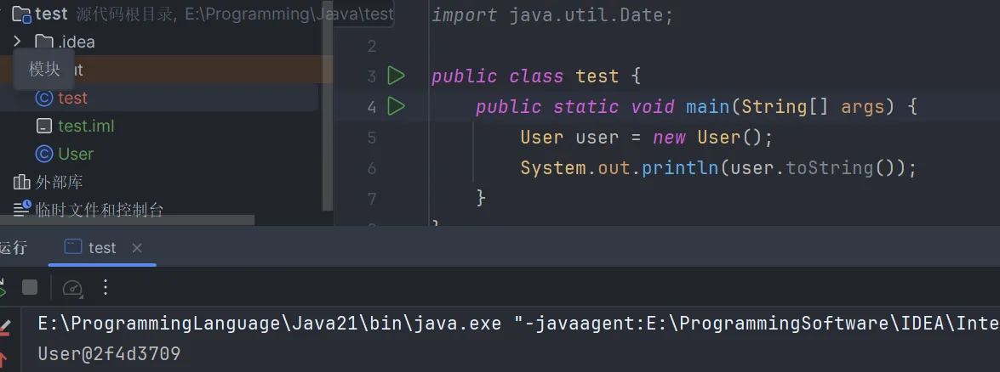

# 泛型数组列表（Arraylist）

在Java 中，允许在运行时确定数组的大小。解决这个问题最简单的方法是使用Java 中的另外一个类，名为Arraylist 。Arraylist 类类似千数组，但在添加或删除元素时，它能够自动地调整数组容量，而不需要为此编写任何代码。

Arraylist 是一个有类型参数( type parameter ) 的泛型类( generic class) 。为了指定数组列表保存的元素对象的类型，需要用一对尖括号将类名括起来追加到Arraylist 后面。

## Java ArrayList 方法

Java ArrayList 常用方法列表如下：

| 方法                                                         | 描述                                          |
| :----------------------------------------------------------- | :-------------------------------------------- |
| [add()](https://www.runoob.com/java/java-arraylist-add.html) | 将元素插入到指定位置的 arraylist 中           |
| [addAll()](https://www.runoob.com/java/java-arraylist-addall.html) | 添加集合中的所有元素到 arraylist 中           |
| [clear()](https://www.runoob.com/java/java-arraylist-clear.html) | 删除 arraylist 中的所有元素                   |
| [clone()](https://www.runoob.com/java/java-arraylist-clone.html) | 复制一份 arraylist                            |
| [contains()](https://www.runoob.com/java/java-arraylist-contains.html) | 判断元素是否在 arraylist                      |
| [get()](https://www.runoob.com/java/java-arraylist-get.html) | 通过索引值获取 arraylist 中的元素             |
| [indexOf()](https://www.runoob.com/java/java-arraylist-indexof.html) | 返回 arraylist 中元素的索引值                 |
| [removeAll()](https://www.runoob.com/java/java-arraylist-removeall.html) | 删除存在于指定集合中的 arraylist 里的所有元素 |
| [remove()](https://www.runoob.com/java/java-arraylist-remove.html) | 删除 arraylist 里的单个元素                   |
| [size()](https://www.runoob.com/java/java-arraylist-size.html) | 返回 arraylist 里元素数量                     |
| [isEmpty()](https://www.runoob.com/java/java-arraylist-isempty.html) | 判断 arraylist 是否为空                       |
| [subList()](https://www.runoob.com/java/java-arraylist-sublist.html) | 截取部分 arraylist 的元素                     |
| [set()](https://www.runoob.com/java/java-arraylist-set.html) | 替换 arraylist 中指定索引的元素               |
| [sort()](https://www.runoob.com/java/java-arraylist-sort.html) | 对 arraylist 元素进行排序                     |
| [toArray()](https://www.runoob.com/java/java-arraylist-toarray.html) | 将 arraylist 转换为数组                       |
| [toString()](https://www.runoob.com/java/java-arraylist-tostring.html) | 将 arraylist 转换为字符串                     |
| [ensureCapacity](https://www.runoob.com/java/java-arraylist-surecapacity.html)() | 设置指定容量大小的 arraylist                  |
| [lastIndexOf()](https://www.runoob.com/java/java-arraylist-lastindexof.html) | 返回指定元素在 arraylist 中最后一次出现的位置 |
| [retainAll()](https://www.runoob.com/java/java-arraylist-retainall.html) | 保留 arraylist 中在指定集合中也存在的那些元素 |
| [containsAll()](https://www.runoob.com/java/java-arraylist-containsall.html) | 查看 arraylist 是否包含指定集合中的所有元素   |
| [trimToSize()](https://www.runoob.com/java/java-arraylist-trimtosize.html) | 将 arraylist 中的容量调整为数组中的元素个数   |
| [removeRange()](https://www.runoob.com/java/java-arraylist-removerange.html) | 删除 arraylist 中指定索引之间存在的元素       |
| [replaceAll()](https://www.runoob.com/java/java-arraylist-replaceall.html) | 将给定的操作内容替换掉数组中每一个元素        |
| [removeIf()](https://www.runoob.com/java/java-arraylist-removeif.html) | 删除所有满足特定条件的 arraylist 元素         |
| [forEach()](https://www.runoob.com/java/java-arraylist-foreach.html) | 遍历 arraylist 中每一个元素并执行特定操作     |

## 声明数组列表

```java
ArrayList<E> objectName =new ArrayList<>();　 // 初始化
```

- **E**: 泛型数据类型，用于设置 objectName 的数据类型，**只能为引用数据类型**。
- **objectName**: 对象名。

ArrayList 是一个数组队列，提供了相关的添加、删除、修改、遍历等功能。

## 其他的引用类型

ArrayList 中的元素实际上是对象，在以上实例中，数组列表元素都是字符串 String 类型。

如果我们要存储其他类型，而 <E> 只能为引用数据类型，这时我们就需要使用到基本类型的包装类。

基本类型对应的包装类表如下：

| 基本类型 | 引用类型  |
| :------- | :-------- |
| boolean  | Boolean   |
| byte     | Byte      |
| short    | Short     |
| int      | Integer   |
| long     | Long      |
| float    | Float     |
| double   | Double    |
| char     | Character |

此外，BigInteger、BigDecimal 用于高精度的运算，BigInteger 支持任意精度的整数，也是引用类型，但它们没有相对应的基本类型。

> 警告： 如下分配数组列表：
> `new Arraylist<> (100) // capacity is 100`
> 这与分配一个新数组有所不同：
> `new Employee[100J // size is 100`
> 数组列表的容量与数组的大小有一个非常重要的区别。如果分配一个有100个元素的数组，数组就有100个空位置（ 槽）可以使用。而容量为100个元素的数组列表只是可能保存100个元素（实际上也可以超过100, 不过要以重新分配空间为代价），但是在最初，甚至完成初始化构造之后，数组列表不包含任何元素。

## 访问数组列表元素

使用get(i)或是增强for循环访问数组列表。

## 类型化与原始数组列表的兼容性

```java
public class EmployeeDB {
    public void update(ArrayList list) {...}//参数为无类型列表
    public ArrayList find(String query) {...}//返回无类型列表
}
```

将一个有类型参数列表传递给一个没有类型的列表不会报错。

```java
Arraylist<Employee> staff =...;
employeeDB.update (staff);//将一个有类型参数列表传递给一个没有类型的列表
```

相反，将一个原始ArrayList赋给一个类型化ArrayList会得到一个警告。

> 注释： 为了能够看到警告的文本信息， 编译时要提供选项-Xlint:unchecked。

```java
ArrayList<Emptoyee> result = employeeDB.find(query); //将一个原始ArrayList赋给一个类型化ArrayList
```

使用类型转换并不能避免出现警告，但是会显示另外一个警告。指出类型转换有误。这就是Java参数化类型的限制所带来的结果。编译器在对类型转化数组进行检查后没有发现违反规则的现象，就将所有类型化数组列表转化为原始的ArrayList，在运行程序时没有像在虚拟机中那种类型参数，因此，有参数没有参数的将执行相同的运行。

# 对象包装器与自动装箱

有时，需要将int 这样的基本类型转换为`对象（Java 泛型（generics）要求类型参数只能代表引用型类型，不能是原始类型）`。所有的基本类型都有一个与之对应的类。例如， Integer 类对应基本类型int 。通常，这些类称为`包装器`(wrapper ) 。这些包装器类有显而易见的名字： Integer 、Long 、Float 、Double 、Short 、Byte 、Character 和Boolean （前6 个类派生于公共的超类Number ) 。包装器类是不可变的，即一旦构造了包装器，就不允许更改包装在其中的值。`同时，包装器类还是final, 因此不能派生它们的子类。`

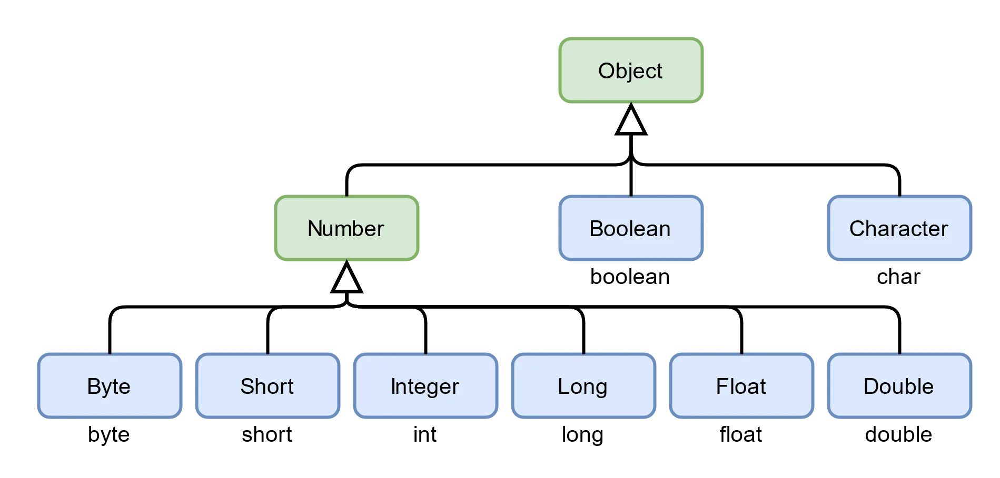

在 Java 中，万物皆对象，所有的操作都要求用对象的形式进行描述。但是 Java 中除了对象（引用类型）还有八大基本类型，它们不是对象。那么，为了把基本类型转换成对象，最简单的做法就是**将基本类型作为一个类的属性保存起来**，也就是把基本数据类型包装一下，这也就是包装类的由来。

> 由于每个值分别包装在对象中，所以`ArrayList<Integer>` 的效率远远低于int[ 数 组。因此，只有当程序员操作的方便性比执行效率更重要的时候，才会考虑对较小的集合使用这种构造。

## **装箱与拆箱**

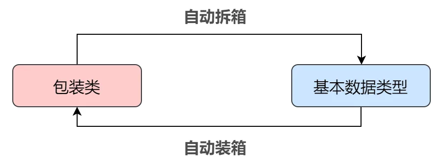

- 装箱：将基本数据类型转换成包装类（每个包装类的构造方法都可以接收各自数据类型的变量）
- 拆箱：从包装类之中取出被包装的基本类型数据（使用包装类的 xxxValue 方法）

```java
自动地拆箱//自动装箱(autoboxing)
//从而可以很容易地向ArrayList <Integer> 添加int 类型的元素。
list.add(3);
//将自动地变换成
list.add(Integer.valueOf(3));

//自动拆箱
//当将一个Integer 对象赋给一个int值时，将会自动地拆箱。
int n = list.get(i);
//将自动地变换成
int n = list.get(i).intValue();


Integer obj = new Integer(10);  // 自动装箱
int temp = obj.intValue();  	// 自动拆箱
```

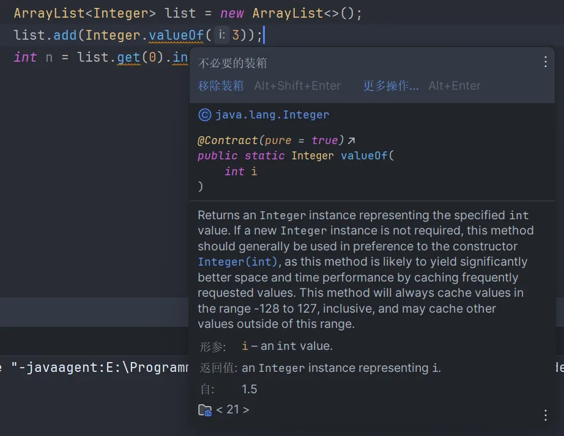

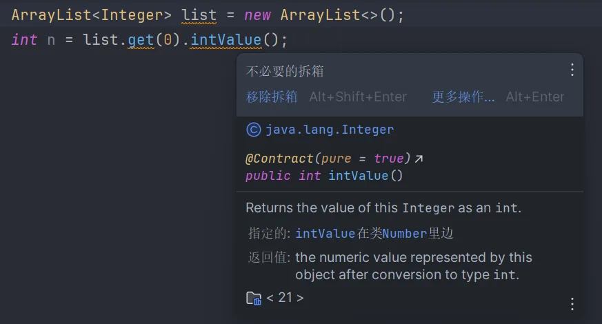

##  **不简单的 Integer.valueOf**

我们上面已经看过了用于自动拆箱的 `intValue` 方法的源码，非常简单。接下来咱来看看用于自动装箱的 `valueOf`，其他包装类倒没什么好说的，不过 `Integer` 中的这个方法还是有点东西的：

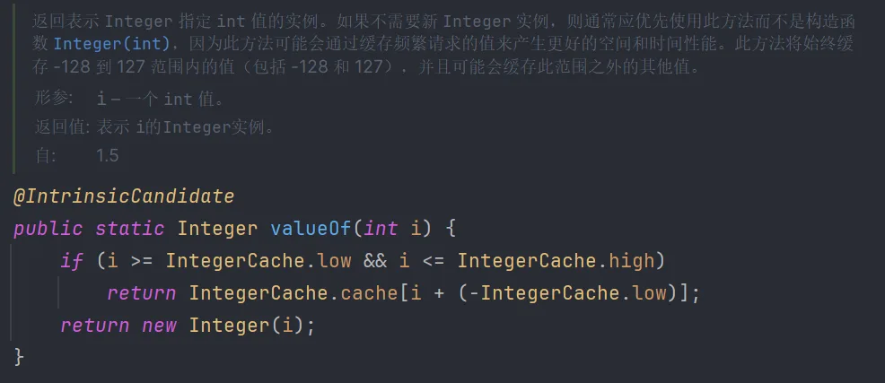

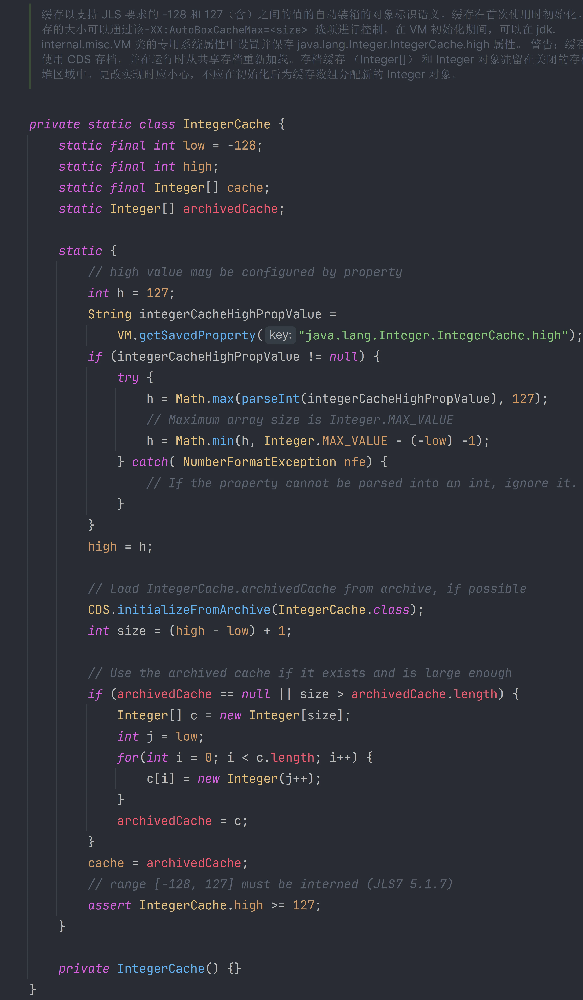

`IntegerCache` 是 `Integer` 类中的静态内部类，综合这两段代码，我们大概也能知道，`IntegerCache` 其实就是个**缓存**，其中定义了一个缓冲区 `cache`，用于存储 `Integer` 类型的数据，**缓存区间是 [-128, 127]**。

回到 `valueOf` 的源码：它首先会判断 int 类型的实参 i 是否在可缓存区间内，如果在，就直接从缓存 `IntegerCache` 中获取对应的 `Integer` 对象；如果不在缓存区间内，则会 new 一个新的 `Integer` 对象。

结合这个特性，我们来看一个题目，两种类似的代码逻辑，但是却得到完全相反的结果。：

```java
public static void main(String args[]) {
    Integer a1 = 127;
    Integer a2 = 127;
    System.out.println(a1 == a2); // true

    Integer b1 = 128;
    Integer b2 = 128;
    System.out.println(b1 == b2); // false
}
```

我们知道，`==` 拥有两种应用场景：

- 对于引用类型来说，判断的是内存地址是否相等
- 对于基本类型来说，判断的是值是否相等

从 a1 开始看，由于其值在 `InterCache` 的缓存区间内，所以这个 `Integer` 对象会被存入缓存。而在创建 a2 的时候，由于其值和 a1 相等，所以直接从缓存中取出值为 127 的 `Integer` 对象给 a2 使用，也就是说，a1 和 a2 这两个 `Integer` 的对象引用都指向同一个地址。

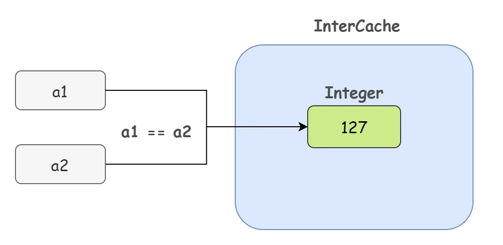

对于 b1 和 b2 来说，由于 128 不在 `IntegerCache` 的缓存区间内，那就只能自己老老实实开辟空间了，所以 b1 和 b2 指向不同的内存地址。

很显然，由于 `InterCache` 缓存机制的存在，可能会让我们在编程的时候出现困惑，因此最好使用 `.equals` 方法来比较 `Integer` 值是否相等。`Integer` 重写了 `.equals` 方法：

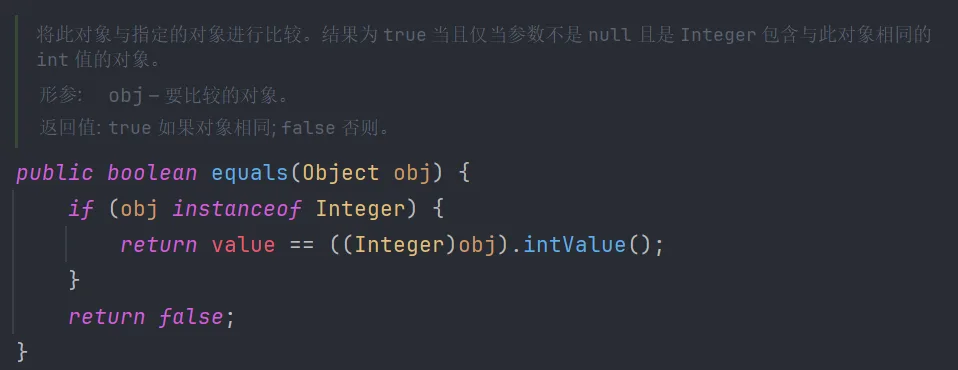

当然，其他包装类虽然没有缓存机制，但是也都重载了 `.equals` 方法，用于根据值来判断是否相等。因此，得出结论，**使用** **`equals`** **方法来比较两个包装类对象的值**。

## 基础类型与包装器类的比较

其他的包装器类也有类似的缓存操作，为了避免多次创建对象，事先创造好了一个缓存数组，如果值在这个范围内，就会直接返回实现创建好的对象。

但是，某个范围内的整型数值是有限的，而浮点数不是。

因此， `Double` 、`Float` 类型就没有类似的缓存数组。

| 类型      | 相同对象范围 | 不同对象范围           |
| --------- | ------------ | ---------------------- |
| Integer   | -128 ~ 127   | i >= 128 \|\| i < -128 |
| Short     | -128 ~ 127   | s >=128 \|\| s < -128  |
| Character | < 128        | c > 128                |
| Long      | -128 ~ 127   | l >= 128 \|\| i < -128 |
| Byte      | 全部         | 无                     |
| Boolean   | 全部         | 无                     |
| Double    | 无           | 全部                   |
| Float     | 无           | 全部                   |

`==` 比较运算符：

- 当两个操作数都是包装器类的对象时，比较的是否为同一个对象。
- 当其中一个是表达式时，则比较的是数值（会触发自动拆箱）。

```java
Integer a = 100;
Integer b = 200;
Long c = 300l;
Long d = 200l;
System.out.println(c == (a+b)); // true
System.out.println(c.equals(a+b)); // false
System.out.println(c.equals(a+d)); // true
```

第一次，先触发自动拆箱，调用 intValue() 方法，比较数值是否相等，因此,结果为true。

第二次，先触发自动拆箱，调用 intValue() 方法，再进行自动装箱，由于两个都为Integer 类型，自动装箱为 Integer.valueof() ，进行 equals() 比较时，类型不相等，因此，结果为 false。

第三次，先触发自动拆箱，调用 intValue() 方法，再进行自动装箱，由于其中一个为 Long 类型，自动装箱变为 Long.valueof() ，进行 equals() 比较时，类型相等，数值相等，因此，结果为 true。

## Object 类可以接收所有数据类型

综上，有了自动拆装箱机制，基本数据类型可以自动的被转为包装类，而 `Object` 是所有类的父类，也就是说，**`Object` 可以接收所有的数据类型了**（引用类型、基本类型）！！！

不信你可以试试，直接用 `Object` 类接收一个基本数据类型 `int`，完全是可以的。

```java
Object obj = 10;
int temp = (Integer) obj;
```

解释一下上面这段代码发生了什么，下面这张图很重要，大家仔细看：

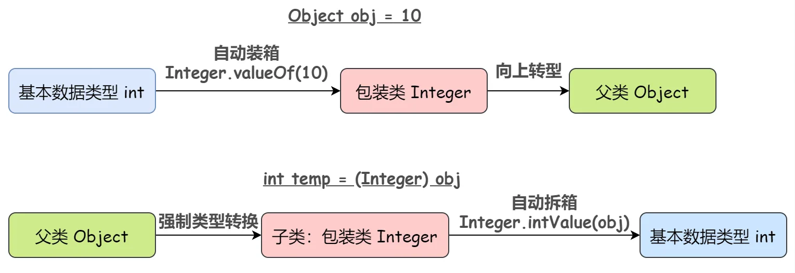

## 数据类型转换

另外，除了在集合中的广泛应用，包装类还包含一个重要功能，那就是提供将String型数据变为基本数据类型的方法，使用几个代表的类做说明：

`Integer`：

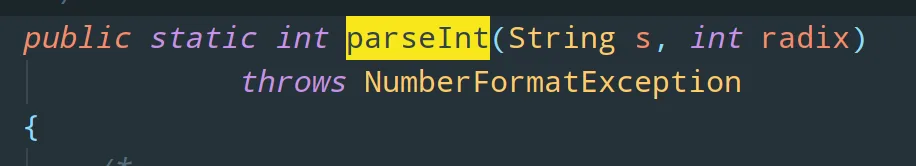

`Double`：

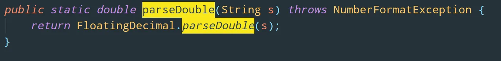

`Boolean`：

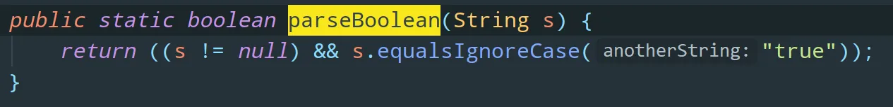

这些方法均被 `static` 标识，也就是说它们被各自对应的所有对象共同维护，直接通过类名访问该方法。举个例子：

```java
String str = "10";
int temp = Integer.parseInt(str);// String -> int
System.out.println(temp * 2); // 20
```

需要特别注意的是：`Character` 类里面并不存在字符串变为字符的方法，因为 `String` 类中已经有一个 `charAt()`的方法可以根据索引取出字符内容。

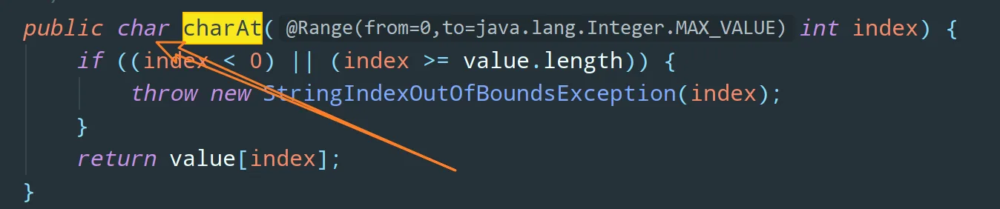

# 参数数量可变的方法

可以提供参数数址可变的方法（有时这些方法被称为“变参”(varargs ) 方法） 。

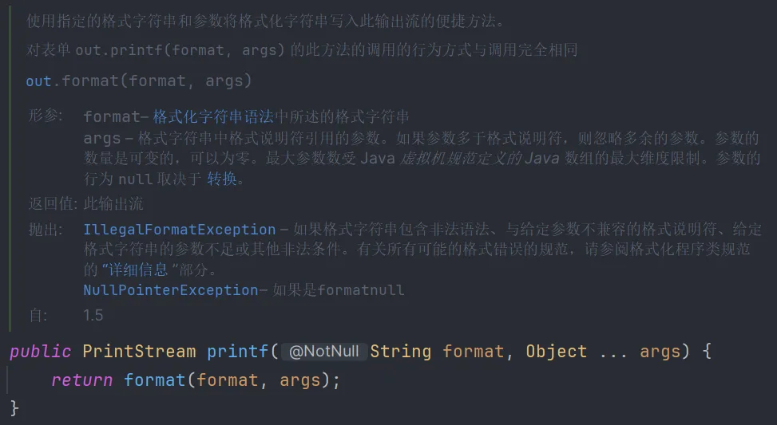

实际上， printf 方法接收两个参数，一个是格式字符串，另一个是Object[ ］ 数组， 其中保存着所有其他参数（如果调用者提供的是整数或者其他基本类型的值，会把它们自动装箱为对象） 。现在不可避免地要扫描fmt 字符串，并将第1 个格式说明符与args[i] 的值匹配起来。
换句话说，对于printf 的实现者来说， Object...参数类型与Object[ ] 完全一样。
编译器需要转换每个printf 调用，将参数绑定到数组中，并在必要的时候进行自动装箱。

# 枚举类

在比较两个枚举类型的值时， 并不需要调用equals , 直接使用“ == ”就可以了。

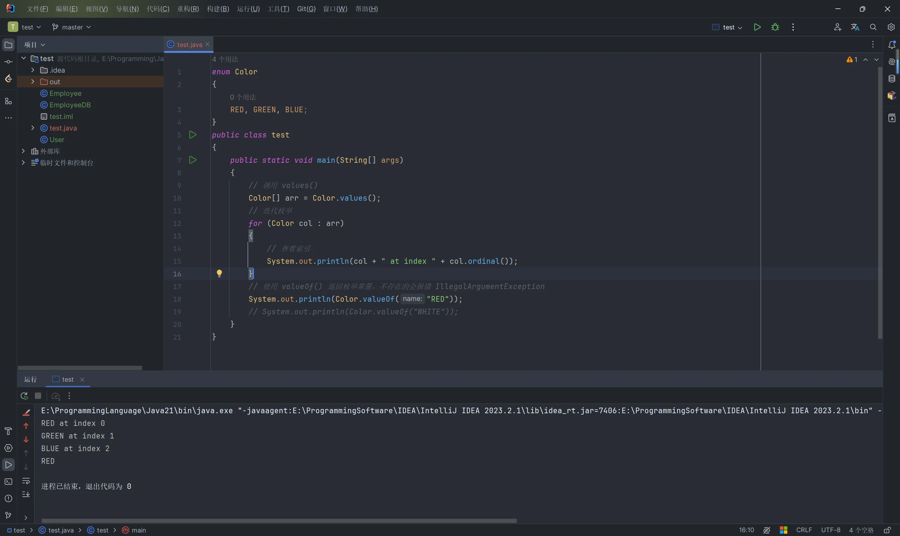

如果需要的话， 可以为枚举类型增加构造器、方法和字段。当然， 构造器只是在构造枚举常量的时候调用。

枚举的构造器总是私有的。可以像前例中一样省略private 修饰符。如果声明一个enum 构造器为public 或protected, 会出现语法错误。所有的枚举类型都是Enum 类的子类。它们继承了这个类的许多方法。其中最有用的一个是toString ，这个方法会返回枚举常批名

每个枚举类型都有一个静态的values 方法，它将返回一个包含全部枚举值的数组。

```java
enum Size {
    SMALL("S"),
    MEDIUM("M"),
    LARGE("L"),
    EXTRA_LARGE("XL");

    private Size(String abbreviation) {
        this.abbreviation = abbreviation;
    }

    public String getAbbreviation() {
        return abbreviation;
    }

    private String abbreviation;
}

public class test {
    public static void main(String[] args) {
        var in = new Scanner(System.in);
        System.out.print("Enter a size:(SMALL,MEDIUM,LARGE,EXTRA_LARGE)");
        String input = in.next().toUpperCase();
        Size size = Enum.valueOf(Size.class, input);
        System.out.println("size=" + size);
        System.out.println("abbreviation=" + size.getAbbreviation());
        if (size == Size.EXTRA_LARGE)
            System.out.println("Good job--you paid attention to the _.");
    }
}
```

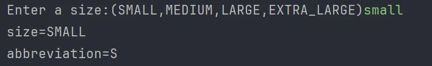

# 反射

反射库( reflection library ) 提供了一个丰富且精巧的工具集，可以用来编写能够动态操纵Java 代码的程序。使用反射， Java 可以支持用户界面生成器、对象关系映射器以及很多其他需要动态查询类能力的开发工具。
　　`Java反射就是在运行状态中，对于任意一个类，都能够知道这个类的所有属性和方法；对于任意一个对象，都能够调用它的任意方法和属性；并且能改变它的属性。`而这也是Java被视为动态（或准动态，为啥要说是准动态，因为一般而言的动态语言定义是程序运行时，允许改变程序结构或变量类型，这种语言称为动态语言。从这个观点看，Perl，Python，Ruby是动态语言，C++，Java，C#不是动态语言。）语言的一个关键性质。
能够分析类能力的程序称为反射(reflective) 。反射机制的功能极其强大，在下面几小节可以看到，反射机制可以用来：

- 在运行时分析类的能力。
- 在运行时检查对象，例如，编写一个适用于所有类的toString 方法。
- 实现泛型数组操作代码。
- 利用Method 对象，这个对象很像C++中的函数指针。
- 通过java语言中的反射机制可以操作字节码文件（可以读和修改字节码文件。）
- 通过反射机制可以操作代码片段。（class文件。）

反射是一种功能强大且复杂的机制。

## 反射能做什么？ 

我们知道反射机制允许程序在运行时取得任何一个已知名称的class的内部信息，包括包括其modifiers(修饰符)，fields(属性)，methods(方法)等，并可于运行时改变fields内容或调用methods。那么我们便可以更灵活的编写代码，代码可以在运行时装配，无需在组件之间进行源代码链接，降低代码的耦合度；还有动态代理的实现等等；但是需要注意的是反射使用不当会造成很高的资源消耗！

**专业的解释（了解一下）：**

​       是在运行状态中，对于任意一个类，都能够知道这个类的所有属性和方法；

​       对于任意一个对象，都能够调用它的任意属性和方法；

​       这种动态获取信息以及动态调用对象方法的功能称为Java语言的反射机制。

**通俗的理解：（掌握）**

* 利用**反射**创建的对象**可以无视修饰符**调用类里面的内容

* 可以跟**配置文件结合起来使用**，把要创建的对象信息和方法写在配置文件中。

  读取到什么类，就创建什么类的对象

  读取到什么方法，就调用什么方法

  此时当需求变更的时候不需要修改代码，只要修改配置文件即可。

## 反射机制相关的重要的类有哪些？

| 类                            | 含义                                                         |
| ----------------------------- | ------------------------------------------------------------ |
| java.lang.Class               | 代表整个字节码。代表一个类型，代表整个类。                   |
| java.lang.reflect.Method      | 代表字节码中的方法字节码。代表类中的方法。                   |
| java.lang.reflect.Constructor | 代表字节码中的构造方法字节码。代表类中的构造方法。           |
| java.lang.reflect.Field       | 代表字节码中的属性字节码。代表类中的成员变量（静态变量+实例变量）。 |

## Class 类

在程序运行期间， Java 运行时系统始终为所有对象维护一个运行时类型标识。这个信息会跟踪每个对象所屈的类。虚拟机利用运行时类型信息选择要执行的正确的方法。

| **方式**                        | **备注** |
| ------------------------------- | -------- |
| Class.forName(“完整类名带包名”) | 静态方法 |
| 对象.getClass()                 |          |
| 任何类型.class                  |          |

不过，可以使用一个特殊的Java 类访问这些信息。保存这些信息的类名为Class , 这个名字有些让人闲惑。Object 类中的getClass (）方法将会返回一个Class 类型的实例。

```java
//1、通过对象调用 getClass() 方法来获取,通常应用在：比如你传过来一个 Object
//  类型的对象，而我不知道你具体是什么类，用这种方法
 　Person p1 = new Person();
 　Class c1 = p1.getClass();
```

如果类在一个包里，包的名字也作为类名的一部分。
还可以使用静态方法forName 获得类名对应的Class 对象。如果类名保存在一个字符串中，这个字符串会在运行时变化，就可以使用这个方法。如果className 是一个类名或接口名，这个方法可以正常执行。否则， forName 方法将抛出一个检查型异常(checked exception ) 。无论何时使用这个方法，都应该提供一个异常处理器(exception handler) 。

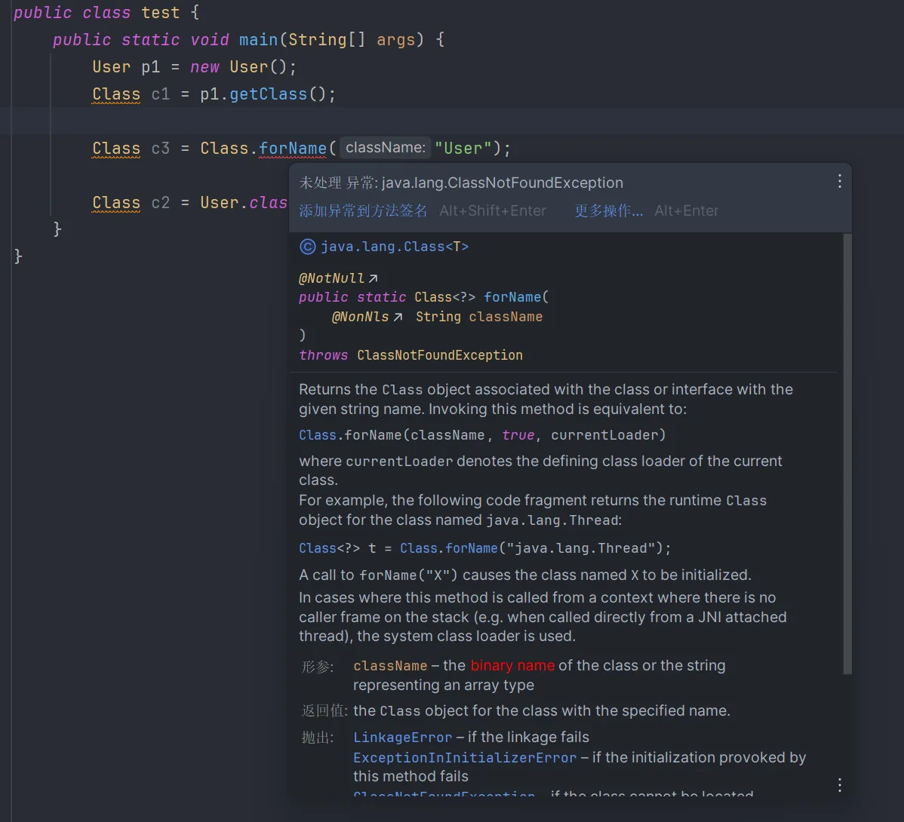

```java
//2、通过 Class 对象的 forName() 静态方法来获取，用的最多，
//   但可能抛出 ClassNotFoundException 异常
Class c3 = Class.forName("com.ys.reflex.Person");
```

> 提示： 在启动时，包含main 方法的类被加载。它会加载所有需要的类。这些被加载的类又要加载它们需要的类，以此类推。对于一个大型的应用程序来说，这将会花费很长时间，用户会因此感到不耐烦。可以使用下面这个技巧给用户一种启动速度比较快的假象。不过，要确保包含畸in 方法的类没有显式地引用其他的类。首先，显示一个启动画面；然后，通过调用Class . forName 手工地强制加载其他类。

获得Class 类对象的第三种方法是一个很方便的快捷方式。如果T 是任意的Java 类型（或void 关键字） ， T.class 将代表匹配的类对象。

```java
//3、直接通过 类名.class 的方式得到,该方法最为安全可靠，程序性能更高
//  这说明任何一个类都有一个隐含的静态成员变量 class
Class c2 = Person.class;
```

>  请注意，一个Class 对象实际上表示的是一个类型，这可能是类，也可能不是类。例如，int 不是类，但int.class 是一个Class 类型的对象。
>
>  Class 类实际上是一个泛型类。例如， Employee.class 的类型是`Class<Employee>`。我们没有深究这个问题的原因是：它将已经很抽象的概念变得更加复杂。在大多数实际问题中，可以忽略类型参数，而使用原始的Class 类。

需要注意的是：**一个类在 JVM 中只会有一个 Class 实例,**即我们对上面获取的 c1,c2,c3进行 equals 比较，发现都是true

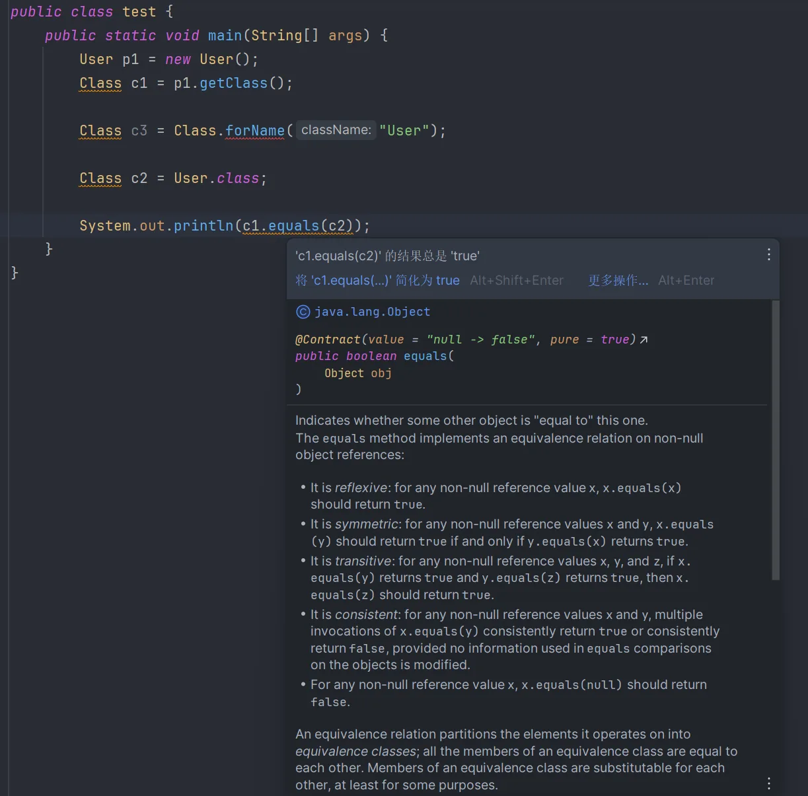

虚拟机为每个类型管理一个唯一的Cl ass 对象。因此， 可以利用＝＝ 运算符实现两个类对象的比较。例如，
`if (e.getClass () = Employee .class)`
如果e 是一个Employee 实例，这个测试将通过。与条件e instanceof Employee 不同，如果e是某个子类（如Manager ) 的实例，这个测试将失败。

## 字节码文件和字节码文件对象

java文件：就是我们自己编写的java代码。

字节码文件：就是通过java文件编译之后的class文件（是在硬盘上真实存在的，用眼睛能看到的）

字节码文件对象：当class文件加载到内存之后，虚拟机自动创建出来的对象。

​				这个对象里面至少包含了：构造方法，成员变量，成员方法。

而我们的反射获取的是什么？字节码文件对象，这个对象在内存中是唯一的。

## 通过反射实例化对象

`对象.newInstance()`

**注**：newInstance()方法内部实际上调用了**无参数构造方法**，必须保证无参构造存在才可以。
否则会抛出`java.lang.InstantiationException`异常。

```java
class ReflectTest02{
    public static void main(String[] args) throws ClassNotFoundException, InstantiationException, IllegalAccessException {
        // 下面这段代码是以反射机制的方式创建对象。
        // 通过反射机制，获取Class，通过Class来实例化对象
        Class c = Class.forName("javase.reflectBean.User");
        // newInstance() 这个方法会调用User这个类的无参数构造方法，完成对象的创建。
        // 重点是：newInstance()调用的是无参构造，必须保证无参构造是存在的！
        Object obj = c.newInstance();
        System.out.println(obj);
    }
}
```

## 获取超类和访问修饰符

类Class的方法getSuperclass()可用于获取有关特定类的超类的信息。

而且，Class提供了一种getModifier()方法，该方法以整数形式返回class的修饰符。

## 反射字段，方法和构造函数

该软件包java.lang.reflect提供了可用于操作类成员的类。例如，

- **方法类** - 提供有关类中方法的信息 Field
- **字段类** - 提供有关类中字段的信息 Method
- **构造函数类** - 提供有关类中构造函数的信息 Constructor

## Java 反射与字段

 我们可以使用Field类提供的各种方法检查和修改类的不同字段。

- **getFields() -** 返回该类及其超类的所有公共字段
- **getDeclaredFields()** - 返回类的所有字段
- **getModifier()** - 以整数形式返回字段的修饰符
- **set(classObject,value)** - 使用指定的值设置字段的值
- **get(classObject)** - 获取字段的值
- **setAccessible(boolean)** - 使私有字段可访问

**注意：**如果我们知道字段名称，则可以使用

- **getField("fieldName"）** - 从类返回名称为**fieldName**的公共字段。
- **getDeclaredField\**("fieldName"）\**** - 从类返回名称为**fieldName**的字段。

## Java 反射与方法

像字段一样，我们可以使用Method类提供的各种方法来检查类的不同方法。

- **getMethods()** - 返回该类及其超类的所有公共方法
- **getDeclaredMethod()** - 返回该类的所有方法
- **getName()** - 返回方法的名称
- **getModifiers()** - 以整数形式返回方法的访问修饰符
- **getReturnType()** - 返回方法的返回类型

## Java 反射与构造函数

我们还可以使用Constructor类提供的各种方法检查类的不同构造函数。

- **getConstructors()** - 返回该类的所有公共构造函数以及该类的超类
- **getDeclaredConstructor()** -返回所有构造函数
- **getName()** - 返回构造函数的名称
- **getModifiers()** - 以整数形式返回构造函数的访问修饰符
- **getParameterCount()** - 返回构造函数的参数数量

## 获取构造方法

规则：

​	get表示获取

​	Declared表示私有

​	最后的s表示所有，复数形式

​	如果当前获取到的是私有的，必须要临时修改访问权限，否则无法使用

| 方法名                                                       | 说明                              |
| ------------------------------------------------------------ | --------------------------------- |
| Constructor<?>[] getConstructors()                           | 获得所有的构造（只能public修饰）  |
| Constructor<?>[] getDeclaredConstructors()                   | 获得所有的构造（包含private修饰） |
| Constructor<T> getConstructor(Class<?>... parameterTypes)    | 获取指定构造（只能public修饰）    |
| Constructor<T> getDeclaredConstructor(Class<?>... parameterTypes) | 获取指定构造（包含private修饰）   |

代码示例：

```java
public class ReflectDemo2 {
    public static void main(String[] args) throws ClassNotFoundException, NoSuchMethodException {
        //1.获得整体（class字节码文件对象）
        Class clazz = Class.forName("com.itheima.reflectdemo.Student");
        //2.获取构造方法对象
        //获取所有构造方法（public）
        Constructor[] constructors1 = clazz.getConstructors();
        for (Constructor constructor : constructors1) {
            System.out.println(constructor);
        }
        System.out.println("=======================");
        //获取所有构造（带私有的）
        Constructor[] constructors2 = clazz.getDeclaredConstructors();
        for (Constructor constructor : constructors2) {
            System.out.println(constructor);
        }
        System.out.println("=======================");
        //获取指定的空参构造
        Constructor con1 = clazz.getConstructor();
        System.out.println(con1);
        Constructor con2 = clazz.getConstructor(String.class,int.class);
        System.out.println(con2);
        System.out.println("=======================");
       
        //获取指定的构造(所有构造都可以获取到，包括public包括private)
        Constructor con3 = clazz.getDeclaredConstructor();
        System.out.println(con3);
        //了解 System.out.println(con3 == con1);
        //每一次获取构造方法对象的时候，都会新new一个。
        Constructor con4 = clazz.getDeclaredConstructor(String.class);
        System.out.println(con4);
    }
}
```

## 获取构造方法并创建对象

涉及到的方法：newInstance

代码示例：

```java
//首先要有一个javabean类
public class Student {
    private String name;
    private int age;
    public Student() {
    }
    public Student(String name) {
        this.name = name;
    }
    private Student(String name, int age) {
        this.name = name;
        this.age = age;
    }
    public String getName() {
        return name;
    }
    public void setName(String name) {
        this.name = name;
    }
    public int getAge() {
        return age;
    }
    public void setAge(int age) {
        this.age = age;
    }
    public String toString() {
        return "Student{name = " + name + ", age = " + age + "}";
    }
}
//测试类中的代码：
//需求1：
//获取空参，并创建对象
//1.获取整体的字节码文件对象
Class clazz = Class.forName("com.itheima.a02reflectdemo1.Student");
//2.获取空参的构造方法
Constructor con = clazz.getConstructor();
//3.利用空参构造方法创建对象
Student stu = (Student) con.newInstance();
System.out.println(stu);
System.out.println("=============================================");
//测试类中的代码：
//需求2：
//获取带参构造，并创建对象
//1.获取整体的字节码文件对象
Class clazz = Class.forName("com.itheima.a02reflectdemo1.Student");
//2.获取有参构造方法
Constructor con = clazz.getDeclaredConstructor(String.class, int.class);
//3.临时修改构造方法的访问权限（暴力反射）
con.setAccessible(true);
//4.直接创建对象
Student stu = (Student) con.newInstance("zhangsan", 23);
System.out.println(stu);
```

## 获取成员变量

规则：

​	get表示获取

​	Declared表示私有

​	最后的s表示所有，复数形式

​	如果当前获取到的是私有的，必须要临时修改访问权限，否则无法使用

方法名：

| 方法名                              | 说明                                         |
| ----------------------------------- | -------------------------------------------- |
| Field[] getFields()                 | 返回所有成员变量对象的数组（只能拿public的） |
| Field[] getDeclaredFields()         | 返回所有成员变量对象的数组，存在就能拿到     |
| Field getField(String name)         | 返回单个成员变量对象（只能拿public的）       |
| Field getDeclaredField(String name) | 返回单个成员变量对象，存在就能拿到           |

代码示例：

```java
public class ReflectDemo4 {
    public static void main(String[] args) throws ClassNotFoundException, NoSuchFieldException {
        //获取成员变量对象
        //1.获取class对象
        Class clazz = Class.forName("com.itheima.reflectdemo.Student");
        //2.获取成员变量的对象（Field对象)只能获取public修饰的
        Field[] fields1 = clazz.getFields();
        for (Field field : fields1) {
            System.out.println(field);
        }
        System.out.println("===============================");
        //获取成员变量的对象（public + private）
        Field[] fields2 = clazz.getDeclaredFields();
        for (Field field : fields2) {
            System.out.println(field);
        }
        System.out.println("===============================");
        //获得单个成员变量对象
        //如果获取的属性是不存在的，那么会报异常
        //Field field3 = clazz.getField("aaa");
        //System.out.println(field3);//NoSuchFieldException
        Field field4 = clazz.getField("gender");
        System.out.println(field4);
        System.out.println("===============================");
        //获取单个成员变量（私有）
        Field field5 = clazz.getDeclaredField("name");
        System.out.println(field5);

    }
}

public class Student {
    private String name;
    private int age;
    public String gender;
    public String address;
    public Student() {
    }
    public Student(String name, int age, String address) {
        this.name = name;
        this.age = age;
        this.address = address;
    }
    public Student(String name, int age, String gender, String address) {
        this.name = name;
        this.age = age;
        this.gender = gender;
        this.address = address;
    }
    public String getName() {
        return name;
    }
    public void setName(String name) {
        this.name = name;
    }
    public int getAge() {
        return age;
    }
    public void setAge(int age) {
        this.age = age;
    }
    public String getGender() {
        return gender;
    }
    public void setGender(String gender) {
        this.gender = gender;
    }
    public String getAddress() {
        return address;
    }
    public void setAddress(String address) {
        this.address = address;
    }
    public String toString() {
        return "Student{name = " + name + ", age = " + age + ", gender = " + gender + ", address = " + address + "}";
    }
}

```

## 获取成员变量并获取值和修改值

| 方法                                | 说明   |
| ----------------------------------- | ------ |
| void set(Object obj, Object value） | 赋值   |
| Object get(Object obj)              | 获取值 |

代码示例：

```java
public class ReflectDemo5 {
    public static void main(String[] args) throws ClassNotFoundException, NoSuchFieldException, IllegalAccessException {
        Student s = new Student("zhangsan",23,"广州");
        Student ss = new Student("lisi",24,"北京");
        //需求：
        //利用反射获取成员变量并获取值和修改值
        //1.获取class对象
        Class clazz = Class.forName("com.itheima.reflectdemo.Student");
        //2.获取name成员变量
        //field就表示name这个属性的对象
        Field field = clazz.getDeclaredField("name");
        //临时修饰他的访问权限
        field.setAccessible(true);
        //3.设置(修改)name的值
        //参数一：表示要修改哪个对象的name？
        //参数二：表示要修改为多少？
        field.set(s,"wangwu");
        //3.获取name的值
        //表示我要获取这个对象的name的值
        String result = (String)field.get(s);
        //4.打印结果
        System.out.println(result);
        System.out.println(s);
        System.out.println(ss);
    }
}
public class Student {
    private String name;
    private int age;
    public String gender;
    public String address;
    public Student() {}
    public Student(String name, int age, String address) {
        this.name = name;
        this.age = age;
        this.address = address;
    }
    public Student(String name, int age, String gender, String address) {
        this.name = name;
        this.age = age;
        this.gender = gender;
        this.address = address;
    }
    public String getName() {
        return name;
    }
    public void setName(String name) {
        this.name = name;
    }
    public int getAge() {
        return age;
    }
    public void setAge(int age) {
        this.age = age;
    }
    public String getGender() {
        return gender;
    }
    public void setGender(String gender) {
        this.gender = gender;
    }
    public String getAddress() {
        return address;
    }
    public void setAddress(String address) {
        this.address = address;
    }
    public String toString() {
        return "Student{name = " + name + ", age = " + age + ", gender = " + gender + ", address = " + address + "}";
    }
}

```

## 获取成员方法

规则：

​	get表示获取

​	Declared表示私有

​	最后的s表示所有，复数形式

​	如果当前获取到的是私有的，必须要临时修改访问权限，否则无法使用

| 方法名                                                       | 说明                                         |
| ------------------------------------------------------------ | -------------------------------------------- |
| Method[] getMethods()                                        | 返回所有成员方法对象的数组（只能拿public的） |
| Method[] getDeclaredMethods()                                | 返回所有成员方法对象的数组，存在就能拿到     |
| Method getMethod(String name, Class<?>... parameterTypes)    | 返回单个成员方法对象（只能拿public的）       |
| Method getDeclaredMethod(String name, Class<?>... parameterTypes) | 返回单个成员方法对象，存在就能拿到           |

代码示例：

```java
public class ReflectDemo6 {
    public static void main(String[] args) throws ClassNotFoundException, NoSuchMethodException {
        //1.获取class对象
        Class<?> clazz = Class.forName("com.itheima.reflectdemo.Student");
        //2.获取方法
        //getMethods可以获取父类中public修饰的方法
        Method[] methods1 = clazz.getMethods();
        for (Method method : methods1) {
            System.out.println(method);
        }
        System.out.println("===========================");
        //获取所有的方法（包含私有）
        //但是只能获取自己类中的方法
        Method[] methods2 = clazz.getDeclaredMethods();
        for (Method method : methods2) {
            System.out.println(method);
        }
        System.out.println("===========================");
        //获取指定的方法（空参）
        Method method3 = clazz.getMethod("sleep");
        System.out.println(method3);
        Method method4 = clazz.getMethod("eat",String.class);
        System.out.println(method4);
        //获取指定的私有方法
        Method method5 = clazz.getDeclaredMethod("playGame");
        System.out.println(method5);
    }
}

```

## 获取成员方法并运行

方法

 Object invoke(Object obj, Object... args) ：运行方法

参数一：用obj对象调用该方法

参数二：调用方法的传递的参数（如果没有就不写）

返回值：方法的返回值（如果没有就不写）

代码示例：

```java
package com.itheima.a02reflectdemo1;
import java.lang.reflect.InvocationTargetException;
import java.lang.reflect.Method;
public class ReflectDemo6 {
    public static void main(String[] args) throws ClassNotFoundException, NoSuchMethodException, InvocationTargetException, IllegalAccessException {
        //1.获取字节码文件对象
        Class clazz = Class.forName("com.itheima.a02reflectdemo1.Student");
        //2.获取一个对象
        //需要用这个对象去调用方法
        Student s = new Student();
        //3.获取一个指定的方法
        //参数一：方法名
        //参数二：参数列表，如果没有可以不写
        Method eatMethod = clazz.getMethod("eat",String.class);
        //运行
        //参数一：表示方法的调用对象
        //参数二：方法在运行时需要的实际参数
        //注意点：如果方法有返回值，那么需要接收invoke的结果
        //如果方法没有返回值，则不需要接收
        String result = (String) eatMethod.invoke(s, "重庆小面");
        System.out.println(result);

    }
}

public class Student {
    private String name;
    private int age;
    public String gender;
    public String address;
    public Student() {}
    public Student(String name) {
        this.name = name;
    }
    private Student(String name, int age) {
        this.name = name;
        this.age = age;
    }
    public String getName() {
        return name;
    }
    public void setName(String name) {
        this.name = name;
    }
    public int getAge() {
        return age;
    }
    public void setAge(int age) {
        this.age = age;
    }
    public String toString() {
        return "Student{name = " + name + ", age = " + age + "}";
    }
    private void study(){
        System.out.println("学生在学习");
    }
    private void sleep(){
        System.out.println("学生在睡觉");
    }
    public String eat(String something){
        System.out.println("学生在吃" + something);
        return "学生已经吃完了，非常happy";
    }
}
```

## 面试题：

​	你觉得反射好不好？好，有两个方向

​	第一个方向：无视修饰符访问类中的内容。但是这种操作在开发中一般不用，都是框架底层来用的。

​	第二个方向：反射可以跟配置文件结合起来使用，动态的创建对象，动态的调用方法。

## 练习泛型擦除（掌握概念，了解代码）

理解：（掌握）

​	集合中的泛型只在java文件中存在，当编译成class文件之后，就没有泛型了。

代码示例：（了解）

```java
package com.itheima.reflectdemo;
import java.lang.reflect.InvocationTargetException;
import java.lang.reflect.Method;
import java.util.ArrayList;
public class ReflectDemo8 {
    public static void main(String[] args) throws NoSuchMethodException, InvocationTargetException, IllegalAccessException {
        //1.创建集合对象
        ArrayList<Integer> list = new ArrayList<>();
        list.add(123);
//        list.add("aaa");
        //2.利用反射运行add方法去添加字符串
        //因为反射使用的是class字节码文件
        //获取class对象
        Class clazz = list.getClass();
        //获取add方法对象
        Method method = clazz.getMethod("add", Object.class);
        //运行方法
        method.invoke(list,"aaa");
        //打印集合
        System.out.println(list);
    }
}

```

## 练习：修改字符串的内容（掌握概念，了解代码）

在这个练习中，我需要你掌握的是字符串不能修改的真正原因。

字符串，在底层是一个byte类型的字节数组，名字叫做value

```java
private final byte[] value;
```

真正不能被修改的原因：final和private

final修饰value表示value记录的地址值不能修改。

private修饰value而且没有对外提供getvalue和setvalue的方法。所以，在外界不能获取或修改value记录的地址值。

如果要强行修改可以用反射：

代码示例：（了解）

```java
String s = "abc";
String ss = "abc";
// private final byte[] value= {97,98,99};
// 没有对外提供getvalue和setvalue的方法，不能修改value记录的地址值
// 如果我们利用反射获取了value的地址值。
// 也是可以修改的，final修饰的value
// 真正不可变的value数组的地址值，里面的内容利用反射还是可以修改的，比较危险
//1.获取class对象
Class clazz = s.getClass();
//2.获取value成员变量（private）
Field field = clazz.getDeclaredField("value");
//但是这种操作非常危险
//JDK高版本已经屏蔽了这种操作，低版本还是可以的
//临时修改权限
field.setAccessible(true);
//3.获取value记录的地址值
byte[] bytes = (byte[]) field.get(s);
bytes[0] = 100;
System.out.println(s);//dbc
System.out.println(ss);//dbc
```

## 练习，反射和配置文件结合动态获取的练习（重点）

需求: 利用反射根据文件中的不同类名和方法名，创建不同的对象并调用方法。

分析:

①通过Properties加载配置文件

②得到类名和方法名

③通过类名反射得到Class对象

④通过Class对象创建一个对象

⑤通过Class对象得到方法

⑥调用方法

代码示例：

```java
public class ReflectDemo9 {
    public static void main(String[] args) throws IOException, ClassNotFoundException, NoSuchMethodException, InvocationTargetException, InstantiationException, IllegalAccessException {
        //1.读取配置文件的信息
        Properties prop = new Properties();
        FileInputStream fis = new FileInputStream("day14-code\\prop.properties");
        prop.load(fis);
        fis.close();
        System.out.println(prop);
        String classname = prop.get("classname") + "";
        String methodname = prop.get("methodname") + "";
        //2.获取字节码文件对象
        Class clazz = Class.forName(classname);
        //3.要先创建这个类的对象
        Constructor con = clazz.getDeclaredConstructor();
        con.setAccessible(true);
        Object o = con.newInstance();
        System.out.println(o);
        //4.获取方法的对象
        Method method = clazz.getDeclaredMethod(methodname);
        method.setAccessible(true);
        //5.运行方法
        method.invoke(o);
    }
}
配置文件中的信息：
classname=com.itheima.a02reflectdemo1.Student
methodname=sleep
```

## 利用反射保存对象中的信息（重点）

```java
public class MyReflectDemo {
    public static void main(String[] args) throws IllegalAccessException, IOException {
    /*
        对于任意一个对象，都可以把对象所有的字段名和值，保存到文件中去
    */
       Student s = new Student("小A",23,'女',167.5,"睡觉");
       Teacher t = new Teacher("播妞",10000);
       saveObject(s);
    }
    //把对象里面所有的成员变量名和值保存到本地文件中
    public static void saveObject(Object obj) throws IllegalAccessException, IOException {
        //1.获取字节码文件的对象
        Class clazz = obj.getClass();
        //2. 创建IO流
        BufferedWriter bw = new BufferedWriter(new FileWriter("myreflect\\a.txt"));
        //3. 获取所有的成员变量
        Field[] fields = clazz.getDeclaredFields();
        for (Field field : fields) {
            field.setAccessible(true);
            //获取成员变量的名字
            String name = field.getName();
            //获取成员变量的值
            Object value = field.get(obj);
            //写出数据
            bw.write(name + "=" + value);
            bw.newLine();
        }
        bw.close();
    }
}
```

```java
public class Student {
    private String name;
    private int age;
    private char gender;
    private double height;
    private String hobby;
    public Student() {}
    public Student(String name, int age, char gender, double height, String hobby) {
        this.name = name;
        this.age = age;
        this.gender = gender;
        this.height = height;
        this.hobby = hobby;
    }
    public String getName() {
        return name;
    }
    public void setName(String name) {
        this.name = name;
    }
    public int getAge() {
        return age;
    }
    public void setAge(int age) {
        this.age = age;
    }
    public char getGender() {
        return gender;
    }
    public void setGender(char gender) {
        this.gender = gender;
    }
    public double getHeight() {
        return height;
    }
    public void setHeight(double height) {
        this.height = height;
    }
    public String getHobby() {
        return hobby;
    }
    public void setHobby(String hobby) {
        this.hobby = hobby;
    }
    public String toString() {
        return "Student{name = " + name + ", age = " + age + ", gender = " + gender + ", height = " + height + ", hobby = " + hobby + "}";
    }
}
```

```java
public class Teacher {
    private String name;
    private double salary;
    public Teacher() {}
    public Teacher(String name, double salary) {
        this.name = name;
        this.salary = salary;
    }
    public String getName() {
        return name;
    }
    public void setName(String name) {
        this.name = name;
    }
    public double getSalary() {
        return salary;
    }
    public void setSalary(double salary) {
        this.salary = salary;
    }
    public String toString() {
        return "Teacher{name = " + name + ", salary = " + salary + "}";
    }
}

```

## 使用反射编写泛型数组代码

```java
public static Object copyOf(Object a, int newLength) {
  Class cl = a.getClass();
  if (!cl.isArray()) return null;
  Class componentType = cl.getComponentType();//获取类型
  int length = Array.getLength(a);//获取长度
  Object newArray = Array.newInstance(componentType, newLength);//创建新的数组
  System.copyarray(a, 0, newArray, 0, Math.min(length, newLength));
  return newArray;
}
```

请注意，这个CopyOf 方法可以用来扩展任意类型的数组，而不仅是对象数组。

- Class类的getComponentType方法可以获取数组的正确类型.

- Array类的getLength静态方法可以获取到数组的长度.

- Array类的newInstance静态方法可以创建一个新的数组, 需要的参数为新数组的类型 (Class 对象) 和一个新的数组长度 (整数).

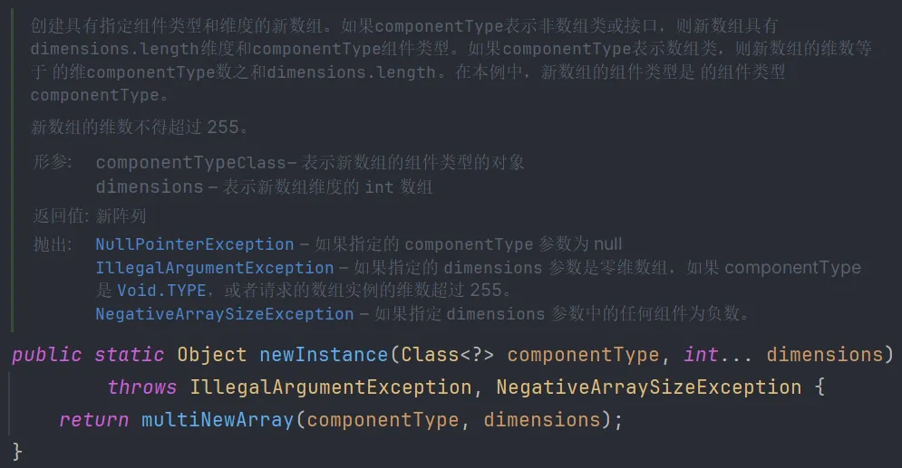
