# 接口

接口( interface)，接口用来描述类应该做什么，而不指定它们具体应该如何做。一个类可以实现(implement ) 一个或多个接口。有些悄况可能要求符合这些接口，只要有这种要求，就可以使用实现了这个接口的类（即实现类）的对象。

官方解释：Java接口是一系列方法的声明，是一些方法特征的集合，**一个接口只有方法的特征没有方法的实现，因此这些方法可以在不同的地方被不同的类实现，而这些实现可以具有不同的行为（功能）**。

## 接口的概念

在Java 程序设计语言中，接口不是类，而是对希望符合这个接口的类的一组需求。

接口中的所有方法都自动是public 方法。因此，在接口中声明方法时，不必提供关键字public 。不过，在实现接口时，必须把方法声明为public; 否则，编译器将认为这个方法的访问属性是包可见性，这是类的默认访问属性，之后编译器就会报错，指出你试图提供更严格的访问权限。

```java
//接口的定义格式：
interface 接口名称{
    // 抽象方法
}

// 接口的声明：interface
// 接口名称：首字母大写，满足“驼峰模式”
```

提供实例字段和方法实现的任务应该由实现接口的那个类来完成。因此，可以将接口看成是没有实例字段的抽象类。但是这两个概念还是有一定区别的，稍后将给出详细的解释。

```java
public interface InterF {
    // 抽象方法！
    //    public abstract void run();
    void run();
    //    public abstract String getName();
    String getName();
    //    public abstract int add(int a , int b);
    int add(int a , int b);
    // 它的最终写法是：
    // public static final int AGE = 12 ;
    int AGE  = 12; //常量
    String SCHOOL_NAME = "黑马程序员";

}
```

为了让类实现一个接口，通常需要完成下面两个步骤：

1. 将类声明为实现给定的接口。
2. 对接口中的所有方法提供定义。

```java
/**接口的实现：
    在Java中接口是被实现的，实现接口的类称为实现类。
    实现类的格式:*/
class 类名 implements 接口1,接口2,接口3...{
}
```

## 类实现接口的要求和意义

1. 必须重写实现的全部接口中所有抽象方法。
2. 如果一个类实现了接口，但是没有重写完全部接口的全部抽象方法，这个类也必须定义成抽象类。
3. **意义：接口体现的是一种规范，接口对实现类是一种强制性的约束，要么全部完成接口申明的功能，要么自己也定义成抽象类。这正是一种强制性的规范。**

## 接口的属性

接口不是类。具体来说，不能使用new 运箕符实例化一个接口。不过，尽管不能构造接口的对象，却能声明接口的变量，接口变批必须引用实现了这个接口的类对象。

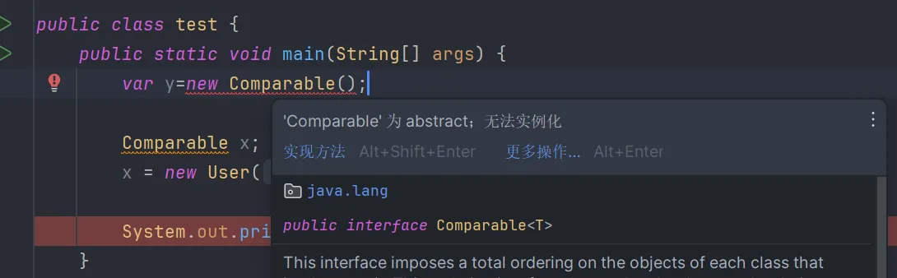

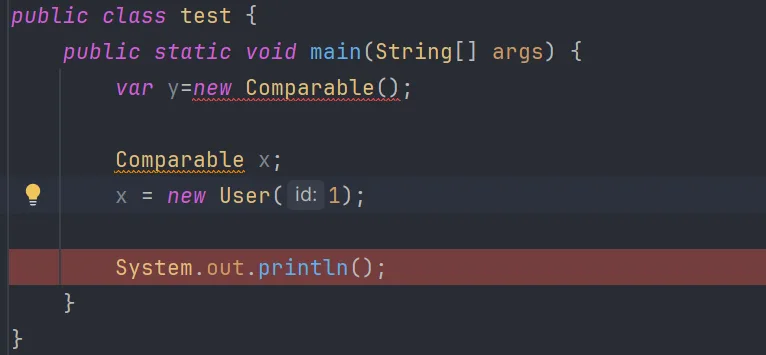

接下来，如同使用instance of 检查一个对象是否屈于某个特定类一样，也可以使用instance of检查一个对象是否实现了某个特定的接口。虽然在接口中不能包含实例字段，但是可以包含常量。与接口中的方法都自动被设置为public 一样，接口中的字段总是public static final 。与建立类的继承层次一样，也可以扩展接口。这里允许有多条接口链，从通用性较高的接口扩展到专用性较高的接口。

尽管每个类只能有一个超类，但却可以实现多个接口。这就为定义类的行为提供了极大的灵活性。

## 接口与抽象类

使用抽象类表示通用属性存在一个严重的问题。每个类只能扩展一个类。假设Employee 类已经扩展了另一个类，它就不能再扩展第二个类了。但每个类可以实现多个接口。有些程序设计语言（尤其是C++）允许一个类有多个超类。我们将这个特性称为多重继承( multiple inheritance) 。Java 的设计者选择了不支持多重继承，其主要原因是多重继承会让语言变得非常复杂（如同C++ ），或者效率会降低（如同Eiffel ) 。实际上，接口可以提供多重继承的大多数好处，同时还能避免多重继承的复杂性和低效性。

## 静态和私有方法

在Java 8 中，允许在接口中增加静态方法。理论上讲，没有任何理由认为这是不合法的。只是这有违于将接口作为抽象规范的初衷。目前为止，通常的做法都是将静态方法放在伴随类中。

在Java 9 中，接口中的方法可以是private 。private 方法可以是静态方法或实例方法。由于私有方法只能在接口本身的方法中使用，所以它们的用法很有限，只能作为接口中其他方法的辅助方法。

## 默认方法

可以为接口方法提供一个默认实现。必须用default 修饰符标记这样一个方法。不过有些情况下，默认方法可能很有用。

默认方法的一个重要用法是“接口演化”( interface evolution ) 。以Collection 接口为例，这个接口作为Java 的一部分已经有很多年了。假设很久以前你提供了这样一个类：
public class Bag implements Collection
后来，在Java 8 中，又为这个接口增加了一个stream方法。假设stream方法不是一个默认方法，那么Bag 类将不能编译，因为它没有实现这个新方法。为接口增加一个非默认方法不能保证”源代码兼容”(source compatible) 。
不过，假设不重新编译这个类，而只是使用原先的一个包含这个类的JAR 文件。这个类仍能正常加载，尽管没有这个新方法。程序仍然可以正常构造Bag 实例，不会有意外发生。（为接口增加方法可以保证” 二进制兼容” 。) 不过，如果程序在一个Bag 实例上洞用st ream 方法，就会出现一个AbstractMet hodErro r 。
将方法实现为一个默认( default ) 方法就可以解决这两个问题。Bag 类又能正常编译了。另外如果没有重新编译而直接加载这个类，并在一个Bag 实例上调用st ream 方法，将调用Collection.stream 方法。

## 解决默认方法冲突

如果先在一个接口中将一个方法定义为默认方法，然后又在超类或另一个接口中定义同样的方法，会发生什么情况？诸如Scala 和C++等语言对千解决这种二义性有一些复杂的规则。幸运的是， Java 的相应规则要简单得多。规则如下：

1. 超类优先。如果超类提供了一个具体方法，同名而且有相同参数类型的默认方法会被忽略。

2. 接口冲突。如`果一个接口提供了一个默认方法，另一个接口提供了一个同名而且参数类型（不论是否是默认参数）相同的方法，必须覆盖这个方法来解决冲突。`

> 注释： 当然，如果两个接口都没有为共享方法提供默认实现，那么就与Java 8 之前的情况一样，这里不存在冲突。实现类可以有两个选择：实现这个方法， 或者干脆不实现。如果是后一种情况，这个类本身就是抽象的。

我们只讨论了两个接口的命名冲突。现在来考虑另一种情况， 一个类扩展了一个超类、同时实现了一个接口， 并从超类和接口继承了相同的方法。

在这种情况下，只会考虑超类方法，接口的所有默认方法都会被忽略。这正是＂类优先”规则。”类优先”规则可以确保与Java 7 的兼容性。如果为一个接口增加默认方法，这对于有这些默认方法之前能正常T作的代码不会有任何影响。

> 警告：千万不要让一个默认方法重新定义Object 类中的某个方法。例如，不能为toString 或equals 定义默认方法，尽管对于List 之类的接口这可能很有吸引力。由于”类优先”规则，这样的方法绝对无法超越Object.toString 或Objects.equals 。

## 接口与回调

回调(callback) 是一种常见的程序设计模式。在这种模式中，可以指定某个特定事件发生时应该采取的动作。例如，按下鼠标或选择某个菜单项时，你可能希望完成某个特定的动作。

一般来说，模块之间都存在一定的调用关系，从调用方式上来看，可分为三类：

同步调用：同步调用是一种阻塞式调用，即在函数A的函数体里通过书写函数B的函数名来调用之，使内存中对应函数B的代码得以执行。

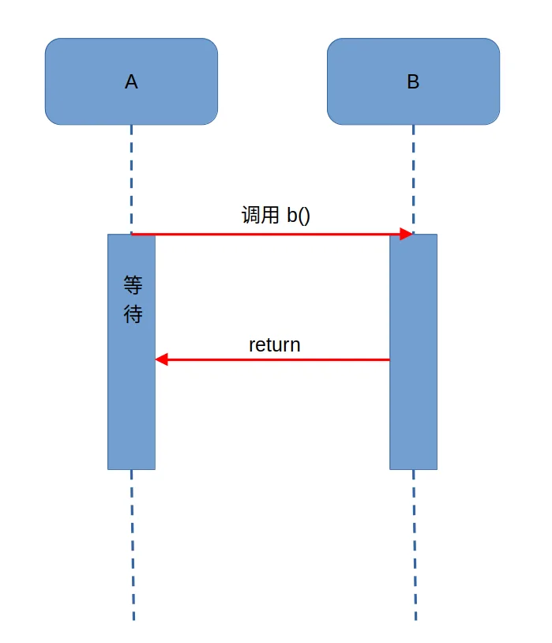

异步调用：异步调用是一种类似消息或事件的机制解决了同步阻塞的问题，例如A通知B后，他们各走各的路，互不影响，不用像同步调用那样，A通知B后，非得等到B走完后，A才继续走。

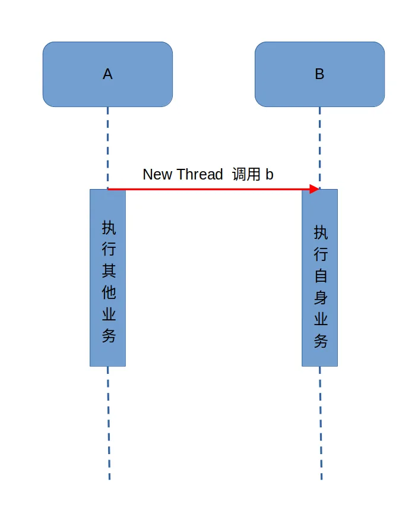

回调：回调是一种双向的调用模式，也就是说，被调用的接口被调用时也会调用对方的接口，例如A要调用B，B在执行完又要调用A。通常回调分为：同步回调和异步回调。网络上大多数的回调案例都是同步回调。

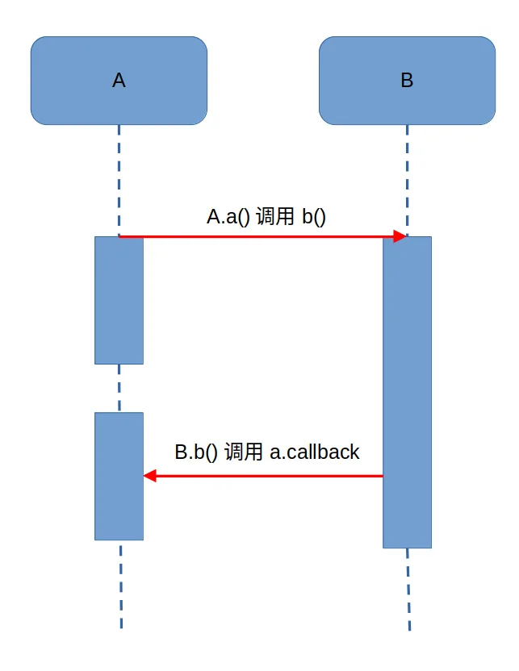

### 同步回调实例

```java
public interface CallBack {
    void callback(String string);
}

public class Person implements CallBack {
    private Genius genius;
    public Person(Genius genius) {
        this.genius = genius;
    }
    @Override
    public void callback(String string) {
        System.out.println("收到答案：" + string);
    }
    public void ask() {
        genius.answer(this);
    }
}

public class Genius {
    public void answer(CallBack callBack) {
        System.out.println("在忙其他事...");
        try {
            Thread.sleep(2000);
            System.out.println("忙完其他事，开始计算...");
        } catch (InterruptedException e) {
            e.printStackTrace();
        }
        System.out.println("天才计算出答案为：2");
        // 回调告诉你
        callBack.callback("2");
    }
}

public static void main(String[] args) {
    Genius genius = new Genius();
    Person you = new Person(genius);
    you.ask();
}
```

上面的过程，就实现了一个同步回调的功能。当然，从程序设计上来说，可以对Person和Genius进一步抽象化处理，通过接口的形式呈现。

在上述回调机制的代码实现中，最核心的是在调用answer方法时传递了this参数，即调用者自身。

从本质上来说，回调是一种思想，是一种机制，至于具体如何实现，如何通过代码将回调实现得优雅、实现得可扩展性比较高，就需要八仙过海各显神通了。

### 异步回调实例

上面的实例演示了同步回调，很明显在调用的过受到Genius执行时长的影响，需要等到Genius处理完才能继续执行Person方法中的后续代码。

下面在上述示例上进行改进，Person提供一个支持异步回调的方法：

```java
public void askASyn() {
    System.out.println("创建新线程请教问题");
    new Thread(() -> genius.answer(this)).start();
    System.out.println("新线程已启动...");
}

public static void main(String[] args) {
    Genius genius = new Genius();
    Person you = new Person(genius);
    you.askASyn();
}
```

## 扩展：接口的细节

不需要背，只要当idea报错之后，知道如何修改即可。

关于接口的使用，以下为语法上要注意的细节，虽然条目较多，但若理解了抽象的本质，无需死记硬背。

1. 当两个接口中存在相同抽象方法的时候，该怎么办？

> 只要重写一次即可。此时重写的方法，既表示重写1接口的，也表示重写2接口的。

2. 实现类能不能继承A类的时候，同时实现其他接口呢？

> 继承的父类，就好比是亲爸爸一样
> 实现的接口，就好比是干爹一样
> 可以继承一个类的同时，再实现多个接口，只不过，要把接口里面所有的抽象方法，全部实现。

3. 实现类能不能继承一个抽象类的时候，同时实现其他接口呢？

> 实现类可以继承一个抽象类的同时，再实现其他多个接口，只不过要把里面所有的抽象方法全部重写。

4. 实现类Zi，实现了一个接口，还继承了一个Fu类。假设在接口中有一个方法，父类中也有一个相同的方法。子类如何操作呢？

> 处理办法一：如果父类中的方法体，能满足当前业务的需求，在子类中可以不用重写。
> 处理办法二：如果父类中的方法体，不能满足当前业务的需求，需要在子类中重写。

5. 如果一个接口中，有10个抽象方法，但是我在实现类中，只需要用其中一个，该怎么办?

> 可以在接口跟实现类中间，新建一个中间类（适配器类）
> 让这个适配器类去实现接口，对接口里面的所有的方法做空重写。
> 让子类继承这个适配器类，想要用到哪个方法，就重写哪个方法。
> 因为中间类没有什么实际的意义，所以一般会把中间类定义为抽象的，不让外界创建对象

## Comparable和Comparator 接口

### **Comparable**

Comparable 接口的定义非常简单，源码如下所示。

```java
public interface Comparable<T> {
    int compareTo(T t);
}
```

如果一个类实现了 Comparable 接口（只需要干一件事，重写 `compareTo()` 方法），就可以按照自己制定的规则将由它创建的对象进行比较。下面给出一个例子。

```java
public class Cmower implements Comparable<Cmower> {
    private int age;
    private String name;
    public Cmower(int age, String name) {
        this.age = age;
        this.name = name;
    }
    @Override
    public int compareTo(Cmower o) {
        return this.getAge() - o.getAge();
    }
    public static void main(String[] args) {
        Cmower wanger = new Cmower(19,"沉默王二");
        Cmower wangsan = new Cmower(16,"沉默王三");
        if (wanger.compareTo(wangsan) < 0) {
            System.out.println(wanger.getName() + "比较年轻有为");
        } else {
            System.out.println(wangsan.getName() + "比较年轻有为");
        }
    }
}
```

在上面的示例中，我创建了一个 Cmower 类，它有两个字段：age 和 name。Cmower 类实现了 Comparable 接口，并重写了 `compareTo()` 方法。

程序输出的结果是“沉默王三比较年轻有为”，因为他比沉默王二小三岁。这个结果有什么凭证吗？

凭证就在于 `compareTo()` 方法，该方法的返回值可能为负数，零或者正数，代表的意思是该对象按照排序的规则小于、等于或者大于要比较的对象。如果指定对象的类型与此对象不能进行比较，则引发 `ClassCastException` 异常（自从有了泛型，这种情况就少有发生了）。

### **Comparator**

Comparator 接口的定义相比较于 Comparable 就复杂的多了，不过，核心的方法只有两个，来看一下源码。

```java
public interface Comparator<T> {
    int compare(T o1, T o2);
    boolean equals(Object obj);
}
```

第一个方法 `compare(T o1, T o2)` 的返回值可能为负数，零或者正数，代表的意思是第一个对象小于、等于或者大于第二个对象。

第二个方法 `equals(Object obj)` 需要传入一个 Object 作为参数，并判断该 Object 是否和 Comparator 保持一致。

有时候，我们想让类保持它的原貌，不想主动实现 Comparable 接口，但我们又需要它们之间进行比较，该怎么办呢？

Comparator 就派上用场了，来看一下示例。

1）原封不动的 Cmower 类。

```java
public class Cmower  {
    private int age;
    private String name;
    public Cmower(int age, String name) {
        this.age = age;
        this.name = name;
    }
}
```

（说好原封不动，getter/setter 吃了啊）

Cmower 类有两个字段：age 和 name，意味着该类可以按照 age 或者 name 进行排序。

2）再来看 Comparator 接口的实现类。

```java
public class CmowerComparator implements Comparator<Cmower> {
    @Override
    public int compare(Cmower o1, Cmower o2) {
        return o1.getAge() - o2.getAge();
    }
}
```

按照 age 进行比较。当然也可以再实现一个比较器，按照 name 进行自然排序，示例如下。

```java
public class CmowerNameComparator implements Comparator<Cmower> {
    @Override
    public int compare(Cmower o1, Cmower o2) {
        if (o1.getName().hashCode() < o2.getName().hashCode()) {
            return -1;
        } else if (o1.getName().hashCode() == o2.getName().hashCode()) {
            return 0;
        }
        return 1;
    }
}
```

3）再来看测试类。

```java
Cmower wanger = new Cmower(19,"沉默王二");
Cmower wangsan = new Cmower(16,"沉默王三");
Cmower wangyi = new Cmower(28,"沉默王一");

List<Cmower> list = new ArrayList<>();
list.add(wanger);
list.add(wangsan);
list.add(wangyi);

list.sort(new CmowerComparator());

for (Cmower c : list) {
    System.out.println(c.getName());
}
```

创建了三个对象，age 不同，name 不同，并把它们加入到了 List 当中。然后使用 List 的 `sort()` 方法进行排序，来看一下输出的结果。

```text
沉默王三
沉默王二
沉默王一
```

这意味着沉默王三的年纪比沉默王二小，排在第一位；沉默王一的年纪比沉默王二大，排在第三位。和我们的预期完全符合。

### **到底该用哪一个呢？**

通过上面的两个例子可以比较出 Comparable 和 Comparator 两者之间的区别：

- 一个类实现了 Comparable 接口，意味着该类的对象可以直接进行比较（排序），但比较（排序）的方式只有一种，很单一。
- 一个类如果想要保持原样，又需要进行不同方式的比较（排序），就可以定制比较器（实现 Comparator 接口）。
- Comparable 接口在 `java.lang` 包下，而 `Comparator` 接口在 `java.util` 包下，算不上是亲兄弟，但可以称得上是表（堂）兄弟。

举个不恰当的例子。我想从洛阳出发去北京看长城，体验一下好汉的感觉，要么坐飞机，要么坐高铁；但如果是孙悟空的话，翻个筋斗就到了。我和孙悟空之间有什么区别呢？孙悟空自己实现了 Comparable 接口（他那年代也没有飞机和高铁，没得选），而我可以借助 Comparator 接口（现代化的交通工具）。

总而言之，如果对象的排序需要基于自然顺序，请选择 `Comparable`，如果需要按照对象的不同属性进行排序，请选择 `Comparator`。

## 对象克隆

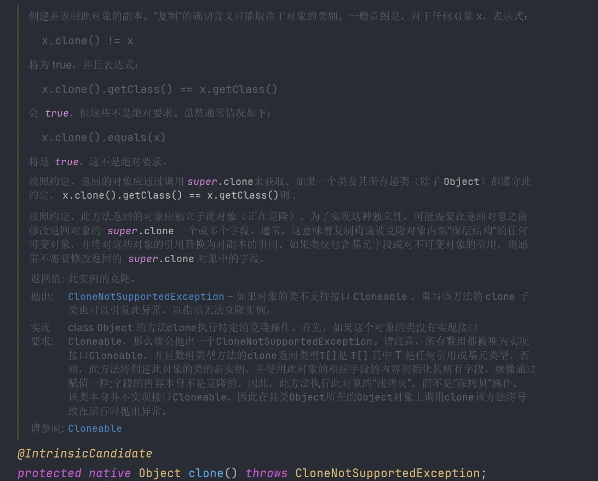

为一个包含对象引用的变量建立副本时会发生什么。原变量和副本都是同一个对象的引用。这说明，任何一个变量改变都会影响另一个变量。

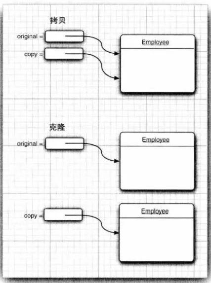

### 浅克隆

在浅克隆中，如果原型对象的成员变量是`值类型`，将复制一份给克隆对象；如果原型对象的成员变量是`引用类型`，则将引用对象的地址复制一份给克隆对象，也就是说原型对象和克隆对象的成员变量指向相同的内存地址。

简单来说，在浅克隆中，当对象被复制时只复制它本身和其中包含的值类型的成员变量，而引用类型的成员对象并没有复制。

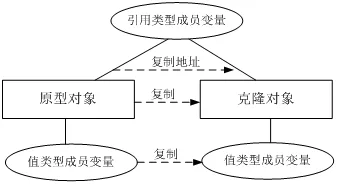

在Java语言中，通过**覆盖Object类的clone()方法可以实现浅克隆**。

### 深克隆

在深克隆中，无论原型对象的成员变量是值类型还是引用类型，都将复制一份给克隆对象，深克隆将原型对象的所有引用对象也复制一份给克隆对象。

简单来说，在深克隆中，除了对象本身被复制外，对象所包含的所有成员变量也将复制。

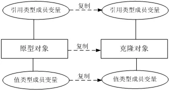

在Java语言中，如果需要**实现深克隆，可以通过**覆盖Object类的clone()方法实现，也**可以通过序列化(Serialization)等方式**来实现。

（**如果引用类型里面还包含很多引用类型，或者内层引用类型的类里面又包含引用类型，使用clone方法就会很麻烦。这时我们可以用序列化的方式来实现对象的深克隆。**）

序列化就是将对象写到流的过程，写到流中的对象是原有对象的一个拷贝，而原对象仍然存在于内存中。通过序列化实现的拷贝不仅可以复制对象本身，而且可以复制其引用的成员对象，因此通过序列化将对象写到一个流中，再从流里将其读出来，可以实现深克隆。需要注意的是能够实现序列化的对象其类必须实现Serializable接口，否则无法实现序列化操作。

> Java语言提供的Cloneable接口和Serializable接口的代码非常简单，它们都是空接口，这种空接口也称为`标识接口`，标识接口中没有任何方法的定义，其作用是告诉JRE这些接口的实现类是否具有某个功能，如是否支持克隆、是否支持序列化等。
>
> 注释： Object 类中的clone 方法声明为protected，所以你的代码不能直接调用anObject.clone。但是，不是所有子类都能访问受保护方法吗？ 不是所有类都是Object 的子类吗？ 幸运的是， 受保护访问的规则比较微妙（ 见第5 章） 。子类只能调用受保护的clone 方法来克隆它自己的对象。必须重新定义clone 为public 才能允许所有方法克隆对象。

### 实现Cloneable接口，重写clone方法

Object默认的clone方法实际是对域的简单拷贝，对于简单数据类型，是值的拷贝；

**对于复杂类型的字段，则是指针地址的拷贝，clone后的对象和原对象指向的还是一个地址空间。**

```java
class Car implements Cloneable {
    private String brand;//品牌
    private int maxSpeed;//最高时速
    @Override
    protected Object clone() throws CloneNotSupportedException {
        return super.clone();
    }
    @Override
    public String toString() {
        return "Car{" +
                "brand='" + brand + '\'' +
                ", maxSpeed=" + maxSpeed +
                '}';
    }
    public String getBrand() {
        return brand;
    }
    public void setBrand(String brand) {
        this.brand = brand;
    }
    public int getMaxSpeed() {
        return maxSpeed;
    }
    public void setMaxSpeed(int maxSpeed) {
        this.maxSpeed = maxSpeed;
    }
    public Car(String brand, int maxSpeed) {
        this.brand = brand;
        this.maxSpeed = maxSpeed;
    }
}

public class Person implements Cloneable {
    private String name;
    private Car car;
    @Override
    protected Object clone() throws CloneNotSupportedException {
        return super.clone();
    }
    @Override
    public String toString() {
        return "Person{" +
                "name='" + name + '\'' +
                ", car=" + car +
                '}';
    }
    public String getName() {
        return name;
    }
    public void setName(String name) {
        this.name = name;
    }
    public Car getCar() {
        return car;
    }
    public void setCar(Car car) {
        this.car = car;
    }
    public Person(String name, Car car) {
        this.name = name;
        this.car = car;
    }
}

package javalearn.beanlearn;
public class test {
    public static void main(String[] args) throws CloneNotSupportedException {
        Car car = new Car("audi", 150);
        Person person = new Person("ding", car);
        Person person1 = (Person) person.clone();
        System.out.println("修改car之前：");
        System.out.println(person);
        System.out.println(person1);
        System.out.println("修改car之后：");
        car.setBrand("benchi");
        car.setMaxSpeed(200);
        System.out.println(person);
        System.out.println(person1);
        System.out.print("使用Object默认的clone方法：");
        System.out.println(person.getCar() == person1.getCar());
    }
}
```

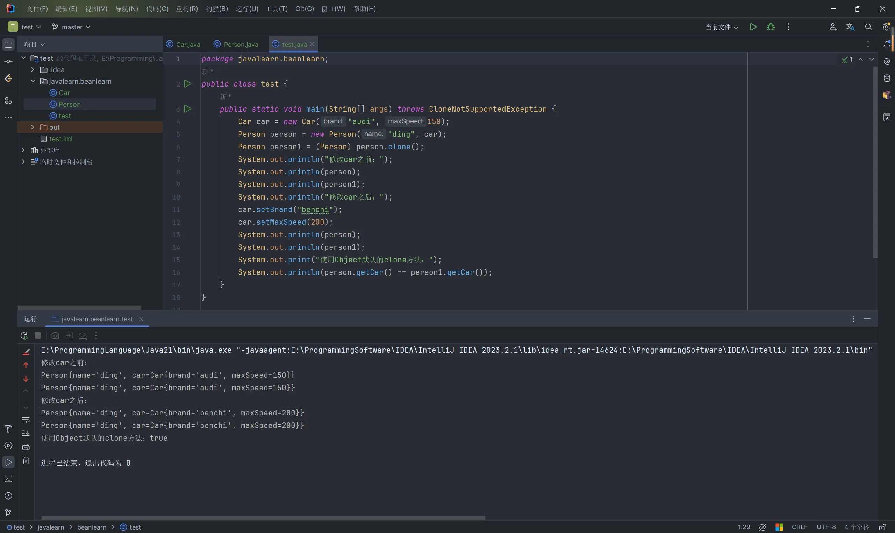

这种克隆方式显然表示原始对象和克隆对象的Car是同一个 引用。也就是说，Car对象没有被克隆。如果修改了Car对象的值，原始对象和克隆对象都将会发生变化。这并不是我们希望看到的。

所以，我们需要连对象里面的对象也要是一个新的对象。每一个属性都被完全拷贝，这才是深克隆。
为了实现深度克隆，我们需要对Person中的clone方法进行改造一下，getCar()测试代码不变。

```java
 @Override
    protected Object clone() throws CloneNotSupportedException {
        Person person= (Person) super.clone();
        person.setCar((Car) person.getCar().clone());
        return person;
    }
```


# lambda 表达式

## 体验Lambda表达式

- 案例需求

  启动一个线程，在控制台输出一句话：多线程程序启动了

- 实现方式一

  - 实现步骤
    - 定义一个类MyRunnable实现Runnable接口，重写run()方法
    - 创建MyRunnable类的对象
    - 创建Thread类的对象，把MyRunnable的对象作为构造参数传递
    - 启动线程

- 实现方式二

  - 匿名内部类的方式改进

- 实现方式三

  - Lambda表达式的方式改进

- 代码演示

  ```java
  //方式一的线程类
  public class MyRunnable implements Runnable {
      @Override
      public void run() {
          System.out.println("多线程程序启动了");
      }
  }
  public class LambdaDemo {
      public static void main(String[] args) {
          //方式一
  //        MyRunnable my = new MyRunnable();
  //        Thread t = new Thread(my);
  //        t.start();
          //方式二
  //        new Thread(new Runnable() {
  //            @Override
  //            public void run() {
  //                System.out.println("多线程程序启动了");
  //            }
  //        }).start();
          //方式三
          new Thread( () -> {
              System.out.println("多线程程序启动了");
          } ).start();
      }
  }
  ```

- 函数式编程思想概述

  函数式思想则尽量忽略面向对象的复杂语法：“强调做什么，而不是以什么形式去做”

  而我们要学习的Lambda表达式就是函数式思想的体现

## Lambda表达式的标准格式

- 格式：

  ​	(形式参数) -> {代码块}

  - 形式参数：如果有多个参数，参数之间用逗号隔开；如果没有参数，留空即可

  - ->：由英文中画线和大于符号组成，固定写法。代表指向动作

  - 代码块：是我们具体要做的事情，也就是以前我们写的方法体内容

- 组成Lambda表达式的三要素：

  - 形式参数，箭头，代码块

### Lambda表达式练习1

- Lambda表达式的使用前提

  - 有一个接口

  - 接口中有且仅有一个抽象方法

- 练习描述

  ​	无参无返回值抽象方法的练习

- 操作步骤

  - 定义一个接口(Eatable)，里面定义一个抽象方法：void eat();

  - 定义一个测试类(EatableDemo)，在测试类中提供两个方法

    - 一个方法是：useEatable(Eatable e)

    - 一个方法是主方法，在主方法中调用useEatable方法

- 示例代码

  ```java
  //接口
  public interface Eatable {
      void eat();
  }
  //实现类
  public class EatableImpl implements Eatable {
      @Override
      public void eat() {
          System.out.println("一天一苹果，医生远离我");
      }
  }
  //测试类
  public class EatableDemo {
      public static void main(String[] args) {
          //在主方法中调用useEatable方法
          Eatable e = new EatableImpl();
          useEatable(e);
          //匿名内部类
          useEatable(new Eatable() {
              @Override
              public void eat() {
                  System.out.println("一天一苹果，医生远离我");
              }
          });
          //Lambda表达式
          useEatable(() -> {
              System.out.println("一天一苹果，医生远离我");
          });
      }
      private static void useEatable(Eatable e) {
          e.eat();
      }
  }
  ```

### Lambda表达式练习2

- 练习描述

  有参有返回值抽象方法的练习

- 操作步骤

  - 定义一个接口(Addable)，里面定义一个抽象方法：int add(int x,int y);

  - 定义一个测试类(AddableDemo)，在测试类中提供两个方法

    - 一个方法是：useAddable(Addable a)

    - 一个方法是主方法，在主方法中调用useAddable方法

- 示例代码

  ```java
  public interface Addable {
      int add(int x,int y);
  }
  public class AddableDemo {
      public static void main(String[] args) {
          //在主方法中调用useAddable方法
          useAddable((int x,int y) -> {
              return x + y;
          });
  
      }
      private static void useAddable(Addable a) {
          int sum = a.add(10, 20);
          System.out.println(sum);
      }
  }
  ```

## Lambda表达式的省略模式

- 省略的规则

  - 参数类型可以省略。但是有多个参数的情况下，不能只省略一个
  - 如果参数有且仅有一个，那么小括号可以省略
  - 如果代码块的语句只有一条，可以省略大括号和分号，和return关键字

- 代码演示

  ```java
  public interface Addable {
      int add(int x, int y);
  }
  public interface Flyable {
      void fly(String s);
  }
  public class LambdaDemo {
      public static void main(String[] args) {
  //        useAddable((int x,int y) -> {
  //            return x + y;
  //        });
          //参数的类型可以省略
          useAddable((x, y) -> {
              return x + y;
          });
  //        useFlyable((String s) -> {
  //            System.out.println(s);
  //        });
          //如果参数有且仅有一个，那么小括号可以省略
  //        useFlyable(s -> {
  //            System.out.println(s);
  //        });
          //如果代码块的语句只有一条，可以省略大括号和分号
          useFlyable(s -> System.out.println(s));
          //如果代码块的语句只有一条，可以省略大括号和分号，如果有return，return也要省略掉
          useAddable((x, y) -> x + y);
      }
      private static void useFlyable(Flyable f) {
          f.fly("风和日丽，晴空万里");
      }
      private static void useAddable(Addable a) {
          int sum = a.add(10, 20);
          System.out.println(sum);
      }
  }
  ```

## Lambda表达式的注意事项

- 使用Lambda必须要有接口，并且要求接口中有且仅有一个抽象方法

- 必须有上下文环境，才能推导出Lambda对应的接口

  - 根据局部变量的赋值得知Lambda对应的接口

    ​	Runnable r = () -> System.out.println("Lambda表达式");

  - 根据调用方法的参数得知Lambda对应的接口

    ​	new Thread(() -> System.out.println("Lambda表达式")).start();

## Lambda表达式和匿名内部类的区别

- 所需类型不同
  - 匿名内部类：可以是接口，也可以是抽象类，还可以是具体类
  - Lambda表达式：只能是接口

- 使用限制不同

  - 如果接口中有且仅有一个抽象方法，可以使用Lambda表达式，也可以使用匿名内部类

  - 如果接口中多于一个抽象方法，只能使用匿名内部类，而不能使用Lambda表达式

- 实现原理不同
  - 匿名内部类：编译之后，产生一个单独的.class字节码文件
  - Lambda表达式：编译之后，没有一个单独的.class字节码文件。对应的字节码会在运行的时候动态生成

## 函数式接口

对于只有一个抽象方法的接口，需要这种接口的对象时，就可以提供一个lambda 表达式。这种接口称为函数式接口( functional interface ) 。

## 方法引用

- 方法引用的出现原因

  在使用Lambda表达式的时候，我们实际上传递进去的代码就是一种解决方案：拿参数做操作

  那么考虑一种情况：如果我们在Lambda中所指定的操作方案，已经有地方存在相同方案，那是否还有必要再写重复逻辑呢？答案肯定是没有必要

  那我们又是如何使用已经存在的方案的呢？

  这就是我们要讲解的方法引用，我们是通过方法引用来使用已经存在的方案

> 类似于lambda 表达式，方法引用也不是一个对象。不过，为一个类型为函数式接口的变量赋值时会生成一个对象。
>
> 如果有多个同名的重载方法，编译器就会尝试从上下文中找出你指的是哪一个方法。例如，Math.max 方法有两个版本， 一个用于整数，另一个用于double 值。选择哪一个版本取决于Math: :max 转换为哪个函数式接口的方法参数。类似于Lambda 表达式，方法引用不能独立存在，总是会转换为函数式接口的实例。

### 方法引用符

- 方法引用符

  ::  该符号为引用运算符，而它所在的表达式被称为方法引用

- 推导与省略

  - 如果使用Lambda，那么根据“可推导就是可省略”的原则，无需指定参数类型，也无需指定的重载形式，它们都将被自动推导
  - 如果使用方法引用，也是同样可以根据上下文进行推导
  - 方法引用是Lambda的孪生兄弟

要用::运算符分隔方法名与对象或类名。主要有3 种情况：

1. object::instanceMethod
   方法引用等价于向方法传递参数的lambda 表达式。对千System.out: :println, 对象是System.out, 所以方法表达式等价于x -> System.out.println(x) 。
2. Class::instanceMethod
   第1 个参数会成为方法的隐式参数。例如， String: : compareTolgnoreCase等同于( x, y) -> x. compareTolg no reCase(y) 。
3. Class::staticMethod
   所有参数都传递到静态方法： Math : :pow 等价于(x, y) -> Math.pow(x, y) 。

### 引用类方法

​	引用类方法，其实就是引用类的静态方法

- 格式

  类名::静态方法

- 范例

  Integer::parseInt

  Integer类的方法：public static int parseInt(String s) 将此String转换为int类型数据

- 练习描述

  - 定义一个接口(Converter)，里面定义一个抽象方法 int convert(String s);

  - 定义一个测试类(ConverterDemo)，在测试类中提供两个方法

    - 一个方法是：useConverter(Converter c)

    - 一个方法是主方法，在主方法中调用useConverter方法

- 代码演示

  ```java
  public interface Converter {
      int convert(String s);
  }
  public class ConverterDemo {
      public static void main(String[] args) {
  		//Lambda写法
          useConverter(s -> Integer.parseInt(s));
          //引用类方法
          useConverter(Integer::parseInt);
      }
      private static void useConverter(Converter c) {
          int number = c.convert("666");
          System.out.println(number);
      }
  }
  ```

- 使用说明

  Lambda表达式被类方法替代的时候，它的形式参数全部传递给静态方法作为参数

### 引用对象的实例方法

​	引用对象的实例方法，其实就引用类中的成员方法

- 格式

  对象::成员方法

- 范例

  "HelloWorld"::toUpperCase

    String类中的方法：public String toUpperCase() 将此String所有字符转换为大写

- 练习描述

  - 定义一个类(PrintString)，里面定义一个方法

    public void printUpper(String s)：把字符串参数变成大写的数据，然后在控制台输出

  - 定义一个接口(Printer)，里面定义一个抽象方法

    void printUpperCase(String s)

  - 定义一个测试类(PrinterDemo)，在测试类中提供两个方法

    - 一个方法是：usePrinter(Printer p)
    - 一个方法是主方法，在主方法中调用usePrinter方法

- 代码演示

  ```java
  public class PrintString {
      //把字符串参数变成大写的数据，然后在控制台输出
      public void printUpper(String s) {
          String result = s.toUpperCase();
          System.out.println(result);
      }
  }
  public interface Printer {
      void printUpperCase(String s);
  }
  public class PrinterDemo {
      public static void main(String[] args) {
  		//Lambda简化写法
          usePrinter(s -> System.out.println(s.toUpperCase()));
          //引用对象的实例方法
          PrintString ps = new PrintString();
          usePrinter(ps::printUpper);
      }
      private static void usePrinter(Printer p) {
          p.printUpperCase("HelloWorld");
      }
  }
  ```

- 使用说明

  Lambda表达式被对象的实例方法替代的时候，它的形式参数全部传递给该方法作为参数

### 引用类的实例方法

​	引用类的实例方法，其实就是引用类中的成员方法

- 格式

  类名::成员方法

- 范例

  String::substring

  public String substring(int beginIndex,int endIndex) 

  从beginIndex开始到endIndex结束，截取字符串。返回一个子串，子串的长度为endIndex-beginIndex

- 练习描述

  - 定义一个接口(MyString)，里面定义一个抽象方法：

    String mySubString(String s,int x,int y);

  - 定义一个测试类(MyStringDemo)，在测试类中提供两个方法

    - 一个方法是：useMyString(MyString my)

    - 一个方法是主方法，在主方法中调用useMyString方法

- 代码演示

  ```java
  public interface MyString {
      String mySubString(String s,int x,int y);
  }
  public class MyStringDemo {
      public static void main(String[] args) {
  		//Lambda简化写法
          useMyString((s,x,y) -> s.substring(x,y));
          //引用类的实例方法
          useMyString(String::substring);
      }
      private static void useMyString(MyString my) {
          String s = my.mySubString("HelloWorld", 2, 5);
          System.out.println(s);
      }
  }
  ```

- 使用说明

  ​    Lambda表达式被类的实例方法替代的时候
  ​    第一个参数作为调用者
  ​    后面的参数全部传递给该方法作为参数

### 引用构造器

​	引用构造器，其实就是引用构造方法

- 格式

  类名::new

- 范例

  Student::new

- 练习描述

  - 定义一个类(Student)，里面有两个成员变量(name,age)

    并提供无参构造方法和带参构造方法，以及成员变量对应的get和set方法

  - 定义一个接口(StudentBuilder)，里面定义一个抽象方法

    Student build(String name,int age);

  - 定义一个测试类(StudentDemo)，在测试类中提供两个方法

    - 一个方法是：useStudentBuilder(StudentBuilder s)

    - 一个方法是主方法，在主方法中调用useStudentBuilder方法

- 代码演示

  ```java
  public class Student {
      private String name;
      private int age;
      public Student() {
      }
      public Student(String name, int age) {
          this.name = name;
          this.age = age;
      }
      public String getName() {
          return name;
      }
      public void setName(String name) {
          this.name = name;
      }
      public int getAge() {
          return age;
      }
      public void setAge(int age) {
          this.age = age;
      }
  }
  
  public interface StudentBuilder {
      Student build(String name,int age);
  }
  public class StudentDemo {
      public static void main(String[] args) {
  		//Lambda简化写法
          useStudentBuilder((name,age) -> new Student(name,age));
          //引用构造器
          useStudentBuilder(Student::new);
      }
      private static void useStudentBuilder(StudentBuilder sb) {
          Student s = sb.build("林青霞", 30);
          System.out.println(s.getName() + "," + s.getAge());
      }
  }
  ```

- 使用说明

  Lambda表达式被构造器替代的时候，它的形式参数全部传递给构造器作为参数

# 内部类

内部类(inner class) 是定义在另一个类中的类。为什么需要使用内部类呢？主要有两个原因：

- 内部类可以对同一个包中的其他类隐藏。
- 内部类方法可以访问定义这个类的作用域中的数据，包括原本私有的数据。
- 内部类的对象总有一个隐式引用，指向创建它的外部类对象

## 什么是内部类

将一个类A定义在另一个类B里面，里面的那个类A就称为**内部类**，B则称为**外部类**。可以把内部类理解成寄生，外部类理解成宿主。

## 什么时候使用内部类

一个事物内部还有一个独立的事物，内部的事物脱离外部的事物无法独立使用

1. 人里面有一颗心脏。
2. 汽车内部有一个发动机。
3. 为了实现更好的封装性。

## 内部类的分类

按定义的位置来分

1. **成员内部内**，类定义在了成员位置 (类中方法外称为成员位置，无static修饰的内部类)
2. **静态内部类**，类定义在了成员位置 (类中方法外称为成员位置，有static修饰的内部类)
3. **局部内部类**，类定义在方法内
4. **匿名内部类**，没有名字的内部类，可以在方法中，也可以在类中方法外。

## 成员内部类

**成员内部类特点**：

- 无static修饰的内部类，属于外部类对象的。
- 宿主：外部类对象。

**内部类的使用格式**：

```java
 外部类.内部类。 // 访问内部类的类型都是用 外部类.内部类
```

**获取成员内部类对象的两种方式**：

方式一：外部直接创建成员内部类的对象

```java
外部类.内部类 变量 = new 外部类（）.new 内部类（）;
```

方式二：在外部类中定义一个方法提供内部类的对象

表达式OuterClass. this表示外围类引用。

**案例演示**

```java
方式一：
public class Test {
    public static void main(String[] args) {
        //  宿主：外部类对象。
       // Outer out = new Outer();
        // 创建内部类对象。
        Outer.Inner oi = new Outer().new Inner();
        oi.method();
    }
}

class Outer {
    // 成员内部类，属于外部类对象的。
    // 拓展：成员内部类不能定义静态成员。
    public class Inner{
        // 这里面的东西与类是完全一样的。
        public void method(){
            System.out.println("内部类中的方法被调用了");
        }
    }
}


方式二：
public class Outer {
    String name;
    private class Inner{
        static int a = 10;
    }
    public Inner getInstance(){
        return new Inner();
    }
}

public class Test {
    public static void main(String[] args) {
        Outer o = new Outer();
        System.out.println(o.getInstance());


    }
}
```

## 成员内部类的细节

编写成员内部类的注意点：

1. 成员内部类可以被一些修饰符所修饰，比如： private，默认，protected，public，static等
2. 在成员内部类里面，JDK16之前不能定义静态变量，JDK16开始才可以定义静态变量。
3. 创建内部类对象时，对象中有一个隐含的Outer.this记录外部类对象的地址值。

详解：

​	内部类被private修饰，外界无法直接获取内部类的对象，只能通过（在外部类中定义一个方法提供内部类的对象）获取内部类的对象

​	被其他权限修饰符修饰的内部类一般用方式一直接获取内部类的对象

​	内部类被static修饰是成员内部类中的特殊情况，叫做静态内部类下面单独学习。

​	内部类如果想要访问外部类的成员变量，外部类的变量必须用final修饰，JDK8以前必须手动写final，JDK8之后不需要手动写，JDK默认加上。

## 成员内部类面试题

请在?地方向上相应代码,以达到输出的内容

注意：内部类访问外部类对象的格式是：**外部类名.this**

```java
public class Test {
    public static void main(String[] args) {
        Outer.inner oi = new Outer().new inner();
        oi.method();
    }
}
class Outer {	// 外部类
    private int a = 30;

    // 在成员位置定义一个类
    class inner {
        private int a = 20;

        public void method() {
            int a = 10;
            System.out.println(???);	// 10   答案：a
            System.out.println(???);	// 20	答案：this.a
            System.out.println(???);	// 30	答案：Outer.this.a
        }
    }
}
```

## 成员内部类内存图

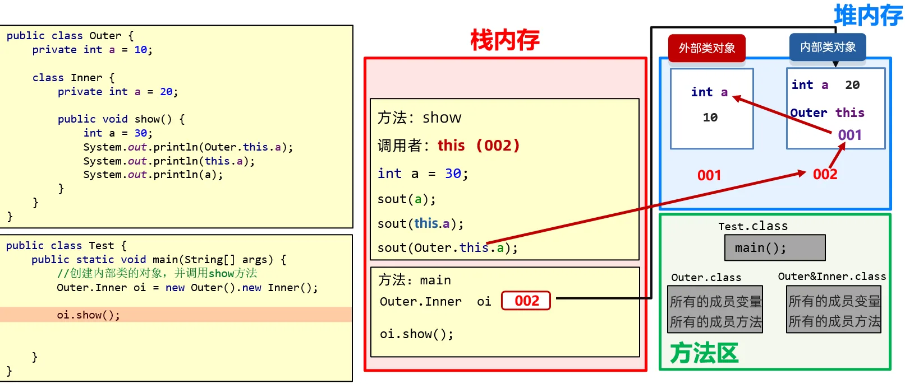

## 静态内部类

**静态内部类特点**：

* 静态内部类是一种特殊的成员内部类。

- 有static修饰，属于外部类本身的。
- 总结：静态内部类与其他类的用法完全一样。只是访问的时候需要加上外部类.内部类。
- **拓展1**:静态内部类可以直接访问外部类的静态成员。
- **拓展2**:静态内部类不可以直接访问外部类的非静态成员，如果要访问需要创建外部类的对象。
- **拓展3**:静态内部类中没有银行的Outer.this。

**内部类的使用格式**：

```
外部类.内部类。
```

**静态内部类对象的创建格式**：

```java
外部类.内部类  变量 = new  外部类.内部类构造器;
```

**调用方法的格式：**

* 调用非静态方法的格式：先创建对象，用对象调用
* 调用静态方法的格式：外部类名.内部类名.方法名();

**案例演示**：

```java
// 外部类：Outer01
class Outer01{
    private static  String sc_name = "黑马程序";
    // 内部类: Inner01
    public static class Inner01{
        // 这里面的东西与类是完全一样的。
        private String name;
        public Inner01(String name) {
            this.name = name;
        }
        public void showName(){
            System.out.println(this.name);
            // 拓展:静态内部类可以直接访问外部类的静态成员。
            System.out.println(sc_name);
        }
    }
}

public class InnerClassDemo01 {
    public static void main(String[] args) {
        // 创建静态内部类对象。
        // 外部类.内部类  变量 = new  外部类.内部类构造器;
        Outer01.Inner01 in  = new Outer01.Inner01("张三");
        in.showName();
    }
}
```

## 局部内部类

- **局部内部类** ：定义在**方法中**的类。

定义格式:

```java
class 外部类名 {
	数据类型 变量名;
	
	修饰符 返回值类型 方法名(参数列表) {
		// …
		class 内部类 {
			// 成员变量
			// 成员方法
		}
	}
}
```

## 匿名内部类【重点】

### 概述

**匿名内部类** ：是内部类的简化写法。他是一个隐含了名字的内部类。开发中，最常用到的内部类就是匿名内部类了。

### 格式

```java
new 类名或者接口名() {
     重写方法;
};
```

包含了：

* 继承或者实现关系

* 方法重写
* 创建对象

所以从语法上来讲，这个整体其实是匿名内部类对象

### 什么时候用到匿名内部类 

**实际上，如果我们希望定义一个只要使用一次的类，就可考虑使用匿名内部类。匿名内部类的本质作用**

**是为了简化代码**。 

之前我们使用接口时，似乎得做如下几步操作：

1. 定义子类
2. 重写接口中的方法
3. 创建子类对象
4. 调用重写后的方法

```java
interface Swim {
    public abstract void swimming();
}

// 1. 定义接口的实现类
class Student implements Swim {
    // 2. 重写抽象方法
    @Override
    public void swimming() {
        System.out.println("狗刨式...");
    }
}

public class Test {
    public static void main(String[] args) {
        // 3. 创建实现类对象
        Student s = new Student();
        // 4. 调用方法
        s.swimming();
    }
}
```

我们的目的，最终只是为了调用方法，那么能不能简化一下，把以上四步合成一步呢？匿名内部类就是做这样的快捷方式。

### 匿名内部类前提和格式

匿名内部类必须**继承一个父类**或者**实现一个父接口**。

**匿名内部类格式**

```java
new 父类名或者接口名(){
    // 方法重写
    @Override 
    public void method() {
        // 执行语句
    }
};
```

### 使用方式

以接口为例，匿名内部类的使用，代码如下：

```java
interface Swim {
    public abstract void swimming();
}

public class Demo07 {
    public static void main(String[] args) {
        // 使用匿名内部类
		new Swim() {
			@Override
			public void swimming() {
				System.out.println("自由泳...");
			}
		}.swimming();

        // 接口 变量 = new 实现类(); // 多态,走子类的重写方法
        Swim s2 = new Swim() {
            @Override
            public void swimming() {
                System.out.println("蛙泳...");
            }
        };

        s2.swimming();
        s2.swimming();
    }
}
```

### 匿名内部类的特点

1. 定义一个没有名字的内部类
2. 这个类实现了父类，或者父类接口
3. 匿名内部类会创建这个没有名字的类的对象

### 匿名内部类的使用场景

通常在方法的形式参数是接口或者抽象类时，也可以将匿名内部类作为参数传递。代码如下：

```java
interface Swim {
    public abstract void swimming();
}

public class Demo07 {
    public static void main(String[] args) {
        // 普通方式传入对象
        // 创建实现类对象
        Student s = new Student();
        
        goSwimming(s);
        // 匿名内部类使用场景:作为方法参数传递
        Swim s3 = new Swim() {
            @Override
            public void swimming() {
                System.out.println("蝶泳...");
            }
        };
        // 传入匿名内部类
        goSwimming(s3);

        // 完美方案: 一步到位
        goSwimming(new Swim() {
            public void swimming() {
                System.out.println("大学生, 蛙泳...");
            }
        });

        goSwimming(new Swim() {
            public void swimming() {
                System.out.println("小学生, 自由泳...");
            }
        });
    }

    // 定义一个方法,模拟请一些人去游泳
    public static void goSwimming(Swim s) {
        s.swimming();
    }
}
```

# 代理

利用代理可以在运行时创建实现了一组给定接口的新类。

代理模式是一种比较好理解的设计模式。简单来说就是 **我们使用代理对象来代替对真实对象(real object)的访问，这样就可以在不修改原目标对象的前提下，提供额外的功能操作，扩展目标对象的功能。**

**代理模式的主要作用是扩展目标对象的功能，比如说在目标对象的某个方法执行前后你可以增加一些自定义的操作。**

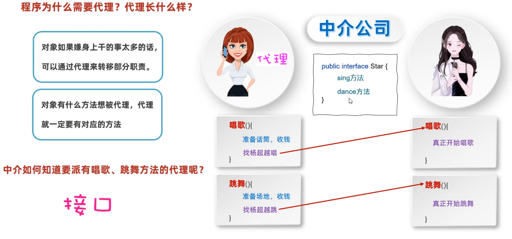

具体地，代理类包含以下方法：

- 指定接口所需要的全部方法。
- Object 类中的全部方法，例如， toString 、equals 等。

## 静态代理

**静态代理中，我们对目标对象的每个方法的增强都是手动完成的（*后面会具体演示代码*），非常不灵活（*比如接口一旦新增加方法，目标对象和代理对象都要进行修改*）且麻烦(*需要对每个目标类都单独写一个代理类*）。** 实际应用场景非常非常少，日常开发几乎看不到使用静态代理的场景。

上面我们是从实现和应用角度来说的静态代理，从 JVM 层面来说， **静态代理在编译时就将接口、实现类、代理类这些都变成了一个个实际的 class 文件。**

静态代理实现步骤:

1. 定义一个接口及其实现类；
2. 创建一个代理类同样实现这个接口
3. 将目标对象注入进代理类，然后在代理类的对应方法调用目标类中的对应方法。这样的话，我们就可以通过代理类屏蔽对目标对象的访问，并且可以在目标方法执行前后做一些自己想做的事情。

**定义发送短信的接口**

```java
public interface SmsService {
    String send(String message);
}
```

**实现发送短信的接口**

```java
public class SmsServiceImpl implements SmsService {
    public String send(String message) {
        System.out.println("send message:" + message);
        return message;
    }
}
```

**创建代理类并同样实现发送短信的接口**

```java
public class SmsProxy implements SmsService {

    private final SmsService smsService;

    public SmsProxy(SmsService smsService) {
        this.smsService = smsService;
    }

    @Override
    public String send(String message) {
        //调用方法之前，我们可以添加自己的操作
        System.out.println("before method send()");
        smsService.send(message);
        //调用方法之后，我们同样可以添加自己的操作
        System.out.println("after method send()");
        return null;
    }
}
```

**实际使用**

```java
public class Main {
    public static void main(String[] args) {
        SmsService smsService = new SmsServiceImpl();
        SmsProxy smsProxy = new SmsProxy(smsService);
        smsProxy.send("java");
    }
}
```

运行上述代码之后，控制台打印出：

```bash
before method send()
send message:java
after method send()
```

可以输出结果看出，我们已经增加了 `SmsServiceImpl` 的`send()`方法。

## 动态代理

## 动态代理三要素：

1，**h** : 实现了 `InvocationHandler` 接口的对象；真正干活的对象.

2，**loader** :类加载器，用于加载代理对象。代理对象

3，**interfaces** : 被代理类实现的一些接口；利用代理调用方法

切记一点：代理可以增强或者拦截的方法都在接口中，接口需要写在newProxyInstance的第二个参数里。

## 代码实现：

```java
public class Test {
    public static void main(String[] args) {
    /*
        需求：
            外面的人想要大明星唱一首歌
             1. 获取代理的对象
                代理对象 = ProxyUtil.createProxy(大明星的对象);
             2. 再调用代理的唱歌方法
                代理对象.唱歌的方法("只因你太美");
     */
        //1. 获取代理的对象
        BigStar bigStar = new BigStar("鸡哥");
        Star proxy = ProxyUtil.createProxy(bigStar);

        //2. 调用唱歌的方法
        String result = proxy.sing("只因你太美");
        System.out.println(result);
    }
}
```

```java
/*
*
* 类的作用：
*       创建一个代理
*
* */
public class ProxyUtil {
    /*
    *
    * 方法的作用：
    *       给一个明星的对象，创建一个代理
    *
    *  形参：
    *       被代理的明星对象
    *
    *  返回值：
    *       给明星创建的代理
    *
    *
    *
    * 需求：
    *   外面的人想要大明星唱一首歌
    *   1. 获取代理的对象
    *      代理对象 = ProxyUtil.createProxy(大明星的对象);
    *   2. 再调用代理的唱歌方法
    *      代理对象.唱歌的方法("只因你太美");
    * */
    public static Star createProxy(BigStar bigStar){
       /* java.lang.reflect.Proxy类：提供了为对象产生代理对象的方法：

        public static Object newProxyInstance(ClassLoader loader, Class<?>[] interfaces, InvocationHandler h)
        参数一：用于指定用哪个类加载器，去加载生成的代理类
        参数二：指定接口，这些接口用于指定生成的代理长什么，也就是有哪些方法
        参数三：用来指定生成的代理对象要干什么事情*/
        Star star = (Star) Proxy.newProxyInstance(
                ProxyUtil.class.getClassLoader(),//参数一：用于指定用哪个类加载器，去加载生成的代理类
                new Class[]{Star.class},//参数二：指定接口，这些接口用于指定生成的代理长什么，也就是有哪些方法
                //参数三：用来指定生成的代理对象要干什么事情
                new InvocationHandler() {
                    @Override
                    public Object invoke(Object proxy, Method method, Object[] args) throws Throwable {
                        /*
                        * 参数一：代理的对象
                        * 参数二：要运行的方法 sing
                        * 参数三：调用sing方法时，传递的实参
                        * */
                        if("sing".equals(method.getName())){
                            System.out.println("准备话筒，收钱");
                        }else if("dance".equals(method.getName())){
                            System.out.println("准备场地，收钱");
                        }
                        //去找大明星开始唱歌或者跳舞
                        //代码的表现形式：调用大明星里面唱歌或者跳舞的方法
                        return method.invoke(bigStar,args);
                    }
                }
        );
        return star;
    }
}
```

```java
public interface Star {
    //我们可以把所有想要被代理的方法定义在接口当中
    //唱歌
    public abstract String sing(String name);
    //跳舞
    public abstract void dance();
}
```

```java
public class BigStar implements Star {
    private String name;
    public BigStar() {
    }
    public BigStar(String name) {
        this.name = name;
    }
    @Override
    public String sing(String name){
        System.out.println(this.name + "正在唱" + name);
        return "谢谢";
    }
    @Override
    public void dance(){
        System.out.println(this.name + "正在跳舞");
    }
    public String getName() {
        return name;
    }
    public void setName(String name) {
        this.name = name;
    }
    public String toString() {
        return "BigStar{name = " + name + "}";
    }
}

```

## 额外扩展

动态代理，还可以拦截方法

比如：

​	在这个故事中，经济人作为代理，如果别人让邀请大明星去唱歌，打篮球，经纪人就增强功能。

​	但是如果别人让大明星去扫厕所，经纪人就要拦截，不会去调用大明星的方法。

```java
/*
* 类的作用：
*       创建一个代理
* */
public class ProxyUtil {
    public static Star createProxy(BigStar bigStar){
        public static Object newProxyInstance(ClassLoader loader, Class<?>[] interfaces, InvocationHandler h)
        Star star = (Star) Proxy.newProxyInstance(
                ProxyUtil.class.getClassLoader(),
                new Class[]{Star.class},
                new InvocationHandler() {
                    @Override
                    public Object invoke(Object proxy, Method method, Object[] args) throws Throwable {
                        if("cleanWC".equals(method.getName())){
                            System.out.println("拦截，不调用大明星的方法");
                            return null;
                        }
                        //如果是其他方法，正常执行
                        return method.invoke(bigStar,args);
                    }
                }
        );
        return star;
    }
}
```

## 动态代理的练习

​	 对add方法进行增强，对remove方法进行拦截，对其他方法不拦截也不增强

```java
public class MyProxyDemo1 {
    public static void main(String[] args) {
        //动态代码可以增强也可以拦截
        //1.创建真正干活的人
        ArrayList<String> list = new ArrayList<>();

        //2.创建代理对象
        //参数一：类加载器。当前类名.class.getClassLoader()
        //                 找到是谁，把当前的类，加载到内存中了，我再麻烦他帮我干一件事情，把后面的代理类，也加载到内存

        //参数二：是一个数组，在数组里面写接口的字节码文件对象。
        //                  如果写了List，那么表示代理，可以代理List接口里面所有的方法，对这些方法可以增强或者拦截
        //                  但是，一定要写ArrayList真实实现的接口
        //                  假设在第二个参数中，写了MyInter接口，那么是错误的。
        //                  因为ArrayList并没有实现这个接口，那么就无法对这个接口里面的方法，进行增强或拦截
        //参数三：用来创建代理对象的匿名内部类
        List proxyList = (List) Proxy.newProxyInstance(
                //参数一：类加载器
                MyProxyDemo1.class.getClassLoader(),
                //参数二：是一个数组，表示代理对象能代理的方法范围
                new Class[]{List.class},
                //参数三：本质就是代理对象
                new InvocationHandler() {
                    @Override
                    //invoke方法参数的意义
                    //参数一：表示代理对象，一般不用（了解）
                    //参数二：就是方法名，我们可以对方法名进行判断，是增强还是拦截
                    //参数三：就是下面第三步调用方法时，传递的参数。
                    //举例1：
                    //list.add("阿玮好帅");
                    //此时参数二就是add这个方法名
                    //此时参数三 args[0] 就是 阿玮好帅
                    //举例2：
                    //list.set(1, "aaa");
                    //此时参数二就是set这个方法名
                    //此时参数三  args[0] 就是 1  args[1]"aaa"
                    public Object invoke(Object proxy, Method method, Object[] args) throws Throwable {
                        //对add方法做一个增强，统计耗时时间
                        if (method.getName().equals("add")) {
                            long start = System.currentTimeMillis();
                            //调用集合的方法，真正的添加数据
                            method.invoke(list, args);
                            long end = System.currentTimeMillis();
                            System.out.println("耗时时间：" + (end - start));
                            //需要进行返回，返回值要跟真正增强或者拦截的方法保持一致
                            return true;
                        }else if(method.getName().equals("remove") && args[0] instanceof Integer){
                            System.out.println("拦截了按照索引删除的方法");
                            return null;
                        }else if(method.getName().equals("remove")){
                            System.out.println("拦截了按照对象删除的方法");
                            return false;
                        }else{
                            //如果当前调用的是其他方法,我们既不增强，也不拦截
                            method.invoke(list,args);
                            return null;
                        }
                    }
                }
        );

        //3.调用方法
        //如果调用者是list，就好比绕过了第二步的代码，直接添加元素
        //如果调用者是代理对象，此时代理才能帮我们增强或者拦截

        //每次调用方法的时候，都不会直接操作集合
        //而是先调用代理里面的invoke，在invoke方法中进行判断，可以增强或者拦截
        proxyList.add("aaa");
        proxyList.add("bbb");
        proxyList.add("ccc");
        proxyList.add("ddd");

        proxyList.remove(0);
        proxyList.remove("aaa");


        //打印集合
        System.out.println(list);
    }
}
```

## 静态代理和动态代理的对比

1. **灵活性**：动态代理更加灵活，不需要必须实现接口，可以直接代理实现类，并且可以不需要针对每个目标类都创建一个代理类。另外，静态代理中，接口一旦新增加方法，目标对象和代理对象都要进行修改，这是非常麻烦的！
2. **JVM 层面**：静态代理在编译时就将接口、实现类、代理类这些都变成了一个个实际的 class 文件。而动态代理是在运行时动态生成类字节码，并加载到 JVM 中的
