# Spring简介

[spring官网](https://spring.io/)

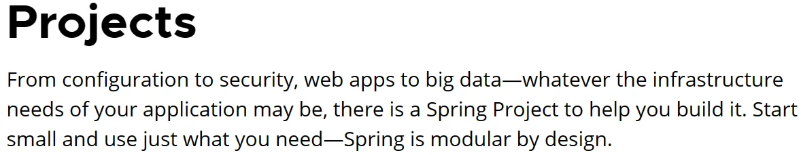

从配置到安全，从Web应用程序到大数据--无论您的应用程序的基础架构需求是什么，都有一个Spring Project可以帮助您构建它。从小处着手，只使用你需要的东西--Spring是模块化设计的。


这些技术并不是所有的都需要学习，额外需要重点关注`Spring Framework`、`SpringBoot`和`SpringCloud`:


* Spring Framework：Spring框架，是Spring中最早最核心的技术，也是所有其他技术的基础。
* SpringBoot：Spring是来简化开发，而SpringBoot是来帮助Spring在简化的基础上能更快速进行开发。
* SpringCloud：这个是用来做分布式之微服务架构的相关开发。

## Spring Framework系统架构图

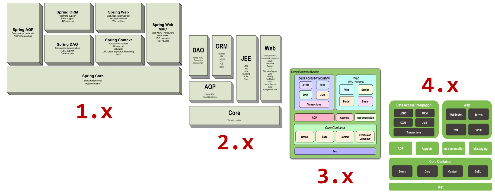

Spring Framework的5版本目前没有最新的架构图，而最新的是4版本，所以接下来主要研究的是4的架构图

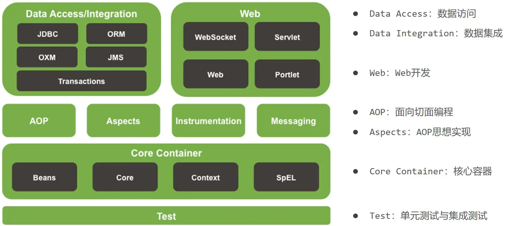

(1)核心层

* Core Container:核心容器，这个模块是Spring最核心的模块，其他的都需要依赖该模块

(2)AOP层

* AOP:面向切面编程，它依赖核心层容器，目的是在不改变原有代码的前提下对其进行功能增强
* Aspects:AOP是思想,Aspects是对AOP思想的具体实现

(3)数据层

* Data Access:数据访问，Spring全家桶中有对数据访问的具体实现技术
* Data Integration:数据集成，Spring支持整合其他的数据层解决方案，比如Mybatis
* Transactions:事务，Spring中事务管理是Spring AOP的一个具体实现，也是后期学习的重点内容

(4)Web层

* 这一层的内容将在SpringMVC框架具体学习

(5)Test层

* Spring主要整合了Junit来完成单元测试和集成测试

## Spring核心概念

### IOC和DI

#### `IOC（Inversion of Control）`控制反转

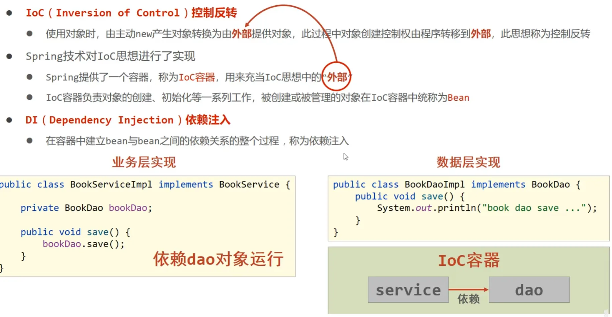

(1)、什么是控制反转呢？

* 使用对象时，由主动new产生对象转换为由`外部`提供对象，此过程中对象创建控制权由程序转移到外部，此思想称为控制反转。
  * 业务层要用数据层的类对象，以前是自己`new`的
  * 现在自己不new了，交给`别人[外部]`来创建对象
  * `别人[外部]`就反转控制了数据层对象的创建权
  * 这种思想就是控制反转

(2)、Spring和IOC之间的关系是什么呢?

* Spring技术对IOC思想进行了实现
* Spring提供了一个容器，称为IOC容器，用来充当IOC思想中的"外部"
* IOC思想中的`别人[外部]`指的就是Spring的IOC容器

(3)、IOC容器的作用以及内部存放的是什么?

* IOC容器负责对象的创建、初始化等一系列工作，其中包含了数据层和业务层的类对象
* 被创建或被管理的对象在IOC容器中统称为Bean
* IOC容器中放的就是一个个的Bean对象

(4)、当IOC容器中创建好service和dao对象后，程序能正确执行么?

* 不行，因为service运行需要依赖dao对象
* IOC容器中虽然有service和dao对象
* 但是service对象和dao对象没有任何关系
* 需要把dao对象交给service,也就是说要绑定service和dao对象之间的关系

#### `DI（Dependency Injection）`依赖注入

(1)什么是依赖注入呢?

* 在容器中建立bean与bean之间的依赖关系的整个过程，称为依赖注入
  * 业务层要用数据层的类对象，以前是自己`new`的
  * 现在自己不new了，靠`别人[外部其实指的就是IOC容器]`来给注入进来
  * 这种思想就是依赖注入

(2)IOC容器中哪些bean之间要建立依赖关系呢?

* 这个需要程序员根据业务需求提前建立好关系，如业务层需要依赖数据层，service就要和dao建立依赖关系

介绍完Spring的IOC和DI的概念后，我们会发现这两个概念的最终目标就是:`充分解耦`，具体实现靠:

* 使用IOC容器管理bean（IOC)
* 在IOC容器内将有依赖关系的bean进行关系绑定（DI）
* 最终结果为:使用对象时不仅可以直接从IOC容器中获取，并且获取到的bean已经绑定了所有的依赖关系.

#### 核心概念小结

这节比较重要，重点要理解`什么是IOC/DI思想`、`什么是IOC容器`和`什么是Bean`：

(1)什么IOC/DI思想?

* IOC:控制反转，控制反转的是对象的创建权
* DI:依赖注入，绑定对象与对象之间的依赖关系

(2)什么是IOC容器?

Spring创建了一个容器用来存放所创建的对象，这个容器就叫IOC容器

(3)什么是Bean?

容器中所存放的一个个对象就叫Bean或Bean对象

#### `IOC`入门案例代码实现

1、在`pom.xml`中 导入坐标

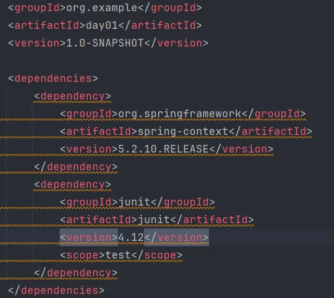

2、添加类文件

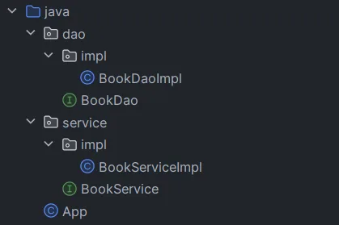

```java
//BookDaoImpl
public class BookDaoImpl implements BookDao {
    public void save() {
        System.out.println("book dao save ...");
    }
}
//BookDao
public interface BookDao {
    public void save();
}
//BookServiceImpl
public class BookServiceImpl implements BookService {
    //5.删除业务层中使用new的方式创建的dao对象
    private BookDao bookDao = new BookDaoImpl();
    public void save() {
        System.out.println("book service save ...");
        bookDao.save();
    }
}
//BookService
public interface BookService {
    public void save();
}
//App
public class App {
    public static void main(String[] args) {
        BookService bookService = new BookServiceImpl();
        bookService.save();
    }
}
```

3、添加配置文件


```xml
<?xml version="1.0" encoding="UTF-8"?>
<beans xmlns="http://www.springframework.org/schema/beans"
       xmlns:xsi="http://www.w3.org/2001/XMLSchema-instance"
       xsi:schemaLocation="http://www.springframework.org/schema/beans http://www.springframework.org/schema/beans/spring-beans.xsd">
    <!--bean标签标示配置bean id属性标示给bean起名字 class属性表示给bean定义类型-->
    <bean id="bookDao" class="dao.impl.BookDaoImpl">

    </bean>
    <bean id="bookService" class="service.impl.BookServiceImpl">
        
    </bean>
</beans>
```

**注意事项：bean定义时id属性在同一个上下文中(配置文件)不能重复**

4、获取IOC容器

新建一个App2的类。

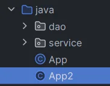

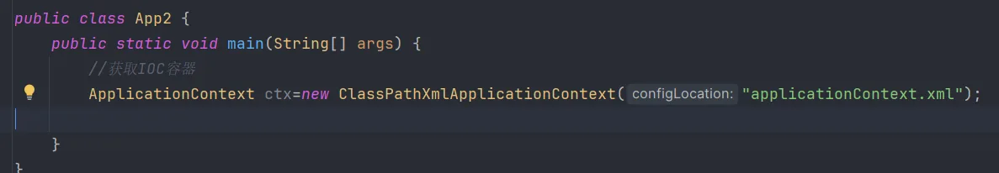

```java
public class App2 {
    public static void main(String[] args) {
        //获取IOC容器
        ApplicationContext ctx=new ClassPathXmlApplicationContext("applicationContext.xml");
    }
}

```

5、获取Bean，并调用

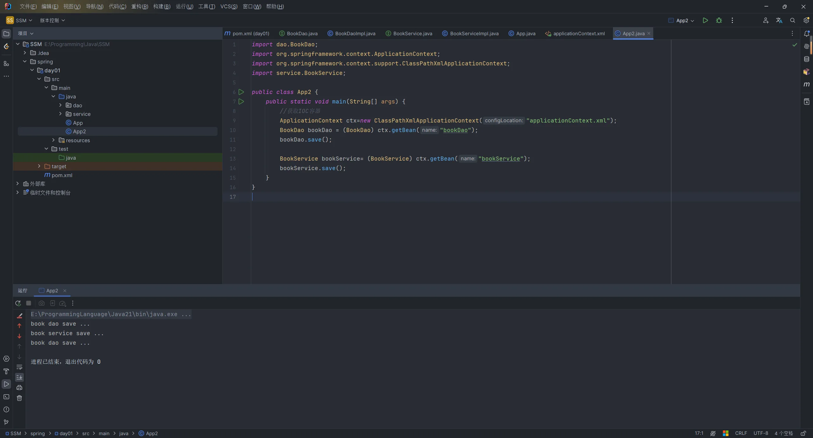

```java
public class App2 {
    public static void main(String[] args) {
        //获取IOC容器
        ApplicationContext ctx=new ClassPathXmlApplicationContext("applicationContext.xml");
        
        BookDao bookDao = (BookDao) ctx.getBean("bookDao");
        bookDao.save();
        
        BookService bookService= (BookService) ctx.getBean("bookService");
        bookService.save();
    }
}
```

#### `DI`入门案例代码实现

1、删除业务层中用`new`创建的语句

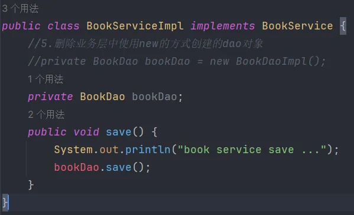

2、生成setter方法

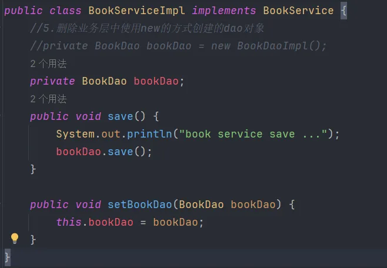

3、配置相关关系

在`applicationContext.xml`中修改代码。

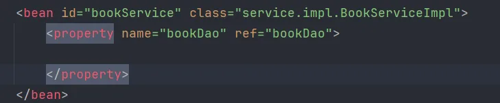

```xml
        <!--配置server与dao的关系-->
        <!--property标签表示配置当前bean的属性
        		name属性表示配置哪一个具体的属性
        		ref属性表示参照哪一个bean-->         
	<bean id="bookService" class="service.impl.BookServiceImpl">
        <property name="bookDao" ref="bookDao">

        </property>
    </bean>
```

注意:配置中的两个bookDao的含义是不一样的

* name="bookDao"中`bookDao`的作用是让Spring的IOC容器在获取到名称后，将首字母大写，前面加set找对应的`setBookDao()`方法进行对象注入
* ref="bookDao"中`bookDao`的作用是让Spring能在IOC容器中找到id为`bookDao`的Bean对象给`bookService`进行注入
* 综上所述，对应关系如下:

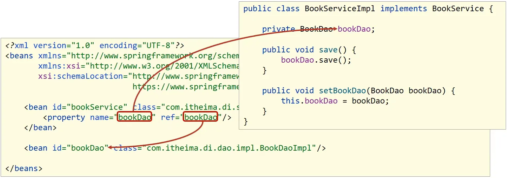

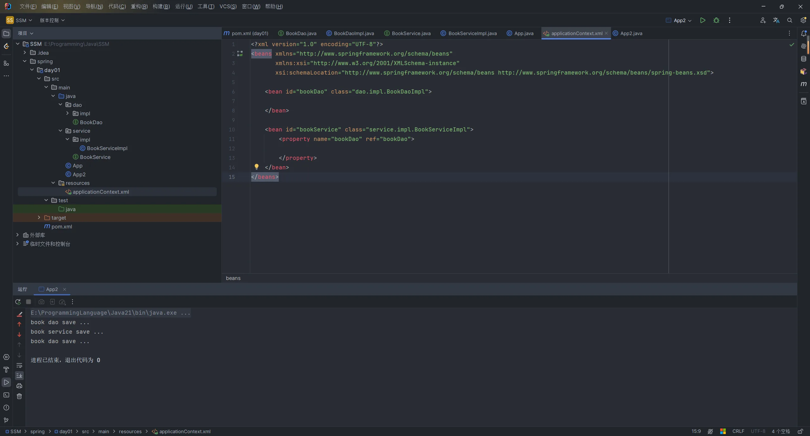

## `IOC`相关内容

### `bean`基础配置

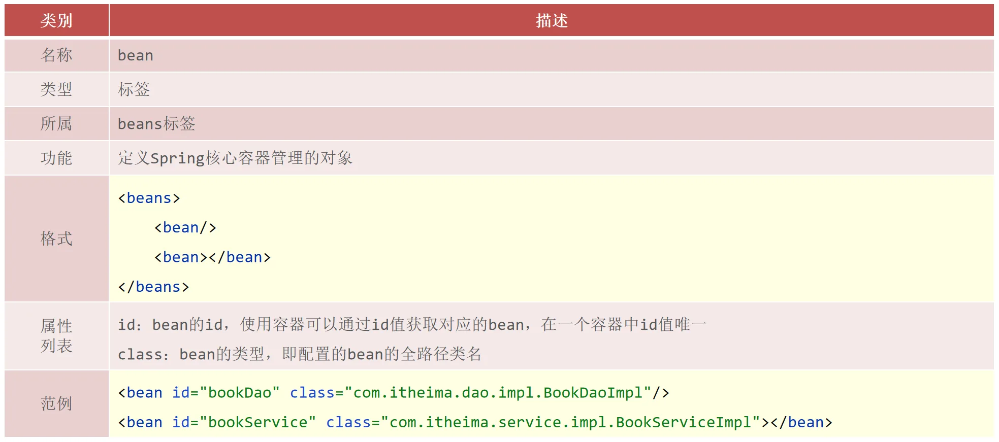

* class属性能不能写接口如`BookDao`的类全名呢?

答案肯定是不行，因为接口是没办法创建对象的。

* 前面提过为bean设置id时，id必须唯一，但是如果由于命名习惯而产生了分歧后，该如何解决?

#### `name`属性

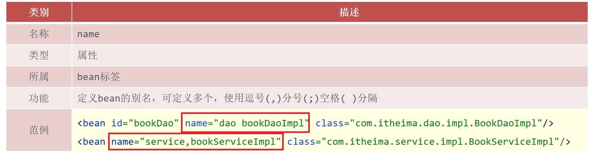

1、配置别名

打开spring的配置文件applicationContext.xml

```xml
	<!--name:为bean指定别名，别名可以有多个，使用逗号，分号，空格进行分隔-->
    <bean id="bookService" name="service service4 bookEbi" class="com.itheima.service.impl.BookServiceImpl">
        <property name="bookDao" ref="bookDao"/>
    </bean>
    <!--scope：为bean设置作用范围，可选值为单例singloton，非单例prototype-->
    <bean id="bookDao" name="dao" class="com.itheima.dao.impl.BookDaoImpl"/>
```

**说明:Ebi全称Enterprise Business Interface，翻译为企业业务接口**

2、根据名称容器中获取bean对象

```java
public class AppForName {
    public static void main(String[] args) {
        ApplicationContext ctx = new ClassPathXmlApplicationContext("applicationContext.xml");
        //此处根据bean标签的id属性和name属性的任意一个值来获取bean对象
        BookService bookService = (BookService) ctx.getBean("service4");
        bookService.save();
    }
}
```

####  `bean`作用范围`scope`配置

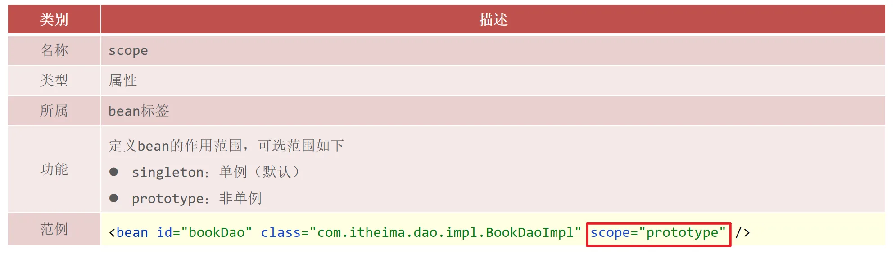

##### 验证IOC容器中对象是否为单例

具体实现

* 创建一个AppForScope的类，在其main方法中来验证

  ```java
  public class AppForScope {
      public static void main(String[] args) {
          ApplicationContext ctx = new 
              ClassPathXmlApplicationContext("applicationContext.xml");
          
          BookDao bookDao1 = (BookDao) ctx.getBean("bookDao");
          BookDao bookDao2 = (BookDao) ctx.getBean("bookDao");
          
          System.out.println(bookDao1);
          System.out.println(bookDao2);
      }
  }
  ```

* 打印，观察控制台的打印结果

  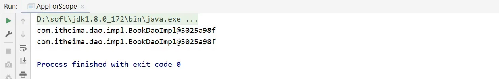

* 结论:默认情况下，Spring创建的bean对象都是单例的

##### 配置bean为非单例

在Spring配置文件中，配置scope属性来实现bean的非单例创建

* 在Spring的配置文件中，修改`<bean>`的scope属性

  ```xml
  <bean id="bookDao" name="dao" class="com.itheima.dao.impl.BookDaoImpl" scope=""/>
  ```

* 将scope设置为`singleton`

  ```xml
  <bean id="bookDao" name="dao" class="com.itheima.dao.impl.BookDaoImpl" scope="singleton"/>
  ```

  运行AppForScope，打印看结果

  

* 将scope设置为`prototype`

  ```java
  <bean id="bookDao" name="dao" class="com.itheima.dao.impl.BookDaoImpl" scope="prototype"/>
  ```

  运行AppForScope，打印看结果

  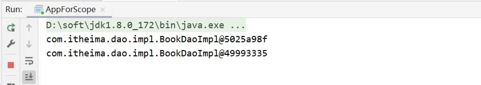

* 结论，使用bean的`scope`属性可以控制bean的创建是否为单例：

  * `singleton`默认为单例
  * `prototype`为非单例

##### scope使用后续思考

介绍完`scope`属性以后，我们来思考几个问题:

* 为什么bean默认为单例?

  * bean为单例的意思是在Spring的IOC容器中只会有该类的一个对象
  * bean对象只有一个就避免了对象的频繁创建与销毁，达到了bean对象的复用，性能高

* bean在容器中是单例的，会不会产生线程安全问题?

  * 如果对象是有状态对象，即该对象有成员变量可以用来存储数据的，
  * 因为所有请求线程共用一个bean对象，所以会存在线程安全问题。
  * 如果对象是无状态对象，即该对象没有成员变量没有进行数据存储的，
  * 因方法中的局部变量在方法调用完成后会被销毁，所以不会存在线程安全问题。

* 哪些bean对象适合交给容器进行管理?

  表现层对象、业务层对象、数据层对象、工具对象

* 哪些bean对象不适合交给容器进行管理?

  * 封装实例的域对象，因为会引发线程安全问题，所以不适合。

### Bean的实例化

#### 1、构造方法

1、准备需要被创建的类

准备一个BookDao和BookDaoImpl类

```java
public interface BookDao {
    public void save();
}
public class BookDaoImpl implements BookDao {
    public void save() {
        System.out.println("book dao save ...");
    }
}
```

2、将类配置到Spring容器

```xml
<?xml version="1.0" encoding="UTF-8"?>
<beans xmlns="http://www.springframework.org/schema/beans"
       xmlns:xsi="http://www.w3.org/2001/XMLSchema-instance"
       xsi:schemaLocation="http://www.springframework.org/schema/beans http://www.springframework.org/schema/beans/spring-beans.xsd">
	<bean id="bookDao" class="com.itheima.dao.impl.BookDaoImpl"/>
</beans>
```

3、编写运行程序

```java
public class AppForInstanceBook {
    public static void main(String[] args) {
        ApplicationContext ctx = new 
            ClassPathXmlApplicationContext("applicationContext.xml");
        BookDao bookDao = (BookDao) ctx.getBean("bookDao");
        bookDao.save();
    }
}
```

4、类中提供构造函数测试

在BookDaoImpl类中添加一个无参构造函数，并打印一句话，方便观察结果。

```java
public class BookDaoImpl implements BookDao {
    public BookDaoImpl() {
        System.out.println("book dao constructor is running ....");
    }
    public void save() {
        System.out.println("book dao save ...");
    }
}
```

运行程序，如果控制台有打印构造函数中的输出，说明Spring容器在创建对象的时候也走的是构造函数

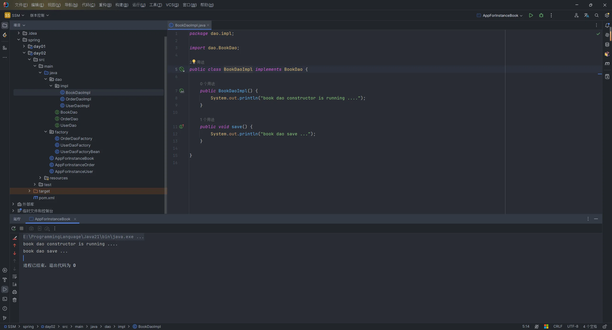

将构造函数改成private测试仍能执行成功，说明内部走的依然是构造函数，能访问到类中的私有构造方法，显而易见Spring底层用的是反射。

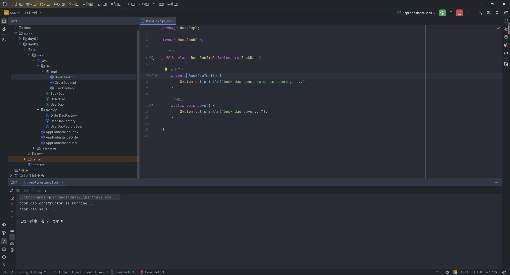

构造函数中添加一个参数测试，程序会报错，说明Spring底层使用的是类的无参构造方法。

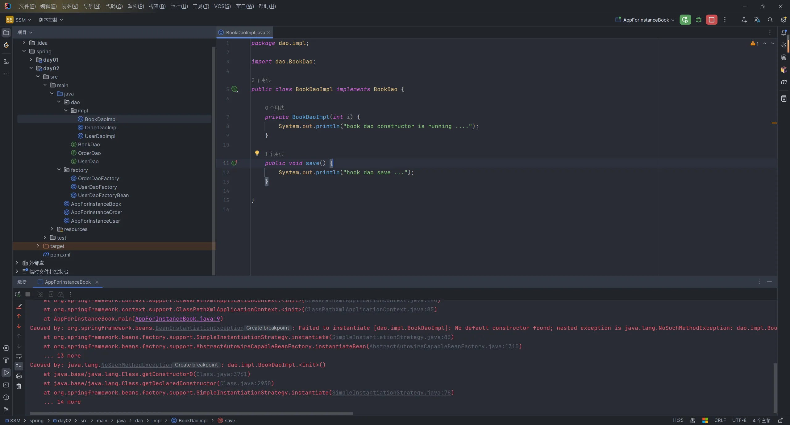

#### 2、静态工厂

1、准备一个OrderDao和OrderDaoImpl类

```java
public interface OrderDao {
    public void save();
}

public class OrderDaoImpl implements OrderDao {
    public void save() {
        System.out.println("order dao save ...");
    }
}
```

2、创建一个工厂类OrderDaoFactory并提供一个静态方法

```java
//静态工厂创建对象
public class OrderDaoFactory {
    public static OrderDao getOrderDao(){
        return new OrderDaoImpl();
    }
}
```

3、编写AppForInstanceOrder运行类，在类中通过工厂获取对象

```java
public class AppForInstanceOrder {
    public static void main(String[] args) {
        //通过静态工厂创建对象
        OrderDao orderDao = OrderDaoFactory.getOrderDao();
        orderDao.save();
    }
}
```

4、添加配置

在spring的配置文件application.properties中添加以下内容:

```xml
<bean id="orderDao" class="com.itheima.factory.OrderDaoFactory" factory-method="getOrderDao"/>
```

class:工厂类的类全名

factory-mehod:具体工厂类中创建对象的方法名

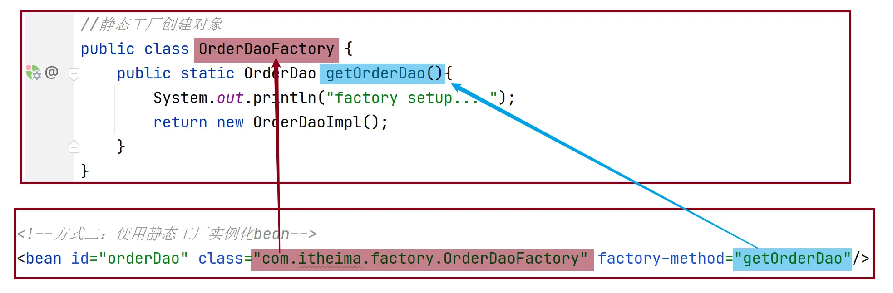

5、运行后，可以查看到结果

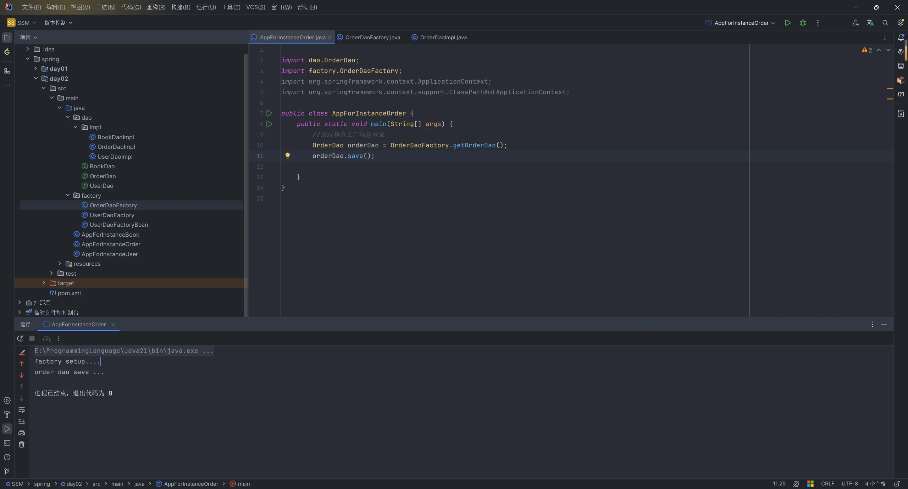

#### 3、实例工厂

1、准备一个UserDao和UserDaoImpl类

```java
public interface UserDao {
    public void save();
}

public class UserDaoImpl implements UserDao {
    public void save() {
        System.out.println("user dao save ...");
    }
}
```

2、创建一个工厂类OrderDaoFactory并提供一个普通方法，注意此处和静态工厂的工厂类不一样的地方是方法不是静态方法

```java
public class UserDaoFactory {
    public UserDao getUserDao(){
        return new UserDaoImpl();
    }
}
```

3、编写AppForInstanceUser运行类，在类中通过工厂获取对象

```java
public class AppForInstanceUser {
    public static void main(String[] args) {
        //创建实例工厂对象
        UserDaoFactory userDaoFactory = new UserDaoFactory();
        //通过实例工厂对象创建对象
        UserDao userDao = userDaoFactory.getUserDao();
        userDao.save();
}
```

4、配置

1)在spring的配置文件中添加以下内容:

```xml
<bean id="userFactory" class="com.itheima.factory.UserDaoFactory"/>
<bean id="userDao" factory-method="getUserDao" factory-bean="userFactory"/>
```

实例化工厂运行的顺序是:

* 创建实例化工厂对象,对应的是第一行配置

* 调用对象中的方法来创建bean，对应的是第二行配置

  * factory-bean:工厂的实例对象

  * factory-method:工厂对象中的具体创建对象的方法名,对应关系如下:

    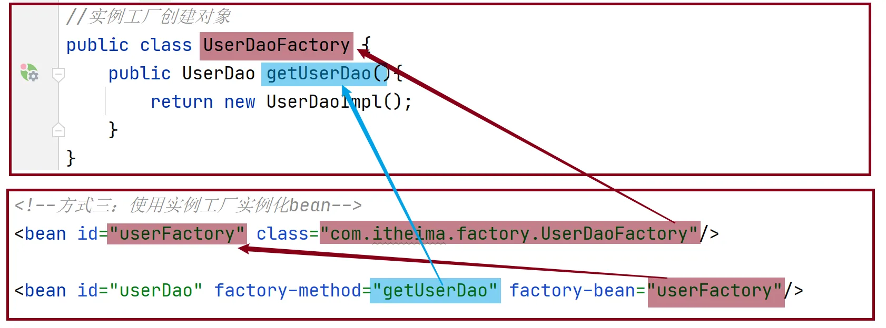

factory-mehod:具体工厂类中创建对象的方法名

4、运行后，可以查看到结果

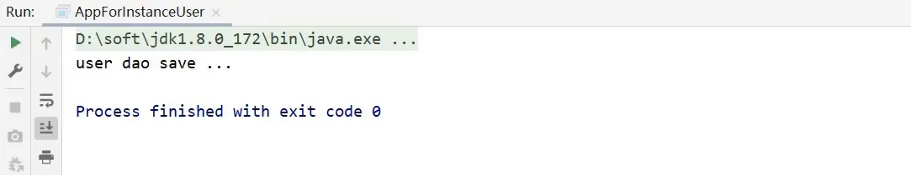

#### 4、`FactoryBean`的使用

1、创建一个UserDaoFactoryBean的类，实现FactoryBean接口，重写接口的方法

```java
public class UserDaoFactoryBean implements FactoryBean<UserDao> {
    //代替原始实例工厂中创建对象的方法
    public UserDao getObject() throws Exception {
        return new UserDaoImpl();
    }
    //返回所创建类的Class对象
    public Class<?> getObjectType() {
        return UserDao.class;
    }
}
```

2、在Spring的配置文件中进行配置

```xml
<bean id="userDao" class="com.itheima.factory.UserDaoFactoryBean"/>
```

3、AppForInstanceUser运行类不用做任何修改，直接运行


这种方式在Spring去整合其他框架的时候会被用到，所以这种方式需要大家理解掌握。

查看源码会发现，FactoryBean接口其实会有三个方法，分别是:

```java
T getObject() throws Exception;

Class<?> getObjectType();

default boolean isSingleton() {
		return true;
}
```

方法一:getObject()，被重写后，在方法中进行对象的创建并返回

方法二:getObjectType(),被重写后，主要返回的是被创建类的Class对象

方法三:没有被重写，因为它已经给了默认值，从方法名中可以看出其作用是设置对象是否为单例，默认true。改为false则会创建非单例数据。

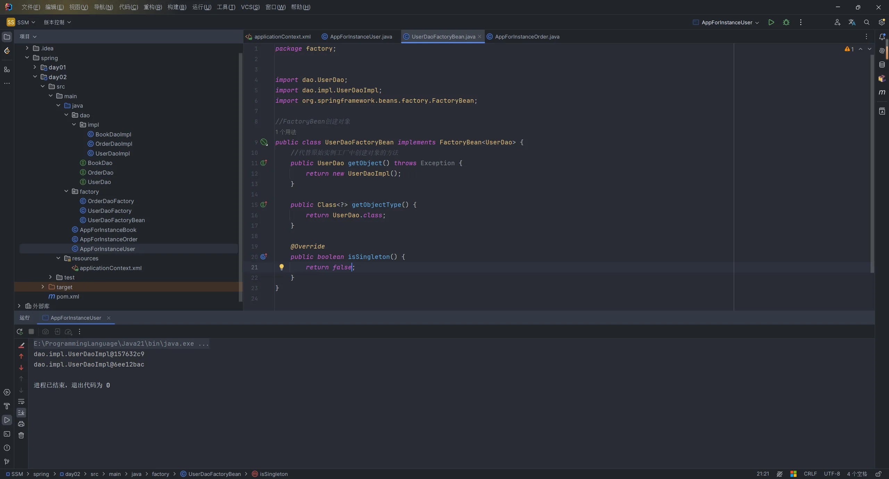

### Bean的生命周期

关于bean的相关知识还有最后一个是`bean的生命周期`,对于生命周期，我们主要围绕着`bean生命周期控制`来讲解:

* 首先理解下什么是生命周期?
  * 从创建到消亡的完整过程,例如人从出生到死亡的整个过程就是一个生命周期。
* bean生命周期是什么?
  * bean对象从创建到销毁的整体过程。
* bean生命周期控制是什么?
  * 在bean创建后到销毁前做一些事情。

1、添加初始化和销毁方法

针对这两个阶段，我们在BooDaoImpl类中分别添加两个方法，方法名任意

```java
public class BookDaoImpl implements BookDao {
    public void save() {
        System.out.println("book dao save ...");
    }
    //表示bean初始化对应的操作
    public void init(){
        System.out.println("init...");
    }
    //表示bean销毁前对应的操作
    public void destory(){
        System.out.println("destory...");
    }
}
```

2、配置生命周期

在配置文件添加配置，如下:

```xml
<bean id="bookDao" class="com.itheima.dao.impl.BookDaoImpl" init-method="init" destroy-method="destory"/>
```

3、运行程序

运行AppForLifeCycle打印结果为:

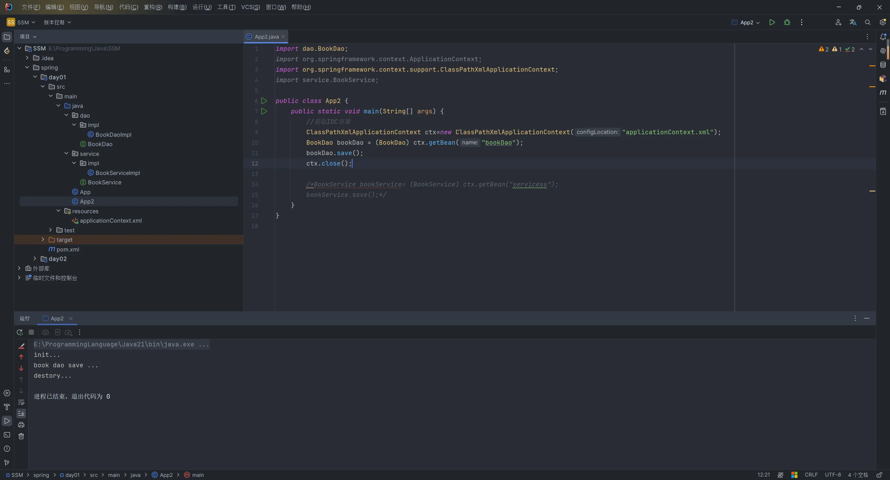

注意事项：

* Spring的IOC容器是运行在JVM中
* 运行main方法后,JVM启动,Spring加载配置文件生成IOC容器,从容器获取bean对象，然后调方法执行
* main方法执行完后，JVM退出，这个时候IOC容器中的bean还没有来得及销毁就已经结束了
* 所以不会调用对应的destroy方法

方式：

```java
//close关闭容器 
//1、ApplicationContext中没有close方法需要将ApplicationContext更换成ClassPathXmlApplicationContext
ClassPathXmlApplicationContext ctx = new 
    ClassPathXmlApplicationContext("applicationContext.xml");
ctx.close();

//2、使用ctx.registerShutdownHook();
ctx.registerShutdownHook();
```

分析上面的实现过程，会发现添加初始化和销毁方法，即需要编码也需要配置，实现起来步骤比较多也比较乱。

#### Spring实现

Spring提供了两个接口来完成生命周期的控制，好处是可以不用再进行配置`init-method`和`destroy-method`

接下来在BookServiceImpl完成这两个接口的使用:

修改BookServiceImpl类，添加两个接口`InitializingBean`， `DisposableBean`并实现接口中的两个方法`afterPropertiesSet`和`destroy`

```java
public class BookServiceImpl implements BookService, InitializingBean, DisposableBean {
    private BookDao bookDao;
    public void setBookDao(BookDao bookDao) {
        this.bookDao = bookDao;
    }
    public void save() {
        System.out.println("book service save ...");
        bookDao.save(); 
    }
    public void destroy() throws Exception {
        System.out.println("service destroy");
    }
    public void afterPropertiesSet() throws Exception {
        System.out.println("service init");
    }
}
```

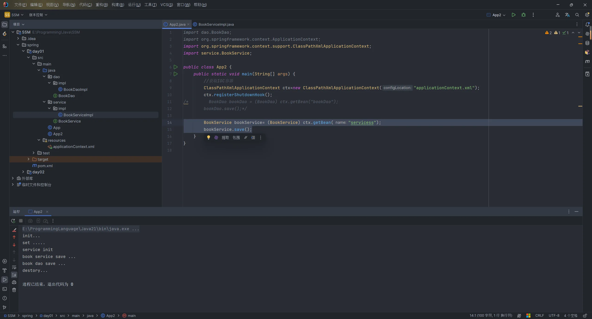

**小细节**

* 对于InitializingBean接口中的afterPropertiesSet方法，翻译过来为`属性设置之后`。
* 对于BookServiceImpl来说，bookDao是它的一个属性
* setBookDao方法是Spring的IOC容器为其注入属性的方法，所以setBookDao先于afterPropertiesSet执行

#### bean生命周期小结

(1)关于Spring中对bean生命周期控制提供了两种方式:

* 在配置文件中的bean标签中添加`init-method`和`destroy-method`属性
* 类实现`InitializingBean`与`DisposableBean`接口，这种方式了解下即可。

(2)对于bean的生命周期控制在bean的整个生命周期中所处的位置如下:

* 初始化容器
  * 1.创建对象(内存分配)
  * 2.执行构造方法
  * 3.执行属性注入(set操作)
  * 4.执行bean初始化方法
* 使用bean
  * 1.执行业务操作
* 关闭/销毁容器
  * 1.执行bean销毁方法

(3)关闭容器的两种方式:

* ConfigurableApplicationContext是ApplicationContext的子类
  * close()方法
  * registerShutdownHook()方法

## DI相关内容

接下来就进入第二个大的模块`DI依赖注入`，首先来介绍下Spring中的注入方式：

* 向一个类中传递数据的方式有几种?
  * 普通方法(set方法)
  * 构造方法
* 依赖注入描述了在容器中建立bean与bean之间的依赖关系的过程，如果bean运行需要的是数字或字符串呢?
  * 引用类型
  * 简单类型(基本数据类型与String)

Spring就是基于上面这些知识点，为我们提供了两种注入方式，分别是:

* setter注入
  * 简单类型
  * 引用类型
* 构造器注入
  * 简单类型
  * 引用类型

### `setter`注入

#### 引用数据类型

1、声明属性并提供setter方法

在BookServiceImpl中声明userDao属性，并提供setter方法

```java
public class BookServiceImpl implements BookService{
    private BookDao bookDao;
    private UserDao userDao;
    public void setUserDao(UserDao userDao) {
        this.userDao = userDao;
    }
    public void setBookDao(BookDao bookDao) {
        this.bookDao = bookDao;
    }
    public void save() {
        System.out.println("book service save ...");
        bookDao.save();
        userDao.save();
    }
}
```

2、配置文件中进行注入配置

在applicationContext.xml配置文件中使用property标签注入

```xml
	<bean id="bookDao" class="com.itheima.dao.impl.BookDaoImpl"/>
    <bean id="userDao" class="com.itheima.dao.impl.UserDaoImpl"/>
    <bean id="bookService" class="com.itheima.service.impl.BookServiceImpl">
        <property name="bookDao" ref="bookDao"/>
        <property name="userDao" ref="userDao"/>
    </bean>
```

3、运行程序

运行AppForDISet类，查看结果，说明userDao已经成功注入。

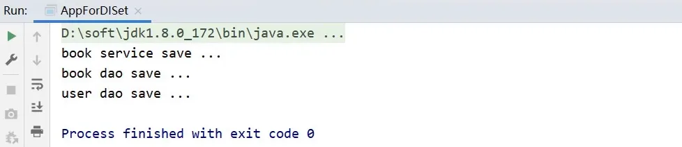

#### 基本数据类型

1、声明属性并提供setter方法

在BookDaoImpl类中声明对应的简单数据类型的属性,并提供对应的setter方法

```java
public class BookDaoImpl implements BookDao {
    private String databaseName;
    private int connectionNum;
    
    public void setConnectionNum(int connectionNum) {
        this.connectionNum = connectionNum;
    }
    public void setDatabaseName(String databaseName) {
        this.databaseName = databaseName;
    }
    public void save() {
        System.out.println("book dao save ..."+databaseName+","+connectionNum);
    }
}
```

2、配置文件中进行注入配置

在applicationContext.xml配置文件中使用property标签注入

```xml
	<bean id="bookDao" class="com.itheima.dao.impl.BookDaoImpl">
        <property name="databaseName" value="mysql"/>
     	<property name="connectionNum" value="10"/>
    </bean>
    <bean id="userDao" class="com.itheima.dao.impl.UserDaoImpl"/>
    <bean id="bookService" class="com.itheima.service.impl.BookServiceImpl">
        <property name="bookDao" ref="bookDao"/>
        <property name="userDao" ref="userDao"/>
    </bean>
```

**说明:**

value:后面跟的是简单数据类型，对于参数类型，Spring在注入的时候会自动转换，但是不能写成

```xml
<property name="connectionNum" value="abc"/>
```

这样的话，spring在将`abc`转换成int类型的时候就会报错。

3、运行程序

运行AppForDISet类，查看结果，说明userDao已经成功注入。

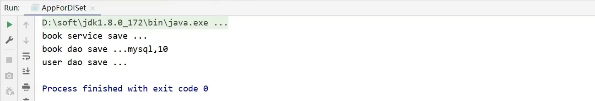

**注意:**两个property注入标签的顺序可以任意。

对于setter注入方式的基本使用就已经介绍完了，

* 对于引用数据类型使用的是`<property name="" ref=""/>`
* 对于简单数据类型使用的是`<property name="" value=""/>`

### 构造器注入

#### 引用数据类型

1、删除setter方法并提供构造方法

在BookServiceImpl类中将bookDao的setter方法删除掉,并添加带有bookDao参数的构造方法

```java
public class BookServiceImpl implements BookService{
    private BookDao bookDao;

    public BookServiceImpl(BookDao bookDao) {
        this.bookDao = bookDao;
    }

    public void save() {
        System.out.println("book service save ...");
        bookDao.save();
    }
}
```

2、配置文件中进行配置构造方式注入

在applicationContext.xml中配置

```xml
	<bean id="bookDao" class="com.itheima.dao.impl.BookDaoImpl"/>
    <bean id="bookService" class="com.itheima.service.impl.BookServiceImpl">
        <constructor-arg name="bookDao" ref="bookDao"/>
    </bean>
```

**说明:**

标签<constructor-arg>中

* name属性对应的值为构造函数中方法**`形参`**的参数名，必须要保持一致。

* ref属性指向的是spring的IOC容器中其他bean对象。

步骤3：运行程序

运行AppForDIConstructor类，查看结果，说明bookDao已经成功注入。

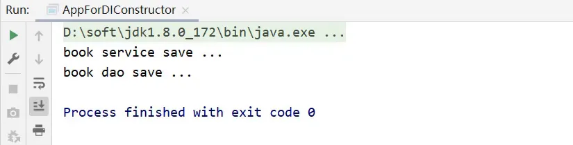

#### 多个引用数据类型

1、提供多个属性的构造函数

在BookServiceImpl声明userDao并提供多个参数的构造函数

```java
public class BookServiceImpl implements BookService{
    private BookDao bookDao;
    private UserDao userDao;

    public BookServiceImpl(BookDao bookDao,UserDao userDao) {
        this.bookDao = bookDao;
        this.userDao = userDao;
    }

    public void save() {
        System.out.println("book service save ...");
        bookDao.save();
        userDao.save();
    }
}
```

2、配置文件中配置多参数注入

在applicationContext.xml中配置注入

```xml
	<bean id="bookDao" class="com.itheima.dao.impl.BookDaoImpl"/>
    <bean id="userDao" class="com.itheima.dao.impl.UserDaoImpl"/>
    <bean id="bookService" class="com.itheima.service.impl.BookServiceImpl">
        <constructor-arg name="bookDao" ref="bookDao"/>
        <constructor-arg name="userDao" ref="userDao"/>
    </bean>
```

**说明:**这两个`<contructor-arg>`的配置顺序可以任意

3、运行程序

运行AppForDIConstructor类，查看结果，说明userDao已经成功注入。

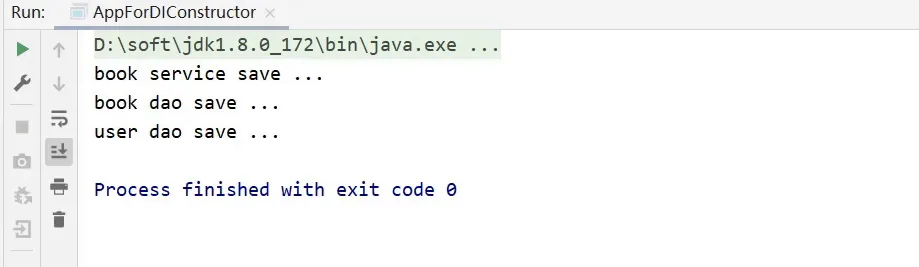

#### 多个简单数据类型

1、添加多个简单属性并提供构造方法

修改BookDaoImpl类，添加构造方法

```java
public class BookDaoImpl implements BookDao {
    private String databaseName;
    private int connectionNum;

    public BookDaoImpl(String databaseName, int connectionNum) {
        this.databaseName = databaseName;
        this.connectionNum = connectionNum;
    }

    public void save() {
        System.out.println("book dao save ..."+databaseName+","+connectionNum);
    }
}
```

2、配置完成多个属性构造器注入

在applicationContext.xml中进行注入配置

```xml
	<bean id="bookDao" class="com.itheima.dao.impl.BookDaoImpl">
        <constructor-arg name="databaseName" value="mysql"/>
        <constructor-arg name="connectionNum" value="666"/>
    </bean>
    <bean id="userDao" class="com.itheima.dao.impl.UserDaoImpl"/>
    <bean id="bookService" class="com.itheima.service.impl.BookServiceImpl">
        <constructor-arg name="bookDao" ref="bookDao"/>
        <constructor-arg name="userDao" ref="userDao"/>
    </bean>
```

**说明:**这两个`<contructor-arg>`的配置顺序可以任意

3、运行程序

运行AppForDIConstructor类，查看结果

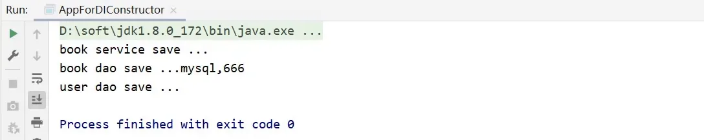

上面已经完成了构造函数注入的基本使用，但是会存在一些问题:

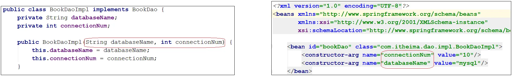

* 当构造函数中方法的参数名发生变化后，配置文件中的name属性也需要跟着变
* 这两块存在紧耦合，具体该如何解决?

在解决这个问题之前，需要提前说明的是，这个参数名发生变化的情况并不多，所以上面的还是比较主流的配置方式，下面介绍的，大家都以了解为主。

**方式一**:删除name属性，添加type属性，按照类型注入

```xml
<bean id="bookDao" class="com.itheima.dao.impl.BookDaoImpl">
    <constructor-arg type="int" value="10"/>
    <constructor-arg type="java.lang.String" value="mysql"/>
</bean>
```

* 这种方式可以解决构造函数形参名发生变化带来的耦合问题
* 但是如果构造方法参数中有类型相同的参数，这种方式就不太好实现了

**方式二**:删除type属性，添加index属性，按照索引下标注入，下标从0开始

```xml
<bean id="bookDao" class="com.itheima.dao.impl.BookDaoImpl">
    <constructor-arg index="1" value="100"/>
    <constructor-arg index="0" value="mysql"/>
</bean>
```

* 这种方式可以解决参数类型重复问题
* 但是如果构造方法参数顺序发生变化后，这种方式又带来了耦合问题

介绍完两种参数的注入方式，具体我们该如何选择呢?

1. 强制依赖使用构造器进行，使用setter注入有概率不进行注入导致null对象出现
   * 强制依赖指对象在创建的过程中必须要注入指定的参数
2. 可选依赖使用setter注入进行，灵活性强
   * 可选依赖指对象在创建过程中注入的参数可有可无
3. Spring框架倡导使用构造器，第三方框架内部大多数采用构造器注入的形式进行数据初始化，相对严谨
4. 如果有必要可以两者同时使用，使用构造器注入完成强制依赖的注入，使用setter注入完成可选依赖的注入
5. 实际开发过程中还要根据实际情况分析，如果受控对象没有提供setter方法就必须使用构造器注入
6. **自己开发的模块推荐使用setter注入**

这节中主要讲解的是Spring的依赖注入的实现方式:

* setter注入

  * 简单数据类型

    ```xml
    <bean ...>
    	<property name="" value=""/>
    </bean>
    ```

  * 引用数据类型

    ```xml
    <bean ...>
    	<property name="" ref=""/>
    </bean>
    ```

* 构造器注入

  * 简单数据类型

    ```xml
    <bean ...>
    	<constructor-arg name="" index="" type="" value=""/>
    </bean>
    ```

  * 引用数据类型

    ```xml
    <bean ...>
    	<constructor-arg name="" index="" type="" ref=""/>
    </bean>
    ```

* 依赖注入的方式选择上

  * 建议使用setter注入
  * 第三方技术根据情况选择

## 自动装配

### 什么是依赖自动装配?

* IoC容器根据bean所依赖的资源在容器中自动查找并注入到bean中的过程称为自动装配

### 自动装配方式有哪些?

* 按类型（常用）
* 按名称
* 按构造方法
* 不启用自动装配

### 完成自动装配的配置

自动装配只需要修改applicationContext.xml配置文件即可:

1、将`<property>`标签删除

2、在`<bean>`标签中添加autowire属性

首先来实现按照类型注入的配置

```xml
<?xml version="1.0" encoding="UTF-8"?>
<beans xmlns="http://www.springframework.org/schema/beans"
       xmlns:xsi="http://www.w3.org/2001/XMLSchema-instance"
       xsi:schemaLocation="http://www.springframework.org/schema/beans http://www.springframework.org/schema/beans/spring-beans.xsd">

    <bean class="com.itheima.dao.impl.BookDaoImpl"/>
    <!--autowire属性：开启自动装配，通常使用按类型装配-->
    <bean id="bookService" class="com.itheima.service.impl.BookServiceImpl" autowire="byType"/>

</beans>
```

注意事项:

* 需要注入属性的类中对应属性的setter方法不能省略
* 被注入的对象必须要被Spring的IOC容器管理
* 按照类型在Spring的IOC容器中如果找到多个对象，会报`NoUniqueBeanDefinitionException`

一个类型在IOC中有多个对象，还想要注入成功，这个时候就需要按照名称注入，配置方式为:

```xml
<?xml version="1.0" encoding="UTF-8"?>
<beans xmlns="http://www.springframework.org/schema/beans"
       xmlns:xsi="http://www.w3.org/2001/XMLSchema-instance"
       xsi:schemaLocation="http://www.springframework.org/schema/beans http://www.springframework.org/schema/beans/spring-beans.xsd">

    <bean class="com.itheima.dao.impl.BookDaoImpl"/>
    <!--autowire属性：开启自动装配，通常使用按类型装配-->
    <bean id="bookService" class="com.itheima.service.impl.BookServiceImpl" autowire="byName"/>

</beans>
```

注意事项:

* 按照名称注入中的名称指的是什么?

  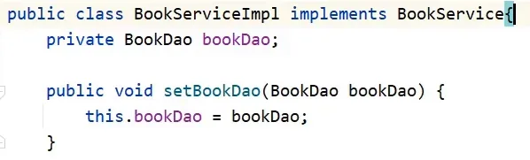

  * bookDao是private修饰的，外部类无法直接方法
  * 外部类只能通过属性的set方法进行访问
  * 对外部类来说，setBookDao方法名，去掉set后首字母小写是其属性名
    * 为什么是去掉set首字母小写?
    * 这个规则是set方法生成的默认规则，set方法的生成是把属性名首字母大写前面加set形成的方法名
  * 所以按照名称注入，其实是和对应的set方法有关，但是如果按照标准起名称，属性名和set对应的名是一致的

* 如果按照名称去找对应的bean对象，找不到则注入Null

* 当某一个类型在IOC容器中有多个对象，按照名称注入只找其指定名称对应的bean对象，不会报错 

两种方式介绍完后，以后用的更多的是按照类型注入。

最后对于依赖注入，需要注意一些其他的配置特征:

1. **自动装配用于引用类型依赖注入，不能对简单类型进行操作**
2. **使用按类型装配时（byType）必须保障容器中相同类型的bean唯一，推荐使用**
3. **使用按名称装配时（byName）必须保障容器中具有指定名称的bean，因变量名与配置耦合，不推荐使用**
4. **自动装配优先级低于setter注入与构造器注入，同时出现时自动装配配置失效**

## 集合注入

前面我们已经能完成引入数据类型和简单数据类型的注入，但是还有一种数据类型集合，集合中既可以装简单数据类型也可以装引用数据类型，对于集合，在Spring中该如何注入呢?

先来回顾下，常见的集合类型有哪些?

* 数组
* List
* Set
* Map
* Properties

下面的所有配置方式，都是在bookDao的bean标签中使用<property>进行注入

```xml
<?xml version="1.0" encoding="UTF-8"?>
<beans xmlns="http://www.springframework.org/schema/beans"
       xmlns:xsi="http://www.w3.org/2001/XMLSchema-instance"
       xsi:schemaLocation="http://www.springframework.org/schema/beans http://www.springframework.org/schema/beans/spring-beans.xsd">

    <bean id="bookDao" class="com.itheima.dao.impl.BookDaoImpl">
        
    </bean>
</beans>
```

### 注入数组类型数据

```xml
<property name="array">
    <array>
        <value>100</value>
        <value>200</value>
        <value>300</value>
    </array>
</property>
```

### 注入List类型数据

```xml
<property name="list">
    <list>
        <value>itcast</value>
        <value>itheima</value>
        <value>boxuegu</value>
        <value>chuanzhihui</value>
    </list>
</property>
```

### 注入Set类型数据

```xml
<property name="set">
    <set>
        <value>itcast</value>
        <value>itheima</value>
        <value>boxuegu</value>
        <value>boxuegu</value>
    </set>
</property>
```

### 注入Map类型数据

```xml
<property name="map">
    <map>
        <entry key="country" value="china"/>
        <entry key="province" value="henan"/>
        <entry key="city" value="kaifeng"/>
    </map>
</property>
```

### 注入Properties类型数据

```xml
<property name="properties">
    <props>
        <prop key="country">china</prop>
        <prop key="province">henan</prop>
        <prop key="city">kaifeng</prop>
    </props>
</property>
```

配置完成后，运行下看结果:

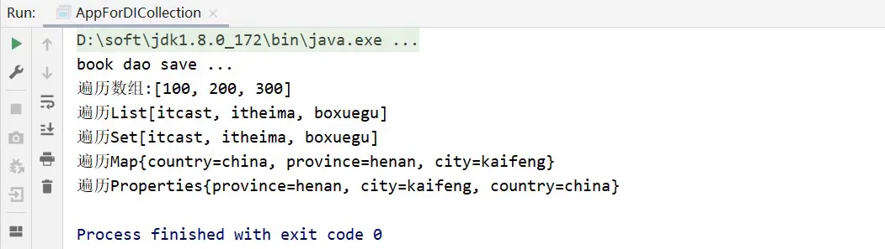

**说明：**

* property标签表示setter方式注入，构造方式注入constructor-arg标签内部也可以写`<array>`、`<list>`、`<set>`、`<map>`、`<props>`标签
* List的底层也是通过数组实现的，所以`<list>`和`<array>`标签是可以混用
* 集合中要添加引用类型，只需要把`<value>`标签改成`<ref>`标签，这种方式用的比较少

## IOC/DI配置管理第三方bean

### 加载properties文件

> 需求:将数据库连接四要素提取到properties配置文件，spring来加载配置信息并使用这些信息来完成属性注入。
>
> 1.在resources下创建一个jdbc.properties(文件的名称可以任意)
>
> 2.将数据库连接四要素配置到配置文件中
>
> 3.在Spring的配置文件中加载properties文件
>
> 4.使用加载到的值实现属性注入
>
> 其中第3，4步骤是需要大家重点关注，具体是如何实现。

1、准备properties配置文件

resources下创建一个jdbc.properties文件,并添加对应的属性键值对

```properties
jdbc.driver=com.mysql.jdbc.Driver
jdbc.url=jdbc:mysql://127.0.0.1:3306/spring_db
jdbc.username=root
jdbc.password=root
```

2、开启`context`命名空间

在applicationContext.xml中开`context`命名空间

```xml
<?xml version="1.0" encoding="UTF-8"?>
<beans xmlns="http://www.springframework.org/schema/beans"
       xmlns:xsi="http://www.w3.org/2001/XMLSchema-instance"
       xmlns:context="http://www.springframework.org/schema/context"
       xsi:schemaLocation="
            http://www.springframework.org/schema/beans
            http://www.springframework.org/schema/beans/spring-beans.xsd
            http://www.springframework.org/schema/context
            http://www.springframework.org/schema/context/spring-context.xsd">
</beans>
```

3、加载properties配置文件

在配置文件中使用`context`命名空间下的标签来加载properties配置文件

```xml
<context:property-placeholder location="jdbc.properties"/>
```

4、完成属性注入

使用`${key}`来读取properties配置文件中的内容并完成属性注入

```xml
<?xml version="1.0" encoding="UTF-8"?>
<beans xmlns="http://www.springframework.org/schema/beans"
       xmlns:xsi="http://www.w3.org/2001/XMLSchema-instance"
       xmlns:context="http://www.springframework.org/schema/context"
       xsi:schemaLocation="
            http://www.springframework.org/schema/beans
            http://www.springframework.org/schema/beans/spring-beans.xsd
            http://www.springframework.org/schema/context
            http://www.springframework.org/schema/context/spring-context.xsd">
    
    <context:property-placeholder location="jdbc.properties"/>
    <bean id="dataSource" class="com.alibaba.druid.pool.DruidDataSource">
        <property name="driverClassName" value="${jdbc.driver}"/>
        <property name="url" value="${jdbc.url}"/>
        <property name="username" value="${jdbc.username}"/>
        <property name="password" value="${jdbc.password}"/>
    </bean>
</beans>
```

至此，读取外部properties配置文件中的内容就已经完成。

### 读取单个属性

对于上面的案例，效果不是很明显，我们可以换个案例来演示下:

> 需求:从properties配置文件中读取key为name的值，并将其注入到BookDao中并在save方法中进行打印。
>
> 1.在项目中添加BookDao和BookDaoImpl类
>
> 2.为BookDaoImpl添加一个name属性并提供setter方法
>
> 3.在jdbc.properties中添加数据注入到bookDao中打印方便查询结果
>
> 4.在applicationContext.xml添加配置完成配置文件加载、属性注入(${key})

步骤1:在项目中添对应的类

BookDao和BookDaoImpl类，并在BookDaoImpl类中添加`name`属性与setter方法

```java
public interface BookDao {
    public void save();
}

public class BookDaoImpl implements BookDao {
    private String name;

    public void setName(String name) {
        this.name = name;
    }

    public void save() {
        System.out.println("book dao save ..." + name);
    }
}
```

步骤2:完成配置文件的读取与注入

在applicationContext.xml添加配置，`bean的配置管理`、`读取外部properties`、`依赖注入`:

```xml
<?xml version="1.0" encoding="UTF-8"?>
<beans xmlns="http://www.springframework.org/schema/beans"
       xmlns:xsi="http://www.w3.org/2001/XMLSchema-instance"
       xmlns:context="http://www.springframework.org/schema/context"
       xsi:schemaLocation="
            http://www.springframework.org/schema/beans
            http://www.springframework.org/schema/beans/spring-beans.xsd
            http://www.springframework.org/schema/context
            http://www.springframework.org/schema/context/spring-context.xsd">
    
    <context:property-placeholder location="jdbc.properties"/>
    
    <bean id="bookDao" class="com.itheima.dao.impl.BookDaoImpl">
        <property name="name" value="${jdbc.driver}"/>
    </bean>
</beans>
```

步骤3:运行程序

在App类中，从IOC容器中获取bookDao对象，调用方法，查看值是否已经被获取到并打印控制台

```java
public class App {
    public static void main(String[] args) throws Exception{
        ApplicationContext ctx = new ClassPathXmlApplicationContext("applicationContext.xml");
        BookDao bookDao = (BookDao) ctx.getBean("bookDao");
        bookDao.save();
    }
}
```

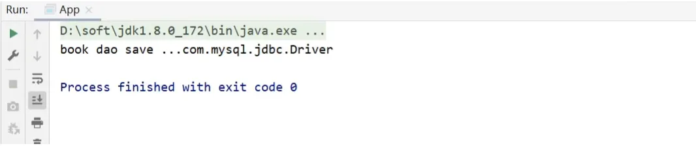

##### 注意事项

至此，读取properties配置文件中的内容就已经完成，但是在使用的时候，有些注意事项:

* 问题一:键值对的key为`username`引发的问题

  1.在properties中配置键值对的时候，如果key设置为`username`

  ```
  username=root666
  ```

  2.在applicationContext.xml注入该属性

  ```xml
  <?xml version="1.0" encoding="UTF-8"?>
  <beans xmlns="http://www.springframework.org/schema/beans"
         xmlns:xsi="http://www.w3.org/2001/XMLSchema-instance"
         xmlns:context="http://www.springframework.org/schema/context"
         xsi:schemaLocation="
              http://www.springframework.org/schema/beans
              http://www.springframework.org/schema/beans/spring-beans.xsd
              http://www.springframework.org/schema/context
              http://www.springframework.org/schema/context/spring-context.xsd">
      
      <context:property-placeholder location="jdbc.properties"/>
      <bean id="bookDao" class="com.itheima.dao.impl.BookDaoImpl">
          <property name="name" value="${username}"/>
      </bean>
  </beans>
  ```

  3.运行后，在控制台打印的却不是`root666`，而是自己电脑的用户名

  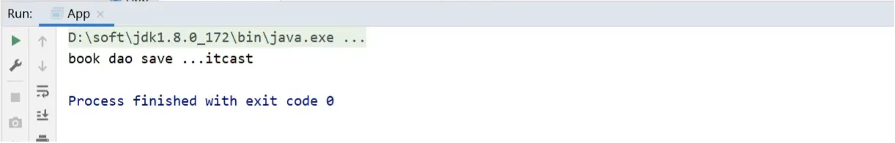

  4.出现问题的原因是`<context:property-placeholder/>`标签会加载系统的环境变量，而且环境变量的值会被优先加载，如何查看系统的环境变量?

  ```java
  public static void main(String[] args) throws Exception{
      Map<String, String> env = System.getenv();
      System.out.println(env);
  }
  ```

  大家可以自行运行，在打印出来的结果中会有一个USERNAME=XXX[自己电脑的用户名称]

  5.解决方案

  ```xml
  <?xml version="1.0" encoding="UTF-8"?>
  <beans xmlns="http://www.springframework.org/schema/beans"
         xmlns:xsi="http://www.w3.org/2001/XMLSchema-instance"
         xmlns:context="http://www.springframework.org/schema/context"
         xsi:schemaLocation="
              http://www.springframework.org/schema/beans
              http://www.springframework.org/schema/beans/spring-beans.xsd
              http://www.springframework.org/schema/context
              http://www.springframework.org/schema/context/spring-context.xsd"> 
      <context:property-placeholder location="jdbc.properties" system-properties-mode="NEVER"/>
  </beans>
  ```

  system-properties-mode:设置为NEVER,表示不加载系统属性，就可以解决上述问题。

  当然还有一个解决方案就是避免使用`username`作为属性的`key`。

* 问题二:当有多个properties配置文件需要被加载，该如何配置?

  1.调整下配置文件的内容，在resources下添加`jdbc.properties`,`jdbc2.properties`,内容如下:

  jdbc.properties

  ```properties
  jdbc.driver=com.mysql.jdbc.Driver
  jdbc.url=jdbc:mysql://127.0.0.1:3306/spring_db
  jdbc.username=root
  jdbc.password=root
  ```

  jdbc2.properties

  ```properties
  username=root666
  ```

  2.修改applicationContext.xml

  ```xml
  <?xml version="1.0" encoding="UTF-8"?>
  <beans xmlns="http://www.springframework.org/schema/beans"
         xmlns:xsi="http://www.w3.org/2001/XMLSchema-instance"
         xmlns:context="http://www.springframework.org/schema/context"
         xsi:schemaLocation="
              http://www.springframework.org/schema/beans
              http://www.springframework.org/schema/beans/spring-beans.xsd
              http://www.springframework.org/schema/context
              http://www.springframework.org/schema/context/spring-context.xsd">
      <!--方式一 -->
      <context:property-placeholder location="jdbc.properties,jdbc2.properties" system-properties-mode="NEVER"/>
      <!--方式二-->
      <context:property-placeholder location="*.properties" system-properties-mode="NEVER"/>
      <!--方式三 -->
      <context:property-placeholder location="classpath:*.properties" system-properties-mode="NEVER"/>
      <!--方式四-->
      <context:property-placeholder location="classpath*:*.properties" system-properties-mode="NEVER"/>
  </beans>	
  ```

  **说明:**

  * 方式一:可以实现，如果配置文件多的话，每个都需要配置
  * 方式二:`*.properties`代表所有以properties结尾的文件都会被加载，可以解决方式一的问题，但是不标准
  * 方式三:标准的写法，`classpath:`代表的是从根路径下开始查找，但是只能查询当前项目的根路径
  * 方式四:不仅可以加载当前项目还可以加载当前项目所依赖的所有项目的根路径下的properties配置文件

### 加载properties文件小结

  本节主要讲解的是properties配置文件的加载，需要掌握的内容有:

  * 如何开启`context`命名空间

    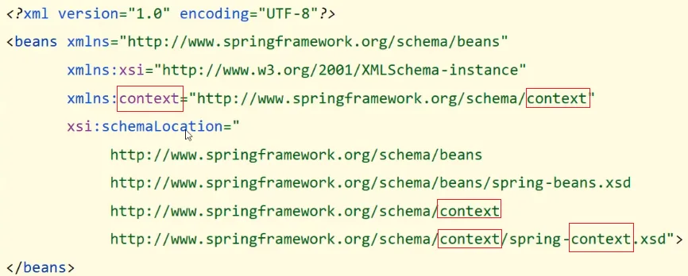

  * 如何加载properties配置文件

    ```xml
    <context:property-placeholder location="" system-properties-mode="NEVER"/>
    ```

  * 如何在applicationContext.xml引入properties配置文件中的值

    ```
    ${key}
    ```
