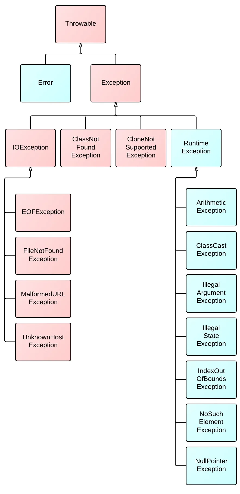
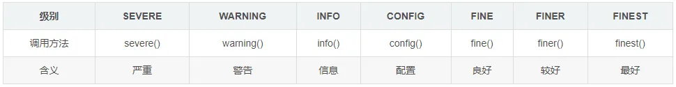
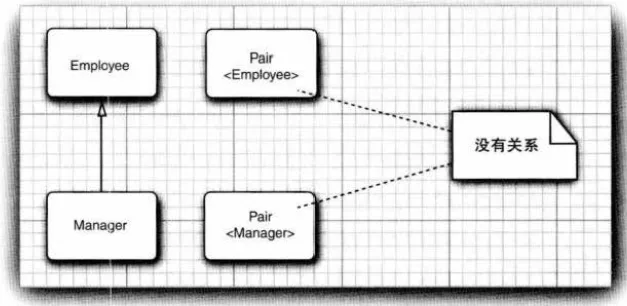
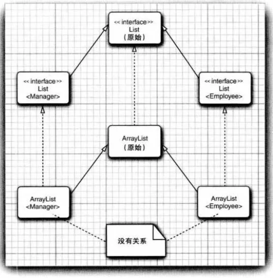
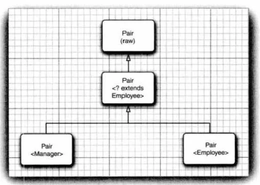
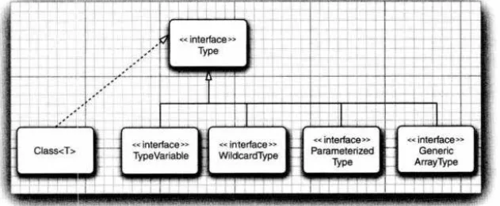

# 处理错误

为了尽量避免错误的发生，至少应该做到以下几点：

- 向用户通知错误；
- 保存所有的工作；
- 允许用户妥善地退出程序。

假设在一个Java 程序运行期间出现了一个错误。这个错误可能是由于文件包含错误信息，或者网络连接出现问题造成的，也有可能（我们真是不想提到这一点）是因为使用了无效的数组下标，或者试图使用一个没有被赋值的对象引用而造成的。用户期望在出现错误时，程序能够采取合理的行为。如果由千出现错误而使得某些操作没有完成，程序应该：

- 返回到一种安全状态，并能够让用户执行其他的命令；或者
- 允许用户保存所有工作的结果，并以妥善的方式终止程序。

## 异常分类

红色区域的异常类表示是程序需要显示捕捉或者抛出的。



Java语言按照错误严重性，从throwale根类衍生出Error和Exception两大派系

> Error（错误）

程序在执行过程中所遇到的硬件或操作系统的错误。错误对程序而言是致命的，将导致程序无法运行。常见的错误有内存溢出，jvm虚拟机自身的非正常运行，calss文件没有主方法。程序本生是不能处理错误的，只能依靠外界干预。Error是系统内部的错误，由jvm抛出，交给系统来处理。

> Exception（异常）

是程序正常运行中，可以预料的意外情况。比如数据库连接中断，空指针，数组下标越界。异常出现可以导致程序非正常终止，也可以预先检测，被捕获处理掉，使程序继续运行。

EXCEPTION（异常）按照性质，又分为编译异常（可检测）和运行时异常（不可检测）。

> 编译时异常：

又叫可检查异常，通常时由语法错和环境因素（外部资源）造成的异常。比如输入输出异常IOException，数据库操作SQLException。其特点是，Java语言强制要求捕获和处理所有非运行时异常。通过行为规范，强化程序的健壮性和安全性。

> 运行时异常（RuntimeException）：

又叫不检查异常，这些异常一般是由程序逻辑错误引起的，即语义错。比如算术异常，空指针异常NullPointerException，下标越界IndexOutOfBoundsException。运行时异常应该在程序测试期间被暴露出来，由程序员去调试，而避免捕获。“如果出现RuntimeException 异常，那么就一定是你的问题”，因为编译器不会注意RuntimeException类型的异常。

所以，java语言处理运行时错误有三种方式，

1. 一是程序不能处理的错误，
2. 二是程序应该避免而可以不去捕获的运行时异常，
3. 三是必须捕获的非运行时异常。

Java 语言规范将派生于Error 类或RuntimeException 类的所有异常称为非检查型( unchecked )异常，所有其他的异常称为检查型( checked ) 异常。这是很有用的术语，在后面还会用到。编译器将检查你是否为所有的检查型异常提供了异常处理器。

## 声明检查型异常

如果遇到了无法处理的情况， Java 方法可以抛出一个异常。这个道理很简单： 方法不仅需要告诉编译器将要返回什么值，还要告诉编译器有可能发生什么错误。例如， 一段读取文件的代码知道有可能读取的文件不存在，或者文件内容为空，因此，试图处理文件信息的代码就需要通知编译器可能会抛出IOException 类的异常。
要在方法的首部指出这个方法可能抛出一个异常， 所以要修改方法首部，以反映这个方法可能抛出的检查型异常。

public FilelnputStream(String name) throws FilNotFoundException

总之， 一个方法必须声明所有可能抛出的检查型异常，而非检查型异常要么在你的控制之外(Error) ，要么是由从一开始就应该避免的情况所导致的(RuntimeException ) 。如果你的方法没有声明所有可能发生的检查型异常，编译器就会发出一个错误消息。

## 如何抛出异常

**e.throws：**

```text
1).语法：

    修饰符   返回值类型  方法名(参数列表)   throws  异常类型{
        执行内容
    }

2).处理：

    方式一:后续调用方法继续声明,后续继续处理，如果由main声明的异常由java虚拟机处理；
    方式二: 后续调用方法直接try...catch处理;

3).注意事项：
    前面声明的异常的方法中该异常类型指定必须比后续调用或声明范围小或其相同；
    声明异常时可以同时声明多个异常;
```

**g.throw:**

```text
1).语法:
    throw  new  Exception();---创建一个需要的异常类型对象
2).后续操作：
    抛出异常以后需要后续处理异常;
```

```java
    public String readData(Scanner scanner) throws EOFException{
        while (){
            if (n<len)
                throw new EOFException()
        }
        return  s;
    }
```

## 创建异常类

你的代码可能会遇到任何标准异常类都无法描述清楚的问题。在这种情况下，创建自己的异常类就是一件顺理成章的事情了。我们需要做的只是定义一个派生于Exception 的类，或者派生于Exception 的某个子类，如IOException 。习惯做法是，自定义的这个类应该包含两个构造器， 一个是默认的构造器，另一个是包含详细描述信息的构造骈（超类Throwable 的toString 方法会返回一个字符串，其中包含这个详细信息，这在调试中非常有用） 。

```java
    public class MyException extends Exception {
        public MyException() {
        }
        public MyException(String message) {
            super(message);
        }
    }
```

# 捕获异常

**a.关键字：**

```text
try: 异常执行代码
catch:  捕获异常
finally: 最终执行
throws: 声明异常
throw: 抛出异常
```

**b.语法一:**

```java
try{
    执行代码--可能含有异常
}catch(异常类型  e){
    异常处理相关操作
}
//后续操作
//问题：如果执行代码中含有多种异常，需要分别处理，如何操作？
```

**c.语法二:**

```java
try{
    执行代码
}catch(异常类型 e){
    异常处理相关操作
}finally{
    最终执行;
}
//后续处理
//finally中的内容不管程序是否出现异常都需要执行的内容：eg:IO流需要最终关闭流/数据库连接使用完毕需要关闭连接
```

如果try 语句块中的任何代码抛出了catch 子句中指定的一个异常类，那么

1. 程序将跳过try 语句块的其余代码。
2. 程序将执行catch 子句中的处理器代码。

如果try 语句块中的代码没有抛出任何异常，那么程序将跳过catch 子句。

如果方法中的任何代码抛出了catch 子句中没有声明的一个异常类型，那么这个方法就会立即退出（希望它的调用者为这种类型的异常提供了catch 子句） 。

## 捕获多个异常

```java
try{
    执行代码
}catch(异常类型1 e1){
    异常处理
}catch(异常类型2 e2){
    异常处理
}finally{
    最终执行代码
}
```

在一个try 语句块中可以捕获多个异常类型， 并对不同类型的异常做出不同的处理。要为每个异常类型使用一个单独的catch 子句

捕获多个异常不仅会让你的代码看起来更简单，还会更高效。生成的字节码只
包含对应公共catch 子句的一个代码块。

## 再次抛出异常与异常链

可以在catch 子句中抛出一个异常。通常，希望改变异常的类型时会这样做。如果开发了一个供其他程序员使用的子系统，可以使用一个指示子系统故障的异常类型，这很有道理。

```java
import java.io.*;
public class ExcepTest{
   public static void main(String args[]){
      try{
         int a[] = new int[2];
         System.out.println("Access element three :" + a[3]);
      }catch(ArrayIndexOutOfBoundsException e){
         System.out.println("Exception thrown  :" + e);
      }
      System.out.println("Out of the block");
   }
}
```

或者是将其变为新的异常并抛出。

## finally 子句

代码抛出一个异常时，就会停止处理这个方法中剩余的代码， 并退出这个方法。如果这个方法已经获得了只有它自已知道一些本地资源，而且这些资源必须清理，这就会有问题。一种解决方案是捕获所有异常，完成资源的清理，再重新抛出异常。但是，这种解决方案比较烦琐，这是因为需要在两个地方清理资源分配。一个在正常的代码中；另一个在异常代码中。finally 子句可以韶决这个问题。

> 当finally 子句包含return 语句时，有可能产生意想不到的结果。假设利用return 语句从try 语句块中间退出。在方法返回前，会执行finally 子句块。如果finally块也有一个return 语句，这个返回值将会遮蔽原来的返回值。

## try-with-Resources 语句

*try-with-resources*是`try`Java中的几条语句之一，旨在减轻开发人员释放`try`块中使用的资源的义务。

它最初是在Java 7中引入的，其背后的全部想法是，开发人员无需担心仅在一个*try-catch-finally*块中使用的资源的资源管理。这是通过消除对`finally`块的需要而实现的，实际上，开发人员仅在关闭资源时才使用块。

此外，使用*try-with-resources的*代码通常更清晰易读，因此使代码更易于管理，尤其是当我们处理许多`try`块时。

*try-with-resources*的语法几乎与通常的*try-catch-finally*语法相同。唯一的区别是括号后`try`，我们在其中声明将使用的资源：

```java
BufferedWriter writer = null;
try {
    writer = new BufferedWriter(new FileWriter(fileName));
    writer.write(str);  // do something with the file we've opened
} catch (IOException e) {
   // handle the exception
} finally {
    try {
        if (writer != null)
            writer.close();
    } catch (IOException e) {
       // handle the exception
    }
}
```

使用*try-with-resources*编写的相同代码如下所示：

```java
try(BufferedWriter writer = new BufferedWriter(new FileWriter(fileName))){
    writer.write(str); // do something with the file we've opened
}
catch(IOException e){
    // handle the exception
}
```

Java理解此代码的方式：

> *在try语句之后在括号中打开的资源仅在此处和现在需要。`.close()`在try块中完成工作后，我将立即调用它们的方法。如果在try块中抛出异常，无论如何我都会关闭这些资源。*

在引入此方法之前，关闭资源是手动完成的，如之前的代码所示。这本质上是样板代码，并且代码库中乱七八糟，从而降低了可读性并使它们难以维护。

在`catch`与`finally`部分*试-与资源*按预期方式工作，与`catch`块处理各自的异常和`finally`不管是否有异常或不执行块。唯一的区别是抑制的异常，这些异常将在本文结尾处进行说明。

**注意**：从Java 9开始，没有必要在*try-with-resources*语句中声明*资源*。我们可以这样做：

```java
BufferedWriter writer = new BufferedWriter(new FileWriter(fileName));
try (writer) {
    writer.write(str); // do something with the file we've opened
}
catch(IOException e) {
    // handle the exception
}
```

#### Multiple Resources

*try-with-resources的*另一个好方面是添加/删除我们正在使用*的资源*的简便性，同时确保在完成后它们将被关闭。

如果要使用多个文件，则可以在`try()`语句中打开文件，并用分号将它们分开：

```java
try (BufferedWriter writer = new BufferedWriter(new FileWriter(fileName));
    Scanner scanner = new Scanner(System.in)) {
if (scanner.hasNextLine())
    writer.write(scanner.nextLine());
}
catch(IOException e) {
    // handle the exception
}
```

然后，Java会小心地调用`.close()`我们在中打开的所有资源`try()`。

**注意**：它们以相反的声明顺序关闭，这意味着，在我们的示例中，`scanner`它将在之前关闭`writer`。

#### 支持的类

声明的所有资源`try()`必须实现该`AutoCloseable`接口。这些通常是各种类型的编写器，读取器，套接字，输出或输入流等`resource.close()`。使用完所有需要编写的内容。

当然，这包括实现该`AutoClosable`接口的用户定义对象。但是，您很少会遇到想要编写自己的资源的情况。

万一发生这种情况，您需要实现`AutoCloseable`或`Closeable`（仅在此处保持向后兼容性，最好使用`AutoCloseable`）接口并重写该`.close()`方法：

#### 异常处理

如果从Java *try-with-resources*块中引发异常，则在该块的括号内打开的任何资源`try`仍将自动关闭。

如前所述，*try-with-resources的*工作原理与*try-catch-finally相同*，只是增加了一点点。这种增加称为*抑制异常*。这是**不是**有必要了解为了使用抑制异常*的try-与资源*，但阅读他们可能会为在没有其他似乎调试工作是有用的。

想象一个情况：

- 由于某些原因，*try-with-resources*块中发生异常
- Java在*try-with-resources*块中停止执行，并调用`.close()`在中声明的所有资源`try()`
- 其中一种`.close()`方法引发异常
- `catch`块会“捕获”哪个异常？

这种情况向我们介绍了上述抑制的例外。受抑制的异常是一种异常，当在*try-with-resources*块的隐式finally块中引发该异常时，也可以忽略该异常，如果从该`try`块也引发了异常。

这些异常是`.close()`方法中发生的异常，它们的访问方式不同于“常规”异常。

重要的是要了解执行顺序为：

1. *资源尝试*块
2. 最终隐式
3. 捕获块（如果在[1]和/或[2]中引发了异常）
4. （明确）终于

例如，这是一个除了抛出异常外什么都不做的资源：

```java
public static class MyResource implements AutoCloseable {
    // method throws RuntimeException
    public void doSomething() {
        throw new RuntimeException("From the doSomething method");
    }
    // we'll override close so that it throws an exception in the implicit finally block of try-with-resources (when it attempts to close our resource)
    @Override
    public void close() throws Exception {
        throw new ArithmeticException("I can throw whatever I want, you can't stop me.");
    }
}

public static void main(String[] arguments) throws Exception {
    // declare our resource in try
    try (MyResource resource = new MyResource()) {
        resource.doSomething();
    }
    catch (Exception e) {
        System.out.println("Regular exception: " + e.toString());

        // getting the array of suppressed exceptions, and its length
        Throwable[] suppressedExceptions = e.getSuppressed();
        int n = suppressedExceptions.length;

        if (n > 0) {
            System.out.println("We've found " + n + " suppressed exceptions:");
            for (Throwable exception : suppressedExceptions) {
                System.out.println(exception.toString());
            }
        }
    }
}
```

此代码是可运行的。您可以使用它来尝试使用多个`MyResource`对象，或查看*try-with-resources*不会抛出异常但`.close()`会抛出异常的情况。

**提示**：突然，关闭资源时引发的异常开始变得很重要。

需要特别注意的是，万一尝试关闭资源时引发资源异常，在同一*try-with-resources*块中打开的任何其他资源仍将关闭。

要注意的另一个事实是，在该`try`块没有引发异常的情况下，并且尝试`.close()`使用所使用的资源时引发了多个异常，第**一个**异常将在调用堆栈中传播，而其他异常将被抑制。 。

正如您在代码中看到的那样，您可以通过访问`Throwable`返回的数组来获取所有抑制的异常的列表`Throwable.getSuppressed()`。

请记住，在try块内只能抛出一个异常。引发异常后，将立即退出try块代码，并且Java尝试关闭资源。

#### 结论

应尽可能使用*try-with-resources*代替常规*try-catch-finally*。很容易忘记在编码几个小时后关闭您的资源之一，或者在随机激发灵感后忘记关闭刚刚添加到程序中的资源。

该代码更具可读性，更易于更改和维护，并且通常更短。

## 分析堆栈轨迹元素

堆栈轨迹(stack trace ) 是程序执行过程中某个特定点上所有挂起的方法调用的一个列表。你肯定已经看到过这种堆栈轨迹列表，当Java 程序因为一个未捕获的异常而终止时．就会显示堆栈轨迹。
可以悯用Throwable 类的printStackTrace 方法访问堆栈轨迹的文本描述信息。

# 使用异常的技巧

1. 异常处理不能代替简单的测试。
   可以看出， 与完成简单的测试相比，捕获异常所花费的时间大大超过了前者，因此使用异常的基本规则是：只在异常情况下使用异常。
2. 不要过分地细化异常。
   因此，有必要将整个任务包在一个try语句块中，这样， 当任何一个操作出现问题时，就可以取消整个任务。
3. 充分利用异常层次结构。
   不要只抛出RuntimeException 异常。应该寻找一个适合的子类或创建自己的异常类。不要只捕获Throwable异常，否则，这会使你的代码更难读、更难维护。考虑检查型异常与非检查型异常的区别。检查型异常本来就很庞大， 不要为逻辑错误抛出这些异常。如果能够将一种异常转换成另一种更加适合的异常，那么不要犹豫。
4. 不要压制异常。
   如果你编写了一个方法要调用另一个方法，而那个方法有可能100 年才抛出一个异常，但是，如果没有在你的方法的t hrows 列表中声明这个异常，编译器就会报错。你不想把它放在throws 列表中，因为这样一来，编译器会对调用了你的方法的所有方法报错。
5. 在检测错误时，＂苛刻“要比放任更好。
   当检测到错误的时候，有些程序员对抛出异常很担心。在用无效的参数调用一个方法时，返回一个虚拟值是不是比抛出一个异常更好？例如，当栈为空时， Stack . pop 是该返回一个null ，还是要抛出一个异常？我们认为：最好在出错的地方抛出一个EmptyStackException 异常，这要于以后抛出一个NullPointerException 异常。
6. 不要羞于传递异常。
   很多程序员都感觉应该捕获抛出的全部异常。如果调用了一个抛出异常的方法， 它们就会本能地捕获这些可能产生的异常。其实，最好继续传递这个异常，更高层的方法通常可以更好地通知用户发生了错误，或者放弃不成功的命令。

# 使用断言

- 断言机制允许在测试期间向代码中插入一些检查，而在生产代码中会自动删除这些检查。
- 断言是一种测试和调试阶段使用的战术性工具。
- 关键字 assert

## 断言的概念

```java
assert condition; 
	//如果条件判断为true，程序继续执行。如果条件判断为false，则抛出 AssertionError异常。
	assert condition:expression; 
	//将表达式传给AssertError对象构造器，并转换成一个消息字符串。
```

这两个语句都会计算条件，如果结果为false , 则抛出一个AssertionError 异常。在第二个语句中，表达式将传入AssertionError 对象的构造盛，并转换成一个消息字符串。

> 注释： ”表达式”(expression) 部分的唯一目的是产生一个消息宇符串。AssertionError对象并不存储具体的表达式值，因此，以后无法得到这个表达式值。正如JDK 文档所描述的那样：如果使用表达式的值，就会鼓励程序员尝试从断言失败恢复程序的运行，这不符合断言机制的初衷。

```java
public static void main(String[] args) {
	        int x = 10;
	        //断言x 非负数
	        assert x >= 0;
    		//或者将x的实际值传递给AssertionError 对象，以便以后显示。
	        assert x>=0:x;
	    }
```

## 启用和禁用断言

- 默认情况下，断言是禁用的。开启命令`-ea` ，关闭命令`-da`

## 使用断言完成参数检查

在Java 语言中，给出了3 种处理系统错误的机制：

- 抛出一个异常。
- 日志。
- 使用断言。

什么时候应该选择使用断言呢？请记住下面几点：

- 断言失败是致命的、不可恢复的错误。
- 断言检查只是在开发和测试阶段打开（这种做法有时候被戏称为“在靠近海岸时穿上救生衣，但在海里就把救生衣抛掉”) 。

# 日志

从jdk1.4起，JDK开始自带一套日志系统。JDK Logger最大的优点就是不需要任何类库的支持，只要有Java的运行环境就可以使用。相对于其他的日志框架，JDK自带的日志可谓是鸡肋，无论易用性，功能还是扩展性都要稍逊一筹，所以在商业系统中很少直接使用。

DK Logging把日志分为如下七个级别，等级依次降低。



```java
import java.util.logging.Level;
import java.util.logging.Logger;
public class LogJDKTest {
       private static Logger log = Logger.getLogger(LogJDKTest.class.toString());
       public static void main(String[] args) {
              // all→finest→finer→fine→config→info→warning→server→off
              // 级别依次升高，后面的日志级别会屏蔽之前的级别
              log.setLevel(Level.INFO);
              log.finest("finest");
              log.finer("finer");
              log.fine("fine");
              log.config("config");
              log.info("info");
              log.warning("warning");
              log.severe("server");
       }
}
```

## 过滤器

在默认情况下，会根据日志记录的级别进行过滤。每个日志记录器和处理器都有一个可选的过滤器来完成附加的过滤。要定义一个过滤器，需要实现Filter 接口并定义以下方法：
boolean isLoggable(LogRecord record)
在这个方法中，可以使用你喜欢的标准分析日志记录，对那些应该包含在日志中的记录返回true 。例如，某个过滤器可能只对entering 方法和exiting 方法生成的消息感兴趣，这个过滤器就可以调用record . getMessage( ）方法，并检查消息是否以ENTRY 或RETURN 开头。
要想将一个过滤器安装到一个日志记录器或处理器中，只需要调用setFilter 方法就可以了。注意，同一时刻最多只能有一个过滤器。

## 格式化器

ConsoleHandler 类和FileHandler 类可以生成文本和XML 格式的日志记录。不过，你也可以自定义格式。

1.JDK log默认会有一个控制台输出，它有两个参数，第一个参数设置输出级别，第二个参数设置输出的字符串。

2.同时也可以设置多个输出（Hander），每个输出设置不用的level，然后通过addHandler添加到了log中。

注意：为log设置级别与为每个handler设置级别的意义是不同的。

```java
import java.util.logging.ConsoleHandler;
import java.util.logging.Handler;
import java.util.logging.Level;
import java.util.logging.Logger;
 
public class LogJDKTest {
    public static Logger log = Logger.getLogger(LogJDKTest.class.toString());
    static {
        Handler console = new ConsoleHandler();
        console.setLevel(Level.SEVERE);
        log.addHandler(console);
        Handler console2 = new ConsoleHandler();
        console2.setLevel(Level.INFO);
        log.addHandler(console2);
    }
    public static void main(String[] args) {
        // all→finest→finer→fine→config→info→warning→server→off
        // 级别依次升高，后面的日志级别会屏蔽之前的级别
        log.setLevel(Level.INFO);
        log.finest("finest");
        log.finer("finer");
        log.fine("fine");
        log.config("config");
        log.info("info");
        log.warning("warning");
        log.severe("server");
    }

}

六月 23, 2021 11:09:03 上午 com.middleware.test.log.LogJDKTest main
信息: info
六月 23, 2021 11:09:03 上午 com.middleware.test.log.LogJDKTest main
警告: warning
六月 23, 2021 11:09:03 上午 com.middleware.test.log.LogJDKTest main
严重: server
六月 23, 2021 11:09:03 上午 com.middleware.test.log.LogJDKTest main
严重: server
```

# 调试技巧

1. 可以打印或记录任意变量的值。
2. 可以在每一个类中放置一个单独的main方法。这样就可以提供一个单元测试桩( stub) ，能够独立地测试类。
3. JUnit 是一个非常流行的单元测试框架，利用它可以很容易地组织测试用例套件。
4. 日志代理( logging proxy) 是一个子类的对象，它可以截获方法调用，记录日志，然后调用超类中的方法。
5. 利用Throwable 类的printStackTrace 方法，可以从任意的异常对象获得堆栈轨迹。
6. 一般来说，堆栈轨迹显示在System.err 上。如果想要记录或显示堆栈轨迹，可以将它捕获到一个字符串中。
7. 通常，将程序错误记入一个文件会很有用。
8. 在System.err 中显示未捕获的异常的堆栈轨迹并不是一个理想的方法。如果最终用户碰巧看到了这些消息，就会很慌乱，而且在真正需要诊断错误原因时却又无法得到这些消息。更好的方法是将这些消息记录到一个文件中。
9. 要想观察类的加载过程， 启动Java 虚拟机时可以使用－verbose 标志。
10. -Xlint 选项告诉编译器找出常见的代码问题。
11. Java 虚拟机增加了对Java 应用程序的监控(monitoring) 和管理(management) 支持，允许在虚拟机中安装代理来跟踪内存消耗、线程使用、类加载等悄况。JDK 提供了一个名为jconsole 的图形工具，可以显示有关虚拟机性能的统计结果。
12. Java 任务控制器(Java Mission Control) 是一个专业级性能分析和诊断工具，包含在Oracle JDK 中，可以免费用于开发。

# 为什么要使用泛型程序设计

泛型程序设计(gen eric programming) 意味着编写的代码可以对多种不同类型的对象重用。泛型有三种使用方式，分别为：泛型类、泛型接口、泛型方法。

**定义：泛型的本质就是把类型参数化，所操作的数据类型被指定为参数，根据动态传入进行处理**

## 类型参数的好处

在Java 中增加泛型类之前，泛型程序设计是用继承实现的。Arraylist 类只维护一个Object 引用的数组

这种方法存在两个问题。当获取一个值时必须进行强制类型转换。此外，这里没有错误检查。可以向数组列表中添加任何类的值。

泛型提供了一个更好的解决方案：类型参数(type param eter ) 。A rraylist 类有一个类型参
数用来指示元素的类型：
`var files = new ArrayList<String>() ;`

如果用一个明确的类型而不是var 声明一个变量，则可以通过使用＂菱形” 语
法省略构造器中的类型参数。

总之：

- **编译期类型安全**
- **避免了强制类型转换运行时异常**
- **同一个类可以操作多种类型数据，代码复用**

## 泛型类

泛型类(generic class) 就是有一个或多个类型变批的类。这个类使我们可以只关注泛型， 而不用为数据存储的细节而分心。

泛型类型用于类的定义中，被称为泛型类。通过泛型可以完成对一组类的操作对外开放相同的接口。最典型的就是各种容器类，如：List、Set、Map。

泛型类的最基本写法：

```java
class 类名称 <泛型标识：可以随便写任意标识号，标识指定的泛型的类型>{
  private 泛型标识 /*（成员变量类型）*/ var; 
  .....

  }
}
```

```java
//此处T可以随便写为任意标识，常见的如T、E、K、V等形式的参数常用于表示泛型
//在实例化泛型类时，必须指定T的具体类型
public class Generic<T>{ 
    //key这个成员变量的类型为T,T的类型由外部指定  
    private T key;

    public Generic(T key) { //泛型构造方法形参key的类型也为T，T的类型由外部指定
        this.key = key;
    }

    public T getKey(){ //泛型方法getKey的返回值类型为T，T的类型由外部指定
        return key;
    }
}
```

## 泛型方法

在java中,泛型类的定义非常简单，但是泛型方法就比较复杂了。泛型方法可以在普通类中定义，也可以在泛型类中定义。

尤其是我们见到的大多数泛型类中的成员方法也都使用了泛型，有的甚至泛型类中也包含着泛型方法，这样在初学者中非常容易将泛型方法理解错了。

```java
/**
 * 泛型方法的基本介绍
 * @param tClass 传入的泛型实参
 * @return T 返回值为T类型
 * 说明：
 *     1）public 与 返回值中间<T>非常重要，可以理解为声明此方法为泛型方法。
 *     2）只有声明了<T>的方法才是泛型方法，泛型类中的使用了泛型的成员方法并不是泛型方法。
 *     3）<T>表明该方法将使用泛型类型T，此时才可以在方法中使用泛型类型T。
 *     4）与泛型类的定义一样，此处T可以随便写为任意标识，常见的如T、E、K、V等形式的参数常用于表示泛型。
 */
public <T> T genericMethod(Class<T> tClass)throws InstantiationException ,
  IllegalAccessException{
        T instance = tClass.newInstance();
        return instance;
}
```

## 类型变量的限定

有时，类或方法需要对类型变量加以约束。例如，规定此类型变量指向的对象必须是实现了 Comparable 接口的。这时候，可以通过对类型变量 T **设置限定**（bound）来实现这一点。

```java
public <T extends Comparable>void sort(T t) { ... }
```

在上述例子中，调用此方法时，传入的对象必须实现了 Comparable 接口，否则就会产生一个编译错误。这里大家可能会有一个疑惑，为什么使用关键字 extends？Comparable 是一个接口，那不是应该用 implements 吗？

`<T extends BoundingType>`表示T 应该是限定类型( bounding type) 的子类型(subtype) 。T 和限定类型可以是类，也可以是接口。注意，此处的 extends 其实并不表示继承，可以将其理解成“绑定”，“绑定”的可以是类，也可以是接口，表示 T 应该是绑定类型的子类型。选择关键字 extends 的原因是更接近子类的概念， 并且 Java 的设计者也不打算在语言中再添加一个新的关键字。

当然，一个变量类型或通配符可以有多个限定，但其中只能有一个类。这也符合我们原本的知识体系——只能继承一个类，但能实现多个接口。

```java
public class Practical<T extends Person & ActionListener & MouseListener> { ... }
```

如果用一个类作为限定，则它必须是限定列表中的第一个，不同的限定类型之间用“ &” 分隔。

# 泛型代码和虚拟机

虚拟机没有泛型类型对象——所有对象都属于普通类。在泛型实现的早期版本中，甚至能够将使用泛型的程序编译为在1.0 虚拟机上运行的类文件！

## 类型擦除

无论何时定义一个泛型类型，都会自动提供一个相应的原始类型(raw type) 。这个原始类型的名字就是去掉类型参数后的泛型类型名。类型变量会被擦除(erased )，并替换为其限定类型（或者，对与无限定的变量则替换为Object) 。

### **原始类型Object**

```java
class Pair<T> {  
    private T value;  
    public T getValue() {  
        return value;  
    }  
    public void setValue(T  value) {  
        this.value = value;  
    }  
} 
```

Pair的原始类型为:

```java
class Pair {  
    private Object value;  
    public Object getValue() {  
        return value;  
    }  
    public void setValue(Object  value) {  
        this.value = value;  
    }  
}
```

因为T 是一个无限定的变扭，所以直接用Object 替换。
结果是一个普通的类，就好像Java 语言中引入泛型之前实现的类一样。

原始类型用第一个限定来替换类型变量，或者，如果没有给定限定，就替换为Object 。

如果类型变量有限定，那么原始类型就用第一个边界的类型变量类替换。

比如: Pair这样声明的话

```java
public class Pair<T extends Comparable & Serializable> {}
```

那么原始类型就是`Comparable`。

要区分原始类型和泛型变量的类型。

在调用泛型方法时，可以指定泛型，也可以不指定泛型。

- 在不指定泛型的情况下，泛型变量的类型为该方法中的几种类型的同一父类的最小级，直到Object
- 在指定泛型的情况下，该方法的几种类型必须是该泛型的实例的类型或者其子类

## 转换泛型表达式

编写一个泛型方法调用时，如果擦除了返回类型，编译器会插入强制类型转换。例如，对于下面这个语句序列：

```java
Pair<Employee> buddies = . .. ;
Employee buddy = buddies.getFirst();
```

get First 擦除类型后的返回类型是Object 。编译器自动插入转换到Employee 的强制类型转换。
也就是说，编译器把这个方法调用转换为两条虚拟机指令：

- 对原始方法Pair．getFirst 的调用。
- 将返回的Object 类型强制转换为Employee 类型。

当访间一个泛型字段时也要插入强制类型转换。假设Pair 类的first 字段和second 字段都是公共的（也许这不是一种好的编程风格，但在Java 中是合法的） 。表达式
Employee buddy= buddies .first;
也会在结果字节码中插入强制类型转换。

总之，对于Java 泛型的转换， 需要记住以下几个事实：

1. 虚拟机中没有泛型，只有普通的类和方法。
2. 所有的类型参数都会替换为它们的限定类型。
3. 会合成桥方法来保待多态。
4. 为保持类型安全性，必要时会插入强制类型转换。

# 限制与局限性

1. 不能用基本类型实例化类型参数
   不能用基本类型实例化类型参数，但可以用包装类。即没有`Pair<double>` ， 只有`Pair<Double>`。
2. 运行时类型查询只适用于原始类型
   虚拟机中的对象总有一个特定的非泛型类型。因此，所有的类型查询只产生原始类型。为提醒这一风险，如果试图查询一个对象是否属千某个泛型类型，你会得到一个编译器错误（使用instanceof 时），或者得到一个警告（使用强制类型转换时） 。同样的道理， getClass 方法总是返回原始类型。

```java
Pair<String> stringPair = .. . ;
Pair<Employee> employeePair =... ;
it (stringPair.getClass () == employeePair.getClass()) // they are equal
//其比较的结果是true, 这是因为两次getClass 调用都返回Pair. class 。
```

3. 不能创建参数化类型的数组
   `var table = new Pai r<String.>(18); // ERROR`
   擦除之后， table 的类型是Pair[]。可以把它转换为Object[]。
   从而使得table可以存入任意类型的数据。
   需要说明的是，只是不允许创建这些数组，而声明类型为`Pair<String> []`的变量仍是合法的。不过不能用`new Pair<String>[l8]` 初始化这个变量。
4. Varargs 警告
   可以采用两种方法来抑制这个警告。一种方法是为包含addAll 调用的方法增加注解@SuppressWarnings ("unchecked” ) 。或者在Java 7 中，还可以用＠SafeVarargs 直接注解addAll 方法。现在就可以提供泛型类型来调用这个方法了。对于任何只需要读取参数数组元素的方法（这肯定是最常见的情况），都可以使用这个注解。
5. 不能实例化类型变量
   不能在类似new T( ... ）的表达式中使用类型变量。
   public Pair() { first = new T(); second = new T(); } // ERROR
   类型擦除将T 变成Object , 而你肯定不希望调用new Object( ） 。
   在Java 8 之后，最好的解决办法是让调用者提供一个构造器表达式。
   `Pair<String> p = Pair.makePair( String: :new);`或`Pair<String> p = Pair.makePair(String. class);`
6. 不能构造泛型数组
   就像不能实例化泛型实例一样，也不能实例化数组。
7. 泛型类的静态上下文中类型变量无效
   不能在静态字段或方法中引用类型变量。类型擦除
8. 不能抛出或捕获泛型类的实例
   既不能抛出也不能捕获泛型类的对象。实际上，泛型类扩展Throwable 甚至都是不合法的。不过， 在异常规范中使用类型变抵是允许的。
9. 可以取消对检查型异常的检查
   Java 异常处理的一个基本原则是， 必须为所有检查型异常提供一个处理器。不过可以利用泛型取消这个机制。
10. 注意擦除后的冲突
    当泛型类型被擦除后，不允许创建引发冲突的条件。

# 泛型类型的继承规则

1.泛型类型的继承规则
在使用泛型类时，需要了解一些有关继承和子类型的准则。下面先从许多程序员感觉不太直观的情况开始。考虑一个类和一个子类，如 Employee 和 Manager。Pair<Manager>是PaiKEmployee>的一个子类吗？ 答案是“不是”。无论S 与 T 有什么联系（如图 所示)，通常，PaiKS>与 Pair<T>S有什么联系。这一限制看起来过于严格，但对于类型安全非常必要。



最后，泛型类可以扩展或实现其他的泛型类。就这一点而言，与普通的类没有什么区别。例如，ArrayList<T>类实现 List<T>接口。这意味着，一个 ArrayList<Manager>可以被转换为一个 List<Manager>。但是，如前面所见，一个 ArrayList<Manager>不是一个ArrayList<Employee> 或 List<Employee>。下图展示了它们之间的联系。  



# 通配符类型

通配符类型中，允许类型参数变化。例如，通配符类型

```java
Pair<? extends Employee 〉
```

表示任何泛型 Pair 类型，它的类型参数是 Employee 的子类，如 Pair<Manager>，但不是Pair<String>。假设要编写一个打印雇员对的方法，像这样：

```java
public static void printBuddies(Pair<Employee>p)
{
    Employee first = p.getFirst();
    Employee second = p.getSecond();
    Systefn.out.println(first.getName()+ " and " +second.getName()+" are buddies.");
}
```

正如前面讲到的，不能将 Pair<Manager>传递给这个方法，这一点很受限制。解决的方法很简单：使用通配符类型：

`public static void printBuddies(Pair<? extends Eiployee> p)`
类型 Pair<Manager> 是 Pair<?extendsEmployee>的子类型



## 通配符的超类型限定

通配符限定与类型变量限定十分类似，但是，还有一个附加的能力，即可以指定一个超类型限定（supertypebound), 如下所示：

`? super Manager`

这个通配符限制为 Manager 的所有超类型。（已有的 super关键字十分准确地描述了这种联系，这一点令人感到非常欣慰。）为什么要这样做呢？ 带有超类型限定的通配符的行为与之前介绍的相反。可以为方法提供参数，但不能使用返回值。直观地讲，带有超类型限定的通配符可以向泛型对象写人，带有子类型限定的通配符可以从泛型对象读取。

## 无限定通配符

还可以使用无限定的通配符，例如，`Pair<?>`。初看起来，这好像与原始的 Pair 类型一样。实际上，有很大的不同。

`Pair<? >和 Pair` 本质的不同在于:可以用任意 Object 对象调用原始 Pair 类的 setObject方法。

# 反射和泛型

**反射允许你在运行时分析任意的对象。如果对象是泛型类的实例，关于泛型类型参数则得不到太多信息，因为它们会被擦除。**

# 泛型Class 类

现在，Class类是泛型的。

类型参数十分有用，这是因为它允许 ClaSS<T>方法的返回类型更加具有针对性。下面Class<T>中的方法就使用了类型参数：

newlnstance方法返回一个实例，这个实例所属的类由默认的构造器获得。它的返回类型目前被声明为 T，其类型与 Class<T>描述的类相同，这样就免除了类型转换。

如果给定的类型确实是 T 的一个子类型，cast方法就会返回一个现在声明为类型 T的对象，否则，抛出一个 BadCastException异常。

如果这个类不是 enum类或类型 T 的枚举值的数组，getEnumConstants方法将返回 null。

最后，getConstructor 与 getdeclaredConstructor方 法 返 回 一 个 Constructor<T>对象。Constructor类也已经变成泛型，以便 newlnstance方法有一个正确的返回类型。

## 使用Class<T>参数进行类型匹配

有时，匹配泛型方法中的 Class<T>参数的类型变量很有实用价值。

```java
public static <T> Pai r<T> makePair(Class<T> c) throws InstantiationException,
    IllegalAccessException
{
    return newPairofc.newInstance(),c.newInstance());
}
```

如果调用

`makePair(Employee.class)`

Employee.class是类型 `Class <Employee>`的一个对象。makePair方法的类型参数 T同 Employee匹配，并且编译器可以推断出这个方法将返回一个 `Pair<Employee>`。

## 虚拟机中的[泛型类](https://so.csdn.net/so/search?q=泛型类&spm=1001.2101.3001.7020)型信息

Java泛型的卓越特性之一是在虚拟机中泛型类型的擦除。令人感到奇怪的是，擦除的类仍然保留一些泛型祖先的微弱记忆。

`public static Comparable min(Coniparable[] a)`
这是一个泛型方法的擦除

`public static <T extends Comparable? super T>>T min(T[] a)`

可以使用反射API来确定：

•这个泛型方法有一个叫做T的类型参数。

•这个类型参数有一个子类型限定，其自身又是一个泛型类型。

•这个限定类型有一个通配符参数。

•这个通配符参数有一个超类型限定。

•这个泛型方法有一个泛型数组参数。

换句话说，需要重新构造实现者声明的泛型类以及方法中的所有内容。但是，不会知道对于特定的对象或方法调用，如何解释类型参数。

为了表达泛型类型声明，使用java.lang.reflect包中提供的接口Type。这个接口包含下列子类型：

•Class类，描述具体类型。

•TypeVariable接口，描述类型变量（如 T extends Comparable<? superT>)。

•WildcardType接口，描述通配符 （如？super T)。

•ParameterizedType接口，描述泛型类或接口类型（如 Comparable<?super T>)。

•GenericArrayType接口，描述泛型数组（如 T[ ])。

下图给出了继承层次。注意，最后 4个子类型是接口，虚拟机将实例化实现这些接口的适当的类。


