# Java 集合框架


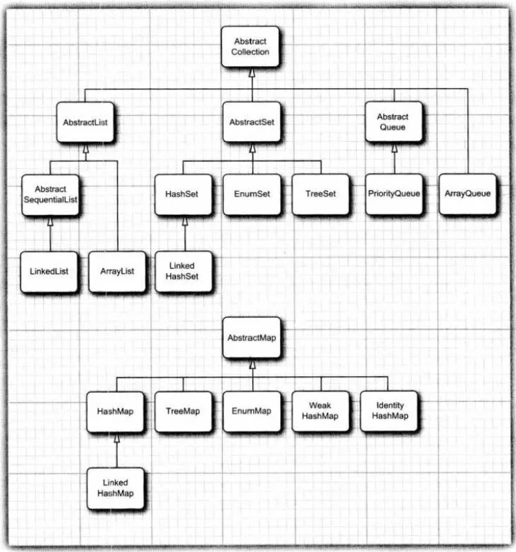

## 集合接口与实现分离

与现代的数据结构类库的常见情况一样，Java集合类库也将接口（interface)与实现(implementation)分离。

例如：队列

队列接口指出可以在队列的尾部添加元素，在队列的头部删除元素，并且可以査找队列中元素的个数。当需要收集对象，并按照“先进先出”的规则检索对象时就应该使用队列。

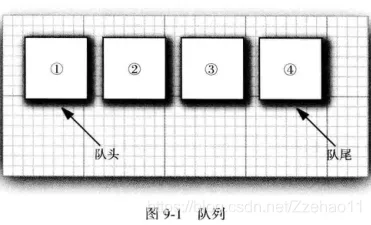

```java
package java.util;

/**
设计用于在加工前保存元素的集合。除了基本Collection操作外，队列还提供其他插入、提取和检查操作。这些方法中的每一个都以两种形式存在：一种在操作失败时引发异常，另一种返回特殊值（nullfalse或 ，具体取决于操作）。后一种形式的插入操作是专门为用于容量受限Queue的实现而设计的;在大多数实现中，插入操作不会失败。
队列方法摘要 

	 抛出异常   返回特殊值
插入 add(e)    offer(e)
删除 remove()  poll()
检查 element() peek()
队列通常（但不一定）以 FIFO（先进先出）方式对元素进行排序。例外情况包括优先级队列，它根据提供的比较器或元素的自然顺序对元素进行排序，以及后进先出队列（或堆栈）对元素进行后进先出（后进先出）排序。无论使用何种排序方式，队列 的头部 都是通过调用 remove() 或 poll()来删除的元素。在 FIFO 队列中，所有新元素都插入到队列的 尾部 。其他类型的队列可能使用不同的放置规则。每个 Queue 实现都必须指定其排序属性。
如果可能，该方法将插入一个元素， offer 否则返回 false.这与方法不同 Collection.add ，后者只能通过抛出未经检查的异常来无法添加元素。该 offer 方法设计用于正常故障而不是异常事件，例如，在固定容量（或“有界”）队列中。
remove() and poll() 方法删除并返回队列的头部。确切地说，从队列中删除哪个元素是队列排序策略的函数，该策略因实现而异。remove()和 poll() 方法的区别仅在于当队列为空时的行为：remove()该方法引发异常，而poll()该方法返回 null.
element()和 peek() 方法返回队列的头部，但不删除队列的头部。
该 Queue 接口未定义 阻塞队列方法，这些方法在并发编程中很常见。这些方法等待元素出现或空间可用，在扩展此接口的 java.util.concurrent.BlockingQueue 接口中定义。
Queue实现通常不允许插入元素，但某些实现（如 LinkedList）不禁止插入 。null null即使在允许它的实现中，也不应插入到 a Queue中，null因为null该方法也将其用作特殊返回值poll，以指示队列不包含任何元素。
Queue实现通常不定义方法的基于元素的equals版本，而是从类Object继承基于标识的版本，hashCode因为对于具有相同元素但不同排序属性的队列，基于元素的相等并不总是很好地定义。
此接口是 Java 集合框架的成员。
自:
1.5
作者:
道格·利
类型形参:
<E> – 此队列中保存的元素类型
 */
public interface Queue<E> extends Collection<E> {
    boolean add(E e);
    boolean offer(E e);
    E remove();
    E poll();
    E element();
    E peek();
}
```

在Queue接口中，定义基本的元素插入和删除的方法，主要方法及其含义分别如下：

| 方法                 | 说明                                                         |
| -------------------- | ------------------------------------------------------------ |
| `boolean add(E e)`   | 向队列中添加一个元素；如果有空间则添加成功返回true，否则则抛出`IllegalStateException`异常 |
| `boolean offer(E e)` | 向队列中添加一个元素；如果有空间则添加成功返回true，否则返回false |
| `E remove()`         | 从队列中删除一个元素；如果元素存在则返回队首元素，否则抛出`NoSuchElementException`异常 |
| `E poll();`          | 从队列中删除一个元素；如果元素存在则返回队首元素，否则返回null |
| `E element()`        | 从队列获取一个元素，但是不删除；如果元素存在则返回队首元素，否则抛出`NoSuchElementException`异常 |
| `E peek()`           | 从队列获取一个元素，但是不删除；如果元素存在则返回队首元素，否则返回null |

队列通常有两种实现方式：一种是使用循环数组；另一种是使用链表

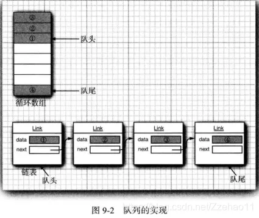

当在程序中使用队列时，一旦构建了集合就不需要知道究竟使用了哪种实现。因此，只有在构建集合对象时，使用具体的类才有意义。可以使用接口类型存放集合的引用。

```java
Queue<String> queue = new ArrayDeque<>();
//构造一个空数组 deque，其初始容量足以容纳 16 个元素。
public ArrayDeque() {
    elements = new Object[16 + 1];
}
/*
接口的Deque可调整大小的数组实现。阵列设计没有容量限制;它们会根据需要增长以支持使用。它们不是线程安全的;在没有外部同步的情况下，它们不支持多个线程的并发访问。禁止使用 null 元素。此类可能比用作堆栈时更快，并且比LinkedList用作队列时更快Stack。
大多数ArrayDeque操作在摊销的常量时间内运行。例外情况包括 remove、 、 removeLastOccurrence、 removeFirstOccurrencecontains和 iterator.remove()批量运算，所有这些运算都以线性时间运行。
此类 iterator 方法返回的迭代器是 快速失败的：如果在创建迭代器后的任何时间修改 deque，除了通过迭代器自己的 remove 方法之外，以任何方式修改迭代器，迭代器通常会抛出一个 ConcurrentModificationException.因此，面对并发修改，迭代器会快速而干净地失败，而不是冒着在未来不确定时间出现任意、非确定性行为的风险。
请注意，迭代器的快速故障行为无法得到保证，因为一般来说，在存在不同步的并发修改的情况下，不可能做出任何硬性保证。快速失败的迭代器会尽最大努力进行 ConcurrentModificationException 迭代。因此，编写一个依赖于此异常的程序的正确性是错误的： 迭代器的快速失败行为应该仅用于检测错误。
此类及其迭代器实现 、 SequencedCollection和 Iterator 接口的所有可选方法Collection。
*/

Queue<String> queue = new LinkedList<>();
//构造一个空列表。
public LinkedList() {}
/*
和 Deque 接口的List双链表实现。实现所有可选列表操作，并允许所有元素（包括 null）。
所有操作都按照双向链接列表的预期执行。索引到列表的操作将从列表的开头或结尾遍历列表，以更接近指定索引者为准。
请注意，此实现不同步。 如果多个线程同时访问一个链表，并且至少有一个线程在结构上修改了该列表，则 必须在 外部同步该链表。（结构修改是添加或删除一个或多个元素的任何操作;仅仅设置元素的值不是结构修改。这通常是通过在自然封装列表的某些对象上进行同步来实现的。如果不存在此类对象，则应使用该 Collections.synchronizedList 方法“包装”列表。最好在创建时执行此操作，以防止意外的不同步访问列表：
    List list = Collections.synchronizedList(new LinkedList(...));
此类 iterator listIterator返回的迭代器是快速失败的：如果在创建迭代器后的任何时间对列表进行结构修改，则除了通过迭代器自己的 remove or add 方法之外，以任何方式修改列表，迭代器将抛出一个 ConcurrentModificationException.因此，面对并发修改，迭代器会快速而干净地失败，而不是冒着在未来不确定时间出现任意、非确定性行为的风险。
请注意，迭代器的快速故障行为无法得到保证，因为一般来说，在存在不同步的并发修改的情况下，不可能做出任何硬性保证。快速失败的迭代器会尽最大努力进行 ConcurrentModificationException 迭代。因此，编写一个依赖于此异常的程序的正确性是错误的： 迭代器的快速失败行为应该仅用于检测错误。
此类是 Java 集合框架的成员。
*/
```

利用这种方式，一旦改变了想法，可以轻松地使用另外一种不同的实现。只需要对程序的一个地方做出修改，即调用构造器的地方。

循环数组要比链表更高效，因此多数人优先选择循环数组。然而，通常这样做也需要付出一定的代价。

循环数组是一个有界集合，即容量有限。如果程序中要收集的对象数量没有上限，就最好使用链表来实现。

在研究API文档时，会发现另外一组名字以Abstract开头的类，例如，AbstractQueue。这些类是为类库实现者而设计的。如果想要实现自己的队列类（也许不太可能)，会发现扩展AbstractQueue类要比实现Queue接口中的所有方法轻松得多。

## Map接口

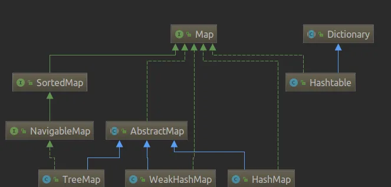

Map用于保存具有映射关系的数据，Map里保存着两组数据：key和value，它们都可以使任何引用类型的数据，但key不能重复。

#### HashMap

Map接口基于哈希表的实现，是使用频率最高的用于键值对处理的数据类型。

它根据键的hashCode值存储数据，大多数情况下可以直接定位到它的值，特点是访问速度快，遍历顺序不确定，线程不安全，最多允许一个key为null，允许多个value为null。

可以用 Collections的synchronizedMap方法使HashMap具有线程安全的能力，或者使用ConcurrentHashMap类。

#### Hashtable

Hashtable和HashMap从存储结构和实现来讲有很多相似之处，不同的是它承自Dictionary类，而且是线程安全的，另外Hashtable不允许key和value为null，并发性不如ConcurrentHashMap。

Hashtable不建议在新代码中使用，不需要线程安全的场合可以用HashMap替换，需要线程安全的场合可以用ConcurrentHashMap替换。

#### LinkedHashMap

LinkedHashMap继承了HashMap，是Map接口的哈希表和链接列表实现，它维护着一个双重链接列表，此链接列表定义了迭代顺序，该迭代顺序可以是插入顺序或者是访问顺序。

#### TreeMap

TreeMap实现SortMap接口，能够把它保存的记录根据键排序，默认是按键值的升序排序（自然顺序），也可以指定排序的比较器，当用Iterator遍历TreeMap时，得到的记录是排过序的。

#### 总结

| 实现类        | 数组结构                      | 是否线程安全 | key是否可为null | 是否有序 |
| ------------- | ----------------------------- | ------------ | --------------- | -------- |
| HashMap       | 数组+链表+红黑树              | 否           | 是              | 否       |
| Hashtable     | 数组+链表                     | 是           | 否              | 否       |
| LinkedHashMap | 数组+链表+红黑树+双重链接列表 | 否           | 是              | 是       |
| TreeMap       | 红黑树                        | 否           | 否              | 是       |


## Collection 接口

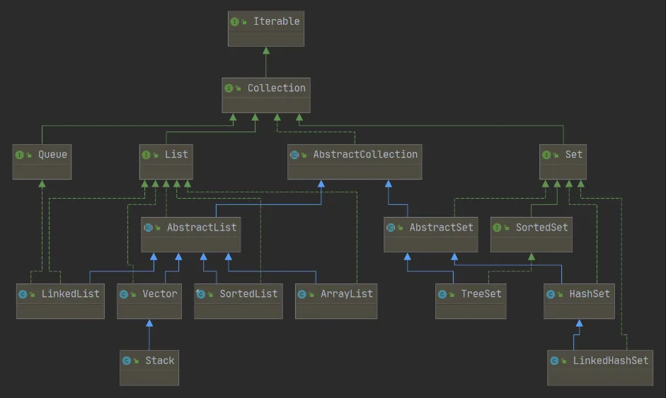

**Collection派生出了三个子接口：**

### **List**

List代表了有序可重复集合，可直接根据元素的索引来访问。

List接口常用的实现类有：ArrayList、LinkedList、Vector。

List集合特点
集合中的元素允许重复
集合中的元素是有顺序的，各元素插入的顺序就是各元素的顺序
集合中的元素可以通过索引来访问或者设置

#### ArrayList

ArrayList是一个动态数组，也是我们最常用的集合，是List类的典型实现。

它允许任何符合规则的元素插入甚至包括null，每一个ArrayList都有一个初始容量（10），该容量代表了数组的大小。

随着容器中的元素不断增加，容器的大小也会随着增加，在每次向容器中增加元素的同时都会进行容量检查，当快溢出时，就会进行扩容操作。

所以如果我们明确所插入元素的多少，最好指定一个初始容量值，避免过多的进行扩容操作而浪费时间、效率。

ArrayList擅长于随机访问，同时ArrayList是非同步的。

#### Vector

与ArrayList相似，但是Vector是同步的，它的操作与ArrayList几乎一样。

#### LinkedList

LinkedList是采用双向循环链表实现，LinkedList是List接口的另一个实现，除了可以根据索引访问集合元素外，LinkedList还实现了Deque接口，可以当作双端队列来使用，也就是说，既可以当作“栈”使用，又可以当作队列使用。

#### Java List总结

1、ArrayList
优点: 底层数据结构是数组，查询快，增删慢。
缺点: 线程不安全，效率高

2、Vector
优点: 底层数据结构是数组，查询快，增删慢。
缺点: 线程安全，效率低

3、LinkedList
优点: 底层数据结构是链表，查询慢，增删快。
缺点: 线程不安全，效率高

### **Set**

Set代表无序不可重复集合，只能根据元素本身来访问

#### HashSet

HashSet是Set集合最常用实现类，是其经典实现。

HashSet底层数据结构采用哈希表实现，元素无序且唯一，线程不安全，效率高，可以存储null元素，元素的唯一性是靠所存储元素类型是否重写hashCode()和equals()方法来保证的，如果没有重写这两个方法，则无法保证元素的唯一性。

#### LinkedHashSet

底层数据结构采用链表和哈希表共同实现，链表保证了元素的顺序与存储顺序一致，哈希表保证了元素的唯一性。

#### TreeSet

底层数据结构采用二叉树来实现，元素唯一且已经排好序,唯一性同样需要重写hashCode和equals()方法，二叉树结构保证了元素的有序性。

#### Java Set总结

1）HashSet

- 底层其实是包装了一个HashMap实现的

- 底层数据结构是数组+链表 + 红黑树
- 具有比较好的读取和查找性能， 可以有null 值
- 通过equals和HashCode来判断两个元素是否相等
- 非线程安全

2）LinkedHashSet

- 继承HashSet，本质是LinkedHashMap实现
- 底层数据结构由哈希表(是一个元素为链表的数组)和双向链表组成。
- 有序的，根据HashCode的值来决定元素的存储位置，同时使用一个链表来维护元素的插入顺序
- 非线程安全，可以有null 值

3）TreeSet

- 是一种排序的Set集合，实现了SortedSet接口，底层是用TreeMap实现的，本质上是一个红黑树原理
- 排序分两种：自然排序（存储元素实现Comparable接口）和定制排序（创建TreeSet时，传递一个自己实现的Comparator对象）
- 正常情况下不能有null值，可以重写Comparable接口 局可以有null值了。

### **Queue**

队列是数据结构中比较重要的一种类型，它支持 FIFO，尾部添加、头部删除（先进队列的元素先出队列），跟我们生活中的排队类似。

#### PriorityQueue

PriorityQueue保存队列元素的顺序并不是按照加入的顺序，而是按照队列元素的大小进行排序的。
PriorityQueue不允许插入null元素。

#### Deque

Deque接口是Queue接口的子接口，它代表一个双端队列,当程序中需要使用“栈”这种数据结构时，推荐使用ArrayDeque。

#### Java集合Map

Map用于保存具有映射关系的数据，Map里保存着两组数据：key和value，它们都可以使任何引用类型的数据，但key不能重复。

## 迭代器

Iterator接口包含 4个方法：

```java
public interface Iterator<E>
{
    E next();
    booleanhasNext();
    void remove();
    default void forEachRemaining(Consumer<? super E> action);
}
```

通过反复调用next方法，可以逐个访问集合中的每个元素。但是，如果到达了集合的末尾，next方法将抛出一个NoSuchElementException。因此，需要在调用next之前调用hasNext方法。如果迭代器对象还有多个供访问的元素，这个方法就返回true。如果想要査看集合中的所有元素，就请求一个迭代器，并在hasNext返回true时反复地调用next方法。

```java
public class DynamicArray implements Iterable<Integer>
	@Override
    public Iterator<Integer> iterator() {
        return new Iterator<Integer>() {
            int i = 0;

            @Override
            public boolean hasNext() { // 有没有下一个元素
                return i < size;
            }

            @Override
            public Integer next() { // 返回当前元素,并移动到下一个元素
                return array[i++];
            }
        };
    }
}
```

元素被访问的顺序取决于集合类型。如果对ArrayList进行迭代，迭代器将从索引0开始，每迭代一次，索引值加+1。然而，如果访问HashSet中的元素，每个元素将会按照某种随机的次序出现。虽然可以确定在迭代过程中能够遍历到集合中的所有元素，但却无法预知元素被访问的次序。这对于计算总和或统计符合某个条件的元素个数这类与顺序无关的操作来说，并不是什么问题。

## 泛型实用方法

由于Collection与Iterator都是泛型接口，可以编写操作任何集合类型的实用方法。Java类库的设计者认为：这些实用方法中的某些方法非常有用，应该将它们提供给用户使用。这样，类库的使用者就不必自己重新构建这些方法了。事实上，Collection接口声明了很多有用的方法，所有的实现类都必须提供这些方法。

```java
intsize()
boolean isEmpty()
boolean contains(Object obj)
boolean containsAl1(Col1ection<?> c)
boolean equals(Object other)
boolean addAll (Collection<? extends E> from)
boolean remove(Object obj)
boolean removeAl1(Col1ection<?> c)
void clear()
boolean retainAl1(Col1ection<?> c)
Object[] toArray()
<T> T[] toArray(T[] arrayToFill)
```

# 具体集合

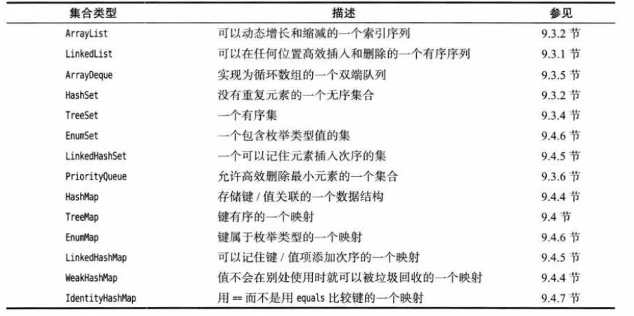

## 链表

链表（LinkedList）将每个对象存放在独立的结点中。每个结点还存放着序列中下一个结点的引用。在Java程序设计语言中，所有链表实际上都是双向链接的(doubly linked)—即每个结点还存放着指向前驱结点的引用。

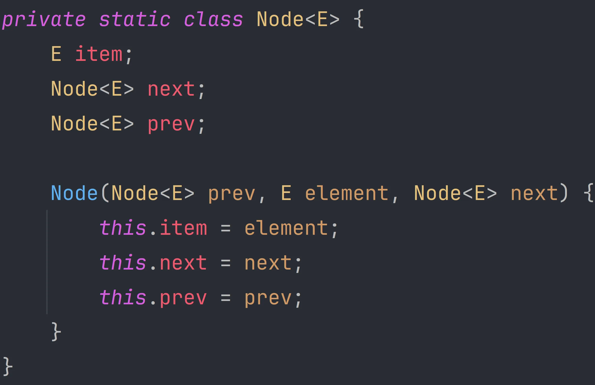

| 方法                                      | 解释                                |
| ----------------------------------------- | ----------------------------------- |
| boolean add(E e)                          | 尾插 e                              |
| void add(int index, E element)            | 将 e 插入到 index 位置              |
| boolean addAll(Collection<? extends E> c) | 尾插 c 中的元素                     |
| E remove(int index)                       | 删除 index 位置元素                 |
| boolean remove(Object o)                  | 删除遇到的第一个 o                  |
| E get(int index)                          | 获取下标 index 位置元素             |
| E set(int index, E element)               | 将下标 index 位置元素设置为 element |
| void clear()                              | 清空                                |
| boolean contains(Object o)                | 判断 o 是否在线性表中               |
| int indexOf(Object o)                     | 返回第一个 o 所在下标               |
| int lastIndexOf(Object o)                 | 返回最后一个 o 的下标               |
| List subList(int fromIndex, int toIndex)  | 截取部分 list                       |

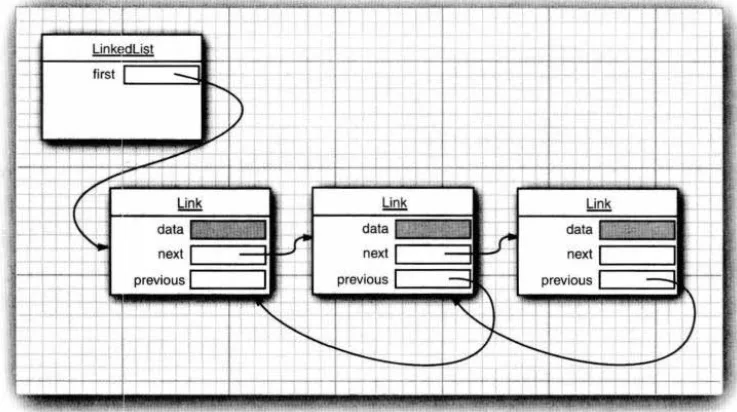

从链表中间删除一个元素是一个很轻松的操作，即需要更新被删除元素附近的链接。因为java虚拟机的垃圾回收机制会自动去掉不需要的数据。

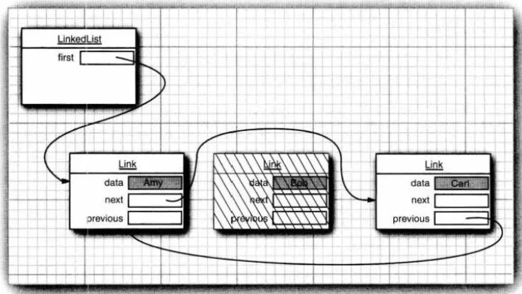

链表与泛型集合之间有一个重要的区别。链表是一个有序集合（ordered collection),每个对象的位置十分重要。

Add方法在迭代器位置之前添加一个新对象。

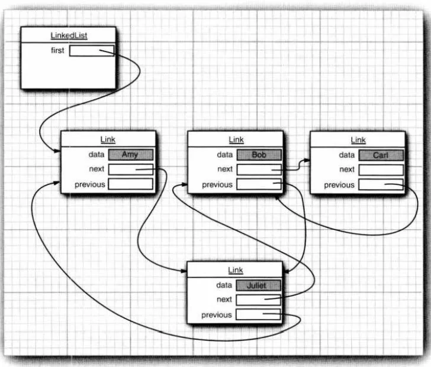

如果多次调用add方法，将按照提供的次序把元素添加到链表中。它们被依次添加到迭代器当前位置之前。当用一个刚刚由Iterator方法返回，并且指向链表表头的迭代器调用add操作时，新添加的元素将变成列表的新表头。当迭代器越过链表的最后一个元素时（即hasNext返回false),添加的元素将变成列表的新表尾。如果链表有n个元素，有n+1个位置可以添加新元素。这些位置与迭代器的n+1个可能的位置相对应。

```java
|ABC
A|BC
AB|C
ABC|
```

在前面已经看到，Collection接口中声明了许多用于对链表操作的有用方法。其中大部分方法都是在LinkedList类的超类AbstractCollection中实现的。如果列表只有少数几个元素，就完全可以使用ArrayList。我们建议避免使用以整数索引表示链表中位置的所有方法。如果需要对集合进行随机访问，就使用数组或ArrayList,而不要使用链表。

| 不同点     | ArrayList                | LinkedList                           |
| ---------- | ------------------------ | ------------------------------------ |
| 存储空间上 | 物理上一定连续           | 逻辑上连续，但物理上不一定连续       |
| 随机访问   | 支持O(1)                 | 不支持：O(N)                         |
| 头插       | 需要搬移元素，效率低O(N) | 只需修改引用的指向，时间复杂度为O(1) |
| 插入       | 空间不够时需要扩容       | 没有容量的概念                       |
| 应用场景   | 元素高效存储+频繁访问    | 任意位置插入和删除频繁               |

## 数组列表

前面介绍了 List 接口和实现了这个接口的LinkedList类。List 接口用于描述一个有序集合，并且集合中每个元素的位置十分重要。有两种访问元素的协议：一种是用迭代器，另一种是用get和set方法随机地访问每个元素。后者不适用于链表，但对数组却很有用。集合类库提供了一种大家熟悉的ArrayList类，这个类也实现了List接口。ArrayList封装了一个动态再分配的对象数组。

对于一个经验丰富的Java程序员来说，在需要动态数组时，可能会使用Vector类。为什么要用ArrayList取代Vector呢？原因很简单：Vector类的所有方法都是同步的。可以由两个线程安全地访问一个Vector对象。但是，如果由一个线程访问Vector,代码要在同步操作上耗费大量的时间。这种情况还是很常见的。而ArrayList方法不是同步的，因此，建议在不需要同步时使用ArrayList,而不要使用Vector。

## 散列集

链表和数组可以按照人们的意愿排列元素的次序。但是，如果想要査看某个指定的元素，却又忘记了它的位置，就需要访问所有元素，直到找到为止。如果集合中包含的元素很多，将会消耗很多时间。如果不在意元素的顺序，可以有几种能够快速査找元素的数据结构。其缺点是无法控制元素出现的次序。它们将按照有利于其操作目的的原则组织数据。

有一种众所周知的数据结构，可以快速地査找所需要的对象，这就是散列表（table)。散列表为每个对象计算一个整数，称为散列码（hash code)。散列码是由对象的实例域产生的一个整数。更准确地说，具有不同数据域的对象将产生不同的散列码。下表列出了几个散列码的示例，它们是由String类的hashCode方法产生的。

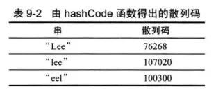

现在，最重要的问题是散列码要能够快速地计算出来，并且这个计算只与要散列的对象状态有关，与散列表中的其他对象无关。在Java中，散列表用链表数组实现。每个列表被称为桶（bucket)。要想査找表中对象的位置，就要先计算它的散列码，然后与桶的总数取余，所得到的结果就是保存这个元素的桶的索引。例如，如果某个对象的散列码为76268,并且有128个桶，对象应该保存在第108号桶中（76268除以128余108)。或许会很幸运，在这个桶中没有其他元素，此时将元素直接插人到桶中就可以了。

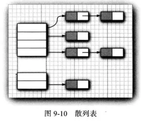

当然，有时候会遇到桶被占满的情况，这也是不可避免的。这种现象被称为散列冲突（hashcollision)。这时，需要用新对象与桶中的所有对象进行比较，査看这个对象是否已经存在。如果散列码是合理且随机分布的，桶的数目也足够大，需要比较的次数就会很少。

如果想更多地控制散列表的运行性能，就要指定一个初始的桶数。桶数是指用于收集具有相同散列值的桶的数目。如果要插入到散列表中的元素太多，就会增加冲突的可能性，降低运行性能。

如果大致知道最终会有多少个元素要插人到散列表中，就可以设置桶数。通常，将桶数设置为预计元素个数的75%~150%。有些研究人员认为：尽管还没有确凿的证据，但最好将桶数设置为一个素数，以防键的集聚。标准类库使用的桶数是2的幂，默认值为16(为表大小提供的任何值都将被自动地转换为2的下一个幂)。

当然，并不是总能够知道需要存储多少个元素的，也有可能最初的估计过低。如果散列表太满，就需要再散列（rehashed)。如果要对散列表再散列，就需要创建一个桶数更多的表，并将所有元素插入到这个新表中.，然后丢弃原来的表。`装填因子（loadfactor)决定何时对散列表进行再散列。`例如，如果装填因子为0.75(默认值)，而表中超过75%的位置已经填人元素，这个表就会用双倍的桶数自动地进行再散列。`对于大多数应用程序来说，装填因子为0.75是比较合理的。`

散列表可以用于实现几个重要的数据结构。`其中最简单的是set类型。`set是没有重复元素的元素集合。set的add方法首先在集中查找要添加的对象，如果不存在，就将这个对象添加进去。

Java集合类库提供了一个HashSet类，它实现了基于散列表的集。可以用add方法添加元素。contains方法已经被重新定义，用来快速地查看是否某个元素已经出现在集中。它只在某个桶中査找元素，而不必查看集合中的所有元素。

散列集迭代器将依次访问所有的桶。由于散列将元素分散在表的各个位置上，所以访问它们的顺序几乎是随机的。只有不关心集合中元素的顺序时才应该使用HashSet。

## 树集

TreeSet类与散列集十分类似，不过，它比散列集有所改进。树集是一个有序集合(sorted collection)。可以以任意顺序将元素插入到集合中。在对集合进行遍历时，每个值将自动地按照排序后的顺序呈现。

```java
SortedSet<String> sorter = new TreeSet<>(); //TreeSet implements SortedSet
sorter.add("Bob");
sorter.add("Aniy");
sorter.add("Carl");

sorter.forEach(System.out::println);
```

这时，每个值将按照顺序打印出来：Amy Bob Carl。正如TreeSet类名所示，排序是用树结构完成的（当前实现使用的是红黑树（red-black tree)）。每次将一个元素添加到树中时，都被放置在正确的排序位置上。因此，迭代器总是以排好序的顺序访问每个元素。

将一个元素添加到树中要比添加到散列表中慢，如下表的比较，但是，与检查数组或链表中的重复元素相比还是快很多。如果树中包含n个元素，査找新元素的正确位置平均需要log2n次比较。

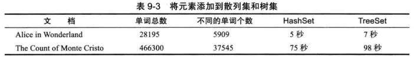

要使用树集，必须能够比较元素。这些元素必须实现 Comparable接口，或者构造集时必须提供一个 Comparator。回头看一看表可能会有疑虑：是否总是应该用树集取代散列集。毕竟，添加一个元素所花费的时间看上去并不很长，而且元素是自动排序的。到底应该怎样做将取决于所要收集的数据。`如果不需要对数据进行排序，就没有必要付出排序的开销。`更重要的是，对于某些数据来说，对其排序要比散列函数更加困难。`散列函数只是将对象适当地打乱存放，而比较却要精确地判别每个对象。`要想具体地了解它们之间的差异，还需要研究一个收集矩形集的任务。如果使用TreeSet,就需要提供`Comparator<Rectangle>`。如何比较两个矩形呢？比较面积吗？这行不通。可能会有两个不同的矩形，它们的坐标不同，但面积却相同。`树的排序必须是全序。也就是说，任意两个元素必须是可比的，并且只有在两个元素相等时结果才为0。`确实，有一种矩形的排序（按照坐标的词典顺序排列）方式，但它的计算很牵强且很繁琐。相反地，Rectangle类已经定义了散列函数，它直接对坐标进行散列。

## 队列与双端队列

前面已经讨论过，队列可以让人们有效地在尾部添加一个元素，在头部删除一个元素。有两个端头的队列，即双端队列，可以让人们有效地在头部和尾部同时添加或删除元素。不支持在队列中间添加元素。在JavaSE6中引人了Deque接口，并由ArrayDeque和LinkedList类实现。这两个类都提供了双端队列，而且在必要时可以增加队列的长度。

## 优先级队列

优先级队列（priority queue)中的元素可以按照任意的顺序插人，却总是按照排序的顺序进行检索。也就是说，无论何时调用remove方法，总会获得当前优先级队列中最小的元素。然而，优先级队列并没有对所有的元素进行排序。如果用迭代的方式处理这些元素，并不需要对它们进行排序。`优先级队列使用了一个优雅且高效的数据结构，称为堆（heap)。堆是一个可以自我调整的二叉树，对树执行添加（add)和删除（remore)操作，可以让最小的元素移动到根，而不必花费时间对元素进行排序。`

与TreeSet—样，一个优先级队列既可以保存实现了Comparable接口的类对象，也可以保存在构造器中提供的Comparator对象。

使用优先级队列的典型示例是任务调度。每一个任务有一个优先级，任务以随机顺序添加到队列中。每当启动一个新的任务时，都将优先级最高的任务从队列中删除（由于习惯上将1设为“最高”优先级，所以会将最小的元素删除)。

# **映射**

集是一个集合，它可以快速地查找现有的元素。但是，要查看一个元素，需要有要查找元素的精确副本。这不是一种非常通用的査找方式。通常，我们知道某些键的信息，并想要查找与之对应的元素。映射（map)数据结构就是为此设计的。映射用来存放键/值对。如果提供了键，就能够查找到值。

## 基本映射操作

Java类库为映射提供了两个通用的实现：HashMap和TreeMap。这两个类都实现了Map接口。

散列映射对键进行散列，树映射用键的整体顺序对元素进行排序，并将其组织成搜索树。散列或比较函数只能作用于键。与键关联的值不能进行散列或比较。

应该选择散列映射还是树映射呢？与集一样，散列稍微快一些，如果不需要按照排列顺序访问键，就最好选择散列。

```java
Map<String, Integer> sorter = new HashMap<>();
sorter.put("987-98-9996 ", 1);
sorter.put("987-98-9995 ", 2);
sorter.put("987-98-9997 ", 3);

sorter.forEach((k, v) -> System.out.println("key=" + k + ",value=" + v));
```

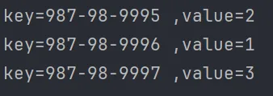

| 方法                          | 解释                                                         |
| ----------------------------- | ------------------------------------------------------------ |
| clear()                       | 从 Map 中删除所有映射                                        |
| remove(Object key)            | 从 Map 中删除键和关联的值                                    |
| put(Object key, Object value) | 将指定值与指定键相关联                                       |
| putAll(Map t)                 | 将指定 Map 中的所有映射复制到此 map                          |
| entrySet()                    | 返回 Map 中所包含映射的 Set 视图。Set 中的每个元素都是一个 Map.Entry 对象，可以使用 getKey() 和 getValue() 方法（还有一个 setValue() 方法）访问后者的键元素和值元素 |
| keySet()                      | 返回 Map 中所包含键的 Set 视图。删除 Set 中的元素还将删除 Map 中相应的映射（键和值） |
| values()                      | 返回 map 中所包含值的 Collection 视图。删除 Collection 中的元素还将删除 Map 中相应的映射（键和值） |
| get(Object key)               | 返回与指定键关联的值                                         |
| getOrDefault                  | 获得与键关联的值；返回与键关联的对象，或者如果未在映射中找到这个键，则返回default Value。 |
| containsKey(Object key)       | 如果 Map 包含指定键的映射，则返回 true                       |
| containsValue(Object value)   | 如果此 Map 将一个或多个键映射到指定值，则返回 true           |
| isEmpty()                     | 如果 Map 不包含键-值映射，则返回 true                        |
| size()                        | 返回 Map 中的键-值映射的数目                                 |

## 更新映射项

处理映射时的一个难点就是更新映射项。正常情况下，可以得到与一个键关联的原值，完成更新，再放回更新后的值。不过，必须考虑一个特殊情况，即键第一次出现。

`counts.put ( word, counts. get ( word)+ 1 ) ;`

这是可以的，不过有一种情况除外：就是第一次看到word时。在这种情况下，get会返回null,因此会出现一个NullPointerException异常。作为一个简单的补救，可以使用getOrDefault方法：

`counts.put ( word, counts.getOrDefault ( word, 0)+ 1 ) ;`

另一种方法是首先调用 putlfAbsent方法。只有当键原先存在时才会放入一个值。

```java
counts.putlfAbsent ( word, 0 ) ;
counts.put ( word, counts.get ( word)+ 1 ) ; // Now we know that get will succeed
```

不过还可以做得更好。merge方法可以简化这个常见的操作。如果键原先不存在，下面的调用：

`counts.merge ( word, 1, Integer::sum) ;`

将把word与1关联，否则使用Integer::sum函数组合原值和1(也就是将原值与1求和)。API注释还描述了另外一些更新映射项的方法，不过这些方法不太常用。

## 映射视图

集合框架不认为映射本身是一个集合。（其他数据结构框架认为映射是一个键/值对集合，或者是由键索引的值集合。）不过，可以得到映射的视图（View)—这是实现了Collection接口或某个子接口的对象。

有3种视图：键集、值集合（不是一个集）以及键/值对集。键和键/值对可以构成一个集，因为映射中一个键只能有一个副本。下面的方法：

```java
Set<K> keySet()
Collection<V> values()
Set<Map.Entry<K, V>> entrySet()
```

会分别返回这3个视图。（条目集的元素是实现Map.Entry接口的类的对象。）

需要说明的是，keySet不是HashSet或TreeSet，而是实现了Set接口的另外某个类的对象。Set接口扩展了Collection接口。因此，可以像使用集合一样使用keySet。

```java
Set<String>keys = map.keySet();
for (String key : keys)
{
    do something with key
}
```

如果想同时查看键和值，可以通过枚举条目来避免查找值。使用以下代码：

```java
for (Map.Entry<String, Employee〉 entry : staff.entrySet())
{
    String k = entry.getKey();
    Employee v = entry.getValue();
    dosomethingwith k, v
}
```

如果在键集视图上调用迭代器的remove方法，实际上会从映射中删除这个键和与它关联的值。不过，不能向键集视图增加元素。另外，如果增加一个键而没有同时增加值也是没有意义的。如果试图调用add方法，它会抛出一个UnsupportedOperationException。条目集视图有同样的限制，尽管理论上增加一个新的键/值对好像是有意义的。

## 弱散列映射

在集合类库中有几个专用的映射类，对它们做简要介绍。

设计WeakHashMap类是为了解决一个有趣的问题。如果有一个值，对应的键已经不再使用了，将会出现什么情况呢？假定对某个键的最后一次引用已经消亡，不再有任何途径引用这个值的对象了。但是，由于在程序中的任何部分没有再出现这个键，所以，这个键/值对无法从映射中删除。为什么垃圾回收器不能够删除它呢？难道删除无用的对象不是垃圾回收器的工作吗？

遗憾的是，事情没有这样简单。垃圾回收器跟踪活动的对象。只要映射对象是活动的，其中的所有桶也是活动的，它们不能被回收。因此，需要由程序负责从长期存活的映射表中删除那些无用的值。或者使用WeakHashMap完成这件事情。当对键的唯一引用来自散列条目时，这一数据结构将与垃圾回收器协同工作一起删除键/值对。

下面是这种机制的内部运行情况。WeakHashMap使用弱引用（weak references)保存键。WeakReference对象将引用保存到另外一个对象中，在这里，就是散列键。对于这种类型的对象，垃圾回收器用一种特有的方式进行处理。通常，如果垃圾回收器发现某个特定的对象已经没有他人引用了，就将其回收。然而，如果某个对象只能由WeakReference引用，垃圾回收器仍然回收它，但要将引用这个对象的弱引用放人队列中。

WeakHashMap将周期性地检查队列，以便找出新添加的弱引用。一个弱引用进人队列意味着这个键不再被他人使用，并且已经被收集起来。于是，WeakHashMap将删除对应的条目。

## 链接散列集与映射

LinkedHashSet和LinkedHashMap类用来记住插人元素项的顺序。这样就可以避免在散歹IJ表中的项从表面上看是随机排列的。当条目插入到表中时，就会并人到双向链表中 

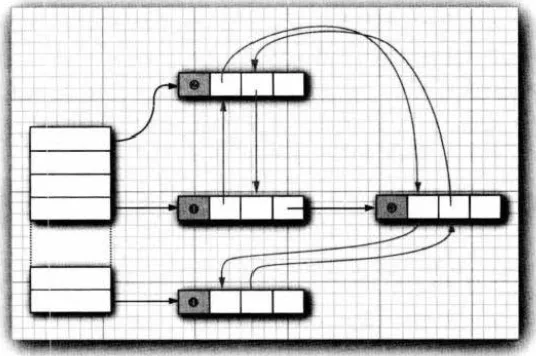

 例如，在最上面的程序中包含下列映射表插入的处理:

```java
Map<String, Employee >staff = new LinkedHashMap<>();
staff.put("144-25-5464", new Employee("Amy Lee"));
staff.put("567-24-2546", new Employee("Harry Hacker"));
staff.put("157-62-7935", new Employee("Gary Cooper"));
staff.put("456-62-5527", new Employee("Francesca Cruz"));
```

链接散列映射将用访问顺序，而不是插入顺序，对映射条目进行迭代。每次调用get或put,受到影响的条目将从当前的位置删除，并放到条目链表的尾部（只有条目在链表中的位置会受影响，而散列表中的桶不会受影响。一个条目总位于与键散列码对应的桶中）。

`LinkedHashMap<K, V>(initialCapacity, loadFactor, true)`

访问顺序对于实现高速缓存的“最近最少使用”原则十分重要。例如，可能希望将访问频率高的元素放在内存中，而访问频率低的元素则从数据库中读取。当在表中找不到元素项且表又已经满时，可以将迭代器加入到表中，并将枚举的前几个元素删除掉。这些是近期最少使用的几个元素。

## 枚举集与映射

EmimSet是一个枚举类型元素集的高效实现。由于枚举类型只有有限个实例，所以EnumSet内部用位序列实现。如果对应的值在集中，则相应的位被置为1。

EnumSet类没有公共的构造器。可以使用静态工厂方法构造这个集：

```java
enum Weekday { MONDAY, TUESDAY, WEDNESDAY, THURSDAY, FRIDAY, SATURDAY, SUNDAY };
EnumSet<Weekday>always= EnumSet.allOf(Weekday.class);
EnumSet<Weekday>never =EnumSet.noneOf(Weekday.class);
EnumSet<Weekday>workday=EnumSet.range(Weekday.MONDAY, Weekday.FRIDAY);
EnumSet<Weekday>mwf = EnumSet.of(Weekday.MONDAY, Weekday.WEDNESDAY, Weekday.FRIDAY);
```

可以使用Set接口的常用方法来修改EnumSet。

EnumMap是一个键类型为枚举类型的映射。它可以直接且高效地用一个值数组实现。在使用时，需要在构造器中指定键类型：

```java
EnumMap<Weekday, Employee> personInCharge = new EnumMapo( Weekday.class );
```

## 标识散列映射

类IdentityHashMap有特殊的作用。在这个类中，键的散列值不是用hashCode函数计算的，而是用System.identityHashCode方法计算的。这是Object.hashCode方法根据对象的内存地址来计算散列码时所使用的方式。而且，在对两个对象进行比较时，IdentityHashMap类使用==,而不使用equals。也就是说，不同的键对象，即使内容相同，也被视为是不同的对象。在实现对象遍历算法（如对象串行化）时，这个类非常有用，可以用来跟踪每个对象的遍历状况。

# 视图与包装器

我们可能会感觉：用如此多的接口和抽象类来实现数量并不多的具体集合类似乎没有太大必要。然而，通过使用视图(views)可以获得其他的实现了Collection接口和Map接口的对象。映射类的keySet方法就是一个这样的示例。初看起来，好像这个方法创建了一个新集，并将映射中的所有键都填进去，然后返回这个集。但是，情况并非如此。`取而代之的是：keySet方法返回一个实现Set接口的类对象，这个类的方法对原映射进行操作。这种集合称为视图。`视图技术在集框架中有许多非常有用的应用。

视图是对数据的逻辑上的组织和展示方式。它提供了一种虚拟的表结构，该结构是基于一个或多个表的查询结果而创建的。视图本身并不实际存储数据，而是通过查询操作来获取所需的数据。

使用视图在编写和维护代码时具有以下优势：

简化复杂查询：视图提供了一种抽象层，使我们能够以一种更高层次的方式执行复杂的查询操作。通过将查询逻辑封装在视图中，我们可以简化代码并提高可读性。

数据安全性：通过视图，我们可以限制对数据的访问权限。视图可以过滤敏感数据或只提供特定列的访问权限，从而提供更好的数据安全性。

逻辑分组：视图允许我们将相关数据逻辑上组织在一起。通过创建不同的视图，我们可以根据不同的需求和角度对数据进行组织和呈现。

## 轻量级集合包装器

Arrays类的静态方法asList将返回一个包装了普通Java数组的List包装器。这个方法可以将数组传递给一个期望得到列表或集合参数的方法。

```java
Card[] cardOeck=new Card[52];
List<Card> cardList=Arrays.asList(cardDeck);
```

返回的对象不是ArrayList。它是一个视图对象，带有访问底层数组的get和set方法。改变数组大小的所有方法（例如，与迭代器相关的add和remove方法）都会抛出一个UnsupportedOperationException异常。asList方法可以接收可变数目的参数。类似地，对于集合框架中的每一个接口，还有一些方法可以生成空集、列表、映射，等等。

## 子范围

可以为很多集合建立子范围（subrange)视图。

```java
List group2=staff.subList(10, 20);
```

第一个索引包含在内，第二个索引则不包含在内。这与String类的substring操作中的参数情况相同。可以将任何操作应用于子范围，并且能够自动地反映整个列表的情况。

## 不可修改的视图

Collections还有几个方法，用于产生集合的不可修改视图（unmodifiable views)。这些视图对现有集合增加了一个运行时的检查。如果发现试图对集合进行修改，就抛出一个异常，同时这个集合将保持未修改的状态。每个方法都定义于一个接口。

Collections-unmodifiableList方法将返回一个实现List接口的类对象。其访问器方法将从staff集合中获取值。当然，lookAt方法可以调用List接口中的所有方法，而不只是访问器。但是所有的更改器方法（例如，add)已经被重新定义为抛出一个UnsupportedOperationException异常，而不是将调用传递给底层集合。

不可修改视图并不是集合本身不可修改。仍然可以通过集合的原始引用（在这里是staff)对集合进行修改。并且仍然可以让集合的元素调用更改器方法。

由于视图只是包装了接口而不是实际的集合对象，所以只能访问接口中定义的方法。例如，LinkedList类有一些非常方便的方法，addFirst和addLast，它们都不是List接口的方法，不能通过不可修改视图进行访问。

## 同步视图

如果由多个线程访问集合，就必须确保集不会被意外地破坏。例如，如果一个线程试图将元素添加到散列表中，同时另一个线程正在对散列表进行再散列，其结果将是灾难性的。

类库的设计者使用视图机制来确保常规集合的线程安全，而不是实现线程安全的集合类。

```java
Map<String, Employee〉 map = Collections.synchronizedMap(new HashMap<String, Employee>());
```

现在，就可以由多线程访问map对象了。像get和put这类方法都是同步操作的，即在另一个线程调用另一个方法之前，刚才的方法调用必须彻底完成。

## 受查视图

"受査”视图用来对泛型类型发生问题时提供调试支持。如同之前所述，实际上将错误类型的元素混人泛型集合中的问题极有可能发生。

视图的add方法将检测插人的对象是否属于给定的类。如果不属于给定的类，就立即抛出一个ClassCastException。这样做的好处是错误可以在正确的位置得以报告。

```java
ArrayList<String> strings = new ArrayList<>();
ArrayList rawList = strings; //warning only, not an error, for compatibility with legacy code
rawList.add(newDate());//now strings contains a Date object!

List<String> safestrings = Collections.checkedList(strings，String,class);
ArrayList rawList = safestrings;
rawList.add(newDate());//checked list throws a ClassCastException
```

## 关于可选操作的说明

通常，视图有一些局限性，即可能只可以读、无法改变大小、只支持删除而不支持插人，这些与映射的键视图情况相同。如果试图进行不恰当的操作，受限制的视图就会抛出一个UnsupportedOperationException。

在集合和迭代器接口的API文档中，许多方法描述为“可选操作”。这看起来与接口的概念有所抵触。毕竟，接口的设计目的难道不是负责给出一个类必须实现的方法吗？确实，从理论的角度看，在这里给出的方法很难令人满意。一个更好的解决方案是为每个只读视图和不能改变集合大小的视图建立各自独立的两个接口。不过，这将会使接口的数量成倍增长，这让类库设计者无法接受。

是否应该将“可选”方法这一技术扩展到用户的设计中呢？我们认为不应该。尽管集合被频繁地使用，其实现代码的风格也未必适用于其他问题领域。集合类库的设计者必须解决一组特别严格且又相互冲突的需求。用户希望类库应该易于学习、使用方便，彻底泛型化，面向通用性，同时又与手写算法一样高效。要同时达到所有目标的要求，或者尽量兼顾所有目标完全是不可能的。但是，在自己的编程问题中，很少遇到这样极端的局限性。应该能够找到一种不必依靠极端衡量“可选的”接口操作来解决这类问题的方案。

# **算法**

## 为什么使用泛型算法

泛型集合接口有一个很大的优点，即算法只需要实现一次。例如，考虑一下计算集合中最大元素这样一个简单的算法。使用传统方式，程序设计人员可能会用循环实现这个算法。下面就是找出数组中最大元素的代码。

```java
//数组
if (a.length == 0) throw new NoSuchElementException();
T largest = a[0];
for (int i = 1; i < a.length; i ++)
	if (largest.compareTo(a[i]) < 0)
		largest = a[i];

//列表
if (v.size()== 0) throw new NoSuchElementException();
T largest = v.get(O);
for (int i = 1; i < v.size(); i ++)
	if (largest.compareTo(v.get(i)) < 0)
		largest = v.get(i);

//链表
if (1.isEmpty()) throw new NoSuchElementException():
Iterator<T> iter = l.iterator()；
T largest = iter.next();
while (iter.hasNext())
{
	T next = iter.next();
	if (largest.compareTo(next) < 0)
		largest = next;
}
```

## 排序与混排

```java
List<String> staff = new LinkedList<>();
fill collection
Collections.sort(staff);
```

这个方法假定列表元素实现了Comparable接口。如果想采用其他方式对列表进行排序，可以使用List接口的sort方法并传入一个Comparator对象。

`staff.sort(Comparator.comparingDouble(Employee::getSalary));`

如果想按照降序对列表进行排序，可以使用一种非常方便的静态方法Collections.reverseOrder()。

`staff.sort(Comparator.reverseOrder())`

这个方法将根据元素类型的compareTo方法给定排序顺序，按照逆序对列表staff进行排序。

`staff.sort(Comparator.comparingDouble(Employee::getSalary).reversed())`

人们可能会对sort方法所采用的排序手段感到好奇。通常，在翻阅有关算法书籍中的排序算法时，会发觉介绍的都是有关数组的排序算法，而且使用的是随机访问方式。但是，对列表进行随机访问的效率很低。实际上，可以使用归并排序对列表进行高效的排序。Java程序设计语言并不是这样实现的。它直接将所有元素转人一个数组，对数组进行排序，然后，再将排序后的序列复制回列表。

集合类库中使用的排序算法比快速排序要慢一些，快速排序是通用排序算法的传统选择。但是，归并排序有一个主要的优点：稳定，即不需要交换相同的元素。

因为集合不需要实现所有的“可选”方法，因此，所有接受集合参数的方法必须描述什么时候可以安全地将集合传递给算法。根据文档说明，列表必须是可修改的，但不必是可以改变大小的。

下面是有关的术语定义：

- 如果列表支持set方法，则是可修改的。

- 如果列表支持add和remove方法，则是可改变大小的。


Collections类有一个算法shuffle,其功能与排序刚好相反，即随机地混排列表中元素的顺序。

## 二分查找

要想在数组中査找一个对象，通常要依次访问数组中的每个元素，直到找到匹配的元素为止。然而，如果数组是有序的，就可以直接査看位于数组中间的元素，看一看是否大于要查找的元素。如果是，用同样的方法在数组的前半部分继续查找；否则，用同样的方法在数组的后半部分继续查找。这样就可以将查找范围缩减一半。一直用这种方式査找下去。

Collections类的binarySearch方法实现了这个算法。注意，集合必须是排好序的，否则算法将返回错误的答案。要想查找某个元素，必须提供集合（这个集合要实现List接口，下面还要更加详细地介绍这个问题）以及要查找的元素。如果集合没有采用Comparable接口的compareTo方法进行排序，就还要提供一个比较器对象。

```java
i = Collections.binarySearch(c, element);
i = Collections.binarySearch(c, element, comparator);
```

如果binarySearch方法返回的数值大于等于0,则表示匹配对象的索引。也就是说,c.get(i)等于在这个比较顺序下的element。如果返回负值，则表示没有匹配的兀素。但是，可以利用返回值计算应该将element插人到集合的哪个位置，以保持集合的有序性。

## 简单算法

在Collections类中包含了几个简单且很有用的算法。前面介绍的查找集合中最大元素的示例就在其中。另外还包括：将一个列表中的元素复制到另外一个列表中；用一个常量值填充容器；逆置一个列表的元素顺序。

## 批操作

很多操作会“成批”复制或删除元素。例如从coll1中删除coll2中出现的所有元素。

`coll1.removeAll(coll2);`

## 集合与数组的转换

由于Java平台API的大部分内容都是在集合框架创建之前设计的，所以，有时候需要在传统的数组和比较现代的集合之间进行转换。

如果需要把一个数组转换为集合，Arrays.asList 包装器可以达到这个目的。

从集合得到数组会更困难一些。当然，可以使用 toArray方法。

## 编写自己的算法

如果编写自己的算法（实际上，是以集合作为参数的任何方法)，应该尽可能地使用接口，而不要使用具体的实现。

# **遗留的集合**

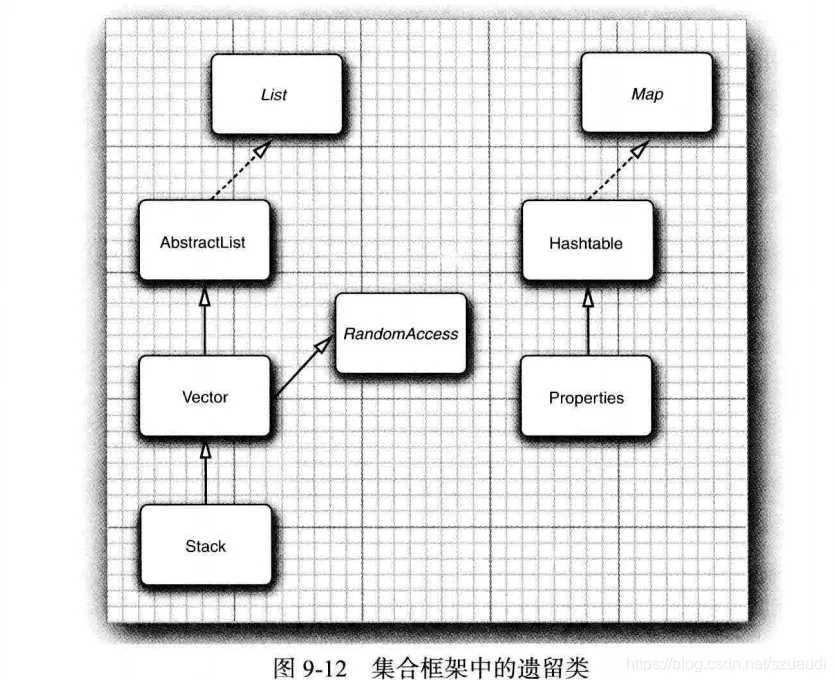

## Hashtable类

Hashtable类与HashMap类的作用一样，实际上，它们拥有相同的接口。与Vector类的方法一样。Hashtable的方法也是同步的。如果对同步性或与遗留代码的兼容性没有任何要求，就应该使用HashMap。如果需要并发访问，则要使用ConcurrentHashMap。

## 枚举

遗留集合使用Enumeration接口对元素序列进行遍历。Enumeration接口有两个方法，即hasMoreElements和nextElement。这两个方法与Iterator接口的hasNext方法和next方法十分类似。

## 属性映射

属性映射（propertymap)是一个类型非常特殊的映射结构。它有下面3个特性：

- 键与值都是字符串。
- 表可以保存到一个文件中，也可以从文件中加载。
- 使用一个默认的辅助表。

实现属性映射的Java平台类称为Properties。

## 栈

从1.0版开始，标准类库中就包含了Stack类，其中有大家熟悉的push方法和pop方法。但是，Stack类扩展为Vector类，从理论角度看，Vector类并不太令人满意，它可以让栈使用不属于栈操作的insert和remove方法，即可以在任何地方进行插入或删除操作，而不仅仅是在栈顶。

## 位集

Java平台的BitSet类用于存放一个位序列（它不是数学上的集，称为位向量或位数组更为合适)。如果需要高效地存储位序列（例如，标志）就可以使用位集。由于位集将位包装在字节里，所以，使用位集要比使用Boolean对象的ArrayList更加高效。

BitSet类提供了一个便于读取、设置或清除各个位的接口。使用这个接口可以避免屏蔽和其他麻烦的位操作。如果将这些位存储在int或long变量中就必须进行这些繁琐的操作。
