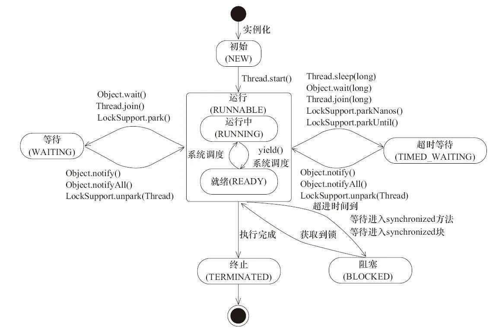
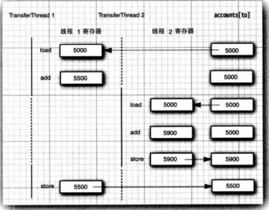
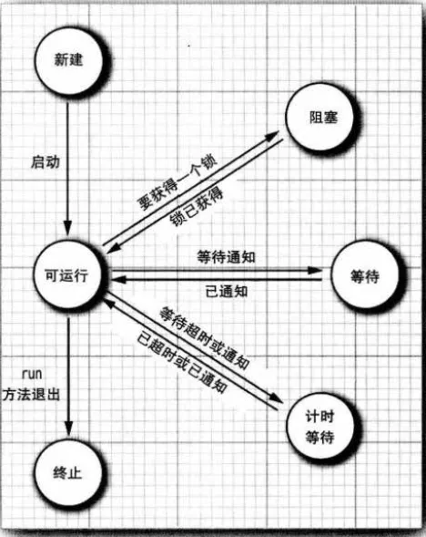
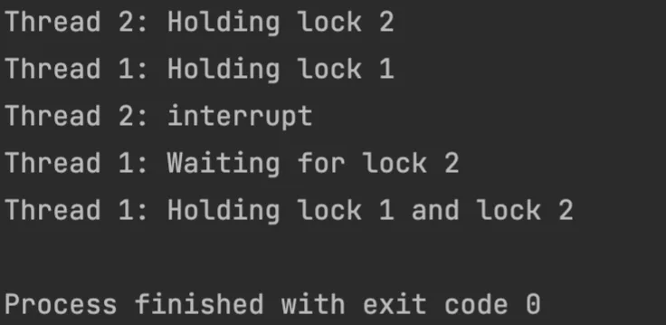
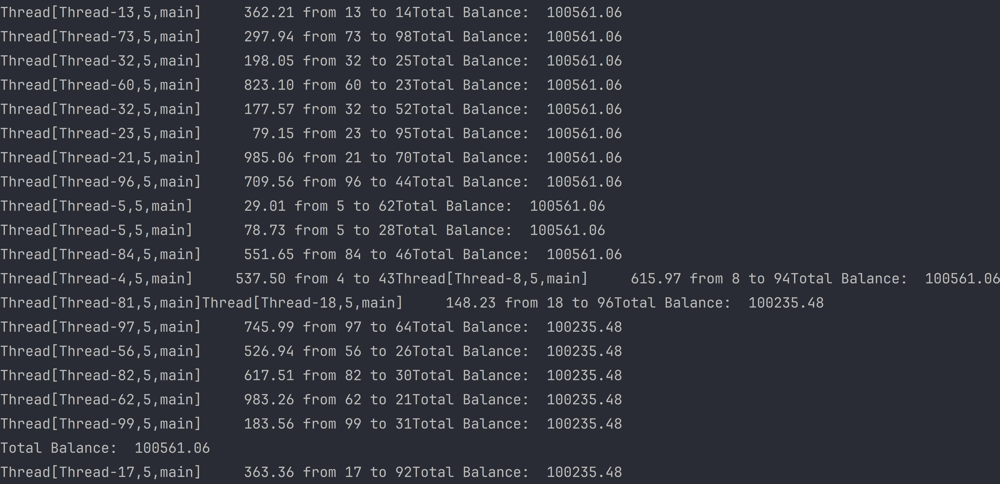
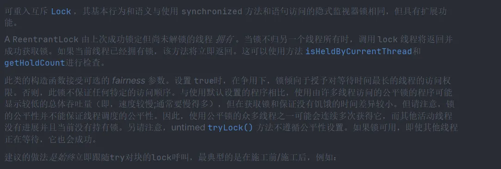
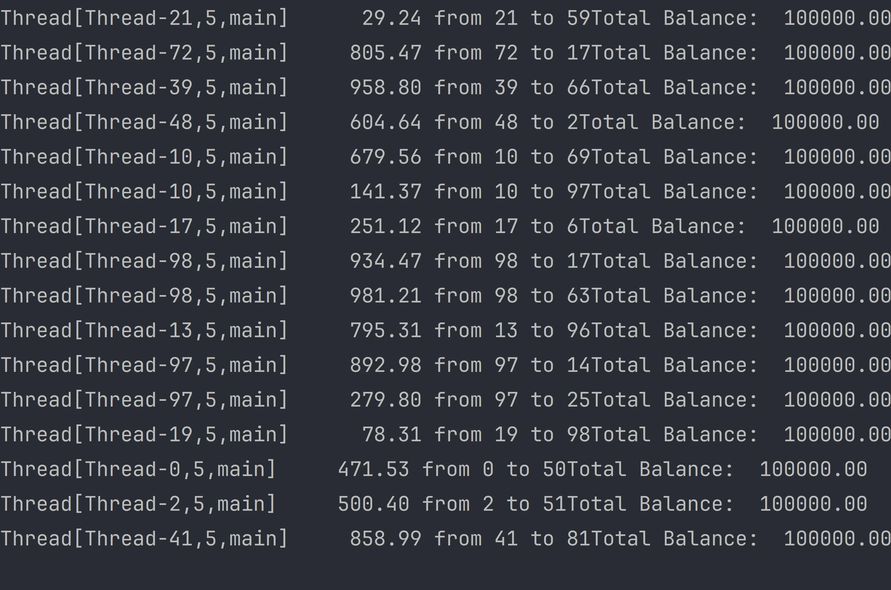
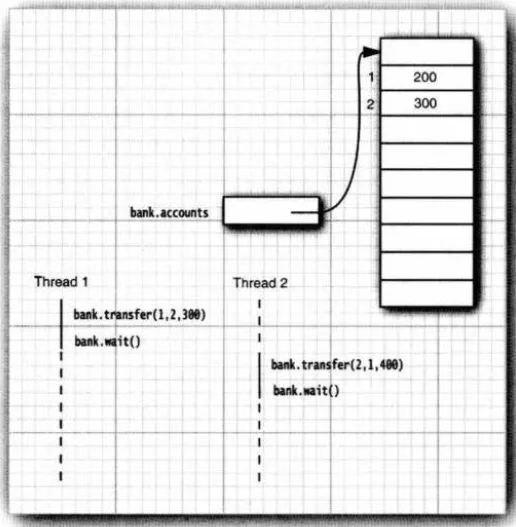
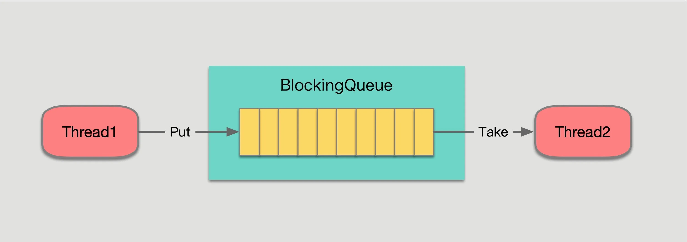

# 多线程

大家很熟悉操作系统中的多任务（multitasking):在同一刻运行多个程序的能力。例如，在编辑或下载邮件的同时可以打印文件。今天，人们很可能有单台拥有多个CPU的计算机，但是，并发执行的进程数目并不是由CPU数目制约的。操作系统将CPU的时间片分配给每一个进程，给人并行处理的感觉。

多线程程序在较低的层次上扩展了多任务的概念：一个程序同时执行多个任务。通常，每一个任务称为一个线程（thread),它是线程控制的简称。可以同时运行一个以上线程的程序称为多线程程序（multithreaded)。

那么，多进程与多线程有哪些区别呢？本质的区别在于每个进程拥有自己的一整套变量，而线程则共享数据。这听起来似乎有些风险，的确也是这样，在本章稍后将可以看到这个问题。然而，共享变量使线程之间的通信比进程之间的通信更有效、更容易。此外，在有些操作系统中，与进程相比较，线程更“轻量级”，创建、撤销一个线程比启动新进程的开销要小得多。

# 什么是线程

首先来看一个使用了两个线程的简单程序。

```java
package javalearn.beanlearn;

public class test {
    public static void main(String[] args) {
        RunnableDemo R1 = new RunnableDemo("Thread-1");
        R1.start();

        RunnableDemo R2 = new RunnableDemo("Thread-2");
        R2.start();
    }
}

class RunnableDemo implements Runnable {
    private Thread t;
    private String threadName;

    RunnableDemo(String name) {
        threadName = name;
        System.out.println("Creating " + threadName);
    }

    public void run() {
        System.out.println("Running " + threadName);
        try {
            for (int i = 4; i > 0; i--) {
                System.out.println("Thread: " + threadName + ", " + i);
                // 让线程睡眠一会
                Thread.sleep(50);
            }
        } catch (InterruptedException e) {
            System.out.println("Thread " + threadName + " interrupted.");
        }
        System.out.println("Thread " + threadName + " exiting.");
    }

    public void start() {
        System.out.println("Starting " + threadName);
        if (t == null) {
            t = new Thread(this, threadName);
            t.start();
        }
    }
}
```

```
Creating Thread-1
Starting Thread-1
Creating Thread-2
Starting Thread-2
Running Thread-1
Running Thread-2
Thread: Thread-2, 4
Thread: Thread-1, 4
Thread: Thread-1, 3
Thread: Thread-2, 3
Thread: Thread-1, 2
Thread: Thread-2, 2
Thread: Thread-1, 1
Thread: Thread-2, 1
Thread Thread-1 exiting.
Thread Thread-2 exiting.
```

# 线程状态



线程是一个动态执行的过程，它也有一个从产生到死亡的过程。线程一共有6个状态，分别是：

1. 初始状态(NEW)
   实现Runnable接口和继承Thread可以得到一个线程类，new一个实例出来，线程就进入了初始状态。

2. 可运行状态（RUNNABLE）
   - 就绪状态(RUNNABLE之READY)
     1. 就绪状态只是说你资格运行，调度程序没有挑选到你，你就永远是就绪状态。
     2. 调用线程的start()方法，此线程进入就绪状态。
     3. 当前线程sleep()方法结束，其他线程join()结束，等待用户输入完毕，某个线程拿到对象锁，这些线程也将进入就绪状态。
     4. 当前线程时间片用完了，调用当前线程的yield()方法，当前线程进入就绪状态。
     5. 锁池里的线程拿到对象锁后，进入就绪状态。
    - 运行中状态(RUNNABLE之RUNNING)
      线程调度程序从可运行池中选择一个线程作为当前线程时线程所处的状态。这也是线程进入运行状态的唯一的一种方式。

3. 阻塞状态(BLOCKED)
   阻塞状态是线程阻塞在进入synchronized关键字修饰的方法或代码块(获取锁)时的状态。

4. 等待(WAITING)
   处于这种状态的线程不会被分配CPU执行时间，它们要等待被显式地唤醒，否则会处于无限期等待的状态。

5. 超时等待(TIMED_WAITING)
   处于这种状态的线程不会被分配CPU执行时间，不过无须无限期等待被其他线程显示地唤醒，在达到一定时间后它们会自动唤醒。

6. 终止状态(TERMINATED)
   当线程的run()方法完成时，或者主线程的main()方法完成时，我们就认为它终止了。这个线程对象也许是活的，但是它已经不是一个单独执行的线程。线程一旦终止了，就不能复生。
   在一个终止的线程上调用start()方法，会抛出java.lang.IllegalThreadStateException异常。

## 新建线程

当用new 操作符创建一个新线程时，如new Thread(r) ，这个线程还没有开始运行。这意味着它的状态是新建(new) 。当一个线程处于新建状态时，程序还没有开始运行线程中的代码。在线程运行之前还有一些基础工作要做。

## 可运行线程

一旦调用start 方法，线程就处于可运行(runnable) 状态。一个可运行的线程可能正在运行也可能没有运行。要由操作系统为线程提供具体的运行时间。（不过， Java 规范没有将正在运行作为一个单独的状态。一个正在运行的线程仍然处千可运行状态。）
一旦一个线程开始运行，它不一定始终保持运行。事实上，运行中的线程有时需要暂停，让其他线程有机会运行。线程调度的细节依赖于操作系统提供的服务。抢占式调度系统给每一个可运行线程一个时间片来执行任务。当时间片用完时，操作系统剥夺该线程的运行权，并给另一个线程一个机会来运行。当选择下一个线程时，操作系统会考虑线程的优先级。
现在所有的桌面以及服务器操作系统都使用抢占式调度。但是，像手机这样的小型设备可能使用协作式调度。在这样的设备中，一个线程只有在调用yield 方法或者被阻塞或等待时才失去控制权。
在有多个处理器的机器上，每一个处理器运行一个线程，可以有多个线程并行运行。当然，如果线程的数目多于处理器的数目，调度器还是需要分配时间片。
记住，在任何给定时刻， 一个可运行的线程可能正在运行也可能没有运行（正是因为这样，这个状态称为“可运行”而不是“运行”) 。



## 阻塞和等待线程

当线程处于阻塞或等待状态时，它暂时是不活动的。它不运行任何代码，而且消耗最少的资源。要由线程调度器重新激活这个线程。具体细节取决于它是怎样到达非活动状态的。

- 当一个线程试图获取一个内部的对象锁（而不是java.util. concurrent 库中的Lock )，而这个锁目前被其他线程占有，该线程就会被阻塞。当所有其他线程都释放了这个锁，并且线程调度器允许该线程持有这个锁时，它将变成非阻塞状态。
- 当线程等待另一个线程通知调度器出现一个条件时，这个线程会进入等待状态。悯用Object .wait 方法或Thread. join 方法，或者是等待java.util. concurrent 库中的Lock 或Condition 时，就会出现这种情况。实际上，阻塞状态与等待状态并没有太大区别。
- 有几个方法有超时参数，调用这些方法会让线程进入计时等待(timed waiting ) 状态。这一状态将一直保持到超时期满或者接收到适当的通知。带有超时参数的方法有Thread.sleep 和计时版的Object.wait、Thread. join 、Lock. tryLock 以及Condition.await 。

下图展示了线程可能的状态以及从一个状态到另一个状态可能的转换。当一个线程阻塞或等待时（或终止时） ， 可以调度另一个线程运行。当一个线程被重新激活（例如，因为超时期满或成功地获得了一个锁），调度器检查它是否具有比当前运行线程更高的优先级。如果是这样，调度器会剥夺某个当前运行线程的运行权，选择一个新线程运行。



## 终止线程

线程会由于以下两个原因之一而终止：

- run 方法正常退出，线程自然终止。
- 因为一个没有捕获的异常终止了run 方法．使线程意外终止。

具体来说，可以调用线程的stop 方法杀死一个线程。该方法抛出一个ThreadDeath 错误对象，这会杀死线程。不过， stop 方法已经废弃，不要在你自己的代码中词用这个方法。

## 线程属性

## 中断线程

当线程的 run方法执行方法体中最后一条语句后，并经由执行 return语句返回时，或者出现了在方法中没有捕获的异常时，线程将终止。在Java的早期版本中，还有一个stop方法，其他线程可以调用它终止线程。但是，这个方法现在已经被弃用了。

没有可以强制线程终止的方法。然而，interrupt方法可以用来请求终止线程。当对一个线程调用interrupt方法时，线程的中断状态将被置位。这是每一个线程都具有的boolean标志。每个线程都应该不时地检査这个标志，以判断线程是否被中断。

> 当 A 线程想让 B 线程终止运行，应该怎么办呢？在Java之前的版本中，可以利用 stop 方法来使一个线程终止，但是该方法已经被废弃了，不要这么用。
>
> 现在可以在 A 线程中调用 B 线程的 interrupt() 方法，来使 B 线程知道有线程想要使自己终止，但是是否终止取决于 B 线程自己，B 完全可以不理会这个终止请求。（当然最好不要这么做）下面我们来看看细节。

相关函数介绍

> void interrupt()
> 中断这个线程。
>
> boolean isInterrupted()
> 检查这个线程是否被中断。
>
> static boolean interrupted()
> 检查当前线程是否被中断，该方法在调用后还会清除该线程的中断状态。

### Java中的线程中断机制

在Java中，线程中断是通过Thread类提供的interrupt()方法来实现的。调用interrupt()方法并不会直接中断线程，而是将线程的中断标志位置为true，表示线程已经被中断。目标线程可以通过检查自身的中断状态来确定是否被中断，从而采取相应的行动。

这种设计使得线程中断变得相对安全，因为线程仍然有机会在合适的时候完成它的工作，而不是被强制中止。同时，它也为程序员提供了更细粒度的控制，可以在适当的时候中断线程，从而提高程序的鲁棒性。

```java
public class InterruptExample {
    public static void main(String[] args) {
        Thread myThread = new Thread(() -> {
            while (!Thread.interrupted()) {
                // 线程执行的操作
                System.out.println("Working...");
            }
            System.out.println("Thread is interrupted!");
        });

        myThread.start();

        // 在适当的时机调用 myThread.interrupt() 来中断线程
        try {
            Thread.sleep(2000);
            myThread.interrupt();
        } catch (InterruptedException e) {
            e.printStackTrace();
        }
    }
}
```

### 捕获中断信号

要想弄清中断状态是否被置位，首先调用静态的Thread.currentThread方法获得当前线程，然后调用islnterrupted方法。

```java
while (!Thread.currentThread().islnterrupted() && morework todo)
{
    do more work
}

//具体案例
public static void main(String[] args) {
        Thread myThread = new Thread(() -> {
            try {
                while (!Thread.interrupted()) {
                    // 模拟线程执行的操作
                    System.out.println("Working...");
                    Thread.sleep(500); // 模拟耗时操作
                }
            } catch (InterruptedException e) {
                System.out.println("Thread is interrupted during work!");
                // 重新设置中断状态，因为Thread.interrupted清除了线程中断状态
              // 否则myThread.isInterrupted()为false
              Thread.currentThread().interrupt(); 
            } finally {
                // 清理工作，确保资源释放
                System.out.println("Cleaning up resources...");
            }
        });

        myThread.start();

        // 在适当的时机调用 myThread.interrupt() 来中断线程
        try {
            Thread.sleep(2000);
            myThread.interrupt();
        } catch (InterruptedException e) {
            e.printStackTrace();
        }

        // 判断线程是否被中断
        boolean isInterrupted = myThread.isInterrupted();
        System.out.println("Thread is interrupted: " + isInterrupted);
    }
```

但是，`如果线程被阻塞，就无法检测中断状态`。这是产生InterruptedExceptioii异常的地方。`当在一个被阻塞的线程（调用sleep或wait)上调用interrupt方法时，阻塞调用将会被InterruptedException异常中断。`（存在不能被中断的阻塞I/O调用，应该考虑选择可中断的调用。）

没有任何语言方面的需求要求一个被中断的线程应该终止。中断一个线程不过是引起它的注意。被中断的线程可以决定如何响应中断。某些线程是如此重要以至于应该处理完异常后，继续执行，而不理会中断。但是，更普遍的情况是，线程将简单地将中断作为一个终止的请求。

```java
Runnable r = () ->{
    try
    {
        ...
        while (!Thread.currentThread().islnterrupted0&& more work to do)
        {
            //domorework
        }
    }
    catch(InterruptedException e)
    {
        //thread was interrupted during sleep or wait
    }
    finally
    {
        //cleanup,if required
    }
    //exiting the run method terminates the thread
};
```

如果在每次工作迭代之后都调用sleep方法（或者其他的可中断方法)，islnterrupted检测既没有必要也没有用处。如果在中断状态被置位时调用sleep方法，它不会休眠。相反，它将清除这一状态（!）并拋出IntemiptedException。因此，如果你的循环调用sleep，不会检测中断状态。相反，要如下所示捕获InterruptedException异常：

```java
Runnable r = () ->{
    try
    {
        ...
        while (more work to do)
        {
            do more work
            Thread.sleep(delay);
        }
    }
    catch(InterruptedException e)
    {
        //thread was interrnpted during sleep or wait
    }
    finally
    {
        //cleanup,if required
    }
    //exiting the run method terminates the thread
};
```

- 在catch子句中调用Thread.currentThread().interrupt()来设置中断状态。于是，调用者可以对其进行检测。

```java
void mySubTask()
{
    ...
    try { sleep(delay); }
    catch (InterruptedException e) { Thread.currentThread()-interrupt(); }
    ...
}
```

- 或者，更好的选择是，用throwsInterruptedException标记你的方法，不采用try语句块捕获异常。于是，调用者（或者，最终的run方法）可以捕获这一异常。

```java
void mySubTaskO throws InterruptedException
{
    ...
    sleep(delay);
    ...
}
```

### 处理中断

线程被中断时，应该采取哪些操作？本节提供一些建议，涉及到线程在中断时的清理工作和资源释放，确保线程的优雅退出。

```java
public static void main(String[] args) {
        Thread myThread = new Thread(() -> {
            try {
                while (!Thread.interrupted()) {
                    // 线程执行的操作
                    System.out.println("Thread is working...");
                    Thread.sleep(1000); // 模拟线程执行任务
                }
            } catch (InterruptedException e) {
                System.out.println("Thread is interrupted during work!");
            } finally {
                // 清理工作，确保资源释放
                System.out.println("Cleaning up resources...");
            }
        });

        myThread.start();
        try {
            // 在适当的时机调用 myThread.interrupt() 来中断线程
            Thread.sleep(5000); // 模拟主线程等待一段时间后中断子线程
            myThread.interrupt();
        } catch (InterruptedException e) {
            e.printStackTrace();
        }
    }
```

### 等待中的线程中断

```java
 public static void main(String[] args) {
        Object lock = new Object();

        Thread myThread = new Thread(() -> {
            synchronized (lock) {
                try {
                    lock.wait();
                } catch (InterruptedException e) {
                    System.out.println("Thread is interrupted!");
                }
            }
        });

        myThread.start();
        try {
            // 在适当的时机调用 myThread.interrupt() 来中断线程
            Thread.sleep(3000); // 模拟主线程等待一段时间后中断子线程
            myThread.interrupt();
        } catch (InterruptedException e) {
            e.printStackTrace();
        }
    }
```

### 优雅的线程中断

```java
import java.io.FileOutputStream;
import java.io.IOException;
import java.io.InputStream;
import java.net.URL;

class FileDownloadThread extends Thread {
    private final String fileUrl;
    private final String destinationFile;

    public FileDownloadThread(String fileUrl, String destinationFile) {
        this.fileUrl = fileUrl;
        this.destinationFile = destinationFile;
    }

    @Override
    public void run() {
        try (InputStream in = new URL(fileUrl).openStream();
             FileOutputStream fileOutputStream = new FileOutputStream(destinationFile)) {

            byte[] buffer = new byte[1024];
            int bytesRead;
            while ( (bytesRead = in.read(buffer)) != -1) {
                if (isInterrupted()){
                    System.out.println("File download cancel!");
                    break;
                }else{
                    fileOutputStream.write(buffer, 0, bytesRead);
                }
                System.out.println("File download completed!");
            }

        } catch (IOException e) {
            System.out.println("File download failed: " + e.getMessage());
        }
    }
}

public class DownLoad {
    public static void main(String[] args) {
        String fileUrl = "https://download.oracle.com/java/21/latest/jdk-21_linux-aarch64_bin.tar.gz";
        String destinationFile = "downloadedFile.zip";

        FileDownloadThread downloadThread = new FileDownloadThread(fileUrl, destinationFile);
        downloadThread.start();

        // 模拟用户点击取消下载操作
        try {
            Thread.sleep(1000); // 用户等待了1秒后取消下载
            downloadThread.interrupt();
        } catch (InterruptedException e) {
            e.printStackTrace();
        }
    }
}
```

> 在这个例子中，FileDownloadThread负责下载文件，通过检查线程的中断状态来判断是否继续下载。主线程模拟用户点击取消下载操作，调用downloadThread.interrupt()来中断文件下载线程。线程在被中断后，会立即停止下载并输出相应的信息，使用户体验更加友好。这展示了线程中断在提高程序响应性方面的实际应用。

###  避免死锁

死锁是多线程编程中常见的问题，而线程中断可以用来避免死锁。通过在获取资源时检查线程中断状态，可以及时中止可能导致死锁的线程。

技术点：

使用线程中断来打破死锁。
如何检查线程中断状态以避免死锁。
实现：

在多线程应用中，当一个线程等待获取多个锁时，可能发生死锁。通过在获取每个锁的过程中检查线程中断状态，可以避免死锁的发生。当线程被中断时，它可以选择立即释放已经获取的锁，防止死锁的发生。

```java
public class DeadlockAvoidanceExample {
    private final Object lock1 = new Object();
    private final Object lock2 = new Object();

    public void executeThread1() {
        synchronized (lock1) {
            System.out.println("Thread 1: Holding lock 1");
            try {
                Thread.sleep(3000);
            } catch (InterruptedException e) {
                System.out.println("Thread 1: interrupt");
                return;
            }
            System.out.println("Thread 1: Waiting for lock 2");
            synchronized (lock2) {
                System.out.println("Thread 1: Holding lock 1 and lock 2");
            }
        }
    }

    public void executeThread2() {
        synchronized (lock2) {
            System.out.println("Thread 2: Holding lock 2");
            try {
                Thread.sleep(10000);
            } catch (InterruptedException e) {
                System.out.println("Thread 2: interrupt");
                //Thread.currentThread().interrupt();
                return;
            }
            System.out.println("Thread 2: Waiting for lock 1");
            synchronized (lock1) {
                System.out.println("Thread 2: Holding lock 1 and lock 2");
            }
        }
    }

    public static void main(String[] args) throws InterruptedException {
        DeadlockAvoidanceExample deadlockAvoidanceExample =new DeadlockAvoidanceExample();
        Thread t1 = new Thread(){
           public void run(){
               deadlockAvoidanceExample.executeThread1();
               //deadlockAvoidanceExample.executeThread2();
            }
        };
        Thread t2 = new Thread(){
            public void run(){
                // deadlockAvoidanceExample.executeThread1();
                deadlockAvoidanceExample.executeThread2();
            }
        };
        t1.start();
        t2.start();
        // 主线程sleep 2秒
        Thread.sleep(2000);
        // 中断t2线程，释放锁，t1线程可以获得锁继续执行
        t2.interrupt();

    }
```



### 最佳实践和注意事项

总结线程中断的最佳实践，提醒读者朋友注意可能的陷阱和常见误区。包括如何避免滥用线程中断，以及在不同场景下的最佳应用方式。

```java
 public static void main(String[] args) {
        Thread myThread = new Thread(() -> {
            try {
                while (!Thread.interrupted()) {
                    // 线程执行的操作
                    System.out.println("Thread is working...");
                    Thread.sleep(1000); // 模拟线程执行任务
                }
            } catch (InterruptedException e) {
                System.out.println("Thread is interrupted during work!");
                Thread.currentThread().interrupt(); // 重新设置中断状态
            } finally {
                // 清理工作，确保资源释放
                System.out.println("Cleaning up resources...");
            }
        });

        myThread.start();
        try {
            // 在适当的时机调用 myThread.interrupt() 来中断线程
            Thread.sleep(5000); // 模拟主线程等待一段时间后中断子线程
            myThread.interrupt();
        } catch (InterruptedException e) {
            e.printStackTrace();
        }
    }
```

技术点：
不同场景下的线程中断最佳实践。
避免滥用线程中断的策略。
实现：
在使用线程中断时，确保目标线程能够正确响应中断信号，避免出现死循环或不响应中断的情况。
谨慎处理捕获的InterruptedException，避免忽略异常或仅仅输出日志而不采取实际行动的情况。

### 总结

#### 可中断的阻塞

针对线程处于由`sleep`, `wait`, `join`，`LockSupport.park`等方法调用产生的阻塞状态时，调用interrupt方法，会抛出异常`InterruptedException`，同时会清除中断标记位，自动改为false。

#### 不可中断的阻塞

1. java.io包中的同步Socket I/O
2. java.io包中的同步I/O
3. Selector的异步I/O
4. `sychronized`加的锁

## 守护线程

可以通过调用

`t.setDaemon(true);`

将线程转换为守护线程（daemon thread)。这样一个线程没有什么神奇。守护线程的唯一用途是为其他线程提供服务。计时线程就是一个例子，它定时地发送“计时器嘀嗒”信号给其他线程或清空过时的高速缓存项的线程。当只剩下守护线程时，虚拟机就退出了，由于如果只剩下守护线程，就没必要继续运行程序了。守护线程有时会被初学者错误地使用，他们不打算考虑关机（shutdown) 动作。但是，这是很危险的。守护线程应该永远不去访问固有资源，如文件、数据库，因为它会在任何时候甚至在一个操作的中间发生中断。

# 线程名

默认情况下，线程有容易记的名字，如Thread-2 。可以用setName 方法为线程设置任何
名字：
var t = new Thread(runnable);
t.setName("Web crawler");
这在线程转储时可能很有用。

## 未捕获异常的处理器

线程的run方法不能抛出任何受查异常，但是，非受査异常会导致线程终止。在这种情况下，线程就死亡了。

但是，不需要任何catch子句来处理可以被传播的异常。相反，就在线程死亡之前，异常被传递到一个用于未捕获异常的处理器。

该处理器必须属于一个实现Thread.UncaughtExceptionHandler接口的类。这个接口只有—个方法。

void uncaughtException(Thread t,Throwable e)

可以用setUncaughtExceptionHandler方法为任何线程安装一个处理器。

也可以用Thread类的静态方法setDefaultUncaughtExceptionHandler为所有线程安装一个默认的处理器。替换处理器可以使用日志API发送未捕获异常的报告到日志文件。

如果不安装默认的处理器，默认的处理器为空。但是，如果不为独立的线程安装处理器，此时的处理器就是该线程的ThreadGroup对象。

ThreadGroup类实现Thread.UncaughtExceptionHandler接口。它的uncaughtException方法做如下操作：

1. 如果该线程组有父线程组，那么父线程组的uncaughtException方法被调用。
2. 否则，如果Thread.getDefaultExceptionHandler方法返回一个非空的处理器，则调用该处理器。

3. 否则，如果Throwable是ThreadDeath的一个实例，什么都不做。

4. 否则，线程的名字以及Throwable的栈轨迹被输出到System.err上。

## 线程优先级

在Java程序设计语言中，每一个线程有一个优先级。默认情况下，一+线程继承它的父线程的优先级。可以用setPriority方法提高或降低任何一个线程的优先级。可以将优先级设置为在MIN_PRIORITY(在Thread类中定义为1)与MAX_PRIORITY(定义为10)之间的任何值。NORM_PRIORITY被定义为5。

每当线程调度器有机会选择新线程时，它首先选择具有较高优先级的线程。但是，线程优先级是高度依赖于系统的。当虚拟机依赖于宿主机平台的线程实现机制时，Java线程的优先级被映射到宿主机平台的优先级上，优先级个数也许更多，也许更少。

例如，Windows有7个优先级别。一些Java优先级将映射到相同的操作系统优先级。在Oracle为Linux提供的Java虚拟机中，线程的优先级被忽略一所有线程具有相同的优先级。初级程序员常常过度使用线程优先级。为优先级而烦恼是事出有因的。不要将程序构建为功能的正确性依赖于优先级。

# 同步

在大多数实际的多线程应用中，两个或两个以上的线程需要共享对同一数据的存取。如果两个线程存取相同的对象，并且每一个线程都调用了一个修改该对象状态的方法，将会发生什么呢？可以想象，线程彼此踩了对方的脚。根据各线程访问数据的次序，可能会产生i化误的对象。这样一个情况通常称为竞争条件（racecondition)。

## 竞争条件的一个例子

为了避免多线程引起的对共享数据的说误，必须学习如何同步存取。在本节中，你会看到如果没有使用同步会发生什么。在下一节中，将会看到如何同步数据存取。

在下面的测试程序中，模拟一个有若干账户的银行。随机地生成在这些账户之间转移钱款的交易。每一个账户有一个线程。每一笔交易中，会从线程所服务的账户中随机转移一定数目的钱款到另一个随机账户。

模拟代码非常直观。我们有具有transfer方法的Bank类。该方法从一个账户转移一定数目的钱款到另一个账户（还没有考虑负的账户余额)。如下是Bank类的transfer方法的代码。

```java
public void transfer(int from, int to, double amount)
{
		System.out.print(Thread.currentThread());
		accounts[from] -= amount;
		System.out.printf(" %10.2f from %d to %d", amount, from, to);
		accounts[to] += amount;
		System.out.printf("Total Balance: %10.2f%n", getTotalBalance());
}
```

这里是Runnable类的代码。它的run方法不断地从一个固定的银行账户取出钱款。在每一次迭代中，run方法随机选择一个目标账户和一个随机账户，调用bank对象的transfer方法，然后睡眠。

```java
Runnable r = () -> {
    try {
        while (true) {
            int toAccount = (int) (bank.size() * Math.random());
            double amount = MAX_AMOUNT * Math.random();
            bank.transfer(fromAccount, toAccount, amount);
            Thread.sleep((int) (DELAY * Math.random()));
        }
    } catch (InterruptedException e) {
    }
};
```

当这个模拟程序运行时，不清楚在某一时刻某一银行账户中有多少钱。但是，知道所有账户的总金额应该保持不变，因为所做的一切不过是从一个账户转移钱款到另一个账户。在每一次交易的结尾，transfer方法重新计算总值并打印出来。本程序永远不会结束。只能按CTRL+C来终止这个程序。

下面是代码：

```java
public class UnsynchBankTest {
    public static final int NACCOUNTS = 100;
    public static final double INITIAL_BALANCE = 1000;
    public static final double MAX_AMOUNT = 1000;
    public static final int DELAY = 10;

    public static void main(String[] args) {
        Bank bank = new Bank(NACCOUNTS, INITIAL_BALANCE);
        for (int i = 0; i < NACCOUNTS; i++) {
            int fromAccount = i;
            Runnable r = () -> {
                try {
                    while (true) {
                        int toAccount = (int) (bank.size() * Math.random());
                        double amount = MAX_AMOUNT * Math.random();
                        bank.transfer(fromAccount, toAccount, amount);
                        Thread.sleep((int) (DELAY * Math.random()));
                    }
                } catch (InterruptedException e) {
                }
            };
            Thread t = new Thread(r);
            t.start();
        }
    }
}
```

```java
import java.util.Arrays;

public class Bank {
    private final double[] accounts;

    //Constructs the bank.
    public Bank(int n, double initialBalance) {
        accounts = new double[n];
        Arrays.fill(accounts, initialBalance);
    }

    //Transfers money from one account to another.
    public void transfer(int from, int to, double amount) {
        if (accounts[from] < amount)
            return;
        System.out.print(Thread.currentThread());
        accounts[from] -= amount;
        System.out.printf(" %10.2f from %d to %d", amount, from, to);
        accounts[to] += amount;
        System.out.printf("Total Balance: %10.2f%n", getTotalBalance());
    }

    //Gets the sun of all account balances.
    public double getTotalBalance() {
        double sum = 0;

        for (double a : accounts)
            sum += a;

        return sum;
    }

    //Gets the number of accounts in the bank.
    public int size() {
        return accounts.length;
    }
}
```



可以看出出现了错误。在最初的交易中，银行的余额保持在`$100000`,这是正确的，因为共100个账户，每个账户`$1000`。但是，过一段时间，余额总量有轻微的变化。当运行这个程序的时候，会发现有时很快就出错了，有时很长的时间后余额发生混乱。这样的状态不会带来信任感，人们很可能不愿意将辛苦挣来的钱存到这个银行。

## 竞争条件详解

上一节中运行了一个程序，其中有几个线程更新银行账户余额。一段时间之后，错误不知不觉地出现了，总额要么增加，要么变少。当两个线程试图同时更新同一个账户的时候，这个问题就出现了。假定两个线程同时执行指令

`accounts[to]+=amount;`

问题在于这不是原子操作。该指令可能被处理如下：

1. 将accounts[to]加载到寄存器。
2. 增加amount。
3. 将结果写回accounts[to]。

现在，假定第1个线程执行步骤1和2,然后，他的运行权被抢占。假定第2个线程被唤醒并修改了accounts数组中的同一项。然后，第1个线程被唤醒并完成其第3步。

这样，这一动作擦去了第二个线程所做的更新。于是，总金额不再正确。我们的测试程序检测到这一讹误。（当然，如果线程在运行这一测试时被中断，也有可能会出现失败警告！）


真正的问题是transfer方法的执行过程中可能会被中断。如果能够确保线程在失去控制之前方法运行完成，那么银行账户对象的状态永远不会被破坏。

## 锁对象



通常，线程进人临界区，却发现在某一条件满足之后它才能执行。要使用一个条件对象来管理那些已经获得了一个锁但是却不能做有用工作的线程。在这一节里，我们介绍Java库中条件对象的实现。（由于历史的原因，条件对象经常被称为条件变量（conditionalvariable)。）

现在来细化银行的模拟程序。我们避免选择没有足够资金的账户作为转出账户。当前线程完全有可能在成功地完成测试，且在调用 transfer方法之前将被中断。不能使用下面这样的代码：

```java
if (bank.getBalance(from)>= amount)
     //thread night be deactivated at this point
    bank.transfer(from , to, amount);
```

在线程再次运行前，账户余额可能已经低于提款金额。必须确保没有其他线程在本检査余额与转账活动之间修改余额。通过使用锁来保护检査与转账动作来做到这一点：

```java
public void transfer(int from, int to, int amount) {
    bankLock.lock();
    try {
        while (accounts[from] < amount) {
            //wait
            ...
        }
        // transfer funds
        ...
    } finally {
        bankLock.unlock();
    }
}
```

现在，当账户中没有足够的余额时，应该做什么呢？等待直到另一个线程向账户中注入了资金。但是，这一线程刚刚获得了对bankLock的排它性访问，因此别的线程没有进行存款操作的机会。这就是为什么我们需要条件对象的原因。

一个锁对象可以有一个或多个相关的条件对象。你可以用newCondition方法获得一个条件对象。习惯上给每一个条件对象命名为可以反映它所表达的条件的名字。例如，在此设置一个条件对象来表达“余额充足”条件。

```java
class Bank {
    private Condition sufficientFunds;
    ...

    public Bank() {
        ...
        sufficientFunds = bankLock.newCondition();
    }
}
```

如果 transfer方法发现余额不足，它调用

`sufficientFunds.await();`

当前线程现在被阻塞了，并放弃了锁。我们希望这样可以使得另一个线程可以进行增加账户余额的操作。

等待获得锁的线程和调用await方法的线程存在本质上的不同。一旦一个线程调用await方法，它进人该条件的等待集。当锁可用时，该线程不能马上解除阻塞。相反，它处于阻塞状态，直到另一个线程调用同一条件上的signalAll方法时为止。当另一个线程转账时，它应该调用

`sufficientFunds.signalAll();`

这一调用重新激活因为这一条件而等待的所有线程。当这些线程从等待集当中移出时，它们再次成为可运行的，调度器将再次激活它们。同时，它们将试图重新进人该对象。一旦锁成为可用的，它们中的某个将从await调用返回，获得该锁并从被阻塞的地方继续执行。

此时，线程应该再次测试该条件。由于无法确保该条件被满足—signalAll方法仅仅是通知正在等待的线程：此时有可能已经满足条件，值得再次去检测该条件。

至关重要的是最终需要某个其他线程调用signalAll方法。当一个线程调用await时，它没有办法重新激活自身。它寄希望于其他线程。如果没有其他线程来重新激活等待的线程，它就永远不再运行了。这将导致令人不快的死锁（deadlock)现象。如果所有其他线程被阻塞，最后一个活动线程在解除其他线程的阻塞状态之前就调用await方法，那么它也被阻塞。没有任何线程可以解除其他线程的阻塞，那么该程序就挂起了。

应该何时调用signalAll呢？经验上讲，在对象的状态有利于等待线程的方向改变时调用signalAll。例如，当一个账户余额发生改变时，等待的线程会应该有机会检查余额。

```java
public void transfer(int from, int to, int amount) {
    bankLock.lock();
    try {
        while (accounts[from] < amount)
            sufficientFunds.await();
        //transfer funds
            ...
        sufficientFunds.signalAll;
    } finally {
        bankLock.unlock();
    }
}
```

注意调用signalAll不会立即激活一个等待线程。它仅仅解除等待线程的阻塞，以便这些线程可以在当前线程退出同步方法之后，通过竞争实现对对象的访问。另一个方法signal,则是随机解除等待集中某个线程的阻塞状态。这比解除所有线程的阻塞更加有效，但也存在危险。如果随机选择的线程发现自己仍然不能运行，那么它再次被阻塞。如果没有其他线程再次调用signal,那么系统就死锁了。

如果你运行下面的程序，会注意到没有出现任何错误。总余额永远是 $100000。没有任何账户曾出现负的余额（但是，你还是需要按下CTRL+C键来终止程序）。你可能还注意到这个程序运行起来稍微有些慢—这是为同步机制中的簿记操作所付出的代价。实际上，正确地使用条件是富有挑战性的。

```java
import java.util.Arrays;
import java.util.concurrent.locks.Condition;
import java.util.concurrent.locks.Lock;
import java.util.concurrent.locks.ReentrantLock;

//A bank with a number of bank accounts that uses locks for serializing access.
public class Bank {
    private final double[] accounts;
    private Lock bankLock;
    private Condition sufficientFunds;

    //Constructs the bank.
    public Bank(int n, double initialBalance) {
        accounts = new double[n];
        Arrays.fill(accounts, initialBalance);
        bankLock = new ReentrantLock();
        sufficientFunds = bankLock.newCondition();
    }

    //Transfers money from one account to another.
    public void transfer(int from, int to, double amount) throws InterruptedException {
        bankLock.lock();
        try {
            while (accounts[from] < amount)
                sufficientFunds.await();
            System.out.print(Thread.currentThread());
            accounts[from] -= amount;
            System.out.printf(" %10.2f from %d to %d", amount, from, to);
            accounts[to] += amount;
            System.out.printf("Total Balance: %10.2f%n", getTotalBalance());
            sufficientFunds.signalAll();
        } finally {
            bankLock.unlock();
        }
    }

    //Gets the sun of all account balances.
    public double getTotalBalance() {
        bankLock.lock();
        try {
            double sum = 0;

            for (double a : accounts)
                sum += a;

            return sum;
        } finally {
            bankLock.unlock();
        }
    }

    //Gets the number of accounts in the bank.
    public int size() {
        return accounts.length;
    }
}
```



## synchronized 关键字

前面介绍了如何使用Lock和Condition对象。在进一步深人之前，总结一下有关锁和条件的关键之处：

- 锁用来保护代码片段，任何时刻只能有一个线程执行被保护的代码。

- 锁可以管理试图进入被保护代码段的线程。

- 锁可以拥有一个或多个相关的条件对象。

- 每个条件对象管理那些已经进入被保护的代码段但还不能运行的线程。


Lock和Condition接口为程序设计人员提供了高度的锁定控制。然而，大多数情况下，并不需要那样的控制，并且可以使用一种嵌人到Java语言内部的机制。从1.0版开始，Java中的每一个对象都有一个内部锁。如果一个方法用synchronized关键字声明，那么对象的锁将保护整个方法。也就是说，要调用该方法，线程必须获得内部的对象锁。

```java
public synchronized void method() {
    method body
}

//等价于
public void method() {
    this.intrinsicLock.lock();
    try {
        method body
    } finally {
        this.intrinsicLock.unlock();
    }
}
```

例如，可以简单地声明Bank类的transfer方法为synchronized,而不是使用一个显式的锁。

内部对象锁只有一个相关条件。wait方法添加一个线程到等待集中，notifyAll/notify方法解除等待线程的阻塞状态。换句话说，调用wait或notityAll等价于

```java
intrinsicCondition.await();
intrinsicCondition.signalAll();
```

wait、notifyAll以及notify方法是Object类的final方法。Condition方法必须被命名为await、signalAll和signal以便它们不会与那些方法发生冲突。理那些试图进入synchronized方法的线程，由条件来管理那些调用wait的线程。

```java
class Bank {
    private double[] accounts;

    public synchronized void transfer(int from, int to, int amount) throws InterruptedException {
        while (accounts[from] < amount)
            wait();//wait on intrinsic object lock's single condition
        accounts[from] -= amount;
        accounts[to] += amount;
        notifyAll();//notify all threads waiting on the condition
    }

    public synchronized double getTotalBalance() { . . .}
}
```

将静态方法声明为synchronized也是合法的。如果调用这种方法，该方法获得相关的类对象的内部锁。例如，如果Bank类有一个静态同步的方法，那么当该方法被调用时，Bank.class对象的锁被锁住。因此，没有其他线程可以调用同一个类的这个或任何其他的同步静态方法。

内部锁和条件存在一些局限。包括：

- 不能中断一个正在试图获得锁的线程。

- 试图获得锁时不能设定超时。

- 每个锁仅有单一的条件，可能是不够的。


在代码中应该使用哪一种？Lock和Condition对象还是同步方法？下面是一些建议：

- 最好既不使用Lock/Condition也不使用synchronized关键字。在许多情况下你可以使用java.util.concurrent包中的一种机制，它会为你处理所有的加锁。

- 如果synchronized关键字适合你的程序，那么请尽量使用它，这样可以减少编写的代码数量，减少出错的几率。


下面的程序给出了用同步方法实现的银行实例。

- 如果特别需要Lock/Condition结构提供的独有特性时，才使用Lock/Condition。

```java
import java.util.*;

//A bank with a number of bank accounts that uses locks for serializing access.
public class Bank {
    private final double[] accounts;

    //Constructs the bank.
    public Bank(int n, double initialBalance) {
        accounts = new double[n];
        Arrays.fill(accounts, initialBalance);
    }

    //Transfers money from one account to another.
    public synchronized void transfer(int from, int to, double amount) throws InterruptedException {
        while (accounts[from] < amount)
            wait();
        System.out.print(Thread.currentThread() + "\t");
        accounts[from] -= amount;
        System.out.printf("%10.2f\tfrom\t%d\tto\t%d", amount, from, to);
        accounts[to] += amount;
        System.out.printf("\tTotal\tBalance:\t%10.2f%n", getTotalBalance());
        notifyAll();
    }

    //Gets the sun of all account balances.
    public synchronized double getTotalBalance() {
        double sum = 0;

        for (double a : accounts)
            sum += a;

        return sum;
    }

    //Gets the number of accounts in the bank.
    public int size() {
        return accounts.length;
    }
}
```

## 同步块

正如刚刚讨论的，每一个Java对象有一个锁。线程可以通过调用同步方法获得锁。还有另一种机制可以获得锁，通过进入一个同步阻塞。当线程进入如下形式的阻塞：

```java
synchronized (obj)//this is the syntax for a synchronized block
{
    critical section
}
```

于是它获得obj的锁。有时会发现“特殊的”锁，例如：

```java
public class Bank {
    private doublet[] accounts;
    private Object lock = new Object();
    ...

    public void transfer(int from, int to, int amount) {
        synchronized (lock)//an ad-hoc lock
        {
            accounts[from] -= amount;
            accounts[to] += amount;
        }
        System.out.println(...);
    }
}
```

在此，lock对象被创建仅仅是用来使用每个Java对象持有的锁。有时程序员使用一个对象的锁来实现额外的原子操作，实际上称为客户端锁定（client-side locking)。例如，考虑Vector类，一个列表，它的方法是同步的。现在，假定在`Vector<Double>`中存储银行余额。这里有一个transfer方法的原始实现：

```java
public void transfer(Vector<Double> accounts, int from, int to, int amount)// Error
{
    accounts.set(from, accounts.get(from) - amount);
    accounts.set(to, accounts.get(to) + amount);
    System.out.println(.. .);
}
```

Vector类的get和set方法是同步的，但是，这对于我们并没有什么帮助。在第一次对get的调用已经完成之后，一个线程完全可能在transfer方法中被剥夺运行权。于是，另一个线程可能在相同的存储位置存人不同的值。但是，我们可以截获这个锁：

```java
public void transfer(Vector<Double> accounts, int from, int to, int amount) {
    synchronized (accounts) {
        accounts.setCfron, accounts.get(from) - amount):
        accounts.set(to, accounts.get(to) + amount);
    }
    System.out.println(... );
}
```

这个方法可以工作，但是它完全依赖于这样一个事实，Vector类对自己的所有可修改方法都使用内部锁。然而，这是真的吗？Vector类的文档没有给出这样的承诺。不得不仔细研究源代码并希望将来的版本能介绍非同步的可修改方法。如你所见，客户端锁定是非常脆弱的，通常不推荐使用。

## 监视器概念

锁和条件是线程同步的强大工具，但是，严格地讲，它们不是面向对象的。多年来，研究人员努力寻找一种方法，可以在不需要程序员考虑如何加锁的情况下，就可以保证多线程的安全性。最成功的解决方案之一是监视器（monitor),这一概念最早是由Per Brinch Hansen和Tony Hoare在20世纪70年代提出的。用Java的术语来讲，监视器具有如下特性：

- 监视器是只包含私有域的类。

- 每个监视器类的对象有一个相关的锁。

- 使用该锁对所有的方法进行加锁。换句话说，如果客户端调用obj.method(),那么obj对象的锁是在方法调用开始时自动获得，并且当方法返回时自动释放该锁。因为所有的域是私有的，这样的安排可以确保一个线程在对对象操作时，没有其他线程能访问该域。

- 该锁可以有任意多个相关条件。


监视器的早期版本只有单一的条件，使用一种很优雅的句法。可以简单地调用await accounts[from]>=balance而不使用任何显式的条件变量。然而，研究表明盲目地重新测试条件是低效的。显式的条件变量解决了这一问题。每一个条件变量管理一个独立的线程集。

Java设计者以不是很精确的方式采用了监视器概念，Java中的每一个对象有一个内部的锁和内部的条件。如果一个方法用synchronized关键字声明，那么，它表现的就像是一个监视器方法。通过调用wait/notifyAll/notify来访问条件变量。

然而，在下述的3个方面Java对象不同于监视器，从而使得线程的安全性下降：

- 域不要求必须是private。

- 方法不要求必须是synchronized。

- 内部锁对客户是可用的


这种对安全性的轻视激怒了Per Brinch Hansen。他在一次对原始Java中的多线程的严厉评论中，写道：“这实在是令我震惊，在监视器和并发Pascal出现四分之一个世纪后，Java的这种不安全的并行机制被编程社区接受。这没有任何益处。”

## volatile 字段

有时，仅仅为了读写一个或两个实例域就使用同步，显得开销过大了。毕竟，什么地方能出错呢？遗憾的是，使用现代的处理器与编译器，出错的可能性很大。

- 多处理器的计算机能够暂时在寄存器或本地内存缓冲区中保存内存中的值。结果是，运行在不同处理器上的线程可能在同一个内存位置取到不同的值。

- 编译器可以改变指令执行的顺序以使吞吐量最大化。这种顺序上的变化不会改变代码语义，但是编译器假定内存的值仅仅在代码中有显式的修改指令时才会改变。然而，内存的值可以被另一个线程改变！


如果你使用锁来保护可以被多个线程访问的代码，那么可以不考虑这种问题。编译器被要求通过在必要的时候刷新本地缓存来保持锁的效应，并且不能不正当地重新排序指令。

volatile关键字为实例域的同步访问提供了一种免锁机制。如果声明一个域为volatile,那么编译器和虚拟机就知道该域是可能被另一个线程并发更新的。

例如，假定一个对象有一个布尔标记done,它的值被一个线程设置却被另一个线程査询，如同我们讨论过的那样，你可以使用锁：

```java
private boolean done;
public synchronized boolean isDone(){ return done; }
public synchronized voidsetDone() { done = true; }
```

或许使用内部锁不是个好主意。如果另一个线程已经对该对象加锁，isDone和setDone方法可能阻塞。如果注意到这个方面，一个线程可以为这一变量使用独立的Lock。但是，这也会带来许多麻烦。

在这种情况下，将域声明为volatile是合理的：

```java
private volatile boolean done;
public boolean isDone() { return done; }
public void setDone() { done = true; }
```

Volatile 变量不能提供原子性。例如，方法

`public void filpDone() {done - !done;}//not atomic`

不能确保翻转域中的值。不能保证读取、翻转和写入不被中断。

## final变量

上一节已经了解到，除非使用锁或volatile修饰符，否则无法从多个线程安全地读取一个域。

还有一种情况可以安全地访问一个共享域，即这个域声明为final时。考虑以下声明：

```java
final Map<String,Double> accounts = new HashMap<>();
```

其他线程会在构造函数完成构造之后才看到这个accounts变量。

如果不使用final，就不能保证其他线程看到的是accounts更新后的值，它们可能都只是看到null,而不是新构造的HashMap。

当然，对这个映射表的操作并不是线程安全的。如果多个线程在读写这个映射表，仍然需要进行同步。

## 原子性

假设对共享变量除了赋值之外并不完成其他操作，那么可以将这些共享变量声明为volatile。

java.util.concurrent.atomic包中有很多类使用了很高效的机器级指令（而不是使用锁）来保证其他操作的原子性。例如，Atomiclnteger类提供了方法incrementAndGet和decrementAndGet,它们分别以原子方式将一个整数自增或自减。例如，可以安全地生成一个数值序列，如下所示：

```java
public static AtomicLong nextNumber = new AtomicLong();
//In some thread...
long id = nextNumber.incrementAndGet();
```

incrementAndGet方法以原子方式将AtomicLong自增，并返回自增后的值。也就是说，获得值、增1并设置然后生成新值的操作不会中断。可以保证即使是多个线程并发地访问同一个实例，也会计算并返回正确的值。有很多方法可以以原子方式设置和增减值，不过，如果希望完成更复杂的更新，就必须使用compareAndSet方法。例如，假设希望跟踪不同线程观察的最大值。下面的代码是不可行的：

```java
public static AtomicLong largest = new AtomicLong();
//In some thread 
largest.set(Math.max(lagest.get(),observed));//Error==race condition!
```

这个更新不是原子的。实际上，可以提供一个lambda表达式更新变量，它会为你完成更新。对于这个例子，我们可以调用：

`largest.updateAndGet(x -> Math.max(x, observed));`
或

`largest.accumulateAndCet(observed, Math::max);`
accumulateAndGet方法利用一个二元操作符来合并原子值和所提供的参数。还有getAndUpdate和getAndAccumulate方法可以返回原值。

如果有大量线程要访问相同的原子值，性能会大幅下降，因为乐观更新需要太多次重试。JavaSE8提供了LongAdder和LongAccumulator类来解决这个问题。LongAdder包括多个变量（加数)，其总和为当前值。可以有多个线程更新不同的加数，线程个数增加时会自动提供新的加数。通常情况下，只有当所有工作都完成之后才需要总和的值，对于这种情况，这种方法会很高效。性能会有显著的提升。

如果认为可能存在大量竞争，只需要使用LongAdder而不是AtomicLong。方法名稍有区别。调用increment让计数器自增，或者调用add来增加一个量，或者调用sum来获取总和。

```java
final LongAdder adder=new LongAdder();
for (. . .)
    pool.submit(()->{
        while (. . .) {
            ...
            if (.. .) adder.increment();
        }
    });
...
long total=adder.sum();
```

LongAccumulator将这种思想推广到任意的累加操作。在构造器中，可以提供这个操作以及它的零元素。要加人新的值，可以调用accumulate。调用get来获得当前值。下面的代码可以得到与LongAdder同样的效果：

```java
var adder = new LongAccumulator(Long::sum,0);// Insomethread...
adder.accumulate(value);
```

在内部，这个累加器包含变量a1,a2，…，an。每个变量初始化为零元素（这个例子中零元素为0)。调用accumulate并提供值v时，其中一t*变量会以原子方式更新为巧ai=a,op v,这里op是中缀形式的累加操作。在我们这个例子中，调用accumulate会对某个i计算ai=ai+v。get的结果是a1 op a2 op...op an.在我们的例子中，这就是累加器的总和：a,+〜+…+a,。如果选择一个不同的操作，可以计算最小值或最大值。一般地，这个操作必须满足结合律和交换律。这说明，最终结果必须独立于所结合的中间值的顺序。

另外DoubleAdder和DoubleAccumulator也采用同样的方式，只不过处理的是double值。

## 死锁

锁和条件不能解决多线程中的所有问题。考虑下面的情况：

账户1:`$200`

账户2:`$300`

线程1:从账户1转移$300到账户2

线程2:从账户2转移$400到账户1

如图所示，线程1和线程2都被阻塞了。`因为账户1以及账户2中的余额都不足以进行转账，两个线程都无法执行下去。`有可能会因为每一个线程要等待更多的钱款存人而导致所有线程都被阻塞。这样的状态称为死锁（deadlock)。在这个程序里，死锁不会发生，原因很简单。每一次转账至多`$1000`。因为有100个账户，而且所有账户的总金额是`$100000`,在任意时刻，至少有一个账户的余额髙于`$1000`。从该账户取钱的线程可以继续运行。但是，如果修改run方法，把每次转账至多`$1000`的限制去掉，死锁很快就会发生。试试看。将NACCOUNTS设为10。每次交易的金额上限设置为`2*INITIAL_BALANCE`,然后运行该程序。程序将运行一段时间后就会挂起。



`导致死锁的另一种途径是让第i个线程负责向第i个账户存钱，而不是从第i个账户取钱。这样一来，有可能将所有的线程都集中到一个账户上，每一个线程都试图从这个账户中取出大于该账户余额的钱。`试试看。在SynchBankTest程序中，转用TransferRunnable类的run方法。在调用transfer时，交换fromAccount和toAccount。运行该程序并查看它为什么会立即死锁。

还有一种很容易导致死锁的情况：在SynchBankTest程序中，将signalAll方法转换为signal,会发现该程序最终会挂起（将NACCOUNTS设为10可以更快地看到结果）。signalAll通知所有等待增加资金的线程，与此不同的是signal方法仅仅对一个线程解锁。如果该线程不能继续运行，所有的线程可能都被阻塞。考虑下面这个会发生死锁的例子。

账户1：$1990

所有其他账户：每一个$990

线程1:从账户1转移$995到账户2

所有其他线程：从他们的账户转移$995到另一个账户

显然，除了线程1,所有的线程都被阻塞，因为他们的账户中没有足够的余额。

线程1继续执行，运行后出现如下状况:

账户1:$995

账户2:$1985

所有其他账户：每个$990

然后，线程1调用signal。signal方法随机选择一个线程为它解锁。假定它选择了线程3。该线程被唤醒，发现在它的账户里没有足够的金额，它再次调用await。但是，线程1仍在运行，将随机地产生一个新的交易，例如，

线程1：从账户1转移$997到账户2

现在，线程1也调用await,所有的线程都被阻塞。系统死锁。问题的起因在于调用signal。它仅仅为一个线程解锁，而且，它很可能选择一个不能继续运行的线程（在我们的例子中，线程2必须把钱从账户2中取出）。遗憾的是，Java编程语言中没有任何东西可以避免或打破这种死锁现象。必须仔细设计程序，以确保不会出现死锁。

## 线程局部变量

我们学习了在线程间共享变量的风险。有时可能要避免共享变量，使用ThreadLocal辅助类为各个线程提供各自的实例。例如，SimpleDateFormat类不是线程安全的。假设有一个静态变量：

`public static final SimpleDateFormat dateFormat = new SimpleDateForniat("yyyy-MM-dd");`

如果两个线程都执行以下操作：

`String dateStamp = dateFormat.format(new Date());`

结果可能很混乱，因为dateFormat使用的内部数据结构可能会被[并发](https://so.csdn.net/so/search?q=并发&spm=1001.2101.3001.7020)的访问所破坏。当然可以使用同步，但开销很大；或者也可以在需要时构造一个局部SimpleDateFormat对象，不过这也太浪费了。要为每个线程构造一个实例，可以使用以下代码：

`public static final ThreadLocal<SimpleDateFormat> dateFormat = ThreadLocal.withInital(() - > new SimpleDateFormat("yyy-MM-dd");`

要访问具体的格式化方法，可以调用：

`String dateStamp = dateFormat.get().format(new Date());`

在一个给定线程中首次调用get时，会调用initialValue方法。在此之后，get方法会返回属于当前线程的那个实例。在多个线程中生成随机数也存在类似的问题。java..util.Random类是线程安全的。但是如果多个线程需要等待一个共享的随机数生成器，这会很低效。

可以使用ThreadLocal辅助类为各个线程提供一个单独的生成器，不过JavaSE7还另外提供了一个便利类。只需要做以下调用：

```java
int random=ThreadLocalRandom.current().nextlnt(upperBound):
ThreadLocalRandom.current()//调用会返回特定于当前线程的Random类实例。
```

## 锁测试与超时

`线程在调用lock方法来获得另一个线程所持有的锁的时候，很可能发生阻塞。应该更加谨慎地申请锁。`tryLock方法试图申请一个锁，在成功获得锁后返回true,否则，立即返回false,而且线程可以立即离开去做其他事情。

```java
if (myLock.tryLock())
{
    //now the thread owns the lock
    try { . . . }
    finally { myLock.unlockO; }
}
else
    //do something else
```

可以调用 tryLock 时，使用超时参数，像这样：

`if (myLock.tryLock(100, TineUnit.MILLISECONDS)) ...`

TimeUnit是一枚举类型，可以取的值包括SECONDS、MILLISECONDS、MICROSECONDS和NANOSECONDS。lock方法不能被中断。如果一个线程在等待获得一个锁时被中断，中断线程在获得锁之前一直处于阻塞状态。如果出现死锁，那么，lock方法就无法终止。

然而，如果调用带有用超时参数的tryLock,那么如果线程在等待期间被中断，将抛出InterruptedException异常。这是一个非常有用的特性，因为允许程序打破死锁。也可以调用locklnterruptibly方法。它就相当于一个超时设为无限的tryLock方法。在等待一个条件时，也可以提供一个超时：

myCondition.await(100,TineUniBILLISECONDS))

如果一个线程被另一个线程通过调用signalAU或signal或者超时时限已达到，或者线程被中断，那么await方法将返回。如果等待的线程被中断，await方法将抛出一个InterruptedException异常。在你希望出现这种情况时线程继续等待（可能不太合理)，可以使用awaitUninterruptibly方法代替await。

## 读/写锁

java.util.concurrent.locks包定义了两个锁类，我们已经讨论的ReentrantLock类和ReentrantReadWriteLock类。如果很多线程从一个数据结构读取数据而很少线程修改其中数据的话，后者是十分有用的。在这种情况下，允许对读者线程共享访问是合适的。当然，写者线程依然必须是互斥访问的。

下面是使用读/写锁的必要步骤：

1)构造一个ReentrantReadWriteLock对象：

`private ReentrantReadWriteLock rwl = new ReentrantReadWriteLock();`
2)抽取读锁和写锁

```java
private Lock readLock = rwl.readLock();
private Lock writeLock = rwl.writeLock();
```

3) 对所有的获取方法加读锁：

```java
public double getTotalBalance()
{
    readLock.lock();
    try { . . . }
    finally { readLock.unlock(); }
}
```

4 ) 对所有的修改方法加写锁：

```java
public void transfer(. . .)
{
    writeLock.lock();
    try { . . .}
    finally { writeLock.unlock(); }
}
```

##  为什么弃用 stop 和 suspend 方法

初始的Java版本定义了一个stop方法用来终止一个线程，以及一个suspend方法用来阻塞一个线程直至另一个线程调用resume。stop和suspend方法有一些共同点：都试图控制一个给定线程的行为。

stop、suspend和resume方法已经弃用。stop方法天生就不安全，经验证明suspend方法会经常导致死锁。我们将看到这些方法的问题所在，以及怎样避免这些问题的出现。

首先来看看stop方法，该方法终止所有未结束的方法，包括run方法。当线程被终止，立即释放被它锁住的所有对象的锁。这会导致对象处于不一致的状态。例如’假定TransferThread在从一个账户向另一个账户转账的过程中被终止，钱款已经转出，却没有转人目标账户，现在银行对象就被破坏了。因为锁已经被释放，这种破坏会被其他尚未停止的线程观察到。

当线程要终止另一个线程时，无法知道什么时候调用stop方法是安全的，什么时候导致对象被破坏。因此，该方法被弃用了。在希望停止线程的时候应该中断线程，被中断的线程会在安全的时候停止。

接下来，看看suspend方法有什么问题。与stop不同，suspend不会破坏对象。但是，如果用suspend挂起一个持有一个锁的线程，那么，该锁在恢复之前是不可用的。如果调用suspend方法的线程试图获得同一个锁，那么程序死锁：被挂起的线程等着被恢复，而将其挂起的线程等待获得锁。

在图形用户界面中经常出现这种情况。假定我们有一个图形化的银行模拟程序。Pause按钮用来挂起转账线程，而Resume按钮用来恢复线程。

```java
pauseButton.addActionListener(event ->{
    for (int i = 0;i <threads.length;i++)
        threads[i].suspend();//Don't do this
});
resumeButton.addActionListener(event ->{
    for (int i = 0;i < threads.length;i++)
        threads[i].resume();
});
```

假设有一个paintComponent方法，通过调用getBalances方法获得一个余额数组，从而为每一个账户绘制图表。就像之前所看到的，按钮动作和重绘动作出现在同一个线程中—事件分配线程（eventdispatchthread)。

考虑下面的情况：

1)某个转账线程获得bank对象的锁。

2)用户点击Pause按钮。

3)所有转账线程被挂起；其中之一仍然持有bank对象上的锁。

4)因为某种原因，该账户图表需要重新绘制。

5)paintComponent方法调用getBalances方法。

6)该方法试图获得bank对象的锁。

现在程序被冻结了。

事件分配线程不能继续运行，因为锁由一个被挂起的线程所持有。因此，用户不能点击Resume按钮，并且这些线程无法恢复。

如果想安全地挂起线程，引人一个变量suspendRequested并在run方法的某个安全的地方测试它，安全的地方是指该线程没有封锁其他线程需要的对象的地方。当该线程发现suspendRequested变量已经设置，将会保持等待状态直到它再次获得为止。

# 线程安全的集合

如果多个线程要并发地修改一个数据结构，例如散列表，那么很容易破坏这个数据结构 。例如， 一个线程可能开始向表中插入一个新元素。假定在调整散列表各个桶之间的链接义系的过程中，这个线程的控制权被抢占。如果另一个线程开始遍历同一个链表，可能使用无效的链接并造成混乱，可能会抛出异常或者陷入无限循环。
可以通过提供锁来保护共享的数据结构，但是选择线程安全的实现可能更为容易。

## 阻塞队列

对于许多线程问题，可以通过使用一个或多个队列以优雅且安全的方式将其形式化。生产者线程向队列插人元素，消费者线程则取出它们。使用队列，可以安全地从一个线程向另一个线程传递数据。例如，考虑银行转账程序，转账线程将转账指令对象插入一个队列中，而不是直接访问银行对象。另一个线程从队列中取出指令执行转账。只有该线程可以访问该银行对象的内部。因此不需要同步。（当然，线程安全的队列类的实现者不能不考虑锁和条件，但是，那是他们的问题而不是你的问题。）

当试图向队列添加元素而队列已满，或是想从队列移出元素而队列为空的时候，阻塞队列（blocking queue)导致线程阻塞。在协调多个线程之间的合作时，阻塞队列是一个有用的工具。工作者线程可以周期性地将中间结果存储在阻塞队列中。其他的工作者线程移出中间结果并进一步加以修改。队列会自动地平衡负载。如果第一个线程集运行得比第二个慢，第二个线程集在等待结果时会阻塞。如果第一个线程集运行得快，它将等待第二个队列集赶上来。



线程 1 往阻塞队列中添加元素，而线程 2 从阻塞队列中移除元素

- 当阻塞队列是空时，从队列中获取元素的操作将会被阻塞。
- 当阻塞队列是满时，从队列中添加元素的操作将会被阻塞。

试图从空的阻塞队列中获取元素的线程将会阻塞，直到其他的线程往空的队列插入新的元素，同样，试图往已满的阻塞队列添加新元素的线程同样也会阻塞，直到其他的线程从列中移除一个或多个元素或者完全清空队列后继续新增。

> 类似我们去海底捞排队，海底捞爆满情况下，阻塞队列相当于用餐区，用餐区满了的话，就阻塞在候客区等着，可以用餐的话 put 一波去用餐，吃完就 take 出去。

| 方法\处理方式 | 抛出异常  | 返回特殊值 | 一直阻塞 | 超时退出           |
| ------------- | --------- | ---------- | -------- | ------------------ |
| 插入方法      | add(e)    | offer(e)   | put(e)   | offer(e,time,unit) |
| 移除方法      | remove()  | poll()     | take()   | poll(time,unit)    |
| 检查方法      | element() | peek()     | 不可用   | 不可用             |

阻塞队列方法分为以下3类，这取决于当队列满或空时它们的响应方式。如果将队列当作线程管理工具来使用，将要用到put和take方法。当试图向满的队列中添加或从空的队列中移出元素时，add、remove和element操作抛出异常。当然，在一个多线程程序中，队列会在任何时候空或满，因此，一定要使用offer、poll和peek方法作为替代。这些方法如果不能完成任务，只是给出一个错误提示而不会抛出异常。

还有带有超时的offer方法和poll方法的变体。例如，下面的调用：

`boolean success=q.offer(x,100,TimeUnit.MILLISECONDS);`

尝试在100毫秒的时间内在队列的尾部插人一个元素。如果成功返回true;否则，达到超时时，返回false。类似地，下面的调用：

`Object head=q.poll(100,TimeUnit.MILLISECONDS)`

尝试用100毫秒的时间移除队列的头元素；如果成功返回头元素，否则，达到在超时时，返回null。如果队列满，则put方法阻塞；如果队列空，则take方法阻塞。在不带超时参数时，offer和poll方法等效。

java.util.concurrent包提供了阻塞队列的几个变种。默认情况下，LinkedBlockingQueue的容量是没有上边界的，但是，也可以选择指定最大容量。LinkedBlockingDeque是一个双端的版本。ArrayBlockingQueue在构造时需要指定容量，并且有一个可选的参数来指定是否需要公平性。若设置了公平参数，则那么等待了最长时间的线程会优先得到处理。通常，公平性会降低性能，只有在确实非常需要时才使用它。

PriorityBlockingQueue是一个带优先级的队列，而不是先进先出队列。元素按照它们的优先级顺序被移出。该队列是没有容量上限，但是，如果队列是空的，取元素的操作会阻塞。

最后，DelayQueue包含实现Delayed接口的对象：

```java
interface Delayed extends Comparable<Delayed>
{
    long getDelay(TimeUnit unit);
}
```

getDelay方法返回对象的残留延迟。负值表示延迟已经结束。元素只有在延迟用完的情况下才能从DelayQueue移除。还必须实现compareTo方法。DelayQueue使用该方法对元素进行排序。JavaSE7增加了一个TranSferQueUe接口，允许生产者线程等待，直到消费者准备就绪可以接收一个元素。如果生产者调用

`q.transfer(item);`

这个调用会阻塞，直到另一个线程将元素（item)删除。LinkedTransferQueue类实现了这个接口。下面的程序展示了如何使用阻塞队列来控制一组线程。程序在一个目录及它的所有子目录下搜索所有文件，打印出包含指定关键字的行。

```java
import java.io.*;
import java.util.*;
import java.util.concurrent.*;

public class BlockingQueueTest {
    private static final int FILE_QUEUE_SIZE = 10;
    private static final int SEARCH_THREADS = 100;
    private static final File DUMMY = new File("");
    private static BlockingQueue<File> queue = new ArrayBlockingQueue<>(FILE_QUEUE_SIZE);

    public static void main(String[] args) {
        try (Scanner in = new Scanner(System.in)) {
            System.out.print("Enter base directory (e.g. /opt/jdkl.8.0/src): ");
            String directory = in.nextLine();
            System.out.print("Enter keyword (e.g. volatile): ");
            String keyword = in.nextLine();

            Runnable enumerator = () -> {
                try {
                    enumerate(new File(directory));
                    queue.put(DUMMY);
                } catch (InterruptedException e) {
                }
            };

            new Thread(enumerator).start();
            for (int i = 1; i <= SEARCH_THREADS; i++) {
                Runnable searcher = () -> {
                    try {
                        boolean done = false;
                        while (!done) {
                            File file = queue.take();
                            if (file == DUMMY) {
                                queue.put(file);
                                done = true;
                            } else
                                search(file, keyword);
                        }
                    } catch (IOException e) {
                        e.printStackTrace();
                    } catch (InterruptedException e) {
                    }
                };
                new Thread(searcher).start();
            }
        }
    }

    //Recursively enumerates all files in a given directory and its subdirectories.
    public static void enumerate(File directory) throws InterruptedException {
        File[] files = directory.listFiles();
        for (File file : files) {
            if (file.isDirectory())
                enumerate(file);
            else
                queue.put(file);
        }
    }

    //Searches a file for a given keyword and prints all matching lines.
    public static void search(File file, String keyword) throws IOException {
        try (Scanner in = new Scanner(file, "UTF-8")) {
            int lineNumber = 0;
            while (in.hasNextLine()) {
                lineNumber++;
                String line = in.nextLine();
                if (line.contains(keyword))
                    System.out.printf("%s:%d:%s%n", file.getPath(), lineNumber, line);
            }
        }
    }
}
```

生产者线程枚举在所有子目录下的所有文件并把它们放到一个阻塞队列中。这个操作很快，如果没有上限的话，很快就包含了所有找到的文件。我们同时启动了大量搜索线程o每个搜索线程从队列中取出一个文件，打开它，打印所有包含该关键字的行，然后取出下一个文件。我们使用一个小技巧在工作结束后终止这个应用程序。为了发出完成信号，枚举线程放置一个虚拟对象到队列中（这就像在行李输送带上放一个写着“最后一个包”的虚拟包)。当搜索线程取到这个虚拟对象时，将其放回并终止。

注意，不需要显式的线程同步。在这个应用程序中，我们使用队列数据结构作为一种同步机制。

## 高效的映射、集和队列

java.util.concurrent包提供了映射、有序集和队列的高效实现：ConcurrentHashMap、ConcurrentSkipListMap、ConcurrentSkipListSet和ConcurrentLinkedQueue。这些集合使用复杂的算法，通过允许并发地访问数据结构的不同部分来使竞争极小化。

与大多数集合不同，size方法不必在常量时间内操作。确定这样的集合当前的大小通常需要遍历。

集合返回弱一致性（weakly consistent)的迭代器。这意味着迭代器不一定能反映出它们被构造之后的所有的修改，但是，它们不会将同一个值返回两次，也不会拋出ConcurrentModificationException异常。

并发的散列映射表，可高效地支持大量的读者和一定数量的写者。默认情况下，假定可以有多达16个写者线程同时执行。可以有更多的写者线程，但是，如果同一时间多于16个，其他线程将暂时被阻塞。可以指定更大数目的构造器，然而，恐怕没有这种必要。

## 映射条目的原子更新

ConcurrentHashMap原来的版本只有为数不多的方法可以实现原子更新，这使得编程多少有些麻烦。假设我们希望统计观察到的某些特性的频度。作为一个简单的例子，假设多个线程会遇到单词，我们想统计它们的频率。

可以使用ConcurrentHashMap<String,Long>吗？考虑让计数自增的代码。显然，下面的代码不是线程安全的：

```java
Long oldValue = map.get(word);
Long newValue = oldValue == null ? 1: oldValue + 1;
map.put(word, newValue);//Error-might not replace oldValue
```

可能会有另一个线程在同时更新同一个计数。

> 有些程序员很奇怪为什么原本线程安全的数据结构会允许非线程安全的操作。有两种完全不同的情况。如果多个线程修改一个普通的HashMap, 它们可能会破坏内部结构（ 一个链表数组） 。有些链接可能丢失，或者甚至会构成循环，使得这个数据结构不再可用。对于ConcurrentHashMap 绝对不会发生这种情况。在上面的例子中， get 和put代码永远不会破坏数据结构。不过， 由于操作序列不是原子的，所以结果不可预知。

传统的做法是使用replace操作，它会以原子方式用一个新值替换原值，前提是之前没有其他线程把原值替换为其他值。必须一直这么做，直到replace成功：

```java
do
{
    oldValue =map.get(word);
    newValue=oldValue=null ? 1 : oldValue + 1;
} while (!map.replace(word, oldValue,newValue));
```

或者，可以使用一个 ConcurrentHashMap<String，AtomicLong>，或者在 Java SE 8中，
还可以使用 ConcurrentHashMap<String，LongAdder>。更新代码如下：

```java
map.putlfAbsent(word, new LongAdder());
map.get(word).increment();
```

第一个语句确保有一个LongAdder可以完成原子自增。由于putlfAbsent返回映射的的值（可能是原来的值，或者是新设置的值)，所以可以组合这两个语句：

```java
map.putlfAbsent(word, new LongAdder()).increraent();
```

JavaSE8提供了一些可以更方便地完成原子更新的方法。调用compute方法时可以提供一个键和一个计算新值的函数。这个函数接收键和相关联的值（如果没有值，则为mill),它会计算新值。例如，可以如下更新一个整数计数器的映射：

```java
map.compute(word, (k, v) -> v = null ? 1 : v+1 );
```

另外还有computelfPresent和computelfbsent方法，它们分别只在已经有原值的情况下计算新值，或者只有没有原值的情况下计算新值。可以如下更新一个LongAdder计数器映射：

```java
map.computelfAbsent(word,k->newLongAdder()), increment();
```

这与之前看到的putlfAbsent调用几乎是一样的，不过LongAdder构造器只在确实需要一个新的计数器时才会调用。首次增加一个键时通常需要做些特殊的处理。利用merge方法可以非常方便地做到这一点。这个方法有一个参数表示键不存在时使用的初始值。否则，就会调用你提供的函数来结合原值与初始值。（与compute不同，这个函数不处理键。）

```java
map.merge(word, 1L, (existingValue, newValue) -> existingValue + newValue);
```

或者，更简单地可以写为：

```java
map.merge(word,1L,Long::sum);
```

再不能比这更简洁了。

如果传入 compute 或 merge 的函数返回 null, 将从映射中删除现有的条目。

## 对并发散列映射的批操作

JavaSE8为并发散列映射提供了批操作，即使有其他线程在处理映射，这些操作也能安全地执行。批操作会遍历映射，处理遍历过程中找到的元素。无须冻结当前映射的快照。除非你恰好知道批操作运行时映射不会被修改，否则就要把结果看作是映射状态的一个近似。

有3种不同的操作：

- 搜索（search)为每个键或值提供一个函数，直到函数生成一个非null的结果。然后搜索终止，返回这个函数的结果。

- 归约（reduce)组合所有键或值，这里要使用所提供的一个累加函数。

- forEach为所有键或值提供一个函数。


每个操作都有4个版本：

- operationKeys:处理键。

- operatioriValues:处理值。

- operation:处理键和值。

- operatioriEntries:处理Map.Entry对象。


对于上述各个操作，需要指定一个参数化阈值（/wa/Zefc/w/AresAoW)。如果映射包含的元素多于这个阈值，就会并行完成批操作。如果希望批操作在一个线程中运行，可以使用阈值Long.MAX_VALUE。如果希望用尽可能多的线程运行批操作，可以使用阈值1。

下面首先来看search方法。有以下版本：

```java
U searchKeys(long threshold, BiFunction<? super K, ? extends U> f)
U searchVaiues(long threshold, BiFunction<? super V, ? extends U> f)
U search(long threshold, BiFunction<? super K, ? super V,? extends U> f)
U searchEntries(long threshold, BiFunction<Map.Entry<K, V>, ? extends U> f)
```

例如，假设我们希望找出第一个出现次数超过1000次的单词。需要搜索键和值：

```java
String result=map.search(threshold,(k,v)->v>1000?k:null);
```

result会设置为第一个匹配的单词，如果搜索函数对所有输人都返回null,则返回null。forEach方法有两种形式。

第一个只为各个映射条目提供一个消费者函数，例如：

```java
map.forEach(threshold,(k,v)->System.out.println(k+"->"+v));
```

第二种形式还有一个转换器函数，这个函数要先提供，其结果会传递到消费者：

```java
map.forEach(threshold,
    (k,v)->k+"->"+v，//Transformer
    System.out::println);//Consumer
```

转换器可以用作为一个过滤器。只要转换器返回null,这个值就会被悄无声息地跳过。例如，下面只打印有大值的条目：

```java
map.forEach(threshold,
    (k,v)->v>1000?k+"->"+v:null,//Filter and transformer
    System.out::println);//The nulls are not passed to the consumer
```

reduce操作用一个累加函数组合其输入。例如，可以如下计算所有值的总和：

```java
Long sum=map.reduceValues(threshold,Long::sum);
```

与forEach类似，也可以提供一个转换器函数。可以如下计算最长的键的长度：

```java
Integer maxlength = map.reduceKeys(threshold,
String::length,//Transformer
Integer::max); //Accumulator
```

转换器可以作为一个过滤器，通过返回null来排除不想要的输入。在这里，我们要统计多少个条目的值>1000:

```java
Long count = map.reduceValues(threshold,
v -> v > 1000 ?1 L : null,
Long::sum);
```

对于int、long和double输出还有相应的特殊化操作，分别有后缀Tolnt、ToLong和ToDouble。需要把输入转换为一个基本类型值，并指定一个默认值和一个累加器函数。映射为空时返回默认值。

```java
long sum = map. 「educeValuesToLong(threshold,
Long::longValue,//Transformer to primitive type
0,// Default value for empty map
Long::sura); //Primitive type accumulator
```

## 并发集视图

假设你想要的是一个大的线程安全的集而不是映射。并没有一个ConcurrentHashSet类，而且你肯定不想自己创建这样一个类。当然，可以使用ConcurrentHashMap(包含“假”值),不过这会得到一个映射而不是集，而且不能应用Set接口的操作。

静态newKeySet方法会生成一个`Set<K>`,这实际上是`ConcurrentHashMap<K,Boolean>`的一个包装器。

`Set<String> words = ConcurrentHashMap.<String>newKeySet();`

当然，如果原来有一个映射，keySet方法可以生成这个映射的键集。这个集是可变的。如果删除这个集的元素，这个键（以及相应的值）会从映射中删除。不过，不能向键集增加元素，因为没有相应的值可以增加。JavaSE8为ConcurrentHashMap增加了第二个keySet方法，包含一个默认值，可以在为集增加元素时使用：

```java
Set<String> words=map.keySet(1L);
words.add("]ava"）;
```

如果"Java”在words中不存在，现在它会有一个值1。

## 写数组的拷贝

CopyOnWriteArrayList和CopyOnWriteArraySet是线程安全的集合，其中所有的修改线程对底层数组进行复制。如果在集合上进行迭代的线程数超过修改线程数，这样的安排是很有用的。当构建一个迭代器的时候，它包含一个对当前数组的引用。如果数组后来被修改了，迭代器仍然引用旧数组，但是，集合的数组已经被替换了。因而，旧的迭代器拥有一致的（可能过时的）视图，访问它无须任何同步开销。

## 并行数组算法

在JavaSE8中，Arrays类提供了大量并行化操作。静态Arrays.parallelSort方法可以对一个基本类型值或对象的数组排序。例如，

```java
String contents = new String(Fi1es.readAllBytes(
Paths.get("alice.txt")), StandardCharsets.UTF_8);//Read file into string
String[] words = contents.split("[\\P{L}]+");//Split along nonletters
Arrays.parallelSort(words);
```

对对象排序时，可以提供一个Comparator。

`Arrays,parallelSort(words,Comparator.comparing(String::length));`

对于所有方法都可以提供一个范围的边界，如：

`values,parallelSort(values,length/2,values,length);//Sort the upper half`

parallelSetAll方法会用由一个函数计算得到的值填充一个数组。这个函数接收元素索引，然后计算相应位置上的值。

`Arrays.parallelSetAll(values,i->i%10);//Fills values with 0123456789012...`

显然，并行化对这个操作很有好处。这个操作对于所有基本类型数组和对象数组都有相应的版本。最后还有一个parallelPrefix方法，它会用对应一个给定结合操作的前缀的累加结果替换各个数组元素。log(n)步之后，这个过程结束。如果有足够多的处理器，这会远远胜过直接的线性计算。这个算法在特殊用途硬件上很常用，使用这些硬件的用户很有创造力，会相应地调整算法来解决各种不同的问题。

## 较早的线程安全集合

从Java的初始版本开始，Vector和Hashtable类就提供了线程安全的动态数组和散列表的实现。现在这些类被弃用了，取而代之的是AnayList和HashMap类。这些类不是线程安全的，而集合库中提供了不同的机制。任何集合类都可以通过使用同步包装器（synchronizationwrapper)变成线程安全的：

```java
List<E> synchArrayList = Collections.synchronizedList(new ArrayList<E>());
Map<K, V> synchHashMap = Col1ections.synchronizedMap(new HashMap<K, V>());
```

结果集合的方法使用锁加以保护，提供了线程安全访问。应该确保没有任何线程通过原始的非同步方法访问数据结构。最便利的方法是确保不保存任何指向原始对象的引用，简单地构造一个集合并立即传递给包装器，像我们的例子中所做的那样。

如果在另一个线程可能进行修改时要对集合进行迭代，仍然需要使用“客户端”锁定：

```java
synchronized (synchHashMap)
{
    Iterator<K> iter = synchHashMap.keySet().iterator();
    while (iter.hasNext()) . ..;
}
```

如果使用“foreach”循环必须使用同样的代码，因为循环使用了迭代器。注意：如果在迭代过程中，别的线程修改集合，迭代器会失效，抛出ConcurrentModificationException异常。同步仍然是需要的，因此并发的修改可以被可靠地检测出来。

最好使用java.Util.Conciirrent包中定义的集合，不使用同步包装器中的。特别是，假如它们访问的是不同的桶，由于ConcurrentHashMap已经精心地实现了，多线程可以访问它而且不会彼此阻塞。有一个例外是经常被修改的数组列表。在那种情况下，同步的ArrayList可以胜过CopyOnWriteArrayList。

# 任务和线程池

构造一个新的线程开销有些大，因为这涉及与操作系统的交互。如果你的程序中创建了大量的生命期很短的线程，那么不应该把每个任务映射到一个单独的线程，而应该使用线程池(thread pool) 。线程池中包含许多准备运行的线程。为线程池提供一个Runnable, 就会有一个线程调用run 方法。当run 方法退出时，这个线程不会死亡，而是留在池中准备为下一个诮求提供服务。

## **Callable 与 Future**

Runnable封装一个异步运行的任务，可以把它想象成为一个没有参数和返回值的异步方法。Callable与Runnable类似，但是有返回值。Callable接口是一个参数化的类型，只有一个方法call。

```java
/*返回结果并可能引发异常的任务。实现者定义一个不带参数的方法，称为 call。
该Callable接口与 类似Runnable，因为两者都是为实例可能由另一个线程执行的类设计的。但是， A Runnable不返回结果，也不能引发已检查异常。
该类Executors包含从其他常见形式转换为Callable类的实用方法。 */
public interface Ca11able<V>
{
    //计算结果，如果无法计算结果，则抛出异常。
    V call() throws Exception;
}
```

类型参数是返回值的类型。例如，Callable表示一个最终返回Integer对象的异步计算。Future保存异步计算的结果。可以启动一个计算，

将Future对象交给某个线程，然后忘掉它。Future对象的所有者在结果计算好之后就可以获得它。

Future接口具有下面的方法：

```java
//Future表示异步计算的结果。提供了方法来检查计算是否完成、等待计算完成以及检索计算结果。get仅当计算完成时才能使用方法检索结果 ，必要时会阻塞，直到准备好为止。取消是通过该 cancel方法执行的。提供了其他方法来确定任务是否正常完成或已取消。一旦计算完成，就无法取消计算。如果您想使用 aFuture来取消，但不提供可用的结果，您可以声明表单的类型Future<?>并null作为基础任务的结果返回。
public interface Future<V>
{
    //如有必要，等待计算完成，然后检索其结果。
    V get() throws . .
    //如有必要，最多等待给定时间计算完成，然后检索其结果（如果可用）。
    V get(long timeout, TimeUnit unit) throws ..
    //尝试取消此任务的执行。如果任务已完成、已取消或由于某些其他原因无法取消，则此尝试将失败。cancel如果成功，并且该任务在调用时尚未开始，则该任务永远不应运行。如果任务已经启动，则该mayInterruptIfRunning参数确定是否应中断执行此任务的线程以尝试停止该任务。
    //该方法返回后，后续调用isDone()将始终返回true。如果此方法返回，则后续调用isCancelled() 将始终返回。truetrue
    void cancel(boolean maylnterrupt);
    //true如果此任务在正常完成之前被取消，则返回。
    boolean isCancelled();
    //true如果此任务完成则返回。完成可能是由于正常终止、异常或取消——在所有这些情况下，此方法都将返回 true。
    boolean isDone();
}
```

FutureTask包装器是一种非常便利的机制，可将Callable转换成Future和Runnable,它同时实现二者的接口。例如：

| 修饰符和类型        | 方法                                    | 说明                                                         |
| :------------------ | :-------------------------------------- | ------------------------------------------------------------ |
| `boolean`           | `cancel(boolean mayInterruptIfRunning)` | 尝试取消此任务的执行。                                       |
| `protected void`    | `done()`                                | 当此任务转换到状态时 `isDone`（无论是正常还是通过取消）调用受保护的方法。 |
| `V`                 | `get() `                                | 如有必要，等待计算完成，然后检索其结果。                     |
| `V`                 | `get(long timeout, TimeUnit unit) `     | 如有必要，最多等待给定时间计算完成，然后检索其结果（如果可用）。 |
| `boolean`           | `isCancelled()`                         | `true`如果此任务在正常完成之前被取消，则返回。               |
| `boolean`           | `isDone()`                              | `true`如果此任务完成则返回。                                 |
| `void`              | `run()`                                 | 将此 Future 设置为其计算结果，除非它已被取消。               |
| `protected boolean` | `runAndReset()`                         | 执行计算而不设置其结果，然后将此 future 重置为初始状态，如果计算遇到异常或被取消，则无法执行此操作。 |
| `protected void`    | `set(V v)`                              | 将此 future 的结果设置为给定值，除非此 future 已设置或已取消。 |

## 执行器

执行器( [`Executors`](https://docs.oracle.com/javase/8/docs/api/java/util/concurrent/Executors.html) ) 类有许多静态工厂方法，用来构造线程池。

此包中定义的[`Executor`](https://docs.oracle.com/javase/8/docs/api/java/util/concurrent/Executor.html)、[`ExecutorService`](https://docs.oracle.com/javase/8/docs/api/java/util/concurrent/ExecutorService.html)、[`ScheduledExecutorService`](https://docs.oracle.com/javase/8/docs/api/java/util/concurrent/ScheduledExecutorService.html)、[`ThreadFactory`](https://docs.oracle.com/javase/8/docs/api/java/util/concurrent/ThreadFactory.html)和类的工厂和实用方法。[`Callable`](https://docs.oracle.com/javase/8/docs/api/java/util/concurrent/Callable.html)该类支持以下几种方法：

- 创建并返回[`ExecutorService`](https://docs.oracle.com/javase/8/docs/api/java/util/concurrent/ExecutorService.html) 具有常用配置设置的设置的方法。
- 创建并返回[`ScheduledExecutorService`](https://docs.oracle.com/javase/8/docs/api/java/util/concurrent/ScheduledExecutorService.html) 具有常用配置设置的设置的方法。
- 创建并返回“包装的”ExecutorService 的方法，该方法通过使特定于实现的方法不可访问来禁用重新配置。
- 创建并返回[`ThreadFactory`](https://docs.oracle.com/javase/8/docs/api/java/util/concurrent/ThreadFactory.html) 将新创建的线程设置为已知状态的方法。
- 创建并返回[`Callable`](https://docs.oracle.com/javase/8/docs/api/java/util/concurrent/Callable.html) 其他类似闭包形式的方法，因此它们可以在需要`Callable`.

| 修饰符和类型              | 方法                                               | 说明                                                         |
| :------------------------ | :------------------------------------------------- | ------------------------------------------------------------ |
| `static Callable<Object>` | `callable(PrivilegedAction<?> action)`             | 返回一个[`Callable`](https://docs.oracle.com/javase/8/docs/api/java/util/concurrent/Callable.html)对象，该对象在调用时运行给定的特权操作并返回其结果。 |
| `static Callable<Object>` | `callable(Runnable task)`                          | 返回一个[`Callable`](https://docs.oracle.com/javase/8/docs/api/java/util/concurrent/Callable.html)对象，该对象在调用时运行给定的任务并返回`null`。 |
| `static <T> Callable<T>`  | `callable(Runnable task, T result)`                | 返回一个[`Callable`](https://docs.oracle.com/javase/8/docs/api/java/util/concurrent/Callable.html)对象，该对象在调用时运行给定的任务并返回给定的结果。 |
| `static ThreadFactory`    | `defaultThreadFactory()`                           | 返回用于创建新线程的默认线程工厂。                           |
| `static ExecutorService`  | `newCachedThreadPool()`                            | 创建一个线程池，该线程池根据需要创建新线程，但会重用以前构造的线程（当它们可用时）。 |
| `static ExecutorService`  | `newCachedThreadPool(ThreadFactory threadFactory)` | 创建一个线程池，该线程池根据需要创建新线程，但会在可用时重用以前构造的线程，并在需要时使用提供的 ThreadFactory 创建新线程。 |
| `static ExecutorService`  | `newFixedThreadPool(int nThreads)`                 | 创建一个线程池，该线程池重用在共享无界队列上运行的固定数量的线程。 |
| `static ExecutorService`  | `newSingleThreadExecutor()`                        | 创建一个执行器，该执行器使用在无界队列上运行的单个工作线程。 |
| ……                        | ……                                                 | ……                                                           |

newCachedThreadPool方法构建了一个线程池，对于每个任务，如果有空闲线程可用，立即让它执行任务，如果没有可用的空闲线程，则创建一个新线程。newFixedThreadPool方法构建一个具有固定大小的线程池。如果提交的任务数多于空闲的线程数，那么把得不到服务的任务放置到队列中。当其他任务完成以后再运行它们。newSingleThreadExecutor是一个退化了的大小为1的线程池：由一个线程执行提交的任务，一个接着一个。这3个方法返回实现了ExecutorService接口的ThreadPoolExecutor类的对象。

如果线程生存期很短，或者大批时间都在阻塞，那么可以使用一个缓存线程池。不过，如果线程工作量很大而且并不阻塞，你肯定不希望运行太多线程。

为了得到最优的运行速度，并发线程数等千处理器内核数。在这种情况下，就应当使用固定线程池，即并发线程总数有一个上限。

单线程执行器对于性能分析很有帮助。如果临时用一个单线程池替换缓存或固定线程池，就能测量不使用并发的悄况下应用的运行速度会慢多少。

可用下面的方法之一将一个Runnable对象或Callable对象提交给ExecutorService:

| 修饰符和类型    | 方法                              | 说明                                                         |
| --------------- | --------------------------------- | ------------------------------------------------------------ |
| `<T> Future<T>` | `submit(Callable<T> task)`        | 提交一个返回值的任务来执行，并返回一个表示任务待处理结果的 Future。 |
| `Future<?>`     | `submit(Runnable task)`           | 提交一个 Runnable 任务来执行并返回一个表示该任务的 Future。  |
| `<T> Future<T>` | `submit(Runnable task, T result)` | 提交一个 Runnable 任务来执行并返回一个表示该任务的 Future。  |

该池会在方便的时候尽早执行提交的任务。调用submit时，会得到一个Future对象，可用来查询该任务的状态。

- 第一个submit方法返回一个奇怪样子的Future。可以使用这样一个对象来调用isDone、cancel或isCancelled。但是，get方法在完成的时候只是简单地返回null。

- 第二个版本的Submit也提交一个Runnable，并且Future的get方法在完成的时候返回指定的result对象。

- 第三个版本的Submit提交一个Callable,并且返回的Future对象将在计算结果准备好的时候得到它。

当用完一个线程池的时候，调用shutdown。该方法启动该池的关闭序列。被关闭的执行器不再接受新的任务。当所有任务都完成以后，线程池中的线程死亡。另一种方法是调用shutdownNow。该池取消尚未开始的所有任务并试图中断正在运行的线程。下面总结了在使用连接池时应该做的事：

1. 调用Executors类中静态的方法newCachedThreadPool或newFixedThreadPool。

2. 调用submit提交Runnable或Callable对象。

3. 如果想要取消一个任务，或如果提交Callable对象，那就要保存好返回的Future对象。

4. 当不再提交任何任务时，调用shutdown。

## 控制任务组

了解了如何将一个执行器服务作为线程池使用，以提高执行任务的效率。有时，使用执行器有更有实际意义的原因，控制一组相关任务。例如，可以在执行器中使用shutdownNow方法取消所有的任务。

invokeAny方法提交所有对象到一个Callable对象的集合中，并返回某个已经完成了的任务的结果。无法知道返回的究竟是哪个任务的结果，也许是最先完成的那个任务的结果。对于搜索问题，如果你愿意接受任何一种解决方案的话，你就可以使用这个方法。例如，假定你需要对一个大整数进行因数分解计算来解码RSA密码。可以提交很多任务，每一个任务使用不同范围内的数来进行分解。只要其中一个任务得到了答案，计算就可以停止了。

invokeAll方法提交所有对象到一个Callable对象的集合中，并返回一个Future对象的列表，代表所有任务的解决方案。当计算结果可获得时，可以像下面这样对结果进行处理：

```java
List<Callab1e<T>> tasks = . ..;
List<Future<T>> results = executor.invokeAll(tasks);
for (Future<T> result : results)
	processFurther(result.get());
```

这个方法的缺点是如果第一个任务恰巧花去了很多时间，则可能不得不进行等待。将结果按可获得的顺序保存起来更有实际意义。可以用ExecutorCompletionService来进行排列。

## fork-join 框架

有些应用使用了大量线程，但其中大多数都是空闲的。举例来说，一个Web服务器可能会为每个连接分别使用一个线程。另外一些应用可能对每个处理器内核分别使用一个线程，来完成计算密集型任务，如图像或视频处理。JavaSE7中新引入了fork-join框架，专门用来支持后一类应用。假设有一个处理任务，它可以很自然地分解为子任务，如下所示：

```java
if (problemSize < threshold)
    solve problem directly
else
{
    break problem into subproblems
    recursively solveeach subproblem
    combine the results
}
```

图像处理就是这样一个例子。要增强一个图像，可以变换上半部分和下部部分。如果有足够多空闲的处理器，这些操作可以并行运行。（除了分解为两部分外，还需要做一些额外的工作，不过这属于技术细节，我们不做讨论)。

在这里，我们将讨论一个更简单的例子。假设想统计一个数组中有多少个元素满足某个特定的属性。可以将这个数组一分为二，分别对这两部分进行统计，再将结果相加。

要采用框架可用的一种方式完成这种递归计算，需要提供一个扩展RecursiveTask<T>的类（如果计算会生成一个类型为T的结果）或者提供一个扩展RecursiveActicm的类（如果不生成任何结果)。再覆盖compute方法来生成并调用子任务，然后合并其结果。

下面是完整的代码。在后台，fork-join框架使用了一种有效的智能方法来平衡可用线程的工作负载，这种方法称为工作密取（workstealing)。每个工作线程都有一个双端队列(deque)来完成任务。一个工作线程将子任务压人其双端队列的队头。（只有一个线程可以访问队头，所以不需要加锁。）一个工作线程空闲时，它会从另一个双端队列的队尾“密取”一个任务。由于大的子任务都在队尾，这种密取很少出现。

```java
import java.util.concurrent.*;
import java.util.function.*;

//This program demonstrates the fork-join framework.
public class test1 {
    public static void main(String[] args) {
        final int SIZE = 10000000;
        double[] numbers = new double[SIZE];
        for (int i = 0; i < SIZE; i++)
            numbers[i] = Math.random();
        Counter counter = new Counter(numbers, 0, numbers.length, x -> x > 0.5);
        ForkJoinPool pool = new ForkJoinPool();
        pool.invoke(counter);
        System.out.println(counter.join());
    }
}

class Counter extends RecursiveTask<Integer> {
    public static final int THRESHOLD = 1000;
    private double[] values;
    private int from;
    private int to;
    private DoublePredicate filter;

    public Counter(double[] values, int from, int to, DoublePredicate filter) {
        this.values = values;
        this.from = from;
        this.to = to;
        this.filter = filter;
    }

    protected Integer compute() {
        if (to - from < THRESHOLD) {
            int count = 0;
            for (int i = from; i < to; i++) {
                if (filter.test(values[i]))
                    count++;
            }
            return count;
        } else {
            int mid = (from + to) / 2;
            Counter first = new Counter(values, from, mid, filter);
            Counter second = new Counter(values, mid, to, filter);
            invokeAll(first, second);
            return first.join() + second.join();
        }
    }
}
```

# 异步计算

到目前为止，我们的并发计算方法都是先分解一个任务，然后等待，直到所有部分都已经完成。不过等待并不总是个好主意。在接下来几节中，你会了解如何实现无等待或异步的计算。

## 可完成Future

 当有—个Future 对象时， 需要调用get 来获得值，这个方法会阻塞， 直到值可用。CompletableFuture 类实现了Future 接口，它提供了获得结果的另一种机制。你要注册一个回调， 一旦结果可用，就会（在某个线程中）利用该结果调用这个回调。

```java
CompletableFuture<String> f =... ;
f.thenAccept(s -> Process the result string s);
```

通过这种方式，无须阻塞就可以在结果可用时对结果进行处理。

# 进程

到目前为止，我们已经了解了如何在同一个程序的不同线程中执行Java 代码。有时你还需要执行另一个程序。为此，可以使用P rocess Builder 和Process 类。Process 类在一个单独的操作系统进程中执行一个命令，允许我们与标准输入、输出和错误流交互。ProcessBuilder 类则允许我们配置Process 对象。

## 建立一个进程

首先指定你想要执行的命令。可以提供一个`List<String>` ，或者直接提供命令字符串。

`var builder = new ProcessBuilder('gee', "myapp. c");`

每个进程都有一个工作目录，用来解析相对目录名。默认情况下，进程的工作目录与虚拟机相同，通常是启动）java 程序的那个目录。可以用directory 方法改变工作目录：

`builder = builder. directory(path. toFile());`

接下来，要指定如何处理进程的标准输入、输出和错误流。默认情况下，它们分别是一个管道，可以用以下方法访问：

| 修饰符和类型            | 方法                | 说明                                 |
| ----------------------- | ------------------- | ------------------------------------ |
| `abstract InputStream`  | `getErrorStream()`  | 返回连接到子进程的错误输出的输入流。 |
| `abstract InputStream`  | `getInputStream()`  | 返回连接到子进程正常输出的输入流。   |
| `abstract OutputStream` | `getOutputStream()` | 返回连接到子进程的正常输入的输出流。 |

## 运行一个进程

配置了构建器之后，要调用它的start 方法启动进程。如果把输入、输出和错误流配置为管道，现在可以写输入流，并读取输出和错误流。

要等待进程完成，可以调用：
`int result = process.waitFor();`

## 进程句柄

要获得程序启动的一个进程的更多信息，或者想更多地了解你的计算机上正在运行的任
何其他进程，可以使用P rocessHandle 接口。可以用4 种方式得到一个ProcessHandle:

1. 给定一个Process 对象p, p. oHandle( ） 会生成它的ProcessHandle 。
2. 给定一个long 类型的操作系统进程ID, ProcessHandle.of(id) 可以生成这个进程的句柄
3. Process.current ( ）是运行这个Java 虚拟机的进程的句柄。
4. ProcessHandle. allProcesses( ） 可以生成对当前进程可见的所有操作系统进程的`Stream`
   `<ProcessHandle>`。
