# springboot概述

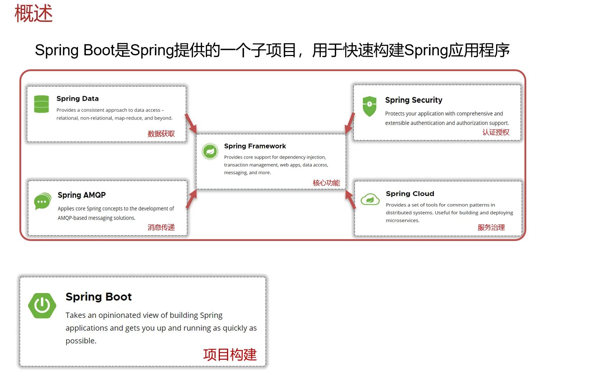

## 传统方式构建spring应用程序

1. 导入依赖繁琐（手动配置各个jar包的版本）
2. 项目配置繁琐（手动配置各个xml配置文件）

## SpringBoot特性

1. 起步依赖：本质上就是一个Maven坐标，整合了完成一个功能需要的所有坐标
2. 自动配置：遵循约定大于配置的原侧，在boot程序启动后，一些bea对象会自动注入到ioc容器，不需要手动声明，简化开发
3. 其他特性

- 内嵌的Tomcat、Jetty（无需部署WAR文件）
- 外部化配置
- 不需要XML配置(properties/yml)

# SpringBoot入门

1. 创建Maven工程

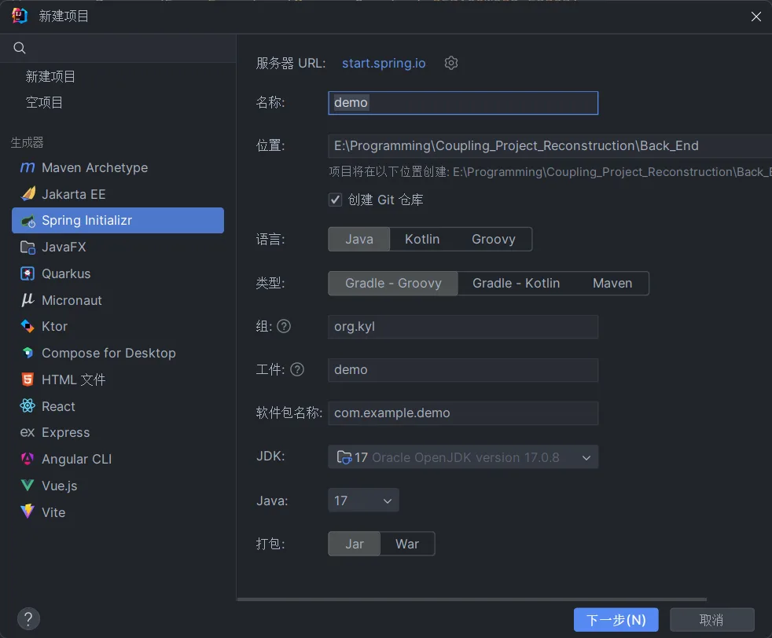

2. 导入spring-boot-stater-web起步依赖

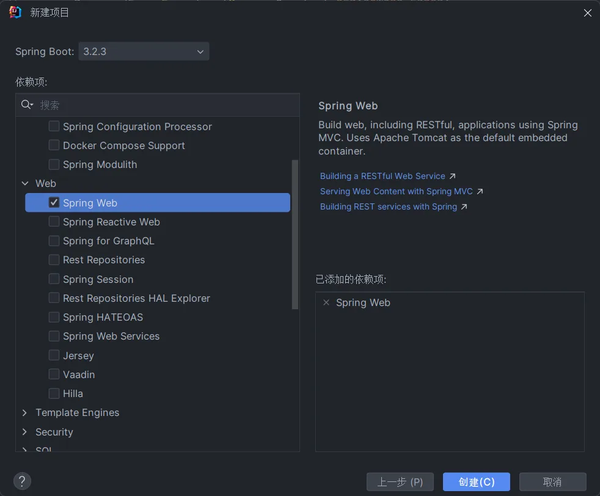

3. 编写Controller 

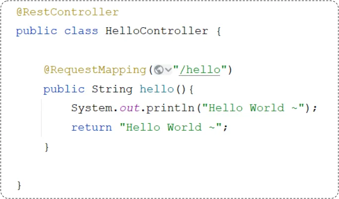
`@RestController是一个组合注解，它包含了@Controller和@ResponseBody两个注解的功能。`用@RestController标记的类表示这是一个RESTful风格的控制器，它可以处理HTTP请求并返回JSON格式的响应。 @RestController注解在处理请求时，会自动将方法的返回值转换为JSON格式的响应体，并返回给客户端。因此，使用@RestController可以省去在每个方法上都加@ResponseBody注解的麻烦。@RestController也支持@RequestMapping注解，用于映射请求。

 `@Controller 注解标记的类则是传统的控制器类。`它用于处理客户端发起的请求，并负责返回适当的视图（View）作为响应。在使用 @Controller 注解的类中，通常需要在方法上使用 `@ResponseBody 注解来指示该方法的返回值要作为响应的主体内容，而不是解析为视图。`这是由于原先的架构都是一体化的，即不是前后端分离的，所以需求不一样，故产生了两类注解方式。

总结

- @RestController 是 @Controller 和 @ResponseBody 的组合注解，用于创建 RESTful 风格的 API。
- @RestController 返回的数据会直接作为响应的主体内容（JSON 或 XML），不进行页面跳转或视图解析。
- @Controller 用于传统的 MVC 架构，负责处理请求并返回视图作为响应。
- @Controller 方法通常需要配合 @ResponseBody 注解，才能将返回值作为响应的主体内容。
- 传统的springMVC一般就需要直接返回视图，而现在新兴的前端技术vue在项目中为前后端分离的架构，前端框架负责处理数据和渲染页面，而后端 API 则负责提供数据即可，所以对返回视图的要求也就比较少了

| 应用场景 | 注解            | 注解说明                         |
| -------- | :-------------- | :------------------------------- |
| 处理请求 | @Controller     | 处理 Http 请求                   |
| 处理请求 | @RestController | @Controller 的衍生注解           |
| 路由请求 | @RequestMapping | 路由请求 可以设置各种操作方法    |
| 路由请求 | @GetMapping     | GET 方法的路由                   |
| 路由请求 | @PostMapping    | POST 方法的路由                  |
| 路由请求 | @PutMapping     | PUT 方法的路由                   |
| 路由请求 | @DeleteMapping  | DELETE 方法的路由                |
| 请求参数 | @PathVariable   | 处理请求 url 路径中的参数 /user/ |
| 请求参数 | @RequestParam   | 处理问号后面的参数               |
| 请求参数 | @RequestBody    | 请求参数以json格式提交           |
| 返回参数 | @ResponseBody   | 返回 json 格式                   |

4. 提供启动类

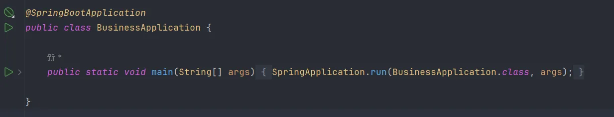

# SpringBoot配置文件

一共有properties配置文件和yaml配置文件两类。

[SpringBoot配置项内容](https://docs.spring.io/spring-boot/docs/current/reference/html/application-properties.html#appendix.application-properties)

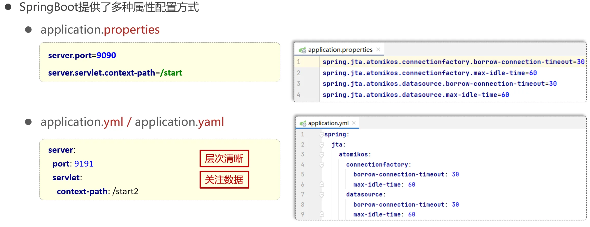

配置第三方文件需要根据文档配置信息。

yaml配置语法：值前边必须有空格，作为分隔符；使用空格作为缩进表示层级关系，相同的层级左侧对齐。

上面为键值对配置，下面为数组配置。

若要获取数据则使用`@value`或`@ConfigurationProperties`。

## 1、`@value`

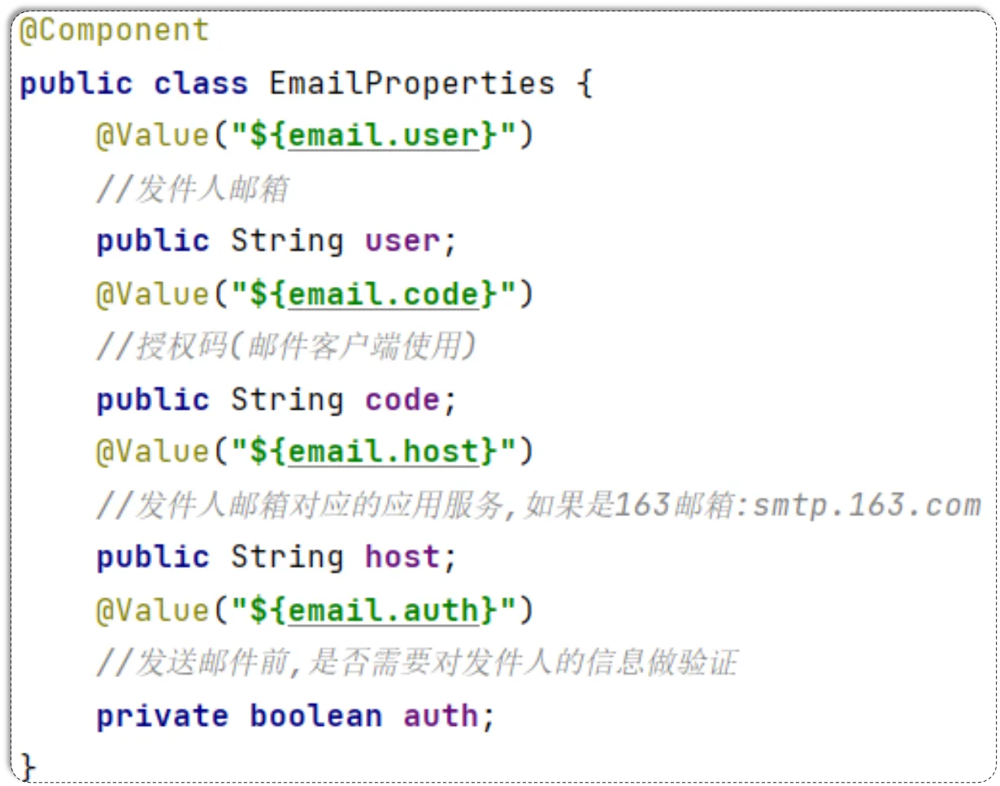

## 2、`@ConfigurationProperties`

若实体类的成员变量名与配置文件中的键名`保持一致`，则可以简化引入方式。

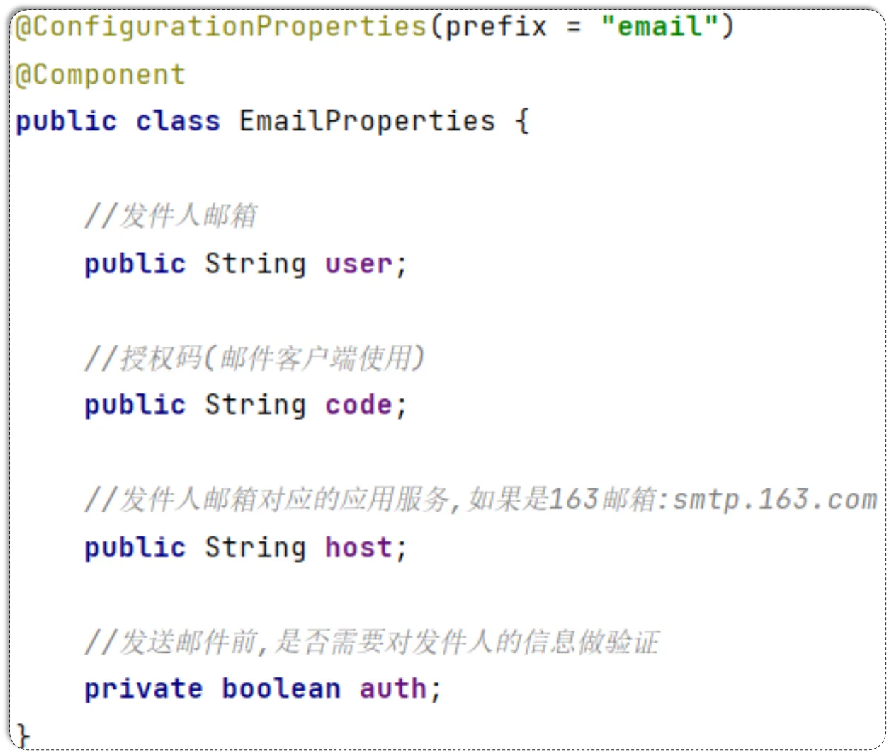

# 整合`mybatis`

配置数据库信息

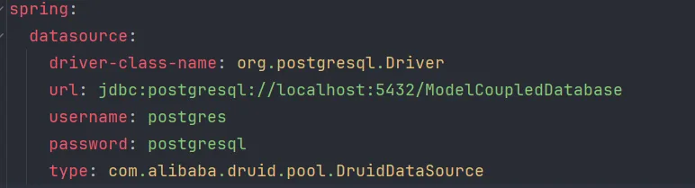

引入mybatis和数据库驱动

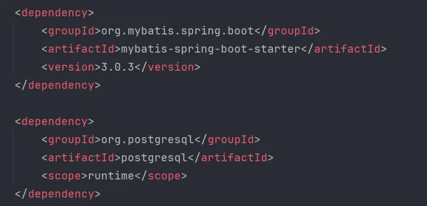

数据库连接池

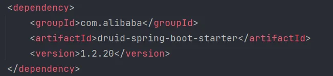

Druid是一个开源的、高性能的数据库连接池，它在很多方面超越了其他连接池。以下是一些选择Druid的原因：

- 监控和统计：Druid提供了丰富的监控和统计功能，您可以了解连接池的使用情况、SQL执行情况等。这有助于识别性能问题和优化SQL查询。

- 防SQL注入：Druid内置了防SQL注入的功能，可以有效地防止潜在的安全风险。

- 高性能：Druid经过精心优化，具有出色的性能。它支持连接池预热，可以在应用程序启动时提前创建一些连接，以减少第一个请求的延迟。

- 丰富的配置选项：Druid允许您通过配置文件或编程方式进行高度自定义，以满足各种需求。

顺序Controller（类）->Service（接口）->ServiceImplement（类，实现Service，在该处添加“@Service”）->Mapper（接口），即Web 应用程序采用了经典的三层分层结构的话，最好在持久层、业务层和控制层分别采用 @Repository、@Service 和 @Controller 对分层中的类进行注释，而用 `@Component`对那些比较中立的类进行注释。

@Service注解用于类上，标记当前类是一个service类，加上该注解会将当前类自动注入到spring容器中，不需要再在applicationContext.xml文件定义bean了。

## `@Repository`

@Repository ：@Repository的作用与@Controller，@Service的作用都是把对象交给Spring管理。@Repository是标注在Dao层接口上，作用是将接口的一个实现类交给Spring管理。

注意：

- 使用这个注解的前提是必须在启动类上添加@MapperScan("Mapper接口层路径") 注解

这个@Repository完全可以省略不写，也完全可以实现自动注入，但是在IDEA中会存在一个红色的波浪线。原因如下：

- Spring配置文件中配置了MapperScannerConfiguer这个Bean，它会扫描持久层接口创建实现类并交给Spring管理。
- SpringBoot的启动类上标注了@MapperScanner，它的作用和上面的MapperScannerConfiguer作用一样

## @Mapper

@Mapper: 这个注解一般使用在Dao层接口上，相当于一个mapper.xml文件，它的作用就是将接口生成一个动态代理类。它可以与各种 Java 框架（如 MapStruct、MyBatis）配合使用，用于自动生成对象之间的映射代码。加入了@Mapper注解，目的就是为了不再写mapper映射文件。这个注解就是用来映射mapper.xml文件的。

使用@mapper后，不需要在spring配置中设置扫描地址，通过mapper.xml里面的namespace属性对应相关的mapper类，spring将动态的生成Bean后注入到ServiceImpl中

注意：

- 在Dao层不要存在相同名字的接口，也就是在Dao不要写重载。因为mapper文件是通过id与接口进行对应的，如果写了两个同名的接口，就会导致mapper文件映射出错。

# Bean管理

## Bean扫描

### @ComponentScan

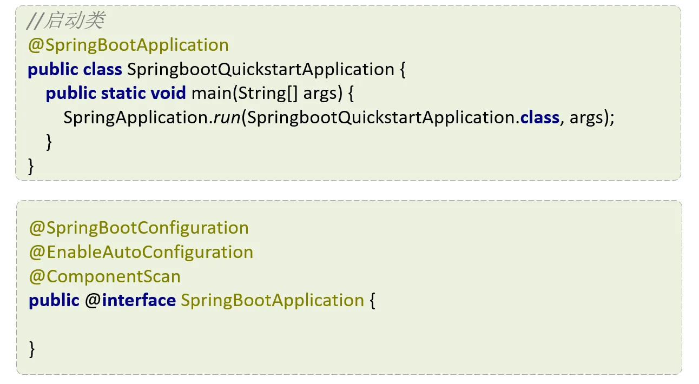

默认只能扫描启动类所在的包及其子包，如果要扫描别的包，必须手动添加。

## Bean注册（内部文件）

| 注解        | 说明                 | 位置                                            |
| ----------- | -------------------- | ----------------------------------------------- |
| @Component  | 声明bean的基础注解   | 不属于以下三类时，用此注解                      |
| @Controller | @Component的衍生注解 | 标注在控制器类上                                |
| @Service    | @Component的衍生注解 | 标注在业务类上                                  |
| @Repository | @Component的衍生注解 | 标注在数据访问类上（由于与mybatis整合，用的少） |

如果要注册的bean对象来自于第三方（不是自定义的），是无法用 @Component 及衍生注解声明bean的

但可以使用@Bean和@Import引入

### @Bean

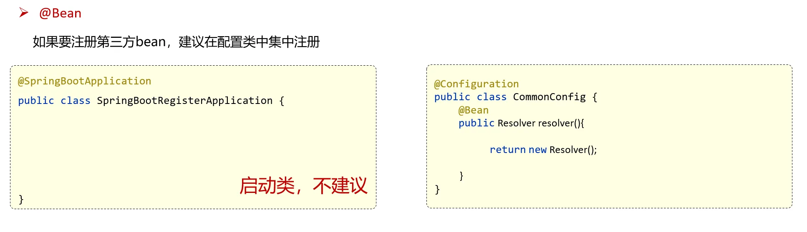

可以通过方法名或指定名称获取Bean

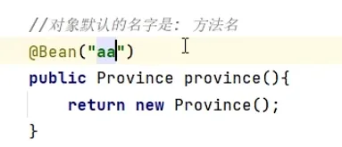

如果方法的内部需要使用到IOC容器中已经存在的bean对象，那么只需要在方法上声明即可，spring会自动的注入

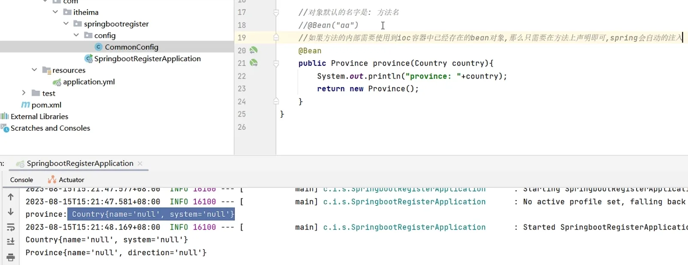

### @Import

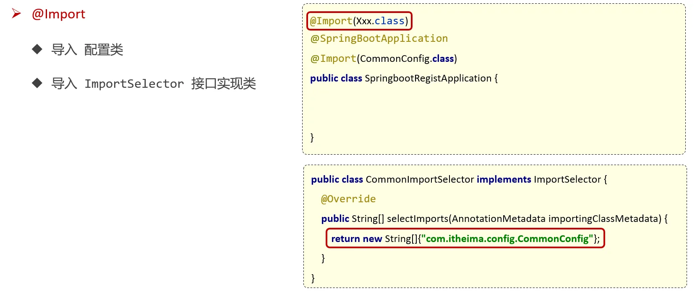

导入 ImportSelector 接口实现类，会自动返回所需要的`配置类的中的所有类`。

实际应用：可以体现SpringBoot的自动装配。

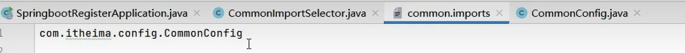

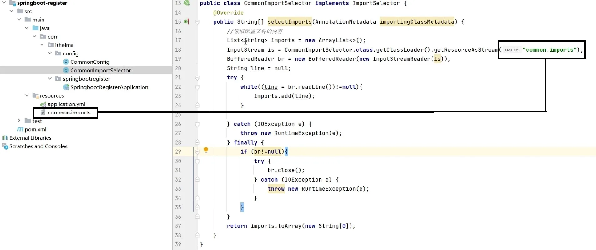

为了配置@Target和@Retention ，可以新建一个“Enablexxx.class”，这样就基本与SpringBoot的自动装配思想一样。

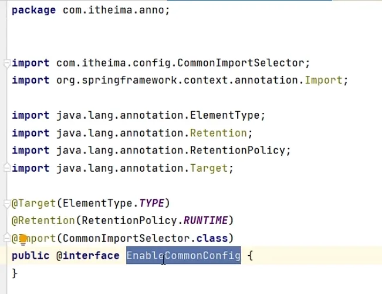

## 注册条件

SpringBoot提供了设置注册生效条件的注解 @Conditional

| 注解                      | 说明                                     |
| ------------------------- | ---------------------------------------- |
| @ConditionalOnProperty    | 配置文件中存在对应的属性，才声明该bean   |
| @ConditionalOnMissingBean | 当不存在当前类型的bean时，才声明该bean   |
| @ConditionalOnClass       | 当前环境存在指定的这个类时，才声明该bean |

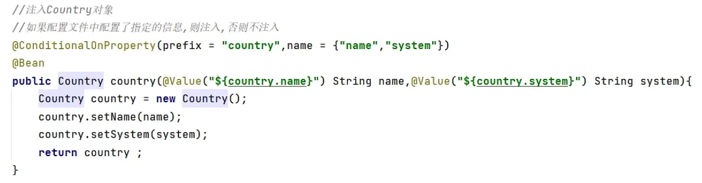

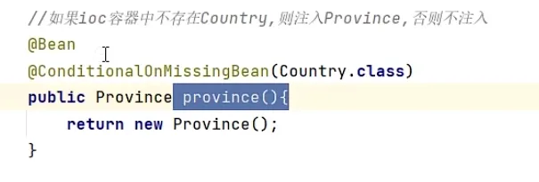

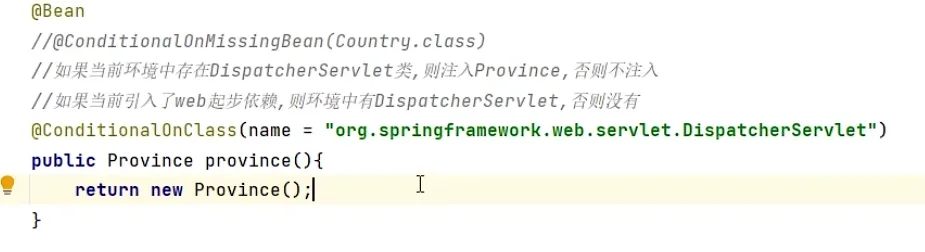

# 自动配置原理（第三方文件）

遵循约定大约配置的原则，在boot程序启动后，起步依赖中的一些bean对象会自动注入到ioc容器

例：程序引入spring-boot-starter-web 起步依赖，启动后，会自动往ioc容器中注入DispatcherServlet

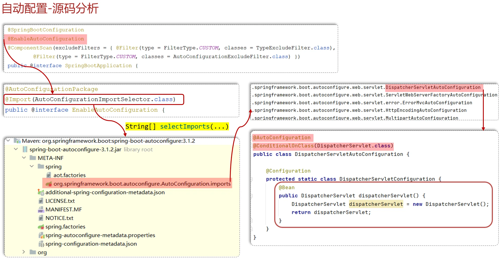

通过内部类进行自动配置。

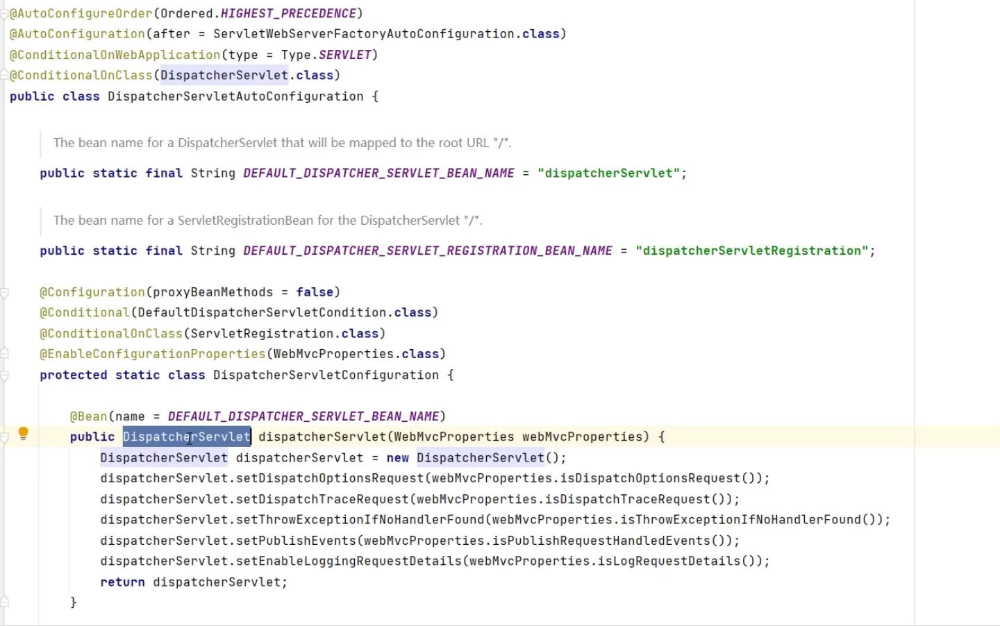

## 源码分析

1、首先找到Application，然后进入@SpringBootApplication

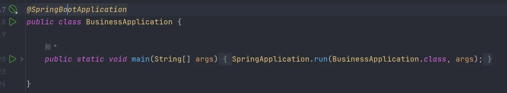

2、注解解析

### @Target

@Target :  Target翻译中文为目标，即该注解可以声明在哪些目标元素之前，也可理解为注释类型的程序元素的种类。

ElementType.PACKAGE：该注解只能声明在一个包名前。 

ElementType.ANNOTATION_TYPE：该注解只能声明在一个注解类型前。 

ElementType.TYPE：该注解只能声明在一个类前。

ElementType.CONSTRUCTOR：该注解只能声明在一个类的构造方法前。

ElementType.LOCAL_VARIABLE：该注解只能声明在一个局部变量前。

ElementType.METHOD：该注解只能声明在一个类的方法前。

ElementType.PARAMETER：该注解只能声明在一个方法参数前。

ElementType.FIELD：该注解只能声明在一个类的字段前。

### @Retention 

@Retention ：Retention 翻译成中文为保留，可以理解为如何保留，即告诉编译程序如何处理，也可理解为注解类的生命周期。 

RetentionPolicy.SOURCE  : 注解只保留在源文件，当Java文件编译成class文件的时候，注解被遗弃；

RetentionPolicy.CLASS  : 注解被保留到class文件，但jvm加载class文件时候被遗弃，这是默认的生命周期；

RetentionPolicy.RUNTIME  : 注解不仅被保存到class文件中，jvm加载class文件之后，仍然存在； 

### @Documented

使用了该注解后，将自定义注解设置为文档说明内容，在生成javadoc时会将该注解加入到文档中。

###  @Inherited

@Inherited注解用于标注一个父类的注解是否可以被子类继承，如果一个注解需要被其子类所继承，则在声明时直接使用@Inherited注解即可。如果没有写此注解，则无法被子类继承。

### @SpringBootConfiguration

配置注解，底层其实也是@Configuration注解，只不过在SpringBoot工程中更推荐使用@SpringBootConfiguration来替代Configuration。

### @EnableAutoConfiguration

启动自动配置，根据所依赖的Jar包自动配置相关配置项。

1、该类实现了“ImportSelector”接口和selectImports方法。

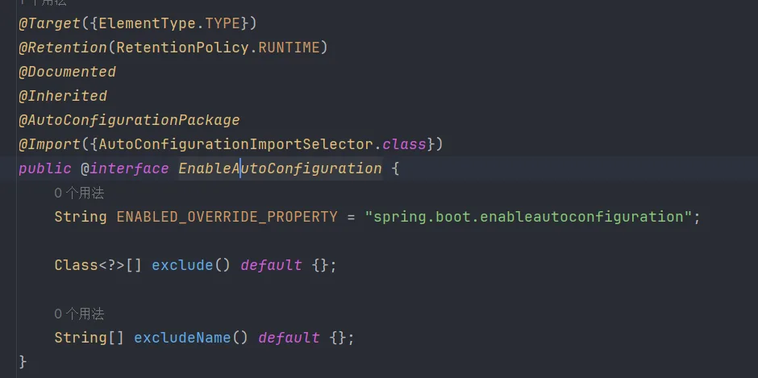

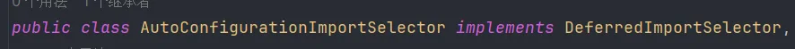

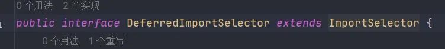

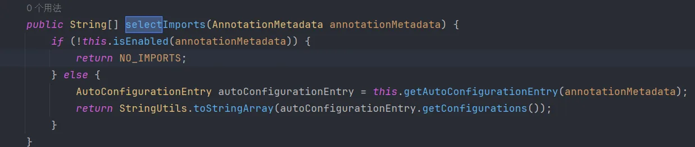

2、通过理解调试可一步步获取到最后

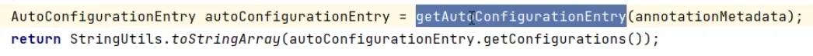

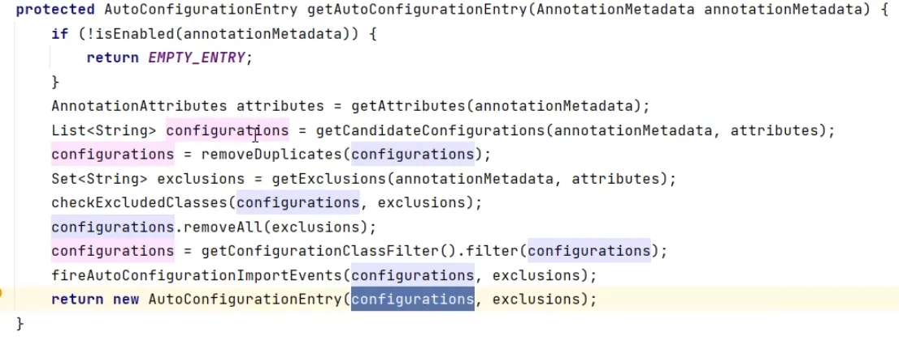

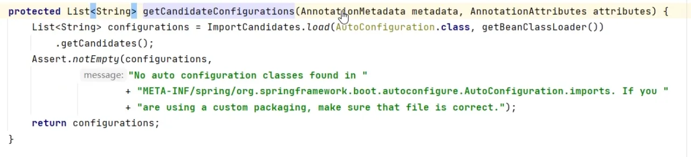

未在中找到自动配置类。META-INF/spring/org.springframework.boot.autoconfigure.AutoConfiguration.imports.如果你正在使用自定义包装，请确保该文件正确。

找到核心起步依赖中的spring-boot-starter，再找到spring-boot-autoconfigure。

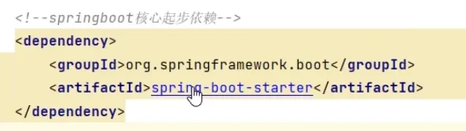

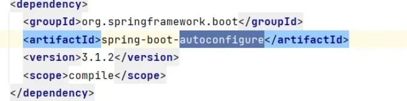

也可以直接在中找到spring-boot-autoconfigure。里面所有的都是需要的配置类。

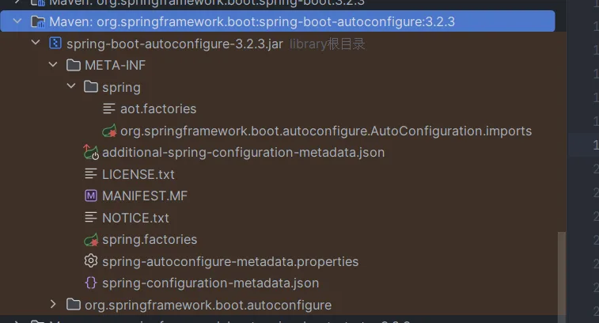

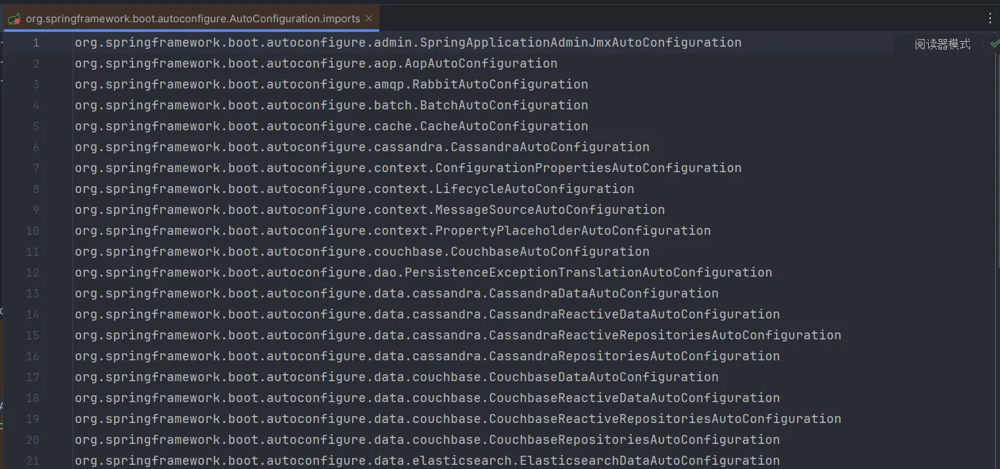

> 1. SpringBoot在SpringApplication对象实例化时会加载META-INF/spring.factories文件，将该配置文件载入Spring容器中，进行自动配置。
> 2. getSpringFactoriesInstances->loadFactoryNames->加载了META-INF/spring.factories。
> 3. 关于spring.factores：用来指导SpringBoot找到指定的配置文件。

### @ComponentScan

在开发应用时，需要告诉 Spring 框架如何查找受 Spring 管理的组件。`@ComponentScan` 使 Spring 能够扫描配置、Controller、Service 和我们定义的其他组件。

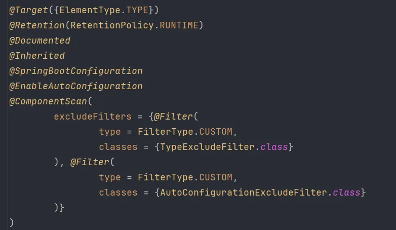

## 总结

大约一共分为4个部分

1、Commonfig由创建者提供注入。（@Bean等）

2、创建者提供一个自动配置类（@AutoConfiguration和@Impor）

3、创建者提供.imports文件

4、将Commonfig的全类名配置在.imports文件

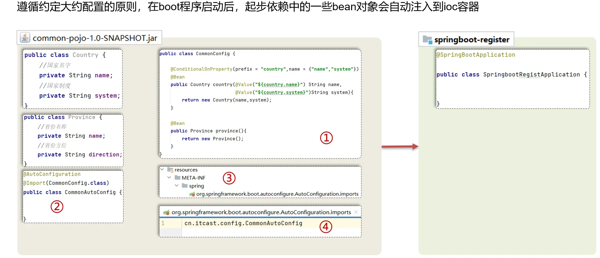

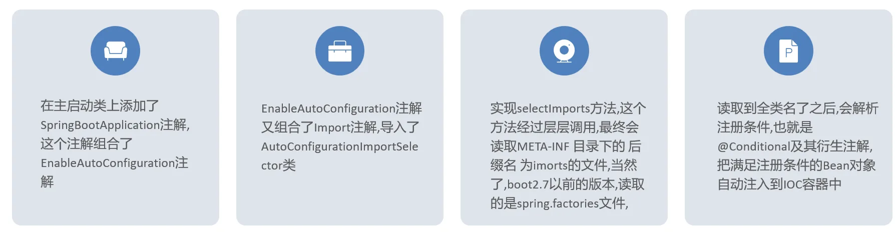

# 自定义starter

在实际开发中，经常会定义一些公共组件，提供给各个项目团队使用。而在SpringBoot的项目中，一般会将这些公共组件封装为SpringBoot 的 starter。

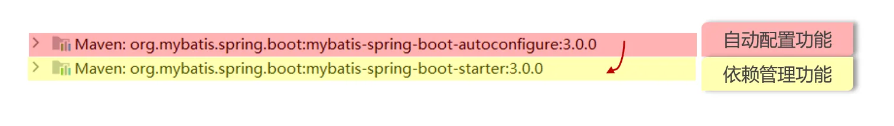

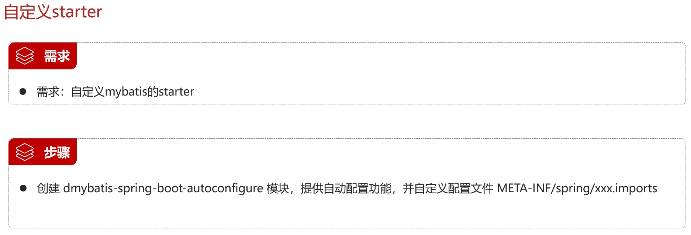

1、书写自动配置类

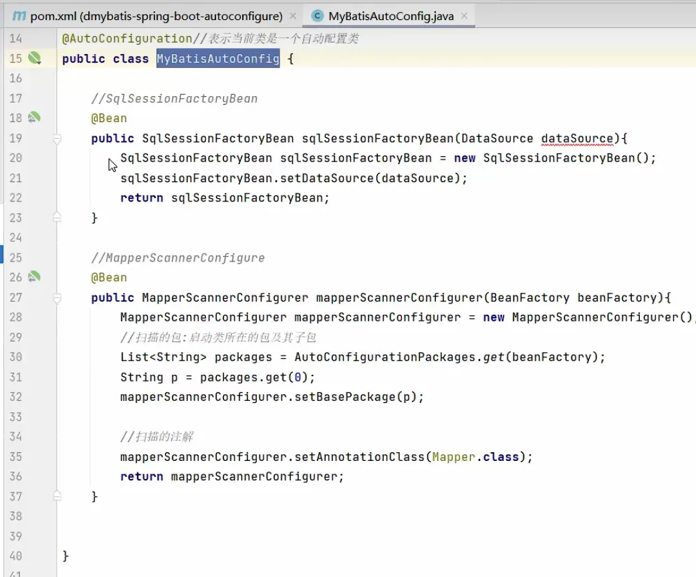

2、配置文件

3、引入依赖

在pom中引入mybatis-spring-boot的相关依赖。

# 面试

## ApplicationContextInitializer

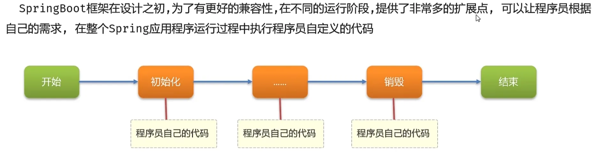

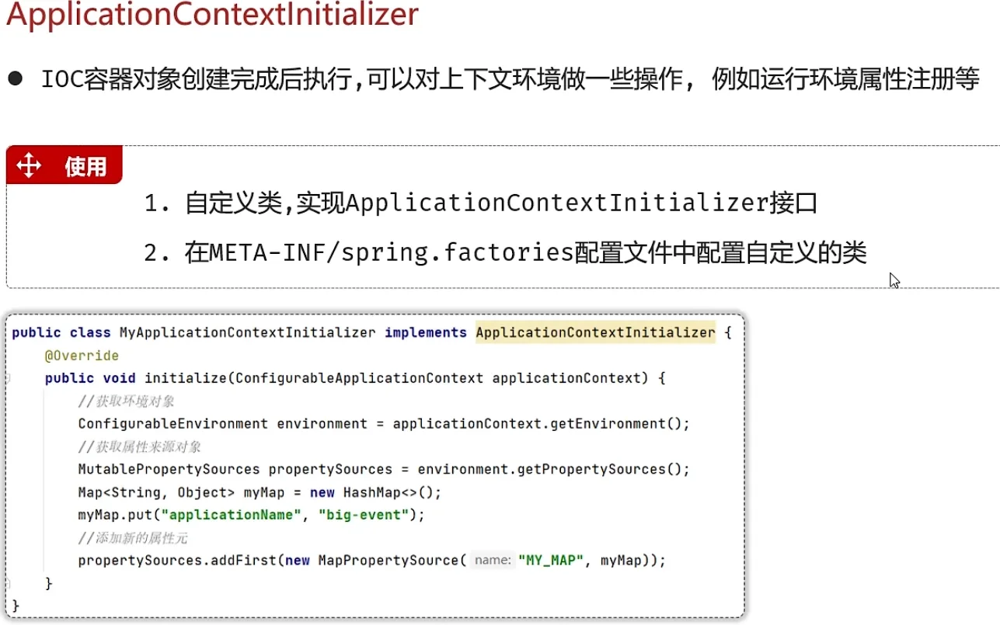

spring.factories中的书写规范为：

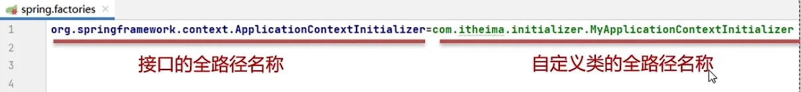

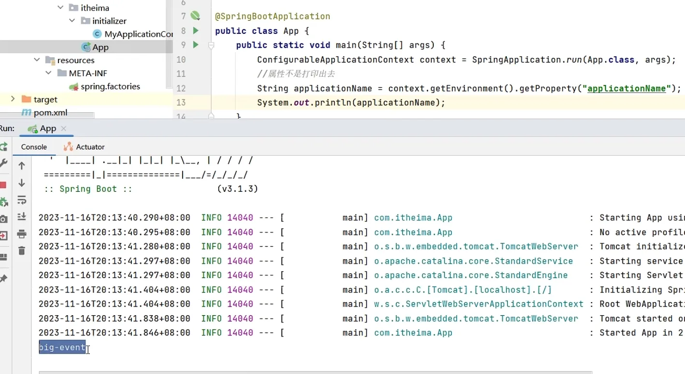

## ApplicationListener

IOC容器发布事件之后执行，通常用于资源加载，定时任务发布等

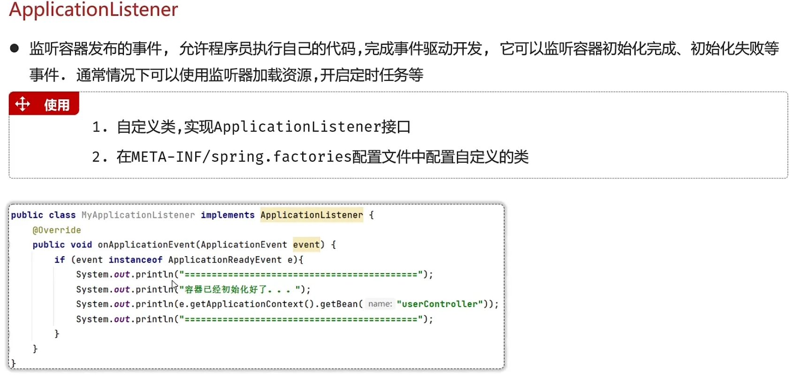

spring.factories中的书写规范为：接口全路径名称=自定义类全路径名称

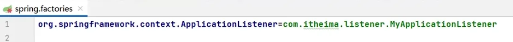

## BeanFactory

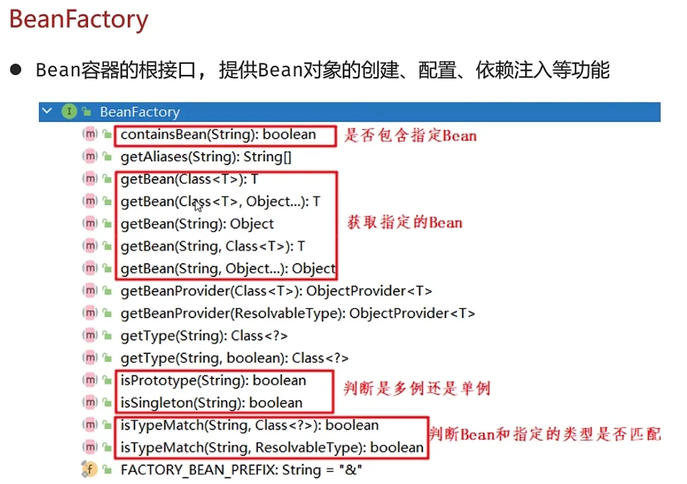

BeanFactory的继承体系

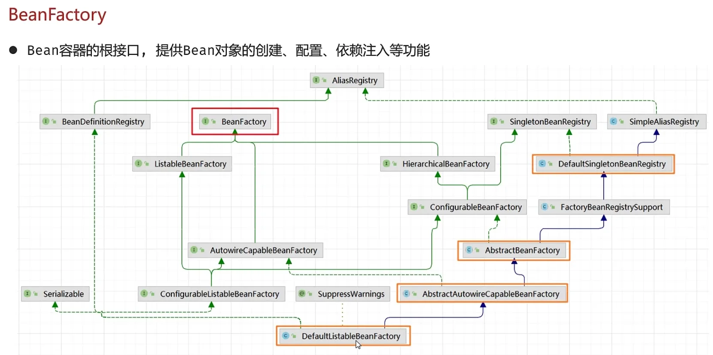

AnnotationConfigServletWebServerApplicationContext（SpringBoot最后得到的容器）中的部分内容都委托给DefaultListableBeanFactory实现

调试：在Application中的main方法中输入以下内容，进行调试即可

## BeanDefinition

继承内容：

调试：在Application中的main方法中输入以下内容，进行调试即可

user：@Component

aa：@Bean

## BeanFactoryPostProcessor

当beanFactory被实例化好后(bean创建之前)，回调这个函数，注册一些BeanDefinition

SpringBoot中已有的”BeanFactoryPostProcessor“

## Aware

## InitializingBean/DisposableBean

PostConstructor和PreDestroy方法，提供初始化方法和销毁方法与该接口功能相同。

## BeanPostProcessor

