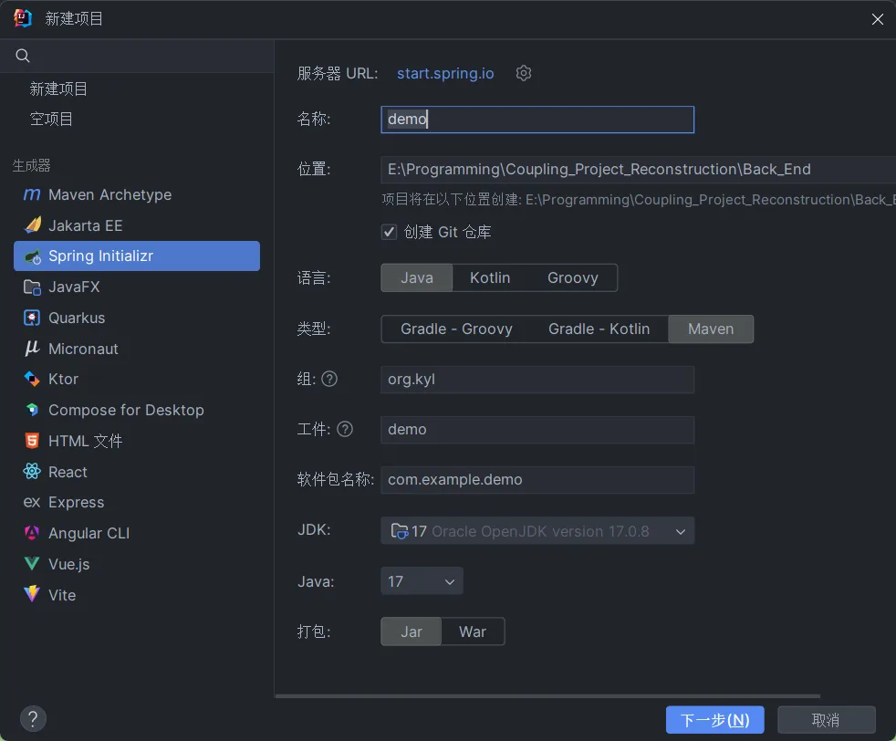
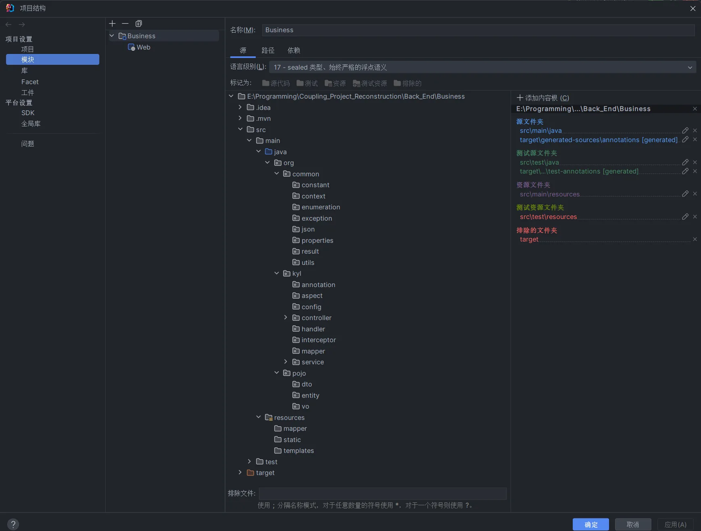
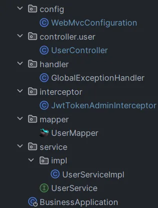

# SpringBoot简介


# 项目准备

通过Idea的Spring Initializr初始化并构建项目。



## 项目文件夹构建

将项目分为三个主要部分

| **名称** | **说明**                                              |
| -------- | ----------------------------------------------------- |
| common   | 存放公共类，例如：工具类、常量类、异常类等            |
| kyl      | 后端服务，存放配置文件、Controller、Service、Mapper等 |
| pojo     | 存放实体类、VO、DTO等                                 |

除pojo外，其他文件夹均可做到见名知意，就不再过多介绍。

| **名称**                    | 说明                                                         |
| --------------------------- | ------------------------------------------------------------ |
| DTO（Data Transfer Object） | DTO是用于数据传输的对象。它通常用于在不同层或模块之间传输数据，例如在前端和后端之间进行数据交互。DTO的设计目的是方便数据的传输和封装。主要用来封装`前端传递`的数据。 |
| VO（Value Object）          | VO是值对象，也可以理解为不可变的DTO。VO通常用于封装某个特定领域的值或状态，并且它的值在创建后不可更改。主要用来封装`后端返回`的数据。 |
| Entity（实体）              | Entity表示领域模型中的实体对象，它`与数据库中的表或集合对应`。Entity对象通常包含与数据库表字段一一对应的属性，并且可能包含一些与数据库交互的方法。Entity对象通常用于持久化数据，通过ORM（对象关系映射）技术将对象数据映射到数据库表中。 |



## 引入第三方文件

由于本项目需要使用druid数据库池、JWT令牌和mybatis等技术，因此需要对这些内容进行引入。

```xml
		<dependency>
            <groupId>com.alibaba</groupId>
            <artifactId>druid-spring-boot-starter</artifactId>
            <version>1.2.20</version>
        </dependency>

        <dependency>
            <groupId>io.jsonwebtoken</groupId>
            <artifactId>jjwt</artifactId>
            <version>0.9.1</version>
        </dependency>

        <dependency>
            <groupId>javax.xml.bind</groupId>
            <artifactId>jaxb-api</artifactId>
            <version>2.3.1</version>
        </dependency>

        <dependency>
            <groupId>javax.servlet</groupId>
            <artifactId>javax.servlet-api</artifactId>
            <version>4.0.1</version>
        </dependency>

        <dependency>
            <groupId>org.aspectj</groupId>
            <artifactId>aspectjrt</artifactId>
            <version>1.9.4</version>
        </dependency>

        <dependency>
            <groupId>org.aspectj</groupId>
            <artifactId>aspectjweaver</artifactId>
            <version>1.9.4</version>
        </dependency>
```

## 项目属性配置

本项目中使用了druid数据库池、JWT令牌和mybatis等技术，因此需要对这些内容进行简单的配置。并且由于原本自带的`.properties`文件格式不够清晰，因此改为了`application.yml`进行配置

```yaml
spring:
  datasource:
    # 数据库驱动类名
    driver-class-name: org.postgresql.Driver
    # 数据库连接URL
    url: jdbc:postgresql://localhost:5432/ModelCoupledDatabase
    # 数据库用户名
    username: postgres
    # 数据库密码
    password: postgresql
    # 数据源类型为DruidDataSource
    type: com.alibaba.druid.pool.DruidDataSource

mybatis:
  # Mapper配置文件的位置
  mapper-locations: classpath:mapper/*.xml
  # 实体类别名包路径
  type-aliases-package: org.pojo.entity
  configuration:
    #开启驼峰命名
    map-underscore-to-camel-case: true

kyl:
  jwt:
    # 设置jwt签名加密时使用的秘钥
    admin-secret-key: kyl
    # 设置JWT过期时间（以毫秒为单位）
    admin-ttl: 72000000000
    # 设置前端传递过来的令牌名称
    admin-token-name: token
```

## org/common/result/Result

对后端返回的数据进行统一封装，从而确保有更高的可读性和交互性。

```java
package org.common.result;
import lombok.Data;
import java.io.Serializable;
/**
 * 后端统一返回结果
 *
 * @param <T> 返回数据的类型
 */
// 自动生成 Getter、Setter、toString 方法等
@Data
public class Result<T> implements Serializable {
    private Integer code; //编码：1成功，0和其它数字为失败
    private String msg; //错误信息
    private T data; //数据
    /**
     * 创建一个成功的结果对象
     *
     * @param <T> 返回数据的类型
     * @return 成功的结果对象
     */
    public static <T> Result<T> success() {
        Result<T> result = new Result<T>();
        result.code = 1;
        return result;
    }
    /**
     * 创建一个成功的结果对象，并设置返回数据
     *
     * @param object 返回数据
     * @param <T>    返回数据的类型
     * @return 成功的结果对象
     */
    public static <T> Result<T> success(T object) {
        Result<T> result = new Result<T>();
        result.data = object;
        result.code = 1;
        return result;
    }
    /**
     * 创建一个失败的结果对象，并设置错误信息
     *
     * @param msg 错误信息
     * @param <T> 返回数据的类型
     * @return 失败的结果对象
     */
    public static <T> Result<T> error(String msg) {
        Result<T> result = new Result<T>();
        result.msg = msg;
        result.code = 0;
        return result;
    }
}
```

# 登陆功能实现

## 总体流程

1. 首先自定义一个MVC配置类，用于过滤用户信息。当用户访问的不是指定路径时，拦截所有内容到拦截器，判断JWT令牌是否合理，如果合理则放行通过；如果不合理则返回“401”错误代码。
2. 当用户访问的是`/login`时，则放行到`Controller`中，开始执行相关方法。
3. 在`Controller`中基本会实现`Service`接口的`ServiceImpl`类中，并在此访问`Mapper`接口，从而查询数据库中的数据。然后将获取到的数据处理各种异常情况（用户名不存在、密码不对、账号被锁定）等。
4. 由于各类异常情况是通过`抛出异常`的方式实现的，因此需要定义一个`GlobalExceptionHandler`，用于处理各类已知或未知异常情况。


主要涉及到以下文件：

# 功能一：拦截器

## org/common/properties/JwtProperties

由于JWT令牌的部分配置内容放在了`application.yml`中，因此需要对JWT属性进行提取。

```java
package org.common.properties;
import lombok.Data;
import org.springframework.boot.context.properties.ConfigurationProperties;
import org.springframework.stereotype.Component;
@Component
// 配置属性前缀为"kyl.jwt"
@ConfigurationProperties(prefix = "kyl.jwt")
// 自动生成getter和setter方法
@Data
public class JwtProperties {
    /**
     * 管理端员工生成jwt令牌相关配置
     */
    // 管理端员工生成JWT令牌的密钥
    private String userSecretKey;
    // 管理端员工JWT令牌的过期时间
    private long userTtl;
    // 管理端员工JWT令牌的名称
    private String userTokenName;
}
```

## org/common/utils/JwtUtil

由于可能会在多个地方使用JWT，因此将JWT的生成与解析封装为一个类。

```java
package org.common.utils;
import io.jsonwebtoken.Claims;
import io.jsonwebtoken.JwtBuilder;
import io.jsonwebtoken.Jwts;
import io.jsonwebtoken.SignatureAlgorithm;
import java.nio.charset.StandardCharsets;
import java.util.Date;
import java.util.Map;
public class JwtUtil {
    /**
     * 生成jwt
     * 使用Hs256算法, 私匙使用固定秘钥
     *
     * @param secretKey jwt秘钥
     * @param ttlMillis jwt过期时间(毫秒)
     * @param claims    设置的信息
     * @return 生成的JWT字符串
     */
    public static String createJWT(String secretKey, long ttlMillis, Map<String, Object> claims) {
        // 指定签名的时候使用的签名算法，也就是header那部分
        SignatureAlgorithm signatureAlgorithm = SignatureAlgorithm.HS256;
        // 生成JWT的时间
        long expMillis = System.currentTimeMillis() + ttlMillis;
        Date exp = new Date(expMillis);
        // 设置jwt的body
        JwtBuilder builder = Jwts.builder()
                // 如果有私有声明，一定要先设置这个自己创建的私有的声明，这个是给builder的claim赋值，
                // 一旦写在标准的声明赋值之后，就是覆盖了那些标准的声明的
                .setClaims(claims)
                // 设置签名使用的签名算法和签名使用的秘钥
                .signWith(signatureAlgorithm, secretKey.getBytes(StandardCharsets.UTF_8))
                // 设置过期时间
                .setExpiration(exp);

        return builder.compact();
    }
    /**
     * Token解密
     *
     * @param secretKey jwt秘钥 此秘钥一定要保留好在服务端, 不能暴露出去, 否则sign就可以被伪造, 如果对接多个客户端建议改造成多个
     * @param token     加密后的token
     * @return 解密后的Claims对象
     */
    public static Claims parseJWT(String secretKey, String token) {
        // 得到DefaultJwtParser
        Claims claims = Jwts.parser()
                // 设置签名的秘钥
                .setSigningKey(secretKey.getBytes(StandardCharsets.UTF_8))
                // 设置需要解析的jwt
                .parseClaimsJws(token).getBody();

        return claims;
    }
}
```

## org/common/constant/JwtClaimsConstant

由于不同的用户在加密JWT时，愿意使用的加密内容也不同，因此挑选几个当作常量。

```java
package org.common.constant;

/**
 * 声明一些常量，用于JWT在加密时使用
 */
public class JwtClaimsConstant {
    public static final String USERNAME = "username";
    public static final String EMAIL = "email";
    public static final String PHONE = "phone";
}
```

## org/kyl/interceptor/JwtTokenUserInterceptor

在配置WebMvcConfiguration组件前，我们需要将自定义的拦截器写好。

```java
package org.kyl.interceptor;
import io.jsonwebtoken.Claims;
import jakarta.servlet.http.HttpServletRequest;
import jakarta.servlet.http.HttpServletResponse;
import lombok.extern.slf4j.Slf4j;
import org.common.constant.JwtClaimsConstant;
import org.common.context.BaseContext;
import org.common.properties.JwtProperties;
import org.common.utils.JwtUtil;
import org.springframework.beans.factory.annotation.Autowired;
import org.springframework.stereotype.Component;
import org.springframework.web.method.HandlerMethod;
import org.springframework.web.servlet.HandlerInterceptor;
/**
 * jwt令牌校验的拦截器
 */
// 标记为组件，用于自动扫描和注入
@Component
// 使用Lombok生成日志对象
@Slf4j
public class JwtTokenUserInterceptor implements HandlerInterceptor {
    @Autowired
    private JwtProperties jwtProperties;
    /**
     * 校验jwt
     *
     * @param request  HttpServletRequest对象
     * @param response HttpServletResponse对象
     * @param handler  处理器对象
     * @return 校验结果，布尔值
     * @throws Exception 异常信息
     */
    @Override
    public boolean preHandle(HttpServletRequest request, HttpServletResponse response, Object handler) throws Exception {
        //判断当前拦截到的是Controller的方法还是其他资源
        if (!(handler instanceof HandlerMethod)) {
            //当前拦截到的不是动态方法，直接放行
            return true;
        }
        //1、从请求头中获取令牌
        String token = request.getHeader(jwtProperties.getUserTokenName());

        //2、校验令牌
        try {
            // 输出日志信息，用于记录校验过程
            log.info("jwt校验:{}", token);
            // 解析JWT令牌
            Claims claims = JwtUtil.parseJWT(jwtProperties.getUserSecretKey(), token);
            // 获取用户名
            String USERNAME = claims.get(JwtClaimsConstant.USERNAME).toString();
            // 设置当前用户名到上下文中
            BaseContext.setCurrentUsername(USERNAME);
            // 输出当前员工ID，用于记录
            log.info("当前员工id：{}", USERNAME);
            //3、通过，放行
            return true;
        } catch (Exception ex) {
            //4、不通过，响应401状态码
            response.setStatus(401);
            return false;
        }
    }
}
```

## org/common/context/BaseContext

由于在以后的设想中会将用户名和上传的文件联系起来，因此将当前访问的用户存储起来。

```java
package org.common.context;
/**
 * 存储当前线程的用户名
 */
public class BaseContext {
    // 创建一个ThreadLocal对象，用于存储当前线程的用户名
    public static ThreadLocal<String> threadLocal = new ThreadLocal<>();
    /**
     * 设置当前线程的用户名
     *
     * @param USERNAME 当前用户名
     */
    public static void setCurrentUsername(String USERNAME) {
        threadLocal.set(USERNAME);
    }
    /**
     * 获取当前线程的用户名
     *
     * @return 当前用户名
     */
    public static String getCurrentUsername() {
        return threadLocal.get();
    }
    /**
     * 移除当前线程的用户名
     */
    public static void removeCurrentUsername() {
        threadLocal.remove();
    }
}
```

## org/kyl/config/WebMvcConfiguration

然后配置WebMvcConfiguration组件，然后注册自定义拦截器。

```java
package org.kyl.config;
import lombok.extern.slf4j.Slf4j;
import org.kyl.interceptor.JwtTokenUserInterceptor;
import org.springframework.beans.factory.annotation.Autowired;
import org.springframework.context.annotation.Configuration;
import org.springframework.web.servlet.config.annotation.InterceptorRegistry;
import org.springframework.web.servlet.config.annotation.WebMvcConfigurationSupport;
/**
 * 配置类，注册web层相关组件
 */
// 标记为配置类
@Configuration
// 使用Lombok生成日志对象
@Slf4j
public class WebMvcConfiguration extends WebMvcConfigurationSupport {
    @Autowired
    private JwtTokenUserInterceptor jwtTokenUserInterceptor;
    /**
     * 注册自定义拦截器
     *
     * @param registry 拦截器注册器
     */
    protected void addInterceptors(InterceptorRegistry registry) {
        // 输出日志信息
        log.info("开始注册自定义拦截器...");
        registry.addInterceptor(jwtTokenUserInterceptor)
                .addPathPatterns("/*")
                .excludePathPatterns("/login")
                .excludePathPatterns("/register");
    }
}
```

到此，拦截器功能完全实现。

# 功能二：全局异常处理

## org/common/constant/MessageConstant

由于处理异常并返回的信息有可能是相同的，因此将可能用到的异常信息提示封装常量类。

```java
package org.common.constant;
/**
 * 信息提示常量类
 */
public class MessageConstant {
    public static final String PASSWORD_ERROR = "密码错误";
    public static final String ACCOUNT_NOT_FOUND = "账号不存在";
    public static final String ACCOUNT_USERNAME_FOUND = "用户名已存在";
    public static final String ACCOUNT_PHONE_FOUND = "手机号已存在";
    public static final String ACCOUNT_EMAIL_FOUND = "邮箱已存在";
    public static final String ALREADY_EXISTS = "账号已存在";
    public static final String UNKNOWN_ERROR = "未知错误";
    public static final String REPASSWORD_ERROR = "两次密码输入不一致";
}
```

## org/kyl/handler/GlobalExceptionHandler

```java
package org.kyl.handler;
import lombok.extern.slf4j.Slf4j;
import org.common.constant.MessageConstant;
import org.common.exception.BaseException;
import org.common.result.Result;
import org.springframework.web.bind.annotation.ExceptionHandler;
import org.springframework.web.bind.annotation.RestControllerAdvice;
import java.sql.SQLIntegrityConstraintViolationException;
/**
 * 全局异常处理器，处理项目中抛出的业务异常
 */
// 声明为全局异常处理器并用于控制器类
@RestControllerAdvice
@Slf4j
public class GlobalExceptionHandler {
    /**
     * 捕获业务异常
     *
     * @param ex 业务异常对象
     * @return 返回处理结果对象
     */
    @ExceptionHandler
    public Result exceptionHandler(BaseException ex) {
        // 记录异常信息到日志
        log.error("异常信息：{}", ex.getMessage());
        // 返回异常结果对象
        return Result.error(ex.getMessage());
    }
    /**
     * 捕获 SQLIntegrityConstraintViolationException 异常
     *
     * @param ex SQLIntegrityConstraintViolationException 异常对象
     * @return 返回处理结果对象
     */
    @ExceptionHandler
    public Result exceptionHandler(SQLIntegrityConstraintViolationException ex) {
        // 获取异常信息
        String message = ex.getMessage();
        // 判断异常信息中是否包含 "Duplicate entry"
        if (message.contains("Duplicate entry")) {
            // 使用空格分割异常信息
            String[] split = message.split(" ");
            // 获取重复的字段名
            String name = split[2];
            // 构造错误信息
            String msg = name + MessageConstant.ALREADY_EXISTS;
            return Result.error(msg);
        } else {
            // 返回未知错误结果对象
            return Result.error(MessageConstant.UNKNOWN_ERROR);
        }
    }
}
```

# 功能三：自动装配

由于在更新或插入时需要更改时间，因此需要使用Aspect来进行这两个字段的自动装配。

## org/common/enumeration/OperationType

首先设定在什么情况下需要进行自动装配。

```java
package org.common.enumeration;
/**
 * 数据库操作类型
 */
public enum OperationType {
    /**
     * 更新操作
     */
    UPDATE,
    /**
     * 插入操作
     */
    INSERT
}
```

## org/kyl/annotation/AutoFill

配置依据那个字段进行自动装配。

```java
package org.kyl.annotation;
import org.common.enumeration.OperationType;
import java.lang.annotation.ElementType;
import java.lang.annotation.Retention;
import java.lang.annotation.RetentionPolicy;
import java.lang.annotation.Target;
// 该注解的作用目标为方法
@Target(ElementType.METHOD)
// 该注解在运行时可通过反射获取注解信息
@Retention(RetentionPolicy.RUNTIME)
/**
 * 自定义注解，用于标识某个方法需要进行功能字段自动填充处理
 */
public @interface AutoFill {
    OperationType value();
}
```

## org/common/constant/AutoFillConstant

由于需要使用lambook进行Java实体和mapper进行对应，因也需要设定对那些实体字段进行填充。

```java
package org.common.constant;
/**
 * 公共字段自动填充相关常量
 */
public class AutoFillConstant {
    /**
     * 实体类中的方法名称 - 设置创建时间
     */
    public static final String SET_CREATE_TIME = "setCreateTime";
    /**
     * 实体类中的方法名称 - 设置更新时间
     */
    public static final String SET_UPDATE_TIME = "setUpdateTime";
}
```

## org/kyl/aspect/AutoFillAspect

自定义切面，实现公共字段自动填充处理逻辑

```java
package org.kyl.aspect;
import lombok.extern.slf4j.Slf4j;
import org.aspectj.lang.JoinPoint;
import org.aspectj.lang.annotation.Aspect;
import org.aspectj.lang.annotation.Before;
import org.aspectj.lang.annotation.Pointcut;
import org.aspectj.lang.reflect.MethodSignature;
import org.common.constant.AutoFillConstant;
import org.common.enumeration.OperationType;
import org.kyl.annotation.AutoFill;
import org.springframework.stereotype.Component;
import java.lang.reflect.Method;
import java.time.LocalDateTime;
@Aspect
@Component
@Slf4j
/**
 * 自定义切面，实现公共字段自动填充处理逻辑
 */
public class AutoFillAspect {
    // 定义切入点，匹配 org.kyl.mapper 包下使用 @AutoFill 注解的任意方法
    @Pointcut("execution(* org.kyl.mapper.*.*(..)) && @annotation(org.kyl.annotation.AutoFill)")
    public void autoFillPointCut() {
    }
    // 在切入点方法执行前执行该通知方法
    @Before("autoFillPointCut()")
    public void autoFill(JoinPoint joinPoint) {
        log.info("开始进行公共字段自动填充...");
        // 获取当前拦截的方法签名信息
        MethodSignature signature = (MethodSignature) joinPoint.getSignature();
        // 获取方法上的 @AutoFill 注解
        AutoFill autoFill = signature.getMethod().getAnnotation(AutoFill.class);
        // 获取注解中指定的操作类型
        OperationType operationType = autoFill.value();
        //获取到当前被拦截的方法的参数--实体对象
        Object[] args = joinPoint.getArgs();
        if (args == null || args.length == 0) {
            return;
        }
        // 获取实体对象参数
        Object entity = args[0];
        //准备赋值的数据
        LocalDateTime now = LocalDateTime.now();
        //根据当前不同的操作类型，为对应的属性通过反射来赋值
        if (operationType == OperationType.INSERT) {
            //为两个公共字段赋值
            try {
                // 获取实体类中的 setCreateTime 方法
                Method setCreateTime = entity.getClass().getDeclaredMethod(AutoFillConstant.SET_CREATE_TIME, LocalDateTime.class);
                // 获取实体类中的 setUpdateTime 方法
                Method setUpdateTime = entity.getClass().getDeclaredMethod(AutoFillConstant.SET_UPDATE_TIME, LocalDateTime.class);
                // 通过反射调用 setCreateTime 方法，将当前时间赋值给实体对象的创建时间字段
                setCreateTime.invoke(entity, now);
                // 通过反射调用 setUpdateTime 方法，将当前时间赋值给实体对象的更新时间字段
                setUpdateTime.invoke(entity, now);
            } catch (Exception e) {
                e.printStackTrace();
            }
        } else if (operationType == OperationType.UPDATE) {
            //为一个公共字段赋值
            try {
                // 获取实体类中的 setUpdateTime 方法
                Method setUpdateTime = entity.getClass().getDeclaredMethod(AutoFillConstant.SET_UPDATE_TIME, LocalDateTime.class);
                // 通过反射调用 setUpdateTime 方法，将当前时间赋值给实体对象的更新时间字段
                setUpdateTime.invoke(entity, now);
            } catch (Exception e) {
                e.printStackTrace();
            }
        }
    }
}
```


# 功能四：登录

## org/pojo/dto/UserLoginDTO

创建UserLoginDTO，用于接收用户登录数据信息。

```java
package org.pojo.dto;
import com.fasterxml.jackson.annotation.JsonProperty;
import lombok.Data;
import java.io.Serializable;
/**
 * 用于接收前端传递过来的信息
 */
// 自动生成 getter、setter 方法、toString 方法等
@Data
public class UserLoginDTO implements Serializable {
    // 使用 @JsonProperty 注解指定属性在 JSON 中的字段名为 "userName"
    @JsonProperty(value = "userName")
    private String userName;
    // 使用 @JsonProperty 注解指定属性在 JSON 中的字段名为 "passWord"
    @JsonProperty(value = "passWord")
    private String passWord;
}
```

## org/pojo/entity/User

用于封装在Mapper里查询到user表里的数据。

```java
package org.pojo.entity;
import lombok.AllArgsConstructor;
import lombok.Builder;
import lombok.Data;
import lombok.NoArgsConstructor;
import java.time.LocalDateTime;
/**
 * 用于封装在Mapper里查询到user表里的数据
 */
// 自动生成 getter、setter 方法、toString 方法等
@Data
// 自动生成无参构造方法
@NoArgsConstructor
// 自动生成全参构造方法
@AllArgsConstructor
// 自动生成 Builder 模式的构造器
@Builder
public class User {
    // 用户ID
    private Long id;
    // 用户名
    private String username;
    // 密码
    private String password;
    // 手机号码
    private String phone;
    // 邮箱
    private String email;
    // 性别，0表示男性，1表示女性
    private int sex;
    // 创建时间
    private LocalDateTime createTime;
    // 更新时间
    private LocalDateTime updateTime;
}
```

## org/pojo/vo/UserLoginVO

用于封装返还给前端的数据对象

```java
package org.pojo.vo;
import lombok.AllArgsConstructor;
import lombok.Builder;
import lombok.Data;
import lombok.NoArgsConstructor;
import java.io.Serializable;
/**
 * 用于封装返还给前端的数据对象
 */
@Data
@Builder
@NoArgsConstructor
@AllArgsConstructor
public class UserLoginVO implements Serializable {
    // 用户ID
    private Long id;
    // 用户名
    private String userName;
    // 访问令牌
    private String token;
}
```

## org/kyl/controller/user/UserController

```java
package org.kyl.controller.user;
import lombok.extern.slf4j.Slf4j;
import org.common.constant.JwtClaimsConstant;
import org.common.properties.JwtProperties;
import org.common.result.Result;
import org.common.utils.JwtUtil;
import org.kyl.service.UserService;
import org.pojo.dto.UserLoginDTO;
import org.pojo.entity.User;
import org.pojo.vo.UserLoginVO;
import org.springframework.beans.factory.annotation.Autowired;
import org.springframework.web.bind.annotation.*;
import java.util.HashMap;
import java.util.Map;
// 声明为控制器类
@RestController
// 声明请求映射路径
@RequestMapping
// 使用 lombok 的 slf4j 注解生成日志对象
@Slf4j
public class UserController {
    @Autowired
    private UserService userService;
    @Autowired
    private JwtProperties jwtProperties;
    /**
     * 用户登录接口
     *
     * @param userLoginDTO 用户登录DTO
     * @return 返回登录结果
     */
    // 声明为处理 POST 请求的方法，映射路径为 "/login"
    @PostMapping("/login")
    public Result login(@RequestBody UserLoginDTO userLoginDTO) {
        // 记录用户登录信息到日志
        log.info("用户登录：{}", userLoginDTO);
        // 调用 UserService 的 Login 方法进行用户登录
        User user = userService.Login(userLoginDTO);
        //登录成功后，生成jwt令牌
        // 创建存储 JWT 载荷的 Map 对象
        Map<String, Object> claims = new HashMap<>();
        // 将用户名添加到 JWT 载荷中
        claims.put(JwtClaimsConstant.USERNAME, user.getUsername());
        String token = JwtUtil.createJWT(
                jwtProperties.getUserSecretKey(),
                jwtProperties.getUserTtl(),
                claims);
        // 使用 UserLoginVO 的构建器创建对象
        UserLoginVO userLoginVO = UserLoginVO.builder()
                .id(user.getId())
                .userName(user.getUsername())
                .token(token)
                .build();
        // 返回登录成功的结果对象
        return Result.success(userLoginVO);
    }
}
```

## org/kyl/service/UserService

```java
package org.kyl.service;
import org.pojo.dto.UserLoginDTO;
import org.pojo.dto.UserRegisterDTO;
import org.pojo.entity.User;
/**
 * 用户服务接口，用于用户登录和注册操作。
 */
public interface UserService {
    // 用户登录方法，接收 UserLoginDTO 对象作为参数，返回 User 对象
    User Login(UserLoginDTO userLoginDTO);
}
```

## org/kyl/service/impl/UserServiceImpl

```java
package org.kyl.service.impl;
import org.common.constant.MessageConstant;
import org.common.exception.AccountFoundException;
import org.common.exception.AccountNotFoundException;
import org.common.exception.PasswordErrorException;
import org.kyl.mapper.UserMapper;
import org.kyl.service.UserService;
import org.pojo.dto.UserLoginDTO;
import org.pojo.dto.UserRegisterDTO;
import org.pojo.entity.User;
import org.springframework.beans.BeanUtils;
import org.springframework.beans.factory.annotation.Autowired;
import org.springframework.stereotype.Service;
import org.springframework.util.DigestUtils;
/**
 * 用户服务实现类，提供用户登录和注册功能。
 */
// 声明为服务类
@Service
public class UserServiceImpl implements UserService {
    @Autowired
    private UserMapper userMapper;
    /**
     * 用户登录方法。
     *
     * @param userLoginDTO 用户登录的数据传输对象
     * @return 用户信息实体对象
     * @throws AccountNotFoundException 如果账号不存在
     * @throws PasswordErrorException   如果密码错误
     */
    @Override
    public User Login(UserLoginDTO userLoginDTO) {
        String username = userLoginDTO.getUserName();
        String password = userLoginDTO.getPassWord();
        //1、根据用户名查询数据库中的数据
        User user = userMapper.getByUserName(username);
        //2、处理各种异常情况（用户名不存在、密码不对、账号被锁定）
        if (user == null) {
            //账号不存在
            throw new AccountNotFoundException(MessageConstant.ACCOUNT_NOT_FOUND);
        }
        //密码比对
        //进行md5加密，然后再进行比对
        password = DigestUtils.md5DigestAsHex(password.getBytes());
        if (!password.equals(user.getPassword())) {
            //密码错误
            throw new PasswordErrorException(MessageConstant.PASSWORD_ERROR);
        }
        //3、返回实体对象
        return user;
    }
}
```

## org/kyl/mapper/UserMapper

```java
package org.kyl.mapper;
import org.apache.ibatis.annotations.Insert;
import org.apache.ibatis.annotations.Mapper;
import org.apache.ibatis.annotations.Select;
import org.common.enumeration.OperationType;
import org.kyl.annotation.AutoFill;
import org.pojo.entity.User;
@Mapper
public interface UserMapper {
    // 使用 SQL 查询语句，根据用户名查询用户信息
    @Select("select * from public.user where username=#{username}")
    User getByUserName(String username);
}
```

# 功能五：自动登录

该部分设计比较简单，因为只需要验证Token是否合理，而该部分又是在拦截器中检查的，因此仅有一个结果并没有其他内容。

## org/kyl/controller/user/UserController

在`org/kyl/controller/user/UserController`中添加如下代码。

```java
 	/**
     * 检查是否可以自动登录接口
     *
     * @return 返回结果
     */
    @GetMapping("/canAutoLogin")
    public Result canAutoLogin() {
        return Result.success();
    }
```

# 功能六：注册

## org/pojo/dto/UserRegisterDTO

由于接受前端传递的数据。

```java
package org.pojo.dto;
import com.fasterxml.jackson.annotation.JsonProperty;
import lombok.Data;
/**
 * 用户注册的数据传输对象（DTO）。
 * 用于表示注册新用户所需的数据。
 */
@Data
public class UserRegisterDTO {
    private String username;
    private String password;
    // 使用@JsonProperty注解将属性与JSON字段"rePassword"映射
    @JsonProperty(value = "rePassword")
    private String rePassword;
    private String phone;
    private String email;
    private int sex;
}
```

## org/kyl/controller/user/UserController

在`org/kyl/controller/user/UserController`中添加如下代码

```java
	/**
     * 用户注册接口
     *
     * @param userRegisterDTO 用户注册DTO
     * @return 返回注册结果
     */
   @PostMapping("/register")
    public Result register(@RequestBody UserRegisterDTO userRegisterDTO) {

        // 记录用户注册信息
        log.info("用户注册：{}", userRegisterDTO);

        // 调用userService执行用户注册逻辑
        userService.Register(userRegisterDTO);

        // 返回注册成功的结果
        return Result.success();
    }
```

## org/kyl/service/UserService

在`org/kyl/service/UserService`中添加如下代码

```java
	// 用户注册方法，接收 UserRegisterDTO 对象作为参数，无返回值
    void Register(UserRegisterDTO userRegisterDTO);
```

## org/kyl/service/impl/UserServiceImpl

在`org/kyl/service/impl/UserServiceImpl`中添加如下代码

```java
	/**
     * 用户注册方法。
     *
     * @param userRegisterDTO 用户注册的数据传输对象
     * @throws AccountFoundException  如果账号已存在
     * @throws PasswordErrorException 如果密码错误
     */
    @Override
    public void Register(UserRegisterDTO userRegisterDTO) {
        // 从传入的用户注册DTO中获取所需的属性
        String username = userRegisterDTO.getUsername();
        String password = userRegisterDTO.getPassword();
        String rePassword = userRegisterDTO.getRePassword();
        String phone = userRegisterDTO.getPhone();
        String email = userRegisterDTO.getEmail();
        // 检查密码与重复密码是否匹配，如果不匹配则抛出密码错误异常
        if (!password.equals(rePassword))
            throw new PasswordErrorException(MessageConstant.REPASSWORD_ERROR);
        //1、根据用户名查询数据库中的数据
        User user = userMapper.getByUserName(username);
        //2、处理异常情况
        if (user != null) {
            //账号已存在
            throw new AccountFoundException(MessageConstant.ACCOUNT_USERNAME_FOUND);
        }
        //3、根据手机查询数据库中的数据
        user = userMapper.getByPhone(phone);
        //4、处理异常情况
        if (user != null) {
            //手机已存在
            throw new AccountFoundException(MessageConstant.ACCOUNT_PHONE_FOUND);
        }
        //5、根据邮箱查询数据库中的数据
        user = userMapper.getByEmail(email);
        //6、处理异常情况
        if (user != null) {
            //邮箱已存在
            throw new AccountFoundException(MessageConstant.ACCOUNT_EMAIL_FOUND);
        }
        // 创建新的用户对象，将注册DTO的属性复制到用户对象中
        user = new User();
        // BeanUtils.copyProperties(sourceObject, targetObject);
        BeanUtils.copyProperties(userRegisterDTO, user);
        user.setPassword(DigestUtils.md5DigestAsHex(password.getBytes()));
        userMapper.insert(user);
    }
```

## org/kyl/mapper/UserMapper

在`org/kyl/mapper/UserMapper`中添加如下代码

```java
	// 使用 SQL 查询语句，根据手机号查询用户信息
    @Select("select * from public.user where phone=#{phone}")
    User getByPhone(String phone);
    // 使用 SQL 查询语句，根据邮箱查询用户信息
    @Select("select * from public.user where email=#{email}")
    User getByEmail(String email);
    // 使用 SQL 插入语句，插入用户信息
    @Insert("insert into public.user(username, password, phone, email, sex, create_time, update_time) " +
            "VALUES (#{username},#{password},#{phone,},#{email},#{sex},#{createTime},#{updateTime})")
    // 使用自定义注解 @AutoFill，表示在插入操作时进行自动填充
    @AutoFill(value = OperationType.INSERT)
    void insert(User user);
```
