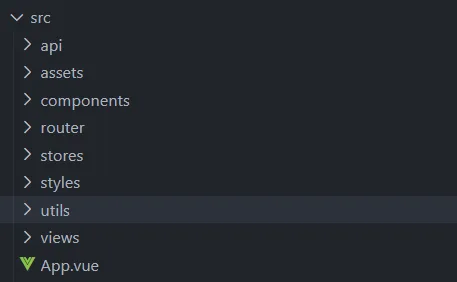
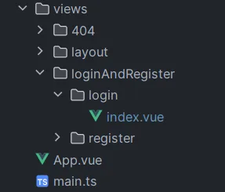
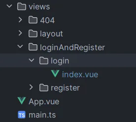

# vue简介

Vue是一款用于构建用户界面的 JavaScript 框架。它基于标准 HTML、CSS 和 JavaScript 构建，并提供了一套声明式的、组件化的编程模型，帮助你高效地开发用户界面。

安装`Node.js`、`NPM`和初始化项目请看下面的链接。

[vue实战-1-创建vue和引入Cesium以及Element Plus | kyl的博客 (alsl521.github.io)](https://alsl521.github.io/2023/12/09/QianDuan-YongHu-1/)

# 项目准备

## 项目清理与文件夹构建

由于创建Vue时，会自动创建部分无用的内容，因此需将项目重新整理。删除`components`和`views`中的所有内容。

 

然后新建如下文件夹



api：存放前后端交互的Url链接和数据格式。

assets：存放前端搭建页面时所需要的静态资源。

components：存放vue的组件。

router：存放vue的路由。详细内容可参考[ Vue Router (vuejs.org)](https://v3.router.vuejs.org/zh/installation.html)

styles：存放搭建前端页面时，可能需要的公共样式。

utils：存放前端可能需要的部分功能，例如封装的axios。

views：vue的视图组件。

App.vue：vue的根页面。

## 引入需要的插件

本项目使用`Scss`样式，所以需要安装相关依赖。

```sh
 npm install sass
```

由于需要进行前后端通信，因此需要安装`axios`。

```sh
 npm install axios
```

由于在使用Vue3的组合式 API 时，无法直接指定名称，并且本项目开发时，采用的是`文件夹/index.vue`的格式，所以引入`vite-plugin-vue-setup-extend`从而直接指定名称，帮助调试与开发。

```sh
npm install vite-plugin-vue-setup-extend
```

还引入了`element-plus`，具体配置请看官网：[快速开始 | Element Plus (element-plus.org)](https://element-plus.org/zh-CN/guide/quickstart.html)

```sh
npm install element-plus --save
```

其余的插件将在使用时一一介绍。

# 登陆页面


登陆页面中主要功能为登录，但当用户输入完用户名和密码之后，可以点击“记住密码”查看是否选择记住密码，如果选择了记住密码，则需要在“Cookie, SessionStorage 或LocalStorage”中存储用户名和密码，并在再次访问登陆页面时自动填充用户名和密码。

## 总体流程

1. 除了用户跳转到登陆页面、注册页面和404页面外，首先判断用户浏览器中是否存储了`Token`，如果存储了`Token`，向后台查询并询问`Token`是否合理，如果合理的话则进入到主页面并根据本地存储的用户名和密码更新`Token`；如果不合理或不存在则跳转到`Login`页面。
2. 在第一次进入`Login`页面时，输入用户名和密码。并可以选择是否记住密码，如果选择了记住密码，则将密码加密后存储在LocalStorage。
3. 在后续进入`Login`页面时，如果LocalStorage里有用户信息时，则判断用户选择了记住密码，从而将用户信息自动存入表单里。如果用户取消勾选了记住密码，则会将LocalStorage中的信息消除。

## 涉及文件




## 详细内容

### axios封装

```typescript
//进行axios二次封装:使用请求与响应拦截器
import axios from 'axios'
import {ElMessage} from 'element-plus'
import {getToken} from "@/utils/localStorage";
import {useRoute} from "vue-router";

//引入用户相关的仓库
//第一步:利用axios对象的create方法,去创建axios实例(其他的配置:基础路径、超时的时间)
const request = axios.create({
    //基础路径
    baseURL: '/api', //基础路径上会携带/api
    timeout: 1800000, //超时的时间的设置
})

//第二步:request实例添加请求与响应拦截器
request.interceptors.request.use((config: any) => {
    //获取用token,登录成功以后携带给服务器
    const token = getToken()

    if (String(token) != '') {
        config.headers.token = token
    }

    //config配置对象,headers属性请求头,经常给服务器端携带公共参数
    //返回配置对象
    return config
})

//第三步:响应拦截器
request.interceptors.response.use(
    (response: any) => {
        //成功回调
        //简化数据
        return response.data
    },
    (error: any) => {
        //失败回调:处理http网络错误的
        //定义一个变量:存储网络错误信息
        let message = ''
        //http状态码
        const status = error.response.status
        switch (status) {
            case 401:
                message = 'TOKEN过期'
                window.location.href = '/login'
                break
            case 403:
                message = '无权访问'
                break
            case 404:
                message = '请求地址错误'
                break
            case 500:
                message = '服务器出现问题'
                break
            default:
                message = '网络出现问题'
                break
        }
        //提示错误信息
        ElMessage({
            type: 'error',
            message,
        })
        return Promise.reject(error)
    },
)

//对外暴露
export default request
```

### LocalStorage封装

```typescript
// User
// 定义用户 Token 的键名
const tokenKey = 'token';
// 获取用户 Token
export const getToken = () => localStorage.getItem(tokenKey) || '';
// 设置用户 Token
export const setToken = (token: string) => localStorage.setItem(tokenKey, token);
// 移除用户 Token
export const removeToken = () => localStorage.removeItem(tokenKey);

// 是否记住密码
// 获取记住密码的值
export const getRemember = () => localStorage.getItem("remember_password") || '';
// 设置记住密码的值
export const setRemember = (val: any) => localStorage.setItem("remember_password", val);
// 移除记住密码的值
export const removeRemember = () => localStorage.removeItem("remember_password");
```

### UserStore

```typescript
import {defineStore} from 'pinia'

import type {
    UserAutoLoginResponse,
    UserLoginDTO,
    UserLoginResponse,
} from "@/api/loginAndRegister/type";
import {ref} from "vue";
import {setToken} from "@/utils/localStorage";
import {canAutoLogin, login} from "@/api/loginAndRegister";

export const useUserStore = defineStore('UserStore', () => {

    // 创建一个响应式引用变量 token
    const token = ref('')

    // 用户登录函数，接受一个 UserLoginDTO 类型的参数 data
    async function userLogin(data: UserLoginDTO) {
        // 调用 login 函数进行用户登录，返回一个 UserLoginResponse 类型的结果 result
        let result: UserLoginResponse = await login(data)

        if (String(result.code) === '1') {
            // 如果登录成功，将 result.data.token 赋值给 token.value
            token.value = result.data.token
            // 将用户 Token 存储到 localStorage 中
            setToken(result.data.token)

            return result.code
        } else {
            // 如果登录失败，返回错误信息 result.msg
            return result.msg;
        }
    }
    // 用户自动登录函数
    async function userAutoLogin() {

        // 调用 canAutoLogin 函数进行自动登录，返回一个结果 result
        let result: UserAutoLoginResponse = await canAutoLogin()

        if (String(result.code) === '1') {
            // 如果自动登录成功，返回结果 result.code
            return result.code
        } else {
            // 如果自动登录失败，返回错误信息 result.msg
            return result.msg;
        }
    }

    return {token, userLogin, userAutoLogin}
})
```

### api/loginAndRegister/index

```typescript
import request from "@/utils/request";
import type {
    UserAutoLoginResponse,
    UserLoginDTO,
    UserLoginResponse,
} from "@/api/loginAndRegister/type";

enum API {
    Login = "/login",
    CanAutoLogin = "/canAutoLogin",
}

// 用户登录函数，接受一个 UserLoginDTO 类型的参数 data
export const login = (data: UserLoginDTO) => request.post<any, UserLoginResponse>(API.Login, data)
// 用户自动登录函数
export const canAutoLogin = () => request.get<any, UserAutoLoginResponse>(API.CanAutoLogin)
```

### api/loginAndRegister/type

```typescript
// 前端传递的数据对象，用于用户登录
export interface UserLoginDTO {
    userName: string,
    passWord: string
}

// 用户登录的响应数据
export interface UserLoginResponse {
    code: number,
    msg: string,
    data: UserLoginVO
}

// 后端返回的用户登录的数据对象
export interface UserLoginVO {
    id: number,
    userName: string,
    token: string
}

// 用户自动登录的响应数据
export interface UserAutoLoginResponse {
    code: number,
    msg: string,
    data: null
}
```

### stores/users/userStore

```typescript
// 导入Vue Router的相关函数
import {createRouter, createWebHistory} from 'vue-router'
// 导入本地存储相关的函数
import {getRemember, getToken} from "@/utils/localStorage";
// 导入用户存储仓库相关的函数
import {useUserStore} from "@/stores/users/userStore";
// 导入Vue的响应式函数
import {reactive} from "vue";
// 导入Base64编码库
import {Base64} from "js-base64";


const router = createRouter({
    // 使用createWebHistory创建基于Web的路由历史记录
    history: createWebHistory(import.meta.env.BASE_URL),
    routes: [
        {
            path: "/login",
            component: () => import( "@/views/loginAndRegister/login/index.vue"),
            meta: {title: "模型耦合用户登陆页面", hidden: true, notNeedAuth: true}
        },
    ]
})

router.beforeEach(async (to, from, next) => {
    //用户存储仓库
    const userStore = useUserStore();
    if (to.path === '/login' || to.path === '/404' || to.path === '/register') {
        // 允许直接访问登录、404和注册页面
        next();
    } else {
        //获取Token
        let token = getToken()
        // 判断是否有token或token为空
        if (token === null || token === '') {
            // 如果没有token或token为空，则重定向到登录页面
            next('/login');
        } else if (token != null && token != '' && !userStore.isLogin) {
            // 调用用户存储仓库的用户自动登录方法并将结果保存在result中
            let result = await userStore.userAutoLogin()
            //判断登录结果是否为成功（返回值为字符串'1'表示成功）
            if (String(result) === '1') {
                userStore.isLogin = true
                //表单数据模型
                const ruleForm = reactive({
                    //用户名
                    userName: "",
                    //密码
                    passWord: "",
                });
                //从本地存储中获取记住密码的数据，并解析为对象
                const data = JSON.parse(getRemember())
                //将用户名赋值给表单数据模型的userName属性
                ruleForm.userName = data.userName
                //将经过Base64编码的密码解码后赋值给表单数据模型的passWord属性
                ruleForm.passWord = Base64.decode(data.passWord)
                //调用用户存储仓库的用户登录方法，将结果保存在result中
                await userStore.userLogin(ruleForm);
                // 允许访问目标路由
                next();
            } else {
                // 不允许自动登录，重定向到登录页面
                next('/login');
            }
        } else {
            // 允许访问目标路由
            next();
        }
    }
})
export default router
```

### views/loginAndRegister/login/index

在`views`中搭建如下路径。



并在index.vue中编写如下代码：

```vue
<template>
  <!-- 登录页面的外层容器 -->
  <div class="login_wrap">

    <!-- 登录表单容器 -->
    <div class="login_form">

      <!-- 表单左侧占位 -->
      <div class="form_lt"></div>

      <!-- 表单右侧容器 -->
      <div class="form_rt">

        <!-- 表单标题 -->
        <div class="form_title">欢迎回来</div>

        <el-form
            ref="ruleFormRef"
            :model="ruleForm"
            :rules="rules"
            status-icon
            class="form_box"
        >

          <!-- 用户名表单项 -->
          <el-form-item prop="userName">
            <el-input
                v-model="ruleForm.userName"
                placeholder="请输入用户名"
                :prefix-icon="User"
            />
          </el-form-item>

          <!-- 密码表单项 -->
          <el-form-item prop="passWord">
            <el-input
                v-model="ruleForm.passWord"
                type="password"
                placeholder="请输入密码"
                show-passWord
                :prefix-icon="Lock"
            />
          </el-form-item>

        </el-form>

        <!-- 记住密码复选框及忘记密码链接 -->
        <div class="login_remember">
          <el-checkbox v-model="isRememberPW" label="记住密码"/>

          <el-link href="/register" type="danger" :underline="false">忘记密码？</el-link>
        </div>

        <!-- 登录按钮容器 -->
        <div class="login_btn">
          <el-button type="primary" @click="handleLogin(ruleFormRef)" :loading="loginBtnLoading">
            登 录
          </el-button>
        </div>

        <!-- 注册按钮容器 -->
        <div class="login_btn">
          <el-button type="success" @click="handleRegister">
            注册
          </el-button>
        </div>

      </div>
    </div>

  </div>
</template>

<script setup lang="ts" name="login">
import {onMounted, reactive, ref} from "vue";
import {ElMessage, type FormInstance, type FormRules} from "element-plus";
import {User, Lock} from "@element-plus/icons-vue";
import {useUserStore} from "@/stores/users/users";
import {useRouter} from "vue-router";
import {getRemember, removeRemember, setRemember} from "@/utils/localStorage";
import {Base64} from "js-base64";

// 第一步 表单内容详情设计    
//表单实例引用
const ruleFormRef = ref<FormInstance>();

//表单数据模型
const ruleForm = reactive({
  //用户名
  userName: "",
  //密码
  passWord: "",
});

//表单校验规则
const rules = reactive<FormRules>({
  userName: [{required: true, message: "请输入用户名", trigger: "change"}],
  passWord: [
    {
      required: true,
      message: "请输入密码",
      trigger: "change",
    }, {
      pattern: /^[a-zA-Z0-9!@#$%^&*()_+\-=[\]{};':"\\|,.<>/?]+$/,
      message: "密码只能包含数字和字母",
      trigger: "change",
    },
    {min: 3, max: 20, message: "长度应为3-20", trigger: "blur"},
  ],
});

// 第二步 登陆相关内容详情
//是否记住密码，默认从本地存储中获取
let isRememberPW = ref(Boolean(getRemember()));

//用户存储仓库
const uerStore = useUserStore();

//路由对象
const router = useRouter()

//登录按钮加载状态
let loginBtnLoading = ref(false);

//处理登录事件
const handleLogin = (formEl: FormInstance | undefined) => {
  if (!formEl) return;

  //表单校验
  formEl.validate(async (valid, fields) => {
    if (valid) {

      //登录按钮加载状态设置为true，显示加载状态
      loginBtnLoading.value = true

      //调用用户存储仓库的用户登录方法，将结果保存在result中
      let result = await uerStore.userLogin(ruleForm);

      //判断登录结果是否为成功（返回值为字符串'1'表示成功）
      if (String(result) === '1') {
        //登录按钮加载状态设置为false，取消加载状态
        loginBtnLoading.value = false

        // 是否记住密码
        if (isRememberPW.value) {

          //将用户名和密码以JSON格式保存到本地存储中
          setRemember(
              JSON.stringify({
                userName: ruleForm.userName,
                //密码进行Base64编码后再保存
                passWord: Base64.encode(ruleForm.passWord),
              })
          );
        } else {
          //如果没有选择记住密码，则移除本地存储中的记住密码数据
          removeRemember();
        }

        //显示登录成功的消息提示
        ElMessage({
          message: "登录成功！",
          type: "success",
        });

        //跳转到首页
        await router.push('/')

      } else {
        //登录按钮加载状态设置为false，取消加载状态
        loginBtnLoading.value = false
        //显示登录失败的消息提示
        ElMessage.error(String(result))
      }
    }
  });
};

//处理注册按钮点击事件
const handleRegister = () => {
  router.push('/register')
}

// 第三步 后续登陆页面设计
//在组件挂载后执行
onMounted(() => {
  //调用isEditPW方法
  isEditPW();
})

//判断是否需要自动填充密码
const isEditPW = () => {
  //如果选择了记住密码
  if (isRememberPW.value) {
    //从本地存储中获取记住密码的数据，并解析为对象
    const data = JSON.parse(getRemember())
    //将用户名赋值给表单数据模型的userName属性
    ruleForm.userName = data.userName
    //将经过Base64编码的密码解码后赋值给表单数据模型的passWord属性
    ruleForm.passWord = Base64.decode(data.passWord)
  }
}

</script>

<style lang="scss" scoped>
.login_wrap {
  position: relative;
  width: 100%;
  height: 100vh;
  background-color: #eaecee;
  background-image: url(@/assets/imgs/login_bg.png);//背景图片
  background-repeat: no-repeat;
  background-size: 100% 100%;

  .login_form {
    position: absolute;
    top: 50%;
    width: 1200px;
    height: 500px;
    left: 50%;
    background-image: url(@/assets/imgs/form_bg.png);//背景图片
    background-size: 100% auto;
    background-repeat: no-repeat;
    transform: translate3d(-50%, -50%, 0);
    display: flex;

    .form_lt {
      flex: 1;
      background-image: url(@/assets/imgs/form_lt.png);//背景图片
      background-size: 100% auto;
      background-repeat: no-repeat;
      margin: 60px 0 0 60px;
    }

    .form_rt {
      flex: 1;
      margin: 60px 40px;

      .form_title {
        color: #444;
        font-weight: bold;
        font-size: 26px;
        padding-left: 40px;
      }

      .form_box {
        padding: 60px 0 0 40px;
        width: 340px;
      }

      .login_remember {
        padding: 0 0 0 40px;

        .el-link {
          padding: 0 0 10px 160px;
        }
      }

      .login_btn {
        padding: 10px 0 0 40px;
        width: 340px;

        .el-button {
          width: 100%;
        }
      }
    }

    .el-form-item {
      margin-bottom: 20px;
    }
  }
}
</style>
```

# 注册页面


用户注册界面逻辑较为简单，就是输入用户注册的信息，如果符合标准的话就可以提交到后台注册。

## views/loginAndRegister/register/index

```vue
<template>
  <!-- 注册页面的外层容器 -->
  <div class="register_wrap">
    <!-- 注册表单容器 -->
    <div class="register_box">
      <!-- 欢迎注册文本 -->
      <el-text class="register_text">欢迎注册使用！</el-text>
      <!-- 注册表单 -->
      <el-form label-width="auto" class="register_form" :model="registerFrom" :rules="registerFormRules"
               ref="registerFormRef" status-icon>
        <el-form-item label="用户名" prop="username">
          <el-input v-model="registerFrom.username"/>
        </el-form-item>
        <el-form-item label="密码" prop="password">
          <el-input v-model="registerFrom.password"/>
        </el-form-item>
        <el-form-item label="确认密码" prop="rePassword">
          <el-input v-model="registerFrom.rePassword"/>
        </el-form-item>
        <el-form-item label="Email" prop="email">
          <el-input v-model="registerFrom.email"/>
        </el-form-item>
        <el-form-item label="手机号" prop="phone">
          <el-input v-model="registerFrom.phone"/>
        </el-form-item>
        <el-form-item label="性别" prop="sex">
          <el-radio-group v-model="registerFrom.sex">
            <el-radio value='0'>男</el-radio>
            <el-radio value='1'>女</el-radio>
          </el-radio-group>
        </el-form-item>
      </el-form>
      <!-- 确认注册按钮 -->
      <div style="text-align: center;margin-top: 40px">
        <el-button type="primary" style="width: 100px" @click="handleRegister(registerFormRef)"
                   :loading="registerBtnLoading">确认注册
        </el-button>
      </div>
      <!-- 前往登录链接 -->
      <div style="text-align: center">
        <el-link style="margin-top: 40px" href="/login" type="danger" :underline="false">已有账户和密码，前去登录
        </el-link>
      </div>
    </div>
  </div>
</template>

<script setup lang="ts" name="register">
import {reactive, ref} from "vue";
import {ElMessage, type FormInstance, type FormRules} from "element-plus";
import {useUserStore} from "@/stores/users/userStore";
import {useRouter} from "vue-router";
// 创建响应式对象
const registerFrom: any = reactive<RuleForm>({
  username: '',
  password: '',
  rePassword: '',
  email: '',
  phone: '',
  sex: '',
})
// 定义表单数据类型
interface RuleForm {
  username: string
  password: string
  rePassword: string
  email: string
  phone: string
  sex: string
}
// 创建表单引用
const registerFormRef = ref<FormInstance>()
// 密码验证函数
const validatePass = (rule: any, value: any, callback: any) => {
  if (value === '') {
    callback(new Error('请输入密码'))
  } else {
    if (registerFrom.rePassword !== '') {
      if (!registerFormRef.value) return
      registerFormRef.value.validateField('rePassword', () => null)
    }
    callback()
  }
}
// 确认密码验证函数
const validateRePass = (rule: any, value: any, callback: any) => {
  if (value === '') {
    callback(new Error('请再次输入密码'))
  } else if (value !== registerFrom.password) {
    callback(new Error("两次密码输入不一致"))
  } else {
    callback()
  }
}
// 创建表单验证规则
const registerFormRules = reactive<FormRules<RuleForm>>({
  username: [
    {required: true, message: '请输入用户名', trigger: 'blur'},
    {min: 3, max: 10, message: '长度在 3 到 10 个字符', trigger: 'blur'}
  ],
  password: [
    {
      required: true,
      message: "请输入密码",
      trigger: "blur",
    },
    {validator: validatePass, trigger: 'blur'},
    {
      pattern: /^[a-zA-Z0-9!@#$%^&*()_+\-=[\]{};':"\\|,.<>/?]+$/,
      message: "密码只能包含数字和字母",
      trigger: "change",
    },
    {min: 3, max: 20, message: "长度应为3-20", trigger: "blur"},
  ],
  rePassword: [
    {
      required: true,
      message: "请再次输入密码",
      trigger: "blur",
    },
    {validator: validateRePass, trigger: "blur",},
  ],
  email: [
    {
      required: true,
      message: "请输入邮箱",
      trigger: "blur",
    },
    {
      pattern: /^[^\s@]+@[^\s@]+\.[^\s@]+$/,
      message: "邮箱格式不正确",
      trigger: "blur",
    },
  ],
  phone: [
    {
      required: true,
      message: "请输入手机号码",
      trigger: "blur",
    },
    {
      pattern: /^(13[0-9]|14[01456879]|15[0-35-9]|16[2567]|17[0-8]|18[0-9]|19[0-35-9])\d{8}$/,
      message: "手机号码格式不正确",
      trigger: "blur",
    },
  ],
  sex: [
    {required: true, message: '请选择性别'},
  ],
})
// 创建注册按钮加载状态的引用
let registerBtnLoading = ref(false);
// 使用用户存储对象
const uerStore = useUserStore();
// 使用路由对象
const router = useRouter()
// 处理注册事件
const handleRegister = (formEl: FormInstance | undefined) => {
  // 检查表单引用是否存在，如果不存在则返回
  if (!formEl) return;
  // 验证表单
  formEl.validate(async (valid, fields) => {
    // 如果表单验证通过
    if (valid) {
      // 设置注册按钮加载状态为true
      registerBtnLoading.value = true
      // 调用用户存储对象的userRegister方法进行用户注册
      let result = await uerStore.userRegister(registerFrom);
      // 如果返回结果为字符串'1'
      if (String(result) === '1') {
        // 设置注册按钮加载状态为false
        registerBtnLoading.value = false
        // 显示注册成功的消息
        ElMessage({
          message: "注册成功！",
          type: "success",
        });
        // 跳转到登录页面
        await router.push('/login')
      } else {
        // 设置注册按钮加载状态为false
        registerBtnLoading.value = false
        // 显示注册失败的错误消息
        ElMessage.error(String(result))
      }
    }
  });
};
</script>
<style scoped>
.register_wrap {
  position: relative;
  width: 100%;
  height: 100vh;
  background-color: #eaecee;
  background-image: url(@/assets/imgs/login_bg.png);
  background-repeat: no-repeat;
  background-size: 100% 100%;
  .register_text {
    left: 25%;
    top: 4%;
    font-size: 40px;
    position: absolute;
    font-weight: bold;
    color: black;
    letter-spacing: 10px;
  }
  .register_box {
    width: 600px;
    height: 800px;
    background-color: rgba(255, 255, 255, 0.85);
    border-radius: 50px;
    position: absolute;
    left: 50%;
    top: 50%;
    transform: translate(-50%, -50%);
    .register_form {
      margin: 120px 50px 0 50px;
      padding: 50px 50px 50px 50px;
      border-radius: 50px;
      background-color: rgba(206, 214, 224, 0.85);
      .el-form-item {
        border-radius: 50px;
        padding: 10px 30px 10px 10px;
      }
    }
  }
}
</style>
```

## stores/users/userStore

在`stores/users/userStore`中新加以下代码。

```typescript
	// 用户注册函数，接受一个任意类型的参数 data
    async function userRegister(data: UserRegisterDTO) {
        // 调用 register 函数进行用户注册，返回一个结果 result
        let result: UserRegisterResponse = await register(data)
        if (String(result.code) === '1') {
            // 如果注册成功，返回结果 result.code
            return result.code
        } else {
            // 如果注册失败，返回错误信息 result.msg
            return result.msg;
        }
    }
```

## api/loginAndRegister/index

在`api/loginAndRegister/index`中新加以下代码。

```typescript
import request from "@/utils/request";
import type {
    UserAutoLoginResponse,
    UserLoginDTO,
    UserLoginResponse,
    UserRegisterDTO,
    UserRegisterResponse
} from "@/api/loginAndRegister/type";
enum API {
    Login = "/login",
    Register = "/register",
    CanAutoLogin = "/canAutoLogin",
}
// 用户注册函数，接受一个 UserRegisterDTO 类型的参数 data
export const register = (data: UserRegisterDTO) => request.post<any, UserRegisterResponse>(API.Register, data)
```

## api/loginAndRegister/type

在`api/loginAndRegister/type`中新加以下代码。

```java
// 前端传递的数据对象，用户注册的表单数据
export interface UserRegisterDTO {
    username: string,// 用户名
    password: string,// 密码
    rePassword: string,// 重复密码
    phone: string,// 手机号
    email: string,// 邮箱
    sex: number// 性别
}
// 用户注册的响应数据
export interface UserRegisterResponse {
    code: number,
    msg: string,
    data: null
}
```
