# 一、排序

基于比较的排序时间复杂度目前做不到nlogn；时间为nlogn，空间为n以下的排序，做不到稳定性。

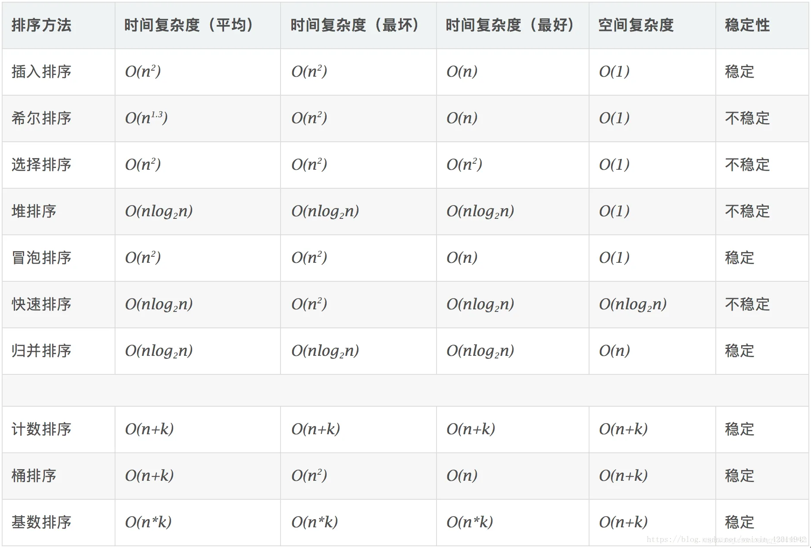

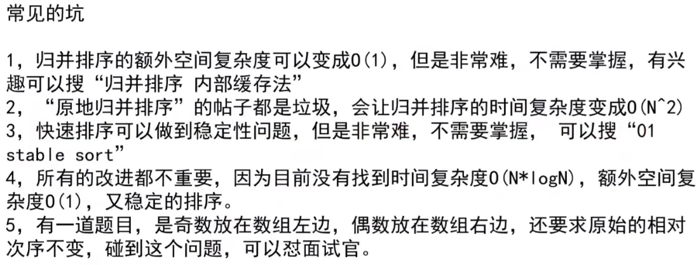

1. 一般来说，都是用快排。算法的每一步实际上都需要一个固定时间量，被称为常量。我们平时考虑时间复杂度的时候并不考虑常量的影响，但有时候常量的影响不可忽略，比如在这个问题上。但是大多数时候考虑复杂度的时候，可能还是不需要考虑常量的影响的，嗯，我觉得是……由于算法的每一步都有一个常量，而**快排的常量比归排小**，因此虽然两者的复杂度相同，但是快排更快一些。那第二个问题就来了，归排的复杂度一直都是O(n*log n)，而快排的平均复杂度才是O(n*log n)，最坏情况下快排的复杂度可以达到O(n^2)，为什不怕快排的时候是最坏的情况呢？主要是因为绝大多数情况下，快排遇到的都是平均情况，也就是最佳情况，只有极个别的时候会是最坏情况，因此往往不考虑这种糟糕的情况。
2. 归并排序可以做到空间复杂度为O(1)吗，可以！但是就不再稳定了。而且实现非常难，不如用堆排序。
3. “原地归并排序”方法会让时间复杂度变成O(n^2)也不行，不如插入排序。
4. “01  stable sort”论文的方法可以实现快排的稳定性，但是会让空间复杂度变成O(n)水平，不如直接用归并。
5. 所有的改进都不重要，因为目前没有找到时间复杂度为O(N*logN),额外空间复杂度O(1),又稳定的排序。
6. 有一道题目，是奇数放在数组左边，偶数放在数组右边，还要求原始的相对次序不变，碰到这个问题，可以怼面试官。 按照经典快排，这个问题跟左边小于等于一个数和右边大于一个数是等效的，但是无法做到稳定性，你可以直接让面试官教下你（左神都说超级难实现）。
7. 工程上充分利用O(N*logN)和O(N^2)的优势，如快排递归到样本量小于六十的时候，用插入排序更快。即进行综合排序。
8. 工程上利用稳定性优势，如果是基础类型数据的排序，如 年龄，分数，用**快排**。如果是用户自己定义的类型，职工（年龄、工时等属性）用**归并**。
9. 而C++和java等语言的排序，底层实现都非常多代码，用到了很多排序，充分利用各种排序的优势。


## 1、选择排序

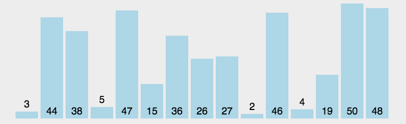

选择排序：
选择排序（ Selection sort）是一种简单直观的排序算法。它的工作原理是每一趟从待排序的数据元素中选出最小（或最大）的一个元素，顺序放在已排好序的数列的最后，直到全部待排序的数据元素排完。

   选择排序算法通过选择和交换来实现排序，其排序流程如下：

- （1）首先从原始数组中选择最小的1个数据，将其和位于第1个位置的数据交换。
- （2）接着从剩下的n-1个数据中选择次小的1个元素，将其和第2个位置的数据交换
- （3）然后，这样不断重复，直到最后两个数据完成交换。最后，便完成了对原始数组的从小到大的排序。

假如给定初始数据：（118，101，105，127，112）

一次排序：101，118，105，127，112

二次排序：101，105，118，127，112

三次排序：101，105，112，127，118

四次排序：101，105，112，118，127

(绿色为交换的数据)

每一趟在n-i+1(i=1,2,...,n-1)个记录中选取关键字最小的记录作为有序序列中第i个记录。具体来说，假设长度为n的数组arr，要按照从小到大排序，那么先从n个数字中找到最小值min1，如果最小值min1的位置不在数组的最左端(也就是min1不等于arr[0])，则将最小值min1和arr[0]交换，接着在剩下的n-1个数字中找到最小值min2，如果最小值min2不等于arr[1]，则交换这两个数字，依次类推，直到数组arr有序排列。算法的时间复杂度为O(n^2)。

```java
package class1;

/**
 * 程序01：选择排序
 */
public class Program01SelectionSort {

    /**
     * 选择排序方法
     *
     * @param arr 待排序的整数数组
     */
    public static void SelectionSort(int[] arr) {
        // 如果数组为空或长度小于2，无需排序，直接返回
        if (arr == null || arr.length < 2) return;

        // 遍历数组进行选择排序
        for (int i = 0; i < arr.length - 1; i++) {
            // 初始化最小值索引
            int minIndex = i;
            // 从当前位置的下一个元素开始，找到最小值的索引
            for (int j = i + 1; j < arr.length; j++) {
                minIndex = arr[j] < arr[minIndex] ? j : minIndex;
            }

            // 如果最小值的索引不等于当前位置，交换元素
            if (minIndex != i) {
                swap(arr, i, minIndex);
            }

            // 打印当前排序后的数组
            for (int k : arr) {
                System.out.print(k + " ");
            }

            System.out.println();
        }
    }

    /**
     * 交换数组中两个元素的位置
     *
     * @param arr 数组
     * @param i   第一个元素的索引
     * @param j   第二个元素的索引
     */
    private static void swap(int[] arr, int i, int j) {
        int temp = arr[i];
        arr[i] = arr[j];
        arr[j] = temp;
    }

    public static void main(String[] args) {
        int[] arr = {1, 4, 6, 3, 0, 2, 5, 9, 8, 7};
        SelectionSort(arr);
    }
}
```

## 2、冒泡排序


1、冒泡排序基本思想：
         通过对待排序序列从前向后（从下标较小的元素开始）,依次对相邻两个元素的值进行两两比较，若发现逆序则交换，使值较大的元素逐渐从前移向后部，就如果水底下的气泡一样逐渐向上冒。

小结：
设总的元素个数为n，那么由上边的排序过程可以看出：

- （1）总计需要进行（n-1）轮排序，也就是（n-1）次大循环
- （2）每轮排序比较的次数逐轮减少
- （3）如果发现在某趟排序中，没有发生一次交换， 可以提前结束冒泡排序。（详见下边优化部分）

```java
package class1;

/**
 * 程序02：冒泡排序
 */
public class Program02BubbleSort {

    /**
     * 冒泡排序方法
     *
     * @param arr 待排序的整数数组
     */
    public static void BubbleSort(int[] arr) {
        // 如果数组为空或长度小于2，无需排序，直接返回
        if (arr == null || arr.length < 2) return;

        // 外循环控制每一轮比较的次数
        for (int i = 0; i < arr.length - 1; i++) {
            // 内循环进行相邻元素的比较和交换
            for (int j = 0; j < arr.length - 1; j++) {
                // 如果前一个元素大于后一个元素，则交换它们的位置
                if (arr[j] > arr[j + 1]) {
                    swap(arr, j, j + 1);
                }
            }

            // 打印当前排序后的数组
            for (int k : arr) {
                System.out.print(k + " ");
            }

            System.out.println();
        }
    }

    /*private static void swap(int[] arr, int i, int j) {
        int temp = arr[i];
        arr[i] = arr[j];
        arr[j] = temp;
    }*/

    /**
     * 交换数组中两个元素的位置
     *
     * @param arr 数组
     * @param i   第一个元素的索引
     * @param j   第二个元素的索引
     */
    private static void swap(int[] arr, int i, int j) {
        // 使用位运算实现两个元素的交换，避免使用临时变量
        arr[i] = arr[i] ^ arr[j];
        arr[j] = arr[i] ^ arr[j];
        arr[i] = arr[i] ^ arr[j];
    }

    public static void main(String[] args) {
        int[] arr = {1, 4, 6, 3, 0, 2, 5, 9, 8, 7};
        BubbleSort(arr);
    }
}
```

### “异或”

#### ^（异或）的使用：

 在以后用的不多，了解一下即可。

计算规则：如果两边相同，结果为false，如果两边不同，结果为true

可以理解为**无进位相加**。

> 性质：
>
> 1. 0^N=N    N^N=0
> 2. B^A  = A^B    (B^A) ^C  = B^ (A^C)
> 3. 同一批数运算的结果，与顺序无关，结果固定。
>    下列代码实现顺序交换：（arr[i]=甲，arr[j]=乙）
>      arr[i] = arr[i] ^ arr[j];
>      arr[j] = arr[i] ^ arr[j];
>      arr[i] = arr[i] ^ arr[j]; 
>      原理（关键arr[i]和arr[j]所指向的内存中的内容不能是同一个，即地址不能相同，但值可以）
>      arr[i]=甲^乙，arr[j]=乙；即arr[i]=甲 ^乙，arr[j]=乙
>      arr[i]=甲^乙， arr[j]=乙^ （甲^乙）= （乙^ 乙）^甲=甲； 即arr[i]=甲^乙， arr[j]=甲
>      arr[i]=（甲^乙 ）^甲= （甲^ 甲）^乙=乙， arr[j]=甲；即arr[i]==乙， arr[j]=甲

#### 代码示例：

```java
//^   //左右不相同，结果才是true，左右相同结果就是false
System.out.println(true ^ true);//false
System.out.println(false ^ false);//false
System.out.println(true ^ false);//true
System.out.println(false ^ true);//true
```

#### 题目：

1、一个数组内，有一种数出现了奇数次，其余数出现了偶数次，求该数。

2、一个数组内，有两种数出现了奇数次，其余数出现了偶数次，求该两种数。

#### 解：

1、对于只有一个数出现奇数次的数组，我们可以利用异或的性质（同为0异为1），将所有的数相异或，最后就只剩下出现奇数次的数。

```java
	public static void printOddTimesNum1(int[] arr){//有一种数出现奇数次，其他数出现偶数次
		int eor = 0;
		for(int cur : arr){
			eor ^= cur;
		}
		System.out.println(eor);
	}
```

2、但是现在有两个出现了奇数次，要是还按上面的方法，最后的结果将是这两个数的异或结果，我们又分不开。怎么办呢？
我们已经知道了只有一个数出现奇数次的解决方法。能不能考虑一下分治的思想呢，就是将这个数组分成两个子数组，然后保持每一个子数组只有一个奇数次数。可是应该怎么分这两个数组呢，以什么依据来分呢？
假设这两个出现奇数次的数分别为a，b。那么它俩肯定至少有一个bit位是不同的吧，如果全都相同那这俩数就完全相等了。我们如果能找到一个这样的bit位，然后按照这一位是0还是1将这个数组分开，那就得到了上面所说的子数组，每个子数组里仅有一个数出现了奇数次。
详细解释一下：假如a和b的第9位是最低的不相同的位，首先我们要找到这个第九位，令x = a^b，则x的第9位肯定是1，我们用 x & -x得到x的最低位的1，并将其余位都变为0。然后对数组中的元素挨个与这个数（x & -x）相“与”，如果结果为0，说明该数该位上为0，否则说明该数该位上为1，根据结果就可以将其分成两个子数组。首先a和b因为该位上的数字不同一定不在一个组里，其次对于其他的数都出现了偶数次，那么要么全被分到这个子数组要么全被分到那个子数组里，因此每个子数组中其他的数仍然是偶数次。这样问题就完美解决了。

```java
public static void printOddTimesNum2(int[] arr){//有两种数出现奇数次，其他数出现偶数次
		int eor = 0,onlyOne = 0;
		for(int cur : arr){
			eor ^= cur;//eor一定等于a^b 设这两种数是a,b，并且a^b不等于0，则一定有一位不等于0
		}
		int rightOne = eor & (~eor + 1);//提取出最右边的1，这两种数在该位上一定不同，设一个是1，一个是0
		for(int cur : arr){
			if((cur & rightOne) == 0){//这里写1也可以，0说明这些数在该位上为0，偶数次的数抹去不影响，剩下的一定是a或者b
				onlyOne ^= cur;
			}
		}
		System.out.println(onlyOne + " " + (eor ^ onlyOne));

	}
```

```java
package class1;

/**
 * 程序03：异或运算
 */
public class Program03XOR {

    /**
     * 打印出现奇数次的数（只有一个数出现奇数次，其他数出现偶数次）
     *
     * @param arr 整数数组
     */
    public static void printOddTimesNum1(int[] arr) {//有一种数出现奇数次，其他数出现偶数次
        int eor = 0;
        // 使用异或运算找出出现奇数次的数
        for (int cur : arr) {
            eor ^= cur;
        }
        System.out.println(eor);
    }

    /**
     * 打印出现奇数次的数（有两个数出现奇数次，其他数出现偶数次）
     *
     * @param arr 整数数组
     */
    public static void printOddTimesNum2(int[] arr) {//有两种数出现奇数次，其他数出现偶数次
        int eor = 0, onlyOne = 0;
        // 使用异或运算找出出现奇数次的两个数
        for (int cur : arr) {
            eor ^= cur;//eor一定等于a^b 设这两种数是a,b，并且a^b不等于0，则一定有一位不等于0
        }
        // 提取出最右边的1，这两个数在该位上一定不同
        int rightOne = eor & (~eor + 1);//设一个是1，一个是0，~eor 是按位取反运算符
        // 再次遍历数组，根据最右边的1将数分为两组，分别进行异或运算
        for (int cur : arr) {
            if ((cur & rightOne) == 0) {//这里写1也可以，0说明这些数在该位上为0，偶数次的数抹去不影响，剩下的一定是a或者b
                onlyOne ^= cur;
            }
        }
        System.out.println(onlyOne + " " + (eor ^ onlyOne));

    }

    public static void main(String[] args) {
        printOddTimesNum1(new int[]{1, 1, 1, 1, 5});
        printOddTimesNum2(new int[]{1, 2, 1, 4, 1, 1});
    }

}
```

int rightOne = eor & (~eor + 1);的含义如下图：

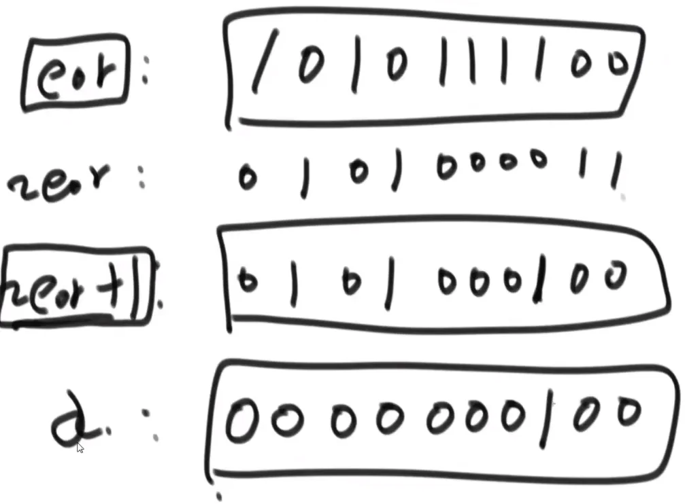

## 3、插入排序

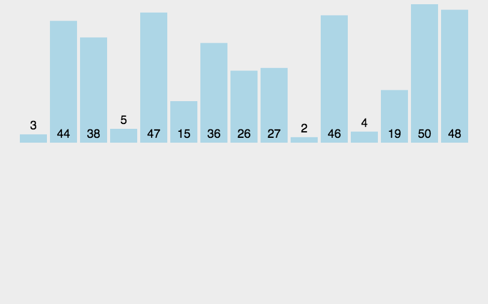

1.左边第一个元素可作为有序子数组；
2.从第二个元素开始，依次向前比较，大于该元素的则向右移一位，直到比该元素小的元素，插入其后；
3.依次向后推进，直至整个数组成为有序数组

```java
package class1;

import utils.PrintIntArr;

/**
 * 程序04：插入排序
 */
public class Program04InsertionSort {

    /**
     * 插入排序方法
     *
     * @param arr 待排序的整数数组
     */
    public static void InsertionSort(int[] arr) {
        // 如果数组为空或长度小于2，无需排序，直接返回
        if (arr == null || arr.length < 2) return;

        // 外循环控制待插入的元素
        for (int i = 1; i < arr.length; i++) {
            // 内循环从待插入元素的位置向前遍历
            for (int j = i; j > 0; j--) {
                // 将比待插入元素大的元素往后移动
                if (arr[j] < arr[j - 1]) {
                    swap(arr, j, j - 1);
                }
            }
            // 打印当前排序后的数组
            PrintIntArr.PrintIntArrays(arr);
        }
    }

    /**
     * 交换数组中两个元素的位置
     *
     * @param arr 数组
     * @param i   第一个元素的索引
     * @param j   第二个元素的索引
     */
    private static void swap(int[] arr, int i, int j) {
        // 使用位运算实现两个元素的交换，避免使用临时变量
        arr[i] = arr[i] ^ arr[j];
        arr[j] = arr[i] ^ arr[j];
        arr[i] = arr[i] ^ arr[j];
    }

    public static void main(String[] args) {
        int[] arr = {1, 4, 6, 3, 0, 2, 5, 9, 8, 7};
        InsertionSort(arr);
    }

}
```

### 二分查找

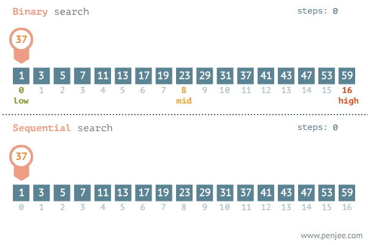

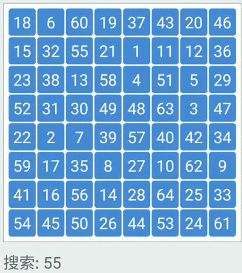

二分查找的前提条件是有序数列，普通查找则不需要。
  查找到返回该元素的下标，否则返回-1。
  普通查找的时间复杂度为O(N), 二分查找的时间复杂度为O(logN)。
  N/2/2···/2=1，2^m=N(m为折半查找的次数)，那么m=log(N)，二分查找的时间复杂度就为O(logN)。

```java
package class1;
/**
 * 程序04：二分查找
 */
public class Program05BinarySearch {

    /**
     * 二分查找方法
     *
     * @param arr 有序整数数组
     * @param key 要查找的元素
     * @return 如果找到，返回元素的索引；否则，返回 -1
     */
    public static int binarySearch(int[] arr, int key) {
        int head = 0, tail = arr.length - 1;

        // 使用二分查找算法
        while (head <= tail) {
            int mid = (head + tail) / 2;
            if (arr[mid] == key) {
                return mid;// 找到了，返回元素的索引
            } else if (arr[mid] < key) {
                head = mid + 1;// 在右半部分继续查找
            } else {
                tail = mid - 1;// 在左半部分继续查找
            }

        }

        // 没有找到，返回 -1
        return -1;
    }

    /**
     * 查找有序数组中目标元素的最左索引
     *
     * @param arr 有序整数数组
     * @param key 要查找的元素
     * @return 如果找到，返回最左索引；否则，返回 -1
     */
    public static int findLeft(int[] arr, int key) {
        int head = 0, tail = arr.length - 1;
        while (head < tail) {
            int mid = (head + tail) / 2;
            if (arr[mid] == key) {
                tail = mid; // 在右半部分继续查找
            } else if (arr[mid] < key) {
                head = mid + 1; // 在右半部分继续查找
            } else {
                tail = mid; // 在左半部分继续查找
            }
        }
        return tail;
    }

    /**
     * 查找有序数组中目标元素的最右索引
     *
     * @param arr 有序整数数组
     * @param key 要查找的元素
     * @return 如果找到，返回最右索引；否则，返回 -1
     */
    public static int findRight(int[] arr, int key) {
        int head = 0, tail = arr.length - 1;
        while (head < tail) {
            int mid = (head + tail) / 2 + 1;
            if (arr[mid] == key) {
                head = mid; // 在右半部分继续查找
            } else if (arr[mid] < key) {
                head = mid; // 在右半部分继续查找
            } else {
                tail = mid - 1; // 在左半部分继续查找
            }
        }
        return head;
    }

    /**
     * 查找数组中的局部最小值
     *
     * @param arr 整数数组
     * @return 如果找到局部最小值，返回其索引；否则，返回 -1
     */
    public static int findLocalMinimum(int[] arr) {

        // 检查第一个元素是否为局部最小值
        if (arr[0] < arr[1]) {
            return 0;
        }

        // 检查最后一个元素是否为局部最小值
        if (arr[arr.length - 1] < arr[arr.length - 2]) {
            return arr.length - 1;
        }

        // 使用二分查找算法查找局部最小值
        int left = 1, right = arr.length - 2;
        while (left < right) {
            int mid = (left + right) / 2;

            if (arr[mid] > arr[mid + 1]) {// 如果中间元素大于其右边的元素，则局部最小值在右半部分
                left = mid + 1;
            } else if (arr[mid] > arr[mid - 1]) {// 如果中间元素大于其左边的元素，则局部最小值在左半部分
                right = mid - 1;
            } else {
                return mid;
            }

        }

        // 没有找到局部最小值，返回 -1
        return -1;
    }

    public static void main(String[] args) {
        int[] arr = {4, 3, 2, 4, 0, 5, 6, 7, 8, 9};
        int binarySearch = binarySearch(arr, 9);

        System.out.println(binarySearch == -1 ? "not found" : "found" + " " + binarySearch);

        int[] arrNew = {1, 1, 2, 2, 2, 2, 3, 3, 4, 5};
        int left = findLeft(arrNew, 2);
        System.out.println(left == -1 ? "not found" : "found" + " " + left);

        int right = findRight(arrNew, 2);
        System.out.println(right == -1 ? "not found" : "found" + " " + right);

        int localMinimum = findLocalMinimum(arr);
        System.out.println(localMinimum == -1 ? "not found" : "found" + " " + localMinimum);
    }
}
```

## 4、归并排序

算法简介
分：
1.一直分两组，分别对两个数组进行排序(根据上层对下层在一组的数据通过临时数组排序，再将有序数组挪回上层数组中)。
2.循环第一步，直到划分出来的“小组”只包含一个元素，只有一个元素的数组默认为已经排好序。
合：（合并时，站在上层合并下层（使组内有序））
1.将两个有序的数组合并到一个大的数组中。
2.从最小的只包含一个元素的数组开始两两合并。此时，合并好的数组也是有序的。最后把小组合成一个组。

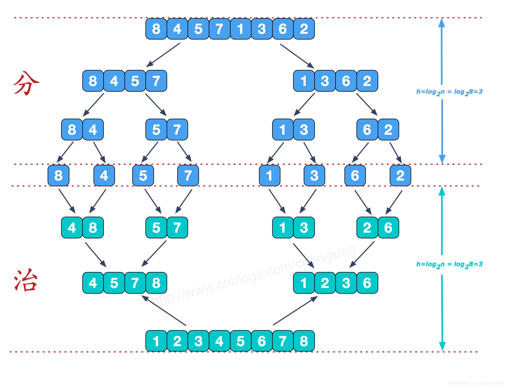


```java
package class2;

import utils.PrintIntArr;

/**
 * 程序：归并排序
 */
public class Program06MergeSort {

    /**
     * 归并排序方法
     *
     * @param arr 待排序的整数数组
     */
    public static void mergeSort(int[] arr) {
        // 如果数组为空或长度小于2，无需排序，直接返回
        if (arr == null || arr.length < 2) return;

        // 调用递归排序方法
        sort(arr, 0, arr.length - 1);
    }

    /**
     * 递归排序方法
     *
     * @param arr   待排序的整数数组
     * @param left  当前子数组的左边界
     * @param right 当前子数组的右边界
     */
    private static void sort(int[] arr, int left, int right) {
        // 如果左边界等于右边界，表示当前子数组只有一个元素，无需排序，直接返回
        if (left == right) return;

        // 计算当前子数组的中间位置
        int mid = left + ((right - left) >> 1);
        // 递归调用排序方法，对左半部分和右半部分分别进行排序
        sort(arr, left, mid);
        sort(arr, mid + 1, right);
        // 合并左半部分和右半部分
        merge(arr, left, mid, right);
    }

    /**
     * 合并子数组方法
     *
     * @param arr   待合并的整数数组
     * @param left  当前子数组的左边界
     * @param mid   当前子数组的中间位置
     * @param right 当前子数组的右边界
     */
    private static void merge(int[] arr, int left, int mid, int right) {
        // 创建临时数组用于存储合并结果
        int[] processArr = new int[right - left + 1];
        // 初始化指针
        int p = left, q = mid + 1, i = 0;

        // 比较左半部分和右半部分的元素，将较小的元素放入临时数组
        while (p <= mid && q <= right) {
            if (arr[p] < arr[q]) {
                processArr[i++] = arr[p++];
            } else {
                processArr[i++] = arr[q++];
            }
        }

        // 将剩余的左半部分的元素放入临时数组
        while (p <= mid) {
            processArr[i++] = arr[p++];
        }

        // 将剩余的右半部分的元素放入临时数组
        while (q <= right) {
            processArr[i++] = arr[q++];
        }

        // 将临时数组中的元素复制回原数组对应位置
        for (i = 0; i < processArr.length; i++) {
            arr[left + i] = processArr[i];
        }
    }

    public static void main(String[] args) {
        int[] arr = {4, 3, 2, 1, 0, 5, 6, 7, 8, 9};
        mergeSort(arr);
        // 打印当前排序后的数组
        PrintIntArr.PrintIntArrays(arr);
    }
}
```

### 最小和

```java
package class2;

import utils.PrintIntArr;

/**
 * 假设有一个数组，数组中每个数据左侧比该数据小的数据的和为最小和，求该数组所有数据最小和的和
 * <p>
 * 假设有[1,2,4,3,5]
 * 1的最小为0
 * 2为 1
 * 4为 2+1 = 3
 * 3为 1+2=3
 * 5为 1+2+4+3 = 10
 * 结果为0+1+3+3+10=17（0+1 +1+2+ 1+2+ 1+2+4+3）
 **/
public class Program07SmallSum {
    /**
     * 类似的题目：降序对
     * 求每个数右边有多少个比它小的数
     * 如果题目要求求出数组中左边或者右边有多少个数比自身大或者小，都可以使用归并的策略求出
     *
     * @param data 待处理的数组
     * @param L    当前子数组的左边界
     * @param R    当前子数组的右边界
     * @return 数组中每个数据最小和的和
     */
    public static int process(int[] data, int L, int R) {

        if (L == R) {
            return 0;
        }

        int mid = L + ((R - L) >> 1);

        int left = process(data, L, mid);
        int right = process(data, mid + 1, R);
        int mergeVal = merge(data, L, mid, R);
        return left + right + mergeVal;

    }

    /**
     * 合并子数组并计算最小和
     *
     * @param data 待合并的数组
     * @param L    当前子数组的左边界
     * @param M    当前子数组的中间位置
     * @param R    当前子数组的右边界
     * @return 当前子数组的最小和
     */
    private static int merge(int[] data, int L, int M, int R) {

        int[] help = new int[R - L + 1];

        int i = 0;
        int p1 = L;
        int p2 = M + 1;
        int result = 0;
        while (p1 <= M && p2 <= R) {

            //重点是先拷贝左组，相等先拷贝右组
            if (data[p1] < data[p2]) {
                help[i++] = data[p1];
                result += (R - p2 + 1) * data[p1];
                p1++;
            } else {
                help[i++] = data[p2++];
            }

        }

        while (p1 <= M) {
            help[i++] = data[p1++];
        }

        while (p2 <= R) {
            help[i++] = data[p2++];
        }

        for (int j = 0; j < help.length; j++) {
            data[L + j] = help[j];
        }

        return result;
    }

    /**
     * 非递归的归并排序方法
     *
     * @param data 待排序的数组
     */
    public static void mergeSort2(int[] data) {

        if (data == null || data.length < 2) {
            return;
        }

        int N = data.length;
        int mergeSize = 1;

        while (mergeSize < N) {

            int L = 0;
            while (L < N) {
                int M = L + mergeSize - 1;
                if (M >= N) {
                    break;
                }

                int R = Math.min(N - 1, M + mergeSize);
                merge(data, L, M, R);
                L = R + 1;
            }

            if (mergeSize > N / 2) { //防止溢出
                break;
            }

            mergeSize <<= 1;

        }

    }


    public static void main(String[] args) {
        int[] data = {1, 2, 4, 3, 5};
        int result = process(data, 0, data.length - 1);

        System.out.println(result);
        System.out.println("----------------------------------");
        PrintIntArr.PrintIntArrays(data);
    }
}
```

## 5、快速排序

算法简介
1.选择一个元素赋值给中间元素temp，默认选择左边第一个元素，这样左边第一个元素的位置就空出来了；

2. 先从最右边的元素开始依次跟temp比较大小，大于等于temp元素的原地不动，遇到小于temp元素的则终止循环，把该元素赋值到左侧空出来的位置，同时左侧索引值自增，这是该元素原来的位置就空出；
3. 然后左侧元素开始依次跟temp比较大小，小于等于temp元素的原地不动，遇到大雨temp元素的则终止循环，把该元素赋值到右侧空出来的位置，同时右侧索引值自减；
4. 依次循环2,3步，直至左侧索引等于右侧索引，则完成一轮循环，把哨兵赋值到该索引的位置。
5. 在分别递归地对temp左右两侧的子数组进行1234步，直至递归子数组只有一个元素则排序完成

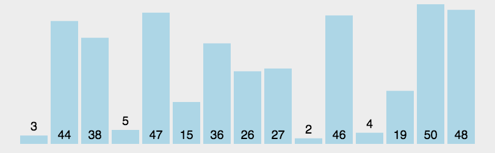

```java
package class2;

import utils.PrintIntArr;

/**
 * 快速排序算法实现
 */
public class Program08QuickSort {

    /**
     * 对给定数组进行快速排序
     *
     * @param arr 待排序的数组
     */
    public static void quickSort(int[] arr) {
        // 如果数组为空或长度小于2，无需排序，直接返回
        if (arr == null || arr.length < 2) return;
        quickSort(arr, 0, arr.length - 1);
    }

    /**
     * 对指定范围内的数组进行快速排序
     *
     * @param arr   待排序的数组
     * @param left  排序范围的左边界
     * @param right 排序范围的右边界
     */
    public static void quickSort(int[] arr, int left, int right) {
        if (left < right) {
            // 从排序范围内随机选择一个元素作为基准元素
            swap(arr, left + (int) (Math.random() * (right - left + 1)), right);
            int[] p = partition(arr, left, right);
            quickSort(arr, left, p[0] - 1);
            quickSort(arr, p[1] + 1, right);
        }
    }

    /**
     * 对指定范围内的数组进行划分操作，并返回划分后基准元素的最终位置
     *
     * @param arr   待划分的数组
     * @param left  划分范围的左边界
     * @param right 划分范围的右边界
     * @return 包含基准元素最终位置的数组，下标0为最终位置的左边界，下标1为最终位置的右边界
     */
    public static int[] partition(int[] arr, int left, int right) {
        int less = left - 1;//小于的范围，开始在0的左边，右边界
        int more = right;//大于的范围，左边界

        while (left < more) {//left表示当前数的位置
            if (arr[left] < arr[right]) {
                swap(arr, ++less, left++);
            } else if (arr[left] > arr[right]) {
                swap(arr, --more, left);
            } else {
                left++;
            }

        }
        swap(arr, more, right);
        return new int[]{less + 1, more};
    }

    /**
     * 交换数组中两个元素的位置
     *
     * @param arr 数组
     * @param i   第一个元素的索引
     * @param j   第二个元素的索引
     */
    private static void swap(int[] arr, int i, int j) {
        int temp = arr[i];
        arr[i] = arr[j];
        arr[j] = temp;
    }

    public static void main(String[] args) {
        int[] arr = {4, 3, 2, 1, 0, 5, 6, 7, 8, 9};
        quickSort(arr);
        PrintIntArr.PrintIntArrays(arr);
    }
}
```

## 6、堆排序

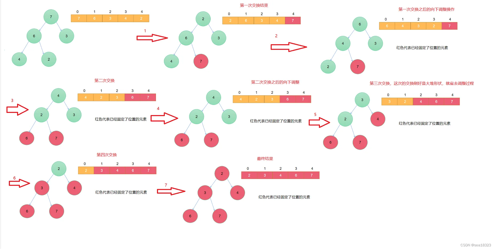

堆排序（Heapsort）是指利用堆这种数据结构所设计的一种排序算法。堆积是一个近似完全二叉树的结构，并同时满足堆积的性质：即子结点的键值或索引总是小于（或者大于）它的父节点。堆排序可以说是一种利用堆的概念来排序的选择排序。分为两种方法：
大顶堆：每个节点的值都大于或等于其子节点的值，在堆排序算法中用于升序排列；
小顶堆：每个节点的值都小于或等于其子节点的值，在堆排序算法中用于降序排列；

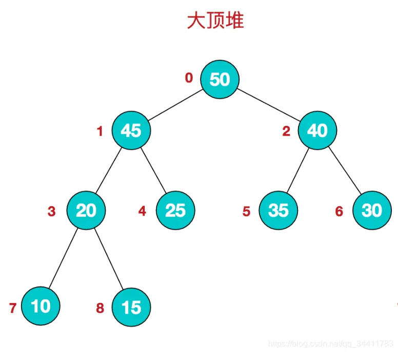

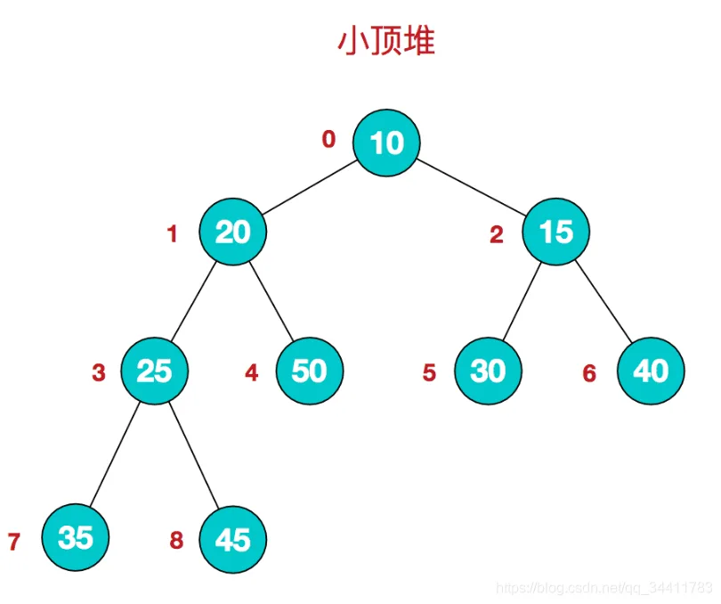

```java
package class3;

import utils.PrintIntArr;


/**
 * 堆排序算法实现
 */
public class Program09HeapSort {

    /**
     * 对给定数组进行堆排序
     *
     * @param arr 待排序的数组
     */
    public static void HeapSort(int[] arr) {
        if (arr == null || arr.length < 2) return;

        /*for (int i = 0; i < arr.length; i++) {
            heapInsert(arr, i);
        }*/

        for (int i = arr.length - 1; i >= 0; i--) {
            heapify(arr, i, arr.length);
        }

        int heapSize = arr.length;
        PrintIntArr.swap(arr, 0, --heapSize);
        while (heapSize > 0) {
            heapify(arr, 0, heapSize);
            PrintIntArr.swap(arr, 0, --heapSize);
        }

    }

    /**
     * 在堆中插入一个新元素，并调整堆结构
     *
     * @param arr   堆数组
     * @param index 插入元素的索引
     */
    private static void heapInsert(int[] arr, int index) {
        while (arr[index] > arr[(index - 1) / 2]) {// 当当前元素大于其父节点时
            PrintIntArr.swap(arr, index, (index - 1) / 2);// 将当前元素与父节点交换
            index = (index - 1) / 2;// 更新当前元素的索引为父节点的索引
        }
    }

    /**
     * 调整指定索引处的元素，使其满足堆的性质
     *
     * @param arr      堆数组
     * @param index    需要调整的元素的索引
     * @param heapSize 当前堆的大小
     */
    private static void heapify(int[] arr, int index, int heapSize) {
        int leftChild = 2 * index + 1;// 左子节点索引
        while (leftChild < heapSize) {// 当左子节点在堆范围内时

            // 获取子节点最大索引
            int largerChild = leftChild + 1 < heapSize && arr[leftChild + 1] > arr[leftChild] ? leftChild + 1 : leftChild;
            // 获取真正的最大值索引
            largerChild = arr[largerChild] > arr[index] ? largerChild : index;
            // 相等退出
            if (largerChild == index) break;
            // 不等重新比较
            PrintIntArr.swap(arr, largerChild, index);// 将当前元素与较大子节点交换
            index = largerChild;// 更新当前元素的索引为较大子节点的索引
            leftChild = 2 * index + 1;// 更新左子节点索引
        }

    }

    public static void main(String[] args) {
        int[] arr = {4, 3, 2, 1, 0, 5, 6, 7, 8, 9};
        HeapSort(arr);
        PrintIntArr.PrintIntArrays(arr);

    }
}
```

### 应用

```java
package class3;

//由于数组是几乎有序的，假如在第k+1个数之后存在最小值，那么元素移动到第一个位置需要移动超过k次，不符合，所以最小值必在前k+1个数里。
//
//可以选择k+1大小的小根堆进行排序，先扫描数组的前k+1个数构建小根堆。然后取出堆顶元素放在数组的第1个位置，并把数组的第k+2个数插入小根堆。
// 再取出堆顶元素放在数组的第2个位置，并把数组的第k+3个数插入小根堆……依次类推，扫描完数组后，把小根堆依次出堆即可。

import utils.PrintIntArr;

import java.util.PriorityQueue;


/**
 * 对距离不超过k的数组进行排序
 */
public class Program10SortArrayDistanceLessK {

    /**
     * 对距离不超过k的数组进行排序
     *
     * @param arr 原始数组
     * @param k   距离阈值
     */
    public static void sortArrayDistanceLessK(int[] arr, int k) {
        PriorityQueue<Integer> heap = new PriorityQueue<Integer>();
        int index = 0;
        // 0...K-1,把前k+1个数放在小根堆里中，防止数量太多
        for (; index <= Math.min(arr.length - 1, k - 1); index++) {
            heap.add(arr[index]);
        }

        int i = 0;
        //弹出一个数，就将该数放入小根堆中
        for (; index < arr.length; i++, index++) {
            heap.add(arr[index]);
            arr[i] = heap.poll();
        }
        //弹出一个数，就将该数放入小根堆中
        while (!heap.isEmpty()) {
            arr[i++] = heap.poll();
        }

    }

    public static void main(String[] args) {
        int[] arr = {1, 4, 6, 3, 0, 2, 5, 9, 8, 7};
        sortArrayDistanceLessK(arr, 4);
        PrintIntArr.PrintIntArrays(arr);
    }

}
```

## 7、基数排序

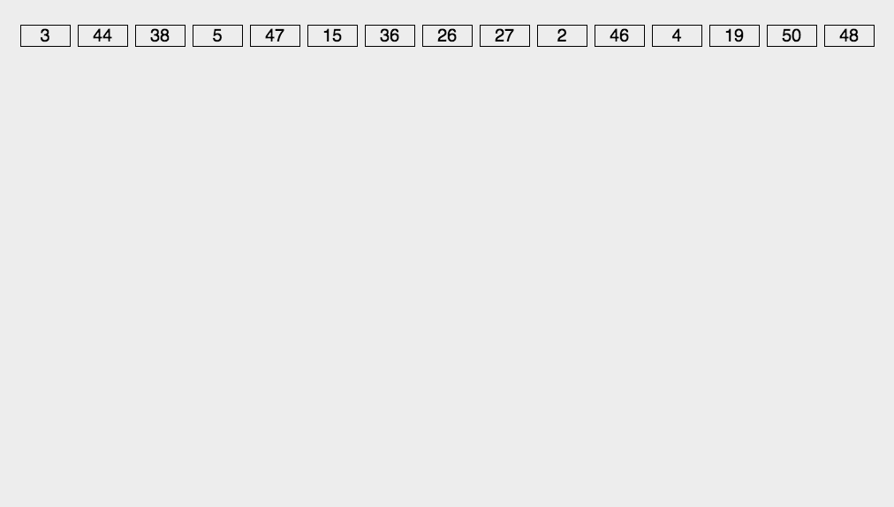

相比其它排序，主要是利用比较和交换，而基数排序则是利用分配和收集两种基本操作。基数 排序是一种按记录关键字的各位值逐步进行排序的方法。此种排序一般适用于记录的关键字为整数类型的情况。所有对于字符串和文字排序不适合。

实现：将所有待比较数值（自然数）统一为同样的数位长度，数位较短的数前面补零。然后，从最低位开始，依次进行一次排序。这样从最低位排序一直到最高位排序完成以后, 数列就变成一个有序序列。
基数排序的两种方式：
高位优先，又称为最有效键(MSD),它的比较方向是由右至左；
低位优先，又称为最无效键(LSD),它的比较方向是由左至右；

```java
package class3;

import utils.PrintIntArr;

/**
 * 基数排序示例程序（桶排序的思想），非比较排序
 */
public class Program12RadixSort {

    // only for no-negative value

    /**
     * 对整数数组进行基数排序（仅适用于非负数）
     *
     * @param arr 待排序的整数数组
     */
    public static void radixSort(int[] arr) {
        if (arr == null || arr.length < 2) {
            return;
        }
        radixSort(arr, 0, arr.length - 1, maxbits(arr));
    }

    /**
     * 获取整数数组中的最大位数
     *
     * @param arr 待计算的整数数组
     * @return 最大位数
     */
    public static int maxbits(int[] arr) {
        int max = Integer.MIN_VALUE;
        for (int i = 0; i < arr.length; i++) {
            max = Math.max(max, arr[i]);
        }
        int res = 0;
        while (max != 0) {
            res++;
            max /= 10;
        }
        return res;
    }

    // arr[L..R]排序  ,  最大值的十进制位数digit

    /**
     * 对整数数组的指定范围进行基数排序
     *
     * @param arr   待排序的整数数组
     * @param L     范围的起始下标
     * @param R     范围的结束下标
     * @param digit 最大值的十进制位数
     */
    public static void radixSort(int[] arr, int L, int R, int digit) {
        final int radix = 10;
        int i = 0, j = 0;
        // 有多少个数准备多少个辅助空间
        int[] help = new int[R - L + 1];
        for (int d = 1; d <= digit; d++) { // 有多少位就进出几次
            // 10个空间
            // count[0] 当前位(d位)是0的数字有多少个
            // count[1] 当前位(d位)是(0和1)的数字有多少个
            // count[2] 当前位(d位)是(0、1和2)的数字有多少个
            // count[i] 当前位(d位)是(0~i)的数字有多少个
            int[] count = new int[radix]; // count[0..9]
            for (i = L; i <= R; i++) {
                // 103  1   3
                // 209  1   9
                j = getDigit(arr[i], d);
                count[j]++;
            }
            for (i = 1; i < radix; i++) {
                count[i] = count[i] + count[i - 1];
            }
            for (i = R; i >= L; i--) {
                j = getDigit(arr[i], d);
                help[count[j] - 1] = arr[i];
                count[j]--;
            }
            for (i = L, j = 0; i <= R; i++, j++) {
                arr[i] = help[j];
            }
        }
    }

    /**
     * 获取整数x的第d位数字
     *
     * @param x 整数
     * @param d 位数
     * @return 第d位的数字
     */
    public static int getDigit(int x, int d) {
        return ((x / ((int) Math.pow(10, d - 1))) % 10);
    }


    public static void main(String[] args) {
        int[] arr = {1, 4, 6, 3, 0, 2, 5, 9, 8, 7};
        radixSort(arr);
        PrintIntArr.PrintIntArrays(arr);
    }
}
```
