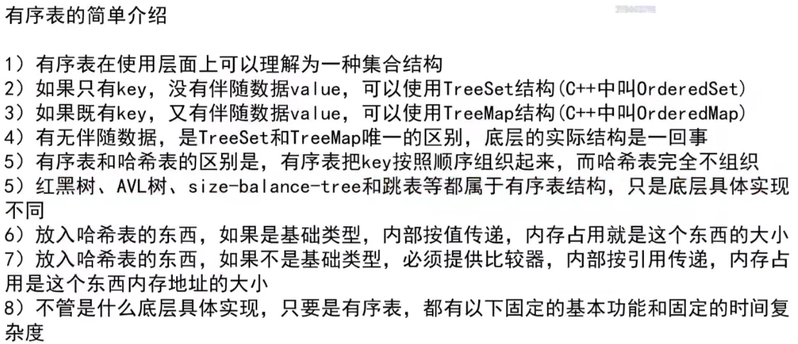
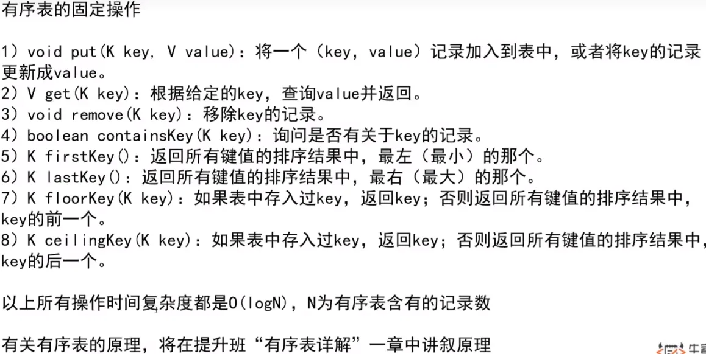

6、7的哈希表指的是有序表

# 快慢指针

快慢指针，顾名思义，在链表中，维持两个指针，跳跃速度不同（A跳一步，B就跳两步）。他能做的事情很多，最直观的是寻找链表的中点。还可以判断链表是否有环等等。这里我们先解释快慢指针算法，然后分析它的复杂度。

# 一棵树是否为搜索二叉树

判断中序遍历是否是升序

# 判断是否为完全二叉树

判断宽度是否符合，判断是否都有左右孩子。

再上一个前提不违规的前提下，如果遇到了第一个左右孩子不全，后续所有节点都必须为叶节点。

# 二叉树递归套路

在处理二叉树的问题时，递归套路是向自己的左右子树要信息。树形DP（树形 DP **是在树上进行的动态规划，利用树的递归性质进行状态转移。**）这些都是可以进行优化的题目。 

平衡二叉树（左右子树的高度差不超过1）
