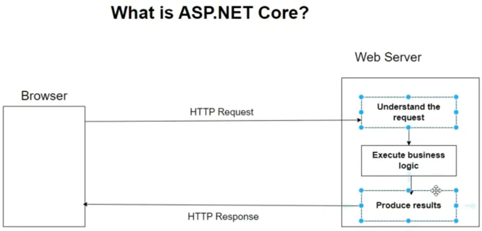
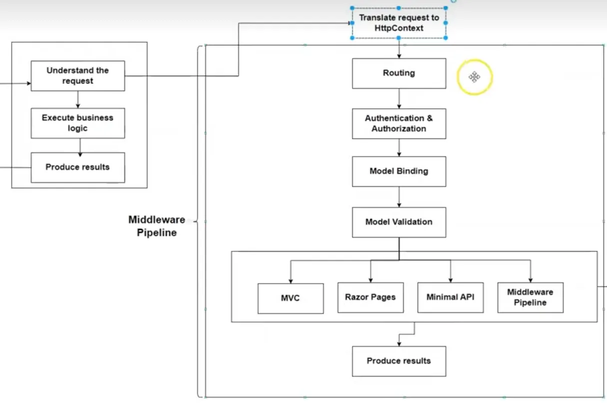

视频教程为：[ASP.NET Core Deep-Dive in .NET 9 | Udemy](https://www.udemy.com/course/aspnet-core-deep-dive/?couponCode=ST14MT150425G1)

# 1、```.NET Core```

.NET Core 是微软开发的**开源、跨平台应用程序开发框架**，旨在为现代云原生、微服务及高性能场景提供支持。以下是其核心特性与定位的详细说明：

------

## 一、**核心定义与定位**

1. 跨平台支持

   .NET Core 可在 Windows、Linux、macOS 等操作系统上运行，并支持 x86、x64、ARM 等多种架构。

   这种跨平台能力使其成为开发云原生、容器化应用（如 Docker）的理想选择。

2. 开源与社区驱动

   作为 MIT 协议下的开源项目，.NET Core 的代码托管于 GitHub，接受社区贡献，确保了技术透明度和快速迭代。

------

## 二、**架构与技术特性**

1. 模块化设计

   采用包化（Packages）管理，开发者可按需引用组件，减少应用体积，与传统的 .NET Framework 打包式安装形成对比。例如，通过

   ```
   dotnet restore
   ```

   命令可动态还原依赖的 NuGet 包。

2. 高性能运行时

   - RyuJIT 编译器：相比传统 JIT，性能提升约 25%，支持 SIMD 指令优化。
   - AOT 编译（Core RT）：将 MSIL 提前编译为机器码，缩短启动时间并降低内存占用，适用于 IoT 和移动端。

3. 核心组件

   - Core CLR：提供垃圾回收（GC）、类型系统等运行时环境。
   - LLILC 编译器：基于 LLVM 实现跨平台 MSIL 编译，支持 JIT 和 AOT。

------

## 三、**与 .NET Framework 的关系**

1. 子集与超集关系

   .NET Core 实现了 .NET Framework 的核心功能（如基础类库、JIT、GC），但移除了 Windows 专属功能（如 ASP.NET Web Forms、WCF）。

2. 发展路径

   - 独立演进：早期与 .NET Framework 并行发展，但自 .NET 5 起，微软将两者统一为单一平台“.NET”，逐步淘汰 .NET Framework。
   - 兼容性：通过 .NET Standard 规范实现与 .NET Framework、Xamarin 的代码共享。

------

## 四、**应用场景与优势**

1. 现代开发需求
   - 微服务与云原生：轻量级、快速启动特性适配 Kubernetes 和 Serverless 架构。
   - 跨平台应用：支持 Web（ASP.NET Core）、桌面（WPF、MAUI）、移动端（Xamarin）及 IoT。
2. 性能与效率
   - 低资源消耗：优化内存占用，适合高并发场景（如 API 服务）。
   - 开发工具链：集成 CLI 工具（如**```dotnet build```**、 **```dotnet run```**），支持热重载、容器化调试。

------

## 五、**发展历程与版本**

1. 关键版本

   - .NET Core 3.1：首个长期支持（LTS）版本，支持 Windows 桌面应用（WPF、WinForms）。

   - .NET 5/6/7：逐步统一生态，引入 Blazor WebAssembly、AOT 优化及机器学习库（如 ML.NET） 。

2. 未来方向

   微软计划通过持续迭代（如 .NET 8 及后续版本）强化跨平台能力、AI 集成与性能提升，巩固其在现代化开发中的竞争力 。

------

## 六、**适用场景建议**

- 选择 .NET Core 的情况：新项目开发、跨平台需求、云部署、追求性能优化。


- 保留 .NET Framework 的情况：维护旧有 Windows 专属应用（如 Web Forms）或依赖特定库。


------

# 2、```ASP.NET Core```

ASP.NET Core 是微软推出的**开源、跨平台 Web 应用开发框架**，作为传统 ASP.NET 的下一代重构版本，专为构建高性能、云原生及实时应用设计。

[ASP.NET documentation | Microsoft Learn](https://learn.microsoft.com/en-us/aspnet/core/?view=aspnetcore-9.0)

以下是其核心定义与特性解析：

------

## 一、**核心定义与定位**

1. 开源与跨平台支持

   ASP.NET Core 基于 MIT 协议开源，代码托管于 GitHub，支持在 Windows、Linux、macOS 等系统上运行。其跨平台能力打破了传统 ASP.NET 对 Windows 的依赖，适配云原生和容器化部署（如 Docker） 。

2. 架构重构与技术革新

   完全重写了传统 ASP.NET，将 MVC 和 Web API 统一为单一编程模型，同时保持与旧版的高度兼容性。例如，开发者可无缝迁移 MVC 模式代码至 ASP.NET Core。

------

## 二、**核心特性与优势**

1. 模块化设计

   采用按需加载的 NuGet 包管理，避免冗余依赖。例如，开发者可仅引入身份验证或日志组件，减少应用体积。


2. 高性能优化

   - Kestrel 服务器：基于异步编程模型，处理高并发请求时性能显著优于传统 IIS。
- 内存与启动优化：通过内存压缩和 AOT 提前编译技术，降低资源占用并加快启动速度。

3. 云原生与微服务适配

   内置环境配置系统和轻量级 HTTP 管道，支持 Kubernetes、Docker 等云平台，适合构建微服务架构。

------

## 三、**技术架构与组件**

1. 中间件管道（Middleware Pipeline）

   通过链式处理请求与响应，支持自定义中间件扩展功能。例如，日志记录、异常处理等均可通过中间件实现。

2. 依赖注入（DI）集成

   框架原生支持 DI，提供瞬态、作用域、单例三种生命周期管理，简化组件解耦与测试。

3. 统一配置系统

   支持 JSON、环境变量、命令行等多源配置，并支持强类型绑定与云环境适配。

------

## 四、**应用场景**

1. Web 应用与 API

   可构建动态网站（如电商平台）、RESTful API 或 GraphQL 服务，通过**```[ApiController]```**特性快速定义端点。


2. 实时通信应用

   集成 SignalR 库，支持 WebSocket 双向通信，适用于聊天应用、实时监控等场景。

3. 云原生与物联网（IoT）

   轻量级特性适配边缘计算设备，结合容器化部署为 IoT 提供高效后端支持。

------

## 五、**与传统 ASP.NET 的对比**

|   **特性**   |         **ASP.NET Core**         |        **传统 ASP.NET**        |
| :----------: | :------------------------------: | :----------------------------: |
| **运行环境** |   跨平台（.NET Core/.NET 5+）    | 仅限 Windows（.NET Framework） |
| **部署方式** |          自托管或容器化          |            依赖 IIS            |
|   **性能**   | 异步模型优化，高并发处理能力更强 |     同步模型为主，性能适中     |
| **架构设计** |          模块化、轻量级          |       单体式、依赖全框架       |
| **版本控制** |         支持并排版本部署         |         单版本全局安装         |

------

## 六、**开发与部署流程**

1. 开发工具链

   支持 Visual Studio、VS Code 及 CLI 工具（如**```dotnet build```**、 **```dotnet run```**），提供热重载功能加速调试。


2. 部署选项

   - 框架依赖部署（FDD）：依赖目标服务器已安装的运行时。
- 自包含部署（SCD）：打包所有依赖，适合无运行时环境的服务器。

------

## 七、**生态系统与发展**

- 社区与扩展：活跃的开源社区贡献了 Blazor（WebAssembly 支持）、ML.NET（机器学习集成）等扩展 。


- 未来方向：持续优化 AOT 编译、强化 AI 集成（如 OpenAI 交互）、深化云原生支持。

------

# 3、**ASP. NET核心剖析**



### **1. 浏览器发起请求**

用户通过浏览器向Web服务器发送一个HTTP请求（如访问网页或提交数据）。请求包含：

- **方法**：GET（获取数据）、POST（提交数据）等。
- **URL**：指定目标资源路径。
- **请求头**：包含客户端信息（如浏览器类型、编码格式等）。
- **请求体**：POST等方法携带的数据。

------

### **2. Web服务器处理请求**

ASP.NET Core框架作为Web服务器的核心，按以下步骤处理请求：

#### **a. 理解请求**

- **解析HTTP请求**：分析请求方法、URL、头信息和请求体。
- **路由匹配**：根据URL确定需要调用的控制器或API端点。

#### **b. 执行业务逻辑**

- **调用代码**：根据路由结果，执行对应的C#代码（如控制器方法、服务层逻辑）。
- **数据处理**：可能涉及数据库操作、业务规则校验、计算等。
- **中间件管道**：通过ASP.NET Core的中间件组件（Middleware）处理请求（如身份验证、日志记录等）。

#### **c. 生成响应**

- **结果封装**：将处理结果（如HTML、JSON、文件等）封装到HTTP响应中。
- **设置响应头**：定义缓存策略、内容类型（如text/html、application/json）等。

------

### **3. 返回HTTP响应**

Web服务器将生成的HTTP响应返回给浏览器，包含：

- **状态码**：如200（成功）、404（未找到）、500（服务器错误）等。
- **响应头**：补充元数据（如内容长度、编码方式）。
- **响应体**：实际返回的数据（如网页内容、API的JSON结果）。

------

### **架构特点总结**

- **跨平台**：支持Windows、Linux、macOS等操作系统。
- **客户端-服务器模型**：浏览器（客户端）发起请求，ASP.NET Core（服务器端）处理并响应。
- **模块化设计**：通过中间件和可插拔组件实现灵活扩展。

# 4. ASP. NET核心剖析(中间件)

### **1. 接收HTTP请求**

- **网络层接收**：Web服务器（如Kestrel）通过TCP/IP协议接收客户端（如浏览器）的HTTP请求。

- 协议解析：解析请求内容，包括：

  - **请求行**：方法（GET/POST）、URL、HTTP版本。
  - **请求头**：客户端信息（如User-Agent）、编码格式、Cookie等。
  - **请求体**（如POST/PUT请求）：表单数据、JSON/XML等。

------

### **2. 构建`HttpContext`对象**

- 封装请求信息：Kestrel 服务器将解析后的请求数据封装到```HttpContext```

  对象中，包含以下核心属性：

  - **Request**：请求对象（如`HttpRequest`），包含URL、查询参数、请求体等。
  - **Response**：响应对象（如`HttpResponse`），用于生成最终响应。
  - **Items**：临时存储请求处理过程中需要传递的数据。

- **上下文传递**：所有后续处理步骤均通过`HttpContext`访问请求数据。

------

### **3. 中间件管道（Middleware Pipeline）处理**

ASP.NET Core通过中间件按顺序处理请求，每个中间件可执行以下操作：

#### **a. 预处理阶段**

- **日志记录**：记录请求的基本信息（如时间、URL）。
- **静态文件服务**：若请求静态资源（如CSS/JS文件），直接返回文件内容，跳过后续处理。
- **路由处理**：确定请求的路由规则（如`UseRouting`中间件）。
- **认证/授权**：验证用户身份（如`UseAuthentication`）和权限（如`UseAuthorization`）。

#### **b. 核心处理阶段**

- 模型绑定：

  - 将请求数据（如表单字段、查询参数）自动绑定到控制器方法的参数。
  - 支持复杂类型绑定（如对象、集合）和自定义绑定逻辑。
  
- 模型验证：

  - 根据数据注解（如`[Required]`、`[Range]`）或自定义规则验证数据。
- 验证失败时，返回错误信息（如HTTP 400 Bad Request）。

#### **c. 业务逻辑执行**

- 控制器/处理程序：

  - 根据路由结果调用对应的控制器方法（如MVC控制器的`HomeController.Index()`）或Minimal API端点。
- 执行业务逻辑（如数据库查询、计算、调用服务）。

#### **d. 后处理阶段**

- 结果生成：

  - 控制器返回结果对象（如`ViewResult`、`JsonResult`、`RedirectResult`）。
  - 将结果对象转换为HTTP响应体（如渲染视图、序列化JSON）。
  
- 响应头设置：

  - 设置状态码（如200、404、500）、内容类型（如`text/html`）、缓存策略等。

#### **e. 错误处理**

- **全局异常处理**：通过中间件（如`UseExceptionHandler`）捕获未处理的异常，返回友好错误页面或JSON错误信息。

------

### **4. 发送HTTP响应**

- 组装响应：

  - 将业务逻辑的结果（如HTML、JSON）写入`HttpResponse.Body`。
  - 设置响应头（如`Content-Type`、`Set-Cookie`）和状态码。
  
- **网络层发送**：通过TCP/IP协议将响应返回客户端。

------

### **关键流程图示**



```
客户端请求 → 网络层接收 → 构建HttpContext（Kestrel 服务器） → 中间件预处理（路由/认证） → 模型绑定与验证 → 执行业务逻辑 → 生成响应 → 中间件后处理 → 返回响应 → 客户端接收
```

------

### **架构特点**

| 特性             | 说明                                               |
| ---------------- | -------------------------------------------------- |
| **模块化中间件** | 按需插入/移除中间件，灵活控制请求处理流程。        |
| **高度可配置**   | 路由、认证、模型绑定等均可通过配置或代码自定义。   |
| **高性能**       | 异步编程模型（如`async/await`）优化处理效率。      |
| **跨平台兼容性** | 支持Windows、Linux、macOS，底层依赖Kestrel服务器。 |
