# 1、创建第一个ASP.NET应用（Minimal API）

## 1.创建新项目

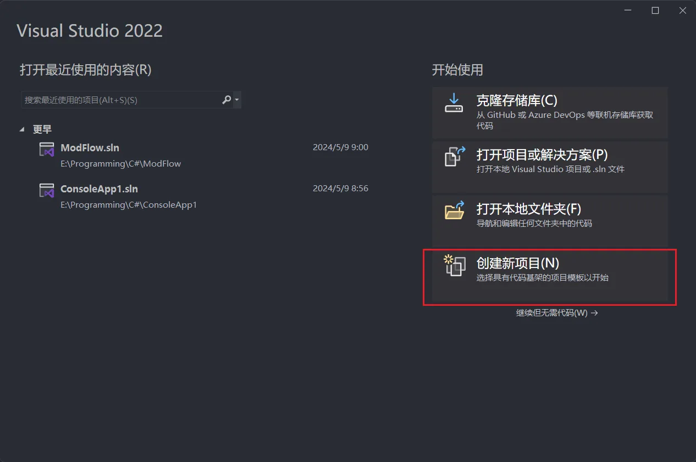

选择新的空项目

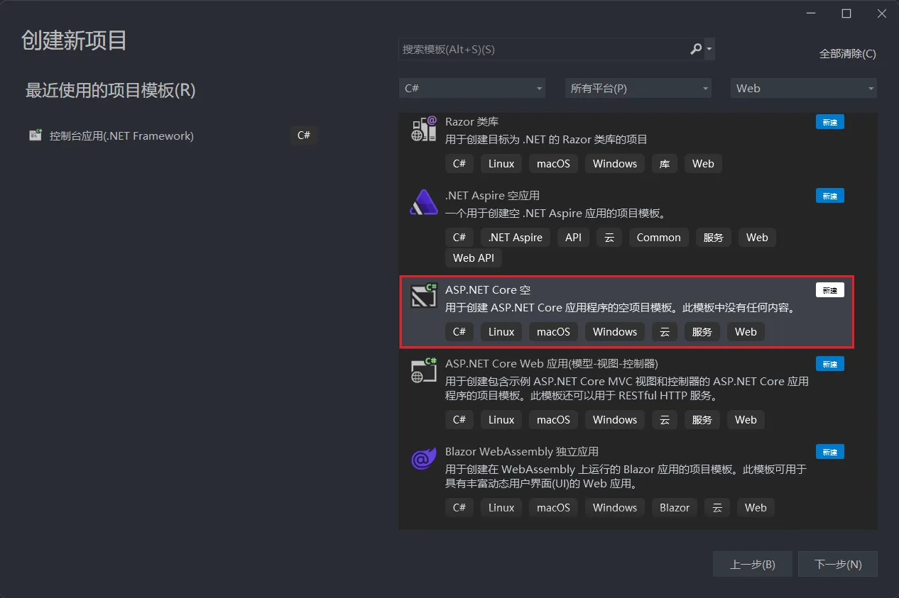

设定基本信息

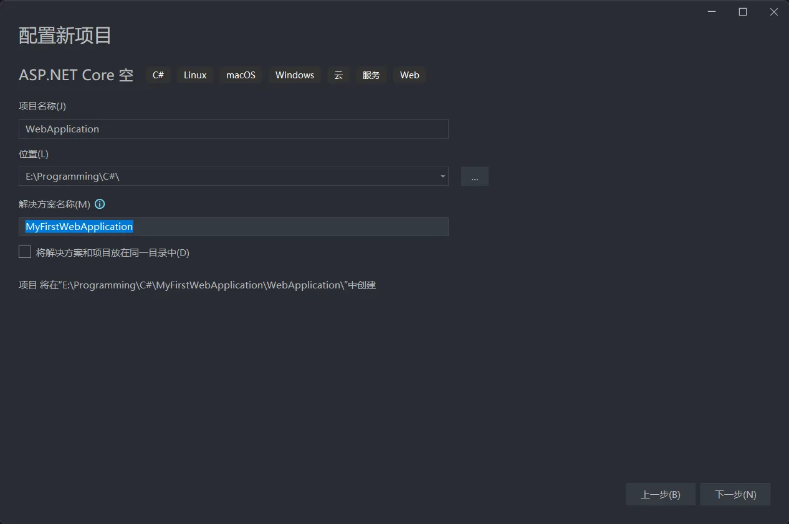

使用最新版.NET作为学习内容

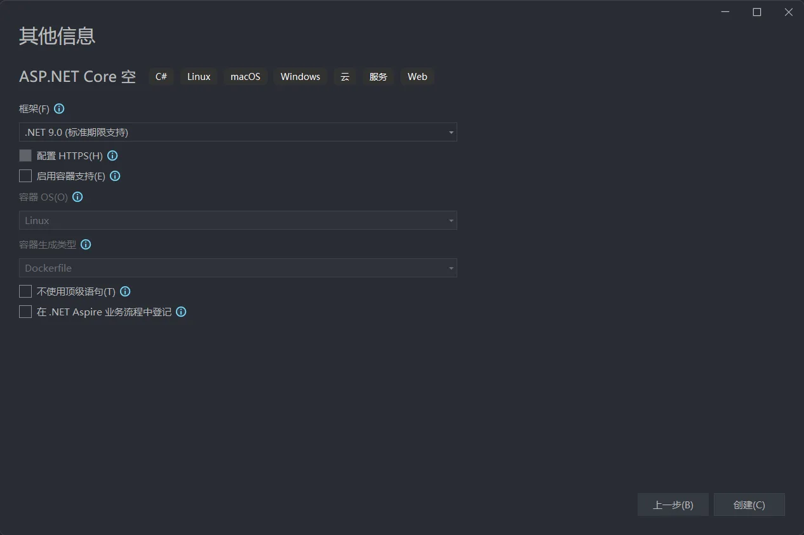

## 2.项目架构简介与解析

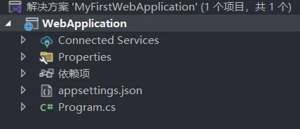

### **1. 解决方案（Solution）**

- **名称**：`MyFirstWebApplication`
- 作用：
  - 作为容器管理多个相关项目（当前仅包含一个项目 `WebApplication`）。
  - 支持团队协作和复杂应用的模块化开发（如Web API、类库、单元测试等）。
- 关键点：
  - 可通过解决方案配置统一管理所有项目的依赖和环境设置。
- 新增项目
  - 右键单击解决方案->添加->新建项目


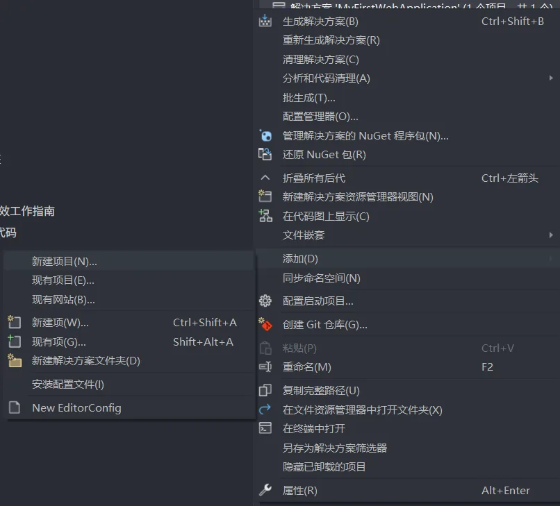

------

### **2. 项目（Project: `WebApplication`）**

- **核心结构**：
  包含构建和运行Web应用所需的所有文件与配置，分为以下关键部分：

#### **a. `Connected Services` 文件夹**

- 作用：
  - 存储与外部服务的连接配置（如数据库、Azure服务、第三方API）。
  - 通过右键添加服务（如Entity Framework、Azure认证），自动生成连接配置文件。
- **示例**：
  添加Azure SQL数据库后，会生成包含连接字符串的配置文件。

#### **b. `Properties` 文件夹**

- 核心文件：
  - `launchSettings.json`：
    - 定义应用启动时的配置，如默认端口、环境变量（Development/Production）。
    - 可配置多环境启动配置（如IIS、本地Kestrel服务器）。
  - **其他属性文件**：如程序集信息（AssemblyInfo.cs）。

#### **c. `依赖项（Dependencies）`**

- 作用：
  - 列出项目依赖的NuGet包（如 `Microsoft.AspNetCore.All`、数据库驱动程序）。
  - 通过NuGet包管理器可添加/更新依赖库。
- 关键包示例：
  - `Microsoft.EntityFrameworkCore`（数据库操作）。
  - `Swashbuckle.AspNetCore`（Swagger API文档）。

#### **d. `appsettings.json`**

- 作用：
  - 应用程序的通用配置文件，以JSON格式存储非敏感配置。
  - 支持环境特定覆盖（如 `appsettings.Development.json` 覆盖开发环境配置）。
- 典型配置：
  - 数据库连接字符串（`"ConnectionStrings": { "DefaultConnection": "..." }`）。
  - 日志级别（`"Logging": { "LogLevel": { ... } }`）。
  - 第三方服务API密钥。

#### **e. `Program.cs`**

- 核心功能：

  - **应用程序入口点**：定义主机（Host）的创建和配置流程。
  - 关键代码逻辑：
    1. 使用 `WebApplicationBuilder` 配置服务（如中间件、依赖注入容器）。
    2. 添加中间件管道（如路由、身份验证、静态文件服务）。
    3. 使用 `builder.Configuration` 加载 `appsettings.json` 配置。
    4. 启动Web服务器（如Kestrel）。

- 示例代码片段：

  ```C#
  var builder = WebApplication.CreateBuilder(args);
  builder.Services.AddControllersWithViews(); // 添加MVC服务
  var app = builder.Build();
  app.UseRouting();
  app.UseEndpoints(endpoints => endpoints.MapControllers());
  app.Run();
  ```
- 初始化代码片段：

```C#
var builder = WebApplication.CreateBuilder(args);//（创建Kestrel 服务器）
var app = builder.Build();
app.MapGet("/", () => "Hello World!");
app.Run();
```

##### **1. `var builder = WebApplication.CreateBuilder(args);`**

- **作用**：创建一个 `WebApplicationBuilder` 对象，用于配置ASP.NET Core应用。
- 关键点：
  - **`WebApplicationBuilder`**：这是一个核心类，负责初始化应用的依赖注入（DI）、配置、日志、中间件等。
  - `args`：命令行参数，用于传递运行时配置（如环境变量、端口等）。例如：`dotnet run --environment Production --urls "http://localhost:5001"`，这些参数会被`builder`自动解析。
  - 默认配置：
    - 加载 `appsettings.json` 及环境特定配置（如 `appsettings.Development.json`）。
    - 注册默认服务（如日志、配置系统）。
    - 配置环境（如 `Development` 或 `Production`）。

##### **2. `var app = builder.Build();`**

- **作用**：根据 `builder` 的配置构建一个 `WebApplication` 实例。
- 关键点：
  - **`WebApplication`**：表示完整的ASP.NET Core应用实例，包含已配置的服务、中间件管道和路由。
  - 构建过程：
    - 注册所有通过 `builder.Services` 添加的服务到DI容器。
    - 初始化中间件管道（如路由、异常处理等默认中间件）。
    - 加载配置文件（如 `appsettings.json`）。

##### **3. `app.MapGet("/", () => "Hello World!");`**

- **作用**：定义一个处理HTTP GET请求的路由，当访问根路径 `/` 时返回字符串 `"Hello World!"`。(中间件管道，仅在Kestrel 服务器接受请求时执行)
- 关键点：
  - **`MapGet`**：注册一个GET请求的路由处理程序。
  - 路由规则：
    - **路径**：`/` 表示根路径，对应浏览器访问 `http://localhost:5000/`。
    - **处理逻辑**：Lambda表达式 `() => "Hello World!"` 直接返回字符串作为响应体。
  - **响应类型**：默认返回 `text/plain` 类型的响应。

##### **4. `app.Run();`**

- **作用**：启动Web服务器并开始监听HTTP请求。
- 关键点：
  - **启动服务器**：默认使用内置的Kestrel服务器（跨平台）。
  - **阻塞主线程**：该方法会阻塞当前线程，直到应用停止（如按 `Ctrl+C`）。
  - **中间件执行**：所有注册的中间件（包括路由和自定义中间件）会按顺序处理请求。

------

##### **完整流程图解**

```
用户请求 → Kestrel接收请求 → 路由匹配（/） → 执行Lambda表达式 → 返回"Hello World!" → 响应客户端
```

------

##### **关键概念扩展**

###### **1. `WebApplicationBuilder` 的作用**

- 服务注册：通过`builder.Services`添加服务到DI容器，例如：

  ```C#
  builder.Services.AddControllers(); // 注册MVC控制器
  builder.Services.AddSingleton<MyService>(); // 注册单例服务
  ```

- 配置扩展：支持自定义配置，例如：

  ```C#
  builder.Configuration.AddJsonFile("custom.config.json"); // 添加自定义配置文件
  ```

- 环境判断：通过 

  ```C#
  builder.Environment
  ```

  判断当前环境：

  ```C#
  if (builder.Environment.IsDevelopment()) {
      // 开发环境配置
  }
  ```

###### **2. 路由与端点（Endpoints）**

- 路由语法：

  ```C#
  // GET请求，带参数
  app.MapGet("/users/{id}", (int id) => $"User ID: {id}");
  
  // POST请求，接收JSON数据
  app.MapPost("/todos", (Todo todo) => Results.Ok(todo));
  ```

- **返回结果**：使用 `Results` 类返回标准化响应（如 `Results.Ok()`、`Results.NotFound()`）。

###### **3. 中间件管道**

- 默认中间件包括：

  - **路由处理**：`UseRouting()`
  - **静态文件服务**：`UseStaticFiles()`
  - **异常处理**：`UseExceptionHandler()`

- 可通过 `app.Use`

  自定义中间件：

  ```
  app.Use(async (context, next) => {
      await context.Response.WriteAsync("Before processing...\n");
      await next(); // 继续后续中间件
      await context.Response.WriteAsync("\nAfter processing!");
  });
  ```

------

###### **完整示例代码**

```
var builder = WebApplication.CreateBuilder(args);

// 注册服务（如数据库上下文）
builder.Services.AddDbContext<MyDbContext>(options => 
    options.UseSqlServer(builder.Configuration.GetConnectionString("Default")));

// 配置中间件
var app = builder.Build();

// 定义路由
app.MapGet("/", () => "Hello World!");
app.MapGet("/api/todos", (MyDbContext db) => db.Todos.ToList()); // 使用DI服务

// 启用Swagger（需安装NSwag包）
if (app.Environment.IsDevelopment()) {
    app.UseOpenApi();
    app.UseSwaggerUi();
}

app.Run();
```

------

###### **常见问题解答**

**Q1: 如何自定义端口？**

- 方法1：通过命令行：

  ```
  dotnet run --urls "http://localhost:5001"
  ```

- 方法2：在代码中设置：

  ```
  var builder = WebApplication.CreateBuilder(args);
  var app = builder.Build();
  app.Urls.Add("http://localhost:5001"); // 添加多个端口
  ```

**Q2: 如何添加控制器？**

- 步骤：

  1. 注册控制器服务：

     ```
     builder.Services.AddControllers();
     ```

  2. 定义控制器：

     ```
     [ApiController]
     [Route("[controller]")]
     public class TodoController : ControllerBase {
         [HttpGet]
         public IActionResult Get() => Ok("From Controller!");
     }
     ```

  3. 配置路由：

     ```
     app.MapControllers(); // 启用控制器路由
     ```

**Q3: 如何处理POST请求？**

```
app.MapPost("/api/todos", (Todo todo) => {
    // 处理POST数据（如保存到数据库）
    return Results.Created($"/todos/{todo.Id}", todo);
});
```

------

###### **总结**

这段代码展示了ASP.NET Core的**最小API模式**（Minimal API），通过简洁的代码实现了：

1. **快速启动**：无需复杂配置即可运行。
2. **路由定义**：通过 `MapGet`/`MapPost` 等方法直接绑定HTTP方法和路径。
3. **依赖注入**：支持通过参数注入服务（如数据库上下文）。
4. **跨平台运行**：使用Kestrel服务器，支持Windows/Linux/macOS。

此模式适合快速开发小型API或原型，而复杂应用可通过扩展服务、中间件和控制器进一步增强功能。


------

### **3. 依赖注入（Dependency Injection, DI）**

- 作用：

  - 通过 `Program.cs` 中的 `builder.Services` 配置服务注册（如数据库上下文、自定义服务）。
  - 实现松耦合设计，便于测试和维护。

- 示例：

  ```c#
  builder.Services.AddDbContext<MyDbContext>(options =>
      options.UseSqlServer(builder.Configuration.GetConnectionString("DefaultConnection")));
  ```

------

### **4. 环境配置**

- 多环境支持：
  - 默认环境为 `Development`（开发环境）。
  - 通过环境变量 `ASPNETCORE_ENVIRONMENT` 切换环境（如Production）。
  - 环境特定配置文件（如 `appsettings.Production.json`）会覆盖通用配置。

------

### **5. 代码与资源组织**

- 视图（Views）：
  - 若使用MVC模式，存放HTML/Razor视图文件（如 `Views/Home/Index.cshtml`）。
- 控制器（Controllers）：
  - 处理HTTP请求的业务逻辑（如 `HomeController.cs`）。
- 静态资源：
  - 存放CSS、JS、图片等静态文件（默认通过 `app.UseStaticFiles()` 访问）。

------

### **架构协作流程**

1. 启动阶段：
   - `Program.cs` 加载 `appsettings.json` 配置，注册服务到DI容器，构建中间件管道。
2. 运行阶段：
   - 接收HTTP请求 → 通过中间件处理（路由、认证等） → 调用控制器/服务 → 返回响应。
3. 配置管理：
   - `appsettings.json` 提供基础配置，环境特定文件实现灵活覆盖。
4. 外部服务集成：
   - 通过 `Connected Services` 管理数据库、云服务等连接，配置通过 `appsettings.json` 传递。

------

### **总结**

该架构通过以下方式实现高效开发：

- **模块化**：解决方案和项目分离关注点，便于扩展。
- **配置解耦**：`appsettings.json` 和环境配置分离代码与配置。
- **依赖管理**：NuGet包和DI容器简化第三方库和内部服务的集成。
- **可维护性**：清晰的文件结构（如 `Properties`、`Connected Services`）提升代码可读性。

此结构是ASP.NET Core项目的标准模板，适用于快速构建Web应用、API等。

## 3.执行结果

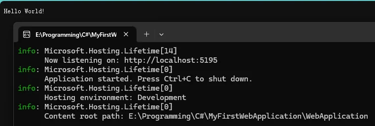

# 2、ASP.NET应用（HttpContext）

```C#
var builder = WebApplication.CreateBuilder(args);
var app = builder.Build();
app.Run(async (HttpContext context) =>
{
    context.Response.ContentType = "text/plain; charset=utf-8";
    await context.Response.WriteAsync($"该请求的方法是{context.Request.Method}\r\n");
    await context.Response.WriteAsync($"该请求的路径是{context.Request.Path}\r\n");
    await context.Response.WriteAsync($"\r\n该请求的请求头有\r\n");
    foreach (var key in context.Request.Headers.Keys)
    {
        await context.Response.WriteAsync($"{key}：{context.Request.Headers[key]}\r\n");
    }
    await context.Response.WriteAsync($"该请求的请求体是{context.Request.Body}\r\n");
});
app.Run();
```

### 一、代码结构解析

1. **宿主构建流程**

   - `WebApplication.CreateBuilder(args)`：创建Web应用构建器，内部会初始化默认配置、日志系统、依赖注入容器等核心组件
   
      - `builder.Build()`：通过管道模式构建IHost对象，完成中间件管道配置、服务器(Kestrel/IIS)初始化等操作


2. **请求处理管道**

   - `app.Run()`：注册终结点中间件，拦截所有HTTP请求并执行异步处理逻辑
   
      - 使用`HttpContext`对象访问请求上下文，包含完整的请求/响应元数据


### 二、核心功能解析

1. **编码设置**

   ```csharp
   context.Response.ContentType = "text/plain; charset=utf-8";
   ```

   - 强制指定响应内容为UTF-8编码，解决中文字符乱码问题

   - `text/plain`表示纯文本格式，与HTML响应的`text/html`形成对比

2. **请求信息输出**
   - **方法类型**：`context.Request.Method` 获取HTTP动词(GET/POST等)
   
   - **请求路径**：`context.Request.Path` 解析URL路径
   
   - **请求头遍历**：通过`Headers.Keys`遍历所有请求头键值对
   
   - 请求体处理：当前直接输出`Body`对象，实际需用`StreamReader读取内容`
   

### 三、优化建议

1. **请求体读取改进**

   ```csharp
   context.Request.EnableBuffering(); // 允许重复读取Body
   using var reader = new StreamReader(context.Request.Body);
   var bodyContent = await reader.ReadToEndAsync();
   context.Request.Body.Position = 0; // 重置读取位置
   ```
   
2. **功能扩展建议**

   - 添加异常处理中间件

     `app.UseExceptionHandler()`
   
      - 集成路由系统
   
        `app.UseRouting()`+终结点配置
   
      - 增加静态文件服务
   
        `app.UseStaticFiles()`
   

### 四、运行流程图解

```
HTTP请求 → Kestrel服务器 → 中间件管道 → 自定义处理逻辑 → 返回响应
```

该流程体现了ASP.NET Core的请求处理管道模式，每个请求都会经过注册的中间件组件

### 五、注意事项

1. **编码一致性**

   - 确保代码文件保存为UTF-8格式（VS菜单：文件→高级保存选项）

   - 若输出HTML内容，需添加`<meta charset="utf-8">`


2. **性能影响**

   - 同步写响应(`WriteAsync`)可能影响吞吐量，建议批量生成响应内容
   - 频繁的字符串拼接可改用`StringBuilder`

此代码可作为请求调试工具使用，完整项目建议采用分层架构（控制器/服务层分离）

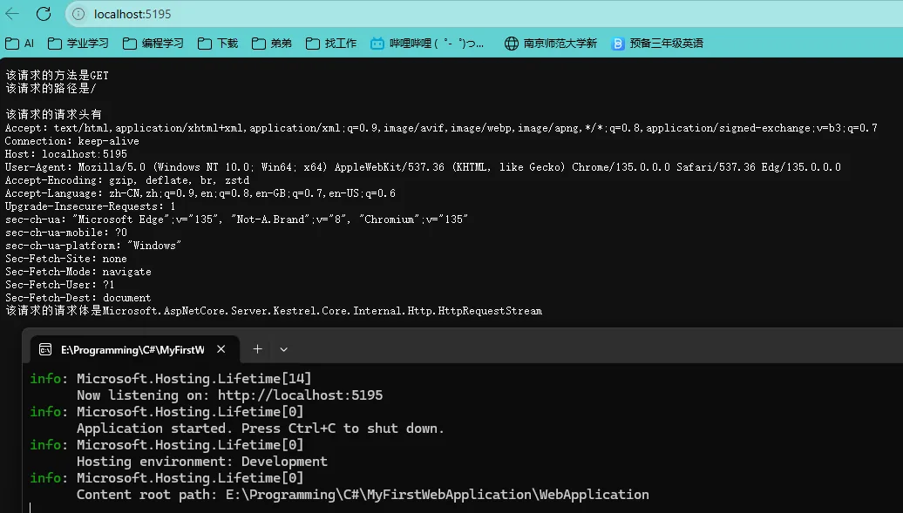

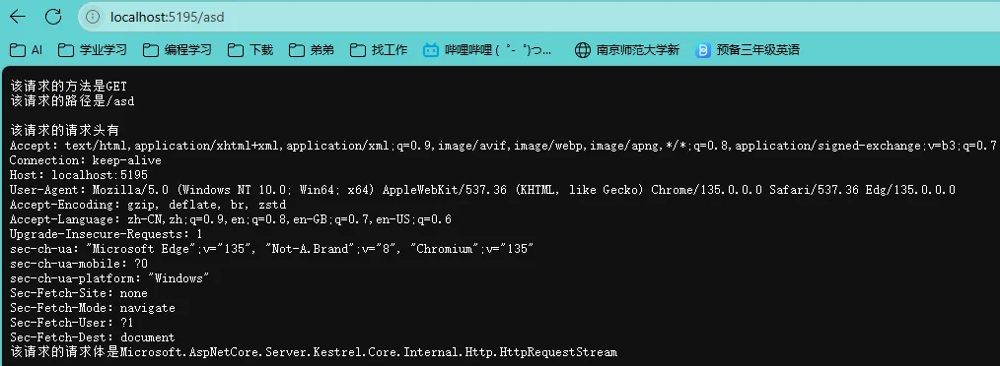

# 3、ASP.NET应用（Http GET）

```C#
var builder = WebApplication.CreateBuilder(args);
var app = builder.Build();

app.Run(async (HttpContext context) =>
{
    context.Response.ContentType = "text/plain; charset=utf-8";

    if (context.Request.Method == "GET")
    {
        if (context.Request.Path.StartsWithSegments("/"))
        {
            await context.Response.WriteAsync($"该请求的方法是{context.Request.Method}\r\n");
            await context.Response.WriteAsync($"该请求的路径是{context.Request.Path}\r\n");
            await context.Response.WriteAsync($"\r\n该请求的请求头有\r\n");
            foreach (var key in context.Request.Headers.Keys)
            {
                await context.Response.WriteAsync($"{key}：{context.Request.Headers[key]}\r\n");
            }
            await context.Response.WriteAsync($"该请求的请求体是{context.Request.Body}\r\n");
        }
        else if (context.Request.Path.StartsWithSegments("/employees")){
            var employees = EmployeesRepository.GetEmployees();
            foreach (var employee in employees)
            {
                await context.Response.WriteAsync($"{employee.Name}: {employee.Position}\r\n");
            }
        }
    }
});

app.Run();

static class EmployeesRepository
{
    private static List<Employee> employees = new List<Employee>
    {
        new Employee(1, "张三", "工程师", 60000),
        new Employee(2, "李四", "经理", 75000),
        new Employee(3, "王五", "技术员", 50000)
    };

    public static List<Employee> GetEmployees() => employees;
}

public class Employee
{
    public int Id { get; set; }
    public string Name { get; set; }
    public string Position { get; set; }
    public double Salary { get; set; }

    public Employee(int id, string name, string position, double salary)
    {
        Id = id;
        Name = name;
        Position = position;
        Salary = salary;
    }
}
```

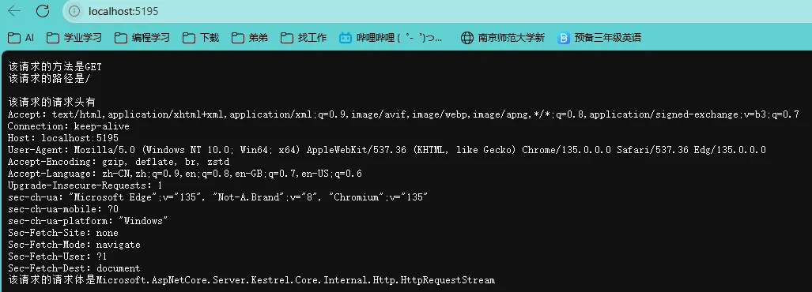

<center>
<figure>


</figure>
</center>
# 4、ASP.NET应用（Http POST）

```C#
using System.Text.Json;

var builder = WebApplication.CreateBuilder(args);
var app = builder.Build();

app.Run(async (HttpContext context) =>
{
    context.Response.ContentType = "text/plain; charset=utf-8";

    if (context.Request.Method == "GET")
    {
        if (context.Request.Path.StartsWithSegments("/"))
        {
            await context.Response.WriteAsync($"该请求的方法是{context.Request.Method}\r\n");
            await context.Response.WriteAsync($"该请求的路径是{context.Request.Path}\r\n");
            await context.Response.WriteAsync($"\r\n该请求的请求头有\r\n");
            foreach (var key in context.Request.Headers.Keys)
            {
                await context.Response.WriteAsync($"{key}：{context.Request.Headers[key]}\r\n");
            }
            await context.Response.WriteAsync($"该请求的请求体是{context.Request.Body}\r\n");
        }
        else if (context.Request.Path.StartsWithSegments("/employees"))
        {
            var employees = EmployeesRepository.GetEmployees();
            foreach (var employee in employees)
            {
                await context.Response.WriteAsync($"{employee.Name}: {employee.Position}\r\n");
            }
        }
    }
    else if (context.Request.Method == "POST")
    {
        if (context.Request.Path.StartsWithSegments("/employees"))
        {
            using var reader = new StreamReader(context.Request.Body);
            var body = await reader.ReadToEndAsync();
            var employee = JsonSerializer.Deserialize<Employee>(body);
            EmployeesRepository.AddEmployees(employee);
        }
    }
});

app.Run();

static class EmployeesRepository
{
    private static List<Employee> employees = new List<Employee>
    {
        new Employee(1, "张三", "工程师", 60000),
        new Employee(2, "李四", "经理", 75000),
        new Employee(3, "王五", "技术员", 50000)
    };

    public static List<Employee> GetEmployees() => employees;

    public static void AddEmployees(Employee? employee)
    {
        if (employee is not null)
        {
            employees.Add(employee);
        }
    }
}


public class Employee
{
    public int Id { get; set; }
    public string Name { get; set; }
    public string Position { get; set; }
    public double Salary { get; set; }

    public Employee(int id, string name, string position, double salary)
    {
        Id = id;
        Name = name;
        Position = position;
        Salary = salary;
    }
}
```

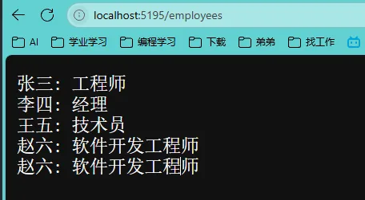

# 5、ASP.NET应用（Http PUT）

```C#
using System.Text.Json;

var builder = WebApplication.CreateBuilder(args);
var app = builder.Build();

app.Run(async (HttpContext context) =>
{
    context.Response.ContentType = "text/plain; charset=utf-8";

    if (context.Request.Method == "GET")
    {
        if (context.Request.Path.StartsWithSegments("/"))
        {
            await context.Response.WriteAsync($"该请求的方法是{context.Request.Method}\r\n");
            await context.Response.WriteAsync($"该请求的路径是{context.Request.Path}\r\n");
            await context.Response.WriteAsync($"\r\n该请求的请求头有\r\n");
            foreach (var key in context.Request.Headers.Keys)
            {
                await context.Response.WriteAsync($"{key}：{context.Request.Headers[key]}\r\n");
            }
            await context.Response.WriteAsync($"该请求的请求体是{context.Request.Body}\r\n");
        }
        else if (context.Request.Path.StartsWithSegments("/employees"))
        {
            var employees = EmployeesRepository.GetEmployees();
            foreach (var employee in employees)
            {
                await context.Response.WriteAsync($"{employee.Name}: {employee.Position}\r\n");
            }
        }
    }
    else if (context.Request.Method == "POST")
    {
        if (context.Request.Path.StartsWithSegments("/employees"))
        {
            using var reader = new StreamReader(context.Request.Body);
            var body = await reader.ReadToEndAsync();
            var employee = JsonSerializer.Deserialize<Employee>(body);
            EmployeesRepository.AddEmployees(employee);
        }
    }
    else if (context.Request.Method == "PUT")
    {
        if (context.Request.Path.StartsWithSegments("/employees"))
        {
            using var reader = new StreamReader(context.Request.Body);
            var body = await reader.ReadToEndAsync();
            var employee = JsonSerializer.Deserialize<Employee>(body);

            var result = EmployeesRepository.UpdateEmployee(employee);
            if (result)
            {
                await context.Response.WriteAsync("Employee已经更新了");
            }
            else
            {
                await context.Response.WriteAsync("Employee没有找到");
            }

        }
    }

});

app.Run();

static class EmployeesRepository
{
    private static List<Employee> employees = new List<Employee>
    {
        new Employee(1, "张三", "工程师", 60000),
        new Employee(2, "李四", "经理", 75000),
        new Employee(3, "王五", "技术员", 50000)
    };

    public static List<Employee> GetEmployees() => employees;

    public static void AddEmployees(Employee? employee)
    {
        if (employee is not null)
        {
            employees.Add(employee);
        }
    }

    public static bool UpdateEmployee(Employee? employee)
    {
        if (employee is not null)
        {
            var emp = employees.FirstOrDefault(x => x.Id == employee.Id);
            if (emp is not null)
            {
                emp.Name = employee.Name;
                emp.Position = employee.Position;
                emp.Salary = employee.Salary;

                return true;
            }
        }

        return false;
    }
}


public class Employee
{
    public int Id { get; set; }
    public string Name { get; set; }
    public string Position { get; set; }
    public double Salary { get; set; }

    public Employee(int id, string name, string position, double salary)
    {
        Id = id;
        Name = name;
        Position = position;
        Salary = salary;
    }
}
```

<center>
<figure>


</figure>
</center>

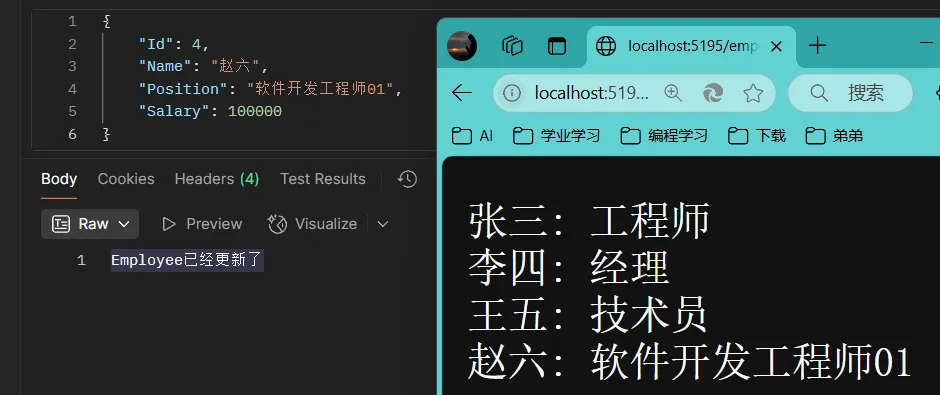

# 6、ASP.NET应用（Http DELETE）

使用路径字符串/查询字符串（?键=值&键=值）、Body传递信息

```C#
using System.Text.Json;

var builder = WebApplication.CreateBuilder(args);
var app = builder.Build();

app.Run(async (HttpContext context) =>
{
    context.Response.ContentType = "text/plain; charset=utf-8";

    foreach(var key in context.Request.Query.Keys)
    {
        await context.Response.WriteAsync($"{key}：{context.Request.Query[key]}\r\n");
    }
});

app.Run();
```

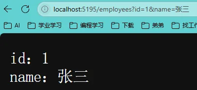

```C#
using System.Text.Json;

var builder = WebApplication.CreateBuilder(args);
var app = builder.Build();

app.Run(async (HttpContext context) =>
{
    context.Response.ContentType = "text/plain; charset=utf-8";

    if (context.Request.Method == "GET")
    {
        if (context.Request.Path.StartsWithSegments("/"))
        {
            await context.Response.WriteAsync($"该请求的方法是{context.Request.Method}\r\n");
            await context.Response.WriteAsync($"该请求的路径是{context.Request.Path}\r\n");
            await context.Response.WriteAsync($"\r\n该请求的请求头有\r\n");
            foreach (var key in context.Request.Headers.Keys)
            {
                await context.Response.WriteAsync($"{key}：{context.Request.Headers[key]}\r\n");
            }
            await context.Response.WriteAsync($"该请求的请求体是{context.Request.Body}\r\n");
        }
        else if (context.Request.Path.StartsWithSegments("/employees"))
        {
            var employees = EmployeesRepository.GetEmployees();
            foreach (var employee in employees)
            {
                await context.Response.WriteAsync($"{employee.Name}: {employee.Position}\r\n");
            }
        }
    }
    else if (context.Request.Method == "POST")
    {
        if (context.Request.Path.StartsWithSegments("/employees"))
        {
            using var reader = new StreamReader(context.Request.Body);
            var body = await reader.ReadToEndAsync();
            var employee = JsonSerializer.Deserialize<Employee>(body);
            EmployeesRepository.AddEmployees(employee);
        }
    }
    else if (context.Request.Method == "PUT")
    {
        if (context.Request.Path.StartsWithSegments("/employees"))
        {
            using var reader = new StreamReader(context.Request.Body);
            var body = await reader.ReadToEndAsync();
            var employee = JsonSerializer.Deserialize<Employee>(body);

            var result = EmployeesRepository.UpdateEmployee(employee);
            if (result)
            {
                await context.Response.WriteAsync("Employee已经更新了");
            }
            else
            {
                await context.Response.WriteAsync("Employee没有找到");
            }

        }
    }
    else if (context.Request.Method == "DELETE")
    {
        if (context.Request.Path.StartsWithSegments("/employees"))
        {
            if (context.Request.Query.ContainsKey("id"))
            {
                var id = context.Request.Query["id"];
                if (int.TryParse(id, out int employeeId))
                {
                    var result = EmployeesRepository.DeleteEmployee(employeeId);

                    if (result)
                    {
                        await context.Response.WriteAsync("Employee已被成功删除");
                    }
                    else
                    {
                        await context.Response.WriteAsync("Employee没有找到");
                    }

                }
            }
        }
    }

});

app.Run();

static class EmployeesRepository
{
    private static List<Employee> employees = new List<Employee>
    {
        new Employee(1, "张三", "工程师", 60000),
        new Employee(2, "李四", "经理", 75000),
        new Employee(3, "王五", "技术员", 50000)
    };

    public static List<Employee> GetEmployees() => employees;

    public static void AddEmployees(Employee? employee)
    {
        if (employee is not null)
        {
            employees.Add(employee);
        }
    }

    public static bool UpdateEmployee(Employee? employee)
    {
        if (employee is not null)
        {
            var emp = employees.FirstOrDefault(x => x.Id == employee.Id);
            if (emp is not null)
            {
                emp.Name = employee.Name;
                emp.Position = employee.Position;
                emp.Salary = employee.Salary;

                return true;
            }
        }

        return false;
    }

    public static bool DeleteEmployee(int id)
    {
        var employee = employees.FirstOrDefault(x => x.Id == id);
        if (employee is not null)
        {
            employees.Remove(employee);
            return true;
        }

        return false;
    }
}


public class Employee
{
    public int Id { get; set; }
    public string Name { get; set; }
    public string Position { get; set; }
    public double Salary { get; set; }

    public Employee(int id, string name, string position, double salary)
    {
        Id = id;
        Name = name;
        Position = position;
        Salary = salary;
    }
}
```

<center>
<figure>


</figure>
</center>

# 7、ASP.NET应用（HTTP Request Headers）

在DELETE添加授权验证为请求头中包含”Authorization=李“

```C#
using System.Text.Json;

var builder = WebApplication.CreateBuilder(args);
var app = builder.Build();

app.Run(async (HttpContext context) =>
{
    context.Response.ContentType = "text/plain; charset=utf-8";

    if (context.Request.Method == "GET")
    {
        if (context.Request.Path.StartsWithSegments("/"))
        {
            await context.Response.WriteAsync($"该请求的方法是{context.Request.Method}\r\n");
            await context.Response.WriteAsync($"该请求的路径是{context.Request.Path}\r\n");
            await context.Response.WriteAsync($"\r\n该请求的请求头有\r\n");
            foreach (var key in context.Request.Headers.Keys)
            {
                await context.Response.WriteAsync($"{key}：{context.Request.Headers[key]}\r\n");
            }
            await context.Response.WriteAsync($"该请求的请求体是{context.Request.Body}\r\n");
        }
        else if (context.Request.Path.StartsWithSegments("/employees"))
        {
            var employees = EmployeesRepository.GetEmployees();
            foreach (var employee in employees)
            {
                await context.Response.WriteAsync($"{employee.Name}: {employee.Position}\r\n");
            }
        }
    }
    else if (context.Request.Method == "POST")
    {
        if (context.Request.Path.StartsWithSegments("/employees"))
        {
            using var reader = new StreamReader(context.Request.Body);
            var body = await reader.ReadToEndAsync();
            var employee = JsonSerializer.Deserialize<Employee>(body);
            EmployeesRepository.AddEmployees(employee);
        }
    }
    else if (context.Request.Method == "PUT")
    {
        if (context.Request.Path.StartsWithSegments("/employees"))
        {
            using var reader = new StreamReader(context.Request.Body);
            var body = await reader.ReadToEndAsync();
            var employee = JsonSerializer.Deserialize<Employee>(body);

            var result = EmployeesRepository.UpdateEmployee(employee);
            if (result)
            {
                await context.Response.WriteAsync("Employee已经更新了");
            }
            else
            {
                await context.Response.WriteAsync("Employee没有找到");
            }

        }
    }
    else if (context.Request.Method == "DELETE")
    {
        if (context.Request.Path.StartsWithSegments("/employees"))
        {
            if (context.Request.Query.ContainsKey("id"))
            {
                var id = context.Request.Query["id"];
                if (int.TryParse(id, out int employeeId))
                {
                    if (context.Request.Headers["Authorization"] == "li")
                    {
                        var result = EmployeesRepository.DeleteEmployee(employeeId);

                        if (result)
                        {
                            await context.Response.WriteAsync("Employee已被成功删除");
                        }
                        else
                        {
                            await context.Response.WriteAsync("Employee没有找到");
                        }
                    }
                    else
                    {
                        await context.Response.WriteAsync("你没有被授权");
                    }

                }
            }
        }
    }


});

app.Run();

static class EmployeesRepository
{
    private static List<Employee> employees = new List<Employee>
    {
        new Employee(1, "张三", "工程师", 60000),
        new Employee(2, "李四", "经理", 75000),
        new Employee(3, "王五", "技术员", 50000)
    };

    public static List<Employee> GetEmployees() => employees;

    public static void AddEmployees(Employee? employee)
    {
        if (employee is not null)
        {
            employees.Add(employee);
        }
    }

    public static bool UpdateEmployee(Employee? employee)
    {
        if (employee is not null)
        {
            var emp = employees.FirstOrDefault(x => x.Id == employee.Id);
            if (emp is not null)
            {
                emp.Name = employee.Name;
                emp.Position = employee.Position;
                emp.Salary = employee.Salary;

                return true;
            }
        }

        return false;
    }

    public static bool DeleteEmployee(int id)
    {
        var employee = employees.FirstOrDefault(x => x.Id == id);
        if (employee is not null)
        {
            employees.Remove(employee);
            return true;
        }

        return false;
    }
}


public class Employee
{
    public int Id { get; set; }
    public string Name { get; set; }
    public string Position { get; set; }
    public double Salary { get; set; }

    public Employee(int id, string name, string position, double salary)
    {
        Id = id;
        Name = name;
        Position = position;
        Salary = salary;
    }
}
```

<center>
<figure>


</figure>
</center>

# 8、ASP.NET应用逻辑重构

应当是先确定访问的路由，再确定访问的方法，顺序不要颠倒

```C#
using System.Text.Json;

var builder = WebApplication.CreateBuilder(args);
var app = builder.Build();

app.Run(async (HttpContext context) =>
{
    context.Response.ContentType = "text/plain; charset=utf-8";

    if (context.Request.Path.StartsWithSegments("/"))
    {
        await context.Response.WriteAsync($"该请求的方法是{context.Request.Method}\r\n");
        await context.Response.WriteAsync($"该请求的路径是{context.Request.Path}\r\n");
        await context.Response.WriteAsync($"\r\n该请求的请求头有\r\n");
        foreach (var key in context.Request.Headers.Keys)
        {
            await context.Response.WriteAsync($"{key}：{context.Request.Headers[key]}\r\n");
        }
        await context.Response.WriteAsync($"该请求的请求体是{context.Request.Body}\r\n");
    }
    else if (context.Request.Path.StartsWithSegments("/employees"))
    {
        if (context.Request.Method == "GET")
        {
            var employees = EmployeesRepository.GetEmployees();

            foreach (var employee in employees)
            {
                await context.Response.WriteAsync($"{employee.Name}: {employee.Position}\r\n");
            }
        }
        else if (context.Request.Method == "POST")
        {
            using var reader = new StreamReader(context.Request.Body);
            var body = await reader.ReadToEndAsync();
            var employee = JsonSerializer.Deserialize<Employee>(body);

            EmployeesRepository.AddEmployees(employee);
        }
        else if (context.Request.Method == "PUT")
        {

            using var reader = new StreamReader(context.Request.Body);
            var body = await reader.ReadToEndAsync();
            var employee = JsonSerializer.Deserialize<Employee>(body);

            var result = EmployeesRepository.UpdateEmployee(employee);
            if (result)
            {
                await context.Response.WriteAsync("Employee已经更新了");
            }
            else
            {
                await context.Response.WriteAsync("Employee没有找到");
            }
        }
        else if (context.Request.Method == "DELETE")
        {

            if (context.Request.Query.ContainsKey("id"))
            {
                var id = context.Request.Query["id"];
                if (int.TryParse(id, out int employeeId))
                {
                    if (context.Request.Headers["Authorization"] == "li")
                    {
                        var result = EmployeesRepository.DeleteEmployee(employeeId);

                        if (result)
                        {
                            await context.Response.WriteAsync("Employee已被成功删除");
                        }
                        else
                        {
                            await context.Response.WriteAsync("Employee没有找到");
                        }
                    }
                    else
                    {
                        await context.Response.WriteAsync("你没有被授权");
                    }
                }
            }
        }
    }
});

app.Run();

static class EmployeesRepository
{
    private static List<Employee> employees = new List<Employee>
    {
        new Employee(1, "张三", "工程师", 60000),
        new Employee(2, "李四", "经理", 75000),
        new Employee(3, "王五", "技术员", 50000)
    };

    public static List<Employee> GetEmployees() => employees;

    public static void AddEmployees(Employee? employee)
    {
        if (employee is not null)
        {
            employees.Add(employee);
        }
    }

    public static bool UpdateEmployee(Employee? employee)
    {
        if (employee is not null)
        {
            var emp = employees.FirstOrDefault(x => x.Id == employee.Id);
            if (emp is not null)
            {
                emp.Name = employee.Name;
                emp.Position = employee.Position;
                emp.Salary = employee.Salary;

                return true;
            }
        }

        return false;
    }

    public static bool DeleteEmployee(int id)
    {
        var employee = employees.FirstOrDefault(x => x.Id == id);
        if (employee is not null)
        {
            employees.Remove(employee);
            return true;
        }

        return false;
    }
}


public class Employee
{
    public int Id { get; set; }
    public string Name { get; set; }
    public string Position { get; set; }
    public double Salary { get; set; }

    public Employee(int id, string name, string position, double salary)
    {
        Id = id;
        Name = name;
        Position = position;
        Salary = salary;
    }
}
```

# 9、ASP.NET应用（HTTP Response）
