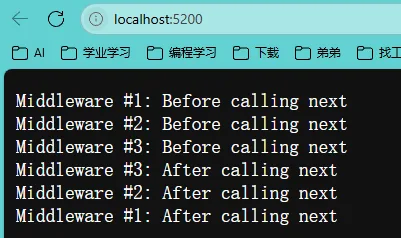
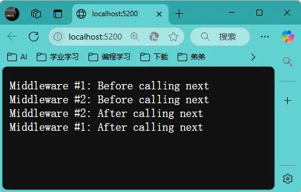
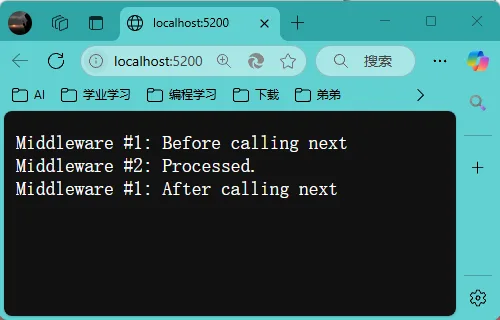
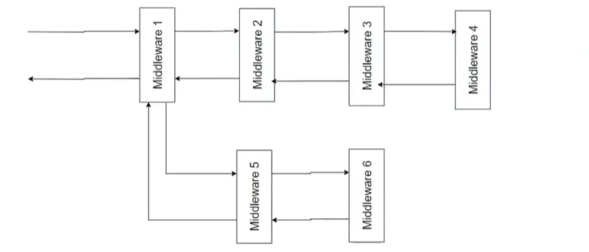
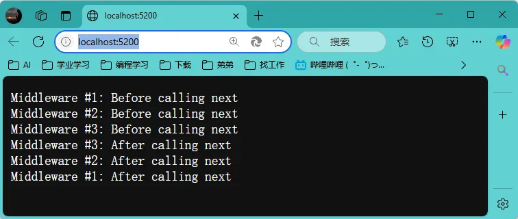
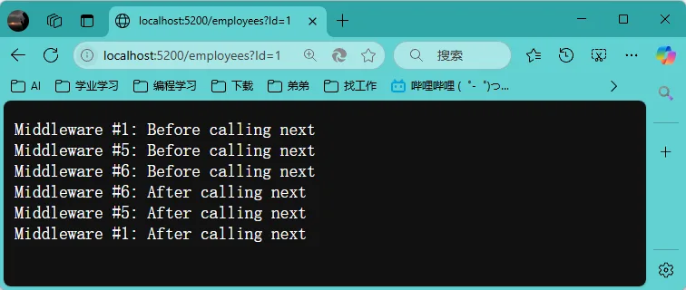
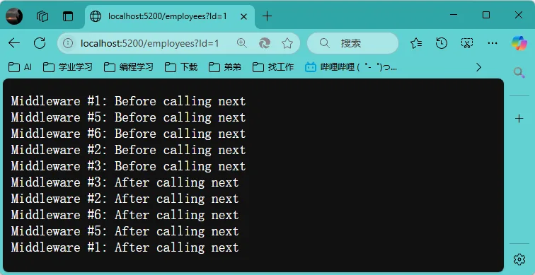
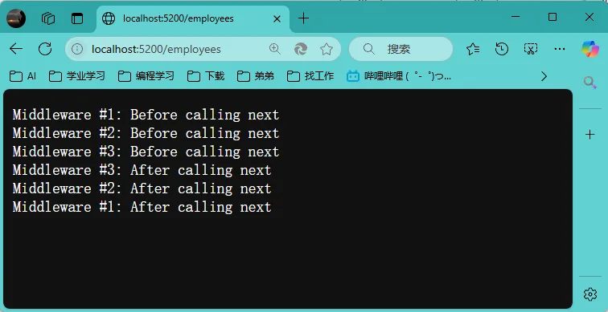
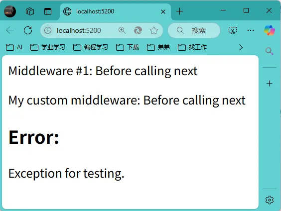

# 1、中间件管道简介

在 C# ASP.NET Core 中，**中间件管道**是处理 HTTP 请求和响应的核心机制，通过将多个中间件按顺序串联成一个处理流程，实现灵活的请求处理和业务逻辑组合。以下是其核心要点：

------

## 1. **中间件管道的基本概念**

- 中间件（Middleware）：是管道中的独立组件，负责处理 HTTP 请求和响应。每个中间件可以：

  - 对请求进行预处理（如日志、身份验证）。

    - 调用下一个中间件（通过``` next()```），或直接终止处理（短路）。

    - 对响应进行后处理（如修改响应头、记录耗时）。
- 管道（Pipeline）：由多个中间件按注册顺序串联而成，形成一个“请求→处理→响应”的流程。请求按顺序经过所有中间件，而响应则逆序返回  。


------

## 2. **管道的工作模式：1-n 然后 n-1**

- 请求阶段（正向传递）：请求从第一个中间件开始，依次传递至最后一个中间件（终结点），形成“1→2→3”的顺序 。


- 响应阶段（逆向返回）：处理完成后，响应从终结点开始，逆序返回至第一个中间件，形成“3→2→1”的顺序  。


  示例


  ```text
  Middleware One: Request Start → Middleware Two: Request Start → Middleware Three: Request Start
  → 终结点处理 →
  Middleware Three: Response End → Middleware Two: Response End → Middleware One: Response End
  ```

  这种模式被称为“俄罗斯套娃”模型  。

------

## 3. **如何配置中间件管道**

在 `Startup.Configure` 方法中通过 `IApplicationBuilder` 注册中间件，常用方法包括：

- `Use()`：添加可调用下一个中间件的组件（需调用``` await next() ```）  。

  ```csharp
  app.Use(async (context, next) => {
      Console.WriteLine("Request进入");
      await next(); // 调用下一个中间件
      Console.WriteLine("Response返回");
  });
  ```
  
- `Run()`：添加终端中间件（不调用```next()```，直接响应）  。

  ```csharp
  app.Run(async context => {
      await context.Response.WriteAsync("Hello World");
  });
  ```

- `Map()`：根据请求路径创建分支管道 。

  ```csharp
  app.Map("/api", branch => {
      branch.UseMiddleware<ApiMiddleware>();
  });
  ```

------

## 4. **中间件的关键特性**

- 短路机制：中间件可选择不调用``` next()``` ，直接返回响应（如身份验证失败时）。


- 依赖注入：可通过构造函数注入服务（如数据库上下文） 。


- 可重用性：中间件可封装为类，通过``` UseMiddleware<T>() ```注册。
- 在使用ASP. NET时，若要修改请求头，则要在返回响应之前修改。


------

## 5. **典型应用场景**

- 内置中间件：ASP.NET Core 提供多种内置中间件，如静态文件处理、MVC 路由、错误页面等。


- 自定义逻辑：例如记录请求日志、跨域处理（CORS）、缓存等 。


- 跨平台支持：借助 .NET Core，中间件管道可在 Windows、Linux、macOS 上运行 。


------

## 示例代码（自定义中间件）

```csharp
public class LoggingMiddleware
{
    private readonly RequestDelegate _next;
    public LoggingMiddleware(RequestDelegate next) => _next = next;

    public async Task InvokeAsync(HttpContext context)
    {
        Console.WriteLine($"请求路径：{context.Request.Path}");
        await _next(context); // 调用下一个中间件
        Console.WriteLine($"响应状态码：{context.Response.StatusCode}");
    }
}
// 注册中间件
app.UseMiddleware<LoggingMiddleware>();
```

------

通过中间件管道，开发者可以灵活构建高效、模块化的 Web 应用，满足不同场景的需求。更多实现细节可参考 ASP.NET Core 文档。

# 2、中间件管道实现-USE（最小API）

`app.Use`通常实现常规中间件组件和短路中间件组件

```C#
var builder = WebApplication.CreateBuilder(args);
var app = builder.Build();

// Middleware #1
app.Use(async (HttpContext context, RequestDelegate next) =>
{
    await context.Response.WriteAsync("Middleware #1: Before calling next\r\n");
    await next(context);
    await context.Response.WriteAsync("Middleware #1: After calling next\r\n");
});

// Middleware #2
app.Use(async (HttpContext context, RequestDelegate next) =>
{
    await context.Response.WriteAsync("Middleware #2: Before calling next\r\n");
    await next(context);
    await context.Response.WriteAsync("Middleware #2: After calling next\r\n");
});

// Middleware #3
app.Use(async (HttpContext context, RequestDelegate next) =>
{
    await context.Response.WriteAsync("Middleware #3: Before calling next\r\n");
    await next(context);
    await context.Response.WriteAsync("Middleware #3: After calling next\r\n");
});

app.Run();
```



# 3、短路

```C#
var builder = WebApplication.CreateBuilder(args);
var app = builder.Build();

// Middleware #1
app.Use(async (HttpContext context, RequestDelegate next) =>
{
    await context.Response.WriteAsync("Middleware #1: Before calling next\r\n");
    await next(context);
    await context.Response.WriteAsync("Middleware #1: After calling next\r\n");
});

// Middleware #2
app.Use(async (HttpContext context, RequestDelegate next) =>
{
    await context.Response.WriteAsync("Middleware #2: Before calling next\r\n");
    await next(context);
    await context.Response.WriteAsync("Middleware #2: After calling next\r\n");
});

/*
下列代码会报错，因为“next”没有被调用，(context, next)这种写法的前提是“next”被调用
// Middleware #2
app.Use(async (context, next) =>
{
    await context.Response.WriteAsync("Middleware #2: Before calling next\r\n");
    //await next(context);
    await context.Response.WriteAsync("Middleware #2: After calling next\r\n");
});
*/

// Middleware #3
app.Use(async (HttpContext context, RequestDelegate next) =>
{
    await context.Response.WriteAsync("Middleware #3: Before calling next\r\n");
    await next(context);
    await context.Response.WriteAsync("Middleware #3: After calling next\r\n");
});

app.Run();
```



# 4、中间件管道实现-RUN（最小API）

`app.RUN`不传递`context`到下一个请求委托，仅实现短路中间件组件

```C#
var builder = WebApplication.CreateBuilder(args);
var app = builder.Build();

// Middleware #1
app.Use(async (HttpContext context, RequestDelegate next) =>
{
    await context.Response.WriteAsync("Middleware #1: Before calling next\r\n");
    await next(context);
    await context.Response.WriteAsync("Middleware #1: After calling next\r\n");
});

// Middleware #2
app.Run(async (context) =>
{
    await context.Response.WriteAsync("Middleware #2: Processed.\r\n");
});

// Middleware #3
app.Use(async (HttpContext context, RequestDelegate next) =>
{
    await context.Response.WriteAsync("Middleware #3: Before calling next\r\n");
    await next(context);
    await context.Response.WriteAsync("Middleware #3: After calling next\r\n");
});
app.Run();
```



# 5、中间件管道创建分支-MAP



```C#
var builder = WebApplication.CreateBuilder(args);
var app = builder.Build();

// Middleware #1
app.Use(async (HttpContext context, RequestDelegate next) =>
{
    await context.Response.WriteAsync("Middleware #1: Before calling next\r\n");
    await next(context);
    await context.Response.WriteAsync("Middleware #1: After calling next\r\n");
});

//“http://localhost:5200/employees/sss”也会跳转到该分支，
app.Map("/employees", (appBuilder) =>
{
    appBuilder.Use(async (HttpContext context, RequestDelegate next) =>
    {
        await context.Response.WriteAsync("Middleware #5: Before calling next\r\n");
        await next(context);
        await context.Response.WriteAsync("Middleware #5: After calling next\r\n");
    });

    appBuilder.Use(async (HttpContext context, RequestDelegate next) =>
    {
        await context.Response.WriteAsync("Middleware #6: Before calling next\r\n");
        await next(context);
        await context.Response.WriteAsync("Middleware #6: After calling next\r\n");
    });
});

// Middleware #2
app.Use(async (context, next) =>
{
    await context.Response.WriteAsync("Middleware #2: Before calling next\r\n");
    await next(context);
    await context.Response.WriteAsync("Middleware #2: After calling next\r\n");
});

// Middleware #3
app.Use(async (HttpContext context, RequestDelegate next) =>
{
    await context.Response.WriteAsync("Middleware #3: Before calling next\r\n");
    await next(context);
    await context.Response.WriteAsync("Middleware #3: After calling next\r\n");
});

app.Run();
```

<center>
<figure>


</figure>
</center>
# 6、中间件管道创建分支-MapWhen

`MapWhen`可以通过访问`Http`上下文对象，从而在复杂条件下创建中间件管道分支。当`MapWhen`中的结果为真时将从分支运行，否则在主流程中运行。

```C#
var builder = WebApplication.CreateBuilder(args);
var app = builder.Build();

// Middleware #1
app.Use(async (HttpContext context, RequestDelegate next) =>
{
    await context.Response.WriteAsync("Middleware #1: Before calling next\r\n");
    await next(context);
    await context.Response.WriteAsync("Middleware #1: After calling next\r\n");
});

app.MapWhen((context) =>
{
    return context.Request.Path.StartsWithSegments("/employees") && context.Request.Query.ContainsKey("id");
},
    (appBuilder) =>
    {
        appBuilder.Use(async (HttpContext context, RequestDelegate next) =>
        {
            await context.Response.WriteAsync("Middleware #5: Before calling next\r\n");
            await next(context);
            await context.Response.WriteAsync("Middleware #5: After calling next\r\n");
        });

        appBuilder.Use(async (HttpContext context, RequestDelegate next) =>
        {
            await context.Response.WriteAsync("Middleware #6: Before calling next\r\n");
            await next(context);
            await context.Response.WriteAsync("Middleware #6: After calling next\r\n");
        });
    });

// Middleware #2
app.Use(async (context, next) =>
{
    await context.Response.WriteAsync("Middleware #2: Before calling next\r\n");
    await next(context);
    await context.Response.WriteAsync("Middleware #2: After calling next\r\n");
});

// Middleware #3
app.Use(async (HttpContext context, RequestDelegate next) =>
{
    await context.Response.WriteAsync("Middleware #3: Before calling next\r\n");
    await next(context);
    await context.Response.WriteAsync("Middleware #3: After calling next\r\n");
});

app.Run();
```






# 7、运行分支后回到主流程-UseWhen

`UseWhen`与`MapWhen`类似，但当分支运行完后，会接着回到主流程中继续运行，直到运行到最终端点。

```C#
var builder = WebApplication.CreateBuilder(args);

var app = builder.Build();

// Middleware #1
app.Use(async (HttpContext context, RequestDelegate next) =>
{
    await context.Response.WriteAsync("Middleware #1: Before calling next\r\n");
    await next(context);
    await context.Response.WriteAsync("Middleware #1: After calling next\r\n");
});

app.UseWhen((context) =>
{
    return context.Request.Path.StartsWithSegments("/employees") && context.Request.Query.ContainsKey("id");
},
    (appBuilder) =>
    {
        appBuilder.Use(async (HttpContext context, RequestDelegate next) =>
        {
            await context.Response.WriteAsync("Middleware #5: Before calling next\r\n");
            await next(context);
            await context.Response.WriteAsync("Middleware #5: After calling next\r\n");
        });

        appBuilder.Use(async (HttpContext context, RequestDelegate next) =>
        {
            await context.Response.WriteAsync("Middleware #6: Before calling next\r\n");
            await next(context);
            await context.Response.WriteAsync("Middleware #6: After calling next\r\n");

        });
    });


// Middleware #2
app.Use(async (context, next) =>
{
    await context.Response.WriteAsync("Middleware #2: Before calling next\r\n");
    await next(context);
    await context.Response.WriteAsync("Middleware #2: After calling next\r\n");
});

// Middleware #3
app.Use(async (HttpContext context, RequestDelegate next) =>
{
    await context.Response.WriteAsync("Middleware #3: Before calling next\r\n");
    await next(context);
    await context.Response.WriteAsync("Middleware #3: After calling next\r\n");

});

app.Run();
```





# 8、横切-类似于Aspect

使用自定义中间件

## 1.`MyCustomExceptionHandler.cs`

```C#
namespace WebApp.MiddleComponents
{
    public class MyCustomExceptionHandler : IMiddleware
    {
        public async Task InvokeAsync(HttpContext context, RequestDelegate next)
        {
            try
            {
                context.Response.ContentType = "text/html";
                await next(context);
            }
            catch (Exception ex) 
            {   
                await context.Response.WriteAsync("<h2>Error:</h2>");
                await context.Response.WriteAsync($"<p>{ex.Message}</p>");
            }
        }
    }
}
```

## 2.`MyCustomMiddleware.cs`

```C#
namespace WebApp.MiddleComponents
{
    public class MyCustomMiddleware : IMiddleware
    {
        public async Task InvokeAsync(HttpContext context, RequestDelegate next)
        {

            await context.Response.WriteAsync("<p>My custom middleware: Before calling next</p>");
            await next(context);
            await context.Response.WriteAsync("<p>My custom middleware: After calling next</p>");
        }
    }
}
```

## 3.`Program.cs`

```c#
using WebApp.MiddleComponents;

var builder = WebApplication.CreateBuilder(args);

builder.Services.AddTransient<MyCustomMiddleware>();
builder.Services.AddTransient<MyCustomExceptionHandler>();

var app = builder.Build();

app.UseMiddleware<MyCustomExceptionHandler>();

// Middleware #1
app.Use(async (HttpContext context, RequestDelegate next) =>
{
    context.Response.ContentType = "text/html";
    await context.Response.WriteAsync("<p>Middleware #1: Before calling next</p>");
    await next(context);
    await context.Response.WriteAsync("<p>Middleware #1: After calling next</p>");
});

app.UseMiddleware<MyCustomMiddleware>();

// Middleware #2
app.Use(async (context, next) =>
{
    throw new ApplicationException("Exception for testing.");
    await context.Response.WriteAsync("<p>Middleware #2: Before calling next</p>");
    await next(context);
    await context.Response.WriteAsync("<p>Middleware #2: After calling next</p>");
});

// Middleware #3
app.Use(async (HttpContext context, RequestDelegate next) =>
{
    await context.Response.WriteAsync("<p>Middleware #3: Before calling next</p>");
    await next(context);
    await context.Response.WriteAsync("<p>Middleware #3: After calling next</p>");
});

app.Run();
```



 
