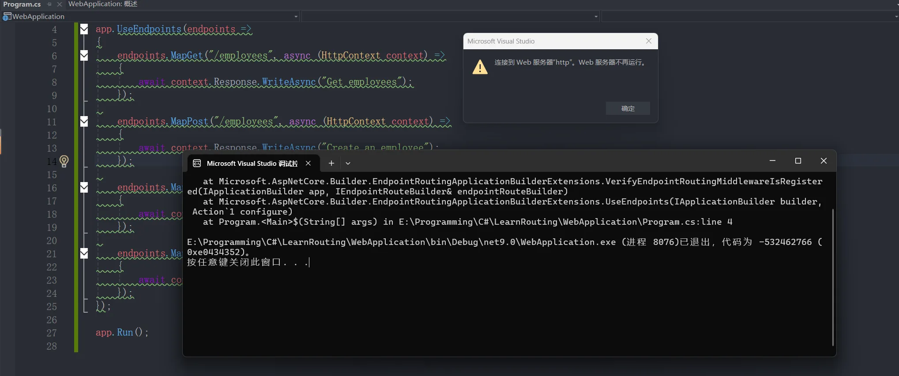
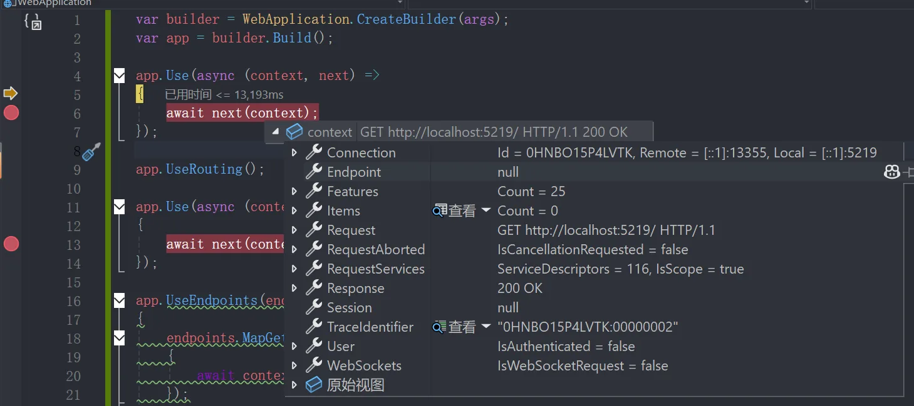
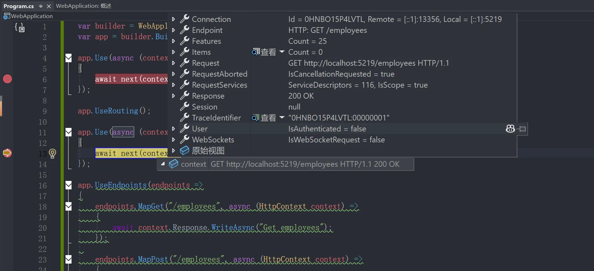
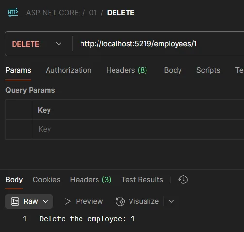
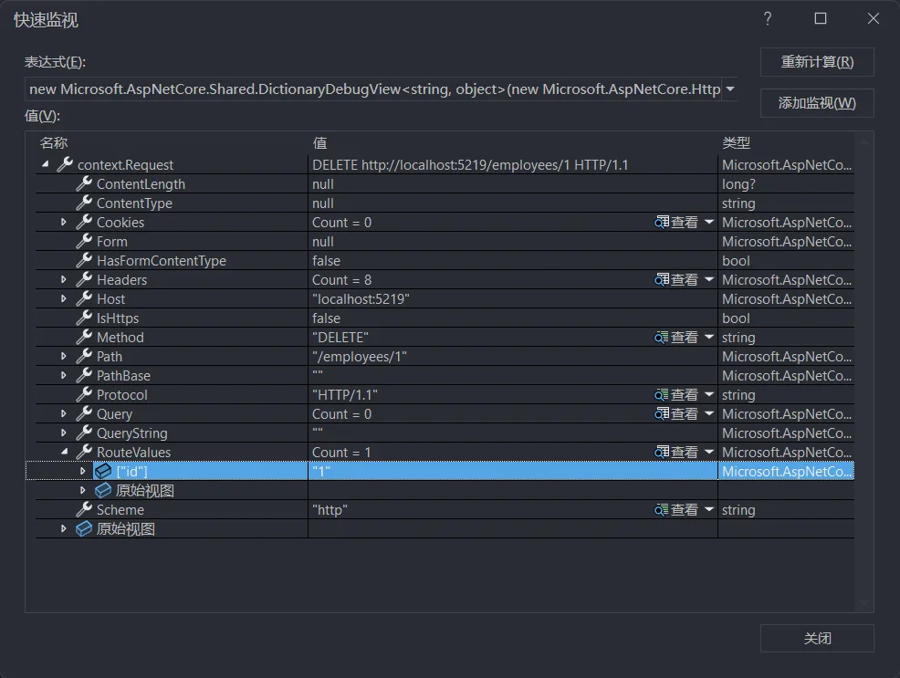
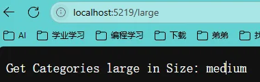
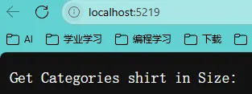
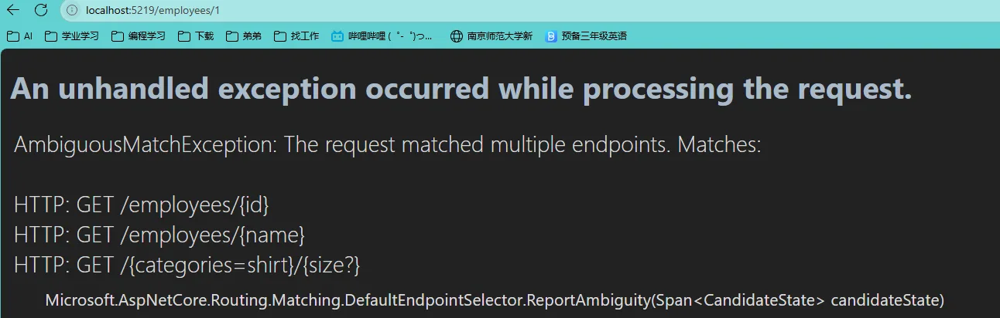

# 1、`Routing`和`Endpoints`简介

在ASP.NET Core中，**路由（`Routing`）**和**终结点（`Endpoints`）**是处理HTTP请求的核心机制，它们共同构成了请求分发的管道系统。以下是对两者的详细介绍：

------

### 一、路由（`Routing`）

**路由**的核心作用是将传入的HTTP请求根据URL路径和HTTP方法匹配到对应的处理逻辑（终结点）。在ASP.NET Core中，路由系统被称为**终结点路由（Endpoint Routing）**。

#### 主要功能与工作流程

1. **匹配请求**：
   通过`UseRouting`中间件（即`EndpointRoutingMiddleware`）扫描应用中所有注册的终结点，根据请求的URL和HTTP方法选择最匹配的终结点 。示例代码：

```csharp
app.UseRouting();
app.UseEndpoints(endpoints => 
{
    endpoints.MapGet("/", async context => { ... });
});
```

2. **路由模板与约束**：
   路由支持模板语法（如`{controller}/{action}/{id?}`）和约束条件（如`{id:int}`），用于动态提取参数并验证格式 。例如：

   ```csharp
   endpoints.MapGet("weather/{city}/{days:int:range(1,4)}", ...);
   ```

3. **中间件协作**：

   - 在`UseRouting`之前：可注册修改请求路径的中间件（如`UsePathBase`）。

      - 在`UseRouting`和`UseEndpoints`之间：可插入认证（`UseAuthentication`）、授权（`UseAuthorization`）等中间件，提前处理路由匹配后的逻辑。


------

### 二、终结点（`Endpoints`）

**终结点**是实际处理请求的执行单元，包含一个`RequestDelegate`委托和元数据（如路由信息、授权策略），最后返回响应。

#### 核心特性

1. **结构定义**：
   终结点通过`Endpoint`类表示，包含以下关键属性：

   - `RequestDelegate`：处理请求的委托。

   - `Metadata`：元数据集合（如路由模板、HTTP方法约束）。

   - `DisplayName`：用于调试的显示名称。

   ```csharp
   public class Endpoint
   {
       public RequestDelegate RequestDelegate { get; }
       public EndpointMetadataCollection Metadata { get; }
   }
   ```

2. **注册与执行**：
   通过`UseEndpoints`中间件（即`EndpointMiddleware`）注册终结点，并执行匹配到的终结点逻辑。示例：

   ```csharp
   endpoints.MapGet("/api/health", () => "OK");
   ```

3. **灵活的应用场景**：

   - **MVC控制器**：`MapControllers()`。

   - **Razor Pages**：`MapRazorPages()`。

   - **SignalR**：`MapHub<ChatHub>()`。

   - gRPC服务：`MapGrpcService<OrderService>()`。


------

### 三、路由与终结点的协作流程

1. 中间件顺序：`UseRouting`必须位于`UseEndpoints`之前，且两者需配合使用。


2. 请求处理步骤：

   - `UseRouting`选择终结点，并将结果存储在`HttpContext`中。

   - 中间件（如认证、CORS）根据终结点元数据执行前置处理。

   - `UseEndpoints`调用终结点对应的`RequestDelegate`生成响应。

------

### 四、与传统路由的对比

1. **传统路由**：
   主要基于MVC框架，路由规则与控制器强耦合，灵活性较低。

2. 终结点路由：

   - 解耦路由与执行：支持多种框架（如Razor Pages、gRPC） 。


   - 元数据驱动：通过元数据实现动态策略（如按终结点配置授权） 。


   - 性能优化：减少中间件调用次数，提升请求处理效率。


------

### 五、实际应用示例

#### 自定义终结点

```csharp
app.MapGet("/custom", (HttpContext context) => 
{
    var routeData = context.GetRouteData();
    return $"Hello {routeData.Values["name"]}";
});
```

#### 健康检查终结点

```csharp
endpoints.MapHealthChecks("/healthz").RequireAuthorization();
```

------

### 总结

ASP.NET Core的**路由系统**通过`UseRouting`和`UseEndpoints`实现了请求的分发与执行分离，而**终结点**作为执行单元，提供了高度可扩展的元数据和约束机制。这种设计不仅支持MVC、Razor Pages等传统模式，还能无缝集成现代技术栈（如gRPC、SignalR），是构建灵活、高性能Web应用的核心基础。

# 2、理解`Endpoints`

可以不写“UseEndpoints”，但是不能创建多个“UseEndpoints”。但下列代码**中间件顺序冲突**，`EndpointRoutingMiddleware`（由`UseRouting()`注册）负责终结点匹配，而`EndpointMiddleware`（由`UseEndpoints()`注册）负责执行终结点。必须先写`EndpointRoutingMiddleware`，后写`EndpointMiddleware`。若顺序颠倒或遗漏`UseRouting()`，会导致路由系统无法正确匹配终结点。

```C#
var builder = WebApplication.CreateBuilder(args);
var app = builder.Build();

app.UseEndpoints(endpoints =>
{
    endpoints.MapGet("/employees", async (HttpContext context) =>
    {
        await context.Response.WriteAsync("Get employees");
    });

    endpoints.MapPost("/employees", async (HttpContext context) =>
    {
        await context.Response.WriteAsync("Create an employee");
    });

    endpoints.MapPut("/employees", async (HttpContext context) =>
    {
        await context.Response.WriteAsync("Update an employee");
    });

    endpoints.MapDelete("/employees", async (HttpContext context) =>
    {
        await context.Response.WriteAsync("Delete an employee");
    });
});

app.Run();
```



# 3、使用路由中间件组件

```C#
var builder = WebApplication.CreateBuilder(args);
var app = builder.Build();

app.Use(async (context, next) =>
{
    await next(context);
});

app.UseRouting();

app.Use(async (context, next) =>
{
    await next(context);
});

app.UseEndpoints(endpoints =>
{
    endpoints.MapGet("/employees", async (HttpContext context) =>
    {
        await context.Response.WriteAsync("Get employees");
    });

    endpoints.MapPost("/employees", async (HttpContext context) =>
    {
        await context.Response.WriteAsync("Create an employee");
    });

    endpoints.MapPut("/employees", async (HttpContext context) =>
    {
        await context.Response.WriteAsync("Update an employee");
    });

    endpoints.MapDelete("/employees/{id}", async (HttpContext context) =>
    {
        await context.Response.WriteAsync($"Delete the employee: {context.Request.RouteValues["id"]}");
    });
});

app.Run();
```

初次进入：



第二次进入




由上述内容可见，app.UseRouting()解析了路径与方法，从而能够确定合理的Endpoints

# 4、处理请求路由参数

```C#
var builder = WebApplication.CreateBuilder(args);
var app = builder.Build();

app.Use(async (context, next) =>
{
    await next(context);
});

app.UseRouting();

app.Use(async (context, next) =>
{
    await next(context);
});

app.UseEndpoints(endpoints =>
{
    endpoints.MapGet("/employees", async (HttpContext context) =>
    {
        await context.Response.WriteAsync("Get employees");
    });

    endpoints.MapPost("/employees", async (HttpContext context) =>
    {
        await context.Response.WriteAsync("Create an employee");
    });

    endpoints.MapPut("/employees", async (HttpContext context) =>
    {
        await context.Response.WriteAsync("Update an employee");
    });

    endpoints.MapDelete("/employees/{id}", async (HttpContext context) =>
    {
        await context.Response.WriteAsync($"Delete the employee: {context.Request.RouteValues["id"]}");
    });
});

app.Run();
```





# 5、处理请求路由参数（默认值）

```C#
var builder = WebApplication.CreateBuilder(args);
var app = builder.Build();

app.Use(async (context, next) =>
{
    await next(context);
});

app.UseRouting();

app.Use(async (context, next) =>
{
    await next(context);
});

app.UseEndpoints(endpoints =>
{
    endpoints.MapGet("/employees", async (HttpContext context) =>
    {
        await context.Response.WriteAsync("Get employees");
    });

    endpoints.MapPost("/employees", async (HttpContext context) =>
    {
        await context.Response.WriteAsync("Create an employee");
    });

    endpoints.MapPut("/employees", async (HttpContext context) =>
    {
        await context.Response.WriteAsync("Update an employee");
    });

    endpoints.MapDelete("/employees/{id}", async (HttpContext context) =>
    {
        await context.Response.WriteAsync($"Delete the employee: {context.Request.RouteValues["id"]}");
    });

    endpoints.MapGet("/{categories=shirt}/{size=medium}", async (HttpContext context) =>
    {
        await context.Response.WriteAsync($"Get Categories {context.Request.RouteValues["categories"]} in Size: {context.Request.RouteValues["size"]}");
    });
});

app.Run();
```

<center>
<figure>


</figure>
</center>

且路由参数是顺序填充的，你无法期望在仅对第二个参数使用指定值的情况下，要求第一个参数使用默认值



# 6、处理请求可选参数

如果不现实提供可选参数的值，他不会获得任何值，且这个参数就好像并未出现过。

```C#
var builder = WebApplication.CreateBuilder(args);
var app = builder.Build();

app.Use(async (context, next) =>
{
    await next(context);
});

app.UseRouting();

app.Use(async (context, next) =>
{
    await next(context);
});

app.UseEndpoints(endpoints =>
{
    endpoints.MapGet("/employees", async (HttpContext context) =>
    {
        await context.Response.WriteAsync("Get employees");
    });

    endpoints.MapPost("/employees", async (HttpContext context) =>
    {
        await context.Response.WriteAsync("Create an employee");
    });

    endpoints.MapPut("/employees", async (HttpContext context) =>
    {
        await context.Response.WriteAsync("Update an employee");
    });

    endpoints.MapDelete("/employees/{id}", async (HttpContext context) =>
    {
        await context.Response.WriteAsync($"Delete the employee: {context.Request.RouteValues["id"]}");
    });

    endpoints.MapGet("/{categories=shirt}/{size?}", async (HttpContext context) =>
    {
        await context.Response.WriteAsync($"Get Categories {context.Request.RouteValues["categories"]} in Size: {context.Request.RouteValues["size"]}");
    });
});

app.Run();
```




且顺序依旧是必须参数/默认值参数/可选参数

# 7、处理请求路由参数约束

如果有多个路径参数是一样的模板格式，在不添加约束的情况下，服务器将无法解析请求，也无法确认使用哪一个EndPoint。

```C#
var builder = WebApplication.CreateBuilder(args);
var app = builder.Build();

app.Use(async (context, next) =>
{
    await next(context);
});

app.UseRouting();

app.Use(async (context, next) =>
{
    await next(context);
});

app.UseEndpoints(endpoints =>
{
    endpoints.MapGet("/employees/{id}", async (HttpContext context) =>
    {
        await context.Response.WriteAsync($"Get employees {context.Request.RouteValues["categories"]}");
    });

    endpoints.MapGet("/employees/{name}", async (HttpContext context) =>
    {
        await context.Response.WriteAsync($"Get employees {context.Request.RouteValues["categories"]}");
    });
});

app.Run();
```



因此，需要添加约束以确保服务器在解析时能够进行正确对应。

```C#
var builder = WebApplication.CreateBuilder(args);
var app = builder.Build();

app.Use(async (context, next) =>
{
    await next(context);
});

app.UseRouting();

app.Use(async (context, next) =>
{
    await next(context);
});

app.UseEndpoints(endpoints =>
{
    endpoints.MapGet("/employees/{id:int}", async (HttpContext context) =>
    {
        await context.Response.WriteAsync($"Get employees {context.Request.RouteValues["id"]}");
    });

    endpoints.MapGet("/employees/{name}", async (HttpContext context) =>
    {
        await context.Response.WriteAsync($"Get employees {context.Request.RouteValues["name"]}");
    });
});

app.Run();
```


<center>
<figure>


</figure>
</center>

> 路由参数约束在Web开发中主要用于对URL中的动态参数进行验证和限制，确保请求符合特定规则后再进入处理逻辑。其核心作用可总结为以下几点：
>
> 1. **类型验证与格式控制**
>    通过预定义规则（如`int`、`datetime`等）或正则表达式，强制要求参数必须符合指定的数据类型或格式。例如，在ASP.NET Core中，使用`{id:int}`可确保`id`为整数，避免非数字参数触发错误处理逻辑。这种方式能直接在路由层过滤无效请求，减少后端逻辑的异常处理负担。
>
>2. **增强安全性与防止攻击**
>    约束可阻止恶意用户传递非法参数（如SQL注入或路径遍历攻击）。例如，使用`alpha`约束限制参数仅包含字母字符，或通过正则表达式`regex(^\d+$)`确保参数为纯数字，避免意外字符导致的漏洞。
>
>    3. **优化资源分配与性能**
>       通过提前过滤无效请求（如超出范围的数值或长度不匹配的字符串），减少不必要的数据库查询或业务逻辑处理。例如，使用`range(18,120)`限制年龄参数范围，或`minlength(5)`要求最小字符串长度，直接返回404而非消耗服务器资源处理无效数据。
> 
> 4. **路由精准匹配与多方法重载**
>     在类似ASP.NET Core的场景中，约束允许同一路由模板通过参数类型区分不同方法。例如，`api/employee/10`匹配整数参数的`GetEmployeeDetails(int)`方法，而`api/employee/smith`匹配字符串参数的版本，避免冲突。
>
> 5. **支持自定义业务规则扩展**
>     当内置约束无法满足需求时（如验证特定枚举值或复杂业务逻辑），可通过实现`IRouteConstraint`接口创建自定义约束，例如检查参数是否为有效邮政编码或符合特定业务状态。
>    
>总结来看，路由参数约束通过预验证机制，在请求进入业务逻辑前完成初步过滤，是提升API健壮性、安全性和维护性的重要手段。
> 

# 8、处理请求路由参数自定义约束

```C#
// 创建Web应用构建器并读取配置
var builder = WebApplication.CreateBuilder(args);


// 配置路由服务选项
builder.Services.AddRouting(options =>
{
    // 向路由约束映射表中添加自定义约束
    // "pos" 是约束名称，typeof(PositionConstraint) 是约束类型
    options.ConstraintMap.Add("pos", typeof(PositionConstraint));
});

// 构建Web应用程序
var app = builder.Build();

// 添加第一个中间件，用于处理请求
app.Use(async (context, next) =>
{
    // 调用管道中的下一个中间件
    await next(context);
});

// 启用路由功能
app.UseRouting();

// 添加第二个中间件，用于处理请求
app.Use(async (context, next) =>
{
    // 调用管道中的下一个中间件
    await next(context);
});

// 配置终结点路由
app.UseEndpoints(endpoints =>
{
    // GET /employees/{position:pos} 终结点（带自定义约束）
    endpoints.MapGet("/employees/{position:pos}", async (HttpContext context) =>
    {
        // 返回指定名称的员工
        await context.Response.WriteAsync($"Get employees under position: {context.Request.RouteValues["position"]}");
    });
});

// 运行应用程序
app.Run();

/// <summary>
/// 路由约束类，用于验证路由参数是否符合特定条件
/// </summary>
class PositionConstraint : IRouteConstraint
{
    /// <summary>
    /// 检查路由参数是否满足约束条件
    /// </summary>
    /// <param name="httpContext">当前HTTP上下文</param>
    /// <param name="route">路由对象</param>
    /// <param name="routeKey">路由键名</param>
    /// <param name="values">路由值字典</param>
    /// <param name="routeDirection">路由方向（入站/出站）</param>
    /// <returns>返回布尔值表示参数是否满足约束</returns>
    public bool Match(HttpContext? httpContext, IRouter? route, string routeKey, RouteValueDictionary values, RouteDirection routeDirection)
    {
        // 检查路由值是否存在
        if (!values.ContainsKey(routeKey)) return false;
        // 检查路由值是否为null
        if (values[routeKey] is null) return false;

        // 检查路由值是否为"manager"或"developer"（不区分大小写）
        if (values[routeKey].ToString().Equals("manager", StringComparison.OrdinalIgnoreCase) ||
            values[routeKey].ToString().Equals("develpoer", StringComparison.OrdinalIgnoreCase))
            return true;

        // 默认返回false
        return false;
    }
}
```

<center>
<figure>


</figure>
</center>

# 9、使用请求路由参数实现CRUD

## 1.Employee

```C#
namespace WebApplication.Models
{
    /// <summary>
    /// 员工实体类，表示公司员工的基本信息
    /// </summary>
    public class Employee
    {
        /// <summary>
        /// 员工ID（唯一标识）
        /// </summary>
        public int Id { get; set; }

        /// <summary>
        /// 员工姓名
        /// </summary>
        public string Name { get; set; }

        /// <summary>
        /// 员工职位
        /// </summary>
        public string Position { get; set; }

        /// <summary>
        /// 员工薪资
        /// </summary>
        public double Salary { get; set; }

        /// <summary>
        /// 员工类的构造函数
        /// </summary>
        /// <param name="id">员工ID</param>
        /// <param name="name">员工姓名</param>
        /// <param name="position">员工职位</param>
        /// <param name="salary">员工薪资</param>
        public Employee(int id, string name, string position, double salary)
        {
            Id = id;
            Name = name;
            Position = position;
            Salary = salary;
        }
    }
}

```

## 2.EmployeesRepository

```C#
namespace WebApplication.Models
{
    /// <summary>
    /// 员工数据仓库类，提供员工数据的静态存储和CRUD操作
    /// </summary>
    public static class EmployeesRepository
    {
        // 静态员工列表，初始化包含3个示例员工数据
        private static List<Employee> employees = new List<Employee>
        {
            new Employee(1, "John Doe", "Engineer", 60000),
            new Employee(2, "Jane Smith", "Manager", 75000),
            new Employee(3, "Sam Brown", "Technician", 50000)
        };

        /// <summary>
        /// 获取所有员工列表
        /// </summary>
        /// <returns>返回员工列表</returns>
        public static List<Employee> GetEmployees() => employees;

        /// <summary>
        /// 根据ID获取单个员工
        /// </summary>
        /// <param name="id">员工ID</param>
        /// <returns>返回匹配的员工对象，未找到则返回null</returns>
        public static Employee? GetEmployeeById(int id)
        {
            return employees.FirstOrDefault(x => x.Id == id);
        }

        /// <summary>
        /// 添加新员工
        /// </summary>
        /// <param name="employee">要添加的员工对象</param>
        public static void AddEmployee(Employee? employee)
        {
            // 检查员工对象不为null才执行添加
            if (employee is not null)
            {
                employees.Add(employee);
            }
        }

        /// <summary>
        /// 更新员工信息
        /// </summary>
        /// <param name="employee">包含更新信息的员工对象</param>
        /// <returns>更新成功返回true，失败返回false</returns>
        public static bool UpdateEmployee(Employee? employee)
        {
            if (employee is not null)
            {
                // 查找要更新的员工
                var emp = employees.FirstOrDefault(x => x.Id == employee.Id);
                if (emp is not null)
                {
                    // 更新员工信息
                    emp.Name = employee.Name;
                    emp.Position = employee.Position;
                    emp.Salary = employee.Salary;

                    return true;
                }
            }

            return false;
        }

        /// <summary>
        /// 删除员工
        /// </summary>
        /// <param name="id">要删除的员工ID</param>
        /// <returns>删除成功返回true，失败返回false</returns>
        public static bool DeleteEmployee(int id)
        {
            // 查找要删除的员工
            var employee = employees.FirstOrDefault(x => x.Id == id);
            if (employee is not null)
            {
                employees.Remove(employee);
                return true;
            }

            return false;
        }
    }
}
```

## 3.Program

```C#
using System.Text.Json;
using WebApp.Models;

// 创建Web应用构建器
var builder = WebApplication.CreateBuilder(args);

// 构建Web应用
var app = builder.Build();

// 启用路由中间件
app.UseRouting();

// 配置端点路由
app.UseEndpoints(endpoints =>
{
    // 根路径GET请求处理
    endpoints.MapGet("/", async (HttpContext context) =>
    {
        await context.Response.WriteAsync("Welcome to the home page.");
    });

    // 获取所有员工信息
    endpoints.MapGet("/employees", async (HttpContext context) =>
    {
        // 从仓库获取所有员工数据
        var employees = EmployeesRepository.GetEmployees();

        // 设置响应类型为HTML
        context.Response.ContentType = "text/html";
        await context.Response.WriteAsync("<h2>Employees</h2>");
        await context.Response.WriteAsync("<ul>");
        // 遍历员工列表生成HTML
        foreach (var employee in employees)
        {
            await context.Response.WriteAsync($"<li><b>{employee.Name}</b>: {employee.Position}</li>");
        }
        await context.Response.WriteAsync("</ul>");
    });

    // 根据ID获取单个员工信息
    endpoints.MapGet("/employees/{id:int}", async (HttpContext context) =>
    {
        // 从路由参数中获取ID
        var id = context.Request.RouteValues["id"];
        var employeeId = int.Parse(id.ToString());

        // 根据ID查询员工
        var employee = EmployeesRepository.GetEmployeeById(employeeId);

        context.Response.ContentType = "text/html";
        await context.Response.WriteAsync("<h2>Employee</h2>");

        // 判断员工是否存在
        if (employee is not null)
        {
            // 显示员工详细信息
            await context.Response.WriteAsync($"Name: {employee.Name}<br/>");
            await context.Response.WriteAsync($"Position: {employee.Position}<br/>");
            await context.Response.WriteAsync($"Salary: {employee.Salary}<br/>");
        }
        else
        {
            // 返回404状态码
            context.Response.StatusCode = 404;
            await context.Response.WriteAsync("Employee not found.");
        }
    });

    // 添加新员工
    endpoints.MapPost("/employees", async (HttpContext context) =>
    {
        // 读取请求体
        using var reader = new StreamReader(context.Request.Body);
        var body = await reader.ReadToEndAsync();

        try
        {
            // 反序列化JSON到Employee对象
            var employee = JsonSerializer.Deserialize<Employee>(body);

            // 验证数据有效性
            if (employee is null || employee.Id <= 0)
            {
                context.Response.StatusCode = 400;
                return;
            }

            // 添加员工到仓库
            EmployeesRepository.AddEmployee(employee);

            // 返回201创建成功状态
            context.Response.StatusCode = 201;
            await context.Response.WriteAsync("Employee added successfully.");
        }
        catch (Exception ex)
        {
            // 处理异常情况
            context.Response.StatusCode = 400;
            await context.Response.WriteAsync(ex.ToString());
            return;
        }
    });

    // 更新员工信息
    endpoints.MapPut("/employees", async (HttpContext context) =>
    {
        // 读取请求体
        using var reader = new StreamReader(context.Request.Body);
        var body = await reader.ReadToEndAsync();
        var employee = JsonSerializer.Deserialize<Employee>(body);

        // 更新员工信息
        var result = EmployeesRepository.UpdateEmployee(employee);
        if (result)
        {
            // 更新成功返回204
            context.Response.StatusCode = 204;
            await context.Response.WriteAsync("Employee updated successfully.");
            return;
        }
        else
        {
            await context.Response.WriteAsync("Employee not found.");
        }
    });

    // 删除员工
    endpoints.MapDelete("/employees/{id}", async (HttpContext context) =>
    {
        // 获取要删除的员工ID
        var id = context.Request.RouteValues["id"];
        var employeeId = int.Parse(id.ToString());

        // 检查授权头
        if (context.Request.Headers["Authorization"] == "frank")
        {
            // 尝试删除员工
            var result = EmployeesRepository.DeleteEmployee(employeeId);

            if (result)
            {
                await context.Response.WriteAsync("Employee is deleted successfully.");
            }
            else
            {
                // 员工不存在返回404
                context.Response.StatusCode = 404;
                await context.Response.WriteAsync("Employee not found.");
            }
        }
        else
        {
            // 未授权返回401
            context.Response.StatusCode = 401;
            await context.Response.WriteAsync("You are not authorized to delete.");
        }
    });
});

// 启动应用
app.Run();
```

<center>
<figure>


</figure>
</center>
