# 1、模型绑定定义


模型绑定是ASP.NET Core中将HTTP请求数据自动映射到方法参数或对象属性的机制。其核心工作流程：

1. **数据来源**：
   - 路由参数（URL片段）
   - 查询字符串（?key=value）
   - 请求体（表单/JSON/XML）
   - 请求头
   - 文件上传

2. **典型应用**：
```csharp
// 自动绑定路由参数和查询参数
[HttpGet("/products/{id}")]
public IActionResult GetProduct(int id, [FromQuery] string category) 
{
    // id来自路由参数，category来自查询字符串
}

// 自动绑定JSON请求体
[HttpPost]
public IActionResult Create([FromBody] Product product)
{
    // 自动将JSON反序列化为Product对象
}
```

3. **处理流程**：
   1. 接收HTTP请求
   2. 根据参数名称/类型识别目标模型
   3. 从预定义数据源提取对应值
   4. 执行类型转换（字符串→目标类型）
   5. 验证数据有效性
   6. 填充到控制器方法参数

4. **优势特点**：
   - 消除手动数据解析代码
   - 支持复杂对象嵌套绑定
   - 内置类型安全验证
   - 可扩展自定义绑定逻辑

简单实现

```C#
using Microsoft.AspNetCore.Mvc;
using System.Text.Json;
using WebApp.Models;

// 创建Web应用构建器实例，用于配置和构建Web应用
var builder = WebApplication.CreateBuilder(args);

// 构建Web应用实例
var app = builder.Build();

// 启用路由中间件，用于处理请求路由
app.UseRouting();

// 配置端点路由，定义应用程序的API端点
app.UseEndpoints(endpoints =>
{
    // 定义GET请求端点：获取员工信息
    // 路由模板：/employees/{id}，其中id是可选的整数参数
    // 使用[FromRoute]特性显式绑定路由参数，并指定参数名称为"id"
    endpoints.MapGet("/employees/{id:int?}",
        ([FromRoute(Name = "id")] int? id) =>
        {
            // 检查是否提供了id参数
            if (id.HasValue)
            {
                // 调用数据访问层方法，根据ID查询员工信息
                var employee = EmployeesRepository.GetEmployeeById(id.Value);

                // 直接返回员工对象，ASP.NET Core会自动将其序列化为JSON响应
                return employee;
            }

            // 如果没有提供id参数，返回null
            return null;
        });
});

// 启动Web应用程序，开始监听HTTP请求
app.Run();
```

<center>
<figure>


</figure>
</center>
# 2、**路由参数绑定**

```C#
using Microsoft.AspNetCore.Mvc;
using System.Text.Json;
using WebApp.Models;

// 创建Web应用构建器实例，用于配置依赖注入和服务
var builder = WebApplication.CreateBuilder(args);

// 构建Web应用实例
var app = builder.Build();

// 启用路由中间件，处理HTTP请求的路由匹配
app.UseRouting();

// 配置端点路由规则
app.UseEndpoints(endpoints =>
{
    // 定义有问题的GET端点：当前路由模板缺少参数占位符
    // ❌ 路由模板"/employees"未包含{id}参数占位符
    // ❌ 参数id未指定绑定来源（应使用[FromQuery]或修正路由模板）
    endpoints.MapGet("/employees", (int id) =>
    {
        // 尝试通过未绑定的id参数查询员工
        // ⚠️ 实际运行时将抛出绑定异常：未指定参数来源
        var employee = EmployeesRepository.GetEmployeeById(id);

        // 返回对象将由ASP.NET Core自动序列化为JSON
        return employee;
    });
});

// 启动Web主机并开始监听请求
app.Run();
```

<center>
<figure>


</figure>
</center>
但如果查询参数名称与路由参数名称一致，仍然可以使用隐式绑定实现查询结果，否则就要使用显示绑定，例如：

```c#
// 配置端点路由，定义应用程序的API端点
app.UseEndpoints(endpoints =>
{
    // 定义GET请求端点：获取员工信息
    // 路由模板：/employees/{id}，其中id是可选的整数参数
    // 使用[FromRoute]特性显式绑定路由参数，并指定参数名称为"id"
    endpoints.MapGet("/employees", (int id) =>
        {
            // 调用数据访问层方法，根据ID查询员工信息
            var employee = EmployeesRepository.GetEmployeeById(id);

            // 直接返回员工对象，ASP.NET Core会自动将其序列化为JSON响应
            return employee;
        });
});
```

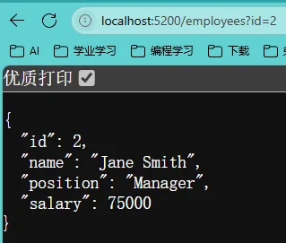

且如果同时出现查询参数与路由参数，那么会仅使用路由参数，例如：

```C#
// 配置端点路由，定义应用程序的API端点
app.UseEndpoints(endpoints =>
{
    // 定义GET请求端点：获取员工信息
    // 路由模板：/employees/{id}，其中id是可选的整数参数
    // 使用[FromRoute]特性显式绑定路由参数，并指定参数名称为"id"
    endpoints.MapGet("/employees/{id:int?}", ([FromRoute(Name = "id")] int? id) =>
        {
            // 检查是否提供了id参数
            if (id.HasValue)
            {
                // 调用数据访问层方法，根据ID查询员工信息
                var employee = EmployeesRepository.GetEmployeeById(id.Value);

                // 直接返回员工对象，ASP.NET Core会自动将其序列化为JSON响应
                return employee;
            }

            // 如果没有提供id参数，返回null
            return null;
        });
});
```

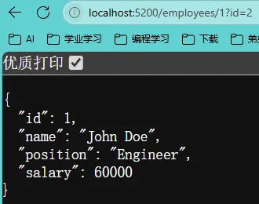

# 3、**请求头参数绑定**

```C#
using Microsoft.AspNetCore.Mvc;
using System.Text.Json;
using WebApp.Models;

// 创建Web应用构建器实例，用于配置服务和中间件
var builder = WebApplication.CreateBuilder(args);

// 构建Web应用实例
var app = builder.Build();

// 启用路由中间件，处理请求路径匹配
app.UseRouting();

// 配置端点路由规则
app.UseEndpoints(endpoints =>
{
    // 定义存在问题的GET端点
    // ⚠️ 路由模板"/employees"未包含参数占位符
    // ⚠️ [FromHeader]绑定与路由模板不匹配
    endpoints.MapGet("/employees",
        // 从请求头"identity"绑定参数，但变量命名为id
        ([FromHeader(Name = "identity")] int id) =>
        {
            // 通过数据访问层查询员工信息
            // ⚠️ 缺少参数有效性验证（如id>0）
            var employee = EmployeesRepository.GetEmployeeById(id);

            // 自动返回JSON格式响应
            return employee;
        });
});

// 启动应用程序并开始监听端口
app.Run();
```

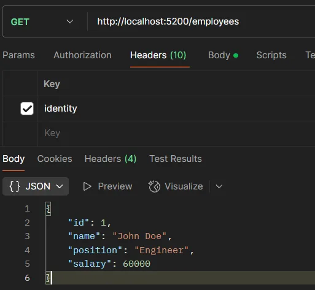

# 4、**使用[AsParameters]特性实现参数分组**

模拟多条件下使用

```C#
using Microsoft.AspNetCore.Mvc;
using System.Text.Json;
using WebApp.Models;

// 创建Web应用构建器实例，用于配置服务和中间件
var builder = WebApplication.CreateBuilder(args);

// 构建Web应用实例
var app = builder.Build();

// 启用路由中间件，处理请求路径匹配
app.UseRouting();

// 配置端点路由规则
app.UseEndpoints(endpoints =>
{
    // 定义员工查询端点
    // ✔ 路由模板包含参数占位符 {id:int} 确保类型安全
    // ✔ 混合参数绑定方式：
    //   - id 从路由路径绑定（隐式[FromRoute]）
    //   - name 从查询字符串绑定（显式[FromQuery]）
    //   - position 从请求头绑定（显式[FromHeader]）
    endpoints.MapGet("/employees/{id:int}", (int id, [FromQuery] string name, [FromHeader] string position) =>
    {
        // 通过ID查询员工基础信息
        var employee = EmployeesRepository.GetEmployeeById(id);

        // 更新动态字段（需注意：此处直接修改可能违反不变性原则）
        employee.Name = name;         // 来自URL查询参数
        employee.Position = position;  // 来自请求头

        // 返回JSON响应（自动序列化）
        // ⚠ 建议添加异常处理（如员工不存在的情况）
        return employee;
    });
});

// 启动应用程序并开始监听端口
app.Run();
```

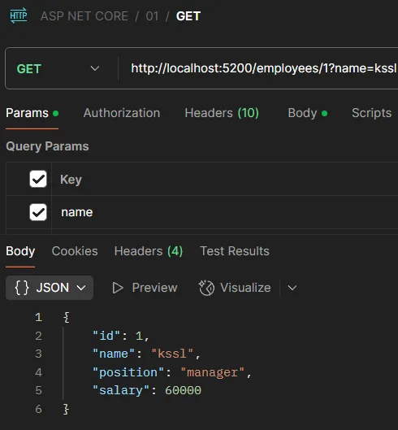

```C#
using Microsoft.AspNetCore.Mvc;
using System.Text.Json;
using WebApp.Models;

// 创建Web应用构建器实例，用于配置服务和中间件
var builder = WebApplication.CreateBuilder(args);

// 构建Web应用实例
var app = builder.Build();

// 启用路由中间件，处理请求路径匹配
app.UseRouting();

// 配置端点路由规则
app.UseEndpoints(endpoints =>
{
    // 定义员工查询端点（使用参数分组优化）
    // ✔ 路由模板包含强类型参数 {id:int}
    // ✔ 使用[AsParameters]特性将分散参数封装为DTO对象
    // ✔ 参数来源清晰标注：
    //   - Id: 从路由路径绑定
    //   - Name: 从查询字符串绑定  
    //   - Position: 从请求头绑定
    endpoints.MapGet("/employees/{id:int}", ([AsParameters] GetEmployeeParameters param) =>
    {
        // 参数自动绑定说明：
        // 1. 框架会自动将路由/查询/头部的参数映射到param对象
        // 2. 相比分散参数更易于维护和扩展

        // 通过ID查询员工基础信息
        // ⚠ 建议添加null检查（param.Id可能无效）
        var employee = EmployeesRepository.GetEmployeeById(param.Id);

        // 更新员工动态字段
        // ⚠ 注意：直接修改实体可能违反领域驱动设计原则
        employee.Name = param.Name;        // 来自查询字符串
        employee.Position = param.Position; // 来自请求头

        // 返回JSON响应（自动序列化）
        // ⚠ 建议：添加NotFound等错误处理
        return employee;
    });
});

// 启动应用程序并开始监听端口
app.Run();

// 参数分组DTO类
// ✔ 集中管理端点参数，提高可维护性
// ✔ 通过特性明确每个参数的来源
class GetEmployeeParameters
{
    [FromRoute]  // 从路由路径绑定
    public int Id { get; set; }

    [FromQuery]  // 从查询字符串绑定
    public string Name { get; set; }

    [FromHeader] // 从请求头绑定
    public string Position { get; set; }
}
```

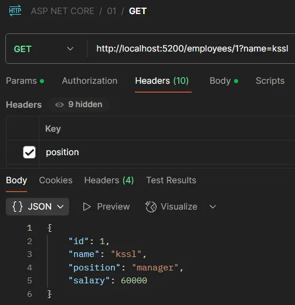

# 5、实现数组参数与查询字符串或请求头的绑定

```C#
using Microsoft.AspNetCore.Mvc;
using System.Text.Json;
using WebApp.Models;

// 应用初始化阶段
// 创建Web应用构建器实例，用于配置服务和中间件
var builder = WebApplication.CreateBuilder(args);

// 构建Web应用实例
var app = builder.Build();

// 中间件配置
// 启用路由中间件，处理请求路径匹配
app.UseRouting();

// 端点路由配置
app.UseEndpoints(endpoints =>
{
    // ✔ 查询字符串数组绑定示例
    // 传参格式：/employees?id=1&id=2 或 ?id=1,2,3
    endpoints.MapGet("/employees", ([FromQuery(Name = "id")] int[] ids) =>
    {
        // 参数处理说明：
        // 1. ASP.NET Core 自动将重复的查询参数转换为数组
        // 2. 支持逗号分隔的字符串解析为数组
        var employees = EmployeesRepository.GetEmployees();
        var emps = employees.Where(x => ids.Contains(x.Id)).ToList();
        return emps;
    });
});

// 应用启动
app.Run();
```

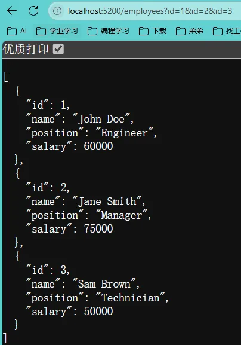

```C#
using Microsoft.AspNetCore.Mvc;
using System.Text.Json;
using WebApp.Models;

// 应用初始化阶段
// 创建Web应用构建器实例，用于配置服务和中间件
var builder = WebApplication.CreateBuilder(args);

// 构建Web应用实例
var app = builder.Build();

// 中间件配置
// 启用路由中间件，处理请求路径匹配
app.UseRouting();

// 端点路由配置
app.UseEndpoints(endpoints =>
{
    // ⚠ 非常规实践：通过Header传递主键数组
    // ✔ 请求头数组绑定示例
    // 传参格式：Header添加 id: 1,2,3
    endpoints.MapGet("/employees", ([FromHeader(Name = "id")] int[] ids) =>
    {
        // 安全建议：
        // 1. 应验证Header来源的可靠性
        // 2. 建议设置最大数组长度限制
        var employees = EmployeesRepository.GetEmployees();
        var emps = employees.Where(x => ids.Contains(x.Id)).ToList();
        return emps;
    });
});

// 应用启动
app.Run();
```

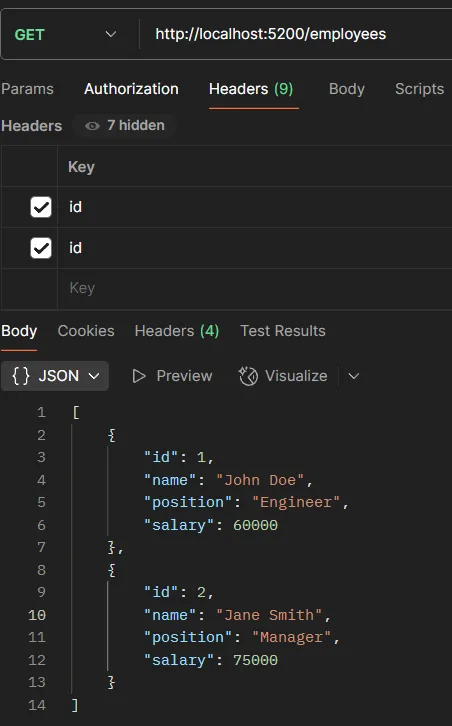

# 6、实现参数与请求体绑定

```C#
using Microsoft.AspNetCore.Mvc;
using System.Text.Json;
using WebApp.Models;

// 应用初始化阶段
// 创建Web应用构建器实例，用于配置服务和中间件
var builder = WebApplication.CreateBuilder(args);

// 构建Web应用实例
var app = builder.Build();

// 中间件配置
// 启用路由中间件，处理请求路径匹配
app.UseRouting();

// 端点路由配置
app.UseEndpoints(endpoints =>
{
    // 定义员工新增端点（POST方法）
    // ✔ 自动模型绑定：框架会将请求体JSON反序列化为Employee对象
    // ✔ 基础参数验证：检查员工对象是否为null或ID是否有效
    endpoints.MapPost("/employees", (Employee employee) =>
    {
        // 参数验证说明：
        // 1. 检查employee对象是否为null（请求体为空的情况）
        // 2. 验证ID是否为正数（基础业务规则校验）
        if (employee is null || employee.Id <= 0)
        {
            // ⚠ 建议：使用标准错误响应格式（如ProblemDetails）
            return "Employee is not provided or is not valid.";
        }

        // 调用仓储层添加员工
        // ⚠ 注意：缺少事务处理和并发控制
        EmployeesRepository.AddEmployee(employee);

        // 返回简单成功消息
        // ✔ 实际项目建议返回创建成功的资源标识（如201 Created响应）
        return "Employee added successfully.";
    });
});

// 应用启动
app.Run();
```

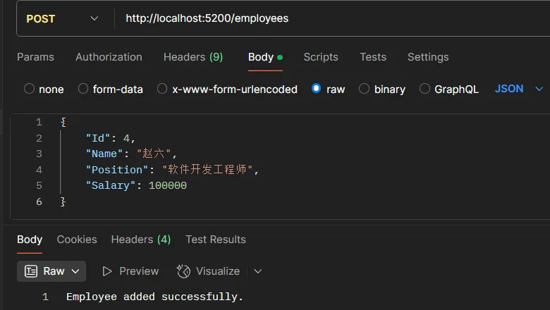

> 但该种方式仍有缺点：
>
> 1. 在Mini API下，默认为JSON格式传递，不支持其他格式，例如XML格式。
> 2. 在Mini API下，传递的JSON不能有不同类型的多个数据，例如无法同时传递Employee和Company

# 7、实现参数与异步方法自定义绑定

```C#
using Microsoft.AspNetCore.Mvc;  // ASP.NET Core MVC 功能
using System;
using System.Text.Json;         // JSON 序列化/反序列化
using WebApp.Models;            // 应用模型

// 应用初始化阶段
// 创建Web应用构建器实例，用于配置服务和中间件
var builder = WebApplication.CreateBuilder(args);  // 创建应用构建器

// 构建Web应用实例
var app = builder.Build();  // 构建应用实例

// 中间件配置
// 启用路由中间件，处理请求路径匹配
app.UseRouting();  // 启用路由功能

// 端点路由配置
app.UseEndpoints(endpoints =>  // 配置终结点路由
{
    // 定义GET请求端点，处理/people路径
    endpoints.MapGet("/people", (Person? p) =>  // p参数通过BindAsync方法绑定
    {
        return $"Id is {p?.Id}; Name is {p?.Name}";  // 返回格式化字符串
    });

});

// 应用启动
app.Run();  // 启动应用

class Person  // 人员模型类
{
    public int Id { get; set; }      // ID属性
    public string? Name { get; set; }  // 可空姓名属性

    // 自定义模型绑定方法
    public static ValueTask<Person?> BindAsync(HttpContext context)
    {
        // 从查询字符串获取id参数
        var idStr = context.Request.Query["id"];
        // 从请求头获取name参数
        var nameStr = context.Request.Headers["name"];

        // 尝试解析id为整数
        if (int.TryParse(idStr, out var id))
        {
            // 成功则返回Person实例
            return new ValueTask<Person?>(new Person { Id = id, Name = nameStr });
        }

        // 解析失败返回null
        return new ValueTask<Person?>(Task.FromResult<Person?>(null));
    }
}
```

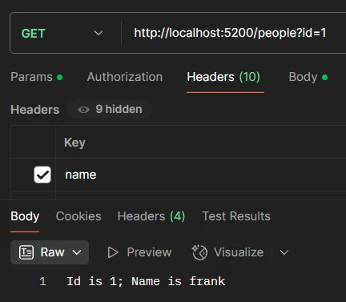

# 8、绑定优先级

在 ASP.NET Core 中，模型绑定会从多个数据源（路由、查询字符串、表单、请求正文等）中提取数据。当这些来源中可能存在相同名称的数据时，框架需要依据内部的“Binding source priorities”（绑定源优先级）来决定最终使用哪一个值。与此同时，开发者也可以通过“显式绑定”（Explicit Binding）的方式来**明确规定**数据的获取过程，其中最典型的做法就是利用类型中定义的 `BindAsync` 静态方法。

1. 显式绑定（Explicit Binding）

   **显式绑定**指的是开发者明确告知 ASP.NET Core 从哪个数据来源绑定数据，而不依赖模型绑定系统的默认查找机制。通常有两种方式实现显式绑定：

   - **通过特性声明**：在控制器参数或模型属性上使用 `[FromQuery]`、`[FromBody]`、`[FromRoute]` 等特性。
   - **通过自定义绑定逻辑**：实现自定义模型绑定器或在模型类型中定义一个静态的 `BindAsync` 方法。

   这两种方式都属于“显式”告诉框架如何获取数据，从而绕过或预设默认的绑定源优先级顺序。

2. BindAsync` 方法的角色` 

   在 ASP.NET Core（尤其是 Minimal API 和一些高级场景中），如果一个模型类型定义了静态的 `BindAsync` 方法，那么 ASP.NET Core 在绑定时会优先调用这个方法。

   - **为什么使用 `BindAsync`？**`BindAsync` 提供了一种显式的绑定机制，使得类型的绑定过程完全由开发者定义。这种方式具有如下优势：

   - **控制权更高**：你可以在方法内部检查请求上下文，从多个数据源中提取数据，自行决定如何合并或选择。

   - **简化参数声明**：无需在每个参数上反复声明 `[FromXxx]` 特性，只需在类型内部编写一次 `BindAsync` 方法，所有使用该类型的参数都将采用自定义逻辑。

   - **优先级覆盖**：由于显式绑定逻辑总是优先于默认绑定源优先级，当类型实现了 `BindAsync` 后，框架不会再依靠路由、查询字符串、表单等默认顺序来寻找数据，而是直接调用 `BindAsync` 进行绑定。

   - **`BindAsync` 的基本签名**（可能因 ASP.NET Core 版本不同有细微变化，但大致如下）：

     当 ASP.NET Core 在处理请求到相关终结点（endpoint）时，会检测参数类型是否有 `BindAsync` 方法。如果存在，则调用这个方法，**完全绕过**默认的绑定源查找顺序。这就是一种非常“显式”的绑定策略，能确保绑定行为与默认优先级无关，而完全由开发者控制。

   ```C#
   public static async ValueTask BindAsync(HttpContext context, ParameterInfo parameter) {    
    // 从 context 中获取数据（例如查询字符串、路由数据、请求正文等）    
    // 根据需要进行解析和验证    
    // 返回构造成功的 YourModelType 实例或者 null（如果绑定失败） 
   }
   ```

3. 定源优先级的基础

   ASP.NET Core 模型绑定默认会按照一定的顺序搜索数据来源。一个常见的优先级顺序如下：

   | 1. Route（路由数据）          |
   | ----------------------------- |
   | 2. Query String（查询字符串） |
   | 3. Form Data（表单数据）      |
   | 4. Body（请求正文）           |
   | 5. Header（请求头）           |

   这种默认顺序确保了当同一参数在多个数据源存在值时，框架能有条不紊地进行选择。如果不希望走这种默认的优先级模型，可以利用绑定属性（如 `[FromQuery]`、`[FromBody]` 等）来**显式**指定绑定来源。

   1. **模型绑定的基本流程**

      当 ASP.NET 处理请求时，会根据请求中的数据自动将传入数据映射到控制器方法的参数或模型属性上。这些数据可能来源于：

      - **路由数据**（Route Data）：URL 路径中提取的信息，如 `api/products/5` 中的 `5`。
      - **查询字符串**（Query String）：URL 中 `?key=value` 部分的数据。
      - **表单数据**（Form Data）：POST 请求中通过表单提交的数据。
      - **请求正文**（Body）：例如 JSON 或 XML 格式的数据（常用于 Web API）。
      - **请求头**（Header）：HTTP 头中的数据。

      如果相同的键在多个来源中都有值，模型绑定系统将依据“绑定源优先级”来决定最终使用哪一个值。

   2. **显式指定绑定源与默认优先级**
   
      为了避免歧义，ASP.NET Core 提供了用于明确声明数据来源的特性，如：
   
      - `[FromRoute]`：指示数据应从路由数据中绑定。
      - `[FromQuery]`：指示数据应从查询字符串中绑定。
      - `[FromForm]`：指示数据应从表单数据中绑定。
      - `[FromBody]`：指示数据应从请求正文中绑定。
   
      如果没有明确指定，框架会根据参数的数据类型等特性采用默认规则，这就涉及到默认的绑定源优先级。例如：
   
      - **简单类型**（如 int、string 等）通常会从路由数据、查询字符串或表单中查找匹配的值。
      - **复杂类型**默认往往预期来自请求正文（特别是在 Web API 场景下），但也可能从其它来源（例如表单）中获取数据，具体取决于请求方法和配置。
   
      这种优先级的设置确保了当同一参数在多个数据源中都有数据时，系统能有一个明确的决策规则，从而避免不确定的行为。例如：如果在 URL 中既有路由参数 `id`，又在查询字符串中传递了 `id`，而未显式标明绑定属性，那么通常路由数据将具有更高优先级，最终 `id` 的值就会采用路由数据中的那个。
   
4. 显式绑定与绑定源优先级的对比

默认过程（依靠绑定源优先级）：

- 参数未标明具体绑定方式时，框架会按照内部的优先级顺序（路由 > 查询 > 表单 > 请求正文等）查找数据。
- 当多个数据源存在同名的键时，就会依据优先级选择先出现的数据源。

显式绑定（通过 `[FromXxx]` 或 `BindAsync`）：

- 使用 `[FromXxx]` 特性，参数的绑定源已经固定，框架将仅从该数据源中查找数据。

- 使用 `BindAsync` 定义绑定逻辑时，整个绑定过程由该方法全部掌控，开发者可以自行决定：

  - 从哪些数据源读取数据
  - 如何处理多个数据源间的取舍
  - 如何验证和转换数据


因此，当你在模型中使用 `BindAsync` 进行显式绑定时，这个显式逻辑的优先级会高于内置的多数据源优先查找顺序，相当于告诉框架，“我知道数据该从哪里来，按我的规则处理”。

5. 一个简化的示意图

|     **流程类型**      |                         **执行逻辑**                         |                         **详细说明**                         |
| :-------------------: | :----------------------------------------------------------: | :----------------------------------------------------------: |
|   **参数显式标识**    |                                                              |                                                              |
| 使用 `[FromXxx]` 特性 |      指定单一数据源（如 `[FromQuery]`、`[FromRoute]`）       | 强制模型绑定仅从指定源获取数据，忽略其他源（例如 `[FromHeader]` 从请求头中取值） |
| 实现 `BindAsync` 方法 |                 自定义绑定逻辑，覆盖默认行为                 | 在类型中定义 `BindAsync(HttpContext, ParameterInfo)` 方法，处理复杂或特殊场景（如自定义格式解析） |
|  **参数无显式绑定**   |                                                              |                                                              |
|  1. 检查 Route 数据   |         从 URL 路径中提取路由参数（如 `/user/{id}`）         |  优先匹配路由模板中的参数名称，适用于简单类型和部分复杂类型  |
|  2. 检查 Query 数据   |       从 URL 的查询字符串中获取参数（如 `?name=John`）       |   通过键值对形式传递，支持简单类型和集合类型（需同名参数）   |
|   3. 检查 Form 数据   | 从 HTTP 请求的正文中获取表单数据（如 `application/x-www-form-urlencoded`） | 适用于 POST 请求的表单提交，支持复杂类型绑定（需属性名称匹配） |
|   4. 检查 Body 数据   | 从请求正文中解析 JSON/XML 等结构化数据（如 `application/json`） | 默认使用 JSON 输入格式化器，需用 `[FromBody]` 显式指定；复杂类型优先从此处绑定 |

总结

- **Binding source priorities** 定义了 ASP.NET Core 如何从多个数据源中拉取数据的默认顺序；
- 默认的模型绑定会依赖这种顺序，但开发者可以**显式**指定数据源，比如使用 `[FromXxx]` 特性；
- 如果模型类型定义了静态的 `BindAsync` 方法，则 ASP.NET Core 会调用该方法来执行自定义绑定，从而**覆盖默认优先级**，实现更高控制精度的显式绑定。

这种设计使得 ASP.NET Core 的模型绑定既灵活又强大，既能满足简单场景下轻松映射传统数据，又能支持复杂需求下的定制数据处理逻辑。

> 依照7中的代码，在路由中添加的数据无法起到作用，因为指定了从Header中获取name，从而使得在获取name时显示查询Header的优先级最高。
>
> 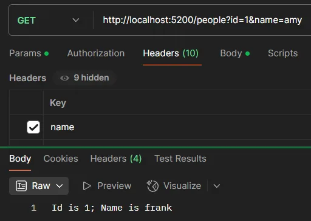

# 9、使用数据注解进行模型数据验证

需要安装“MinimalApis.Extensions”

```C#
using System.ComponentModel.DataAnnotations;  // 数据验证特性

// 创建Web应用构建器
var builder = WebApplication.CreateBuilder(args);
// 构建应用实例
var app = builder.Build();

// 定义POST端点，添加员工
app.MapPost("/employees", (Employee employee) =>
{
    // 调用仓库方法添加员工
    EmployeesRepository.AddEmployee(employee);
    return "Employee is added successfully.";  // 返回成功消息
}).WithParameterValidation();  // 启用参数验证

// 启动应用
app.Run();

// 员工数据仓库
public static class EmployeesRepository
{
    // 初始化员工列表
    private static List<Employee> employees = new List<Employee>
    {
        new Employee(1, "John Doe", "Engineer", 60000),
        new Employee(2, "Jane Smith", "Manager", 75000),
        new Employee(3, "Sam Brown", "Technician", 50000)
    };

    // 获取所有员工
    public static List<Employee> GetEmployees() => employees;

    // 根据ID获取员工
    public static Employee? GetEmployeeById(int id)
    {
        return employees.FirstOrDefault(x => x.Id == id);  // 使用LINQ查询
    }

    // 添加员工
    public static void AddEmployee(Employee? employee)
    {
        if (employee is not null)  // 非空检查
        {
            employees.Add(employee);  // 添加到列表
        }
    }

    // 更新员工信息
    public static bool UpdateEmployee(Employee? employee)
    {
        if (employee is not null)
        {
            var emp = employees.FirstOrDefault(x => x.Id == employee.Id);  // 查找员工
            if (emp is not null)
            {
                // 更新属性
                emp.Name = employee.Name;
                emp.Position = employee.Position;
                emp.Salary = employee.Salary;

                return true;  // 更新成功
            }
        }
        return false;  // 更新失败
    }

    // 删除员工
    public static bool DeleteEmployee(int id)
    {
        var employee = employees.FirstOrDefault(x => x.Id == id);  // 查找员工
        if (employee is not null)
        {
            employees.Remove(employee);  // 从列表移除
            return true;  // 删除成功
        }
        return false;  // 删除失败
    }
}

// 员工实体类
public class Employee
{
    public int Id { get; set; }  // 员工ID

    [Required]  // 必填验证
    public string Name { get; set; }  // 员工姓名
    public string Position { get; set; }  // 职位

    [Required]  // 必填验证
    [Range(50000, 200000)]  // 薪资范围验证
    public double Salary { get; set; }  // 薪资

    // 构造函数
    public Employee(int id, string name, string position, double salary)
    {
        Id = id;
        Name = name;
        Position = position;
        Salary = salary;
    }
}
```

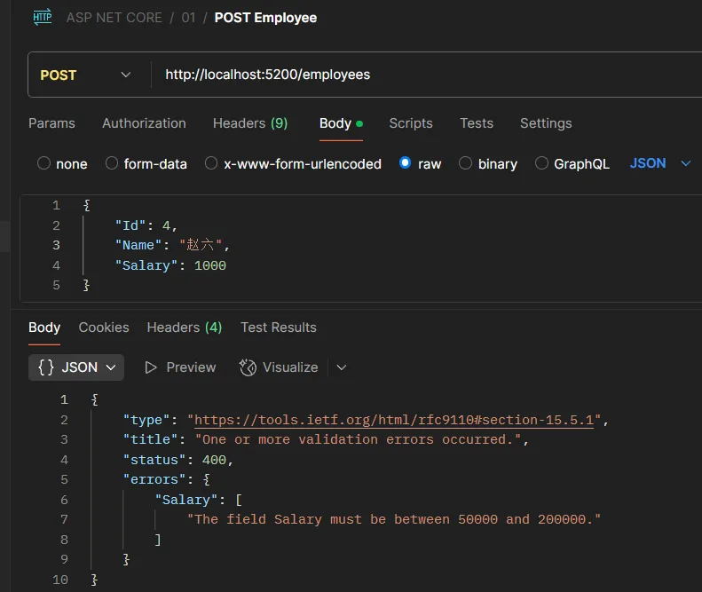

# 10、自定义模型数据验证

Employee_EnsureSalary.cs

```C#
using System.ComponentModel.DataAnnotations;  // 引入数据验证命名空间

namespace WebApp
{
    // 自定义薪资验证特性，继承自ValidationAttribute
    public class Employee_EnsureSalary : ValidationAttribute
    {
        // 重写验证方法
        protected override ValidationResult? IsValid(object? value, ValidationContext validationContext)
        {
            // 将验证对象转换为Employee类型
            var employee = validationContext.ObjectInstance as Employee;

            // 检查员工是否为经理且薪资是否符合要求
            if (employee is not null &&
                !string.IsNullOrWhiteSpace(employee.Position) &&
                employee.Position.Equals("Manager", StringComparison.OrdinalIgnoreCase))
            {
                // 如果经理薪资低于100000，返回错误信息
                if (employee.Salary < 100000)
                {
                    return new ValidationResult("经理的薪资必须至少为100000");
                }
            }

            // 验证通过
            return ValidationResult.Success;
        }
    }
}
```

Program.cs

```C#
using System.ComponentModel.DataAnnotations;  // 引入数据验证特性
using WebApp;  // 引入自定义验证特性

// 创建Web应用构建器实例
var builder = WebApplication.CreateBuilder(args);

// 构建Web应用实例
var app = builder.Build();

// 定义POST端点用于添加员工
app.MapPost("/employees", (Employee employee) =>
{
    // 调用数据仓库方法添加员工
    EmployeesRepository.AddEmployee(employee);
    return "员工添加成功";  // 返回成功消息
}).WithParameterValidation();  // 启用参数自动验证

// 启动Web应用
app.Run();

// 员工数据仓库类
public static class EmployeesRepository
{
    // 初始化员工数据列表
    private static List<Employee> employees = new List<Employee>
    {
        new Employee(1, "张三", "工程师", 60000),
        new Employee(2, "李四", "经理", 75000),
        new Employee(3, "王五", "技术员", 50000)
    };

    // 获取所有员工数据
    public static List<Employee> GetEmployees() => employees;

    // 根据ID查询单个员工
    public static Employee? GetEmployeeById(int id)
    {
        return employees.FirstOrDefault(x => x.Id == id);  // 使用LINQ查询
    }

    // 添加新员工
    public static void AddEmployee(Employee? employee)
    {
        if (employee is not null)  // 非空检查
        {
            employees.Add(employee);  // 添加到员工列表
        }
    }

    // 更新员工信息
    public static bool UpdateEmployee(Employee? employee)
    {
        if (employee is not null)
        {
            var emp = employees.FirstOrDefault(x => x.Id == employee.Id);  // 查找要更新的员工
            if (emp is not null)
            {
                // 更新员工属性
                emp.Name = employee.Name;
                emp.Position = employee.Position;
                emp.Salary = employee.Salary;

                return true;  // 返回更新成功
            }
        }
        return false;  // 返回更新失败
    }

    // 删除员工
    public static bool DeleteEmployee(int id)
    {
        var employee = employees.FirstOrDefault(x => x.Id == id);  // 查找要删除的员工
        if (employee is not null)
        {
            employees.Remove(employee);  // 从列表中移除
            return true;  // 返回删除成功
        }
        return false;  // 返回删除失败
    }
}

// 员工实体类
public class Employee
{
    public int Id { get; set; }  // 员工ID属性

    [Required(ErrorMessage = "员工姓名不能为空")]  // 必填验证
    public string Name { get; set; }  // 员工姓名属性

    public string Position { get; set; }  // 职位属性

    [Required(ErrorMessage = "薪资不能为空")]  // 必填验证
    [Range(50000, 200000, ErrorMessage = "薪资必须在50000到200000之间")]  // 范围验证
    [Employee_EnsureSalary(ErrorMessage = "经理薪资不能低于100000")]  // 自定义验证
    public double Salary { get; set; }  // 薪资属性

    // 构造函数
    public Employee(int id, string name, string position, double salary)
    {
        Id = id;
        Name = name;
        Position = position;
        Salary = salary;
    }
}
```

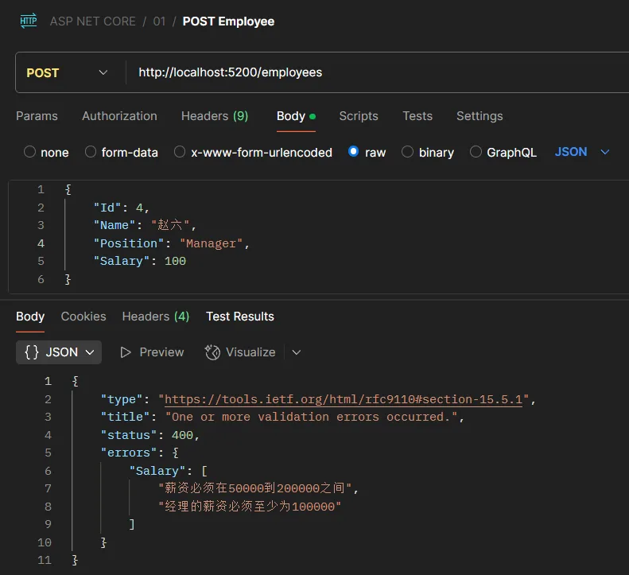

# 11、注册信息验证

```C#
using Microsoft.AspNetCore.Mvc;  // 引入ASP.NET Core MVC功能
using System.ComponentModel.DataAnnotations;  // 引入数据验证命名空间

var builder = WebApplication.CreateBuilder(args);  // 创建Web应用构建器
var app = builder.Build();  // 构建Web应用程序

app.UseRouting();  // 启用路由中间件

app.UseEndpoints(endpoints => {  // 配置终结点路由
    endpoints.MapGet("/register", (Registration reg) =>  // 映射GET请求到/register路径
    {
        return $"获取成功：用户邮箱{reg.Email}，用户密码{reg.Password}，用户确认密码{reg.ConfirmPassword}";  // 返回注册信息
    }).WithParameterValidation();

    endpoints.MapPost("/register", ([FromBody] Registration reg) =>  // 映射POST请求到/register路径，从请求体获取数据
    {
        return $"注册成功：用户邮箱{reg.Email}，用户密码{reg.Password}，用户确认密码{reg.ConfirmPassword}";  // 返回注册信息
    }).WithParameterValidation();
});

app.Run();  // 启动Web应用

public class Registration  // 用户注册模型类
{
    [Required]  // 必填字段
    [EmailAddress(ErrorMessage = "不合理的格式")]  // 必须为邮箱格式
    public string? Email { get; set; }

    [Required]  // 必填字段
    [StringLength(100, MinimumLength = 6, ErrorMessage = "密码长度至少6位数")]  // 密码长度6-100字符
    public string? Password { get; set; }

    [Required(ErrorMessage = "请输入确认密码")]  // 必填字段
    [Compare(nameof(Password), ErrorMessage = "两次密码不一致")]  // 必须与Password字段值相同
    public string? ConfirmPassword { get; set; }

    public static ValueTask<Registration?> BindAsync(HttpContext context)  // 从请求绑定注册数据
    {
        var email = context.Request.Query["email"];  // 从查询字符串获取email参数
        var password = context.Request.Query["password"];  // 从查询字符串获取password参数
        var confirmPassword = context.Request.Query["confirmPassword"];  // 从查询字符串获取confirmPassword参数

        return new ValueTask<Registration?>(new Registration { Email = email, Password = password, ConfirmPassword = confirmPassword });  // 返回注册对象
    }
}
```

错误演示：

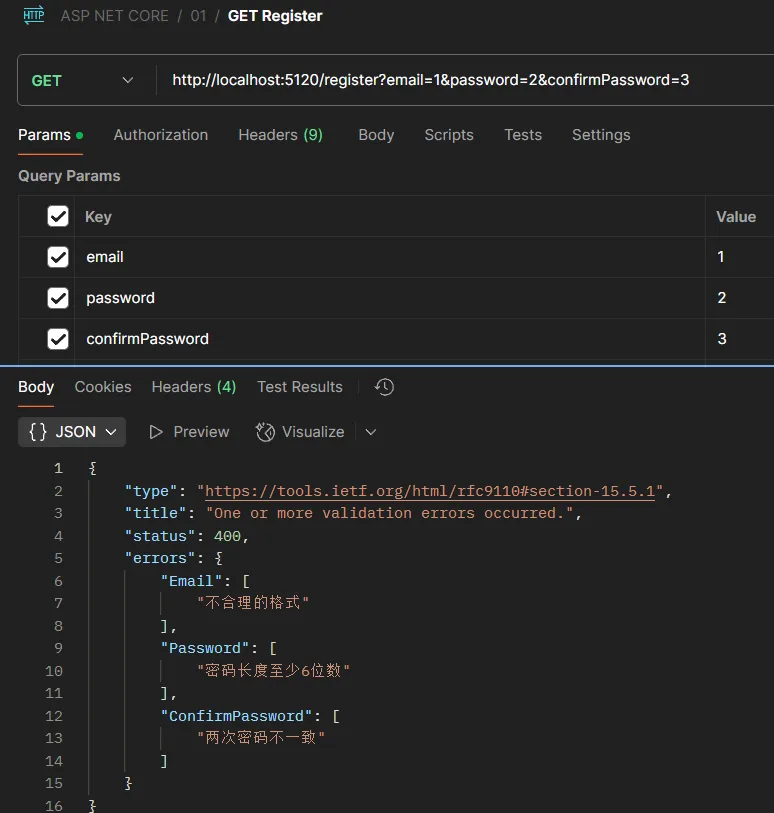

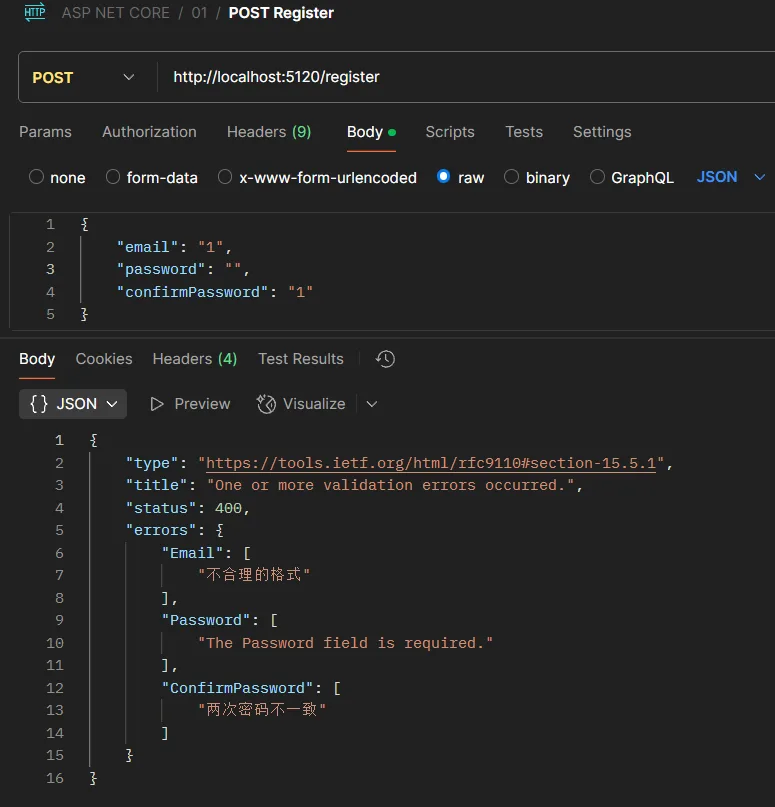

正确演示：

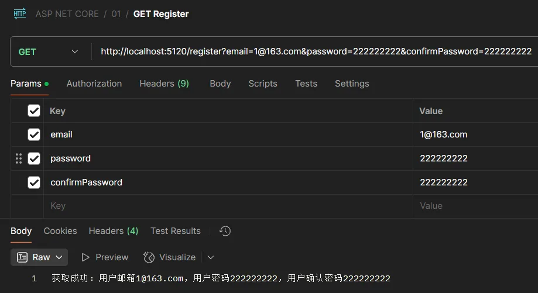

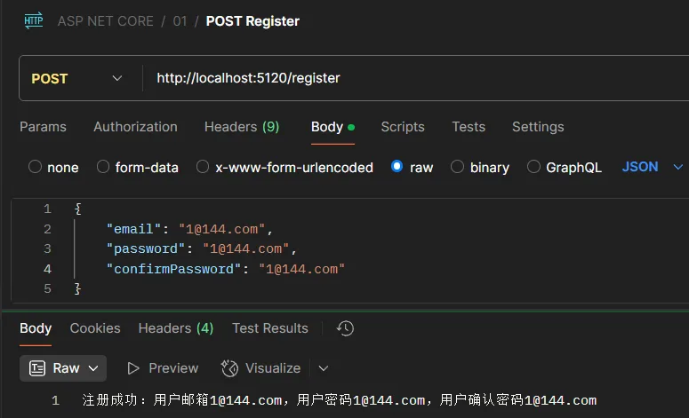
