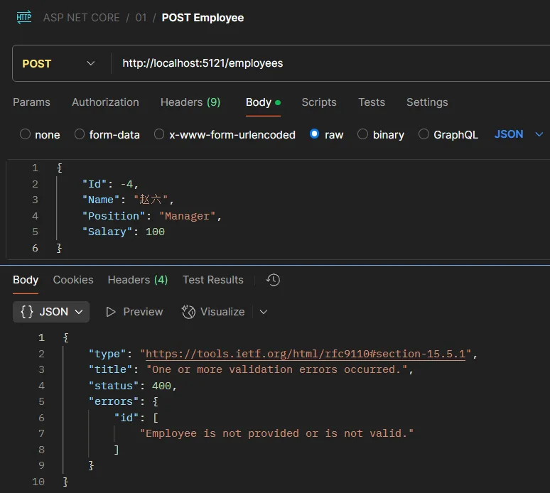
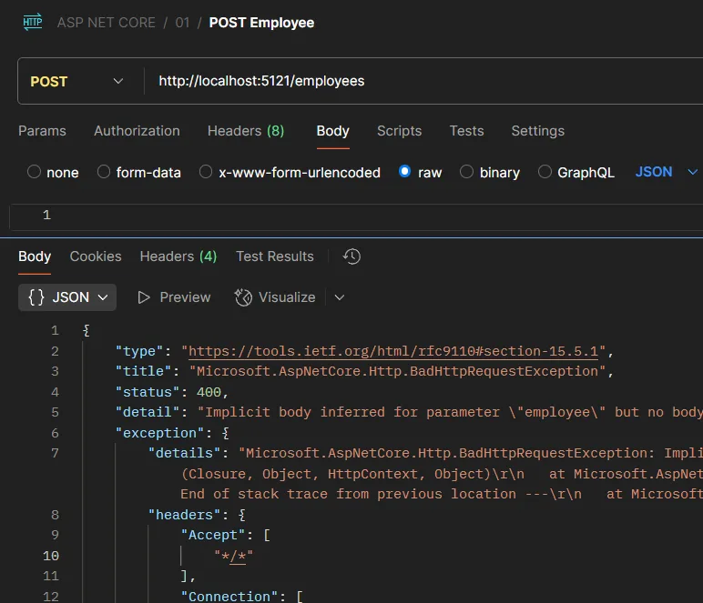
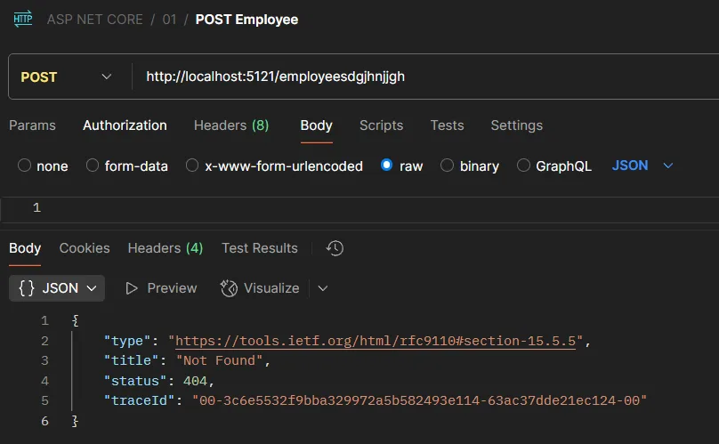
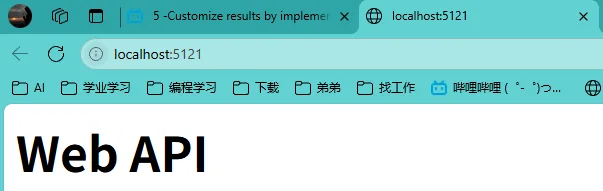

本次学习基础代码如下：

Employee.cs

```C#
using System.ComponentModel.DataAnnotations;

namespace WebApi.Models
{
    /// <summary>
    /// 员工实体类
    /// </summary>
    public class Employee
    {
        /// <summary>
        /// 员工唯一标识符
        /// </summary>
        public int Id { get; set; }

        /// <summary>
        /// 员工姓名
        /// </summary>
        public string Name { get; set; }

        /// <summary>
        /// 员工职位（必填字段）
        /// </summary>
        [Required]
        public string Position { get; set; }

        /// <summary>
        /// 员工薪资
        /// </summary>
        public double Salary { get; set; }

        /// <summary>
        /// 员工构造函数
        /// </summary>
        /// <param name="id">员工ID</param>
        /// <param name="name">员工姓名</param>
        /// <param name="position">员工职位</param>
        /// <param name="salary">员工薪资</param>
        public Employee(int id, string name, string position, double salary)
        {
            Id = id;
            Name = name;
            Position = position;
            Salary = salary;
        }
    }
}
```

EmployeesRepository.cs

```C#
namespace WebApi.Models
{
    /// <summary>
    /// 员工数据存储库（静态类，模拟数据访问层）
    /// </summary>
    public static class EmployeesRepository
    {
        // 使用静态列表模拟内存数据库存储
        private static List<Employee> employees = new List<Employee>
    {
        // 初始化测试数据
        new Employee(1, "John Doe", "Engineer", 60000),
        new Employee(2, "Jane Smith", "Manager", 75000),
        new Employee(3, "Sam Brown", "Technician", 50000)
    };

        /// <summary>
        /// 获取所有员工列表
        /// </summary>
        /// <returns>员工集合</returns>
        public static List<Employee> GetEmployees() => employees;

        /// <summary>
        /// 根据ID查询单个员工
        /// </summary>
        /// <param name="id">员工ID</param>
        /// <returns>匹配的员工对象，未找到返回null</returns>
        public static Employee? GetEmployeeById(int id)
        {
            return employees.FirstOrDefault(x => x.Id == id);
        }

        /// <summary>
        /// 添加新员工
        /// </summary>
        /// <param name="employee">要添加的员工对象</param>
        public static void AddEmployee(Employee? employee)
        {
            if (employee is not null)
            {
                employees.Add(employee);
            }
        }

        /// <summary>
        /// 更新员工信息
        /// </summary>
        /// <param name="employee">更新后的员工对象</param>
        /// <returns>更新成功返回true，失败返回false</returns>
        public static bool UpdateEmployee(Employee? employee)
        {
            if (employee is not null)
            {
                var emp = employees.FirstOrDefault(x => x.Id == employee.Id);
                if (emp is not null)
                {
                    // 更新员工属性
                    emp.Name = employee.Name;
                    emp.Position = employee.Position;
                    emp.Salary = employee.Salary;

                    return true;
                }
            }

            return false;
        }

        /// <summary>
        /// 根据ID删除员工
        /// </summary>
        /// <param name="id">要删除的员工ID</param>
        /// <returns>删除成功返回true，失败返回false</returns>
        public static bool DeleteEmployee(int id)
        {
            var employee = employees.FirstOrDefault(x => x.Id == id);
            if (employee is not null)
            {
                employees.Remove(employee);
                return true;
            }

            return false;
        }
    }
}

```

Program.cs

```C#
using System.Text.Json;
using WebApi.Models;

// 创建Web应用构建器
var builder = WebApplication.CreateBuilder(args);
// 构建Web应用实例
var app = builder.Build();

// 根路径响应测试端点
app.MapGet("/", () => "Hello World!");

// 员工数据查询端点
app.MapGet("/employees", () =>
{
    // 从仓储层获取所有员工数据
    var employees = EmployeesRepository.GetEmployees();
    // 返回员工列表
    return employees;
});

// 员工数据新增端点
app.MapPost("/employees", (Employee employee) =>
{
    // 参数有效性检查
    if (employee is null || employee.Id <= 0)
    {
        return "Employee is not provided or is not valid.";
    }

    // 调用仓储层添加员工
    EmployeesRepository.AddEmployee(employee);
    // 返回成功响应
    return "Employee added successfully.";

}).WithParameterValidation();  // 启用参数自动验证（需配合验证库使用）

// 启动Web应用程序
app.Run();
```

# 1、IResult

在 ASP.NET Core 中，**`IResult`** 是一个接口，用于表示 Web 应用程序中的**返回结果**。它是 Minimal API 模型的重要部分，设计目的是提供一种简化的方式来定义 HTTP 响应。

核心功能

- **抽象化 HTTP 响应**：`IResult` 封装了控制器或终结点（endpoint）返回的 HTTP 响应，使代码更加简洁和可维护。
- **灵活性**：允许开发者使用内置方法或创建自定义结果来生成 HTTP 响应。

示例

以下是一个使用 `IResult` 的基本示例：

`app.MapGet("/hello", () => Results.Ok("Hello, World!"));`

在这个例子中，`Results.Ok` 是一个实现了 `IResult` 的方法，用于返回一个 HTTP 200 状态码的响应。

常见的 `Results` 方法

ASP.NET Core 提供了多个内置的 `IResult` 实现，可用于构建不同类型的响应，例如：

- `Results.Ok()`：返回 200 状态码。
- `Results.BadRequest()`：返回 400 状态码。
- `Results.NotFound()`：返回 404 状态码。
- `Results.Redirect()`：用于重定向。
- `Results.Json()`：返回 JSON 格式的响应。

优势

1. **代码更简洁**：适合 Minimal API，使得定义终结点和响应逻辑变得直接明了。
2. **可测试性高**：通过 `IResult` 抽象，可以更方便地测试终结点逻辑。
3. **高度灵活**：支持自定义实现，满足复杂响应需求。

```C#
using System.Text.Json;
using WebApi.Models;

// 创建Web应用构建器
var builder = WebApplication.CreateBuilder(args);
// 构建Web应用实例
var app = builder.Build();

// 根路径响应测试端点
app.MapGet("/", () => "Hello World!");

// 员工数据查询端点
app.MapGet("/employees", () =>
{
    // 从仓储层获取所有员工数据
    var employees = EmployeesRepository.GetEmployees();
    // 返回200状态码和员工列表
    return TypedResults.Ok(employees);
});

// 员工数据新增端点
app.MapPost("/employees", (Employee employee) =>
{
    // 参数有效性检查
    if (employee is null || employee.Id <= 0)
    {
        return Results.BadRequest("Employee is not provided or is not valid.");
    }

    // 调用仓储层添加员工
    EmployeesRepository.AddEmployee(employee);
    // 返回成功响应
    return Results.Ok("Employee added successfully.");

}).WithParameterValidation();  // 启用参数自动验证（需配合验证库使用）

// 启动Web应用程序
app.Run();
```

# 2、混合匹配Results和TypedResults

当使用TypedResults时，方法中所有的返回类型必须一致，如果不一致则会出现错误。所以需混合使用Results和TypedResults

```C#
app.MapPost("/employees", (Employee employee) =>
{
    if (employee is null || employee.Id <= 0)
    {
        return Results.BadRequest("Employee is not provided or is not valid.");
    }

    EmployeesRepository.AddEmployee(employee);
    return Results.Ok("Employee added successfully.");

}).WithParameterValidation();
```

# 3、问题详情标准

在 ASP.NET 中，“Problem Details standard”（问题详情标准）是一种用于表达 API 错误响应的规范化格式。它遵循 [RFC 7807](https://datatracker.ietf.org/doc/html/rfc7807)，为 HTTP API 提供了一种一致的方式来描述错误的详细信息。这种标准化格式旨在帮助客户端更轻松地处理错误响应，并且能更清晰地了解错误的原因和上下文。

核心内容

**Problem Details** 定义了一个 JSON 对象结构，用于传递错误信息。以下是该标准推荐的字段：

- **`type`**: 表示错误的 URI 或分类，指向详细的文档。
- **`title`**: 简短的人类可读的错误描述。
- **`status`**: 与 HTTP 响应码一致的状态码，例如 404、500。
- **`detail`**: 详细的错误信息，可帮助客户端理解问题。
- **`instance`**: 指向具体问题实例的 URI，便于追踪。

例如，一个典型的 Problem Details 响应可能是这样的：

```Json
{  
 "type": "https://example.com/probs/out-of-credit",  
 "title": "You do not have enough credit.",  
 "status": 403,  
 "detail": "Your account balance is too low to proceed.",  
 "instance": "/account/12345/transactions/67890" 
}
```

在 ASP.NET 中的应用

ASP.NET Core 提供了对 Problem Details 标准的内置支持。使用 `ProblemDetails` 类可以方便地创建符合 RFC 7807 的错误响应。例如，在控制器中，可以这样使用：

```C#
return Problem(
    detail: "Your account balance is too low to proceed.",
    title: "Not enough credit",
    statusCode: 403
);
```

或者，如果你需要自定义 Problem Details，可以直接实例化 `ProblemDetails` 对象并返回：

```C#
var problemDetails = new ProblemDetails
{
    Type = "https://example.com/probs/out-of-credit",
    Title = "Insufficient Credit",
    Detail = "Your balance is $0.",
    Status = StatusCodes.Status403Forbidden
};

return new ObjectResult(problemDetails) { StatusCode = problemDetails.Status };
```

优势

1. **统一的错误响应结构**：使 API 客户端可以一致地处理不同类型的错误。
2. **可扩展性**：可以添加自定义字段，以便提供更多错误相关的信息。
3. **易于调试**：清晰描述问题所在，减少开发者调试时间。

通过 Problem Details 标准，ASP.NET Core 的 API 错误处理变得更加规范化和可读。如果你希望进一步了解如何扩展 `ProblemDetails` 或结合中间件处理错误，我们可以继续探讨！希望这些信息对你有帮助。

```C#
app.MapPost("/employees", (Employee employee) =>
{
    if (employee is null || employee.Id < 0)
    {
        return Results.ValidationProblem(new Dictionary<string, string[]>
        {
            {"id", new[] { "Employee is not provided or is not valid." } }
        });
    }

    EmployeesRepository.AddEmployee(employee);
    return TypedResults.Created($"/employees/{employee.Id}", employee);    

}).WithParameterValidation();
```



# 4、标准化所有输出

```C#
using System.Text.Json;
using WebApi.Models;

// 初始化Web应用构建器，自动加载appsettings.json配置文件
var builder = WebApplication.CreateBuilder(args);

// 添加问题详情服务，用于生成标准化的错误响应
builder.Services.AddProblemDetails();

// 构建Web应用实例，初始化中间件管道
var app = builder.Build();

// 非开发环境下配置异常处理中间件
if (!app.Environment.IsDevelopment())
{
    // 使用统一的异常处理器处理未捕获异常
    app.UseExceptionHandler();
}

// 添加状态码页面处理中间件，自动处理4xx/5xx状态码
app.UseStatusCodePages();

// 定义根路径端点，用于服务健康检查
app.MapGet("/", () => "Hello World!");

// 定义获取所有员工的GET端点
app.MapGet("/employees", () =>
{
    // 从仓储层获取所有员工数据
    var employees = EmployeesRepository.GetEmployees();
    // 返回200 OK响应，自动将结果序列化为JSON
    return TypedResults.Ok(employees);
});

// 定义创建新员工的POST端点
app.MapPost("/employees", (Employee employee) =>
{
    // 参数验证：检查员工对象是否为空和ID是否有效
    if (employee is null || employee.Id < 0)
    {
        // 返回符合RFC 7807标准的验证错误响应
        return Results.ValidationProblem(new Dictionary<string, string[]>
        {
            {"id", new[] { "必须提供有效的员工信息" } }
        });
    }

    // 调用仓储层添加新员工
    EmployeesRepository.AddEmployee(employee);
    // 返回201 Created响应，包含新创建资源的URI
    return TypedResults.Created($"/employees/{employee.Id}", employee);

}).WithParameterValidation();  // 启用基于数据注解的自动参数验证

// 启动Web应用
app.Run();
```





# 5、自定义实现IResult

HtmlResult.cs

```C#
using System.Text;

namespace WebApi.Results
{
    /// <summary>
    /// 自定义HTML响应结果类，实现IResult接口
    /// </summary>
    public class HtmlResult : IResult
    {
        private readonly string html;  // 存储HTML内容

        /// <summary>
        /// 构造函数，初始化HTML内容
        /// </summary>
        /// <param name="html">要返回的HTML字符串</param>
        public HtmlResult(string html)
        {
            this.html = html;
        }

        /// <summary>
        /// 执行结果处理方法
        /// </summary>
        /// <param name="httpContext">HTTP上下文对象</param>
        public async Task ExecuteAsync(HttpContext httpContext)
        {
            // 设置响应内容类型为HTML
            httpContext.Response.ContentType = "text/html";

            // 计算并设置响应内容长度（UTF-8编码）
            httpContext.Response.ContentLength = Encoding.UTF8.GetByteCount(html);

            // 将HTML内容写入响应流
            await httpContext.Response.WriteAsync(html);
        }
    }
}
```

Program.cs

```C#
// 定义根路径端点，用于服务健康检查
app.MapGet("/", HtmlResult() => { 
    string html = "<html><body><h1>Web API</h1></body></html>";
    return new HtmlResult(html);
});
```



# 6、重构员工相关代码

```C#
using System.Text.Json;
using WebApi.Models;
using WebApi.Results;

// 初始化Web应用构建器，自动加载appsettings.json配置文件
var builder = WebApplication.CreateBuilder(args);

// 添加问题详情服务，用于生成标准化的错误响应
builder.Services.AddProblemDetails();

// 构建Web应用实例，初始化中间件管道
var app = builder.Build();

// 非开发环境下配置异常处理中间件
if (!app.Environment.IsDevelopment())
{
    // 使用统一的异常处理器处理未捕获异常
    app.UseExceptionHandler();
}

// 添加状态码页面处理中间件，自动处理4xx/5xx状态码
app.UseStatusCodePages();

// 定义根路径端点，返回HTML页面用于服务健康检查
app.MapGet("/", () => {
    // 创建简单的HTML页面内容
    string html = "<html><body><h1>Web API</h1></body></html>";
    // 返回自定义的HTML响应结果
    return new HtmlResult(html);
});

// 定义获取所有员工的GET端点
app.MapGet("/employees", () =>
{
    // 从仓储层获取所有员工数据
    var employees = EmployeesRepository.GetEmployees();
    // 返回200 OK响应，自动将结果序列化为JSON
    return TypedResults.Ok(employees);
});

// 定义获取单个员工的GET端点，支持ID参数
app.MapGet("/employees/{id:int}", (int id) =>
{
    // 调用仓储层获取指定ID的员工对象
    var employee = EmployeesRepository.GetEmployeeById(id);
    // 如果员工存在返回200 OK，否则返回404错误
    return employee is not null ?
        TypedResults.Ok(employee) : Results.ValidationProblem(new Dictionary<string, string[]>
        {
            {"id", new[] { $"员工{id}并不存在" } }
        }, statusCode: 404);
});

// 定义创建新员工的POST端点
app.MapPost("/employees", (Employee employee) =>
{
    // 参数验证：检查员工对象是否为空和ID是否有效
    if (employee is null || employee.Id < 0)
    {
        // 返回符合RFC 7807标准的验证错误响应，状态码400
        return Results.ValidationProblem(new Dictionary<string, string[]>
        {
            {"id", new[] { "必须提供有效的员工信息" } }
        }, statusCode: 400);
    }

    // 调用仓储层添加新员工
    EmployeesRepository.AddEmployee(employee);
    // 返回201 Created响应，包含新创建资源的URI
    return TypedResults.Created($"/employees/{employee.Id}", employee);

}).WithParameterValidation();  // 启用基于数据注解的自动参数验证

// 定义更新员工的PUT端点
app.MapPut("/employees/{id:int}", (int id, Employee employee) =>
{
    // 参数验证：检查URL中的ID与请求体中的ID是否一致
    if (employee.Id != id)
    {
        // 返回ID不一致的错误响应，状态码400
        return Results.ValidationProblem(new Dictionary<string, string[]>
        {
            {"id", new[] { $"{id}与员工id不一致" } }
        }, statusCode: 400);
    }

    // 调用仓储层更新员工信息，成功返回204 NoContent，失败返回404错误
    return EmployeesRepository.UpdateEmployee(employee) ?
        TypedResults.NoContent() :
        Results.ValidationProblem(new Dictionary<string, string[]>
        {
            {"id", new[] { $"员工{id}并不存在" } }
        }, statusCode: 404);
});

// 定义删除员工的DELETE端点
app.MapDelete("/employees/{id:int}", (int id) =>
{
    // 先获取要删除的员工信息
    var employee = EmployeesRepository.GetEmployeeById(id);
    // 调用仓储层删除员工，成功返回200 OK和员工信息，失败返回404错误
    return EmployeesRepository.DeleteEmployee(id) ?
        TypedResults.Ok(employee) :
        Results.ValidationProblem(new Dictionary<string, string[]>
        {
            {"id", new[] { $"员工{id}并不存在" } }
        }, statusCode: 404);
});

// 启动Web应用
app.Run();
```
