# 1、什么是controller？为什么用controller？

模型-视图-控制器 (MVC) 体系结构模式将应用分成 3 个主要组件：模型 (M)、视图 (V) 和控制器 (C) 。 MVC 模式有助于创建比传统单片应用更易于测试和更新的应用。

基于 MVC 的应用包含：

- 模型 (M)：是表示应用数据的类。 模型类使用验证逻辑来对该数据强制实施业务规则。 通常，模型对象检索模型状态并将其存储在数据库中。 本教程中，`Movie` 模型将从数据库中检索电影数据，并将其提供给视图或对其进行更新。 更新后的数据将写入到数据库。
- 视图 (V)：视图是显示应用用户界面 (UI) 的组件。 此 UI 通常会显示模型数据。
- 控制器 (C)：具有以下特征的类：
  - 处理浏览器请求。
  - 检索模型数据。
  - 调用返回响应的视图模板。

在 MVC 应用中，视图仅显示信息。 控制器处理用户输入和交互并对其进行响应。 例如，控制器处理 URL 段和查询字符串值，并将这些值传递给模型。 该模型可使用这些值查询数据库。 例如：

- `https://localhost:5001/Home/Privacy`：指定 `Home` 控制器和 `Privacy` 操作。
- `https://localhost:5001/Movies/Edit/5`：是使用 `Movies` 控制器和 `Edit` 操作编辑 ID=5 的电影的请求，本教程稍后将对此进行详细介绍。

本教程的后续部分中将介绍路由数据。

MVC 体系结构模式将应用分成 3 组主要组件：模型、视图和控制器。 此模式有助于实现关注点分离：UI 逻辑位于视图中。 输入逻辑位于控制器中。 业务逻辑位于模型中。 这种隔离有助于控制构建应用时的复杂程度，因为它可用于一次处理一个实现特性，而不影响其他特性的代码。 例如，处理视图代码时不必依赖业务逻辑代码。

`ChatGPT`：

在 ASP.NET（尤其是 ASP.NET MVC 和 ASP.NET Core MVC）中，**Controller** 是应用程序的核心组件之一，负责处理用户请求并决定如何生成响应。它是基于 MVC（Model-View-Controller）架构模式的一部分，负责连接用户界面（View）和业务逻辑（Model）。

**什么是 Controller？**

1. **定义**
    Controller 是一个类，通常继承自 `ControllerBase` 或 `Controller` 类，用来处理用户通过 HTTP 请求发送到应用的任务。例如：接收 GET、POST、PUT 或 DELETE 请求。

2. **职责**

   - 解析和处理用户请求（包括路由和参数）。
   - 调用业务逻辑（通常通过服务或模型）来完成具体任务。
   - 根据处理结果返回适当的响应，如 JSON 数据、视图（HTML 页面）或 HTTP 状态码。

3. **基本示例** 在 ASP.NET Core 中，一个简单的 Controller 示例：

   ```C#
   [ApiController]
   [Route("[controller]")]
   public class ProductsController : ControllerBase
   {
       [HttpGet]
       public IEnumerable<string> Get()
       {
           return new string[] { "Product1", "Product2" };
       }
   }
   ```

   - 当用户通过 HTTP GET 请求访问 `/Products` 时，`Get` 方法会被执行并返回结果。

**为什么使用 Controller？**

1. **解耦逻辑**
   - 将用户界面、业务逻辑和数据逻辑分离，使代码更易于维护和扩展。
   - 通过 MVC 模式，Controller 专注于处理请求，而模型处理数据逻辑，视图负责渲染界面。
2. **提升代码的可读性与可维护性**
   - Controller 的方法往往小而清晰，每个方法处理特定的任务，使代码更加模块化。
   - 开发者可以轻松地对功能进行更新或扩展，而不会影响其他部分。
3. **内置功能**
   - ASP.NET Core Controller 提供内置的路由、模型绑定、验证等功能，大大简化了开发任务。
   - 提供对 JSON、XML 等多种格式的支持，使构建 API 更加方便。
4. **支持测试**
   - Controller 易于进行单元测试，开发者可以用 Mock 服务来测试不同的请求和响应路径，而无需依赖真实的底层资源（如数据库）。

**总结**
 Controller 是 ASP.NET 应用程序中用于处理请求的核心组件，它通过 MVC 模式的分工，简化了代码结构，提升了扩展性和维护性。Controller 的存在，让开发者能够专注于实现具体的业务逻辑，同时轻松处理复杂的请求与响应逻辑。

# 2、MVC-属性路由

在 ASP.NET 中，可以通过以下几个特征来识别、判断一个类是否为 **Controller**：

## 1、判断一个类是否为`Controller`

**1. 命名规范**

通常，ASP.NET 的 Controller 类以 **`Controller`** 结尾。例如：

- `HomeController`
- `ProductsController`

这是 MVC 模式的约定，虽然并非强制，但符合此命名惯例的类更容易被识别为 Controller。

**2. 基类继承**

在 ASP.NET Core 中，Controller 类通常继承以下基类之一：

- **`ControllerBase`**（用于 API 控制器）。
- **`Controller`**（用于 MVC 控制器，支持视图和 Razor Pages）。

示例：

```C#
public class ProductsController : ControllerBase
{
    // 方法定义
}
```

如果一个类继承了上述基类，那么它很可能是一个 Controller。

**3. 特性标注（Attributes）**

Controller 通常会通过特性标注来定义行为或路由规则：

- **`[ApiController]`**：标识该类是 Web API 的控制器。
- **`[Route]`** 或 `[HttpGet]` 等：定义路由和请求类型。

示例：

```C#
[ApiController]
[Route("api/[controller]")]
public class ProductsController : ControllerBase
{
    [HttpGet]
    public IEnumerable<string> GetProducts()
    {
        return new string[] { "Product1", "Product2" };
    }
}
```

使用了这些特性的类通常是 Controller。

**4. 类的职责**

一个 Controller 类的核心职责包括：

- **处理 HTTP 请求**：例如 GET、POST、PUT、DELETE 等。
- **返回响应**：通常通过 `IActionResult` 或数据模型返回结果。
- **连接业务逻辑与用户界面**：通过调用服务或处理数据，向前端传递数据。

如果一个类包含这些职责，很可能是一个 Controller。

**5. 文件位置**

在 ASP.NET 项目中，Controller 类通常被组织在一个名为 **`Controllers`** 的文件夹中。例如：

```cmd
/MyApp
 ├── Controllers/
     ├── HomeController.cs
     ├── ProductsController.cs
```

虽然文件夹名称不是强制要求，但这是约定俗成的组织方式。

**6. 方法签名**

Controller 类中的方法通常具有以下特征：

- 与 HTTP 动作相关联（如 GET、POST 等）。
- 返回类型为 `IActionResult` 或直接返回数据（如 `string` 或 `List`）。

示例：

```C#
public IActionResult GetProduct(int id)
{
    // 返回一个响应
    return Ok(new { Id = id, Name = "Sample Product" });
}
```

**总结**

要判断一个类是否是 Controller，可以综合考虑以下因素：

- 是否命名为 `Controller` 结尾。
- 是否继承了 `ControllerBase` 或 `Controller`。
- 是否使用了特性如 `[ApiController]` 或 `[Route]`。
- 是否位于 `Controllers` 文件夹。
- 是否负责处理 HTTP 请求并返回响应。

这些特性组合起来能明确判断一个类是否为 ASP.NET 中的 Controller。

## 2、注册一个类为`Controller`

在 ASP.NET 中，注册一个类为 **Controller** 是通过框架内置机制完成的。通常，只需按照框架的约定设置类即可，ASP.NET 会自动识别它并注册为控制器。

以下是如何确保你的类被注册为控制器的步骤：

**1. 确保继承正确的基类**

在 ASP.NET Core 中，控制器类需要继承以下基类之一：

- **`ControllerBase`**：用于 Web API 控制器（不需要视图支持）。
- **`Controller`**：用于 MVC 控制器（支持视图和 Razor Pages）。

例如：

```C#
using Microsoft.AspNetCore.Mvc;

public class ProductsController : ControllerBase
{
    [HttpGet]
    public IActionResult GetProducts()
    {
        return Ok(new[] { "Product1", "Product2" });
    }
}
```

如果类继承了 `ControllerBase` 或 `Controller`，框架会自动识别它为控制器。

**2. 特性标注（可选）**

你可以通过特性（Attributes）明确声明控制器的行为：

- **`[ApiController]`**：标识该类是 Web API 的控制器。
- **`[Route]`**：定义控制器的路由规则。

示例：

```C#
[ApiController]
[Route("api/[controller]")]
public class ProductsController : ControllerBase
{
    [HttpGet]
    public IActionResult GetProducts()
    {
        return Ok(new[] { "Product1", "Product2" });
    }
}
```

使用 `[ApiController]` 特性可以启用额外功能，如模型验证自动处理。

**3. 配置 ASP.NET Core 应用程序**

控制器的注册通常通过 `Program.cs` 中的配置完成：

**(1) 使用依赖注入**

如果控制器需要依赖其他服务，你可以在依赖注入容器中注册这些服务。例如：

```
builder.Services.AddControllers();
```

这行代码会告诉 ASP.NET Core 自动扫描项目中的控制器类并注册它们。

**(2) 配置中间件**

在 ASP.NET Core 中，使用 `MapControllers()` 添加控制器路由：

```c#
var app = builder.Build();
app.MapControllers();
app.Run();
```

这确保所有符合控制器约定的类被注册并正确映射到对应的 HTTP 请求。

**4. 项目结构与约定**

控制器通常按照约定存放在项目的 `Controllers/` 文件夹中：

```c#
/MyApp
 ├── Controllers/
     ├── HomeController.cs
     ├── ProductsController.cs
```

虽然不是必须，但这种组织方式符合惯例，并且便于框架自动发现控制器。

**5. 动态注册（特殊需求）**

如果需要动态注册某个控制器，可以通过反射或自定义路由处理器来实现，但这通常用于高级场景。以下是示例：

```c#
app.UseEndpoints(endpoints =>
{
    endpoints.MapControllerRoute(
        name: "default",
        pattern: "{controller=Home}/{action=Index}/{id?}");
});
```

**总结**

要注册一个类为控制器，只需：

1. 继承 `ControllerBase` 或 `Controller`。
2. 添加相关的特性（如 `[ApiController]` 和 `[Route]`）。
3. 确保在 `Program.cs` 中通过 `AddControllers()` 和 `MapControllers()` 注册和启用控制器。

DepartmentsController.cs

```C#
using Microsoft.AspNetCore.Mvc;  // 引入MVC核心功能命名空间

namespace WebApp.Controllers  // 控制器所在的应用程序命名空间
{
    [Route("/api")]  // 控制器级路由：定义基础API路径
    public class DepartmentsController  // 部门业务控制器类
    {
        [HttpGet("departments")]  // 定义GET请求端点：/api/departments
        public string GetDepartments()
        {
            return "These are the departments.";  // 返回部门列表响应
        }

        [HttpGet("departments/{id}")]  // 定义带参数的GET请求端点：/api/departments/{id}
        public string GetDepartmentById(int id)
        {
            return $"Department info: {id}";  // 返回带ID参数的部门信息响应
        }
    }
}
```

Program.cs

```C#
var builder = WebApplication.CreateBuilder(args);  // 创建Web应用构建器实例

builder.Services.AddControllers();  // 注册控制器服务（MVC核心功能）

var app = builder.Build();  // 构建Web应用程序实例

app.UseRouting();  // 启用请求路由中间件

app.UseEndpoints(endpoints =>
{
    endpoints.MapControllers();  // 映射控制器路由端点（自动匹配控制器路由）
});

app.Run();  // 启动Web应用程序并监听请求
```

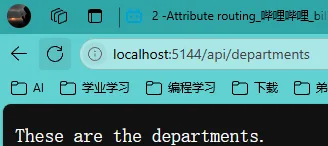

# 3、MVC-传统路由

在 ASP.NET 中，**传统路由（Traditional Routing）** 是一种基于 **路由表** 的 URL 路由机制，用于将用户请求映射到特定的控制器和动作方法。这种路由方式最早出现在 ASP.NET MVC 和 Web API 中，其核心是通过定义固定的路由模板来解析请求。

**1. 传统路由的工作机制**

传统路由依赖一个全局的路由表，该表由开发者在应用程序启动时定义。这些路由通过模板和参数描述 URL 模式，并将其与相应的控制器和动作方法关联。

- 传统路由的典型定义在 `Startup.cs`（ASP.NET Core）或 `Global.asax`（早期 ASP.NET）中完成。
- 它基于顺序匹配：框架会从上到下检查路由规则，一旦匹配成功，就停止继续匹配。

**2. 传统路由的示例**

以下是一个 ASP.NET Core 的传统路由示例：

```c#
app.UseEndpoints(endpoints =>
{
    endpoints.MapControllerRoute(
        name: "default",
        pattern: "{controller=Home}/{action=Index}/{id?}");
});
```

**解释**：

- `{controller}`：表示控制器名称，如 `HomeController`。
- `{action}`：表示控制器中的动作方法，如 `Index`。
- `{id?}`：表示一个可选的参数，通常用于传递 ID 值。

示例请求：

- `/Home/Index` 会映射到 `HomeController` 的 `Index` 方法。
- `/Products/Details/5` 会映射到 `ProductsController` 的 `Details` 方法，并将 `id` 参数设置为 5。

**3. 传统路由的优缺点**

优点：

- **简单直观**：基于固定模板的规则易于理解和使用。
- **灵活性高**：可以定义复杂的路由模板以满足多样化需求。

缺点：

- **依赖顺序匹配**：如果路由规则很多，可能会降低性能或导致错误的匹配。
- **不够自动化**：需要明确定义每个路由规则，管理成本较高。
- **局限性**：对于现代 RESTful API 或 SPA（单页应用程序）开发，传统路由不够高效。

**4. 与端点路由（Endpoint Routing）的对比**

在 ASP.NET Core 3.0 之后，引入了 **端点路由（Endpoint Routing）**，逐渐替代了传统路由。相比之下：

- **传统路由** 依赖 `UseMvc()` 来添加路由表，而 **端点路由** 使用 `MapControllers()` 或 `MapGet()` 来定义路由。
- **端点路由** 更灵活，支持全局路由过滤器和动态路由规则。

**总结**

传统路由是 ASP.NET 中用于将 URL 模式映射到控制器和动作方法的早期机制，具有规则明确和简单易用的特点，但逐渐被更现代的端点路由取代。在实际开发中，了解传统路由的基础有助于理解路由系统的演变和其在复杂应用中的适用场景。

DepartmentsController.cs

```C#
using Microsoft.AspNetCore.Mvc;  // 引入ASP.NET Core MVC核心功能命名空间

namespace WebApp.Controllers  // 定义应用程序控制器层命名空间
{
    public class DepartmentsController  // 部门资源控制器类
    {
        // 获取部门列表
        // 返回值: 部门列表信息字符串
        public string Index()
        {
            return "These are the departments.";  // 返回部门列表响应信息
        }

        // 获取指定部门详情
        // 参数: id - 可空部门ID
        // 返回值: 包含部门ID的详情信息字符串
        public string Details(int? id)
        {
            return $"Department info: {id}";  // 返回带ID参数的部门详情响应
        }

        // 显示部门创建页面
        // 返回值: 部门创建提示信息字符串
        [HttpPost]
        public string Create()
        {
            return "Create the departments.";  // 返回部门创建功能提示
        }

        // 删除指定部门
        // 参数: id - 可空部门ID
        // 返回值: 包含部门ID的删除操作信息字符串
        [HttpDelete]
        public string Delete(int? id)
        {
            return $"Delete info: {id}";  // 返回带ID参数的删除操作响应
        }

        // 编辑指定部门(自定义路由)
        // 路由: /departments/{id?}
        // 参数: id - 可空部门ID
        // 返回值: 包含部门ID的编辑操作信息字符串
        [HttpPut]
        [Route("/departments/{id?}")]
        public string Edit(int? id)
        {
            return $"Edit info: {id}";  // 返回带ID参数的编辑操作响应
        }
    }
}
```

Program.cs

```C#
var builder = WebApplication.CreateBuilder(args);  // 创建Web应用构建器实例（加载配置文件和环境配置）

builder.Services.AddControllers();  // 注册MVC控制器服务（支持控制器和API端点）

var app = builder.Build();  // 构建Web应用实例（中间件管道初始化）

app.UseRouting();  // 启用路由中间件（请求与端点匹配）

// 配置端点路由时检测到嵌套的UseEndpoints调用（异常结构）
// 正确写法应删除外层UseEndpoints，改为：
app.UseEndpoints(endpoints =>
{
    // 配置默认控制器路由模板
    // 格式说明：{控制器=Home}/{Action=Index}/{可选ID参数}
    endpoints.MapControllerRoute(
        name: "default",  // 路由方案名称
        pattern: "{controller=Home}/{action=Index}/{id?}");  // URL路径匹配规则
});

app.Run();  // 启动HTTP服务（阻塞式监听，直到应用关闭）
```

<center>
<figure>


</figure>
</center>
# 4、MVC-复杂模型绑定

Department.cs

```c#
using Microsoft.AspNetCore.Mvc;  // 引入ASP.NET Core MVC框架核心功能
using System.ComponentModel.DataAnnotations;  // 引入数据验证相关特性

namespace WebApp.Models  // 定义应用程序模型层命名空间
{
    public class Department  // 部门实体类
    {
        public int Id { get; set; }  // 部门唯一标识符(主键)

        [Required]  // 数据验证：名称字段为必填项
        public string? Name { get; set; }  // 部门名称(可空字符串)

        [StringLength(500)]  // 数据验证：描述字段最大长度限制为500字符
        public string? Description { get; set; }  // 部门描述信息(可空字符串)
    }
}
```

DepartmentsController.cs

```C#
using Microsoft.AspNetCore.Mvc;  // 引入ASP.NET Core MVC框架核心功能
using WebApp.Models;  // 引入应用程序模型层

namespace WebApp.Controllers  // 定义应用程序控制器层命名空间
{
    public class DepartmentsController  // 部门资源控制器类
    {
        // 获取部门列表
        // 返回值: 部门列表信息字符串
        public string Index()
        {
            return "These are the departments.";  // 返回部门列表响应信息
        }

        // 获取指定部门详情
        // 参数: id - 可空部门ID
        // 返回值: 包含部门ID的详情信息字符串
        public string Details(int? id)
        {
            return $"Department info: {id}";  // 返回带ID参数的部门详情响应
        }

        // 创建新部门(HTTP POST方法)
        // 参数: department - 部门实体对象
        // 返回值: 创建成功的部门对象
        [HttpPost]
        public object Create(Department department)
        {
            return department;  // 返回创建的部门对象
        }

        // 删除指定部门(HTTP POST方法)
        // 参数: id - 可空部门ID
        // 返回值: 删除操作结果信息字符串
        [HttpPost]
        public string Delete(int? id)
        {
            return $"Deleted department: {id}";  // 返回删除操作结果
        }

        // 编辑指定部门(HTTP POST方法)
        // 参数: id - 可空部门ID
        // 返回值: 编辑操作结果信息字符串
        [HttpPost]
        public string Edit(int? id)
        {
            return $"Updated department: {id}";  // 返回编辑操作结果
        }
    }
}
```

Program.cs

```C#
var builder = WebApplication.CreateBuilder(args);  // 创建Web应用构建器，加载配置参数

builder.Services.AddControllers();  // 添加MVC控制器服务到依赖注入容器

var app = builder.Build();  // 构建Web应用程序实例

app.UseRouting();  // 启用路由中间件，用于请求路由匹配

app.UseEndpoints(endpoints =>  // 配置端点路由
{
    endpoints.MapControllerRoute(  // 映射控制器路由
        name: "default",  // 路由名称
        pattern: "{controller=Home}/{action=Index}/{id?}"  // 默认路由模板
                                                           // 格式说明：{控制器=默认值}/{动作=默认值}/{可选ID参数}
    );
});

app.Run();  // 启动应用程序，开始监听HTTP请求
```

数据依据表单、查询字符串等内容进行自动解析、映射、匹配。但不能将复杂类型绑定到HTTP的Header中。

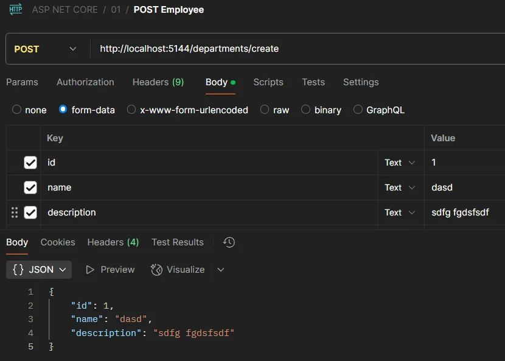

# 5、模型绑定优先级

ASP.NET Core 中的控制器模型绑定源优先级（Model Binding in controllers: Binding source priorities）是一个明确规定了请求数据来源解析顺序的机制。当控制器动作方法需要绑定参数时，框架会按照固定优先级顺序尝试从不同数据源获取值。以下是基于图片的详细解析：

------

### 1.模型绑定基础

模型绑定（Model Binding）是 ASP.NET Core 将 HTTP 请求中的数据（如路由参数、查询字符串、表单字段等）自动映射到控制器方法参数或模型对象的过程。**绑定源优先级**决定了当多个数据源存在同名参数时，框架优先选择哪一个来源的值。

------

### 2.绑定源优先级层级（从高到低）

1. **Explicit (显式指定)**
   通过特性（如 `[FromQuery]`, `[FromBody]`, `[FromRoute]` 等）明确指定参数来源时，优先级最高。
   ​**​示例​**​：

   ```csharp
   public IActionResult GetUser([FromRoute] int id) { ... }
   ```

2. **BindAsync 接口**
   如果参数类型实现了 `IBindableFromHttpContext<T>.BindAsync` 接口，框架会调用此方法进行绑定（常见于自定义复杂类型）。

3. **表单字段绑定（Form Fields）**
   支持将任意类型（简单或复杂）绑定到 HTTP POST 请求的 `Form` 数据（`application/x-www-form-urlencoded` 或 `multipart/form-data`）。

4. **简单类型绑定到路由参数**
   当参数为简单类型（如 `int`, `string`）且未显式指定来源时，默认优先从路由参数（URL Path）中获取值。

5. **查询字符串绑定（Query String）**
   若参数未通过上述方式获取，框架会尝试从 URL 的查询字符串（Query String）中解析值。

6. **数组绑定到查询字符串或 Headers**
   特殊场景：当参数是数组类型时，会尝试从查询字符串或 HTTP 请求头（Headers）中解析值。

------

### 3.关键规则与场景

1. **显式优先于隐式**
   使用 `[From*]` 特性时，无论优先级层级如何，都会直接采用指定来源的数据。
2. **复杂对象绑定逻辑**
   对于复杂类型（如 DTO 对象），默认会从表单字段、请求体（Body）或路由参数中按优先级组合绑定属性。
3. **冲突处理**
   当多个来源存在同名参数时（如路由参数和查询字符串同名），优先级高的来源会覆盖低优先级的值。

------

### 4.开发注意事项

- **避免歧义**：建议显式指定参数来源（如 `[FromQuery]`），提高代码可读性并避免意外绑定行为。
- **性能优化**：高频使用的参数优先通过路由或查询字符串传递，避免频繁解析请求体。
- **数组处理**：数组绑定需遵循格式（如 `?ids=1&ids=2` 或 `X-Array-Header: [1,2,3]`）。

------

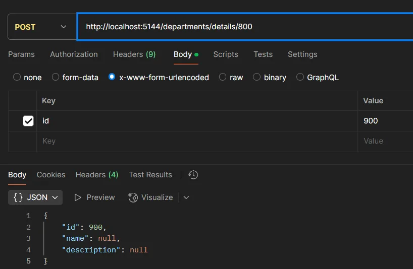

# 6、模型输入格式

默认情况下只能输入Json格式的数据，如果想输入其他数据，例如XML则需要指定

```
// 创建新部门(HTTP POST方法)
// 参数: department - 部门实体对象
// 返回值: 创建成功的部门对象
[HttpPost]
public object Create([FromBody]Department department)
{
    return department;  // 返回创建的部门对象
}
```

Program.cs

```C#
// 创建Web应用程序构建器实例，并加载配置参数
var builder = WebApplication.CreateBuilder(args);

// 添加MVC控制器服务到依赖注入容器，并支持XML序列化格式
builder.Services.AddControllers()
    .AddXmlSerializerFormatters();

// 构建Web应用程序实例
var app = builder.Build();

// 启用请求路由中间件，用于匹配请求路径到对应的控制器和Action
app.UseRouting();

// 配置应用程序的终结点路由
app.UseEndpoints(endpoints =>
{
    // 映射默认控制器路由
    endpoints.MapControllerRoute(
        name: "default",  // 路由名称标识
        pattern: "{controller=Home}/{action=Index}/{id?}"  // 路由模板格式。模板说明： {controller} - 控制器名称，默认为Home；{action} - Action方法名称，默认为Index；{id?} - 可选参数，可省略
    );
});

// 启动应用程序，开始监听HTTP请求
app.Run();
```

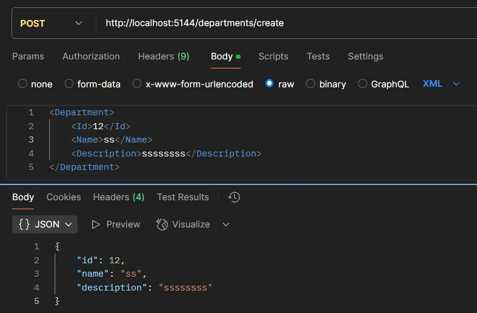

# 7、模型状态

如果缺少某些内容或者参数不正确，该状态下的代码并不会报错，而是可以继续运行，这并不正确。

通过继承Controller基类从而利用框架，便可以通过ModelState判断控制错误。

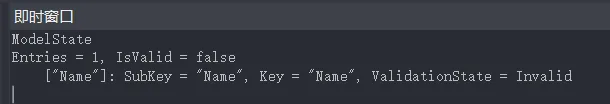

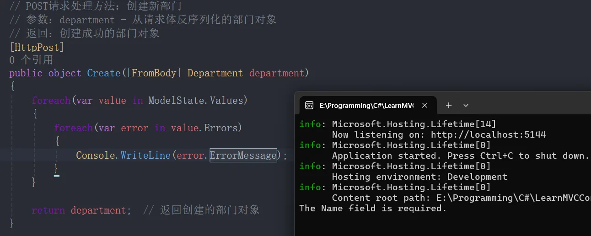

但如果设定为`[ApiController]`则会立即报错。

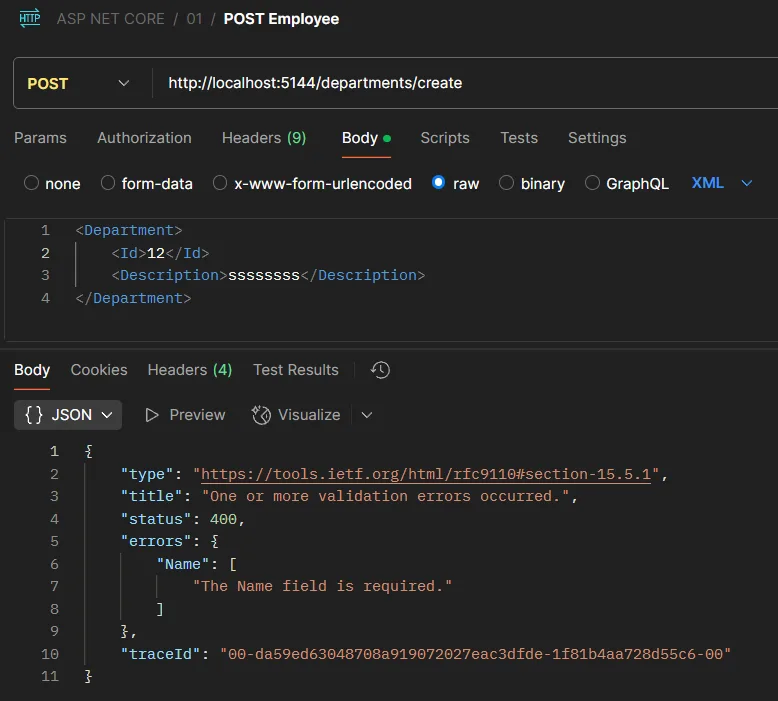

# 8、MVC-结果处理

在 ASP.NET Core 中，**Action Result（动作结果）** 代表控制器操作返回的不同类型的 HTTP 响应。根据你提供的图片信息，这里是对以下几种常见的 Action Result 的解析：

**1. ViewResult**

**用于返回 HTML 视图页面**（通常用于 MVC 应用）。它会渲染 Razor 视图，并将数据传递给前端页面。 示例：

```C#
public IActionResult Index()
{
    return View(); // 这里会返回 Views/Index.cshtml
}
```

💡 **适用场景**：当你需要返回完整的 HTML 视图给客户端时，例如网页 UI。

**2. ContentResult**

**用于返回纯文本或 HTML 片段**，而不是完整的视图页面。可以指定返回的内容类型（如 `text/plain` 或 `text/html`）。 示例：

```C#
public IActionResult SimpleText()
{
    return Content("Hello, this is plain text!");
}
```

💡 **适用场景**：当你需要返回一个简单的字符串（例如 API 返回消息），而不涉及视图渲染。

**3. JsonResult**

**用于返回 JSON 数据**，特别适用于 Web API。它会自动将对象序列化为 JSON 格式。 示例：

```C#
public IActionResult GetData()
{
    var product = new { Id = 1, Name = "Laptop", Price = 999.99 };
    return Json(product);
}
```

💡 **适用场景**：用于 API 或 AJAX 请求，需要返回 JSON 结构化数据给前端。

**4. FileResult**

**用于返回文件作为 HTTP 响应**（如 PDF、图片、Excel）。它允许客户端下载或显示文件内容。 示例：

```C#
public IActionResult DownloadFile()
{
    var filePath = "wwwroot/files/sample.pdf";
    var fileBytes = System.IO.File.ReadAllBytes(filePath);
    return File(fileBytes, "application/pdf", "download.pdf");
}
```

💡 **适用场景**：当你需要提供文件下载或直接展示文件时。

**5. Redirect Results**

**用于执行页面重定向**。ASP.NET 提供多种重定向方式：

- **`Redirect()`**：临时重定向（302）
- **`RedirectPermanent()`**：永久重定向（301）
- **`RedirectToAction()`**：重定向到控制器的另一个操作
- **`RedirectToRoute()`**：重定向到特定的路由

示例：

```C#
public IActionResult RedirectExample()
{
    return Redirect("https://example.com");
}
```

💡 **适用场景**：当你希望用户访问另一个 URL，比如登录后跳转到首页。

**总结**

这些不同类型的 **Action Result** 提供了灵活的 HTTP 响应方式：

- **ViewResult** → 适用于 MVC 视图返回
- **ContentResult** → 适用于返回纯文本数据
- **JsonResult** → 适用于 JSON 数据 API
- **FileResult** → 适用于文件下载
- **Redirect Results** → 适用于页面跳转

## 1、ContentResult

```C#
// ContentResult - 返回纯文本或 HTML 片段
public IActionResult Index()
{
    return new ContentResult
    {
        Content = "<h1>Departments</h1> Welcome to the departments page!",
        ContentType = "text/html"
    };
}

public IActionResult Index()
{
    return Content("<h1>Departments</h1> Welcome to the departments page!", "text/html");
}
```

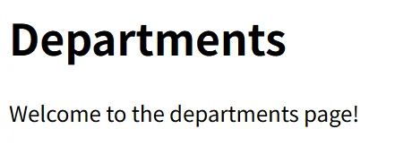

## 2、JsonResult

```C#
public object Details(int? id)
{
	return new Department { Id = 1, Name = "sss" };
}

public IActionResult Details(int? id)
{
	return new JsonResult(new Department { Id = 1, Name = "sss" });
}

public IActionResult Details(int? id)
{
	return new Json(new Department { Id = 1, Name = "sss" });
}
```

<center>
<figure>


</figure>
</center>

## 3、FileResult

**关于文件结果类型**

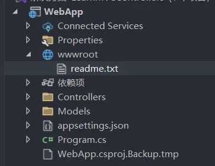

ASP.NET Core 提供了三种主要的文件结果类型，可以根据文件的存储方式和访问需求，返回不同类型的文件响应：

1. **VirtualFileResult**

   - 用于返回存储在 `wwwroot` 目录中的文件。该目录是 ASP.NET Core 的默认静态文件目录。
   - 适用于应用程序的静态文件（如图片、CSS 文件）。

   示例：

   ```C#
   public IActionResult GetVirtualFile()
   {
       return File("~/wwwroot/files/sample.pdf", "application/pdf");
   }
   ```

2. **PhysicalFileResult**

   - 用于返回存储在 `wwwroot` 之外的文件。这些文件可能存储在服务器的任意路径中，但需要开发者确保文件路径的正确性和安全性。
   - 适合返回服务器上的私有文件。
   
   示例：

   ```C#
   public IActionResult GetPhysicalFile()
   {
       string filePath = Path.Combine(Directory.GetCurrentDirectory(), "files/sample.pdf");
       return PhysicalFile(filePath, "application/pdf");
   }
   ```

3. **FileContentResult**

   - 用于直接从内存中返回文件内容，而无需依赖物理文件。这种方式适合返回动态生成的文件数据或只存储在内存中的内容。
   - 适用于生成临时文件或二进制内容。
   
   示例：

   ```C#
   public IActionResult GetFileContent()
   {
       byte[] fileContent = System.IO.File.ReadAllBytes("files/sample.pdf");
       return File(fileContent, "application/pdf", "download.pdf");
   }
   ```

**总结**

通过以上文件结果类型，ASP.NET Core 提供了灵活的文件响应机制，允许开发者根据文件的存储位置和访问方式选择适合的结果类型：

- **VirtualFileResult** → 针对 `wwwroot` 的静态文件。
- **PhysicalFileResult** → 服务器中任何文件。
- **FileContentResult** → 内存中的动态文件数据。

```C#
// 处理虚拟文件下载请求的路由
// 路由地址：/download_vf
// 返回：从wwwroot目录返回的文本文件
[Route("/download_vf")]
public IActionResult ReturnVirtualFile()
{
    // 文件必须存在于wwwroot目录下
    return new  VirtualFileResult("/readme.txt", "text/plain");  // 返回虚拟文件结果
}

// 处理虚拟文件下载请求的路由
// 路由地址：/download_vf
// 返回：从wwwroot目录返回的文本文件
[Route("/download_vf")]
public IActionResult ReturnVirtualFile()
{
    // 文件必须存在于wwwroot目录下
    return File("/readme.txt", "text/plain");  // 返回虚拟文件结果
}
```

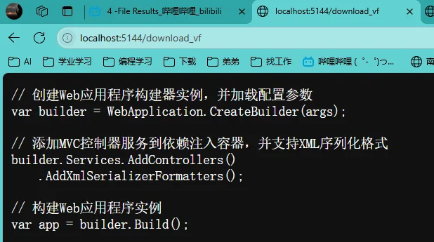

```C#
// 处理物理文件下载请求的路由
// 路由地址：/download_pf
// 返回：从物理路径返回的PDF文件
[Route("/download_pf")]
public IActionResult ReturnPhysicalFile()
{
    return PhysicalFile(@"E:\Programming\C#\LearnMVCControllers\WebApp\wwwroot\readme.txt", "application/pdf");  // 返回物理文件结果
}

// 处理物理文件下载请求的路由
// 路由地址：/download_pf
// 返回：从物理路径返回的PDF文件
[Route("/download_pf")]
public IActionResult ReturnPhysicalFile()
{
    return new PhysicalFileResult(@"E:\Programming\C#\LearnMVCControllers\WebApp\wwwroot\readme.txt", "application/pdf");  // 返回物理文件结果
}
```

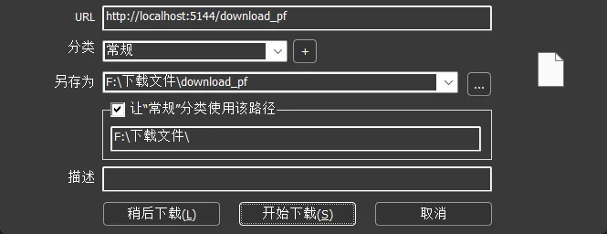

```C#
// 处理字节流文件下载请求的路由
// 路由地址：/download_cf
// 返回：以字节流形式返回的PDF文件
[Route("/download_cf")]
public IActionResult ReturnContentFile()
{
    byte[] bytes = System.IO.File.ReadAllBytes(@"E:\Programming\C#\LearnMVCControllers\WebApp\wwwroot\readme.txt");  // 读取文件字节

    return File(bytes, "application/pdf");  // 返回字节流文件结果
}

// 处理字节流文件下载请求的路由
// 路由地址：/download_cf
// 返回：以字节流形式返回的PDF文件
[Route("/download_cf")]
public IActionResult ReturnContentFile()
{
    byte[] bytes = System.IO.File.ReadAllBytes(@"E:\Programming\C#\LearnMVCControllers\WebApp\wwwroot\readme.txt");  // 读取文件字节

    return new FileContentResult(bytes, "application/pdf");  // 返回字节流文件结果
}
```

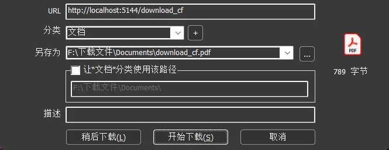

## 4、Redirect Results

图片中的内容展示的是与 ASP.NET Core MVC 框架中 **重定向结果**（Redirect Results）相关的三种常见类型，标题为 “Producing Results: Redirect Results”。下面我将详细介绍每一种重定向结果，并探讨它们各自的应用场景和背后的意义：

1. **RedirectToActionResult**
    这种结果类型主要用于在控制器中重定向到另一个动作方法（action）。当你处理完当前请求后，可能需要将用户导航到另一处逻辑上更适合处理后续操作的地方，例如转入另一控制器的动作或返回一个成功提示页面。在这种情况下，利用 `RedirectToActionResult`，你可以仅指定目标动作的方法名、控制器名称以及必要的路由参数，利用路由系统自动生成正确的 URL，从而避免硬编码 URL 的风险和维护问题。例如，在完成一个表单提交后，使用这种结果可以让用户跳转到一个“操作成功”的页面，同时确保路由的灵活性和一致性。

   ```C#
   using Microsoft.AspNetCore.Mvc;
   
   namespace MyApp.Controllers
   {
       public class HomeController : Controller
       {
           // 默认页面：完成操作后重定向到 Success 动作
           public IActionResult Index()
           {
               // 执行完相关逻辑后重定向到 Success 动作
               return RedirectToAction("Success");
           }
   
           public IActionResult Success()
           {
               ViewBag.Message = "操作成功！";
               return View();
           }
       }
   }
   ```

2. **LocalRedirectResult**
    这种结果在安全性上更为严格，当需要重定向到一个“本地” URL 时使用。所谓“本地”指的是同一应用内部的页面或资源。通过使用 `LocalRedirectResult`，可以有效防范开放重定向攻击——也就是防止恶意用户利用重定向漏洞，将用户诱导到外部危险或恶意网站。系统在执行重定向时，会先验证目标 URL 是否是应用内部允许的地址，只有符合条件的 URL 才会被接受。如果验证失败，通常会抛出异常或者返回错误信息，从而保护应用和用户双方的安全。

   ```C#
   using Microsoft.AspNetCore.Mvc;
   
   namespace MyApp.Controllers
   {
       public class AccountController : Controller
       {
           public IActionResult Login(string returnUrl)
           {
               // 验证 returnUrl 是否为本地 URL
               if (!Url.IsLocalUrl(returnUrl))
               {
                   // 非本地 URL时，可以重定向到一个安全的默认页面
                   return RedirectToAction("Index", "Home");
               }
               // 安全跳转到传入的本地 URL
               return LocalRedirect(returnUrl);
           }
       }
   }
   ```

3. **RedirectResult**
    这是最基础和直接的重定向类型，它接受一个明确的 URL 字符串作为目标地址，并立即向客户端发出重定向指令。与 `RedirectToActionResult` 不同，`RedirectResult` 不会处理控制器或路由信息，它适用于那些 URL 已经确定且无需依赖应用内路由配置的情况。虽然它提供了很高的灵活性，允许跳转到完全任意的地址，但这也要求开发者自己确保目标 URL 的正确性和安全性，否则可能会引入重定向漏洞。

   ```C#
   using Microsoft.AspNetCore.Mvc;
   
   namespace MyApp.Controllers
   {
       public class HomeController : Controller
       {
           public IActionResult ExternalRedirect()
           {
               // 重定向到外部 URL
               return Redirect("https://www.example.com");
           }
       }
   }
   ```

EmployeesController

```C#
// 引入ASP.NET Core MVC框架的核心功能
using Microsoft.AspNetCore.Mvc;

// 定义控制器所在的命名空间
namespace WebApp.Controllers
{
    // 员工控制器类，继承自Controller基类
    public class EmployeesController : Controller
    {
        // GET请求处理方法：根据部门ID获取员工列表
        // 参数：
        //   departmentId - 从路由中获取的部门ID（路由参数名为"id"）
        // 返回：包含部门ID的文本内容
        public IActionResult GetEmployeesByDepartment([FromRoute(Name = "id")] int departmentId)
        {
            // 返回文本内容，显示正在加载指定部门的员工
            return Content($"Loading employees under department: {departmentId}");
        }
    }
}
```

RedirectToActionResult

```C#
// 处理部门详情的GET请求
// 参数：
//   id - 可空的部门ID
// 返回：重定向到Employees控制器的GetEmployeesByDepartment方法
public IActionResult Details(int? id)
{
    // 使用RedirectToActionResult进行重定向
    // 参数说明：
    //   1. "GetEmployeesByDepartment" - 目标Action名称
    //   2. "Employees" - 目标控制器名称
    //   3. new { id=id } - 传递的路由参数(将当前id传递给目标Action)
    return new RedirectToActionResult("GetEmployeesByDepartment", "Employees", new { id=id} );
}

// 处理部门详情的GET请求
// 参数：
//   id - 可空的部门ID
// 返回：重定向到Employees控制器的GetEmployeesByDepartment方法
public IActionResult Details(int? id)
{
    // 使用RedirectToActionResult进行重定向
    // 参数说明：
    //   1. "GetEmployeesByDepartment" - 目标Action名称
    //   2. "Employees" - 目标控制器名称
    //   3. new { id=id } - 传递的路由参数(将当前id传递给目标Action)
    return new RedirectToAction("GetEmployeesByDepartment", "Employees", new { id=id} );
}
```

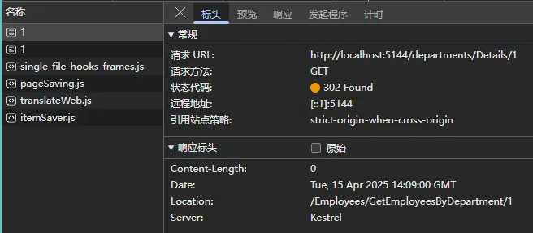

LocalRedirectResult

```C#
// 处理部门详情的GET请求
// 参数：
//   id - 可选的部门ID（可为null）
// 返回：本地重定向到员工控制器下的GetEmployeesByDepartment方法
public IActionResult Details(int? id)
{
    // 使用LocalRedirectResult进行本地重定向
    // 重定向路径格式：/employees/GetEmployeesByDepartment/{id}
    // 会将当前部门ID作为参数传递给目标Action
    return new LocalRedirectResult($"/employees/GetEmployeesByDepartment/{id}");
}

// 处理部门详情的GET请求
// 参数：
//   id - 可选的部门ID（可为null）
// 返回：本地重定向到员工控制器下的GetEmployeesByDepartment方法
public IActionResult Details(int? id)
{
    // 使用LocalRedirectResult进行本地重定向
    // 重定向路径格式：/employees/GetEmployeesByDepartment/{id}
    // 会将当前部门ID作为参数传递给目标Action
    return new LocalRedirect($"/employees/GetEmployeesByDepartment/{id}");
}
```

RedirectResult

```C#
// 处理部门详情的GET请求
// 参数：
//   id - 可选的部门ID参数（可为null）
// 返回：重定向到百度首页的外部链接
public IActionResult Details(int? id)
{
    // 使用RedirectResult进行外部重定向
    // 重定向目标：百度首页(https://www.baidu.com)
    return new RedirectResult("https://www.baidu.com");
}

// 处理部门详情的GET请求
// 参数：
//   id - 可选的部门ID参数（可为null）
// 返回：重定向到百度首页的外部链接
public IActionResult Details(int? id)
{
    // 使用RedirectResult进行外部重定向
    // 重定向目标：百度首页(https://www.baidu.com)
    return new Redirect("https://www.baidu.com");
}
```

# 9、重构学习代码

## 1.Department

```C#
// 引入必要的命名空间
using Microsoft.AspNetCore.Mvc;  // 提供MVC相关功能
using System.ComponentModel.DataAnnotations;  // 提供数据验证特性

namespace WebApp.Models
{
    // 部门实体类
    public class Department
    {
        // 默认无参构造函数
        public Department()
        {
            // 初始化逻辑可以放在这里
        }

        // 带参数的构造函数
        // 参数：
        //   id - 部门ID
        //   name - 部门名称
        //   description - 部门描述（可选参数，默认为空字符串）
        public Department(int id, string name, string? description = "")
        {
            this.Id = id;
            this.Name = name;
            this.Description = description;
        }

        // 部门ID属性
        public int Id { get; set; }

        // 部门名称属性
        // 使用[Required]特性表示该字段为必填项
        [Required]
        public string? Name { get; set; }

        // 部门描述属性
        // 使用[StringLength]特性限制最大长度为500个字符
        [StringLength(500)]
        public string? Description { get; set; }
    }
}
```

## 2.DepartmentsRepository

```C#
using System.Xml.Linq;

namespace WebApp.Models
{
    // 部门数据仓库类，提供部门数据的静态存储和CRUD操作
    public static class DepartmentsRepository
    {
        // 初始化部门数据列表
        private static List<Department> Departments = new List<Department>
        {
            new Department(1, "Sales", "销售部门"),
            new Department(2, "Engineering", "工程部门"),
            new Department(3, "QA", "质量保证部门")
        };

        // 获取所有部门列表
        public static List<Department> GetDepartments() => Departments;

        // 根据ID获取单个部门
        // 参数：id - 部门ID
        // 返回值：匹配的部门对象，未找到返回null
        public static Department? GetDepartmentById(int id)
        {
            return Departments.FirstOrDefault(x => x.Id == id);
        }

        // 添加新部门
        // 参数：Department - 要添加的部门对象
        public static void AddDepartment(Department? Department)
        {
            if (Department is not null)
            {
                // 自动生成新ID（当前最大ID+1）
                int maxId = Departments.Max(x => x.Id);
                Department.Id = maxId + 1;
                Departments.Add(Department);
            }
        }

        // 更新部门信息
        // 参数：Department - 包含更新数据的部门对象
        // 返回值：更新成功返回true，失败返回false
        public static bool UpdateDepartment(Department? Department)
        {
            if (Department is not null)
            {
                // 查找要更新的部门
                var emp = Departments.FirstOrDefault(x => x.Id == Department.Id);
                if (emp is not null)
                {
                    // 更新部门信息
                    emp.Name = Department.Name;
                    emp.Description = Department.Description;

                    return true;
                }
            }

            return false;
        }

        // 删除部门
        // 参数：Department - 要删除的部门对象
        // 返回值：删除成功返回true，失败返回false
        public static bool DeleteDepartment(Department? Department)
        {
            if (Department is not null)
            {
                Departments.Remove(Department);
                return true;
            }

            return false;
        }
    }
}
```

## 3.DepartmentsController

```C#
using Microsoft.AspNetCore.Mvc;
using WebApp.Models;
using static System.Net.Mime.MediaTypeNames;

namespace WebApp.Controllers
{
    // 部门控制器，处理部门相关的HTTP请求
    public class DepartmentsController : Controller
    {
        // GET请求：显示所有部门列表
        [HttpGet]
        public IActionResult Index()
        {
            // 获取所有部门数据
            var departments = DepartmentsRepository.GetDepartments();

            // 生成HTML列表页面
            var html = $@"
                    <h1>部门列表</h1>
                    <ul>
                        {string.Join("", departments.Select(x => $@"
                                    <li>
                                        <a href='/departments/details/{x.Id}'>{x.Name} ({x.Description})</a>
                                    </li>
                                "))}
                    </ul>
                    <br/>
                    <a href='/departments/create'>添加部门</a>
                ";

            return Content(html, "text/html");
        }

        // GET请求：显示部门详情
        [HttpGet]
        public IActionResult Details(int id)
        {
            // 根据ID获取部门
            var department = DepartmentsRepository.GetDepartmentById(id);
            if (department == null)
            {
                return Content("<h3 style='color: red'>部门未找到</h3>");
            }

            // 生成部门详情编辑表单
            var html = $@"
                <h1>部门详情</h1>
                <form method='post' action='/departments/edit'>
                    <input type='hidden' name='Id' value='{department.Id}' />
                    <label>名称: <input type='text' name='Name' value='{department.Name}' /></label><br />
                    <label>描述: <input type='text' name='Description' value='{department.Description}' /></label><br />
                    <br/>
                    <a href='/departments'>取消</a>
                    <button type='submit'>更新</button>
                </form>

                <form method='post' action='/departments/delete/{department.Id}'>
                    <button type='submit' style='background-color:red;color:white'>删除</button>
                </form>";

            return Content(html, "text/html");
        }

        // POST请求：更新部门信息
        [HttpPost]
        public IActionResult Edit(Department department)
        {
            // 验证模型状态
            if (!ModelState.IsValid)
            {
                return Content(GetErrorsHTML(), "text/html");
            }

            // 更新部门信息
            DepartmentsRepository.UpdateDepartment(department);

            // 重定向到部门列表
            return RedirectToAction(nameof(Index));
        }

        // GET请求：显示添加部门表单
        [HttpGet]
        public IActionResult Create()
        {
            // 生成添加部门表单
            var html = @"
                <h1>添加部门</h1>
                <form method='post' action='/departments/create'>
                    <label>名称: <input type='text' name='Name' /></label><br />
                    <label>描述: <input type='text' name='Description' /></label><br />
                    <br/>
                    <button type='submit'>添加</button>
                </form>";

            return Content(html, "text/html");
        }

        // POST请求：创建新部门
        [HttpPost]
        public IActionResult Create(Department department)
        {
            // 验证模型状态
            if (!ModelState.IsValid)
            {
                return Content(GetErrorsHTML(), "text/html");
            }

            // 添加新部门
            DepartmentsRepository.AddDepartment(department);

            // 重定向到部门列表
            return RedirectToAction(nameof(Index));
        }

        // POST请求：删除部门
        [HttpPost]
        public IActionResult Delete(int id)
        {
            // 获取要删除的部门
            var department = DepartmentsRepository.GetDepartmentById(id);
            if (department == null)
            {
                ModelState.AddModelError("id", "部门未找到");
                return Content(GetErrorsHTML(), "text/html");
            }

            // 删除部门
            DepartmentsRepository.DeleteDepartment(department);

            // 重定向到部门列表
            return RedirectToAction(nameof(Index));
        }

        // 获取模型验证错误信息并生成HTML
        private string GetErrorsHTML()
        {
            List<string> errorMessages = new List<string>();
            foreach (var value in ModelState.Values)
            {
                foreach (var error in value.Errors)
                {
                    errorMessages.Add(error.ErrorMessage);
                }
            }

            string html = string.Empty;
            if (errorMessages.Count > 0)
            {
                html = $@"
                    <ul>
                        {string.Join("", errorMessages.Select(error => $"<li style='color:red;'>{error}</li>"))}
                    </ul>";
            }

            return html;
        }
    }
}
```

## 4.Program

```C#
// 创建Web应用构建器，用于配置和构建Web应用
var builder = WebApplication.CreateBuilder(args);

// 向依赖注入容器添加MVC控制器服务
builder.Services.AddControllers();

// 构建Web应用实例
var app = builder.Build();

// 启用路由中间件
app.UseRouting();

// 配置终结点路由
app.UseEndpoints(endpoints =>
{
    // 映射默认控制器路由
    // 路由模式为: {控制器=Home}/{动作=Index}/{可选参数id}
    endpoints.MapControllerRoute(
        name: "default",  // 路由名称
        pattern: "{controller=Home}/{action=Index}/{id?}"  // 路由模板
    );
});

// 启动应用程序
app.Run();

```

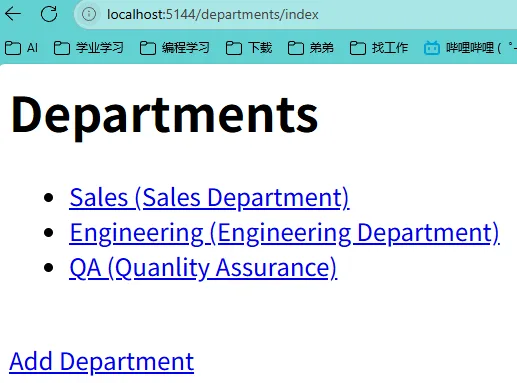
