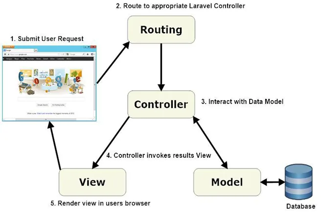
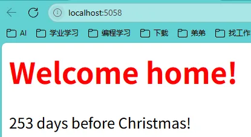
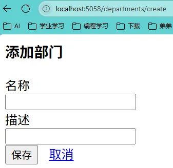
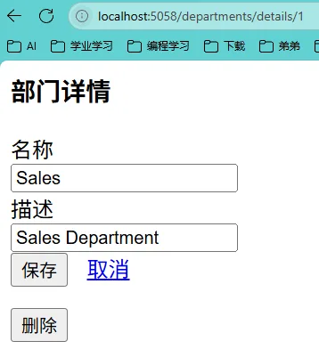
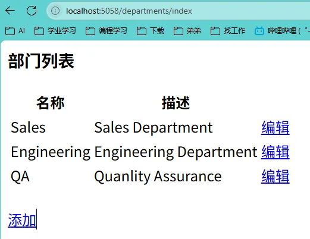

# 1、MVC Pattern

ASP.NET中的MVC（Model-View-Controller）模式是一种软件架构设计模式，它将应用程序分为三个核心组件：**模型（Model）、视图（View）和控制器（Controller）**，以实现关注点分离，提升代码可维护性和可扩展性。



以下是其具体内涵及在ASP.NET中的应用特点：

### 1. **MVC的核心组件**

- **模型（Model）**
  负责处理应用程序的数据逻辑和业务规则。模型直接与数据库交互，执行数据的存取、验证及业务逻辑处理，例如定义商品信息的属性及操作（如增删改查）。在ASP.NET中，模型可以是简单的数据传输对象（DTO），也可以是包含复杂业务逻辑的领域模型。

- **视图（View）**
  负责用户界面的展示。视图通过HTML、CSS和JavaScript动态渲染模型传递的数据，例如生成商品列表页面或订单详情页面。ASP.NET支持Razor视图引擎，允许在视图中嵌入C#代码，实现灵活的数据绑定。

- **控制器（Controller）**
  作为用户请求的中转站，接收输入（如HTTP请求），调用模型处理数据，并选择合适的视图返回响应。例如，用户点击“购买”按钮时，控制器会调用业务逻辑验证库存，再跳转到支付页面或错误提示。

### 2. **MVC在ASP.NET中的优势**

- **关注点分离**
  业务逻辑（Model）、界面（View）和流程控制（Controller）的解耦使代码更清晰，便于团队协作开发。例如，前端开发者可独立设计视图，后端开发者专注模型和控制器。

- **增强可测试性**
  各组件独立设计，支持单元测试和测试驱动开发（TDD）。例如，控制器可通过Mock模型进行测试，无需启动完整Web服务。

- **灵活的URL路由**
  ASP.NET MVC提供强大的路由系统，允许自定义URL规则（如`/products/details/123`映射到控制器动作），提升SEO友好性。

- **无ViewState与服务器控件**
  相比传统Web Forms，MVC不依赖ViewState和服务器控件，开发者可更精细地控制HTML和HTTP请求行为，减少页面性能开销。

### 3. **与传统ASP.NET Web Forms的对比**

- **Web Forms**
  采用事件驱动模型和服务器控件，适合快速开发小型应用，但代码耦合度高，测试困难。

- **MVC**
  更适合复杂、需要长期维护的大型项目，支持现代开发实践（如依赖注入、跨平台部署）。例如，ASP.NET Core MVC可运行于Linux环境，通过中间件配置简化请求处理流程。

### 4. **实际应用场景**

- **企业级系统**
  如电商平台，模型处理订单逻辑，视图展示商品信息，控制器协调用户操作与库存管理。

- **API开发**
  MVC模式天然支持RESTful API设计，通过`ActionResult<T>`返回JSON或XML数据。

### 总结

ASP.NET MVC通过分层架构优化了Web应用的结构，尤其适用于需要高可维护性、可测试性和灵活性的项目。其核心思想是通过分离职责，让开发者能够专注于不同层面的逻辑实现，从而提升开发效率和代码质量。

# 2、Razor

ASP.NET中的**Razor**是一种基于C#或VB.NET的服务器端标记语法，用于在HTML中嵌入动态代码以生成Web页面内容。它最初随ASP.NET MVC 3发布，现已成为ASP.NET Core的核心组件之一，广泛应用于MVC和Razor Pages等开发模式中。以下是其核心特性及功能：

------

### 1. **Razor的核心设计理念**

- **代码与HTML无缝融合**
  Razor通过`@`符号将C#代码嵌入HTML，无需传统ASP.NET Web Forms的`<% %>`标签，简化了代码与标记的切换。例如：

  ```html
  <p>当前时间：@DateTime.Now.ToString("yyyy-MM-dd")</p>
  ```

  代码块通过`@{}`包裹，支持多行逻辑。

- **智能语法解析**
  Razor能自动识别代码与HTML的边界。例如，在条件语句中可直接混用HTML标签：

  ```html
  @if (isAdmin) {
      <button>管理员操作</button>
  }
  ```

------

### 2. **Razor语法的主要特性**

- **表达式与编码**

  - 隐式表达式：直接使用`@变量名`输出内容（如`@Model.Title`），自动对HTML敏感字符编码以防止XSS攻击。

  - 显式表达式：通过`@()`包裹复杂表达式（如`@(a + b)`）或泛型方法调用（如`@(GenericMethod<int>(10))`）。

- **控制结构**
  支持完整的C#流程控制，包括条件语句（`@if`、`@switch`）和循环（`@for`、`@foreach`），例如动态生成列表：

  ```html
  <ul>
      @foreach (var item in items) {
          <li>@item.Name</li>
      }
  </ul>
  ```

- **模板化与复用**

  - 布局页（Layout）：通过`@{ Layout = "_Layout.cshtml"; }`定义公共页面结构，实现UI复用。

  - 分部视图（Partial View）：使用`@await Html.PartialAsync("_PartialView.cshtml")`嵌入可重用的UI片段。


------

### 3. **Razor在ASP.NET技术栈中的应用**

- **与ASP.NET Core MVC集成**
  Razor是MVC视图引擎的标准选择，通过控制器（Controller）传递模型（Model）数据到视图（View），动态渲染页面 。例如，使用`@Html.ActionLink`生成超链接，关联控制器动作。

- **Razor Pages模型**
  在ASP.NET Core中，Razor Pages将页面逻辑与UI绑定，每个`.cshtml`文件可包含`@page`指令和直接处理HTTP请求的代码块，简化小型应用的开发。

- **跨平台支持**
  Razor与ASP.NET Core深度集成，可在Windows、Linux和macOS上运行，并支持Docker容器化部署。

------

### 4. **Razor的优势与适用场景**

- 开发效率高：通过智能提示和简洁语法减少代码量，支持Visual Studio的强类型检查和调试。

- 安全性强：自动编码输出内容，减少XSS风险。

- 灵活性：可与JavaScript框架（如React）结合，或通过`Html.Raw()`输出原始HTML。

- 适用场景：适用于动态内容渲染（如电商产品列表）、表单处理、以及需要服务器端逻辑的复杂UI生成。


------

### 总结

Razor通过其简洁的语法、强大的模板功能和与ASP.NET生态的深度集成，成为构建动态Web应用的高效工具。无论是传统的MVC项目还是现代化的Razor Pages，它都能提供灵活且安全的服务器端渲染方案。

# 3、主页面实现

DepartsCRUD\WebApp\Controllers\HomeController.cs

```html
@using WebApp.Models @* 引入应用程序模型命名空间 *@

@* 声明Razor代码块开始 *@
@{
    // 计算当前日期到今年圣诞节的天数差
    var days = new DateTime(DateTime.Today.Year, 12, 25) - DateTime.Today;

    // 处理跨年情况：如果今年圣诞已过，计算到明年圣诞的天数
    if (DateTime.Today > new DateTime(DateTime.Today.Year, 12, 25))
    {
        days = new DateTime(DateTime.Today.Year + 1, 12, 25) - DateTime.Today;
    }

    // 根据天数奇偶性设置文字颜色（交替显示红绿）
    string color = days.Days % 2 == 0 ? "green" : "red";
}

<html>
<head>
    <title>Home page</title>
</head>
<body>

    @* 条件渲染：当剩余天数≤35天时显示节日提示 *@
    @if (days.Days <= 35)
    {
        @* 直接输出HTML元素 *@
        <h1>Christmas is around the corner!</h1>
        @* 使用@:输出纯文本内容 *@
        @:Happy holidays!
    }
    else
    {
        @* 根据颜色变量切换标题样式 *@
        switch (color)
        {
            case "green":
                <h1 style="color:green">Welcome home!</h1>
                break;
            case "red":
                <h1 style="color:red">Welcome home!</h1>
                break;
        }

        @* 混合输出：C#表达式 + 纯文本内容 *@
        @days.Days
        <text> days before Christmas!</text>
    }

</body>
</html>
```

DepartsCRUD\WebApp\Views\Home\Index.cshtml

```C#
// 引入MVC核心命名空间
using Microsoft.AspNetCore.Mvc;

namespace WebApp.Controllers // 控制器所在的命名空间
{
    public class HomeController : Controller // 继承Controller基类
    {
        // 处理根路径请求的Action方法
        public IActionResult Index()
        {
            // 显式指定返回名为"Index"的视图
            return new ViewResult { ViewName = "Index" };

            // 等效写法（被注释的默认返回方式）：
            // 根据约定自动查找Views/Home/Index.cshtml视图
            //return View();
        }
    }
}
```

DepartsCRUD\WebApp\Program.cs

```C#
// 创建一个Web应用程序构建器实例
var builder = WebApplication.CreateBuilder(args);

// 向构建器添加控制器和视图的支持
builder.Services.AddControllersWithViews();

// 构建应用程序
var app = builder.Build();

// 使用路由中间件
app.UseRouting();

// 配置路由端点
app.UseEndpoints(endpoints =>
{
    // 定义默认路由模式，将请求映射到控制器和操作方法
    endpoints.MapControllerRoute(
        name: "default", // 路由名称
        pattern: "{controller=Home}/{action=Index}/{id?}" // 路由模式，{controller}默认值为Home，{action}默认值为Index，{id}为可选参数
    );
});

// 运行应用程序
app.Run();
```



# 4、Department相关实现

## 1.Department

DepartsCRUD\WebApp\Model\Department.cs

```C#
// 引入MVC核心命名空间和数据注解命名空间
using Microsoft.AspNetCore.Mvc;
using System.ComponentModel.DataAnnotations;

namespace WebApp.Models
{
    public class Department
    {
        // 默认构造函数（实体框架ORM需要空构造）
        public Department()
        {

        }

        // 全参构造函数用于快速初始化对象
        public Department(int id, string name, string? description = "")
        {
            this.Id = id;          // 部门唯一标识
            this.Name = name;      // 必填部门名称
            this.Description = description; // 可选描述信息
        }

        // 部门ID（主键）
        public int Id { get; set; }

        [Required] // 数据验证：名称字段必填
        public string? Name { get; set; } // 可为空的字符串类型

        [StringLength(500)] // 数据验证：最大允许500字符
        public string? Description { get; set; } // 可选描述字段
    }
}
```

## 2.DepartmentsRepository

DepartsCRUD\WebApp\Model\DepartmentsRepository.cs

```C#
using System.Xml.Linq;

namespace WebApp.Models
{
    public static class DepartmentsRepository
    {
        // 静态内存数据源（模拟数据库表）
        private static List<Department> Departments = new List<Department>
        {
            new Department(1, "Sales", "Sales Department"),       // 初始化销售部门
            new Department(2, "Engineering", "Engineering Department"), // 技术部门
            new Department(3, "QA", "Quanlity Assurance")         // 质量保障部门
        };

        // 获取全部部门列表（直接返回内存集合）
        public static List<Department> GetDepartments() => Departments;

        // 按ID查询单个部门（可能返回null）
        public static Department? GetDepartmentById(int id)
        {
            return Departments.FirstOrDefault(x => x.Id == id); // LINQ查询匹配ID
        }

        // 添加新部门（自动生成递增ID）
        public static void AddDepartment(Department? department)
        {
            if (department is not null)
            {
                // 计算当前最大ID并+1生成新ID
                int maxId = Departments.Max(x => x.Id);
                department.Id = maxId + 1;
                Departments.Add(department); // 加入内存集合
            }
        }

        // 更新部门信息（基于ID定位）
        public static bool UpdateDepartment(Department? department)
        {
            if (department is not null)
            {
                var emp = Departments.FirstOrDefault(x => x.Id == department.Id);
                if (emp is not null)
                {
                    // 更新可修改字段（保留原始ID）
                    emp.Name = department.Name;
                    emp.Description = department.Description;
                    return true; // 更新成功
                }
            }
            return false; // 更新失败
        }

        // 删除部门记录（物理删除）
        public static bool DeleteDepartment(Department? department)
        {
            if (department is not null)
            {
                Departments.Remove(department); // 从集合移除对象
                return true; // 删除成功
            }
            return false; // 删除失败
        }
    }
}
```

## 3.DepartmentsController

DepartsCRUD\WebApp\Controllers\DepartmentsController.cs

```C#
// 引入MVC核心组件和模型命名空间
using Microsoft.AspNetCore.Mvc;
using WebApp.Models;

namespace WebApp.Controllers
{
    public class DepartmentsController : Controller
    {
        [HttpGet] // 处理GET请求：显示部门列表
        public IActionResult Index()
        {
            var departments = DepartmentsRepository.GetDepartments(); // 从仓储获取全部数据
            return View(departments); // 将数据模型传递给列表视图
        }

        [HttpGet] // 处理GET请求：显示单个部门详情
        public IActionResult Details(int id)
        {
            var department = DepartmentsRepository.GetDepartmentById(id);
            if (department == null) // 处理数据不存在的情况
            {
                return View("Error", new List<string>() { "Department not found." });
            }
            return View(department); // 传递部门对象到详情视图
        }

        [HttpPost] // 处理POST请求：更新部门信息
        public IActionResult Edit(Department department)
        {
            if (!ModelState.IsValid) // 验证模型数据有效性
            {
                return View("Error", GetErrors());
            }

            DepartmentsRepository.UpdateDepartment(department); // 调用仓储更新方法
            return RedirectToAction(nameof(Index)); // 返回列表页
        }

        [HttpGet] // 处理GET请求：显示新建表单
        public IActionResult Create()
        {
            return View(new Department()); // 初始化空对象给表单视图
        }

        [HttpPost] // 处理POST请求：提交新建数据
        public IActionResult Create(Department department)
        {
            if (!ModelState.IsValid) // 验证数据有效性
            {
                return View("Error", GetErrors());
            }

            DepartmentsRepository.AddDepartment(department); // 调用仓储新增方法
            return RedirectToAction(nameof(Index)); // 返回列表页
        }

        [HttpPost] // 处理POST请求：删除指定部门
        public IActionResult Delete(int id)
        {
            var department = DepartmentsRepository.GetDepartmentById(id);
            if (department == null) // 处理目标数据不存在的情况
            {
                ModelState.AddModelError("id", "Department not found.");
                return View("Error", GetErrors());
            }

            DepartmentsRepository.DeleteDepartment(department); // 执行删除操作
            return RedirectToAction(nameof(Index)); // 返回列表页
        }

        // 辅助方法：从ModelState中提取验证错误信息
        private List<string> GetErrors()
        {
            return ModelState.Values
                .SelectMany(v => v.Errors)
                .Select(e => e.ErrorMessage)
                .ToList();
        }
    }
}
```

## 4.Create

DepartsCRUD\WebApp\Views\Departments\Create.cshtml

```html
@using WebApp.Models  @* 引入应用程序模型命名空间 *@
@model Department     @* 声明视图使用的模型类型为Department *@

<html>
<head>
    @* 引入Bootstrap CSS样式表 *@
    <link href="https://cdn.jsdelivr.net/npm/bootstrap@5.3.3/dist/css/bootstrap.min.css" rel="stylesheet" integrity="sha384-QWTKZyjpPEjISv5WaRU9OFeRpok6YctnYmDr5pNlyT2bRjXh0JMhjY6hW+ALEwIH" crossorigin="anonymous">
</head>
<body>
    <div class="container"> @* Bootstrap容器布局 *@
    <h3>添加部门</h3> @* 页面标题 *@
    
    @* 表单定义：提交到/departments/create路径 *@
    <form method='post' action='/departments/create'>
        
        @* 部门名称输入行 *@
        <div class="row mb-3"> @* Bootstrap行布局 *@
            <div class="col-2"> @* 左侧标签列 *@
                <label class="col-form-label">名称</label>
            </div>
            <div class="col-6"> @* 右侧输入框列 *@
                @* 绑定模型Name属性 *@
                <input type='text' name='Name' value='@Model.Name' class="form-control" />
            </div>
        </div>

        @* 部门描述输入行 *@
        <div class="row mb-3">
            <div class="col-2">
                <label class="col-form-label">描述</label>
            </div>
            <div class="col-6">
                @* 绑定模型Description属性 *@
                <input type='text' name='Description' value='@Model.Description' class="form-control" />
            </div>
        </div>

        @* 按钮操作行 *@
        <div class="row mb-3">
            <div class="col-2">
                @* 提交按钮 *@
                <button type='submit' class="btn btn-primary">保存</button>
                    &nbsp;&nbsp; @* 按钮间距 *@
                @* 取消按钮(返回部门列表) *@
                <a href="/departments" class="btn btn-primary">取消</a>
            </div>            
            <div class="col-4">
                @* 预留空白列 *@
            </div>
        </div>
    </form>

    </div>
</body>
</html>
```



## 5.Details

DepartsCRUD\WebApp\Views\Departments\Details.cshtml

```html
@using WebApp.Models  @* 引入应用程序模型命名空间 *@
@model Department     @* 声明视图使用的模型类型为Department *@

<html>
<head>
    @* 引入Bootstrap CSS样式表 *@
    <link href="https://cdn.jsdelivr.net/npm/bootstrap@5.3.3/dist/css/bootstrap.min.css" rel="stylesheet" integrity="sha384-QWTKZyjpPEjISv5WaRU9OFeRpok6YctnYmDr5pNlyT2bRjXh0JMhjY6hW+ALEwIH" crossorigin="anonymous">
</head>
<body>
    <div class="container"> @* Bootstrap容器布局 *@
    <h3>部门详情</h3> @* 页面标题 *@
    
    @* 编辑表单：提交到/departments/edit路径 *@
    <form method='post' action='/departments/edit'>
        @* 隐藏字段：部门ID *@
        <input type='hidden' name='Id' value='@Model.Id' />

        @* 部门名称输入行 *@
        <div class="row mb-3"> @* Bootstrap行布局 *@
            <div class="col-2"> @* 左侧标签列 *@
                <label class="col-form-label">名称</label>
            </div>
            <div class="col-6"> @* 右侧输入框列 *@
                @* 绑定模型Name属性 *@
                <input type='text' name='Name' value='@Model.Name' class="form-control" />
            </div>
        </div>

        @* 部门描述输入行 *@
        <div class="row mb-3">
            <div class="col-2">
                <label class="col-form-label">描述</label>
            </div>
            <div class="col-6">
                @* 绑定模型Description属性 *@
                <input type='text' name='Description' value='@Model.Description' class="form-control" />
            </div>
        </div>

        @* 按钮操作行 *@
        <div class="row mb-3">
            <div class="col-2">
                @* 提交按钮 *@
                <button type='submit' class="btn btn-primary">保存</button>
                    &nbsp;&nbsp; @* 按钮间距 *@
                @* 取消按钮(返回部门列表) *@
                <a href="/departments" class="btn btn-primary">取消</a>
            </div>            
            <div class="col-4">
                @* 预留空白列 *@
            </div>
        </div>
    </form>

    @* 删除表单：提交到/departments/delete/{id}路径 *@
    <form method='post' action='/departments/delete/@Model.Id'>
        @* 删除按钮(红色危险样式) *@
        <button type='submit' class="btn btn-danger">删除</button>
    </form>

    </div>
</body>
</html>
```



## 6.Error

DepartsCRUD\WebApp\Views\Departments\Error.cshtml

```html
@model List<string>  @* 声明视图模型为字符串列表，用于显示错误信息集合 *@

<html>
    <head>
        <title>Error</title>  @* 页面标题设置为"Error" *@
    </head>
    <body>
        @* 红色错误标题 *@
        <h1 style="color:red">Errors:</h1>  
        
        @* 错误信息列表容器 *@
        <ul>
            @* 检查模型数据是否存在且非空 *@
            @if (Model is not null && Model.Count > 0)
            {
                @* 遍历所有错误信息并显示为列表项 *@
                foreach (var errorMessage in Model)
                {
                    <li>@errorMessage</li>  @* 显示单条错误信息 *@
                }
            }             
        </ul>        
    </body>
</html>
```

## 7.Index

DepartsCRUD\WebApp\Views\Departments\Index.cshtml

```C#
@using WebApp.Models 
@* 声明视图模型为Department列表 *@
@model List<Department> 

<html>
    <head>
        @* 引入Bootstrap CSS样式表 *@
        <link href="https://cdn.jsdelivr.net/npm/bootstrap@5.3.3/dist/css/bootstrap.min.css" rel="stylesheet" integrity="sha384-QWTKZyjpPEjISv5WaRU9OFeRpok6YctnYmDr5pNlyT2bRjXh0JMhjY6hW+ALEwIH" crossorigin="anonymous">    
    </head>
    <body>
        <div class="container"> @* Bootstrap容器布局 *@
        
            <h3>部门列表</h3> @* 页面标题 *@
        
                @* 检查部门数据是否存在且非空 *@
                @if (Model is not null && Model.Count > 0)
                {
                    <table class="table table-striped"> @* 条纹表格样式 *@
                        <thread> @* 表头部分 *@
                            <tr>
                                <th>名称</th> @* 部门名称列标题 *@
                                <th>描述</th> @* 部门描述列标题 *@
                                <th></th> @* 操作列标题 *@
                            </tr>
                        </thread>
                        <tbody> @* 表格内容部分 *@
                            @* 遍历所有部门数据 *@
                            @foreach(var department in Model)
                            {
                                <tr>
                                    <td>@department.Name</td> @* 显示部门名称 *@
                                    <td>@department.Description</td> @* 显示部门描述 *@
                                    <td>
                                        @* 编辑按钮，链接到部门详情页 *@
                                        <a class="btn btn-link" href="/departments/details/@department.Id">编辑</a>
                                    </td>
                                </tr>
                            }
                        </tbody>
                    </table>
                }             
        
            <br/>
            @* 添加部门按钮 *@
            <a class="btn btn-primary" href='/departments/create'>添加</a>

        </div>
    </body>
</html>
```



# 5、依赖注入方式

在 ASP.NET Core 中，依赖注入的实现方式主要分为以下两类，涵盖服务注册与具体注入技术：

------

### 一、**服务注册的实现方式**

1. **内置依赖注入容器**
   ASP.NET Core 自带的轻量级容器是默认方案，通过 `Startup.cs` 或 `Program.cs` 的 `ConfigureServices` 方法注册服务，支持三种生命周期（`AddTransient`、`AddScoped`、`AddSingleton`）。开发者无需额外配置即可完成基本依赖管理。

2. **第三方依赖注入库**
   如 Autofac、Ninject 等，提供更高级功能（如属性注入、模块化注册）。例如，Autofac 支持基于条件的注册和复杂的生命周期管理，需通过替换默认容器实现集成。

3. **自定义依赖注入容器**
   继承 `ServiceProvider` 类并重写方法，适用于需要深度定制容器行为的场景（如特殊实例化逻辑），但开发复杂度较高。

4. **服务定位器模式**
   通过全局 `IServiceProvider` 手动解析服务（如 `GetService<T>()`），虽能解决某些特殊需求，但会导致代码耦合，官方明确不推荐使用。

------

### 二、**依赖注入的应用方式**

1. **构造函数注入**
   
   **​推荐方式​**​：在类的构造函数中声明依赖项，容器自动解析并注入。例如，控制器的构造函数接收服务接口参数，实现高可测试性和松耦合 。
   
   - 特点：
   
     - 显式声明依赖：所有依赖项在对象初始化时即被明确声明，确保类实例的完整性和不可变性。
   
     - 高可测试性：便于单元测试时通过 Mock 对象替换实际依赖。
   
   
   - 应用场景：
   
     - 控制器（Controller）：在 MVC 中，控制器的构造函数中注入服务（如数据库上下文、日志服务）。
   
     - 中间件（Middleware）：中间件类的构造函数中可注入自定义服务。
   
     - 服务层：业务逻辑层的服务类通过构造函数接收其他服务依赖。
   

**示例**：

```csharp
public class WeatherForecastController : ControllerBase
{
    private readonly ILogger<WeatherForecastController> _logger;
    public WeatherForecastController(ILogger<WeatherForecastController> logger)
    {
        _logger = logger; // 依赖注入
    }
}
```

2. **属性注入**
   通过属性标记（如 `[FromServices]`）注入依赖项。ASP.NET Core 原生不支持此方式，需借助第三方库（如 Autofac）或手动在 `Startup` 中赋值。
   
   - 特点：
     - 灵活性：允许依赖项在对象初始化后动态注入，适用于可选依赖或复杂对象图。
     - 耦合风险：属性可被修改，可能破坏对象状态一致性。
   
   - 应用场景：
     - 扩展框架组件：当无法通过构造函数注入时（如某些框架限制或遗留代码改造）。
     - 动态配置：需要运行时根据条件动态切换依赖实现。

**示例（Autofac 实现）**：

```csharp
public class MyService
{
    [Autowired] // Autofac 特性标记
    public ILogger Logger { get; set; }
}
```

3. **方法注入**
   在方法参数中使用 `[FromServices]` 特性动态获取服务实例，适用于临时依赖的场景（如中间件或特定业务逻辑方法）。
   
   - 特点：
     - 按需使用：仅在特定方法中需要依赖时注入，减少类整体耦合。
     - 灵活性：支持在运行时动态解析依赖项。
   
   - 应用场景：
     - 中间件的 `Invoke/InvokeAsync` 方法：处理 HTTP 请求时动态获取服务。
     - Startup 类的 `Configure` 方法：注册中间件时直接注入服务。

**示例**：

```csharp
public void Configure(IApplicationBuilder app, IWebHostEnvironment env, ILoggerFactory loggerFactory)
{
    // 方法参数中注入 env 和 loggerFactory
    if (env.IsDevelopment()) 
    {
        app.UseDeveloperExceptionPage();
    }
}
```

------

### 三、**服务生命周期管理**

注册服务时需指定生命周期，直接影响实例的创建与共享：

- Transient：每次请求创建新实例，适用于无状态服务（如工具类）。


- Scoped：同一请求内共享实例，常见于数据库上下文（如`DbContext`）。


- Singleton：全局单例，适用于配置、缓存等全局共享资源。


------
