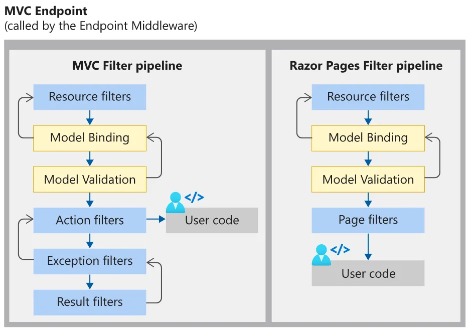
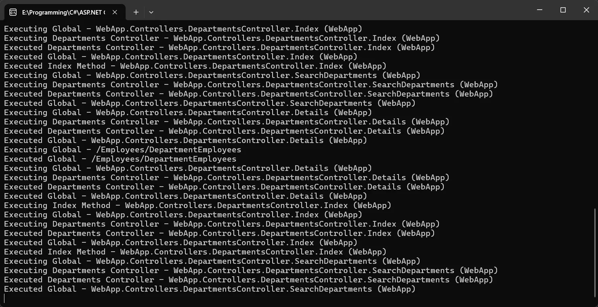

# 一、ASP.NET Core 中的过滤管道

## 1. **什么是过滤管道？**

**过滤管道（Filter Pipeline）**是 ASP.NET Core 请求处理流程中的一个核心机制，由一系列过滤器（Filters）按特定顺序组成。这些过滤器在 MVC 或 Razor Pages 的请求处理管道中，针对不同阶段（如授权、模型绑定、Action 执行等）插入自定义逻辑，实现横切关注点（Cross-Cutting Concerns）的集中处理。

过滤器的类型及执行顺序：

- 授权过滤器（Authorization Filters）：最先执行，用于验证用户权限（如是否登录或具备访问权限）。

- 资源过滤器（Resource Filters）：在授权后执行，常用于缓存或短路管道（如直接返回结果，跳过后续处理）。

- 操作过滤器（Action Filters）：在 Action 执行前后运行，可修改输入参数或结果（如日志记录、参数校验）。

- 异常过滤器（Exception Filters）：捕获未处理的异常，统一处理错误响应。

- 结果过滤器（Result Filters）：在 Action 结果生成后执行，用于修改响应内容（如格式化输出）。


## 2. **为什么需要过滤管道？**

过滤管道解决了以下核心问题：

1. **横切关注点的解耦**
   将通用逻辑（如授权、日志、异常处理）从业务代码中分离，避免重复代码。例如：

   - 全局异常处理可通过异常过滤器统一捕获并返回友好错误页面。

   - 权限检查通过授权过滤器集中实现，无需在每个 Action 中编写验证逻辑。

2. **灵活性和可扩展性**
   - 作用域灵活：过滤器可全局应用，也可针对特定控制器或 Action 生效。
   
   - 执行顺序可控：通过作用域（全局→控制器→Action）或`IOrderedFilter` 接口调整执行顺序。
   
3. **管道短路与性能优化**
   过滤器可通过设置 `context.Result` 提前终止请求处理，减少不必要的资源消耗。例如：
   - 资源过滤器可缓存高频请求的结果，直接返回缓存数据。
   
   - 授权失败时，授权过滤器直接返回 403 状态码，避免后续处理。
   
4. **与中间件互补**
   中间件（Middleware）处理底层 HTTP 请求（如静态文件服务、CORS），而过滤器更贴近业务逻辑（如模型验证、Action 执行）。两者的分工使管道更清晰：

   - 中间件：处理请求级逻辑（如身份认证、日志记录）。

   - 过滤器：处理 MVC 或 Razor Pages 特有的逻辑（如 Action 参数校验）。


## 3. **实际应用场景**

- 权限控制：通过自定义`AuthorizationFilter`实现基于角色的访问限制。

- 日志记录：使用 Action 过滤器记录请求参数和执行时间。

- 缓存优化：资源过滤器缓存高频查询结果，减少数据库压力。

- 统一异常处理：异常过滤器捕获所有未处理错误，返回标准化错误响应。


## 4. **过滤管道与中间件的对比**

|   **特性**   |           **过滤管道**           |             **中间件**             |
| :----------: | :------------------------------: | :--------------------------------: |
| **作用范围** |     MVC/Razor Pages 特定阶段     |         全局 HTTP 请求处理         |
| **常见用途** |  权限校验、模型绑定、结果格式化  |    身份认证、静态文件服务、CORS    |
| **执行顺序** |   按过滤器类型和作用域分层执行   |           按注册顺序执行           |
| **依赖关系** | 依赖于 MVC 或 Razor Pages 上下文 | 独立于业务逻辑，处理原始 HTTP 请求 |

## 总结

ASP.NET Core 的过滤管道通过分层、模块化的设计，将通用逻辑集中处理，显著提升代码的可维护性和扩展性。它允许开发者在请求处理的关键阶段插入自定义逻辑，同时通过短路机制优化性能。结合中间件，两者共同构建了一个高效、灵活的请求处理体系。

# 二、最小API模式Filter

EmployeeCreateFilter.cs

```C#
using WebApi.Models; // 引入数据模型命名空间，用于访问Employee类型

namespace WebApi.Filters
{
    // 员工创建过滤器，实现IEndpointFilter接口
    // 该过滤器用于在创建员工端点执行前验证请求数据的有效性
    public class EmployeeCreateFilter : IEndpointFilter
    {
        // 实现IEndpointFilter接口的InvokeAsync方法
        // 该方法在端点处理程序执行前调用，可以拦截、验证或修改请求
        // context: 包含当前请求上下文，包括请求参数等信息
        // next: 表示过滤器管道中的下一个委托（要么是下一个过滤器，要么是端点处理程序）
        public async ValueTask<object?> InvokeAsync(EndpointFilterInvocationContext context, EndpointFilterDelegate next)
        {
            // 从请求上下文中获取第一个参数(索引0)，并尝试将其转换为Employee类型
            var employee = context.GetArgument<Employee>(0);

            // 验证员工对象是否有效：检查是否为null及ID是否小于0
            if (employee is null || employee.Id < 0)
            {
                // 如果验证失败，立即返回400 Bad Request状态码
                // 并提供结构化的验证问题描述（基于RFC 7807标准）
                return Microsoft.AspNetCore.Http.Results.ValidationProblem(new Dictionary<string, string[]>
                    {
                        {"id", new[] { "Employee is not provided or is not valid." } }
                    },
                statusCode: 400);
            }

            // 如果验证通过，调用过滤器管道中的下一个委托
            // 这将请求传递给下一个过滤器或最终的端点处理程序
            return await next(context);
        }
    }
}
```

EmployeeUpdateFilter.cs

```C#
using WebApi.Models; // 引入数据模型命名空间，用于访问Employee类型

namespace WebApi.Filters
{
    // 员工更新过滤器，实现IEndpointFilter接口
    // 该过滤器用于在更新员工端点执行前验证请求数据的一致性
    public class EmployeeUpdateFilter : IEndpointFilter
    {
        // 实现IEndpointFilter接口的InvokeAsync方法
        // 该方法在端点处理程序执行前调用，可以拦截、验证或修改请求
        // context: 包含当前请求上下文，包括请求参数等信息
        // next: 表示过滤器管道中的下一个委托（要么是下一个过滤器，要么是端点处理程序）
        public async ValueTask<object?> InvokeAsync(EndpointFilterInvocationContext context, EndpointFilterDelegate next)
        {
            // 从请求上下文中获取第一个参数(索引0)，即路由中的id值
            var id = context.GetArgument<int>(0);
            
            // 从请求上下文中获取第二个参数(索引1)，即请求体中的Employee对象
            var employee = context.GetArgument<Employee>(1);

            // 验证路由中的id与请求体中Employee对象的Id是否一致
            // 这是一个重要的业务规则，确保API使用的一致性
            if (id != employee.Id)
            {
                // 如果不一致，立即返回400 Bad Request状态码
                // 并提供结构化的验证问题描述（基于RFC 7807标准）
                return Microsoft.AspNetCore.Http.Results.ValidationProblem(new Dictionary<string, string[]>
                    {
                        {"id", new[] { "Employee id is not the same as id." } }
                    },
                statusCode: 400);
            }

            // 如果验证通过，调用过滤器管道中的下一个委托
            // 这将请求传递给下一个过滤器或最终的端点处理程序
            return await next(context);
        }
    }
}
```

EnsureEmployeeExistsFilter.cs

```C#
using WebApi.Models; // 引入数据模型命名空间，用于访问IEmployeesRepository接口

namespace WebApi.Filters
{
    // 确保员工存在的过滤器，实现IEndpointFilter接口
    // 该过滤器用于在处理特定员工的端点执行前验证该员工是否存在
    public class EnsureEmployeeExistsFilter : IEndpointFilter
    {
        // 员工仓储接口的私有字段，用于查询员工信息
        private readonly IEmployeesRepository employeesRepository;

        // 构造函数，通过依赖注入接收员工仓储实例
        // 这种方式使过滤器可以访问数据层而无需直接创建仓储实例
        public EnsureEmployeeExistsFilter(IEmployeesRepository employeesRepository)
        {
            this.employeesRepository = employeesRepository;
        }

        // 实现IEndpointFilter接口的InvokeAsync方法
        // 该方法在端点处理程序执行前调用，可以拦截、验证或修改请求
        // context: 包含当前请求上下文，包括请求参数等信息
        // next: 表示过滤器管道中的下一个委托（要么是下一个过滤器，要么是端点处理程序）
        public async ValueTask<object?> InvokeAsync(EndpointFilterInvocationContext context, EndpointFilterDelegate next)
        {
            // 从请求上下文中获取第一个参数(索引0)，即员工ID
            var id = context.GetArgument<int>(0);

            // 使用仓储检查指定ID的员工是否存在
            if (!this.employeesRepository.EmployeeExists(id))
            {
                // 如果员工不存在，立即返回404 Not Found状态码
                // 并提供结构化的验证问题描述（基于RFC 7807标准）
                return Microsoft.AspNetCore.Http.Results.ValidationProblem(new Dictionary<string, string[]>
                    {
                        {"id", new[] { $"Employee with the id {id} doesn't exist." } }
                    },
                    statusCode: 404);
            }

            // 如果员工存在，调用过滤器管道中的下一个委托
            // 这将请求传递给下一个过滤器或最终的端点处理程序
            return await next(context);
        }
    }
}
```

EmployeeEndpoints.cs

```C#
using WebApi.Filters; // 引入过滤器相关的命名空间
using WebApi.Models; // 引入数据模型的命名空间
using WebApi.Results; // 引入自定义结果类型的命名空间
using static System.Net.Mime.MediaTypeNames; // 引入媒体类型常量，用于内容协商

namespace WebApi.Endpoints
{
    // 员工相关端点的静态类，用于组织和封装所有与员工资源相关的API路由
    public static class EmployeeEndpoints
    {
        // 扩展方法，用于将所有员工相关的端点映射到WebApplication实例
        public static void MapEmployeeEndpoints(this WebApplication app)
        {
            // 映射根路径，返回简单的HTML欢迎信息
            // 使用自定义HtmlResult类型来处理HTML响应
            app.MapGet("/", HtmlResult () =>
            {
                string html = "<h2>Welcome to our API</h2> Our API is used to learn ASP.NET CORE.";

                return new HtmlResult(html);
            });

            // 映射GET请求到"/employees"路径，返回所有员工
            app.MapGet("/employees", (IEmployeesRepository employeesRepository) =>
            {
                // 从仓储中获取所有员工
                var employees = employeesRepository.GetEmployees();

                // 返回200 OK状态码和员工列表
                return TypedResults.Ok(employees);
            });

            // 映射GET请求到"/employees/{id}"路径，返回指定ID的员工
            // 路由参数约束":int"确保ID是整数类型
            app.MapGet("/employees/{id:int}", (int id, IEmployeesRepository employeesRepository) =>
            {
                // 从仓储中获取特定ID的员工
                var employee = employeesRepository.GetEmployeeById(id);
                // 返回200 OK状态码和员工信息
                return TypedResults.Ok(employee);
            }).AddEndpointFilter<EnsureEmployeeExistsFilter>(); // 添加员工存在性检查过滤器

            // 映射POST请求到"/employees"路径，用于创建新员工
            app.MapPost("/employees", (Employee employee, IEmployeesRepository employeesRepository) =>
            {
                // 添加员工到仓储
                employeesRepository.AddEmployee(employee);
                // 返回201 Created状态码，包含新创建资源的位置和资源本身
                return TypedResults.Created($"/employees/{employee.Id}", employee);

            }).AddEndpointFilter<EmployeeCreateFilter>() // 添加员工创建验证过滤器
              .WithParameterValidation(); // 启用参数验证，自动验证模型状态

            // 映射PUT请求到"/employees/{id}"路径，用于更新指定ID的员工
            app.MapPut("/employees/{id:int}", (int id, Employee employee, IEmployeesRepository employeesRepository) =>
            {
                // 尝试更新员工信息并返回更新结果
                return employeesRepository.UpdateEmployee(employee);
            }).AddEndpointFilter<EnsureEmployeeExistsFilter>() // 添加员工存在性检查过滤器
              .AddEndpointFilter<EmployeeUpdateFilter>() // 添加员工更新验证过滤器（检查ID一致性）
              .WithParameterValidation(); // 启用参数验证，自动验证模型状态

            // 映射DELETE请求到"/employees/{id}"路径，用于删除指定ID的员工
            app.MapDelete("/employees/{id:int}", (int id, IEmployeesRepository employeesRepository) =>
            {
                // 获取要删除的员工信息
                var employee = employeesRepository.GetEmployeeById(id);
                // 返回200 OK状态码和被删除的员工信息
                return TypedResults.Ok(employee);
            }).AddEndpointFilter<EnsureEmployeeExistsFilter>(); // 添加员工存在性检查过滤器
        }
    }
}
```

Program.cs

```C#
using System.Text.Json; // 引入 JSON 序列化/反序列化所需的命名空间
using WebApi.Endpoints; // 引入自定义端点配置的命名空间  
using WebApi.Models; // 引入数据模型的命名空间
using WebApi.Results; // 引入结果处理相关的命名空间

// 创建 ASP.NET Core 应用程序构建器实例
var builder = WebApplication.CreateBuilder(args);

// 添加 ProblemDetails 服务，用于标准化错误响应
// 这符合 RFC 7807 规范，提供结构化的错误信息
builder.Services.AddProblemDetails();

// 注册员工仓储服务，使用单例模式
// IEmployeesRepository 被注入为 EmployeesRepository 的实现
builder.Services.AddSingleton<IEmployeesRepository, EmployeesRepository>();

// 构建应用程序实例
var app = builder.Build();

// 在非开发环境中启用异常处理中间件
// 这会捕获未处理的异常并返回友好的错误页面，而不是详细的异常信息
if (!app.Environment.IsDevelopment())
{
    app.UseExceptionHandler();
}

// 启用状态码页面中间件
// 当请求返回特定状态码时提供更友好的响应
app.UseStatusCodePages();

// 配置员工相关的 API 端点
// 该方法在 WebApi.Endpoints 命名空间中定义
app.MapEmployeeEndpoints();

// 启动应用程序，开始监听请求
app.Run();
```

# 三、MVC模式Filter

ASP.NET Core MVC 的过滤器（Filter）是一种基于 **AOP（面向切面编程）** 的机制，允许开发者在请求处理管道的不同阶段插入自定义逻辑。以下是对五种过滤器的详细说明，涵盖其作用、执行顺序、实现方式及典型应用场景：



------

## 1.**Authorization Filter（授权过滤器）**

**核心作用**：
验证用户权限，确保请求合法且用户具备访问资源或操作的资格。
​**​执行顺序​**​：
在所有过滤器中 ​**​最先执行​**​，若未通过验证，直接短路后续管道。

实现方式：

1. **内置特性**：
   使用 `[Authorize]` 特性，支持全局、控制器或 Action 级别的权限控制：

   ```csharp
   [Authorize(Roles = "Admin")]  // 仅允许管理员访问
   public class AdminController : Controller { ... }
   ```

2. **自定义实现**：
   继承 `IAuthorizationFilter` 或 `IAsyncAuthorizationFilter` 接口，编写逻辑：

   ```csharp
   public class CustomAuthFilter : IAuthorizationFilter {
       public void OnAuthorization(AuthorizationFilterContext context) {
           if (!IsUserAdmin(context.HttpContext.User)) {
               context.Result = new ForbidResult();  // 返回 403
           }
       }
   }
   ```

**典型场景**：

- 角色/策略验证（如仅允许登录用户访问）

- 非 HTTPS 请求拦截（如`[RequireHttps]`）


------

## 2.**Resource Filter（资源过滤器）**

**核心作用**：
在 ​**​模型绑定前​**​ 或 ​**​结果生成后​**​ 执行逻辑，常用于性能优化或管道短路。
​**​执行顺序​**​：
紧随授权过滤器之后，分为 `OnResourceExecuting`（执行前）和 `OnResourceExecuted`（执行后）。

实现方式：

1. **同步接口**：`IResourceFilter`

   ```csharp
   public class CacheResourceFilter : IResourceFilter {
       public void OnResourceExecuting(ResourceExecutingContext context) {
           // 检查缓存是否存在，若存在直接返回结果
       }
       public void OnResourceExecuted(ResourceExecutedContext context) {
           // 将结果存入缓存
       }
   }
   ```
   
2. **异步接口**：`IAsyncResourceFilter`

   ```csharp
   public class AsyncResourceFilter : IAsyncResourceFilter {
       public async Task OnResourceExecutionAsync(...) {
           // 异步缓存逻辑
       }
   }
   ```

**典型场景**：

- 请求结果缓存（减少数据库查询）

- 请求预处理（如压缩响应数据）


------

## 3.**Action Filter（动作过滤器）**

**核心作用**：
在 ​**​Action 方法执行前后​**​ 插入逻辑，适用于与业务逻辑密切相关的操作。
​**​执行顺序​**​：
在资源过滤器之后，模型绑定完成后触发。

实现方式：

1. **特性继承**：
   继承 `ActionFilterAttribute`，覆盖 `OnActionExecuting` 和 `OnActionExecuted`：

   ```csharp
   public class LogActionFilter : ActionFilterAttribute {
       public override void OnActionExecuting(ActionExecutingContext context) {
           LogRequestParams(context.HttpContext.Request);
       }
   }
   ```
   
2. **直接接口实现**：

   ```csharp
   public class CustomActionFilter : IActionFilter { ... }
   ```

**典型场景**：

- 请求参数校验（如验证模型合法性）

- 日志记录（记录请求耗时、参数）


------

## 4.**Result Filter（结果过滤器）**

**核心作用**：
在 ​**​Action 结果生成后​**​ 修改响应内容，如格式化输出或添加统一响应头。
​**​执行顺序​**​：
在 Action 方法执行后，结果返回客户端前执行。

实现方式：

1. **同步接口**：`IResultFilter`

   ```csharp
   public class AddHeaderFilter : IResultFilter {
       public void OnResultExecuting(ResultExecutingContext context) {
           context.HttpContext.Response.Headers.Add("X-Custom-Header", "Value");
       }
   }
   ```
   
2. **异步接口**：`IAsyncResultFilter`

   ```csharp
   public class AsyncResultFilter : IAsyncResultFilter {
       public async Task OnResultExecutionAsync(...) { ... }
   }
   ```

**典型场景**：

- 统一响应格式（如 JSON 包装）

- 动态修改视图结果（如根据设备类型返回不同 HTML）


------

## 5.**Exception Filter（异常过滤器）**

**核心作用**：
捕获 ​**​未处理的异常​**​，统一返回错误信息，避免敏感信息泄露。
​**​执行顺序​**​：
仅在发生异常时触发，优先级高于全局异常中间件。

实现方式：

1. 特性继承：继承`ExceptionFilterAttribute`，覆盖`OnException`：

   ```csharp
   public class CustomExceptionFilter : ExceptionFilterAttribute {
       public override void OnException(ExceptionContext context) {
           context.Result = new JsonResult(new { Error = "系统异常" });
           context.ExceptionHandled = true;  // 标记已处理
       }
   }
   ```

**典型场景**：

- 全局异常处理（返回友好错误页）

- 日志记录（记录异常堆栈）


------

> ### **关键注意事项**
>
> 1. 执行顺序：整体顺序为 授权 → 资源 → 动作 → 结果，异常过滤器仅在出错时触发。
>
> 2. 作用域优先级：Action 级别 > 控制器级别 > 全局级别（“就近原则”）。
>
> 3. 生命周期配置：避免将`DbContext`等 Scoped 服务注册为 Singleton，否则可能导致线程安全问题。
>
>
> 通过合理组合这五类过滤器，开发者可以实现 **横切关注点的解耦**，提升代码复用率与可维护性。例如，一个电商系统可通过授权过滤器管理权限、动作过滤器记录操作日志、异常过滤器统一处理支付失败等场景。

## 6.Filter Scopes

ASP.NET Core MVC 中的过滤器作用域（Filter Scopes）分为 **Action（方法级）**、**Controller（控制器级）** 和 **Global（全局级）**，它们决定了过滤器的应用范围和执行优先级。以下是三种作用域的详细说明及实际应用指导：

------

### **1. Action 作用域（方法级）**

**定义**：
将过滤器直接应用于 ​**​单个 Action 方法​**​，仅对该方法的请求处理生效。
​**​特点​**​：

- **最细粒度**：精准控制某个具体方法的逻辑（如权限校验、日志记录）。
- **优先级最高**：在同类型过滤器中，Action 级别的逻辑最先执行。

**配置方式**：
在 Action 方法上通过特性（Attribute）标记：

```csharp
[TypeFilter(typeof(CustomActionFilter))]  // 手动依赖注入
public IActionResult GetUser()
{
    // 业务逻辑
}
```

**适用场景**：

- 特定方法需要独立逻辑（如某个接口需要额外权限）。
- 临时覆盖全局或控制器级别的过滤器行为。

**注意事项**：

- 若同时存在多个同类型过滤器，按声明顺序执行。
- 避免滥用，否则可能导致代码冗余。

------

### **2. Controller 作用域（控制器级）**

**定义**：
将过滤器应用于 ​**​整个 Controller 类​**​，对所有属于该控制器的 Action 方法生效。
​**​特点​**​：

- **批量管理**：统一处理多个方法的公共逻辑（如控制器级别的日志或权限）。
- **优先级次之**：在同类型过滤器中，执行顺序位于全局过滤器和 Action 过滤器之间。

**配置方式**：
在 Controller 类上添加特性：

```csharp
[Authorize(Roles = "Admin")]  // 该控制器下所有 Action 仅允许管理员访问
public class AdminController : Controller
{
    // Action 方法
}
```

**适用场景**：

- 控制器内所有方法共享的权限控制（如管理员专属模块）。
- 统一处理模型验证或异常捕获（如整个订单模块的异常处理）。

**注意事项**：

- 若某个 Action 需要排除控制器级过滤器，可使用 `[AllowAnonymous]` 等特性覆盖。
- 控制器级过滤器会影响所有派生类（除非子类显式重写）。

------

### **3. Global 作用域（全局级）**

**定义**：
将过滤器注册为 ​**​全局应用级别​**​，对所有 Controller 和 Action 方法生效。
​**​特点​**​：

- **最广泛覆盖**：适用于全站通用逻辑（如全局异常处理、请求日志）。
- **优先级最低**：在同类型过滤器中，全局过滤器最后执行。

**配置方式**：
在 `Program.cs` 或 `Startup.cs` 中全局注册：

```C#
// 添加全局异常过滤器
builder.Services.AddControllersWithViews(options =>
{
    options.Filters.Add<GlobalExceptionFilter>();
});
```

**适用场景**：

- 统一错误处理（返回标准化错误 JSON）。
- 全站请求日志记录（记录每个请求的耗时和参数）。

**注意事项**：

- 谨慎注册全局过滤器，避免性能损耗（如频繁的日志写入）。
- 可通过 `[AllowAnonymous]` 或自定义逻辑跳过全局过滤器。

------

### **三者的执行顺序与优先级**

在请求处理管道中，同类型过滤器的执行顺序为：

```text
Global → Controller → Action  
```

但实际顺序还受过滤器类型影响（如授权过滤器始终最先执行）。
​**​示例​**​：

- 若全局、控制器、Action 均注册了 `ActionFilter`，执行顺序为：
  `Global → Controller → Action`（OnActionExecuting）
  然后反向执行 `OnActionExecuted`：`Action → Controller → Global`。

------

### **对比总结**

|   **作用域**   |       **应用范围**        | **优先级** |              **典型用途**              |
| :------------: | :-----------------------: | :--------: | :------------------------------------: |
|   **Global**   |       整个应用程序        |    最低    |    全局异常处理、日志记录、跨域配置    |
| **Controller** | 单个控制器及其所有 Action |     中     |  模块化权限控制（如管理员专属控制器）  |
|   **Action**   |     单个 Action 方法      |    最高    | 精细校验（如特定接口的限流或参数校验） |

------

### **实际应用建议**

1. **按需选择作用域**：
   - 优先使用 **Controller 或 Action 级别**，避免全局过滤器过度侵入代码。
   - 全局过滤器适用于必须全站生效的逻辑（如安全防护）。
2. **灵活组合使用**：
   - 例如，全局处理异常 + 控制器级权限控制 + Action 级日志记录。
3. **注意生命周期**：
   - 全局过滤器若依赖 Scoped 服务（如 DbContext），需显式配置作用域。

通过合理使用三种作用域，您可以高效管理横切关注点（Cross-Cutting Concerns），构建高内聚、低耦合的 ASP.NET Core MVC 应用。

## 7.代码实现

### AddHeaderFilter.cs

Filters/AddHeaderFilter.cs

```C#
// 引入 MVC 过滤器相关的命名空间
using Microsoft.AspNetCore.Mvc.Filters;

namespace WebApp.Filters
{
    // AddHeaderFilter 类，同时作为特性(Attribute)和结果过滤器(IResultFilter)
    // 作为特性可以通过标注方式应用于控制器或动作方法
    // 实现 IResultFilter 接口可以在结果执行前后进行拦截处理
    public class AddHeaderFilter : Attribute, IResultFilter
    {
        // 要添加的 HTTP 头名称属性
        public string? Name { get; set; }
        
        // 要添加的 HTTP 头值属性
        public string? Value { get; set; }

        // 实现 IResultFilter 接口的 OnResultExecuted 方法
        // 在结果执行完成后调用，本例中不需要任何操作，所以方法体为空
        public void OnResultExecuted(ResultExecutedContext context)
        {
            // 结果执行后的逻辑，此处不需要任何处理
        }

        // 实现 IResultFilter 接口的 OnResultExecuting 方法
        // 在结果执行前调用，用于添加 HTTP 响应头
        public void OnResultExecuting(ResultExecutingContext context)
        {
            // 进行一系列检查，确保可以安全地添加响应头：
            // 1. 确保响应对象不为空
            // 2. 确保名称和值属性已设置
            // 3. 确保响应头集合不为空
            // 4. 确保不重复添加同名的响应头
            if (context.HttpContext.Response != null &&
                this.Name is not null &&
                this.Value is not null &&
                context.HttpContext.Response.Headers is not null &&
                !context.HttpContext.Response.Headers.ContainsKey(this.Name))
            {
                // 向 HTTP 响应中添加指定的头信息
                context.HttpContext.Response.Headers.Add(Name, Value);
            }
        }
    }
}
```

### EndpointExpiresFilter.cs

Filters/EndpointExpiresFilter.cs

```C#
// 引入基本的 MVC 命名空间
using Microsoft.AspNetCore.Mvc;
// 引入 MVC 过滤器相关的命名空间
using Microsoft.AspNetCore.Mvc.Filters;

namespace WebApp.Filters
{
    // EndpointExpiresFilter 类，同时作为特性(Attribute)和资源过滤器(IResourceFilter)
    // 作为特性可以通过标注方式应用于控制器或动作方法
    // 实现 IResourceFilter 接口可以在资源执行前后进行拦截处理
    public class EndpointExpiresFilter : Attribute, IResourceFilter
    {
        // 过期日期属性，可以在应用过滤器时设置
        public string? ExpiryDate { get; set; }

        // 实现 IResourceFilter 接口的 OnResourceExecuting 方法
        // 在资源执行前调用，用于检查端点是否已过期
        public void OnResourceExecuting(ResourceExecutingContext context)
        {
            // 尝试将字符串类型的过期日期转换为 DateTime 类型
            if (DateTime.TryParse(ExpiryDate, out DateTime expiryDate))
            {
                // 如果当前时间已经超过了过期日期
                if (DateTime.Now > expiryDate) 
                {
                    // 设置结果为 400 Bad Request，阻止进一步的处理
                    // 这会导致请求立即终止，返回 400 状态码
                    context.Result = new BadRequestResult();
                }
            }
        }

        // 实现 IResourceFilter 接口的 OnResourceExecuted 方法
        // 在资源执行后调用，本例中不需要任何操作，所以方法体为空
        public void OnResourceExecuted(ResourceExecutedContext context)
        {
            // 资源执行后的逻辑，此处不需要任何处理
        }        
    }
}
```

### EnsureDepartmentExistsFilter.cs

Filters/EnsureDepartmentExistsFilter.cs

```C#
// 引入基本的 MVC 命名空间
using Microsoft.AspNetCore.Mvc;
// 引入 MVC 过滤器相关的命名空间
using Microsoft.AspNetCore.Mvc.Filters;
// 引入辅助类命名空间，用于处理模型状态错误
using WebApp.Helpers;
// 引入数据模型命名空间，用于访问部门仓储接口
using WebApp.Models;

namespace WebApp.Filters
{
    // 确保部门存在的过滤器，继承自 ActionFilterAttribute
    // 这种方式比实现接口更方便，因为基类已经实现了所有接口方法，我们只需重写需要的方法
    public class EnsureDepartmentExistsFilter: ActionFilterAttribute
    {
        // 重写 OnActionExecuting 方法，在控制器动作执行前调用
        // 用于验证请求的部门是否存在
        public override void OnActionExecuting(ActionExecutingContext context)
        {
            // 调用基类方法，确保基本功能正常
            base.OnActionExecuting(context);

            // 从动作参数中获取部门ID
            // 这里假设动作方法有一个名为"id"的参数，并且可以转换为int类型
            var departmentId = (int)context.ActionArguments["id"];

            // 使用依赖注入从请求服务中获取部门仓储服务
            var departmentsRepository = context.HttpContext.RequestServices.GetService<IDepartmentsRepository>();

            // 检查部门是否存在
            if (!departmentsRepository.DepartmentExists(departmentId))
            {
                // 如果部门不存在，添加模型错误
                context.ModelState.AddModelError("id", "Department not found.");

                // 创建视图结果，指定使用"Error"视图
                var result = new ViewResult { ViewName = "Error" };

                // 获取当前控制器实例
                var controller = context.Controller as Controller;
                
                // 复制控制器的ViewData到结果中，保留已有的视图数据
                result.ViewData = controller.ViewData;
                
                // 设置模型为模型状态错误列表，使用辅助方法提取错误
                result.ViewData.Model = ModelStateHelper.GetErrors(context.ModelState);

                // 设置操作结果，中断正常的执行流程，转而显示错误视图
                context.Result = result; 

                // 下面是注释掉的原始控制器代码，作为参考
                // 在过滤器中，我们需要以不同方式处理，因为这里没有直接的ModelState和View方法
                //ModelState.AddModelError("id", "Department not found.");
                //return View("Error", ModelStateHelper.GetErrors(ModelState));
            }
        }
    }
}
```

### EnsureEmployeeExistsPageFilter.cs

Filters/EnsureEmployeeExistsPageFilter.cs

```C#
// 引入基本的 MVC 命名空间
using Microsoft.AspNetCore.Mvc;
// 引入 MVC 过滤器相关的命名空间
using Microsoft.AspNetCore.Mvc.Filters;
// 引入辅助类命名空间，用于处理模型状态错误
using WebApp.Helpers;
// 引入数据模型命名空间，用于访问员工仓储接口
using WebApp.Models;
// 引入员工页面命名空间，访问相关页面模型
using WebApp.Pages.Employees;

namespace WebApp.Filters
{
    // 确保员工存在的页面过滤器，同时作为特性(Attribute)和页面过滤器(IPageFilter)
    // 用于Razor Pages场景下验证员工是否存在
    public class EnsureEmployeeExistsPageFilter : Attribute, IPageFilter
    {
        // 实现 IPageFilter 接口的 OnPageHandlerExecuted 方法
        // 在页面处理程序执行后调用，本例中不需要任何操作，所以方法体为空
        public void OnPageHandlerExecuted(PageHandlerExecutedContext context)
        {
            // 页面处理程序执行后的逻辑，此处不需要任何处理
        }

        // 实现 IPageFilter 接口的 OnPageHandlerExecuting 方法
        // 在页面处理程序执行前调用，用于验证员工是否存在
        public void OnPageHandlerExecuting(PageHandlerExecutingContext context)
        {
            // 如果当前处理程序是OnGet方法，直接返回，不做验证
            // 这是因为GET请求通常是初始加载页面，此时可能还没有指定员工ID
            if (context.HandlerMethod is not null && context.HandlerMethod.MethodInfo.Name == "OnGet") return;

            // 使用依赖注入从请求服务中获取员工仓储服务
            var employeeRespository = context.HttpContext.RequestServices.GetService<IEmployeesRepository>();

            // 尝试获取员工ID，可能来自两个不同的来源
            object? employeeId;
            if (context.HandlerArguments.ContainsKey("id"))
                // 如果处理程序参数中包含id，直接使用它
                employeeId = context.HandlerArguments["id"];
            else            
                // 否则，从页面模型中提取员工ID（适用于编辑场景）
                employeeId = ((EditModel)context.HandlerInstance).EmployeeViewModel.Employee.Id;
            
            // 检查员工是否存在
            if (!employeeRespository.EmployeeExists((int)employeeId))
            {
                // 如果员工不存在，添加模型错误
                context.ModelState.AddModelError("id", "Employee not found.");
                // 使用辅助方法提取模型状态错误
                var errors = ModelStateHelper.GetErrors(context.ModelState);

                // 设置结果为重定向到错误页面，并传递错误信息
                context.Result = new RedirectToPageResult("/Error", new { errors });
            }            
        }

        // 实现 IPageFilter 接口的 OnPageHandlerSelected 方法
        // 在页面处理程序被选择后、执行前调用，本例中不需要任何操作
        public void OnPageHandlerSelected(PageHandlerSelectedContext context)
        {
            // 页面处理程序选择后的逻辑，此处不需要任何处理
        }
    }
}
```

### EnsureValidModelStateFilter.cs

Filters/EnsureValidModelStateFilter.cs

```C#
// 引入基本的 MVC 命名空间
using Microsoft.AspNetCore.Mvc;
// 引入 MVC 过滤器相关的命名空间
using Microsoft.AspNetCore.Mvc.Filters;
// 引入辅助类命名空间，用于处理模型状态错误
using WebApp.Helpers;
// 引入数据模型命名空间
using WebApp.Models;

namespace WebApp.Filters
{
    // 确保模型状态有效的过滤器，继承自 ActionFilterAttribute
    // 该过滤器用于在控制器动作执行前验证模型状态是否有效
    public class EnsureValidModelStateFilter : ActionFilterAttribute
    {
        // 重写 OnActionExecuting 方法，在控制器动作执行前调用
        // 用于验证模型状态是否有效
        public override void OnActionExecuting(ActionExecutingContext context)
        {
            // 调用基类方法，确保基本功能正常
            base.OnActionExecuting(context);

            // 检查模型状态是否有效
            if (!context.ModelState.IsValid)
            {
                // 如果模型状态无效，创建一个视图结果，指定使用"Error"视图
                var result = new ViewResult { ViewName = "Error" };

                // 获取当前控制器实例
                var controller = context.Controller as Controller;
                
                // 复制控制器的ViewData到结果中，保留已有的视图数据
                result.ViewData = controller.ViewData;
                
                // 设置模型为模型状态错误列表，使用辅助方法提取错误
                result.ViewData.Model = ModelStateHelper.GetErrors(context.ModelState);

                // 设置操作结果，中断正常的执行流程，转而显示错误视图
                context.Result = result;
            }
        }
    }
}
```

### EnsureValidModelStatePageFilter.cs

Filters/EnsureValidModelStatePageFilter.cs

```C#
// 引入基本的 MVC 命名空间
using Microsoft.AspNetCore.Mvc;
// 引入 MVC 过滤器相关的命名空间
using Microsoft.AspNetCore.Mvc.Filters;
// 引入辅助类命名空间，用于处理模型状态错误
using WebApp.Helpers;
// 引入数据模型命名空间
using WebApp.Models;

namespace WebApp.Filters
{
    // 确保模型状态有效的页面过滤器，同时作为特性(Attribute)和页面过滤器(IPageFilter)
    // 用于Razor Pages场景下验证模型状态是否有效
    public class EnsureValidModelStatePageFilter : Attribute, IPageFilter
    {
        // 实现 IPageFilter 接口的 OnPageHandlerExecuted 方法
        // 在页面处理程序执行后调用，本例中不需要任何操作，所以方法体为空
        public void OnPageHandlerExecuted(PageHandlerExecutedContext context)
        {
            // 页面处理程序执行后的逻辑，此处不需要任何处理
        }

        // 实现 IPageFilter 接口的 OnPageHandlerExecuting 方法
        // 在页面处理程序执行前调用，用于验证模型状态是否有效
        public void OnPageHandlerExecuting(PageHandlerExecutingContext context)
        {
            // 检查模型状态是否有效
            if (!context.ModelState.IsValid)
            {
                // 如果模型状态无效，使用辅助方法提取模型状态错误
                var errors = ModelStateHelper.GetErrors(context.ModelState);
                
                // 设置结果为重定向到错误页面，并传递错误信息
                context.Result = new RedirectToPageResult("/Error", new { errors });
            }
        }

        // 实现 IPageFilter 接口的 OnPageHandlerSelected 方法
        // 在页面处理程序被选择后、执行前调用，本例中不需要任何操作
        public void OnPageHandlerSelected(PageHandlerSelectedContext context)
        {
            // 页面处理程序选择后的逻辑，此处不需要任何处理
        }
    }
}
```

### HandleExceptionsFilter.cs

Filters/HandleExceptionsFilter.cs

```C#
// 引入基本的 MVC 命名空间
using Microsoft.AspNetCore.Mvc;
// 引入 MVC 过滤器相关的命名空间
using Microsoft.AspNetCore.Mvc.Filters;

namespace WebApp.Filters
{
    // 异常处理过滤器，继承自 ExceptionFilterAttribute
    // 用于捕获并处理控制器或页面处理程序中发生的未处理异常
    public class HandleExceptionsFilter : ExceptionFilterAttribute
    {
        // 重写 OnException 方法，当发生未处理的异常时调用
        public override void OnException(ExceptionContext context)
        {
            // 调用基类方法，确保基本功能正常
            base.OnException(context);

            // 创建一个符合 RFC 7807 标准的问题详情对象
            // 这种格式是 RESTful API 中表示错误信息的推荐方式
            var error = new ProblemDetails
            {
                Title = "An error occurred", // 错误的简短标题
                Detail = context.Exception.ToString(), // 详细的异常信息，包含堆栈跟踪
                Status = 500 // HTTP 状态码：500 Internal Server Error
            };

            // 设置操作结果为包含问题详情的对象结果
            context.Result = new ObjectResult(error)
            {
                StatusCode = 500 // 设置 HTTP 响应状态码为 500
            };

            // 标记异常为已处理，防止异常继续向上传播
            // 这会阻止 ASP.NET Core 的默认异常处理逻辑执行
            context.ExceptionHandled = true;
        }
    }
}
```

### SpecialAuthorizationFilter.cs

Filters/SpecialAuthorizationFilter.cs

```C#
// 引入基本的 MVC 命名空间
using Microsoft.AspNetCore.Mvc;
// 引入 MVC 过滤器相关的命名空间
using Microsoft.AspNetCore.Mvc.Filters;

namespace WebApp.Filters
{
    // 特殊授权过滤器，同时作为特性(Attribute)和授权过滤器(IAuthorizationFilter)
    // 用于实现自定义的授权逻辑，验证用户是否有权访问特定资源
    public class SpecialAuthorizationFilter : Attribute, IAuthorizationFilter
    {
        // 实现 IAuthorizationFilter 接口的 OnAuthorization 方法
        // 在控制器动作或页面处理程序执行前调用，用于验证用户授权
        public void OnAuthorization(AuthorizationFilterContext context)
        {
            // 获取当前请求中的用户信息
            var user = context.HttpContext.User;

            // 检查用户是否存在且已经过身份验证
            if (user is null || user.Identity is null || !user.Identity.IsAuthenticated)
            {
                // 如果用户未通过身份验证，返回401 Unauthorized状态码
                // 这表示请求需要用户认证
                context.Result = new UnauthorizedResult();
            }

            // 检查用户是否具有特定的声明（自定义授权规则）
            // 这里检查用户是否有一个类型为"CustomClaim"且值为"CustomValue"的声明
            if (!user.HasClaim(c => c.Type == "CustomClaim" && c.Value == "CustomValue"))
            {
                // 如果用户没有所需声明，返回403 Forbidden状态码
                // 这表示服务器理解请求但拒绝授权
                context.Result = new ForbidResult();
            }
        }
    }
}
```

### WriteToConsoleResourceFilter.cs

Filters/WriteToConsoleResourceFilter.cs

```C#
// 引入 MVC 过滤器相关的命名空间
using Microsoft.AspNetCore.Mvc.Filters;

namespace WebApp.Filters
{
    // 控制台日志资源过滤器，同时实现三个接口：
    // 1. Attribute - 使其可作为特性应用于控制器或动作方法
    // 2. IResourceFilter - 资源过滤器接口，在管道早期和晚期执行
    // 3. IOrderedFilter - 有序过滤器接口，允许指定执行顺序
    public class WriteToConsoleResourceFilter : Attribute, IResourceFilter, IOrderedFilter
    {
        // 描述属性，可在应用过滤器时设置，用于标识过滤器实例
        public string? Description { get; set; }

        // 顺序属性，实现IOrderedFilter接口要求
        // 数值越小的过滤器越先执行
        public int Order { get; set; }

        // 构造函数，设置默认描述为"Global"
        // 这通常表示它是全局注册的过滤器实例
        public WriteToConsoleResourceFilter()
        {
            this.Description = "Global";
        }

        // 实现 IResourceFilter 接口的 OnResourceExecuting 方法
        // 在资源执行前调用，用于记录请求开始处理的日志
        public void OnResourceExecuting(ResourceExecutingContext context)
        {
            // 输出当前正在执行的动作信息到控制台
            Console.WriteLine($"Executing {Description} - {context.ActionDescriptor.DisplayName}");
        }

        // 实现 IResourceFilter 接口的 OnResourceExecuted 方法
        // 在资源执行后调用，用于记录请求完成处理的日志
        public void OnResourceExecuted(ResourceExecutedContext context)
        {
            // 输出当前已执行完毕的动作信息到控制台
            Console.WriteLine($"Executed {Description} - {context.ActionDescriptor.DisplayName}");
        }        
    }
}
```

### DepartmentsController.cs

Controllers/DepartmentsController.cs

```C#
// 引入 ASP.NET Core 授权相关命名空间
using Microsoft.AspNetCore.Authorization;
// 引入 ASP.NET Core MVC 相关命名空间
using Microsoft.AspNetCore.Mvc;
// 引入自定义过滤器命名空间
using WebApp.Filters;
// 引入辅助类命名空间
using WebApp.Helpers;
// 引入数据模型命名空间
using WebApp.Models;
// 引入媒体类型常量，用于内容协商
using static System.Net.Mime.MediaTypeNames;

namespace WebApp.Controllers
{
    // 为整个控制器应用控制台日志资源过滤器，跟踪所有动作方法的执行
    [WriteToConsoleResourceFilter(Description = "Departments Controller")]
    public class DepartmentsController : Controller
    {
        // 部门仓储接口的私有字段
        private readonly IDepartmentsRepository departmentsRepository;

        // 构造函数，通过依赖注入接收部门仓储实例
        public DepartmentsController(IDepartmentsRepository departmentsRepository)
        {
            this.departmentsRepository = departmentsRepository;
        }

        // 处理GET请求的Index动作方法，显示部门列表页面
        [HttpGet]
        // 应用资源过滤器，设置描述和高优先级顺序(-1值使其较早执行)
        [WriteToConsoleResourceFilter(Description = "Index Method", Order = -1)]
        public IActionResult Index()
        { 
            // 返回默认的Index视图
            return View();
        }

        // 以下是被注释掉的部门搜索方法，使用了部分视图实现
        //[Route("/department-list/{filter?}")]
        //public IActionResult SearchDepartments(string? filter)
        //{   
        //    var departments = departmentsRepository.GetDepartments(filter);
        //    return PartialView("_DepartmentList", departments);
        //}

        // 处理部门搜索请求的动作方法，使用视图组件实现
        [Route("/department-list/{filter?}")] // 自定义路由，filter参数可选
        public IActionResult SearchDepartments(string? filter)
        {
            // 返回DepartmentList视图组件，传递filter参数
            return ViewComponent("DepartmentList", new { filter });
        }

        // 处理GET请求的Details动作方法，显示部门详情
        [HttpGet]
        // 应用过期过滤器，设置此API端点的过期日期
        [EndpointExpiresFilter(ExpiryDate = "2028-01-18")]
        // 应用确保部门存在的过滤器，在执行前验证部门是否存在
        [EnsureDepartmentExistsFilter]
        public IActionResult Details(int id)
        {
            // 获取指定ID的部门
            var department = departmentsRepository.GetDepartmentById(id);            

            // 返回Details视图，传递部门对象作为模型
            return View(department);
            
        }

        // 处理POST请求的Edit动作方法，更新部门信息
        [HttpPost]
        // 应用模型状态验证过滤器，确保提交的数据有效
        [EnsureValidModelStateFilter]
        public IActionResult Edit(Department department)
        {   
            // 更新部门信息
            departmentsRepository.UpdateDepartment(department);

            // 重定向到Index动作方法
            return RedirectToAction(nameof(Index));
        }

        // 处理GET请求的Create动作方法，显示创建部门表单
        [HttpGet]
        public IActionResult Create()
        {           
            // 返回Create视图，传递一个新的部门对象作为模型
            return View(new Department());
        }

        // 处理POST请求的Create动作方法，创建新部门
        [HttpPost]
        // 应用模型状态验证过滤器，确保提交的数据有效
        [EnsureValidModelStateFilter]
        public IActionResult Create(Department department)
        {
            // 添加新部门
            departmentsRepository.AddDepartment(department);

            // 重定向到Index动作方法
            return RedirectToAction(nameof(Index));
        }

        // 处理POST请求的Delete动作方法，删除部门
        [HttpPost]
        // 应用确保部门存在的过滤器，在执行前验证部门是否存在
        [EnsureDepartmentExistsFilter]
        public IActionResult Delete(int id)
        {
            // 获取指定ID的部门
            var department = departmentsRepository.GetDepartmentById(id);
            
            // 删除部门
            departmentsRepository.DeleteDepartment(department);

            // 重定向到Index动作方法
            return RedirectToAction(nameof(Index));
        }

        // 处理GET请求的GetDepartments动作方法，返回所有部门的JSON数据
        [HttpGet]
        // 应用异常处理过滤器，捕获并处理未处理的异常
        [HandleExceptionsFilter]
        public IActionResult GetDepartments()
        {
            // 异常测试代码（已注释）
            //throw new ApplicationException("Testing exception handling for web api endpoints.");
            
            // 获取所有部门
            var departments = departmentsRepository.GetDepartments();
            
            // 将部门列表序列化为JSON并返回
            return Json(departments);
        }
        
    }
}
```

### HomeController.cs

Controllers/HomeController.cs

```C#
// 引入 ASP.NET Core MVC 相关命名空间
using Microsoft.AspNetCore.Mvc;
// 引入自定义过滤器命名空间
using WebApp.Filters;

namespace WebApp.Controllers
{
    // 为整个控制器应用添加HTTP头过滤器
    // 这将为所有从该控制器返回的响应添加一个名为"MyHeader"值为"MyValue"的HTTP头
    [AddHeaderFilter(Name = "MyHeader", Value = "MyValue")]
    public class HomeController : Controller
    {
        // 处理默认请求的Index动作方法，显示首页
        public IActionResult Index()
        {
            // 返回默认的Index视图
            return View();
        }
    }
}
```

### Program.cs

Program.cs

```C#
// 引入自定义过滤器命名空间
using WebApp.Filters;
// 引入数据模型命名空间
using WebApp.Models;

// 创建 ASP.NET Core 应用程序构建器实例
var builder = WebApplication.CreateBuilder(args);

// 添加 MVC 控制器和视图服务
builder.Services.AddControllersWithViews();
// 添加 Razor Pages 服务，并配置 MVC 选项
builder.Services.AddRazorPages().AddMvcOptions(options =>
{
    // 全局注册控制台日志资源过滤器，将在每个请求中执行
    options.Filters.Add<WriteToConsoleResourceFilter>();
});

// 注册部门仓储服务，使用单例模式（整个应用程序生命周期内使用同一实例）
builder.Services.AddSingleton<IDepartmentsRepository, DepartmentsRepository>();
// 注册员工仓储服务，使用单例模式
builder.Services.AddSingleton<IEmployeesRepository, EmployeesRepository>();

// 构建应用程序实例
var app = builder.Build();

// 启用静态文件中间件，并配置响应头
app.UseStaticFiles(new StaticFileOptions
{
    // 为静态文件配置响应准备事件处理程序
    OnPrepareResponse = ctx =>
    {
        // 添加缓存控制头，设置公共缓存最长时间为600秒（10分钟）
        ctx.Context.Response.Headers.Append("Cache-Control", "public,max-age=600");
        // 添加过期时间头，设置为10分钟后
        ctx.Context.Response.Headers.Append("Expires", DateTime.UtcNow.AddMinutes(10).ToString());
    }
});

// 启用路由中间件
app.UseRouting();

// 配置终结点路由
app.UseEndpoints(endpoints =>
{
    // 配置默认的控制器路由
    // name: 路由名称
    // pattern: 路由模式，格式为"{控制器}/{动作}/{可选id}"
    // 默认控制器为Home，默认动作为Index，id参数可选
    endpoints.MapControllerRoute(
        name: "default",
        pattern: "{controller=Home}/{action=Index}/{id?}"
        );

    // 映射Razor页面路由
    endpoints.MapRazorPages();
});

// 启动应用程序，开始监听请求
app.Run();
```


