# 1、初始化项目

本实践将创建以下 API：

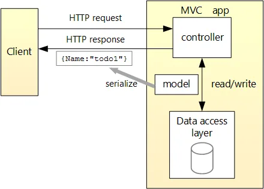

| API                          | 说明             | 请求正文 | 响应正文       |
| :--------------------------- | :--------------- | :------- | :------------- |
| `GET /api/todoitems`         | 获取所有待办事项 | 无       | 待办事项的数组 |
| `GET /api/todoitems/{id}`    | 按 ID 获取项     | 无       | 待办事项       |
| `POST /api/todoitems`        | 添加新项         | 待办事项 | 待办事项       |
| `PUT /api/todoitems/{id}`    | 更新现有项       | 待办事项 | 无             |
| `DELETE /api/todoitems/{id}` | 删除项           | 无       | 无             |

## 1.初始化项目

首先要确保安装必备的相关内容，即`ASP.NET和Web开发`。

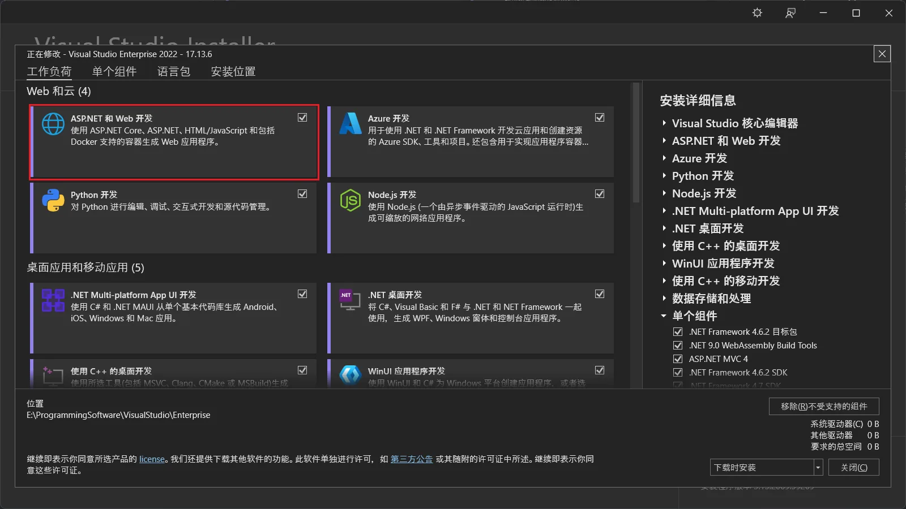

在此基础上，创建项目：

1. 首先选择合理的项目模板

   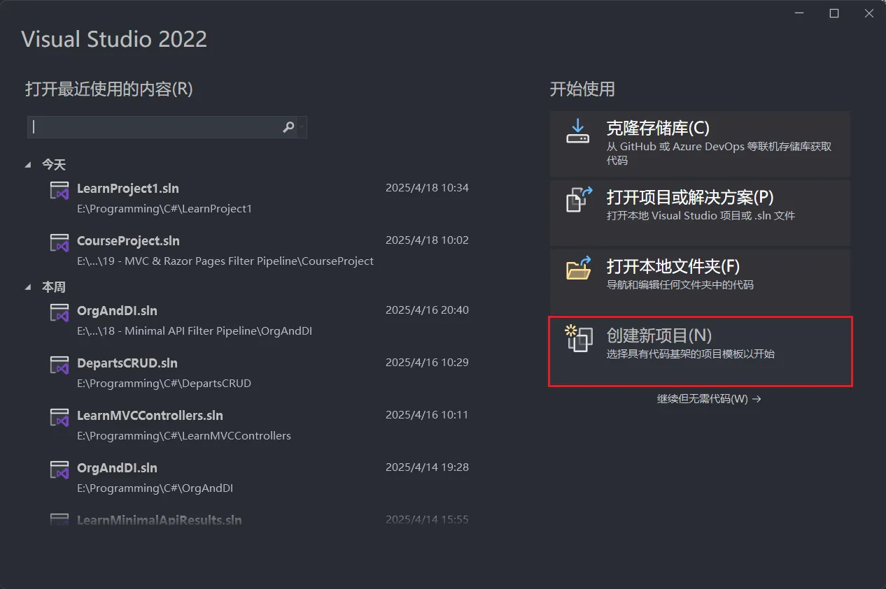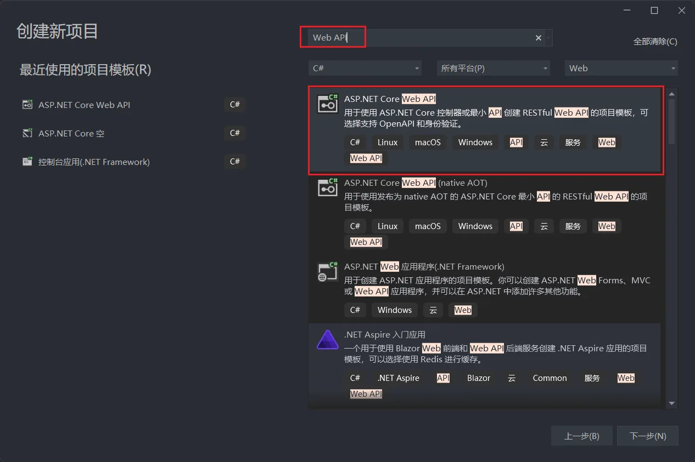

2. 随后选择并输入名称，具体内容随意

   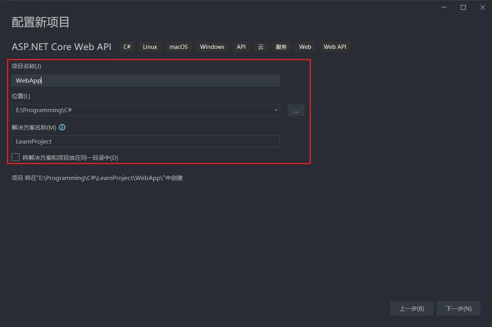

3. 依据需求选择，本次不使用`HTTPS`，随后创建项目。

   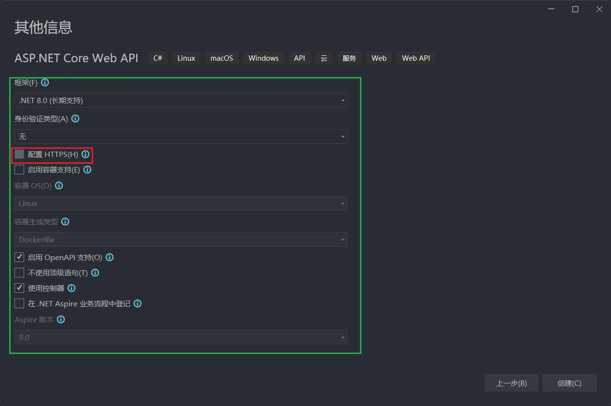

## 2.项目内容介绍：

 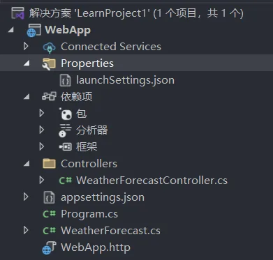

该项目是一个典型的 ASP.NET Core Web 应用项目，采用标准的 MVC（模型-视图-控制器）分层架构。

------

### **1. 项目整体架构**

- 分层逻辑：
  - **控制器（Controllers）**：处理 HTTP 请求，协调业务逻辑与视图/数据返回。
  - **模型（Models）**：定义数据结构（如 `WeatherForecast.cs`），用于数据传输与业务处理。
  - **配置与入口（Program.cs / appsettings.json）**：全局配置与启动流程。
  - **依赖管理（Dependencies）**：管理第三方库与框架依赖。

------

### **2. 关键文件与文件夹说明**

#### **(1) **`WebApp`（项目根目录）

- **作用**：项目主体代码存放位置，包含应用核心逻辑和配置。

#### **(2) **`Connected Services`

- **作用**：管理与外部服务的连接配置（如 Azure 服务、数据库连接）

#### **(3) **`Properties` 与 `launchSettings.json`

- `launchSettings.json`：

  - **作用**：定义应用的启动配置（如开发环境变量、启动 URL、端口号）。

  - 示例配置项

    ```json
    "profiles": {
      "WebApp": {
        "commandName": "Project",
        "launchBrowser": true,
        "applicationUrl": "https://localhost:5001;http://localhost:5000",
        "environmentVariables": {
          "ASPNETCORE_ENVIRONMENT": "Development"
        }
      }
    }
    ```

#### **(4) **`Dependencies`

- 作用：管理项目依赖项，包括：
  - **NuGet 包**：第三方库（如 Entity Framework Core、Swagger）。
  - **分析器（Analyzers）**：静态代码分析工具，帮助检测潜在代码问题。
  - **框架（Frameworks）**：.NET Core SDK 和运行时依赖。

#### **(5) **`Controllers/WeatherForecastController.cs`

- **作用**：控制器类，处理 `/WeatherForecast` 相关的 HTTP 请求（如 GET/POST）。

- 典型代码逻辑：

  ```csharp
  [ApiController]
  [Route("[controller]")]
  public class WeatherForecastController : ControllerBase
  {
      [HttpGet]
      public IEnumerable<WeatherForecast> Get()
      {
          // 生成天气数据并返回
      }
  }
  ```

#### **(6) **`appsettings.json`

- **作用**：存储应用配置（如数据库连接字符串、日志级别、自定义参数）。

- 示例配置：

  ```json
  {
    "Logging": {
      "LogLevel": {
        "Default": "Information",
        "Microsoft.AspNetCore": "Warning"
      }
    },
    "AllowedHosts": "*"
  }
  ```

#### **(7) **`Program.cs`

- **作用**：程序入口，配置主机（Host）、服务容器（DI）、中间件管道。

- 核心代码流程：

  ```csharp
  var builder = WebApplication.CreateBuilder(args);
  builder.Services.AddControllers(); // 注册控制器
  var app = builder.Build();
  app.UseHttpsRedirection();
  app.MapControllers(); // 路由映射
  app.Run();
  ```

#### **(8) **`WeatherForecast.cs`

- **作用**：数据模型类，定义天气预测数据的结构（如日期、温度）。

- 示例代码：

  ```csharp
  public class WeatherForecast
  {
      public DateTime Date { get; set; }
      public int TemperatureC { get; set; }
      public string? Summary { get; set; }
  }
  ```

#### **(9) **`WebApp.http`

- **作用**：HTTP 请求测试文件（类似 Postman 的快捷脚本），用于快速调试 API 接口。

- 示例请求：

  ```http
  GET https://localhost:5001/WeatherForecast
  Accept: application/json
  ```

------

### **3. 协作流程示例**

1. **启动应用**：根据 `launchSettings.json` 配置启动环境与端口。
2. **加载配置**：`Program.cs` 读取 `appsettings.json`，初始化服务容器。
3. **处理请求**：用户访问 `/WeatherForecast`，`WeatherForecastController` 生成数据并返回 JSON。
4. **依赖管理**：通过 `Dependencies` 中的包支持数据库操作或日志记录。

## 4.具体代码解析

### 1.WeatherForecast.cs

```C#
namespace WebApp
{
    /// <summary>
    /// 天气预报类，用于存储和处理天气预报数据
    /// </summary>
    public class WeatherForecast
    {
        /// <summary>
        /// 获取或设置天气预报的日期
        /// </summary>
        public DateOnly Date { get; set; }

        /// <summary>
        /// 获取或设置摄氏温度值
        /// </summary>
        public int TemperatureC { get; set; }

        /// <summary>
        /// 获取华氏温度值，根据摄氏温度自动计算
        /// 公式: F = 32 + (C / 0.5556)
        /// </summary>
        public int TemperatureF => 32 + (int)(TemperatureC / 0.5556);

        /// <summary>
        /// 获取或设置天气概述描述
        /// </summary>
        public string? Summary { get; set; }
    }
}
```

### 2.WeatherForecastController.cs

Controllers\WeatherForecastController.cs

```C#
using Microsoft.AspNetCore.Mvc;

namespace WebApp.Controllers
{
    /// <summary>
    /// 天气预报控制器，提供天气预报数据的API端点
    /// </summary>
    [ApiController]
    [Route("[controller]")]
    public class WeatherForecastController : ControllerBase
    {
        /// <summary>
        /// 天气状况描述的静态数组
        /// </summary>
        private static readonly string[] Summaries = new[]
        {
            "Freezing", "Bracing", "Chilly", "Cool", "Mild", "Warm", "Balmy", "Hot", "Sweltering", "Scorching"
        };

        /// <summary>
        /// 日志记录器实例
        /// </summary>
        private readonly ILogger<WeatherForecastController> _logger;

        /// <summary>
        /// 构造函数，通过依赖注入接收日志记录器
        /// </summary>
        /// <param name="logger">注入的日志记录器实例</param>
        public WeatherForecastController(ILogger<WeatherForecastController> logger)
        {
            _logger = logger;
        }

        /// <summary>
        /// 获取天气预报数据的GET方法
        /// </summary>
        /// <returns>返回5天的随机天气预报数据集合</returns>
        [HttpGet(Name = "GetWeatherForecast")]
        public IEnumerable<WeatherForecast> Get()
        {
            return Enumerable.Range(1, 5).Select(index => new WeatherForecast
            {
                Date = DateOnly.FromDateTime(DateTime.Now.AddDays(index)),  // 设置未来日期
                TemperatureC = Random.Shared.Next(-20, 55),                 // 生成随机温度(-20°C到55°C)
                Summary = Summaries[Random.Shared.Next(Summaries.Length)]   // 随机选择天气描述
            })
            .ToArray();
        }
    }
}
```

### 3.Program.cs

Program.cs

```C#
// 创建Web应用程序构建器，用于配置应用程序的服务和中间件
var builder = WebApplication.CreateBuilder(args);

// 向依赖注入容器添加服务

// 添加MVC控制器服务，使应用程序能够处理API控制器
builder.Services.AddControllers();
// 添加API浏览器服务，用于生成OpenAPI规范
// Learn more about configuring Swagger/OpenAPI at https://aka.ms/aspnetcore/swashbuckle
builder.Services.AddEndpointsApiExplorer();
// 添加Swagger生成器服务，用于生成Swagger UI和Swagger JSON端点
builder.Services.AddSwaggerGen();

// 构建应用程序实例
var app = builder.Build();

// 配置HTTP请求处理管道
// 检查应用程序是否在开发环境中运行
if (app.Environment.IsDevelopment())
{
    // 启用Swagger中间件，生成JSON端点
    app.UseSwagger();
    // 启用SwaggerUI中间件，提供Web UI以浏览API
    app.UseSwaggerUI();
}

// 添加授权中间件，处理身份验证和授权
app.UseAuthorization();

// 添加路由中间件，将请求映射到控制器操作方法
app.MapControllers();

// 启动应用程序并等待请求
app.Run();
```

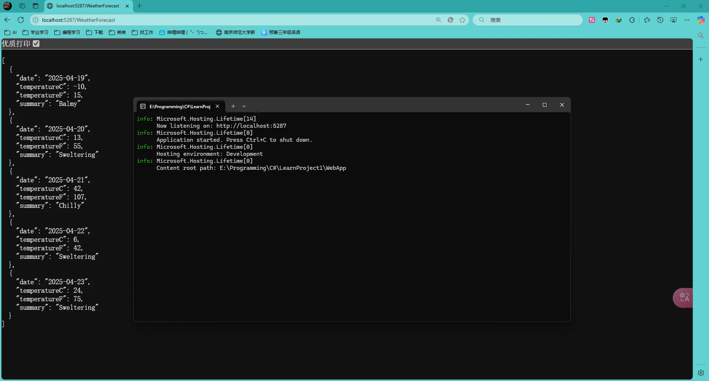

将项目按照SpringBoot的模板进行文件内容重构，以适应架构内容。

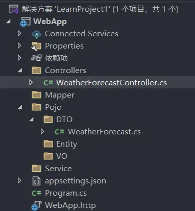

> 1.**VO（View Object）视图对象**
>
> 用于展示层（如Web或移动端界面），根据前端需求聚合或格式化数据。例如：
>
> ```java
> public class UserVO {
>     private String displayName;
>     private String formattedEmail;  // 例如"xxx@xxx.com"
> }
> ```
>
> VO的字段可能与数据库字段不完全一致，且可能包含界面特有的逻辑（如日期格式化）
>
> 2.**DTO（Data Transfer Object）数据传输对象**
>
> 用于跨层（如服务层与控制器层）或跨服务（如微服务调用）传输数据，通常用于减少网络传输量或隐藏敏感字段。例如：
>
> ```java
> public class UserDTO {
>     private String name;
>     private String email;  // 不暴露密码字段
> }
> ```
>
> DTO的设计注重网络效率和安全性

# 2、新建模型类

- 在“解决方案资源管理器”中，右键单击项目。 选择**添加**>**新建文件夹**。 将该文件夹命名为 `Models`。
- 右键单击文件夹，然后选择**添加**>**类**。 将类命名为`TodoItem`，然后选择“添加”。

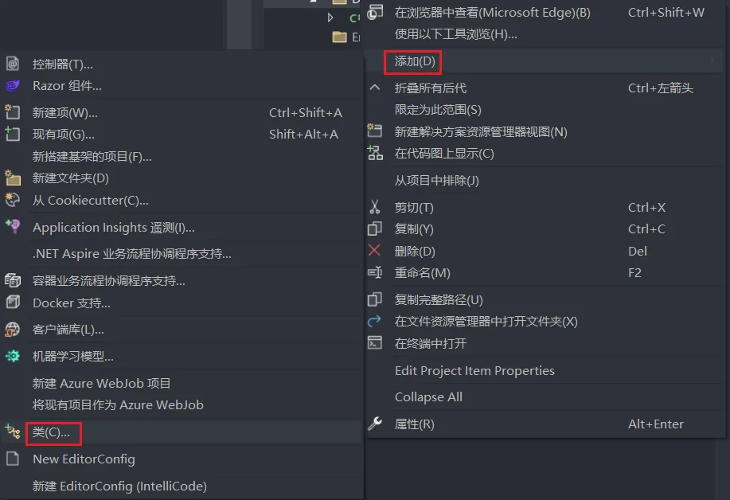

Pojo\DTO\TodoItem.cs

```C#
namespace WebApp.Pojo.DTO
{
    /// <summary>
    /// 表示待办事项的数据传输对象（DTO）
    /// </summary>
    public class TodoItem
    {
        /// <summary>
        /// 获取或设置待办事项的唯一标识符
        /// </summary>
        public long Id { get; set; }

        /// <summary>
        /// 获取或设置待办事项的名称
        /// 可以为 null
        /// </summary>
        public string? Name { get; set; }

        /// <summary>
        /// 获取或设置待办事项是否已完成的标志
        /// </summary>
        public bool IsComplete { get; set; }
    }
}
```

# 3、添加数据库上下文

数据库上下文是为数据模型协调 Entity Framework 功能的主类。 此类由 [Microsoft.EntityFrameworkCore.DbContext](https://learn.microsoft.com/zh-cn/dotnet/api/microsoft.entityframeworkcore.dbcontext) 类派生而来。因此需要先安装` Microsoft.EntityFrameworkCore.DbContext `NuGet包。

- 右键单击文件夹，然后选择**添加**>**类**。 将类命名为 TodoContext，然后单击“添加”。

Mapper\TodoContext.cs

```C#
using Microsoft.EntityFrameworkCore;
using WebApp.Pojo.DTO;

namespace WebApp.Mapper
{
    /// <summary>
    /// 数据库上下文类，用于管理与数据库的连接及 TodoItem 实体的数据操作
    /// 继承自 EntityFrameworkCore 的 DbContext 类
    /// </summary>
    public class TodoContext : DbContext
    {
        /// <summary>
        /// 构造函数，接收数据库上下文配置选项
        /// </summary>
        /// <param name="options">数据库上下文配置选项</param>
        public TodoContext(DbContextOptions<TodoContext> options) : base(options)
        {
        }

        /// <summary>
        /// TodoItem 实体的数据库集合，用于对 TodoItem 表进行查询和操作
        /// 通过 DbSet 可以进行增删改查等数据库操作
        /// 标记为 null! 表示该属性在构造后不会为 null
        /// </summary>
        public DbSet<TodoItem> TodoItems { get; set; } = null!;
    }
}
```

# 4、注册数据库上下文

在 ASP.NET Core 中，服务（如数据库上下文）必须向[依赖关系注入 (DI)](https://learn.microsoft.com/zh-cn/aspnet/core/fundamentals/dependency-injection?view=aspnetcore-8.0) 容器进行注册。 该容器向控制器提供服务。在使用之前，需要安装`Microsoft.EntityFrameworkCore.InMemory`。

Program.cs

```C#
// 引入所需的命名空间
using Microsoft.EntityFrameworkCore;
using WebApp.Mapper;

// 创建Web应用程序构建器实例，用于配置应用程序
var builder = WebApplication.CreateBuilder(args);

// 向依赖注入容器添加服务

// 添加MVC控制器服务，使应用程序能够处理API请求
builder.Services.AddControllers();

// 注册TodoContext数据库上下文，配置为使用内存数据库
// 名为"TodoList"的内存数据库将用于存储待办事项数据
builder.Services.AddDbContext<TodoContext>(opt =>
    opt.UseInMemoryDatabase("TodoList")
    );

// Swagger/OpenAPI配置，用于API文档和测试
// 更多信息可参考：https://aka.ms/aspnetcore/swashbuckle
builder.Services.AddEndpointsApiExplorer();  // 添加API端点探索服务
builder.Services.AddSwaggerGen();            // 添加Swagger文档生成服务

// 构建Web应用程序实例
var app = builder.Build();

// 配置HTTP请求处理管道

// 如果应用程序运行在开发环境中，启用Swagger文档和UI
if (app.Environment.IsDevelopment())
{
    app.UseSwagger();      // 启用Swagger文档生成
    app.UseSwaggerUI();    // 启用Swagger UI界面
}

// 启用授权中间件，处理授权相关逻辑
app.UseAuthorization();

// 添加控制器路由映射，将HTTP请求映射到相应的控制器
app.MapControllers();

// 启动应用程序，开始监听HTTP请求
app.Run();
```

# 5、构建控制器

- 右键单击 `Controllers` 文件夹。

- 选择**添加**>**New Scaffolded Item**。

- 选择“其操作使用实体框架的 API 控制器”，然后选择“添加”。

- 在“添加其操作使用实体框架的 API 控制器”对话框中：

  - 在“模型类”中选择“TodoItem (TodoApi.Models)”。

    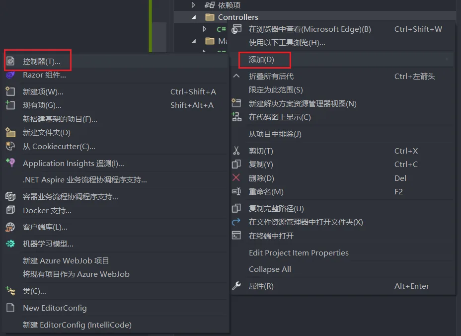

  - 在“数据上下文类”中选择“TodoContext (TodoAPI.Models)”。

    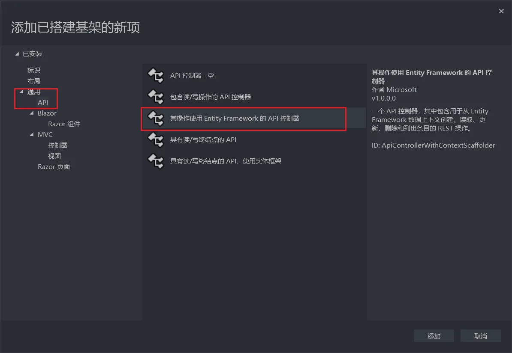

  - 选择“添加”，会自动下载安装所需内容，并且会自动生成一系列代码。

    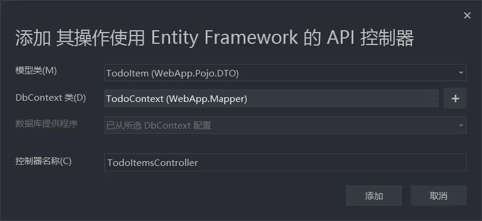

    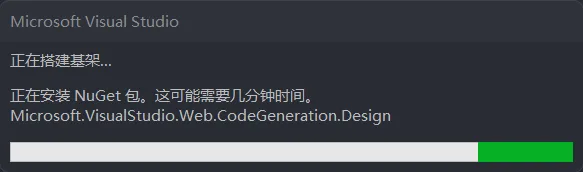


Controllers\TodoItemsController.cs

```C#
using System;
using System.Collections.Generic;
using System.Linq;
using System.Threading.Tasks;
using Microsoft.AspNetCore.Http;
using Microsoft.AspNetCore.Mvc;
using Microsoft.EntityFrameworkCore;
using WebApp.Mapper;
using WebApp.Pojo.DTO;

namespace WebApp.Controllers
{
    /// <summary>
    /// 待办事项控制器，提供待办事项的CRUD API接口
    /// </summary>
    [Route("api/[controller]")]  // 定义API路由为 "api/TodoItems"
    [ApiController]              // 标识此类为API控制器
    public class TodoItemsController : ControllerBase
    {
        /// <summary>
        /// 数据库上下文实例，用于操作待办事项数据
        /// </summary>
        private readonly TodoContext _context;

        /// <summary>
        /// 构造函数，通过依赖注入接收数据库上下文
        /// </summary>
        /// <param name="context">待办事项数据库上下文</param>
        public TodoItemsController(TodoContext context)
        {
            _context = context;
        }

        /// <summary>
        /// 获取所有待办事项列表
        /// </summary>
        /// <returns>待办事项集合</returns>
        // GET: api/TodoItems
        [HttpGet]
        public async Task<ActionResult<IEnumerable<TodoItem>>> GetTodoItems()
        {
            return await _context.TodoItems.ToListAsync();
        }

        /// <summary>
        /// 根据ID获取单个待办事项
        /// </summary>
        /// <param name="id">待办事项ID</param>
        /// <returns>指定ID的待办事项，若不存在则返回404</returns>
        // GET: api/TodoItems/5
        [HttpGet("{id}")]
        public async Task<ActionResult<TodoItem>> GetTodoItem(long id)
        {
            var todoItem = await _context.TodoItems.FindAsync(id);

            if (todoItem == null)
            {
                return NotFound();  // 返回404状态码，表示资源未找到
            }

            return todoItem;
        }

        /// <summary>
        /// 更新指定ID的待办事项
        /// </summary>
        /// <param name="id">待办事项ID</param>
        /// <param name="todoItem">待更新的待办事项对象</param>
        /// <returns>更新结果：成功返回204，失败返回400或404</returns>
        // PUT: api/TodoItems/5
        // To protect from overposting attacks, see https://go.microsoft.com/fwlink/?linkid=2123754
        [HttpPut("{id}")]
        public async Task<IActionResult> PutTodoItem(long id, TodoItem todoItem)
        {
            if (id != todoItem.Id)
            {
                return BadRequest();  // 返回400状态码，表示请求参数错误
            }

            // 将实体状态标记为已修改
            _context.Entry(todoItem).State = EntityState.Modified;

            try
            {
                // 保存更改到数据库
                await _context.SaveChangesAsync();
            }
            catch (DbUpdateConcurrencyException)
            {
                // 处理并发冲突异常
                if (!TodoItemExists(id))
                {
                    return NotFound();  // 返回404状态码，表示资源未找到
                }
                else
                {
                    throw;  // 重新抛出异常
                }
            }

            return NoContent();  // 返回204状态码，表示成功但无返回内容
        }

        /// <summary>
        /// 创建新的待办事项
        /// </summary>
        /// <param name="todoItem">新的待办事项对象</param>
        /// <returns>创建的待办事项及其资源位置</returns>
        // POST: api/TodoItems
        // To protect from overposting attacks, see https://go.microsoft.com/fwlink/?linkid=2123754
        [HttpPost]
        public async Task<ActionResult<TodoItem>> PostTodoItem(TodoItem todoItem)
        {
            // 添加待办事项到数据库
            _context.TodoItems.Add(todoItem);
            await _context.SaveChangesAsync();

            // 返回201状态码，表示资源已创建，并在响应头中包含新资源的URL
            return CreatedAtAction("GetTodoItem", new { id = todoItem.Id }, todoItem);
        }

        /// <summary>
        /// 删除指定ID的待办事项
        /// </summary>
        /// <param name="id">待删除的待办事项ID</param>
        /// <returns>删除结果：成功返回204，未找到返回404</returns>
        // DELETE: api/TodoItems/5
        [HttpDelete("{id}")]
        public async Task<IActionResult> DeleteTodoItem(long id)
        {
            var todoItem = await _context.TodoItems.FindAsync(id);
            if (todoItem == null)
            {
                return NotFound();  // 返回404状态码，表示资源未找到
            }

            // 从数据库中移除待办事项
            _context.TodoItems.Remove(todoItem);
            await _context.SaveChangesAsync();

            return NoContent();  // 返回204状态码，表示成功但无返回内容
        }

        /// <summary>
        /// 检查指定ID的待办事项是否存在
        /// </summary>
        /// <param name="id">待检查的待办事项ID</param>
        /// <returns>如果存在返回true，否则返回false</returns>
        private bool TodoItemExists(long id)
        {
            return _context.TodoItems.Any(e => e.Id == id);
        }
    }
}
```

生成的代码：

- 使用 [`[ApiController\]`](https://learn.microsoft.com/zh-cn/dotnet/api/microsoft.aspnetcore.mvc.apicontrollerattribute) 属性标记类。 此属性指示控制器响应 Web API 请求。 有关该属性启用的特定行为的信息，请参阅[使用 ASP.NET Core 创建 Web API](https://learn.microsoft.com/zh-cn/aspnet/core/web-api/?view=aspnetcore-8.0)。
- 使用 DI 将数据库上下文 (`TodoContext`) 注入到控制器中。 数据库上下文将在控制器中的每个 [CRUD](https://wikipedia.org/wiki/Create,_read,_update_and_delete) 方法中使用。

ASP.NET Core 模板：

- 具有视图的控制器在路由模板中包含 `[action]`。
- API 控制器不在路由模板中包含 `[action]`。

`[action]` 令牌不在路由模板中时，终结点中不包含 [action](https://learn.microsoft.com/zh-cn/aspnet/core/mvc/controllers/routing?view=aspnetcore-8.0#action) 名称（方法名称）。 也就是说，不会在匹配的路由中使用操作的关联方法名称。

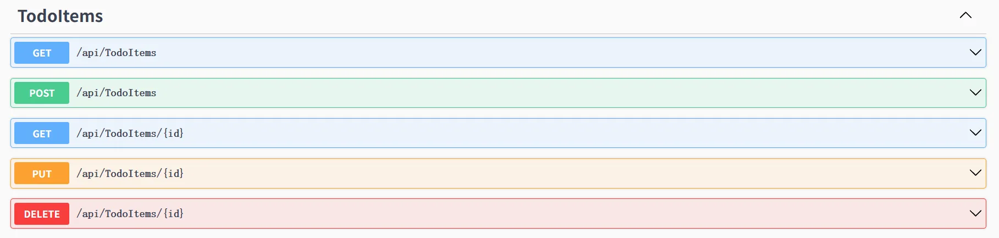

> ### ASP.NET Core 中 MVC 控制器与 API 控制器的路由设计差异解析
>
> 在 ASP.NET Core 中，**带有视图的控制器（传统 MVC）** 和 **API 控制器（Web API）** 的路由模板设计存在显著差异，主要体现在是否包含 `[action]` 占位符。这种差异源于两者不同的应用场景和设计目标。以下从 **设计原则**、**路由配置** 和 **实际影响** 三方面详细解释：
>
> ------
>
> ### **1. 设计原则与目标**
>
> |    **类型**    |                    **核心目标**                    |            **路由设计导向**            |
> | :------------: | :------------------------------------------------: | :------------------------------------: |
> | **MVC 控制器** | 渲染视图页面，支持用户交互（如表单提交、页面跳转） |   明确区分不同 Action 对应的视图路径   |
> | **API 控制器** |   提供数据接口，遵循 RESTful 规范（资源化操作）    | 通过 HTTP 方法区分操作，隐藏 Action 名 |
>
> ------
>
> ### **2. 路由模板对比**
>
> #### **(1) 传统 MVC 控制器（包含 `[action]`）**
>
> - **默认路由模板**：
>
>   ```csharp
>   app.MapControllerRoute(
>       name: "default",
>       pattern: "{controller=Home}/{action=Index}/{id?}");
>   ```
>
> - **URL 示例**：
>
>   - `/Home/Index` → `HomeController.Index()`
>   - `/Product/Details/5` → `ProductController.Details(int id)`
>
> - **必要性**：
>
>   - 每个 Action 对应独立的视图文件（如 `Index.cshtml`、`Details.cshtml`），需通过 URL 路径明确指定 Action 名称以渲染正确视图。
>   - 支持多 Action 多视图的灵活跳转（如导航菜单链接到不同页面）。
>
> #### **(2) API 控制器（不包含 `[action]`）**
>
> - **典型路由配置**：
>
>   ```csharp
>   [ApiController]
>   [Route("[controller]")]  // 路由模板中不包含 [action]
>   public class WeatherForecastController : ControllerBase
>   {
>       [HttpGet]  // 通过 HTTP 方法区分操作
>       public IEnumerable<WeatherForecast> Get() { ... }
>   
>       [HttpPost]
>       public IActionResult Create([FromBody] WeatherForecast data) { ... }
>   }
>   ```
>
> - **URL 示例**：
>
>   - `GET /WeatherForecast` → 获取天气数据
>   - `POST /WeatherForecast` → 创建新天气数据
>
> - **设计优势**：
>
>   - **符合 RESTful 规范**：URL 表示资源（如 `/WeatherForecast`），HTTP 方法（GET、POST）表示操作类型（读、写）。
>   - **简化 URL 结构**：避免暴露内部方法名，提升接口可读性和安全性。
>   - **依赖 HTTP 语义**：利用标准方法（GET/POST/PUT/DELETE）而非 URL 路径区分功能。
>
> ------
>
> ### **3. 实际影响与配置差异**
>
> #### **(1) 路由注册方式**
>
> - **MVC 控制器**：
>   通常使用 ​**​约定路由​**​（`MapControllerRoute`）全局定义模板，依赖 `[action]` 映射视图。
> - **API 控制器**：
>   优先使用 ​**​属性路由​**​（`[Route]` + `[HttpMethod]`），直接为每个 Action 指定端点，无需依赖 `[action]`。
>
> #### **(2) `[ApiController]` 特性的作用**
>
> - **自动推断路由**：若未显式指定 `[Route]`，默认生成 `/ControllerName` 的路由。
> - **禁用视图查找**：强制 API 控制器仅返回数据（如 JSON），而非视图。
> - **模型验证**：自动响应 400 Bad Request 验证错误。
>
> #### **(3) 如何强制 API 控制器包含 `[action]`（不推荐）**
>
> 若需兼容旧版风格，可手动添加 `[action]`，但违背 RESTful 设计：
>
> ```csharp
> [ApiController]
> [Route("[controller]/[action]")]  // 显式包含 [action]
> public class WeatherForecastController : ControllerBase
> {
>     [HttpGet]
>     public IEnumerable<WeatherForecast> List() { ... }  // URL: /WeatherForecast/List
> }
> ```
>
> ------
>
> ### **4. 项目结构图中的体现**
>
> 在您提供的项目图中，`WeatherForecastController.cs` 属于 **API 控制器**：
>
> - 未在路由模板中包含 `[action]`：
>   - 通过 `[Route("[controller]")]` 定义基础路径 `/WeatherForecast`。
>   - 使用 `[HttpGet]` 等特性标识方法，无需 URL 路径区分操作。
> - 符合 RESTful 风格：
>   - 所有操作均围绕 `/WeatherForecast` 资源展开，通过 HTTP 方法（GET/POST）区分功能。
>
> ------
>
> ### **总结**
>
> - **MVC 控制器**：需通过 `[action]` 明确指定视图路径，支持多页面交互。
> - **API 控制器**：省略 `[action]` 以简化 URL，强调资源与 HTTP 方法的语义化操作，符合现代 API 设计趋势。
> - 最佳实践：
>   - **API 设计**：优先使用属性路由，避免 `[action]` 暴露内部逻辑。
>   - **混合项目**：若同时存在 MVC 和 API 控制器，可通过 `MapControllers()` 和 `MapControllerRoute()` 分别注册路由。

# 6、路由和 URL 路径

[`[HttpGet\]`](https://learn.microsoft.com/zh-cn/dotnet/api/microsoft.aspnetcore.mvc.httpgetattribute) 属性表示响应 `HTTP GET` 请求的方法。 每个方法的 URL 路径构造如下所示：

- 在控制器的 `Route` 属性中以模板字符串开头：

  ```csharp
  /// <summary>
  /// 待办事项控制器，提供待办事项的CRUD API接口
  /// </summary>
  [Route("api/[controller]")]  // 定义API路由为 "api/TodoItems"
  [ApiController]              // 标识此类为API控制器
  public class TodoItemsController : ControllerBase
  ```

- 将 `[controller]` 替换为控制器的名称，按照惯例，在控制器类名称中去掉“Controller”后缀。 对于此示例，控制器类名称为“TodoItems”控制器，因此控制器名称为“TodoItems”。 ASP.NET Core [路由](https://learn.microsoft.com/zh-cn/aspnet/core/mvc/controllers/routing?view=aspnetcore-8.0)不区分大小写。

- 如果 `[HttpGet]` 属性具有路由模板（例如 `[HttpGet("products")]`），则将它追加到路径。 此示例不使用模板。 有关详细信息，请参阅[使用 Http [Verb\] 特性的特性路由](https://learn.microsoft.com/zh-cn/aspnet/core/mvc/controllers/routing?view=aspnetcore-8.0#verb)。

在下面的 `GetTodoItem` 方法中，`"{id}"` 是待办事项的唯一标识符的占位符变量。 调用 `GetTodoItem` 时，URL 中 `"{id}"` 的值会在 `id` 参数中提供给方法。

```csharp
/// <summary>
/// 根据ID获取单个待办事项
/// </summary>
/// <param name="id">待办事项ID</param>
/// <returns>指定ID的待办事项，若不存在则返回404</returns>
// GET: api/TodoItems/5
[HttpGet("{id}")]
public async Task<ActionResult<TodoItem>> GetTodoItem(long id)
{
    var todoItem = await _context.TodoItems.FindAsync(id);

    if (todoItem == null)
    {
        return NotFound();  // 返回404状态码，表示资源未找到
    }

    return todoItem;
}
```

# 7、返回值

`GetTodoItems` 和 `GetTodoItem` 方法的返回类型是 [ActionResult 类型](https://learn.microsoft.com/zh-cn/aspnet/core/web-api/action-return-types?view=aspnetcore-8.0#actionresultt-type)。 ASP.NET Core 自动将对象序列化为 [JSON](https://www.json.org/)，并将 JSON 写入响应消息的正文中。 此返回类型的响应代码为 [200 OK](https://developer.mozilla.org/docs/Web/HTTP/Status/200)（假设没有未处理的异常）。 未经处理的异常将转换为 5xx 错误。

`ActionResult` 返回类型可以表示大范围的 HTTP 状态代码。 例如，`GetTodoItem` 可以返回两个不同的状态值：

- 如果没有任何项与请求的 ID 匹配，该方法将返回 [404 状态](https://developer.mozilla.org/docs/Web/HTTP/Status/404)[NotFound](https://learn.microsoft.com/zh-cn/dotnet/api/microsoft.aspnetcore.mvc.controllerbase.notfound)错误代码。
- 否则，此方法将返回具有 JSON 响应正文的 200。 返回 `item` 则产生 `HTTP 200` 响应。

# 8、防止过度公开

目前，示例应用公开了整个 `TodoItem` 对象。 生产应用通常使用模型的子集来限制输入和返回的数据。 这背后有多种原因，但安全性是主要原因。 模型的子集通常称为数据传输对象 (DTO)、输入模型或视图模型。 本教程使用了 **DTO**。

DTO 可用于：

- 防止过度发布。
- 隐藏客户端不应查看的属性。
- 省略一些属性以缩减有效负载大小。
- 平展包含嵌套对象的对象图。 对客户端而言，平展的对象图可能更方便。

将`TodoItem` 拆分为DTO和Entity

Pojo\DTO\TodoItemDTO.cs

```C#
namespace WebApp.Pojo.DTO
{
    /// <summary>
    /// 表示待办事项的数据传输对象（DTO）
    /// </summary>
    public class TodoItemDTO
    {
        /// <summary>
        /// 获取或设置待办事项的唯一标识符
        /// </summary>
        public long Id { get; set; }

        /// <summary>
        /// 获取或设置待办事项的名称
        /// 可以为 null
        /// </summary>
        public string? Name { get; set; }

        /// <summary>
        /// 获取或设置待办事项是否已完成的标志
        /// </summary>
        public bool IsComplete { get; set; }
    }
}
```

Pojo\Entity\TodoItem.cs

```C#
namespace WebApp.Pojo.Entity
{
    /// <summary>
    /// 表示待办事项的实体模型类
    /// 用于数据库存储和内部处理
    /// </summary>
    public class TodoItem
    {
        /// <summary>
        /// 获取或设置待办事项的唯一标识符
        /// </summary>
        public long Id { get; set; }

        /// <summary>
        /// 获取或设置待办事项的名称
        /// 可以为 null
        /// </summary>
        public string? Name { get; set; }

        /// <summary>
        /// 获取或设置待办事项是否已完成的标志
        /// </summary>
        public bool IsComplete { get; set; }

        /// <summary>
        /// 获取或设置待办事项的私密信息
        /// 此字段不应在API响应中返回给客户端，仅在实体模型中使用
        /// 可以为 null
        /// </summary>
        public string? Secret { get; set; }
    }
}
```

Mapper\TodoContext.cs

```C#
using Microsoft.EntityFrameworkCore;
using WebApp.Pojo.Entity;

namespace WebApp.Mapper
{
    /// <summary>
    /// 数据库上下文类，用于管理与数据库的连接及 TodoItem 实体的数据操作
    /// 继承自 EntityFrameworkCore 的 DbContext 类
    /// </summary>
    public class TodoContext : DbContext
    {
        /// <summary>
        /// 构造函数，接收数据库上下文配置选项
        /// </summary>
        /// <param name="options">数据库上下文配置选项</param>
        public TodoContext(DbContextOptions<TodoContext> options) : base(options)
        {
        }

        /// <summary>
        /// TodoItem 实体的数据库集合，用于对 TodoItem 表进行查询和操作
        /// 通过 DbSet 可以进行增删改查等数据库操作
        /// 标记为 null! 表示该属性在构造后不会为 null
        /// </summary>
        public DbSet<TodoItem> TodoItems { get; set; } = null!;
    }
}
```

随后更新 `TodoItemsController` 以使用 `TodoItemDTO`：

Controllers\TodoItemsController.cs

```C#
using System;
using System.Collections.Generic;
using System.Linq;
using System.Threading.Tasks;
using Microsoft.AspNetCore.Http;
using Microsoft.AspNetCore.Mvc;
using Microsoft.EntityFrameworkCore;
using WebApp.Mapper;
using WebApp.Pojo.DTO;
using WebApp.Pojo.Entity;

namespace WebApp.Controllers
{
    /// <summary>
    /// 待办事项控制器，提供待办事项的CRUD API接口
    /// 实现了数据实体(Entity)与数据传输对象(DTO)之间的转换，保护敏感数据
    /// </summary>
    [Route("api/[controller]")]  // 定义API路由为 "api/TodoItems"
    [ApiController]              // 标识此类为API控制器
    public class TodoItemsController : ControllerBase
    {
        /// <summary>
        /// 数据库上下文实例，用于操作待办事项数据
        /// </summary>
        private readonly TodoContext _context;

        /// <summary>
        /// 构造函数，通过依赖注入接收数据库上下文
        /// </summary>
        /// <param name="context">待办事项数据库上下文</param>
        public TodoItemsController(TodoContext context)
        {
            _context = context;
        }

        /// <summary>
        /// 获取所有待办事项列表，返回DTO对象集合（不含敏感字段）
        /// </summary>
        /// <returns>待办事项DTO对象集合</returns>
        [HttpGet]
        public async Task<ActionResult<IEnumerable<TodoItemDTO>>> GetTodoItems()
        {
            // 查询所有待办事项并转换为DTO对象
            return await _context.TodoItems
                .Select(x => ItemToDTO(x))
                .ToListAsync();
        }

        /// <summary>
        /// 根据ID获取单个待办事项，返回DTO对象（不含敏感字段）
        /// </summary>
        /// <param name="id">待办事项ID</param>
        /// <returns>指定ID的待办事项DTO对象，若不存在则返回404</returns>
        [HttpGet("{id}")]
        public async Task<ActionResult<TodoItemDTO>> GetTodoItem(long id)
        {
            // 根据ID查找待办事项
            var todoItem = await _context.TodoItems.FindAsync(id);

            // 如果未找到，返回404 Not Found状态码
            if (todoItem == null)
            {
                return NotFound();
            }

            // 将实体对象转换为DTO对象并返回
            return ItemToDTO(todoItem);
        }

        /// <summary>
        /// 更新指定ID的待办事项
        /// </summary>
        /// <param name="id">待办事项ID</param>
        /// <param name="todoDTO">待更新的待办事项DTO对象</param>
        /// <returns>更新结果：成功返回204，失败返回400或404</returns>
        [HttpPut("{id}")]
        public async Task<IActionResult> PutTodoItem(long id, TodoItemDTO todoDTO)
        {
            // 验证URL中的ID与DTO对象中的ID是否匹配
            if (id != todoDTO.Id)
            {
                return BadRequest(); // 返回400 Bad Request状态码
            }

            // 获取原有的待办事项实体
            var todoItem = await _context.TodoItems.FindAsync(id);
            if (todoItem == null)
            {
                return NotFound(); // 返回404 Not Found状态码
            }

            // 更新实体的属性，保留Secret字段不变
            todoItem.Name = todoDTO.Name;
            todoItem.IsComplete = todoDTO.IsComplete;

            try
            {
                // 保存更改到数据库
                await _context.SaveChangesAsync();
            }
            catch (DbUpdateConcurrencyException) when (!TodoItemExists(id))
            {
                // 处理并发异常，如果项目已不存在则返回404
                return NotFound();
            }

            // 返回204 No Content状态码，表示成功但无返回内容
            return NoContent();
        }

        /// <summary>
        /// 创建新的待办事项
        /// </summary>
        /// <param name="todoDTO">包含新待办事项信息的DTO对象</param>
        /// <returns>创建的待办事项DTO对象及其资源位置</returns>
        [HttpPost]
        public async Task<ActionResult<TodoItemDTO>> PostTodoItem(TodoItemDTO todoDTO)
        {
            // 创建新的待办事项实体，从DTO复制属性值
            var todoItem = new TodoItem
            {
                IsComplete = todoDTO.IsComplete,
                Name = todoDTO.Name
                // Secret字段保持默认值null
            };

            // 将实体添加到数据库
            _context.TodoItems.Add(todoItem);
            await _context.SaveChangesAsync();

            // 返回201 Created状态码，包含新资源的位置和转换后的DTO对象
            return CreatedAtAction(
                nameof(GetTodoItem),           // 获取资源的方法名
                new { id = todoItem.Id },      // 路由参数
                ItemToDTO(todoItem));          // 返回的DTO对象
        }

        /// <summary>
        /// 删除指定ID的待办事项
        /// </summary>
        /// <param name="id">待删除的待办事项ID</param>
        /// <returns>删除结果：成功返回204，未找到返回404</returns>
        [HttpDelete("{id}")]
        public async Task<IActionResult> DeleteTodoItem(long id)
        {
            // 查找待删除的待办事项
            var todoItem = await _context.TodoItems.FindAsync(id);
            if (todoItem == null)
            {
                return NotFound(); // 返回404 Not Found状态码
            }

            // 从数据库中删除待办事项
            _context.TodoItems.Remove(todoItem);
            await _context.SaveChangesAsync();

            // 返回204 No Content状态码，表示成功但无返回内容
            return NoContent();
        }

        /// <summary>
        /// 检查指定ID的待办事项是否存在
        /// </summary>
        /// <param name="id">待检查的待办事项ID</param>
        /// <returns>如果存在返回true，否则返回false</returns>
        private bool TodoItemExists(long id)
        {
            return _context.TodoItems.Any(e => e.Id == id);
        }

        /// <summary>
        /// 将待办事项实体转换为DTO对象，排除敏感字段（如Secret）
        /// </summary>
        /// <param name="todoItem">待转换的待办事项实体</param>
        /// <returns>转换后的待办事项DTO对象</returns>
        private static TodoItemDTO ItemToDTO(TodoItem? todoItem) =>
           new TodoItemDTO
           {
               Id = todoItem.Id,
               Name = todoItem.Name,
               IsComplete = todoItem.IsComplete
               // 不包含Secret字段，保护敏感数据
           };
    }
}
```

# 9、从`ASP.NET Core空`构建最简化项目

## 1、初始化项目

1. 在初始化项目的时候，采用`ASP.NET Core空`初始化项目，并取消HTTPS

   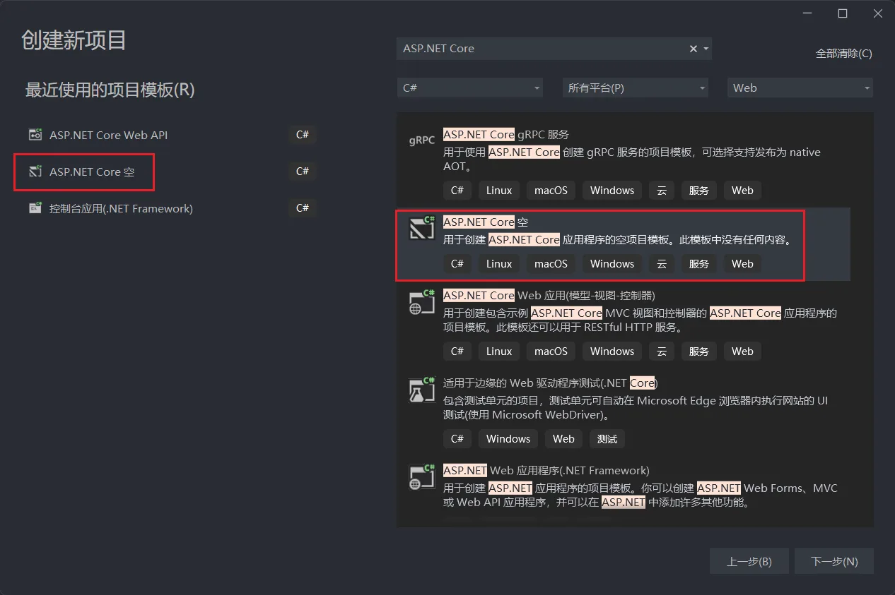

   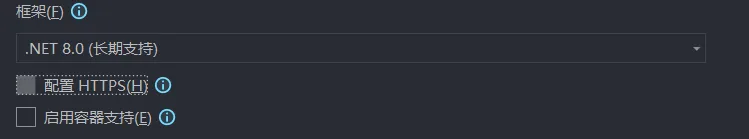

2. 并添加一系列预留文件夹，模板参照SpingBoot

   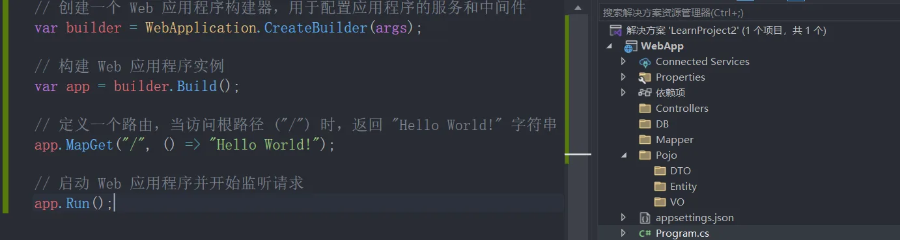

## 2、创建`TodoItem` 相关的类

Pojo\DTO\TodoItemDTO.cs

```C#
namespace WebApp.Pojo.DTO
{
    /// <summary>
    /// 待办事项数据传输对象 (Data Transfer Object)
    /// 用于在应用层之间传递待办事项数据，不包含所有实体属性
    /// </summary>
    public class TodoItemDTO
    {
        /// <summary>
        /// 优先级ID，表示待办事项的优先级等级
        /// </summary>
        public long PriorityId { get; set; }

        /// <summary>
        /// 待办事项名称，可为空
        /// </summary>
        public string? Name { get; set; }

        /// <summary>
        /// 完成状态标志，表示待办事项是否已完成
        /// true 表示已完成，false 表示未完成
        /// </summary>
        public bool IsComplete { get; set; }
    }
}
```

Pojo\Entity\TodoItem.cs

```C#
namespace WebApp.Pojo.Entity
{
    /// <summary>
    /// 待办事项实体类
    /// 表示数据库中的一条待办事项记录
    /// </summary>
    public class TodoItem
    {
        /// <summary>
        /// 待办事项的唯一标识符
        /// 设为私有属性以保证实体完整性
        /// </summary>
        private long TodoId { get; set; }

        /// <summary>
        /// 优先级标识符
        /// 用于关联待办事项的优先级别
        /// </summary>
        public long PriorityId { get; set; }

        /// <summary>
        /// 待办事项名称
        /// 可以为空
        /// </summary>
        public string? Name { get; set; }

        /// <summary>
        /// 完成状态标志
        /// true表示已完成，false表示未完成
        /// </summary>
        public bool IsComplete { get; set; }

        /// <summary>
        /// 创建时间
        /// 记录待办事项的创建时间戳
        /// </summary>
        public DateTime CreatedAt { get; set; }

        /// <summary>
        /// 更新时间
        /// 记录待办事项的最后更新时间戳
        /// </summary>
        public DateTime UpdatedAt { get; set; }

        /// <summary>
        /// 删除时间
        /// 用于软删除功能，记录实体被删除的时间
        /// 为null表示未删除
        /// </summary>
        public DateTime? DeletedAt { get; set; }

        /// <summary>
        /// TodoItem 的完整构造函数
        /// 初始化待办事项的所有属性
        /// </summary>
        /// <param name="todoId">待办事项ID</param>
        /// <param name="priorityId">优先级ID</param>
        /// <param name="name">待办事项名称</param>
        /// <param name="isComplete">完成状态</param>
        /// <param name="createdAt">创建时间</param>
        /// <param name="updatedAt">更新时间</param>
        /// <param name="deletedAt">删除时间，默认为null</param>
        public TodoItem(long todoId, long priorityId, string? name, bool isComplete, DateTime createdAt, DateTime updatedAt, DateTime? deletedAt = null)
        {
            TodoId = todoId;
            PriorityId = priorityId;
            Name = name;
            IsComplete = isComplete;
            CreatedAt = createdAt;
            UpdatedAt = updatedAt;
            DeletedAt = deletedAt;
        }
    }
}
```

Pojo\VO\TodoItemVO.cs

```C#
namespace WebApp.Pojo.VO
{
    /// <summary>
    /// 待办事项视图对象 (View Object)
    /// 用于向前端或其他外部系统展示待办事项数据
    /// 不包含敏感数据字段，适合视图层使用
    /// </summary>
    public class TodoItemVO
    {
        /// <summary>
        /// 优先级标识符
        /// 表示待办事项的优先级等级
        /// </summary>
        public long PriorityId { get; set; }

        /// <summary>
        /// 待办事项名称
        /// 可为空值
        /// </summary>
        public string? Name { get; set; }

        /// <summary>
        /// 完成状态标志
        /// true表示已完成，false表示未完成
        /// </summary>
        public bool IsComplete { get; set; }

        /// <summary>
        /// 创建时间
        /// 记录待办事项创建的时间戳
        /// </summary>
        public DateTime CreatedAt { get; set; }

        /// <summary>
        /// 更新时间
        /// 记录待办事项最后一次更新的时间戳
        /// </summary>
        public DateTime UpdatedAt { get; set; }

        /// <summary>
        /// 删除时间
        /// 用于软删除功能，记录删除时间
        /// 为null表示未删除
        /// </summary>
        public DateTime? DeletedAt { get; set; }
    }
}
```

## 3、构建`TodoItemController`类

创建`TodoItemController`，并继承`ControllerBase`，并利用“注解”标注为`[ApiController]`和`[Route("api/[controller]")]`。

```C#
using Microsoft.AspNetCore.Mvc;

namespace WebApp.Controllers
{
    /// <summary>
    /// 待办事项控制器
    /// 处理与待办事项相关的HTTP请求
    /// </summary>
    [ApiController]  // 指示此类为API控制器
    [Route("api/[controller]")]  // 设置此控制器的路由模板，访问路径为 api/TodoItem
    public class TodoItemController : ControllerBase
    {
        // 在此添加控制器方法，如：
        // GET - 获取所有待办事项
        [HttpGet] // 指定此方法处理 HTTP GET 请求
        public ActionResult<string> Get()
        {
            // 返回所有待办事项
            // 当前返回的是一个简单的字符串 "ss"，可以替换为实际的待办事项数据
            return Ok("ss"); // 返回 HTTP 200 状态码和响应内容
        }

        // GET(id) - 获取指定ID的待办事项
        // POST - 创建新待办事项
        // PUT - 更新待办事项
        // DELETE - 删除待办事项
    }
}
```

## 4、注册使用“控制器服务”

在`Program.cs`中使用控制器。`builder.Services.AddControllers();`、`app.MapControllers();`

```C#
// 创建一个 Web 应用程序构建器，用于配置应用程序的服务和中间件
var builder = WebApplication.CreateBuilder(args);

// 1、注册控制器服务
// 这一步将控制器添加到依赖注入容器中，允许应用程序处理基于控制器的 HTTP 请求
builder.Services.AddControllers();

// 构建 Web 应用程序实例
// 通过构建器生成一个 Web 应用程序对象，准备运行应用程序
var app = builder.Build();

// 2、映射控制器路由
// 将控制器的路由映射到应用程序中，使其能够响应 HTTP 请求
app.MapControllers();

// 启动 Web 应用程序并开始监听请求
// 运行应用程序，开始处理传入的 HTTP 请求
app.Run();
```

这个时候启动便可以通过”api/TodoItem“查看是否启动成功。

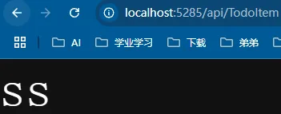

## 5、构建详细内容

### 1、数据库

在DB/TodoItemDataBase.cs中模拟数据库相关操作。

```C#
using WebApp.Pojo.Entity;

namespace WebApp.DB
{
    /// <summary>
    /// 待办事项数据库模拟类
    /// 用于在内存中存储和管理 TodoItem 对象
    /// </summary>
    public static class TodoItemDataBase
    {
        /// <summary>
        /// 存储待办事项的静态集合
        /// 使用只读属性确保集合的封装性
        /// </summary>
        public static List<TodoItem> TodoItems { get; }

        /// <summary>
        /// 静态构造函数
        /// 初始化待办事项数据，模拟数据库中的记录
        /// </summary>
        static TodoItemDataBase()
        {
            TodoItems = new List<TodoItem>
            {
                // 创建第一个待办事项，ID为1，优先级为1，未完成
                new TodoItem(
                    todoId: 1,
                    priorityId: 1,
                    name: "Task 1",
                    isComplete: false,
                    createdAt: DateTime.Now,
                    updatedAt: DateTime.Now),
                
                // 创建第二个待办事项，ID为2，优先级为2，已完成，创建时间为一天前
                new TodoItem(
                    todoId: 2,
                    priorityId: 2,
                    name: "Task 2",
                    isComplete: true,
                    createdAt: DateTime.Now.AddDays(-1),
                    updatedAt: DateTime.Now)
            };
        }
    }
}
```

### 2、Mapper

ITodoItemMapper 接口详细介绍

1. 设计目的与原则
  ITodoItemMapper 接口是应用程序数据访问层的核心组件，其设计遵循以下关键原则：

  - 数据映射器模式(Data Mapper Pattern)：将数据层与领域模型分离，负责数据在持久化存储和内存对象之间的转换
  - 单一职责原则：专注于待办事项数据的访问操作，不涉及业务逻辑
  - 依赖倒置原则：高层模块依赖于抽象接口，而非具体实现
  - 接口隔离原则：只提供必要的方法，保持接口简洁明确

2. 方法详解

  1. GetAllTodoItems()
    - 功能：检索系统中的所有待办事项记录
    - 返回值：包含所有 TodoItem 对象的列表
    - 应用场景：用户访问待办事项列表页面时，需要展示所有任务
  2. GetTodoItemById(long id)
    - 功能：根据唯一标识查找单个待办事项
    - 参数：待办事项的ID
    - 返回值：找到的 TodoItem 对象，如果不存在则返回 null
    - 应用场景：查看特定待办事项详情、编辑前获取数据、验证项目存在性
  3. AddTodoItem(TodoItem todoItem)
    - 功能：创建新的待办事项记录
    - 参数：完整填充的 TodoItem 实体
    - 返回值：无，操作成功时无返回值
    - 应用场景：用户创建新任务时
  4. UpdateTodoItem(long id, TodoItem todoItem)
    - 功能：更新现有待办事项的信息
    - 参数：
    - id：要更新的待办事项标识
    - todoItem：包含更新数据的待办事项对象
    - 返回值：无，操作成功时无返回值
    - 应用场景：用户编辑任务内容、标记任务完成等
  5. DeleteTodoItem(long id)
    - 功能：删除指定的待办事项
    - 参数：待删除项的 ID
    - 返回值：无，操作成功时无返回值
    - 应用场景：用户删除不再需要的任务

3. 在应用架构中的位置
  ITodoItemMapper 在应用的多层架构中处于数据访问层：

  ```
  表示层(Controller) → 业务逻辑层(Service) → 数据访问层(Mapper) → 数据存储层(DB)
  ```

  在这个架构中：

  - 控制器接收用户请求
  - 服务层实现业务逻辑并调用 Mapper
  - Mapper 实现(如 TodoItemMapperImpl) 执行实际的数据操作
  - 数据最终存储在数据库或内存集合中

4. 接口优势与扩展性

  - 测试友好：可以轻松创建模拟实现用于单元测试
  - 实现替换：可以在不修改业务逻辑的情况下切换数据源(如从内存存储切换到SQL数据库)
  - 代码组织：清晰定义了数据操作的边界，使代码结构更加有序
  - 分离关注点：数据访问逻辑与业务规则分离

5. 总结
  ITodoItemMapper 接口代表了一种清晰的关注点分离设计，通过定义数据操作的契约，使应用程序能够以松耦合、可测试和可扩展的方式处理待办事项数据。这种设计方式促进了代码的可维护性，同时提供了实现替换的灵活性。

```C#
using WebApp.Pojo.Entity;

namespace WebApp.Mapper
{
    /// <summary>
    /// 待办事项数据映射器接口
    /// 定义了对待办事项(TodoItem)实体的数据访问操作
    /// 作为数据访问层的核心组件，负责数据操作的抽象
    /// </summary>
    public interface ITodoItemMapper
    {
        /// <summary>
        /// 获取所有待办事项
        /// </summary>
        /// <returns>所有待办事项的集合</returns>
        public List<TodoItem> GetAllTodoItems();
        
        /// <summary>
        /// 根据ID获取特定的待办事项
        /// </summary>
        /// <param name="id">待办事项的唯一标识符</param>
        /// <returns>对应ID的待办事项，如果不存在则返回null</returns>
        public TodoItem GetTodoItemById(long id);
        
        /// <summary>
        /// 添加一个新的待办事项
        /// </summary>
        /// <param name="todoItem">需要添加的待办事项对象</param>
        public void AddTodoItem(TodoItem todoItem);
        
        /// <summary>
        /// 更新指定ID的待办事项
        /// </summary>
        /// <param name="id">待更新待办事项的ID</param>
        /// <param name="todoItem">包含更新信息的待办事项对象</param>
        public void UpdateTodoItem(long id, TodoItem todoItem);
        
        /// <summary>
        /// 删除指定ID的待办事项
        /// </summary>
        /// <param name="id">待删除待办事项的ID</param>
        public void DeleteTodoItem(long id);
    }
}
```

TodoItemMapperImpl 类是 ITodoItemMapper 接口的具体实现，采用内存存储方式管理待办事项数据。它提供了待办事项的基本CRUD（创建、读取、更新、删除）操作的实现，使用静态类 TodoItemDataBase 作为数据源。
设计特点

1.	内存数据存储模式：

   - 使用 TodoItemDataBase.TodoItems 静态集合作为数据源
   - 所有操作直接在内存中执行，无需数据库连接
   - 适合原型开发、测试和小型应用场景

2.	简单直接的实现：

   - 代码简洁清晰，每个方法直接操作静态集合
   - 没有额外的数据验证或异常处理
   - 利用C#内置的LINQ功能（如Find方法）进行数据查询

3.	接口实现：

   1.	完全实现了 ITodoItemMapper 接口定义的所有方法
   2.	保持了方法签名的一致性
   3.	遵循了依赖倒置原则，允许通过接口引用使用此实现

4.	方法分析

   1.	GetAllTodoItems()
      - 实现逻辑：直接返回静态集合的引用
      - 性能特点：O(1)时间复杂度，非常高效
   2.	GetTodoItemById(long id)
      - 实现逻辑：使用LINQ的Find方法查找匹配ID的第一个项目
      - 性能特点：O(n)时间复杂度，需要遍历集合
   3.	AddTodoItem(TodoItem todoItem)
      - 实现逻辑：直接将项目添加到静态集合中
      - 性能特点：O(1)时间复杂度，高效
   4.	UpdateTodoItem(long id, TodoItem todoItem)
      - 实现逻辑：查找匹配项并逐个更新属性
      - 性能特点：O(n)时间复杂度，需要遍历集合
   5.	DeleteTodoItem(long id)
      1.	实现逻辑：查找匹配项并从集合中移除
      2.	性能特点：O(n)时间复杂度，需要遍历集合
   6.	在架构中的位置
      TodoItemMapperImpl 在应用程序的分层架构中处于数据访问层，具体位置如下：

   ```
   表示层 (Controller) → 业务逻辑层 (Service) → 数据访问层 (Mapper) → 数据存储
                                                 ↓
                                          TodoItemMapperImpl → TodoItemDataBase
   ```

   服务层通过接口引用调用此实现，不直接依赖于具体类，从而实现松耦合设计。

```C#
using WebApp.DB;
using WebApp.Pojo.Entity;

namespace WebApp.Mapper.Impl
{
    /// <summary>
    /// TodoItem数据映射器的实现类
    /// 提供待办事项数据的内存存储实现
    /// 实现ITodoItemMapper接口定义的所有数据访问操作
    /// </summary>
    public class TodoItemMapperImpl : ITodoItemMapper
    {
        /// <summary>
        /// 获取所有待办事项
        /// 直接返回内存数据库中存储的所有TodoItem对象
        /// </summary>
        /// <returns>所有待办事项的集合</returns>
        public List<TodoItem> GetAllTodoItems()
        {
            return TodoItemDataBase.TodoItems;
        }

        /// <summary>
        /// 根据ID获取特定的待办事项
        /// 在内存数据库中查找匹配指定ID的TodoItem
        /// </summary>
        /// <param name="id">待办事项的唯一标识符</param>
        /// <returns>对应ID的待办事项，如果不存在则返回null</returns>
        public TodoItem GetTodoItemById(long id)
        {
            return TodoItemDataBase.TodoItems.Find(item => item.Id == id);
        }

        /// <summary>
        /// 添加一个新的待办事项
        /// 将待办事项对象添加到内存数据库集合中
        /// </summary>
        /// <param name="todoItem">需要添加的待办事项对象</param>
        public void AddTodoItem(TodoItem todoItem)
        {
            TodoItemDataBase.TodoItems.Add(todoItem);
        }

        /// <summary>
        /// 更新指定ID的待办事项
        /// 先查找对应ID的项目，然后更新其所有属性
        /// </summary>
        /// <param name="id">待更新待办事项的ID</param>
        /// <param name="todoItem">包含更新信息的待办事项对象</param>
        /// <remarks>注意：此方法不检查项目是否存在，可能导致空引用异常</remarks>
        public void UpdateTodoItem(long id, TodoItem todoItem)
        {
            var item = TodoItemDataBase.TodoItems.Find(item => item.Id == id);
            item.Id = todoItem.Id;
            item.Name = todoItem.Name;
            item.IsComplete = todoItem.IsComplete;
            item.CreatedAt = todoItem.CreatedAt;
            item.UpdatedAt = todoItem.UpdatedAt;
            item.DeletedAt = todoItem.DeletedAt;
        }

        /// <summary>
        /// 删除指定ID的待办事项
        /// 先查找对应ID的项目，然后从集合中移除
        /// </summary>
        /// <param name="id">待删除待办事项的ID</param>
        /// <remarks>注意：此方法不检查项目是否存在，可能导致空引用异常</remarks>
        public void DeleteTodoItem(long id)
        {
            var item = TodoItemDataBase.TodoItems.Find(item => item.Id == id);
            TodoItemDataBase.TodoItems.Remove(item);
        }
    }
}
```

### 3、Services

ITodoItemService 接口详细介绍
1. 设计目的与定位
  ITodoItemService 接口是 WebApp 应用程序中业务逻辑层的核心组件，它定义了与待办事项相关的所有业务操作。该接口采用了以下设计原则：

  - 业务逻辑封装：将所有待办事项相关的业务规则和操作集中在一个接口中管理
  - 转换逻辑处理：负责在不同数据模型（DTO、Entity、VO）之间进行转换
  - 面向接口编程：通过接口定义服务契约，支持依赖注入和松耦合设计
  - 单一职责原则：专注于待办事项这一业务实体的操作

2. 数据模型关系
  ITodoItemService 接口处理三种不同的数据模型，每种模型有特定用途：

  1. TodoItemDTO (Data Transfer Object)：
     - 用于接收客户端提交的数据
     - 包含最少必要的字段 (Id, Name, IsComplete)
     - 适用于数据输入和修改操作
  2. TodoItem (Entity)：
     - 表示数据库中的实体
     - 包含完整的数据字段，包括内部字段 (如 TodoId)
     - 用于持久化存储
  3. TodoItemVO (View Object)：
     - 用于向客户端返回数据
     - 包含展示所需的全部字段
     - 隐藏内部实现细节，适合前端展示

3. 方法详解

  1. GetAllTodoItems()
     - 业务含义：获取系统中所有可见的待办事项
     - 处理流程：
       1. 调用数据访问层获取所有实体
       2. 将实体集合转换为视图对象集合
       3. 可能进行过滤（如排除已删除项）或排序
       4. 返回说明：返回TodoItemVO的列表，确保数据适合前端展示
       5. 业务规则：可能实现分页、排序或筛选等功能
  2. GetTodoItemById(long id)
     - 业务含义：查询特定待办事项的详细信息
     - 处理流程：
       1. 验证ID的有效性
       2. 调用数据访问层查找对应实体
       3. 如果找到，将实体转换为视图对象
       4. 如果未找到，可能抛出业务异常
       5. 返回说明：返回单个TodoItemVO对象
       6. 业务规则：确保返回的是有效且未删除的待办事项

4. AddTodoItem(TodoItemDTO todoItemDTO)

   1. 业务含义：创建新的待办事项
   2. 处理流程：
      1. 验证DTO中的数据有效性
      2. 创建新的TodoItem实体
      3. 设置自动生成的字段（如创建时间）
      4. 调用数据访问层保存实体
      5. 将保存后的实体转换为视图对象
      6. 返回说明：返回创建成功的TodoItemVO对象，包含系统生成的ID和时间戳
      7. 业务规则：处理数据验证、ID生成、重复项检查等业务逻辑

5. UpdateTodoItem(long id, TodoItemDTO todoItemDTO)

   - 业务含义：更新现有待办事项的信息
   - 处理流程：
     1. 验证ID有效性和DTO数据合法性
     2. 查找现有实体
     3. 用DTO中的数据更新实体属
     4. 更新修改时间戳
     5. 调用数据访问层保存更改
     6. 将更新后的实体转换为视图对象
     7. 返回说明：返回更新后的TodoItemVO对象
     8. 业务规则：处理并发控制、部分更新、状态转换等业务逻辑

6. DeleteTodoItem(long id)

   1. 业务含义：删除指定的待办事项
   2. 处理流程：
      1. 验证ID有效性
      2. 查找现有实体并保存副本
      3. 执行删除操作（可能是物理删除或逻辑删除）
      4. 将被删除的实体转换为视图对象
      5. 返回说明：返回删除前的TodoItemVO对象，便于客户端确认删除的内容
      6. 业务规则：可能实现软删除（标记DeletedAt）而非物理删除

7. 在应用架构中的位置
  ITodoItemService 在应用的分层架构中处于业务逻辑层：

  ```
  表示层(Controller) → 业务逻辑层(Service) → 数据访问层(Mapper) → 数据存储层(DB)
          ↓                     ↓                    ↓                 ↓
   使用TodoItemVO         ITodoItemService      ITodoItemMapper    TodoItem实体
   接收TodoItemDTO
  ```

  - 向上：为控制器提供业务功能，接收DTO并返回VO
  - 向下：调用数据访问层接口进行实际的数据操作
  - 内部：处理数据转换、业务规则验证和错误处理

8. 设计优势

  - 关注点分离：业务逻辑与数据访问清晰分离
  - 模型转换：专门处理不同数据模型之间的转换
  - 统一业务入口：为待办事项提供统一的业务功能入口
  - 可测试性：便于对业务逻辑进行单元测试
  - 灵活性：通过接口设计支持不同实现，如缓存、事务等扩展

9. 总结
   ITodoItemService接口是应用程序业务逻辑层的关键组件，负责待办事项的所有业务操作。它通过清晰定义的方法契约，将表示层与数据访问层解耦，同时处理不同数据模型间的转换。这种设计支持更好的代码组织、测试和维护，符合现代企业应用架构的最佳实践。

```C#
using WebApp.Pojo.DTO;
using WebApp.Pojo.Entity;
using WebApp.Pojo.VO;

namespace WebApp.Services
{
    /// <summary>
    /// 待办事项服务接口
    /// 定义了待办事项的业务逻辑操作
    /// 作为业务逻辑层的核心组件，处理待办事项的业务规则和转换逻辑
    /// </summary>
    public interface ITodoItemService
    {
        /// <summary>
        /// 获取所有待办事项
        /// 以视图对象(VO)形式返回，适合前端展示
        /// </summary>
        /// <returns>所有待办事项的VO集合</returns>
        public List<TodoItemVO> GetAllTodoItems();

        /// <summary>
        /// 根据ID获取特定的待办事项
        /// 将数据库实体转换为视图对象返回
        /// </summary>
        /// <param name="id">待办事项的唯一标识符</param>
        /// <returns>对应ID的待办事项视图对象，如果不存在可能抛出异常</returns>
        public TodoItemVO GetTodoItemById(long id);

        /// <summary>
        /// 添加一个新的待办事项
        /// 将DTO转换为实体对象并保存，然后返回创建后的视图对象
        /// </summary>
        /// <param name="todoItemDTO">包含新待办事项信息的DTO</param>
        /// <returns>创建成功后的待办事项视图对象</returns>
        public TodoItemVO AddTodoItem(TodoItemDTO todoItemDTO);

        /// <summary>
        /// 更新指定ID的待办事项
        /// 使用DTO中的数据更新已有实体，并返回更新后的视图对象
        /// </summary>
        /// <param name="id">待更新待办事项的ID</param>
        /// <param name="todoItemDTO">包含更新信息的DTO</param>
        /// <returns>更新后的待办事项视图对象</returns>
        public TodoItemVO UpdateTodoItem(long id, TodoItemDTO todoItemDTO);

        /// <summary>
        /// 删除指定ID的待办事项
        /// 执行删除操作并返回删除前的待办事项信息
        /// </summary>
        /// <param name="id">待删除待办事项的ID</param>
        /// <returns>删除前的待办事项视图对象</returns>
        public TodoItemVO DeleteTodoItem(long id);
    }
}
```

TodoItemServiceImpl 类详细介绍
1. 设计目的与职责
  TodoItemServiceImpl 是 ITodoItemService 接口的具体实现，它在 WebApp 应用的分层架构中扮演着业务逻辑层的核心角色。主要职责包括：

  1. 业务逻辑处理：实现所有待办事项相关的业务操作和规则
  2. 数据转换：在三种数据模型间进行转换
     - 从 DTO（客户端输入）到 Entity（数据存储）
     - 从 Entity（数据存储）到 VO（客户端展示）
  3. 数据验证：验证操作的有效性，处理异常情况
  4. 数据访问协调：通过依赖注入的 ITodoItemMapper 进行数据访问

2. 架构定位与关系
  在应用的分层架构中，TodoItemServiceImpl 的位置如下：

  ```
  控制器层 (TodoItemController) 
        ↓ 依赖
  业务逻辑层 (TodoItemServiceImpl -> ITodoItemService)
        ↓ 依赖
  数据访问层 (TodoItemMapperImpl -> ITodoItemMapper)
        ↓ 访问
    数据存储 (TodoItemDataBase)
  ```

  - 向上：为控制器提供业务服务，处理请求参数和响应
  - 向下：通过 ITodoItemMapper 接口访问数据

3. 依赖注入设计
  类采用了构造函数注入的依赖注入模式：

  ```C#
  private readonly ITodoItemMapper _todoItemMapper;
  
  public TodoItemServiceImpl(ITodoItemMapper todoItemMapper)
  {
      _todoItemMapper = todoItemMapper;
  }
  ```

  这种设计有以下优势：

  - 松耦合：不直接依赖具体实现，而是依赖抽象接口
  - 可测试性：便于在单元测试中注入模拟对象
  - 灵活性：可以轻松替换底层数据访问实现

4. 方法分析

  1. GetAllTodoItems()
    - 数据流：Mapper → Entity集合 → VO集合 → 控制器
    - 转换逻辑：使用LINQ的Select方法批量转换实体为VO
    - 性能考虑：适用于中小型数据集，大数据集可能需要分页
  2. GetTodoItemById(long id)
    - 异常处理：明确处理了项目不存在的情况
    - 数据流：ID → Mapper查询 → Entity → VO → 控制器
    - 验证逻辑：确保返回有效的待办事项
  3. AddTodoItem(TodoItemDTO todoItemDTO)
    - 数据创建：从DTO创建新的Entity，设置初始值
  4. UpdateTodoItem(long id, TodoItemDTO todoItemDTO)
    - 业务流程：查找 → 验证 → 更新 → 保存 → 验证 → 返回
    - 状态管理：自动更新UpdatedAt时间戳
  5. DeleteTodoItem(long id)
    - 业务设计：返回删除前的对象，便于客户端确认删除的内容
    - 实现策略：物理删除而非逻辑删除

```C#
using WebApp.Mapper;
using WebApp.Pojo.DTO;
using WebApp.Pojo.Entity;
using WebApp.Pojo.VO;

namespace WebApp.Services.Impl
{
    /// <summary>
    /// 待办事项服务实现类
    /// 实现了ITodoItemService接口定义的所有业务逻辑操作
    /// 作为连接表示层和数据访问层的桥梁，处理数据转换和业务规则
    /// </summary>
    public class TodoItemServiceImpl : ITodoItemService
    {
        /// <summary>
        /// 待办事项数据映射器接口，用于数据访问操作
        /// 通过依赖注入获取具体实现
        /// </summary>
        private readonly ITodoItemMapper _todoItemMapper;

        /// <summary>
        /// 构造函数，通过依赖注入初始化数据映射器
        /// </summary>
        /// <param name="todoItemMapper">待办事项数据映射器接口实现</param>
        public TodoItemServiceImpl(ITodoItemMapper todoItemMapper)
        {
            _todoItemMapper = todoItemMapper;
        }

        /// <summary>
        /// 获取所有待办事项
        /// 将从数据层获取的实体列表转换为视图对象列表
        /// </summary>
        /// <returns>所有待办事项的视图对象集合</returns>
        public List<TodoItemVO> GetAllTodoItems()
        {
            // 调用数据映射器获取所有待办事项实体
            List<TodoItem> todoItems = _todoItemMapper.GetAllTodoItems();

            // 使用LINQ将实体列表转换为VO列表并返回
            return todoItems.Select(item => new TodoItemVO
            {
                Id = item.Id,
                Name = item.Name,
                IsComplete = item.IsComplete,
                CreatedAt = item.CreatedAt,
                UpdatedAt = item.UpdatedAt,
                DeletedAt = item.DeletedAt
            }).ToList();
        }

        /// <summary>
        /// 根据ID获取特定的待办事项
        /// 如果项目不存在则抛出异常
        /// </summary>
        /// <param name="id">待办事项的唯一标识符</param>
        /// <returns>对应ID的待办事项视图对象</returns>
        /// <exception cref="Exception">当找不到待办事项时抛出</exception>
        public TodoItemVO GetTodoItemById(long id)
        {
            // 调用数据映射器根据ID查找待办事项
            TodoItem todoItem = _todoItemMapper.GetTodoItemById(id);

            // 如果未找到项目，抛出异常
            if (todoItem == null)
            {
                throw new Exception("Todo item not found");
            }

            // 将实体转换为视图对象并返回
            return new TodoItemVO
            {
                Id = todoItem.Id,
                Name = todoItem.Name,
                IsComplete = todoItem.IsComplete,
                CreatedAt = todoItem.CreatedAt,
                UpdatedAt = todoItem.UpdatedAt,
                DeletedAt = todoItem.DeletedAt
            };
        }

        /// <summary>
        /// 添加一个新的待办事项
        /// 将DTO转换为实体对象，保存后返回创建的视图对象
        /// </summary>
        /// <param name="todoItemDTO">包含新待办事项信息的DTO</param>
        /// <returns>创建成功后的待办事项视图对象</returns>
        /// <exception cref="Exception">当创建操作失败时抛出</exception>
        public TodoItemVO AddTodoItem(TodoItemDTO todoItemDTO)
        {
            // 创建新的待办事项实体，设置适当的初始值
            // 注意：todoId使用了硬编码值3，实际应用中应使用自增ID或GUID
            TodoItem todoItem = new TodoItem(
                    todoId: long.Parse(DateTime.Now.ToString()),
                    id: todoItemDTO.Id,
                    name: todoItemDTO.Name,
                    isComplete: todoItemDTO.IsComplete,
                    createdAt: DateTime.Now,
                    updatedAt: DateTime.Now);

            // 调用数据映射器添加新项目
            _todoItemMapper.AddTodoItem(todoItem);

            // 验证添加操作是否成功
            TodoItem todoItemCreate = _todoItemMapper.GetTodoItemById(todoItemDTO.Id);
            if (todoItem == null) // 注意：这里应检查todoItemCreate而非todoItem
            {
                throw new Exception("Todo item not found");
            }

            // 将实体转换为视图对象并返回
            return new TodoItemVO
            {
                Id = todoItem.Id,
                Name = todoItem.Name,
                IsComplete = todoItem.IsComplete,
                CreatedAt = todoItem.CreatedAt,
                UpdatedAt = todoItem.UpdatedAt,
                DeletedAt = todoItem.DeletedAt
            };
        }

        /// <summary>
        /// 更新指定ID的待办事项
        /// 使用DTO中的数据更新已有实体，保存后返回更新的视图对象
        /// </summary>
        /// <param name="id">待更新待办事项的ID</param>
        /// <param name="todoItemDTO">包含更新信息的DTO</param>
        /// <returns>更新后的待办事项视图对象</returns>
        /// <exception cref="Exception">当待办事项不存在或更新失败时抛出</exception>
        public TodoItemVO UpdateTodoItem(long id, TodoItemDTO todoItemDTO)
        {
            // 调用数据映射器根据ID查找待办事项
            TodoItem todoItem = _todoItemMapper.GetTodoItemById(id);

            // 如果未找到项目，抛出异常
            if (todoItem == null)
            {
                throw new Exception("Todo item not found");
            }

            // 用DTO中的数据更新实体属性
            todoItem.Id = todoItemDTO.Id;
            todoItem.Name = todoItemDTO.Name;
            todoItem.IsComplete = todoItemDTO.IsComplete;
            todoItem.UpdatedAt = DateTime.Now; // 更新修改时间为当前时间

            // 调用数据映射器更新项目
            _todoItemMapper.UpdateTodoItem(id, todoItem);

            // 验证更新操作是否成功
            TodoItem todoItemUpdate = _todoItemMapper.GetTodoItemById(todoItemDTO.Id);
            if (todoItem == null) // 注意：这里应检查todoItemUpdate而非todoItem
            {
                throw new Exception("Todo item not found");
            }

            // 将更新后的实体转换为视图对象并返回
            return new TodoItemVO
            {
                Id = todoItem.Id,
                Name = todoItem.Name,
                IsComplete = todoItem.IsComplete,
                CreatedAt = todoItem.CreatedAt,
                UpdatedAt = todoItem.UpdatedAt,
                DeletedAt = todoItem.DeletedAt
            };
        }

        /// <summary>
        /// 删除指定ID的待办事项
        /// 执行删除操作并返回删除前的待办事项信息
        /// </summary>
        /// <param name="id">待删除待办事项的ID</param>
        /// <returns>删除前的待办事项视图对象</returns>
        /// <exception cref="Exception">当待办事项不存在时抛出</exception>
        public TodoItemVO DeleteTodoItem(long id)
        {
            // 调用数据映射器根据ID查找待办事项
            TodoItem todoItem = _todoItemMapper.GetTodoItemById(id);

            // 如果未找到项目，抛出异常
            if (todoItem == null)
            {
                throw new Exception("Todo item not found");
            }

            // 在删除前，保存项目的信息用于返回
            TodoItemVO result = new TodoItemVO
            {
                Id = todoItem.Id,
                Name = todoItem.Name,
                IsComplete = todoItem.IsComplete,
                CreatedAt = todoItem.CreatedAt,
                UpdatedAt = todoItem.UpdatedAt,
                DeletedAt = todoItem.DeletedAt
            };

            // 调用数据映射器删除项目
            _todoItemMapper.DeleteTodoItem(id);

            // 返回删除前的项目信息
            return result;
        }
    }
}
```

### 4、Controllers

TodoItemController 类详细介绍
1. 设计目的与定位
  TodoItemController 是 WebApp 应用程序的表示层组件，作为 ASP.NET Core Web API 控制器，负责处理与待办事项相关的 HTTP 请求。它的主要职责包括：

  1. 请求接收：接收并处理来自客户端的 HTTP 请求
  2. 参数解析：从 URL、查询字符串和请求体中提取参数
  3. 服务调用：调用业务逻辑层（ITodoItemService）处理具体业务操作
  4. 响应构造：将处理结果包装为 HTTP 响应返回给客户端
     作为 MVC/Web API 架构中的 "C"（控制器），它是连接客户端和服务层的桥梁。

2. 路由与 API 端点
  控制器通过类级别和方法级别的特性定义了 RESTful API 端点：

  | HTTP 方法 | 路由               | 方法名称        | 描述                 |
  | --------- | ------------------ | --------------- | -------------------- |
  | GET       | /api/TodoItem      | GetAllTodoItems | 获取所有待办事项列表 |
  | GET       | /api/TodoItem/{id} | GetTodoItemById | 获取特定ID的待办事项 |
  | POST      | /api/TodoItem      | AddTodoItem     | 创建新的待办事项     |
  | PUT       | /api/TodoItem/{id} | UpdateTodoItem  | 更新指定ID的待办事项 |
  | DELETE    | /api/TodoItem/{id} | DeleteTodoItem  | 删除指定ID的待办事项 |

  这些端点遵循 RESTful API 设计原则，使用标准的 HTTP 方法对资源进行操作。

3. 依赖注入设计
  控制器采用构造函数注入的方式获取 ITodoItemService 实例：

  ```
  private readonly ITodoItemService _todoItemService;
  
  public TodoItemController(ITodoItemService todoItemService)
  {
      _todoItemService = todoItemService;
  }
  ```

  这种设计有以下优点：

  - 松耦合：控制器依赖于抽象接口而非具体实现
  - 可测试性：便于在单元测试中注入模拟服务
  - 维护性：服务实现可以独立更改，不影响控制器代码

  4. 数据流与模型使用
    控制器处理三种不同的数据模型：

    - DTO (Data Transfer Object)：从客户端接收数据时使用
    - VO (View Object)：向客户端返回数据时使用
    - Entity：在服务层内部使用，控制器不直接接触

  5. 数据流如下：

    1. 输入：客户端请求 → DTO → 控制器 → 服务层
    2. 输出：服务层 → VO → 控制器 → HTTP 响应 → 客户端
      这种设计分离了内部数据模型和外部接口，增强了系统的安全性和灵活性。

  6. 方法详解

    1. GetAllTodoItems()

      - 作用：获取所有待办事项列表
      - 请求格式：GET api/TodoItem
      - 响应格式：
      - 状态码：200 OK 或服务层抛出的异常

    2. GetTodoItemById(long id)

      - 作用：获取单个待办事项

      - 请求格式：GET api/TodoItem/1

      - 响应格式：

      - 状态码：200 OK 或找不到时的异常

    3. AddTodoItem(TodoItemDTO todoItem)

      - 作用：创建新的待办事项
      - 请求格式： POST api/TodoItem
      - 响应格式：创建后的待办事项VO
      - 状态码：当前返回 200 OK

    4. UpdateTodoItem(long id, TodoItemDTO todoItem)

      - 作用：更新现有待办事项
      - 请求格式： PUT api/TodoItem/1
      - 响应格式：更新后的待办事项VO
      - 状态码：200 OK 或找不到时的异常

    5. DeleteTodoItem(long id)

      - 作用：删除待办事项
      - 请求格式：DELETE api/TodoItem/1
      - 响应格式：删除的待办事项信息
      - 状态码：200 OK 或找不到时的异常

```C#
using Microsoft.AspNetCore.Mvc;
using WebApp.Pojo.DTO;
using WebApp.Pojo.VO;
using WebApp.Services;

namespace WebApp.Controllers
{
    /// <summary>
    /// 待办事项控制器
    /// 处理与待办事项相关的所有HTTP请求
    /// 作为应用程序的表示层，负责接收请求、调用服务层处理业务逻辑并返回结果
    /// </summary>
    [ApiController]  // 指示此类为API控制器，启用API特定行为如自动模型验证
    [Route("api/[controller]")]  // 设置此控制器的路由模板，[controller]会被解析为"TodoItem"(去掉"Controller"后缀)
    public class TodoItemController : ControllerBase
    {
        /// <summary>
        /// 待办事项服务接口实例
        /// 通过依赖注入获取，用于处理业务逻辑操作
        /// </summary>
        private readonly ITodoItemService _todoItemService;

        /// <summary>
        /// 构造函数，通过依赖注入初始化服务
        /// </summary>
        /// <param name="todoItemService">待办事项服务接口实现</param>
        public TodoItemController(ITodoItemService todoItemService)
        {
            _todoItemService = todoItemService;
        }

        /// <summary>
        /// 获取所有待办事项
        /// 处理HTTP GET请求，路由为 "api/TodoItem"
        /// </summary>
        /// <returns>包含所有待办事项VO列表的HTTP 200成功响应</returns>
        [HttpGet] // 指定此方法处理 HTTP GET 请求
        public ActionResult<List<TodoItemVO>> GetAllTodoItems()
        {
            // 调用服务层获取所有待办事项
            List<TodoItemVO> todoItemVOs = _todoItemService.GetAllTodoItems();

            // 返回HTTP 200状态码和获取到的待办事项列表
            return Ok(todoItemVOs);
        }

        /// <summary>
        /// 根据ID获取特定的待办事项
        /// 处理HTTP GET请求，路由为 "api/TodoItem/{id}"
        /// </summary>
        /// <param name="id">待获取的待办事项ID，来自URL路径</param>
        /// <returns>包含指定ID待办事项的HTTP 200成功响应，如果未找到则由服务层抛出异常</returns>
        [HttpGet("{id}")] // 指定此方法处理带有ID参数的HTTP GET请求
        public ActionResult<TodoItemVO> GetTodoItemById(long id)
        {
            // 调用服务层根据ID获取待办事项
            TodoItemVO todoItemVO = _todoItemService.GetTodoItemById(id);

            // 返回HTTP 200状态码和获取到的待办事项
            return Ok(todoItemVO);
        }

        /// <summary>
        /// 创建新的待办事项
        /// 处理HTTP POST请求，路由为 "api/TodoItem"
        /// </summary>
        /// <param name="todoItem">包含新待办事项信息的DTO，从请求体中解析</param>
        /// <returns>包含创建成功的待办事项VO的HTTP 200成功响应</returns>
        [HttpPost] // 指定此方法处理HTTP POST请求
        public ActionResult<TodoItemVO> AddTodoItem([FromBody] TodoItemDTO todoItem)
        {
            // 调用服务层创建新待办事项
            TodoItemVO todoItemVO = _todoItemService.AddTodoItem(todoItem);

            // 返回HTTP 200状态码和创建的待办事项
            // 注意：更符合RESTful设计的做法是返回201 Created状态码和资源位置
            return Ok(todoItemVO);
        }

        /// <summary>
        /// 更新指定ID的待办事项
        /// 处理HTTP PUT请求，路由为 "api/TodoItem/{id}"
        /// </summary>
        /// <param name="id">待更新的待办事项ID，来自URL路径</param>
        /// <param name="todoItem">包含更新信息的DTO，从请求体中解析</param>
        /// <returns>包含更新后待办事项VO的HTTP 200成功响应，如果未找到则由服务层抛出异常</returns>
        [HttpPut("{id}")] // 指定此方法处理带有ID参数的HTTP PUT请求
        public ActionResult<TodoItemVO> UpdateTodoItem(long id, [FromBody] TodoItemDTO todoItem)
        {
            // 调用服务层更新待办事项
            TodoItemVO todoItemVO = _todoItemService.UpdateTodoItem(id, todoItem);

            // 返回HTTP 200状态码和更新后的待办事项
            return Ok(todoItemVO);
        }

        /// <summary>
        /// 删除指定ID的待办事项
        /// 处理HTTP DELETE请求，路由为 "api/TodoItem/{id}"
        /// </summary>
        /// <param name="id">待删除的待办事项ID，来自URL路径</param>
        /// <returns>包含删除前待办事项信息的HTTP 200成功响应，如果未找到则由服务层抛出异常</returns>
        [HttpDelete("{id}")] // 指定此方法处理带有ID参数的HTTP DELETE请求
        public ActionResult<TodoItemVO> DeleteTodoItem(long id)
        {
            // 调用服务层删除待办事项
            TodoItemVO todoItemVO = _todoItemService.DeleteTodoItem(id);

            // 返回HTTP 200状态码和删除的待办事项信息
            // 注意：更符合RESTful设计的做法是返回204 No Content状态码
            return Ok(todoItemVO);
        }
    }
}
```

### 5、Config

DependencyInjectionExtensions 类详细介绍
1. 设计目的与意义
  DependencyInjectionExtensions 类是 WebApp 应用程序中的依赖注入配置中心，它通过扩展方法扩展了 ASP.NET Core 的 IServiceCollection 接口，提供了集中管理和注册应用程序服务的能力。这种设计有以下优点：

  1. 关注点分离：将服务注册逻辑从启动代码 (Program.cs) 中分离出来
  2. 代码组织：按功能或层次分组服务注册，提高代码可读性
  3. 可扩展性：可以轻松添加新的服务分类和注册方法
  4. 简化主程序：Program.cs 中只需一行代码即可注册所有服务

2. 扩展方法原理
  该类使用了 C# 的扩展方法特性，允许向现有类型添加方法而无需修改原始类型：

  ```
  public static IServiceCollection RegisterApplicationServices(this IServiceCollection services)
  ```

  关键点：

  - static 修饰符：扩展方法必须是静态的
  - this 关键字：表明这是一个扩展方法，作用于 IServiceCollection 类型
  - 返回值类型：返回相同的 IServiceCollection 实例，支持方法链式调用

3. 服务注册模式

  该类采用了层次化的服务注册模式：

  1. 顶层方法：RegisterAllServices 作为主入口点，被 Program.cs 直接调用
  2. 分组方法：RegisterApplicationServices 处理特定类别的服务注册
  3. 扩展能力：预留了添加其他服务分类的位置
     这种结构支持应用程序随着规模增长，可以在不修改主方法的情况下添加新的服务分类。

4. 依赖注入生命周期

  在当前实现中，使用了 AddScoped 方法注册服务，这意味着：

  - 在同一个 HTTP 请求作用域内，将获得相同的服务实例
  - 不同的 HTTP 请求将获得不同的服务实例
  - 适合于大多数业务服务和数据访问服务
  - 其他可用的生命周期选项：
    - AddTransient：每次请求服务时创建新实例
    - AddSingleton：整个应用程序生命周期内共享同一实例

5. 服务层次与依赖关系

  代码注册了两个主要的服务类型，反映了应用程序的分层架构：

  1. 业务服务层：ITodoItemService → TodoItemServiceImpl

     - 处理业务逻辑和规则
     - 依赖于数据访问层

  2. 数据访问层：ITodoItemMapper → TodoItemMapperImpl

     - 处理数据持久化和检索
     - 通常与数据库或其他存储机制交互

     这种注册方式体现了依赖倒置原则，高层模块（业务服务）依赖于抽象（接口），而非具体实现。

6. 适用场景与扩展性

  当前实现适用于中小型应用程序，但代码结构已经考虑了扩展性：

  - 新服务类型：可以在 RegisterApplicationServices 中添加新的服务注册
  - 新服务分类：可以创建新的注册方法（如 RegisterInfrastructureServices）并在 RegisterAllServices 中调用
  - 批量注册：可以添加反射或约定注册方法，自动扫描并注册符合特定模式的服务

7. 实际应用流程

  在应用程序启动过程中，这些扩展方法的调用流程如下：

  1. Program.cs 调用 builder.Services.RegisterAllServices()
  2. RegisterAllServices 调用 RegisterApplicationServices
  3. RegisterApplicationServices 注册具体的服务实现
  4. ASP.NET Core 依赖注入容器配置完成
  5. 当控制器或其他组件请求服务时，依赖注入容器提供相应的实例

8. 总结

   DependencyInjectionExtensions 类是应用程序依赖注入配置的核心组件，通过扩展方法模式提供了集中、组织化和可扩展的服务注册能力。它采用了层次化的结构设计，支持应用程序按需扩展服务类型和分类，同时保持 Program.cs 的简洁。这种设计符合关注点分离原则，提高了代码的可读性和可维护性。

```C#
using Microsoft.Extensions.DependencyInjection;
using System.Reflection;
using WebApp.Services.Impl;
using WebApp.Services;
using WebApp.Mapper;
using WebApp.Mapper.Impl;

namespace WebApp.Config
{
    /// <summary>
    /// 依赖注入扩展类
    /// 提供注册应用程序服务的扩展方法
    /// 集中管理所有依赖注入配置，简化Program.cs中的服务注册
    /// </summary>
    public static class DependencyInjectionExtensions
    {
        /// <summary>
        /// 注册应用程序核心服务
        /// 主要包括业务服务和数据映射器的具体实现
        /// </summary>
        /// <param name="services">服务集合，由ASP.NET Core依赖注入容器提供</param>
        /// <returns>配置后的服务集合，支持方法链式调用</returns>
        public static IServiceCollection RegisterApplicationServices(this IServiceCollection services)
        {
            // 注册业务服务层
            // AddScoped确保每个HTTP请求获得同一个服务实例
            // 将ITodoItemService接口映射到TodoItemServiceImpl实现类
            services.AddScoped<ITodoItemService, TodoItemServiceImpl>();

            // 注册数据访问层
            // 将ITodoItemMapper接口映射到TodoItemMapperImpl实现类
            // 使业务层可以通过接口访问数据，而不依赖具体实现
            services.AddScoped<ITodoItemMapper, TodoItemMapperImpl>();

            return services;
        }

        /// <summary>
        /// 注册应用程序中的所有服务
        /// 作为Program.cs中调用的主入口点
        /// 可以根据需要扩展注册不同类别的服务
        /// </summary>
        /// <param name="services">服务集合，由ASP.NET Core依赖注入容器提供</param>
        /// <returns>配置后的服务集合，支持方法链式调用</returns>
        public static IServiceCollection RegisterAllServices(this IServiceCollection services)
        {
            // 调用核心应用服务注册方法
            RegisterApplicationServices(services);

            // 在这里可以添加其他服务分类的注册
            // 例如：
            // RegisterInfrastructureServices(services);
            // RegisterExternalServices(services);
            // RegisterAuthenticationServices(services);

            return services;
        }
    }
}
```


### 6、Program.cs

```C#
// 导入WebApp.Config命名空间，提供依赖注入扩展方法
using WebApp.Config;

// 创建一个 Web 应用程序构建器，用于配置应用程序的服务和中间件
// 这是ASP.NET Core应用程序的起点，提供配置、日志、服务注册等功能
var builder = WebApplication.CreateBuilder(args);

// 注册控制器服务
// 这一步将控制器添加到依赖注入容器中，允许应用程序处理基于控制器的 HTTP 请求
// 使MVC控制器可以被依赖注入系统识别
builder.Services.AddControllers();

// 注册应用程序中的所有服务
// 通过DependencyInjectionExtensions类中的扩展方法自动注册服务
// 包括TodoItemService、TodoItemMapper等依赖服务，避免在Program.cs中手动逐一注册
builder.Services.RegisterAllServices();

// 构建 Web 应用程序实例
// 通过构建器生成一个 Web 应用程序对象，准备运行应用程序
// 此时所有配置和服务注册都已完成，可以开始处理HTTP请求
var app = builder.Build();

// 映射控制器路由
// 将控制器的路由映射到应用程序中，使其能够响应 HTTP 请求
// 例如：将"/api/TodoItem"路径映射到TodoItemController
app.MapControllers();

// 启动 Web 应用程序并开始监听请求
// 运行应用程序，开始处理传入的 HTTP 请求
// 应用程序将一直运行，直到被明确停止
app.Run();
```

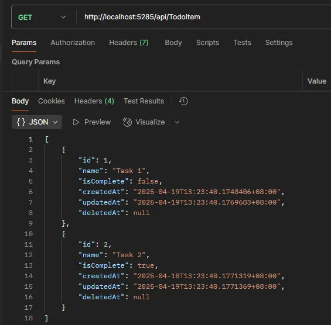

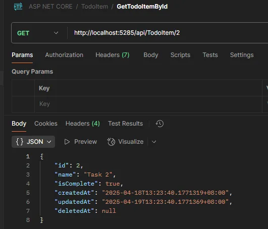

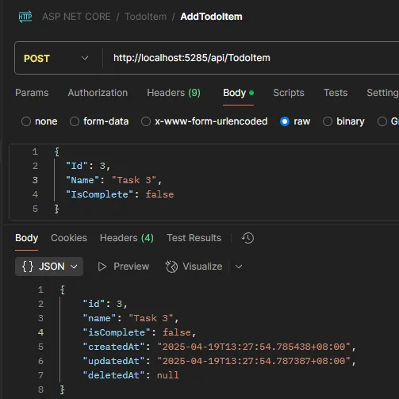

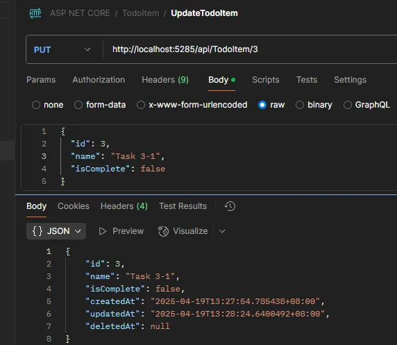

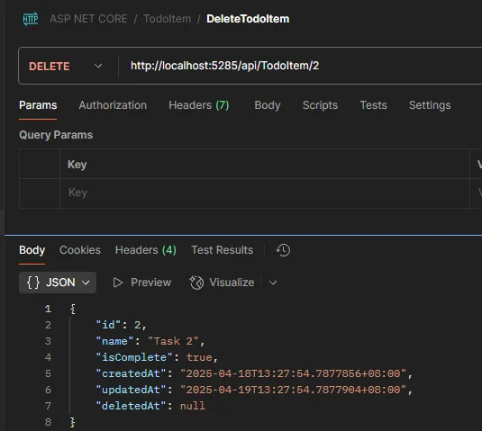

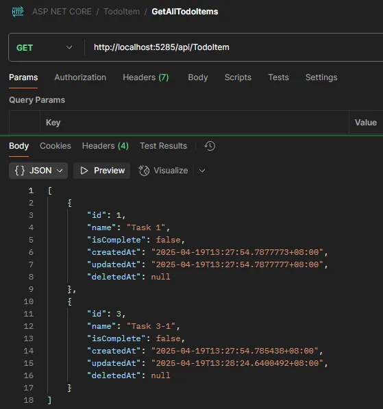
