# 1、配置数据库

1. 首先连接数据库

   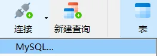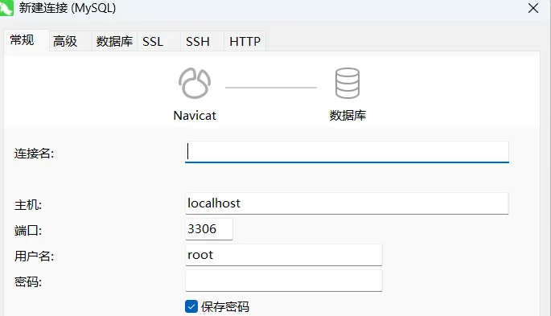

2. 然后连接已有数据库，或者是创建新的数据库

   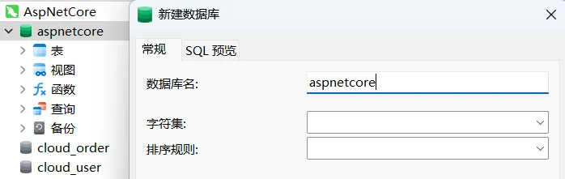

3. 随后在选择的数据库中选择或创建新的表，并且添加初始数据

   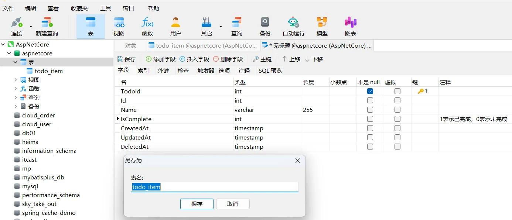

   由于是利用软件自动生成的数据，数据以仅作示例，没有特定含义。

   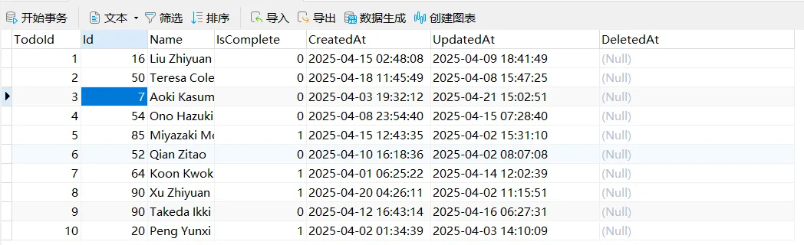

# 2、配置 MySQL 所需包

在使用数据库时，由于可能不包含必要的数据库插件，所以需要安装以下`NuGet`包，并且需要注意版本一致性：

1. Microsoft.EntityFrameworkCore
2. Microsoft.EntityFrameworkCore.Design
3. Microsoft.EntityFrameworkCore.Tools
4. Pomelo.EntityFrameworkCore.MySql

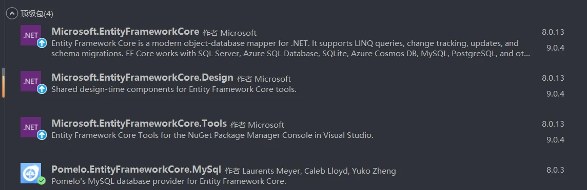

# 3、配置 MySQL 上下文

 TodoItemDbContext 类，它是一个 Entity Framework Core (EF Core) 的数据库上下文类，主要用于管理与数据库的交互。TodoItemDbContext 继承自 DbContext，是 EF Core 的核心组件，用于：定义数据库表与实体类的映射关系。提供对数据库的访问接口（如查询、插入、更新、删除操作）。管理数据库连接和事务。

```C#
using Microsoft.EntityFrameworkCore;
using Microsoft.Extensions.Options;
using WebApp.Pojo.Entity;

namespace WebApp.DB
{
    /// <summary>
    /// 待办事项数据库上下文类
    /// 继承自 DbContext，用于与数据库交互
    /// 提供对 TodoItem 实体的访问和管理
    /// </summary>
    public class TodoItemDbContext : DbContext
    {
        /// <summary>
        /// 待办事项表的 DbSet
        /// 映射到数据库中的 "todo_item" 表
        /// 作用：DbSet<T> 是 EF Core 中的一个集合，表示数据库中的一张表。
        /// 在这里：TodoItems 映射到数据库中的 todo_item 表。
        /// 用途：通过 TodoItems 属性，您可以对 todo_item 表执行 CRUD 操作（如查询所有待办事项、添加新待办事项等）。
        /// </summary>
        public DbSet<TodoItem> TodoItems { get; set; }

        /// <summary>
        /// 构造函数
        /// 通过依赖注入接收 DbContextOptions，用于配置数据库连接
        /// 作用：通过依赖注入接收 DbContextOptions，用于配置数据库连接（如连接字符串、数据库提供程序等）。
        /// 在这里：options 包含了数据库的配置信息（如 MySQL 的连接字符串）。
        /// 用途：支持灵活的数据库配置，便于在不同环境（如开发、测试、生产）中使用不同的数据库。
        /// </summary>
        /// <param name="options">数据库上下文选项</param>
        public TodoItemDbContext(DbContextOptions<TodoItemDbContext> options) : base(options)
        {
        }

        /// <summary>
        /// 配置模型的创建规则
        /// 在这里可以定义实体与数据库表的映射关系
        /// 作用：配置实体类与数据库表的映射规则。
        /// 在这里：
        /// 显式指定 TodoItem 实体映射到数据库表 todo_item。
        /// 如果不指定，EF Core 会默认使用实体类的名称（如 TodoItem）作为表名。
        /// 用途：确保代码中的实体类与数据库中的表名一致，避免因命名不一致导致的问题。
        /// </summary>
        /// <param name="modelBuilder">模型生成器</param>
        protected override void OnModelCreating(ModelBuilder modelBuilder)
        {
            // 显式指定 TodoItem 实体映射到数据库表 "todo_item"
            modelBuilder.Entity<TodoItem>().ToTable("todo_item");
        }
    }
}
```

注释说明

1.	类级别注释：
   - `TodoItemDbContext `是数据库上下文类，继承自 `DbContext`，用于管理与数据库的交互。
   - 它是 `Entity Framework Core` 的核心组件，负责查询、保存和管理实体。
2.	属性注释：
   - `DbSet<TodoItem>` 是 `EF Core `中的一个集合，表示数据库中的一张表。
   - 在这里，`TodoItems` 映射到数据库中的 `todo_item` 表。
3.	构造函数注释：
   - 构造函数通过依赖注入接收 `DbContextOptions`，用于配置数据库连接（如连接字符串、数据库提供程序等）。
4.	方法注释：
   - `OnModelCreating `方法用于配置实体与数据库表的映射关系。
   - 使用` ToTable("todo_item") `显式指定 `TodoItem `实体映射到数据库表` todo_item`。
---
代码功能总结

- 数据库上下文：
  - `TodoItemDbContext `是应用程序与数据库之间的桥梁。
  - 它管理` TodoItem `实体的` CRUD `操作。
- 表名映射：
  - 使用` ToTable("todo_item") `将 `TodoItem`实体映射到数据库表` todo_item`，确保表名一致。
- 依赖注入：
  - 通过构造函数注入` DbContextOptions`，支持灵活的数据库配置。

# 4、配置 MySQL 连接字符串

在 appsettings.json 文件中添加 MySQL 的连接字符串。

```Json
{
  // 配置日志记录
  "Logging": {
    "LogLevel": {
      // 默认日志级别，设置为 "Information"，记录信息级别及以上的日志（如警告、错误）
      "Default": "Information",
      // 针对 Microsoft.AspNetCore 命名空间的日志级别，设置为 "Warning"，仅记录警告及以上的日志
      "Microsoft.AspNetCore": "Warning"
    }
  },
  // 数据库连接字符串配置
  "ConnectionStrings": {
    // 默认数据库连接字符串，连接到 MySQL 数据库
    // server: 数据库服务器地址（此处为 localhost）
    // port: 数据库端口（MySQL 默认端口为 3306）
    // database: 数据库名称（此处为 aspnetcore）
    // uid: 数据库用户名（此处为 root）
    // pwd: 数据库密码（此处为 root）
    "DefaultConnection": "server=localhost;port=3306;database=aspnetcore;uid=root;pwd=root;"
  },
  // 配置允许的主机
  // "*" 表示允许所有主机访问
  "AllowedHosts": "*"
}
```

# 5、在 Program.cs 中配置 MySQL

```C#
// 导入必要的命名空间
// Microsoft.EntityFrameworkCore 提供与数据库交互的功能
// WebApp.Config 包含服务注册的扩展方法
// WebApp.DB 包含数据库上下文类
using Microsoft.EntityFrameworkCore;
using WebApp.Config;
using WebApp.DB;

// 创建一个 Web 应用程序构建器，用于配置应用程序的服务和中间件
// 这是 ASP.NET Core 应用程序的起点，提供配置、日志、服务注册等功能
var builder = WebApplication.CreateBuilder(args);

// 配置 MySQL 数据库上下文
// 将 TodoItemDbContext 注册到依赖注入容器中
// 使用 MySQL 作为数据库提供程序，并从 appsettings.json 中读取连接字符串
builder.Services.AddDbContext<TodoItemDbContext>(options =>
    options.UseMySql(
        builder.Configuration.GetConnectionString("DefaultConnection"), // 从配置文件中读取连接字符串
        new MySqlServerVersion(new Version(8, 0, 34)) // 指定 MySQL 数据库的版本
    )
);

// 注册控制器服务
// 将控制器添加到依赖注入容器中，允许应用程序处理基于控制器的 HTTP 请求
// 使 MVC 控制器可以被依赖注入系统识别
builder.Services.AddControllers();

// 注册应用程序中的所有服务
// 通过 DependencyInjectionExtensions 类中的扩展方法自动注册服务
// 包括 TodoItemService、TodoItemMapper 等依赖服务，避免在 Program.cs 中手动逐一注册
builder.Services.RegisterAllServices();

// 构建 Web 应用程序实例
// 通过构建器生成一个 Web 应用程序对象，准备运行应用程序
// 此时所有配置和服务注册都已完成，可以开始处理 HTTP 请求
var app = builder.Build();

// 映射控制器路由
// 将控制器的路由映射到应用程序中，使其能够响应 HTTP 请求
// 例如：将 "/api/TodoItem" 路径映射到 TodoItemController
app.MapControllers();

// 启动 Web 应用程序并开始监听请求
// 运行应用程序，开始处理传入的 HTTP 请求
// 应用程序将一直运行，直到被明确停止
app.Run();
```

详细解析
1. AddDbContext

  - 作用：
    - 将 TodoItemDbContext 注册到 ASP.NET Core 的依赖注入容器中。
    - 允许应用程序的其他部分（如控制器或服务）通过构造函数注入的方式使用 TodoItemDbContext。
  - 参数：
    - TodoItemDbContext：数据库上下文类，继承自 DbContext，用于管理与数据库的交互。
    - options：配置数据库上下文的选项（如数据库提供程序、连接字符串等）。

2. UseMySql

  - 作用：

    - 配置 EF Core 使用 MySQL 作为数据库提供程序。
    - 告诉 EF Core 如何连接到 MySQL 数据库。

  - 参数：

    - 连接字符串：

      - 通过 builder.Configuration.GetConnectionString("DefaultConnection") 从 appsettings.json 中读取连接字符串。
      - 连接字符串包含数据库服务器地址、端口、数据库名称、用户名和密码。

    - 示例连接字符串：

      ```C#
      "DefaultConnection": "server=localhost;port=3306;database=aspnetcore;uid=root;pwd=root;"
      ```

3. MySQL 版本：

  - 使用 new MySqlServerVersion(new Version(8, 0, 34)) 指定 MySQL 数据库的版本。
  - 这是 Pomelo.EntityFrameworkCore.MySql 提供程序的要求，用于优化 SQL 生成和功能支持。

4. builder.Configuration.GetConnectionString

  - 作用：
    - 从配置文件（如 appsettings.json）中读取连接字符串。
    - 确保数据库连接信息可以集中管理，便于在不同环境（如开发、测试、生产）中使用不同的配置。

5. 依赖注入的作用

   - 注册到容器：
     - AddDbContext 将 TodoItemDbContext 注册为服务，允许在应用程序的其他部分通过构造函数注入使用它。
   - 生命周期：
     - 默认情况下，AddDbContext 使用 Scoped 生命周期：
     - 每个 HTTP 请求创建一个新的 TodoItemDbContext 实例。
     - 同一请求中的所有服务共享同一个实例。

   ---
   代码在程序中的作用
   1.	数据库连接管理：
      - 通过 AddDbContext 和 UseMySql 配置数据库连接，确保应用程序可以与 MySQL 数据库交互。
   2.	依赖注入支持：
      - 将 TodoItemDbContext 注册到依赖注入容器中，允许控制器或服务通过构造函数注入使用它。
   3.	灵活的配置管理：
      - 使用 appsettings.json 管理连接字符串，便于在不同环境中切换数据库配置。
   4.	MySQL 优化：
      - 通过指定 MySQL 版本，EF Core 可以生成针对特定版本优化的 SQL 查询。

# 6、创建实体模型

依据创建的数据库表重新构建pojo中的内容。

Pojo\DTO\TodoItemDTO.cs

```C#
namespace WebApp.Pojo.DTO
{
    /// <summary>
    /// 待办事项数据传输对象 (Data Transfer Object)
    /// 用于在应用层之间传递待办事项数据，不包含所有实体属性
    /// </summary>
    public class TodoItemDTO
    {
        /// <summary>
        /// 优先级ID，表示待办事项的优先级等级
        /// </summary>
        public int Id { get; set; }

        /// <summary>
        /// 待办事项名称，可为空
        /// </summary>
        public string? Name { get; set; }

        /// <summary>
        /// 完成状态标志，表示待办事项是否已完成
        /// true 表示已完成，false 表示未完成
        /// </summary>
        public int IsComplete { get; set; }
    }
}
```

Pojo\Entity\TodoItem.cs

```C#
namespace WebApp.Pojo.Entity
{
    /// <summary>
    /// 待办事项实体类
    /// 表示数据库中的一条待办事项记录
    /// 用于持久化存储待办事项数据
    /// </summary>
    public class TodoItem
    {
        /// <summary>
        /// 待办事项的唯一标识符
        /// 设为私有属性以保证实体完整性
        /// 通常由数据库自动生成
        /// </summary>
        private int TodoId { get; set; }

        /// <summary>
        /// 优先级标识符
        /// 用于关联待办事项的优先级别
        /// 也可作为任务的唯一标识
        /// </summary>
        public int Id { get; set; }

        /// <summary>
        /// 待办事项名称
        /// 可以为空，表示任务的标题或描述
        /// </summary>
        public string? Name { get; set; }

        /// <summary>
        /// 完成状态标志
        /// 1 表示已完成，0 表示未完成
        /// 用于标记任务的完成状态
        /// </summary>
        public int IsComplete { get; set; }

        /// <summary>
        /// 创建时间
        /// 记录待办事项的创建时间戳
        /// 用于跟踪任务的生成时间
        /// </summary>
        public DateTime CreatedAt { get; set; }

        /// <summary>
        /// 更新时间
        /// 记录待办事项的最后更新时间戳
        /// 用于跟踪任务的修改时间
        /// </summary>
        public DateTime UpdatedAt { get; set; }

        /// <summary>
        /// 删除时间
        /// 用于软删除功能，记录任务被删除的时间
        /// 如果为 null，表示任务未被删除
        /// </summary>
        public DateTime? DeletedAt { get; set; }

        /// <summary>
        /// 默认构造函数
        /// 提供无参数的构造方法，便于 EF Core 或其他框架实例化对象
        /// </summary>
        public TodoItem()
        {
        }

        /// <summary>
        /// TodoItem 的完整构造函数
        /// 初始化待办事项的所有属性
        /// </summary>
        /// <param name="todoId">待办事项ID</param>
        /// <param name="id">优先级ID</param>
        /// <param name="name">待办事项名称</param>
        /// <param name="isComplete">完成状态</param>
        /// <param name="createdAt">创建时间</param>
        /// <param name="updatedAt">更新时间</param>
        /// <param name="deletedAt">删除时间，默认为 null</param>
        public TodoItem(int todoId, int id, string? name, int isComplete, DateTime createdAt, DateTime updatedAt, DateTime? deletedAt = null)
        {
            TodoId = todoId;
            Id = id;
            Name = name;
            IsComplete = isComplete;
            CreatedAt = createdAt;
            UpdatedAt = updatedAt;
            DeletedAt = deletedAt;
        }
    }
}
```

> 在 Entity Framework Core (EF Core) 或其他类似框架中，默认构造函数（无参数构造函数）是必需的或推荐的，主要是因为这些框架在实例化实体对象时需要遵循特定的规则。以下是详细的原因和解释：
>
> 1. EF Core 如何实例化实体对象
>
>   EF Core 使用反射（Reflection）来实例化实体对象。当从数据库中查询数据时，EF Core 会：
>
>   1. 创建实体对象：通过调用实体类的默认构造函数（无参数构造函数）。
>   2. 设置属性值：将数据库中的列值绑定到实体对象的属性。
>
>   如果实体类没有默认构造函数，EF Core 将无法实例化该类的对象，从而导致运行时错误。
>
> 2. 默认构造函数的作用
>
>    - 支持反射实例化
>      - EF Core 使用反射来创建对象，而反射需要一个无参数的构造函数来实例化类。如果没有默认构造函数，EF Core 无法通过反射创建对象。
>    - 支持延迟加载（Lazy Loading）
>      - 在启用延迟加载时，EF Core 可能会动态代理实体类（创建派生类）。默认构造函数是动态代理生成的关键要求。
>    - 支持属性绑定
>      - EF Core 在实例化对象后，会逐一设置属性值。如果没有默认构造函数，EF Core 无法创建对象，也就无法设置属性值。
>
> ---
> 3. 为什么完整构造函数不足以替代默认构造函数？
>   虽然实体类可以定义带参数的完整构造函数，但 EF Core 无法自动将数据库列值绑定到构造函数的参数。原因如下：
>   1. 参数名与列名可能不匹配：
>      - EF Core 依赖属性名与数据库列名匹配，而构造函数的参数名可能与列名不同。
>   2. 绑定复杂性：
>      - EF Core 无法解析复杂的构造函数逻辑（如参数的默认值或计算逻辑）。
>   3. 灵活性不足：
>      - 如果只有带参数的构造函数，EF Core 无法支持动态代理或延迟加载。

Pojo\VO\TodoItemVO.cs

```C#
namespace WebApp.Pojo.VO
{
    /// <summary>
    /// 待办事项视图对象 (View Object)
    /// 用于向前端或其他外部系统展示待办事项数据
    /// 不包含敏感数据字段，适合视图层使用
    /// </summary>
    public class TodoItemVO
    {
        /// <summary>
        /// 优先级标识符
        /// 表示待办事项的优先级等级
        /// </summary>
        public int Id { get; set; }

        /// <summary>
        /// 待办事项名称
        /// 可为空值
        /// </summary>
        public string? Name { get; set; }

        /// <summary>
        /// 完成状态标志
        /// true表示已完成，false表示未完成
        /// </summary>
        public int IsComplete { get; set; }

        /// <summary>
        /// 创建时间
        /// 记录待办事项创建的时间戳
        /// </summary>
        public DateTime CreatedAt { get; set; }

        /// <summary>
        /// 更新时间
        /// 记录待办事项最后一次更新的时间戳
        /// </summary>
        public DateTime UpdatedAt { get; set; }

        /// <summary>
        /// 删除时间
        /// 用于软删除功能，记录删除时间
        /// 为null表示未删除
        /// </summary>
        public DateTime? DeletedAt { get; set; }
    }
}
```

# 7、使用数据库

在Mapper中使用数据库

Mapper\ITodoItemMapper.cs

```C#
using WebApp.Pojo.Entity;

namespace WebApp.Mapper
{
    /// <summary>
    /// 待办事项数据映射器接口
    /// 定义了对待办事项(TodoItem)实体的数据访问操作
    /// 作为数据访问层的核心组件，负责数据操作的抽象
    /// </summary>
    public interface ITodoItemMapper
    {
        /// <summary>
        /// 获取所有待办事项
        /// </summary>
        /// <returns>所有待办事项的集合</returns>
        public List<TodoItem> GetAllTodoItems();

        /// <summary>
        /// 根据ID获取特定的待办事项
        /// </summary>
        /// <param name="id">待办事项的唯一标识符</param>
        /// <returns>对应ID的待办事项，如果不存在则返回null</returns>
        public TodoItem GetTodoItemById(int id);

        /// <summary>
        /// 添加一个新的待办事项
        /// </summary>
        /// <param name="todoItem">需要添加的待办事项对象</param>
        public void AddTodoItem(TodoItem todoItem);

        /// <summary>
        /// 更新指定ID的待办事项
        /// </summary>
        /// <param name="id">待更新待办事项的ID</param>
        /// <param name="todoItem">包含更新信息的待办事项对象</param>
        public void UpdateTodoItem(int id, TodoItem todoItem);

        /// <summary>
        /// 删除指定ID的待办事项
        /// </summary>
        /// <param name="id">待删除待办事项的ID</param>
        public void DeleteTodoItem(int id);
    }
}
```

Mapper\Impl\TodoItemMapperImpl.cs

```C#
using WebApp.DB;
using WebApp.Pojo.Entity;

namespace WebApp.Mapper.Impl
{
    /// <summary>
    /// TodoItem 数据映射器的实现类
    /// 提供对待办事项数据的数据库操作实现
    /// 实现 ITodoItemMapper 接口定义的所有数据访问操作
    /// </summary>
    public class TodoItemMapperImpl : ITodoItemMapper
    {
        /// <summary>
        /// 数据库上下文，用于与数据库交互
        /// </summary>
        private readonly TodoItemDbContext _context;

        /// <summary>
        /// 构造函数，通过依赖注入初始化数据库上下文
        /// </summary>
        /// <param name="todoItemDbContext">数据库上下文实例</param>
        public TodoItemMapperImpl(TodoItemDbContext todoItemDbContext)
        {
            _context = todoItemDbContext;
        }

        /// <summary>
        /// 获取所有待办事项
        /// 从数据库中检索所有 TodoItem 记录
        /// </summary>
        /// <returns>包含所有待办事项的集合</returns>
        public List<TodoItem> GetAllTodoItems()
        {
            // 使用 EF Core 的 ToList 方法将所有记录加载到内存中
            return _context.TodoItems.ToList();
        }

        /// <summary>
        /// 根据 ID 获取特定的待办事项
        /// 从数据库中查找匹配指定 ID 的 TodoItem
        /// </summary>
        /// <param name="id">待办事项的唯一标识符</param>
        /// <returns>对应 ID 的待办事项对象，如果不存在则返回 null</returns>
        public TodoItem GetTodoItemById(int id)
        {
            // 使用 EF Core 的 Find 方法根据主键查找记录
            return _context.TodoItems.Find(id);
        }

        /// <summary>
        /// 添加一个新的待办事项
        /// 将 TodoItem 对象插入到数据库中
        /// </summary>
        /// <param name="todoItem">需要添加的待办事项对象</param>
        public void AddTodoItem(TodoItem todoItem)
        {
            // 使用 EF Core 的 Add 方法将新记录添加到上下文
            _context.TodoItems.Add(todoItem);
            // 保存更改到数据库
            _context.SaveChanges();
        }

        /// <summary>
        /// 更新指定 ID 的待办事项
        /// 使用传入的 TodoItem 对象更新数据库中的记录
        /// </summary>
        /// <param name="id">待更新待办事项的 ID</param>
        /// <param name="todoItem">包含更新信息的待办事项对象</param>
        /// <remarks>注意：此方法不检查记录是否存在，可能导致空引用异常</remarks>
        public void UpdateTodoItem(int id, TodoItem todoItem)
        {
            // 使用 EF Core 的 Update 方法更新记录
            _context.TodoItems.Update(todoItem);
            // 保存更改到数据库
            _context.SaveChanges();
        }

        /// <summary>
        /// 删除指定 ID 的待办事项
        /// 从数据库中移除匹配的记录
        /// </summary>
        /// <param name="id">待删除待办事项的 ID</param>
        /// <remarks>注意：如果记录不存在，此方法不会执行任何操作</remarks>
        public void DeleteTodoItem(int id)
        {
            // 使用 EF Core 的 Find 方法查找记录
            var item = _context.TodoItems.Find(id);
            if (item != null)
            {
                // 如果记录存在，使用 Remove 方法删除记录
                _context.TodoItems.Remove(item);
                // 保存更改到数据库
                _context.SaveChanges();
            }
        }
    }
}
```

# 8、构建完整代码

Services\ITodoItemService.cs

```C#
using WebApp.Pojo.DTO;
using WebApp.Pojo.Entity;
using WebApp.Pojo.VO;

namespace WebApp.Services
{
    /// <summary>
    /// 待办事项服务接口
    /// 定义了待办事项的业务逻辑操作
    /// 作为业务逻辑层的核心组件，处理待办事项的业务规则和转换逻辑
    /// </summary>
    public interface ITodoItemService
    {
        /// <summary>
        /// 获取所有待办事项
        /// 以视图对象(VO)形式返回，适合前端展示
        /// </summary>
        /// <returns>所有待办事项的VO集合</returns>
        public List<TodoItemVO> GetAllTodoItems();

        /// <summary>
        /// 根据ID获取特定的待办事项
        /// 将数据库实体转换为视图对象返回
        /// </summary>
        /// <param name="id">待办事项的唯一标识符</param>
        /// <returns>对应ID的待办事项视图对象，如果不存在可能抛出异常</returns>
        public TodoItemVO GetTodoItemById(int id);

        /// <summary>
        /// 添加一个新的待办事项
        /// 将DTO转换为实体对象并保存，然后返回创建后的视图对象
        /// </summary>
        /// <param name="todoItemDTO">包含新待办事项信息的DTO</param>
        /// <returns>创建成功后的待办事项视图对象</returns>
        public TodoItemVO AddTodoItem(TodoItemDTO todoItemDTO);

        /// <summary>
        /// 更新指定ID的待办事项
        /// 使用DTO中的数据更新已有实体，并返回更新后的视图对象
        /// </summary>
        /// <param name="id">待更新待办事项的ID</param>
        /// <param name="todoItemDTO">包含更新信息的DTO</param>
        /// <returns>更新后的待办事项视图对象</returns>
        public TodoItemVO UpdateTodoItem(int id, TodoItemDTO todoItemDTO);

        /// <summary>
        /// 删除指定ID的待办事项
        /// 执行删除操作并返回删除前的待办事项信息
        /// </summary>
        /// <param name="id">待删除待办事项的ID</param>
        /// <returns>删除前的待办事项视图对象</returns>
        public TodoItemVO DeleteTodoItem(int id);
    }
}
```

Services\Impl\TodoItemServiceImpl.cs

```C#
using WebApp.Mapper;
using WebApp.Pojo.DTO;
using WebApp.Pojo.Entity;
using WebApp.Pojo.VO;

namespace WebApp.Services.Impl
{
    /// <summary>
    /// 待办事项服务实现类
    /// 实现了ITodoItemService接口定义的所有业务逻辑操作
    /// 作为连接表示层和数据访问层的桥梁，处理数据转换和业务规则
    /// </summary>
    public class TodoItemServiceImpl : ITodoItemService
    {
        /// <summary>
        /// 待办事项数据映射器接口，用于数据访问操作
        /// 通过依赖注入获取具体实现
        /// </summary>
        private readonly ITodoItemMapper _todoItemMapper;

        /// <summary>
        /// 构造函数，通过依赖注入初始化数据映射器
        /// </summary>
        /// <param name="todoItemMapper">待办事项数据映射器接口实现</param>
        public TodoItemServiceImpl(ITodoItemMapper todoItemMapper)
        {
            _todoItemMapper = todoItemMapper;
        }

        /// <summary>
        /// 获取所有待办事项
        /// 将从数据层获取的实体列表转换为视图对象列表
        /// </summary>
        /// <returns>所有待办事项的视图对象集合</returns>
        public List<TodoItemVO> GetAllTodoItems()
        {
            // 调用数据映射器获取所有待办事项实体
            List<TodoItem> todoItems = _todoItemMapper.GetAllTodoItems();

            // 使用LINQ将实体列表转换为VO列表并返回
            return todoItems.Select(item => new TodoItemVO
            {
                Id = item.Id,
                Name = item.Name,
                IsComplete = item.IsComplete,
                CreatedAt = item.CreatedAt,
                UpdatedAt = item.UpdatedAt,
                DeletedAt = item.DeletedAt
            }).ToList();
        }

        /// <summary>
        /// 根据ID获取特定的待办事项
        /// 如果项目不存在则抛出异常
        /// </summary>
        /// <param name="id">待办事项的唯一标识符</param>
        /// <returns>对应ID的待办事项视图对象</returns>
        /// <exception cref="Exception">当找不到待办事项时抛出</exception>
        public TodoItemVO GetTodoItemById(int id)
        {
            // 调用数据映射器根据ID查找待办事项
            TodoItem todoItem = _todoItemMapper.GetTodoItemById(id);

            // 如果未找到项目，抛出异常
            if (todoItem == null)
            {
                throw new Exception("Todo item not found");
            }

            // 将实体转换为视图对象并返回
            return new TodoItemVO
            {
                Id = todoItem.Id,
                Name = todoItem.Name,
                IsComplete = todoItem.IsComplete,
                CreatedAt = todoItem.CreatedAt,
                UpdatedAt = todoItem.UpdatedAt,
                DeletedAt = todoItem.DeletedAt
            };
        }

        /// <summary>
        /// 添加一个新的待办事项
        /// 将DTO转换为实体对象，保存后返回创建的视图对象
        /// </summary>
        /// <param name="todoItemDTO">包含新待办事项信息的DTO</param>
        /// <returns>创建成功后的待办事项视图对象</returns>
        /// <exception cref="Exception">当创建操作失败时抛出</exception>
        public TodoItemVO AddTodoItem(TodoItemDTO todoItemDTO)
        {
            // 创建新的待办事项实体，设置适当的初始值
            // 注意：todoId使用了硬编码值3，实际应用中应使用自增ID或GUID
            TodoItem todoItem = new TodoItem(
                    todoId: Random.Shared.Next(),
                    id: todoItemDTO.Id,
                    name: todoItemDTO.Name,
                    isComplete: todoItemDTO.IsComplete,
                    createdAt: DateTime.Now,
                    updatedAt: DateTime.Now);

            // 调用数据映射器添加新项目
            _todoItemMapper.AddTodoItem(todoItem);

            // 验证添加操作是否成功
            TodoItem todoItemCreate = _todoItemMapper.GetTodoItemById(todoItemDTO.Id);
            if (todoItem == null) // 注意：这里应检查todoItemCreate而非todoItem
            {
                throw new Exception("Todo item not found");
            }

            // 将实体转换为视图对象并返回
            return new TodoItemVO
            {
                Id = todoItem.Id,
                Name = todoItem.Name,
                IsComplete = todoItem.IsComplete,
                CreatedAt = todoItem.CreatedAt,
                UpdatedAt = todoItem.UpdatedAt,
                DeletedAt = todoItem.DeletedAt
            };
        }

        /// <summary>
        /// 更新指定ID的待办事项
        /// 使用DTO中的数据更新已有实体，保存后返回更新的视图对象
        /// </summary>
        /// <param name="id">待更新待办事项的ID</param>
        /// <param name="todoItemDTO">包含更新信息的DTO</param>
        /// <returns>更新后的待办事项视图对象</returns>
        /// <exception cref="Exception">当待办事项不存在或更新失败时抛出</exception>
        public TodoItemVO UpdateTodoItem(int id, TodoItemDTO todoItemDTO)
        {
            // 调用数据映射器根据ID查找待办事项
            TodoItem todoItem = _todoItemMapper.GetTodoItemById(id);

            // 如果未找到项目，抛出异常
            if (todoItem == null)
            {
                throw new Exception("Todo item not found");
            }

            // 用DTO中的数据更新实体属性
            todoItem.Id = todoItemDTO.Id;
            todoItem.Name = todoItemDTO.Name;
            todoItem.IsComplete = todoItemDTO.IsComplete;
            todoItem.UpdatedAt = DateTime.Now; // 更新修改时间为当前时间

            // 调用数据映射器更新项目
            _todoItemMapper.UpdateTodoItem(id, todoItem);

            // 验证更新操作是否成功
            TodoItem todoItemUpdate = _todoItemMapper.GetTodoItemById(todoItemDTO.Id);
            if (todoItem == null) // 注意：这里应检查todoItemUpdate而非todoItem
            {
                throw new Exception("Todo item not found");
            }

            // 将更新后的实体转换为视图对象并返回
            return new TodoItemVO
            {
                Id = todoItem.Id,
                Name = todoItem.Name,
                IsComplete = todoItem.IsComplete,
                CreatedAt = todoItem.CreatedAt,
                UpdatedAt = todoItem.UpdatedAt,
                DeletedAt = todoItem.DeletedAt
            };
        }

        /// <summary>
        /// 删除指定ID的待办事项
        /// 执行删除操作并返回删除前的待办事项信息
        /// </summary>
        /// <param name="id">待删除待办事项的ID</param>
        /// <returns>删除前的待办事项视图对象</returns>
        /// <exception cref="Exception">当待办事项不存在时抛出</exception>
        public TodoItemVO DeleteTodoItem(int id)
        {
            // 调用数据映射器根据ID查找待办事项
            TodoItem todoItem = _todoItemMapper.GetTodoItemById(id);

            // 如果未找到项目，抛出异常
            if (todoItem == null)
            {
                throw new Exception("Todo item not found");
            }

            // 在删除前，保存项目的信息用于返回
            TodoItemVO result = new TodoItemVO
            {
                Id = todoItem.Id,
                Name = todoItem.Name,
                IsComplete = todoItem.IsComplete,
                CreatedAt = todoItem.CreatedAt,
                UpdatedAt = todoItem.UpdatedAt,
                DeletedAt = todoItem.DeletedAt
            };

            // 调用数据映射器删除项目
            _todoItemMapper.DeleteTodoItem(id);

            // 返回删除前的项目信息
            return result;
        }
    }
}
```

Controllers\TodoItemController.cs

```C#
using Microsoft.AspNetCore.Mvc;
using WebApp.Pojo.DTO;
using WebApp.Pojo.VO;
using WebApp.Services;

namespace WebApp.Controllers
{
    /// <summary>
    /// 待办事项控制器
    /// 处理与待办事项相关的所有HTTP请求
    /// 作为应用程序的表示层，负责接收请求、调用服务层处理业务逻辑并返回结果
    /// </summary>
    [ApiController]  // 指示此类为API控制器，启用API特定行为如自动模型验证
    [Route("api/[controller]")]  // 设置此控制器的路由模板，[controller]会被解析为"TodoItem"(去掉"Controller"后缀)
    public class TodoItemController : ControllerBase
    {
        /// <summary>
        /// 待办事项服务接口实例
        /// 通过依赖注入获取，用于处理业务逻辑操作
        /// </summary>
        private readonly ITodoItemService _todoItemService;

        /// <summary>
        /// 构造函数，通过依赖注入初始化服务
        /// </summary>
        /// <param name="todoItemService">待办事项服务接口实现</param>
        public TodoItemController(ITodoItemService todoItemService)
        {
            _todoItemService = todoItemService;
        }

        /// <summary>
        /// 获取所有待办事项
        /// 处理HTTP GET请求，路由为 "api/TodoItem"
        /// </summary>
        /// <returns>包含所有待办事项VO列表的HTTP 200成功响应</returns>
        [HttpGet] // 指定此方法处理 HTTP GET 请求
        public ActionResult<List<TodoItemVO>> GetAllTodoItems()
        {
            // 调用服务层获取所有待办事项
            List<TodoItemVO> todoItemVOs = _todoItemService.GetAllTodoItems();

            // 返回HTTP 200状态码和获取到的待办事项列表
            return Ok(todoItemVOs);
        }

        /// <summary>
        /// 根据ID获取特定的待办事项
        /// 处理HTTP GET请求，路由为 "api/TodoItem/{id}"
        /// </summary>
        /// <param name="id">待获取的待办事项ID，来自URL路径</param>
        /// <returns>包含指定ID待办事项的HTTP 200成功响应，如果未找到则由服务层抛出异常</returns>
        [HttpGet("{id}")] // 指定此方法处理带有ID参数的HTTP GET请求
        public ActionResult<TodoItemVO> GetTodoItemById(int id)
        {
            // 调用服务层根据ID获取待办事项
            TodoItemVO todoItemVO = _todoItemService.GetTodoItemById(id);

            // 返回HTTP 200状态码和获取到的待办事项
            return Ok(todoItemVO);
        }

        /// <summary>
        /// 创建新的待办事项
        /// 处理HTTP POST请求，路由为 "api/TodoItem"
        /// </summary>
        /// <param name="todoItem">包含新待办事项信息的DTO，从请求体中解析</param>
        /// <returns>包含创建成功的待办事项VO的HTTP 200成功响应</returns>
        [HttpPost] // 指定此方法处理HTTP POST请求
        public ActionResult<TodoItemVO> AddTodoItem([FromBody] TodoItemDTO todoItem)
        {
            // 调用服务层创建新待办事项
            TodoItemVO todoItemVO = _todoItemService.AddTodoItem(todoItem);

            // 返回HTTP 200状态码和创建的待办事项
            // 注意：更符合RESTful设计的做法是返回201 Created状态码和资源位置
            return Ok(todoItemVO);
        }

        /// <summary>
        /// 更新指定ID的待办事项
        /// 处理HTTP PUT请求，路由为 "api/TodoItem/{id}"
        /// </summary>
        /// <param name="id">待更新的待办事项ID，来自URL路径</param>
        /// <param name="todoItem">包含更新信息的DTO，从请求体中解析</param>
        /// <returns>包含更新后待办事项VO的HTTP 200成功响应，如果未找到则由服务层抛出异常</returns>
        [HttpPut("{id}")] // 指定此方法处理带有ID参数的HTTP PUT请求
        public ActionResult<TodoItemVO> UpdateTodoItem(int id, [FromBody] TodoItemDTO todoItem)
        {
            // 调用服务层更新待办事项
            TodoItemVO todoItemVO = _todoItemService.UpdateTodoItem(id, todoItem);

            // 返回HTTP 200状态码和更新后的待办事项
            return Ok(todoItemVO);
        }

        /// <summary>
        /// 删除指定ID的待办事项
        /// 处理HTTP DELETE请求，路由为 "api/TodoItem/{id}"
        /// </summary>
        /// <param name="id">待删除的待办事项ID，来自URL路径</param>
        /// <returns>包含删除前待办事项信息的HTTP 200成功响应，如果未找到则由服务层抛出异常</returns>
        [HttpDelete("{id}")] // 指定此方法处理带有ID参数的HTTP DELETE请求
        public ActionResult<TodoItemVO> DeleteTodoItem(int id)
        {
            // 调用服务层删除待办事项
            TodoItemVO todoItemVO = _todoItemService.DeleteTodoItem(id);

            // 返回HTTP 200状态码和删除的待办事项信息
            // 注意：更符合RESTful设计的做法是返回204 No Content状态码
            return Ok(todoItemVO);
        }
    }
}
```

# 9、结果可视化

1、查询全部

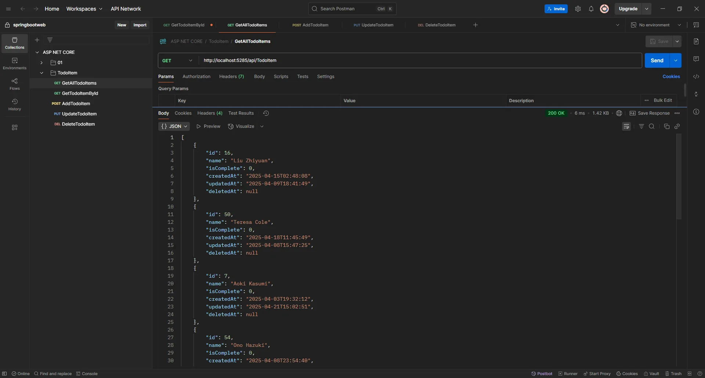

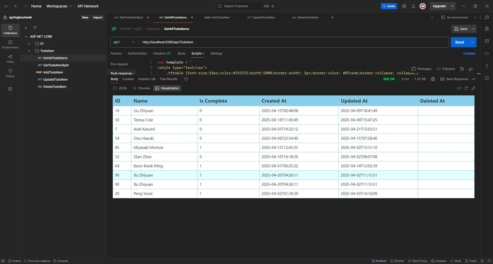

2、单独查询全部

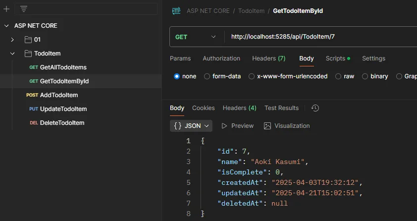

3、添加新内容

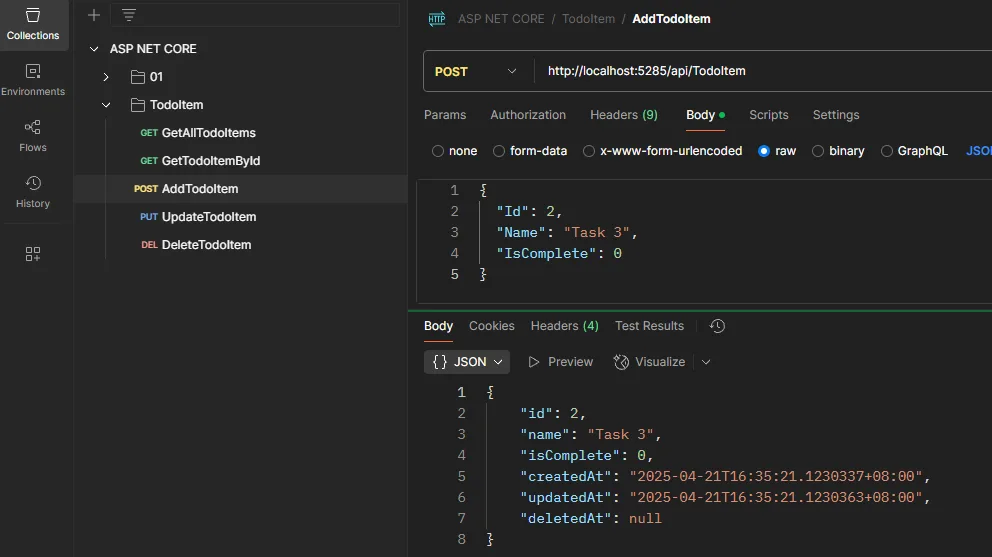

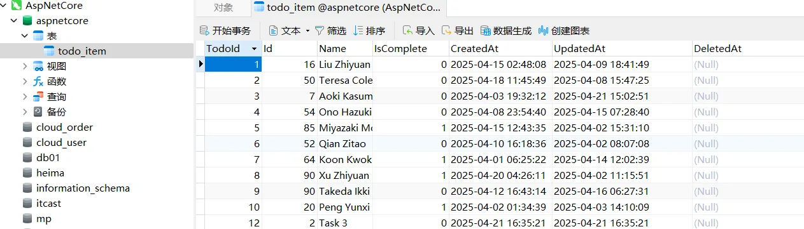

4、改数据

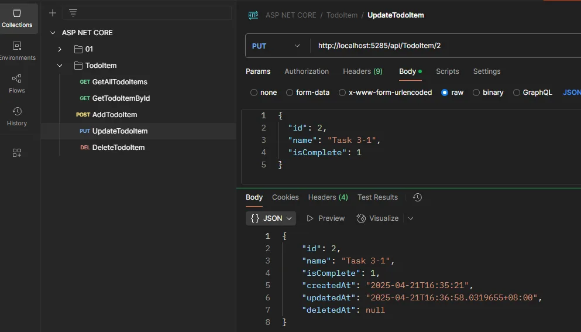

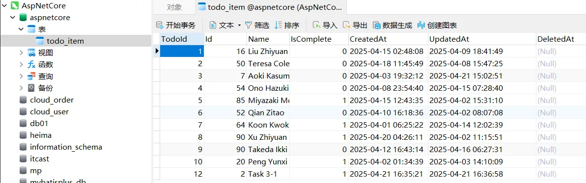

5、删除数据

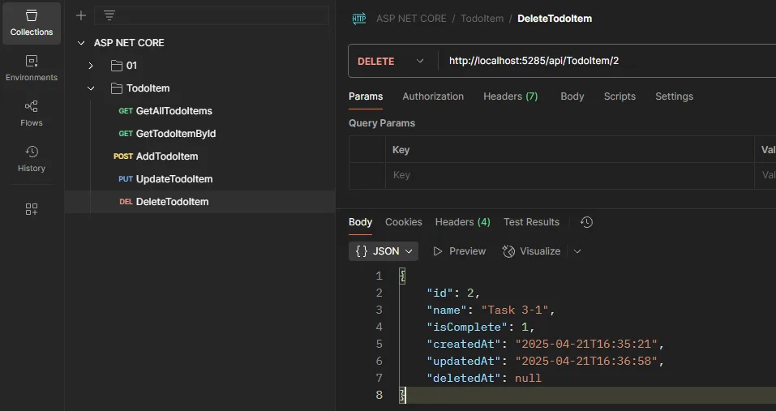

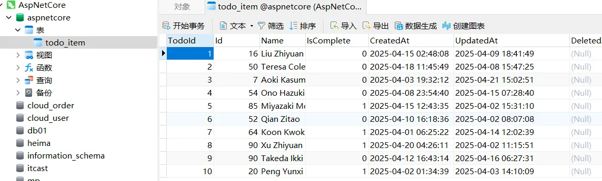
