# 1、分页

在`TodoItemController.cs`中添加如下代码

```C#
/// <summary>
/// 获取分页的待办事项列表
/// 处理HTTP GET请求，路由为 "api/TodoItem/paged"
/// 接收查询参数pageNumber和pageSize
/// </summary>
/// <param name="pageNumber">当前页码，默认为1，从查询字符串中获取</param>
/// <param name="pageSize">每页记录数，默认为10，从查询字符串中获取</param>
/// <returns>包含分页待办事项列表的HTTP 200成功响应</returns>
[HttpGet("paged")] // 指定此方法处理路由为 "api/TodoItem/paged" 的GET请求
public ActionResult<List<TodoItemVO>> GetPagedTodoItems([FromQuery] int pageNumber = 1, [FromQuery] int pageSize = 10)
{
    // 验证分页参数的有效性
    if (pageNumber < 1) pageNumber = 1;
    if (pageSize < 1) pageSize = 10;
    if (pageSize > 100) pageSize = 100; // 限制最大页面大小，防止请求过多数据

    // 调用服务层获取分页数据
    // 服务层负责计算分页偏移量、获取数据子集并返回结果
    var pagedResult = _todoItemService.GetPagedTodoItems(pageNumber, pageSize);

    // 返回分页结果
    // 可以考虑返回包含额外分页元数据的自定义结果类
    return Ok(pagedResult);
}
```

在`ITodoItemService.cs`中添加如下代码

```C#
/// <summary>
/// 获取分页的待办事项
/// </summary>
/// <param name="pageNumber">当前页码</param>
/// <param name="pageSize">每页记录数</param>
/// <returns>分页的待办事项集合</returns>
public List<TodoItemVO> GetPagedTodoItems(int pageNumber, int pageSize);
```

在`TodoItemServiceImpl.cs`中添加如下代码

```C#
/// <summary>
/// 获取分页的待办事项列表
/// 从数据访问层获取指定页的数据并转换为视图对象
/// </summary>
/// <param name="pageNumber">要获取的页码，从1开始</param>
/// <param name="pageSize">每页包含的记录数</param>
/// <returns>指定页的待办事项视图对象集合</returns>
public List<TodoItemVO> GetPagedTodoItems(int pageNumber, int pageSize)
{
    // 验证分页参数的有效性
    if (pageNumber < 1) pageNumber = 1;
    if (pageSize < 1) pageSize = 10;

    // 调用数据映射器获取分页的待办事项数据
    var todoItems = _todoItemMapper.GetPagedTodoItems(pageNumber, pageSize);

    // 将实体对象转换为视图对象并返回
    var pagedItems = todoItems.Select(item => new TodoItemVO
    {
        Id = item.Id,
        Name = item.Name,
        IsComplete = item.IsComplete,
        CreatedAt = item.CreatedAt,
        UpdatedAt = item.UpdatedAt,
        DeletedAt = item.DeletedAt
    }).ToList();

    return pagedItems;
}
```

在`ITodoItemMapper.cs`中添加如下代码

```C#
/// <summary>
/// 获取分页的待办事项列表
/// 根据指定的页码和页面大小返回对应的数据子集
/// 支持分页查询，优化大数据集的访问效率
/// </summary>
/// <param name="pageNumber">请求的页码，从1开始计数</param>
/// <param name="pageSize">每页的记录数量</param>
/// <returns>指定页的待办事项集合，如果没有记录则返回空列表</returns>
public List<TodoItem> GetPagedTodoItems(int pageNumber, int pageSize);
```

在`TodoItemMapperImpl.cs`中添加如下代码

```c#
/// <summary>
/// 获取分页的待办事项列表
/// 根据指定的页码和页面大小返回对应的数据子集
/// 支持分页查询，优化大数据集的访问效率
/// </summary>
/// <param name="pageNumber">请求的页码，从1开始计数</param>
/// <param name="pageSize">每页的记录数量</param>
/// <returns>指定页的待办事项集合，如果没有记录则返回空列表</returns>
public List<TodoItem> GetPagedTodoItems(int pageNumber, int pageSize)
{
    // 使用 LINQ 的 Skip 和 Take 方法实现分页
    // Skip 方法跳过前 (pageNumber - 1) * pageSize 条记录
    // Take 方法获取接下来的 pageSize 条记录
    // 这会执行 SELECT * FROM todo_item LIMIT {pageSize} OFFSET {(pageNumber-1)*pageSize} 查询
    return _context.TodoItems
        .Skip((pageNumber - 1) * pageSize)
        .Take(pageSize)
        .ToList();
}
```

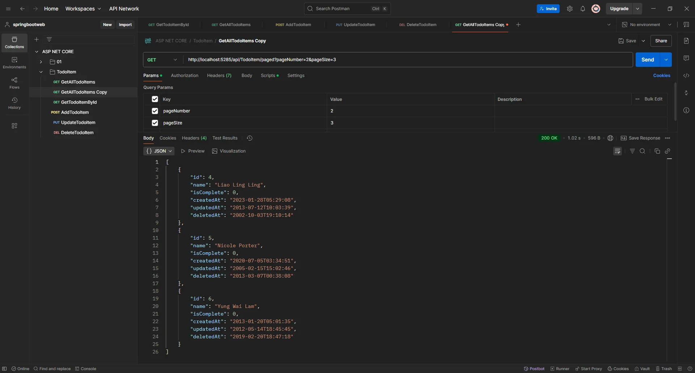

# 2、筛选

在`TodoItemController.cs`中修改为如下代码

```C#
/// <summary>
/// 获取分页的待办事项列表，支持可选的名称筛选
/// 处理HTTP GET请求，路由为 "api/TodoItem/paged"
/// 接收查询参数pageNumber、pageSize和可选的name
/// </summary>
/// <param name="pageNumber">当前页码，默认为1，从查询字符串中获取</param>
/// <param name="pageSize">每页记录数，默认为10，从查询字符串中获取</param>
/// <param name="name">可选的名称筛选条件，支持包含匹配，从查询字符串中获取</param>
/// <returns>包含分页待办事项列表的HTTP 200成功响应</returns>
[HttpGet("paged")] // 指定此方法处理路由为 "api/TodoItem/paged" 的GET请求
public ActionResult<List<TodoItemVO>> GetPagedTodoItems(
    [FromQuery] int pageNumber = 1,
    [FromQuery] int pageSize = 10,
    [FromQuery] string? name = null)
{
    // 验证分页参数的有效性
    if (pageNumber < 1) pageNumber = 1;
    if (pageSize < 1) pageSize = 10;
    if (pageSize > 100) pageSize = 100; // 限制最大页面大小，防止请求过多数据

    // 调用服务层获取分页数据，传递筛选参数
    var pagedResult = _todoItemService.GetPagedTodoItems(pageNumber, pageSize, name);

    // 返回分页结果
    return Ok(pagedResult);
}
```

在`ITodoItemService.cs`中修改为如下代码

```C#
/// <summary>
/// 获取分页的待办事项，支持可选的名称筛选
/// </summary>
/// <param name="pageNumber">当前页码</param>
/// <param name="pageSize">每页记录数</param>
/// <param name="name">可选的名称筛选条件，null表示不筛选</param>
/// <returns>分页的待办事项集合</returns>
public List<TodoItemVO> GetPagedTodoItems(int pageNumber, int pageSize, string? name = null);
```

在`TodoItemServiceImpl.cs`中修改为如下代码

```C#
/// <summary>
/// 获取分页的待办事项列表，支持可选的名称筛选
/// </summary>
/// <param name="pageNumber">当前页码，从1开始计数</param>
/// <param name="pageSize">每页记录数</param>
/// <param name="name">可选的名称筛选条件，null表示不筛选</param>
/// <returns>指定页的待办事项视图对象集合</returns>
public List<TodoItemVO> GetPagedTodoItems(int pageNumber, int pageSize, string? name = null)
{
    // 调用数据映射层获取分页数据，传递筛选参数
    var todoItems = _todoItemMapper.GetPagedTodoItems(pageNumber, pageSize, name);

    // 将实体对象转换为视图对象
    var pagedItems = todoItems.Select(item => new TodoItemVO
    {
        Id = item.Id,
        Name = item.Name,
        IsComplete = item.IsComplete,
        CreatedAt = item.CreatedAt,
        UpdatedAt = item.UpdatedAt,
        DeletedAt = item.DeletedAt
    })
        .ToList();

    return pagedItems;
}
```

在`ITodoItemMapper.cs`中修改为如下代码

```C#
/// <summary>
/// 获取分页的待办事项列表，支持可选的名称筛选
/// </summary>
/// <param name="pageNumber">请求的页码，从1开始计数</param>
/// <param name="pageSize">每页的记录数量</param>
/// <param name="name">可选的名称筛选条件，null表示不筛选</param>
/// <returns>符合条件的待办事项集合</returns>
public List<TodoItem> GetPagedTodoItems(int pageNumber, int pageSize, string? name = null);
```

在`TodoItemMapperImpl.cs`中修改为如下代码

```c#
/// <summary>
/// 获取分页的待办事项列表，支持可选的名称筛选
/// </summary>
/// <param name="pageNumber">请求的页码，从1开始计数</param>
/// <param name="pageSize">每页的记录数量</param>
/// <param name="name">可选的名称筛选条件，null表示不筛选</param>
/// <returns>符合条件的待办事项集合</returns>
public List<TodoItem> GetPagedTodoItems(int pageNumber, int pageSize, string? name = null)
{
    // 创建基础查询
    IQueryable<TodoItem> query = _context.TodoItems;

    // 应用名称筛选（如果提供）
    if (!string.IsNullOrEmpty(name))
    {
        query = query.Where(t => t.Name != null && t.Name.Contains(name));
    }

    // 应用分页并返回结果
    return query
        .Skip((pageNumber - 1) * pageSize)
        .Take(pageSize)
        .ToList();
}
```

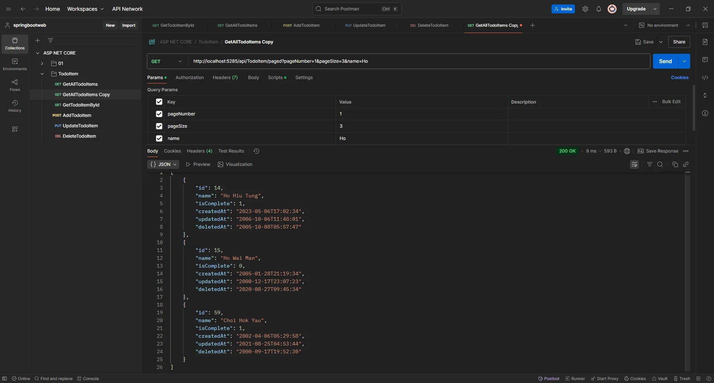

# 3、排序

在`TodoItemController.cs`中修改为如下代码

```C#
/// <summary>
/// 获取分页的待办事项列表，支持可选的名称筛选和排序
/// 处理HTTP GET请求，路由为 "api/TodoItem/paged"
/// </summary>
/// <param name="pageNumber">当前页码，默认为1</param>
/// <param name="pageSize">每页记录数，默认为10</param>
/// <param name="name">可选的名称筛选条件，为null时不筛选</param>
/// <param name="sortBy">可选的排序字段，默认为"createdAt"</param>
/// <param name="order">可选的排序方向，默认为"desc"</param>
/// <returns>包含分页待办事项列表的HTTP 200成功响应</returns>
[HttpGet("paged")]
public ActionResult<List<TodoItemVO>> GetPagedTodoItems(
    [FromQuery] int pageNumber = 1,
    [FromQuery] int pageSize = 10,
    [FromQuery] string? name = null,
    [FromQuery] string? sortBy = null,
    [FromQuery] string? order = null)
{
    // 验证分页参数
    if (pageNumber < 1) pageNumber = 1;
    if (pageSize < 1) pageSize = 10;
    if (pageSize > 100) pageSize = 100;

    // 调用服务层获取分页数据
    var pagedResult = _todoItemService.GetPagedTodoItems(pageNumber, pageSize, name, sortBy, order);

    // 返回分页结果
    return Ok(pagedResult);
}
```

在`ITodoItemService.cs`中修改为如下代码

```C#
/// <summary>
/// 获取分页的待办事项，支持可选的名称筛选和排序
/// </summary>
/// <param name="pageNumber">当前页码</param>
/// <param name="pageSize">每页记录数</param>
/// <param name="name">可选的名称筛选条件</param>
/// <param name="sortBy">可选的排序字段</param>
/// <param name="order">可选的排序方向</param>
/// <returns>分页的待办事项集合</returns>
public List<TodoItemVO> GetPagedTodoItems(int pageNumber, int pageSize, string? name = null, string? sortBy = null, string? order = null);
```

在`TodoItemServiceImpl.cs`中修改为如下代码

```C#
/// <summary>
/// 获取分页的待办事项列表，支持可选的名称筛选和排序
/// </summary>
/// <param name="pageNumber">当前页码，从1开始计数</param>
/// <param name="pageSize">每页记录数</param>
/// <param name="name">可选的名称筛选条件，null表示不筛选</param>
/// <param name="sortBy">可选的排序字段，null使用默认排序</param>
/// <param name="order">可选的排序方向，null使用默认方向</param>
/// <returns>指定页的待办事项视图对象集合</returns>
public List<TodoItemVO> GetPagedTodoItems(int pageNumber, int pageSize, string? name = null,
                                 string? sortBy = null, string? order = null)
{
    // 调用数据访问层获取分页数据，传递所有筛选和排序参数
    // 体现了分层设计：将复杂的查询逻辑委托给数据访问层
    var todoItems = _todoItemMapper.GetPagedTodoItems(pageNumber, pageSize, name, sortBy, order);

    // 将实体对象转换为视图对象
    // 确保返回给控制层的是展示层模型，而非持久层模型
    return todoItems.Select(item => new TodoItemVO
    {
        Id = item.Id,
        Name = item.Name,
        IsComplete = item.IsComplete,
        CreatedAt = item.CreatedAt,
        UpdatedAt = item.UpdatedAt,
        DeletedAt = item.DeletedAt
    }).ToList();
}
```

在`ITodoItemMapper.cs`中修改为如下代码

```C#
/// <summary>
/// 获取分页的待办事项列表，支持可选的名称筛选和排序
/// </summary>
/// <param name="pageNumber">页码</param>
/// <param name="pageSize">页大小</param>
/// <param name="name">可选的名称筛选</param>
/// <param name="sortBy">可选的排序字段</param>
/// <param name="order">可选的排序方向</param>
/// <returns>待办事项集合</returns>
public List<TodoItem> GetPagedTodoItems(int pageNumber, int pageSize, string? name = null,string? sortBy = null, string? order = null);
```

在`TodoItemMapperImpl.cs`中修改为如下代码

```c#
/// <summary>
/// 获取分页的待办事项列表，支持可选的名称筛选和排序
/// 根据给定的参数从数据库中检索并返回符合条件的数据子集
/// </summary>
/// <param name="pageNumber">要获取的页码，从1开始</param>
/// <param name="pageSize">每页包含的记录数</param>
/// <param name="name">可选的名称筛选条件，支持包含匹配</param>
/// <param name="sortBy">可选的排序字段名称</param>
/// <param name="order">可选的排序方向，"asc"表示升序，其他值表示降序</param>
/// <returns>分页过滤后的待办事项集合</returns>
public List<TodoItem> GetPagedTodoItems(int pageNumber, int pageSize, string? name = null,
                               string? sortBy = null, string? order = null)
{
    // 创建基础查询
    // 定义一个IQueryable<TodoItem>，这样可以延迟执行查询，只在需要时才访问数据库
    IQueryable<TodoItem> query = _context.TodoItems;

    // 应用名称筛选
    // 如果提供了名称参数，则添加WHERE条件
    if (!string.IsNullOrEmpty(name))
    {
        query = query.Where(t => t.Name != null && t.Name.Contains(name));
    }

    // 确定排序方向
    // 解析order参数，确定是升序还是降序排序
    // 如果order参数是"asc"则为升序，否则为降序
    bool isAscending = !string.IsNullOrEmpty(order) && order.ToLower() == "asc";

    // 应用排序
    // 根据sortBy参数选择排序字段，并应用之前确定的排序方向
    if (!string.IsNullOrEmpty(sortBy))
    {
        switch (sortBy.ToLower())
        {
            case "id":
                query = isAscending ? query.OrderBy(t => t.Id) : query.OrderByDescending(t => t.Id);
                break;

            case "name":
                query = isAscending ? query.OrderBy(t => t.Name) : query.OrderByDescending(t => t.Name);
                break;

            case "iscomplete":
                query = isAscending ? query.OrderBy(t => t.IsComplete) : query.OrderByDescending(t => t.IsComplete);
                break;

            case "updatedat":
                query = isAscending ? query.OrderBy(t => t.UpdatedAt) : query.OrderByDescending(t => t.UpdatedAt);
                break;

            case "createdat":
                query = isAscending ? query.OrderBy(t => t.CreatedAt) : query.OrderByDescending(t => t.CreatedAt);
                break;

            default:
                query = isAscending ? query.OrderBy(t => t.CreatedAt) : query.OrderByDescending(t => t.CreatedAt);
                break;
        }
    }
    else
    {
        // 默认按创建时间降序排序
        // 如果没有指定排序字段，则使用创建时间降序作为默认排序
        query = query.OrderByDescending(t => t.CreatedAt);
    }

    // 应用分页
    // 使用Skip和Take方法实现分页
    // Skip跳过前(pageNumber-1)*pageSize条记录，Take获取pageSize条记录
    return query
        .Skip((pageNumber - 1) * pageSize)
        .Take(pageSize)
        .ToList(); // 执行查询并返回结果
}
```

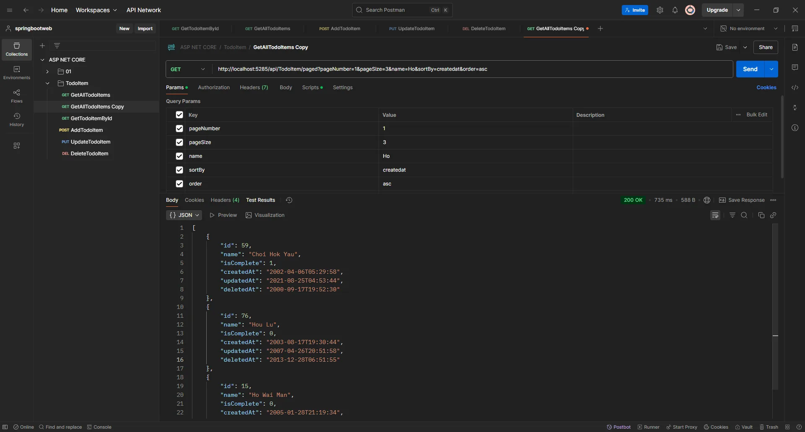

# 4、使用`Redis`

Redis是一种基于内存的高性能键值数据库，其核心作用在于提供快速的数据读写能力，并支持多样化的数据结构与高可用架构。以下是它的基本作用及典型使用场景：

## 1、基本作用

1. **高速数据存储与访问**
   由于数据存储在内存中，Redis的读写速度远超传统磁盘数据库，可达到每秒数十万次操作，尤其适合处理高并发场景下的实时数据需求。例如缓存热点数据，降低数据库负载，提升系统响应速度。
2. **多样化数据结构支持**
   除了基础的字符串（String）、哈希（Hash）、列表（List）、集合（Set）、有序集合（Sorted Set），Redis还支持位图、HyperLogLog、地理空间索引等高级结构，能灵活应对复杂业务逻辑，如统计唯一用户数（UV）或地理位置计算。
3. **数据持久化与可靠性**
   通过RDB快照和AOF日志两种机制，Redis可将内存数据持久化到磁盘，避免系统故障时数据丢失。同时，主从复制、哨兵模式及集群架构确保了服务的高可用性和容灾能力。
4. **分布式系统支持**
   Redis支持分布式锁、集群分片及跨节点数据同步，适用于构建分布式架构中的资源协调与负载均衡，例如电商秒杀场景下的库存控制。

## 2、典型使用场景

1. **缓存加速**
   将频繁访问的数据（如商品详情、用户信息）缓存至Redis，减少直接查询数据库的次数，显著提升响应速度。例如，电商平台的热门商品信息可通过Redis缓存，缓解数据库压力。
2. **会话存储与状态管理**
   存储用户登录状态或会话信息（如购物车数据），支持无状态服务架构。用户在不同设备或服务器间切换时，仍能保持一致的会话体验。
3. **实时排行榜与计数器**
   利用有序集合（Sorted Set）的自动排序特性，实现实时更新的游戏积分榜或热销商品排行。原子操作（如INCR）则支持高并发下的访问量统计或限流控制。
4. **消息队列与异步处理**
   通过列表（List）或发布订阅（Pub/Sub）模式构建轻量级消息队列，实现异步任务处理。例如订单生成后，异步通知物流系统或发送用户确认邮件。
5. **分布式锁与资源协调**
   使用SETNX命令实现跨服务的互斥锁，确保分布式环境下共享资源的安全访问，例如防止库存超卖或重复提交订单。
6. **实时数据分析**
   结合HyperLogLog统计大规模数据集的唯一值，或利用位图记录用户活跃状态，快速生成实时统计报表，如每日活跃用户数（DAU）。

## 3、通过docker desktop安装Redis

### 1. **下载 Docker Desktop**

- 访问 Docker 官网：https://www.docker.com/。
- 点击页面上的“Download for Windows - AMD64”按钮，以下载适用于 Windows 系统的 Docker Desktop 安装文件。

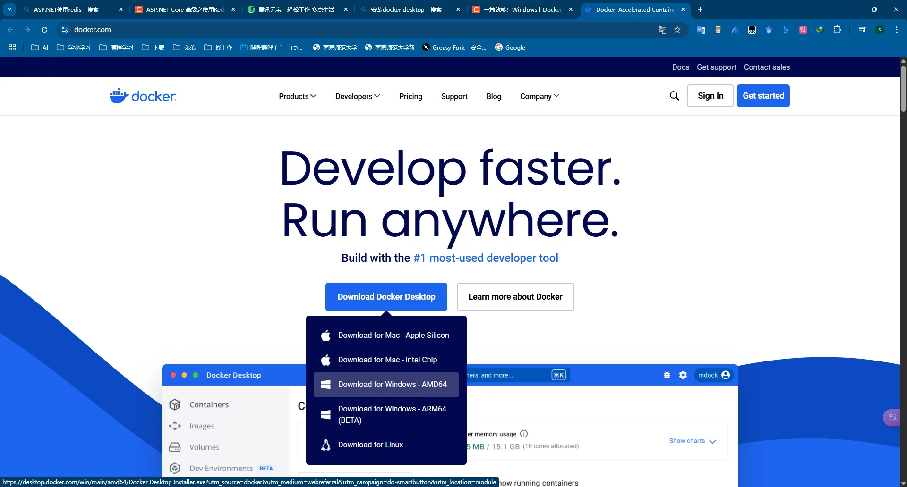

### 2. **安装 Docker Desktop**

- 双击下载的安装文件，开始安装 Docker Desktop。

- 在安装之前首先启动必要的Windows功能

  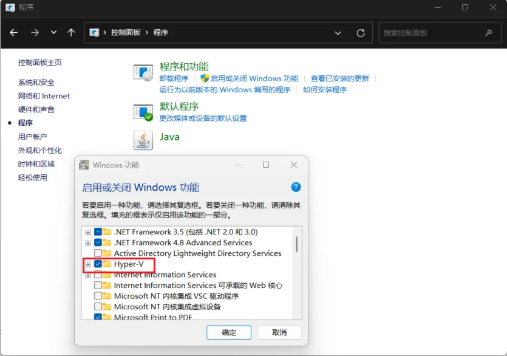

  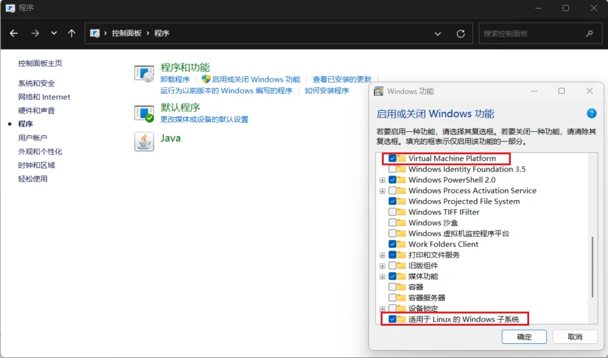

- 按照安装向导的指示完成安装。在安装过程中，将提示安装 **WSL 2**，建议勾选此选项以获得更好的性能。

  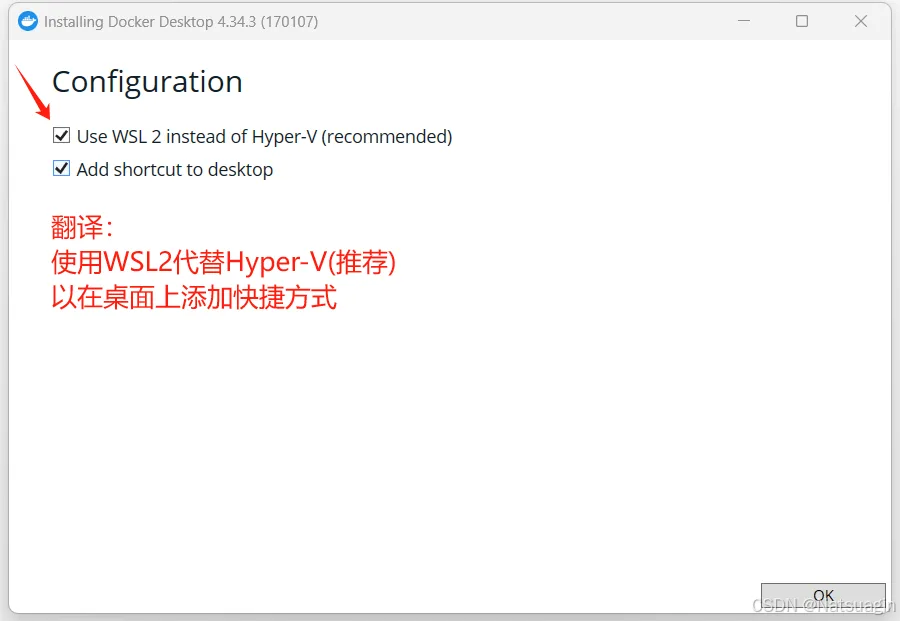

### 3. **配置 Docker Desktop**

- 安装完成后，启动 **Docker Desktop**。

  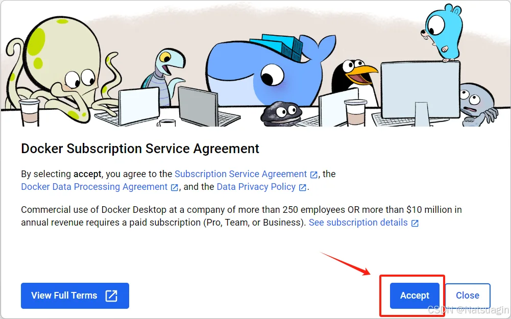

- 首次打开时，将出现 Docker 订阅协议，点击 `Accept`（接受）以继续。

- 随后，系统将提示用户登录。可以选择使用 GitHub 账户或 Google 账户登录。

- 接下来，将出现调查问卷，您可以根据个人喜好选择填写，或直接跳过此步骤。

- 最后，Docker Desktop 将正常启动。

  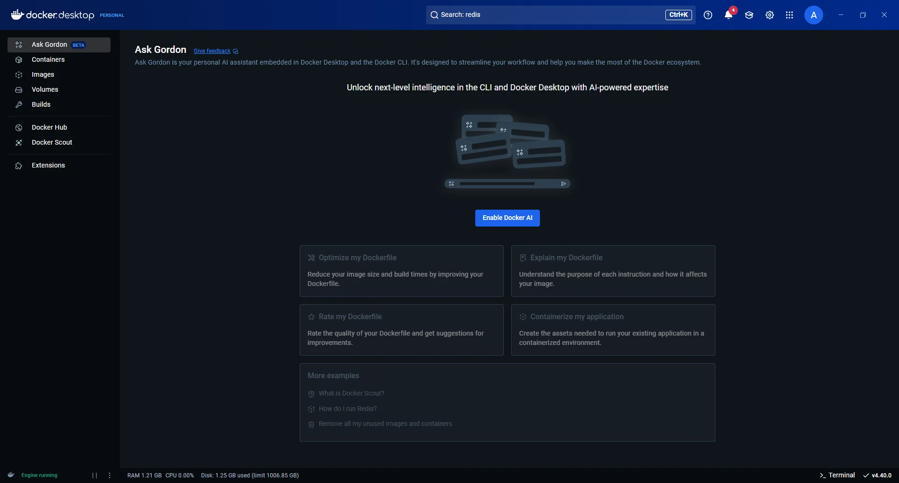

### 4. **安装Redis**

1. 在Docker Desktop中搜寻Redis，里面有通过Docker Desktop安装Redis相关内容。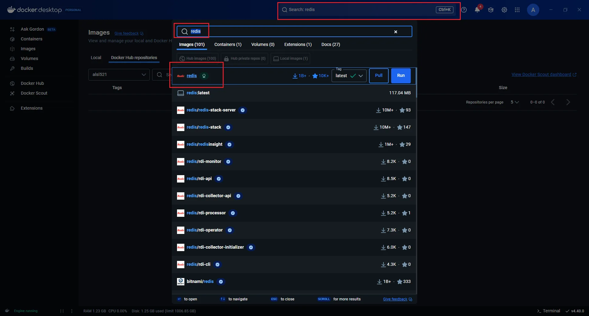

   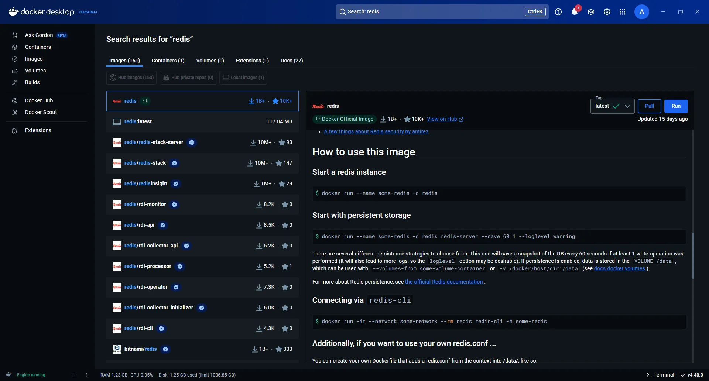

2. 打开`Terminal（终端）`，然后输入相关docker代码，从而运行Redis，我们可以通过`Another Redis Desktop Manager`连接查看数据库中的内容。并且需要将Redis设定密码。

   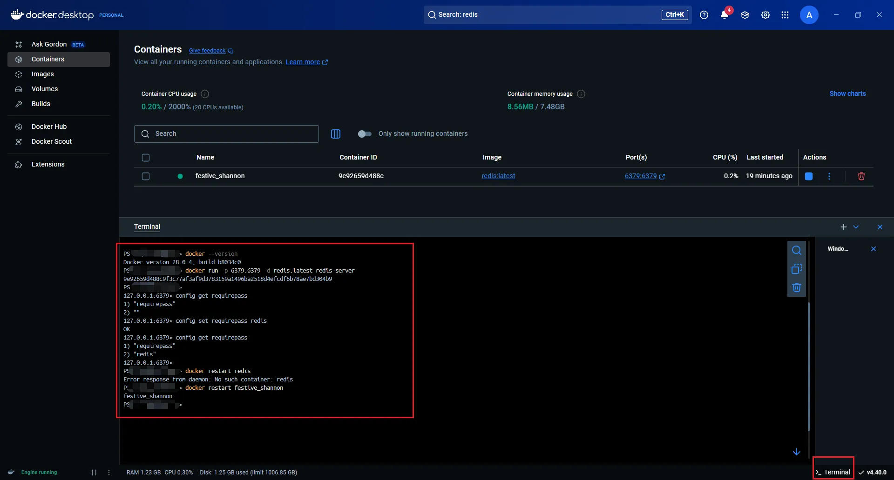

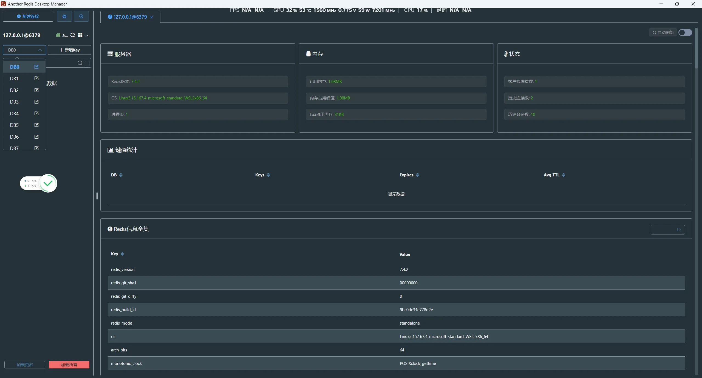

## 4、ASP.NET Core中使用Redis

### 1、安装必要的 NuGet 包

在项目中安装 StackExchange.Redis 包，基本 Redis 客户端。Microsoft.Extensions.Caching.StackExchangeRedis则用于分布式缓存集成。

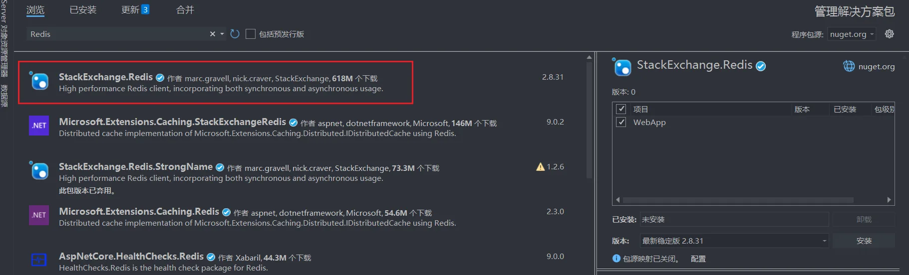

> Redis客户端库比较及推荐理由
>
> 1. ServiceStack.Redis
>
> 简介
>
> - ServiceStack.Redis 是一个功能强大的 Redis 客户端，支持丰富的 Redis 功能。
> - 属于 ServiceStack 框架的一部分，提供高级 API 和易用性。
> - 支持连接池、事务、发布/订阅、Lua 脚本等功能。
>
> 优点
>
> - 高级 API 封装复杂操作
> - 支持高并发连接池
> - 提供丰富文档和示例
>
> 缺点
>
> - **商业化**：免费版功能受限，企业版需购买许可证
> - 社区支持较少，依赖官方维护
>
> ---
>
> 2. StackExchange.Redis
>
> 简介
>
> - 由 StackExchange 团队（Stack Overflow 开发者）维护，支持 .NET Core/.NET Framework。
> - 目前最流行的 .NET Redis 客户端之一。
>
> 优点
>
> - **开源免费**：无商业限制
> - **高性能**：多路复用连接减少开销
> - **功能全面**：支持事务、发布/订阅、Lua 脚本等
> - **活跃社区**：用户群体庞大，更新频繁
> - **完善文档**：提供详细示例代码
>
> 缺点
>
> - API 偏底层，需熟悉 Redis 原理
> - 不支持连接池（但多路复用已优化性能）
>
> ---
>
> 3. CSRedis
>
> 简介
>
> - 轻量级 Redis 客户端，简化 Redis 使用。
> - 提供与 Redis 命令一一对应的 API。
>
> 优点
>
> - 易用性高，快速上手
> - 支持高并发连接池
> - 集成 ASP.NET Core 分布式缓存和会话管理
>
> 缺点
>
> - 社区支持较少（个人维护为主）
> - 功能相对简单，适合中小项目
>
> ---
>
> 4. FreeRedis
>
> 简介
>
> - 现代化 Redis 客户端，支持多种 Redis 功能。
> - API 设计与 Redis 命令一致。
>
> 优点
>
> - 支持事务、发布/订阅、管道等
> - API 简洁易用
> - 兼容单机/集群/哨兵模式
>
> 缺点
>
> - 社区支持不足，用户基数小
> - 文档和示例较少
>
> ---
>
> 推荐使用 StackExchange.Redis 的原因
>
> 1. **开源免费** 
>    无商业限制，适用于任何规模项目。
>
> 2. **高性能** 
>    多路复用技术减少连接开销，单连接处理多请求。
>
> 3. **功能全面性** 
>    覆盖 Redis 核心功能（事务、Lua 脚本、管道等），支持缓存、分布式锁等场景。
>
> 4. **社区支持**  
>    - 用户群体庞大，问题解决效率高  
>    - 由 StackExchange 团队持续维护，稳定性强
>
> 5. **文档完善** 
>    提供详细文档和代码示例，降低学习成本。
>
> 6. **企业级验证** 
>    被多家大型企业采用，性能与可靠性经过实际验证。
>
> ---
>
> 总结对比
>
> | 特性           | ServiceStack.Redis | StackExchange.Redis | CSRedis | FreeRedis |
> | -------------- | ------------------ | ------------------- | ------- | --------- |
> | **开源免费**   | 否（商业限制）     | 是                  | 是      | 是        |
> | **社区支持**   | 较少               | 活跃                | 较少    | 较少      |
> | **性能**       | 高                 | 高                  | 中      | 中        |
> | **功能全面性** | 高                 | 高                  | 中      | 中        |
> | **易用性**     | 高                 | 中                  | 高      | 高        |
> | **文档和示例** | 丰富               | 丰富                | 较少    | 较少      |
>
> **结论**：推荐优先选择 `StackExchange.Redis`，尤其适合需高性能、功能全面且开源免费的项目。其社区支持与文档完善性使其成为 .NET 生态的首选客户端。

### 2、配置 Redis 连接

在 appsettings.json 中添加 Redis 的连接字符串：

```json
{
  // 配置日志记录
  "Logging": {
    "LogLevel": {
      // 默认日志级别，设置为 "Information"，记录信息级别及以上的日志（如警告、错误）
      "Default": "Information",
      // 针对 Microsoft.AspNetCore 命名空间的日志级别，设置为 "Warning"，仅记录警告及以上的日志
      "Microsoft.AspNetCore": "Warning"
    }
  },
  // 数据库连接字符串配置
  "ConnectionStrings": {
    // 默认数据库连接字符串，连接到 MySQL 数据库
    // server: 数据库服务器地址（此处为 localhost）
    // port: 数据库端口（MySQL 默认端口为 3306）
    // database: 数据库名称（此处为 aspnetcore）
    // uid: 数据库用户名（此处为 root）
    // pwd: 数据库密码（此处为 root）
    "DefaultConnection": "server=localhost;port=3306;database=aspnetcore;uid=root;pwd=root;",
    // Redis连接字符串
    // localhost:6379: Redis服务器地址和端口
    // password: Redis认证密码
    // ssl: 是否启用SSL连接（此处为false）
    // abortConnect: 连接失败时是否中止（此处为false，表示允许重试）
    "Redis": "localhost:6379,password=redis,ssl=false,abortConnect=false"
  },
  // Redis实例配置
  "Redis": {
    // Redis实例名称前缀，用于区分不同应用的缓存键
    "InstanceName": "TodoApp:"
  },
  // 配置允许的主机
  // "*" 表示允许所有主机访问
  "AllowedHosts": "*"
}
```

### 3. 在 Program.cs 中配置 Redis

在 ASP.NET Core 的依赖注入容器中注册 Redis 客户端：

```c#
// 导入必要的命名空间
// Microsoft.EntityFrameworkCore 提供与数据库交互的功能
using Microsoft.EntityFrameworkCore;
// StackExchange.Redis 是Redis客户端，提供与Redis服务器通信的功能
using StackExchange.Redis;
// WebApp.Config 包含服务注册的扩展方法
using WebApp.Config;
// WebApp.DB 包含数据库上下文类，定义了应用程序与数据库的交互模型
using WebApp.DB;

// 创建一个 Web 应用程序构建器，用于配置应用程序的服务和中间件
// 这是 ASP.NET Core 应用程序的起点，提供配置、日志、服务注册等功能
var builder = WebApplication.CreateBuilder(args);

// 配置 MySQL 数据库上下文
// 将 TodoItemDbContext 注册到依赖注入容器中
// 使用 MySQL 作为数据库提供程序，并从 appsettings.json 中读取连接字符串
builder.Services.AddDbContext<TodoItemDbContext>(options =>
    options.UseMySql(
        builder.Configuration.GetConnectionString("DefaultConnection"), // 从配置文件中读取连接字符串
        new MySqlServerVersion(new Version(8, 0, 34)) // 指定 MySQL 数据库的版本
    )
);

// 添加Redis分布式缓存
// 配置ASP.NET Core内置的分布式缓存系统使用Redis作为存储后端
// 这允许应用程序使用IDistributedCache接口访问Redis缓存
builder.Services.AddStackExchangeRedisCache(options =>
{
    // 设置Redis连接字符串，指定Redis服务器的地址和认证信息
    options.Configuration = builder.Configuration.GetConnectionString("Redis");
    // 设置Redis实例名称前缀，用于区分不同应用共享同一Redis服务时的缓存键
    options.InstanceName = builder.Configuration.GetSection("Redis:InstanceName").Value;
});

// 注册Redis连接多路复用器
// ConnectionMultiplexer是StackExchange.Redis的核心组件，管理与Redis服务器的所有连接
// 使用单例模式注册，确保整个应用程序共享同一连接实例，避免创建过多连接
builder.Services.AddSingleton<IConnectionMultiplexer>(sp =>
{
    // 解析Redis连接配置
    var configuration = ConfigurationOptions.Parse(
        builder.Configuration.GetConnectionString("Redis"));
    // 创建并返回连接实例
    // 此连接支持自动重连和命令多路复用
    return ConnectionMultiplexer.Connect(configuration);
});


// 注册控制器服务
// 将控制器添加到依赖注入容器中，允许应用程序处理基于控制器的 HTTP 请求
// 使 MVC 控制器可以被依赖注入系统识别，支持API端点的路由和处理
builder.Services.AddControllers();

// 注册应用程序中的所有服务
// 通过 DependencyInjectionExtensions 类中的扩展方法自动注册服务
// 包括 TodoItemService、TodoItemMapper、RedisCacheService 等依赖服务
// 避免在 Program.cs 中手动逐一注册，提高代码模块化和可维护性
builder.Services.RegisterAllServices();

// 构建 Web 应用程序实例
// 通过构建器生成一个 Web 应用程序对象，准备运行应用程序
// 此时所有配置和服务注册都已完成，可以开始处理 HTTP 请求
var app = builder.Build();

// 映射控制器路由
// 将控制器的路由映射到应用程序中，使其能够响应 HTTP 请求
// 例如：将 "/api/TodoItem" 路径映射到 TodoItemController
// 这是启用API端点的必要步骤
app.MapControllers();

// 启动 Web 应用程序并开始监听请求
// 运行应用程序，开始处理传入的 HTTP 请求
// 应用程序将一直运行，直到被明确停止（如按Ctrl+C或进程终止）
app.Run();
```

### 4. 创建 Redis 服务类相关代码

IRedisCacheService

```C#
namespace WebApp.Redis
{
    /// <summary>
    /// Redis 缓存服务接口
    /// 定义了与 Redis 缓存交互的基本操作
    /// 提供类型安全的方法来存储、检索和管理缓存数据
    /// </summary>
    public interface IRedisCacheService
    {
        /// <summary>
        /// 异步从缓存中获取指定键的值
        /// </summary>
        /// <typeparam name="T">要返回的对象类型</typeparam>
        /// <param name="key">缓存键</param>
        /// <returns>
        /// 如果找到键，则返回反序列化后的对象；
        /// 如果未找到键或值已过期，则返回 null
        /// </returns>
        Task<T?> GetAsync<T>(string key);

        /// <summary>
        /// 异步将值存储在缓存中，使用指定的键
        /// </summary>
        /// <typeparam name="T">要缓存的对象类型</typeparam>
        /// <param name="key">缓存键</param>
        /// <param name="value">要缓存的对象</param>
        /// <param name="expiry">
        /// 可选的过期时间；
        /// 如果为 null，则使用默认过期策略或永不过期（取决于实现）
        /// </param>
        /// <returns>表示异步操作的任务</returns>
        Task SetAsync<T>(string key, T value, TimeSpan? expiry = null);

        /// <summary>
        /// 异步从缓存中移除指定键的值
        /// </summary>
        /// <param name="key">要移除的缓存键</param>
        /// <returns>
        /// 如果键存在且被成功移除，则返回 true；
        /// 如果键不存在，则返回 false
        /// </returns>
        Task<bool> RemoveAsync(string key);

        /// <summary>
        /// 异步检查缓存中是否存在指定的键
        /// </summary>
        /// <param name="key">要检查的缓存键</param>
        /// <returns>
        /// 如果缓存中存在指定的键，则返回 true；
        /// 否则返回 false
        /// </returns>
        Task<bool> ExistsAsync(string key);
    }
}
```

RedisCacheServiceImpl

```C#
using StackExchange.Redis;   // 引入 StackExchange.Redis 命名空间，提供 Redis 客户端功能
using WebApp.Result;         // 引入自定义结果处理命名空间，包含 ISerializer 接口

namespace WebApp.Redis.Impl
{
    /// <summary>
    /// Redis缓存服务实现类
    /// 实现了IRedisCacheService接口，提供与Redis缓存交互的具体实现
    /// 使用StackExchange.Redis作为底层客户端与Redis服务器通信
    /// </summary>
    public class RedisCacheServiceImpl : IRedisCacheService
    {
        /// <summary>
        /// Redis数据库实例
        /// 提供对Redis命令的直接访问
        /// 由ConnectionMultiplexer管理，线程安全且高效
        /// </summary>
        private readonly IDatabase _db;

        /// <summary>
        /// 序列化器接口实例
        /// 负责对象与字符串之间的转换，使Redis能够存储复杂对象
        /// </summary>
        private readonly ISerializer _serializer;

        /// <summary>
        /// 构造函数，通过依赖注入初始化Redis数据库和序列化器
        /// </summary>
        /// <param name="redis">Redis连接多路复用器，管理与Redis服务器的连接</param>
        /// <param name="serializer">用于序列化和反序列化对象的工具</param>
        public RedisCacheServiceImpl(IConnectionMultiplexer redis, ISerializer serializer)
        {
            _db = redis.GetDatabase();  // 获取Redis数据库实例
            _serializer = serializer;   // 初始化序列化器
        }

        /// <summary>
        /// 从Redis缓存中异步获取值
        /// </summary>
        /// <typeparam name="T">要返回的对象类型</typeparam>
        /// <param name="key">缓存键</param>
        /// <returns>
        /// 如果找到键，则返回反序列化后的对象；
        /// 如果未找到键或值已过期，则返回默认值(null或值类型的默认值)
        /// </returns>
        public async Task<T?> GetAsync<T>(string key)
        {
            // 从Redis获取字符串值
            var value = await _db.StringGetAsync(key);

            // 如果值为null，直接返回类型的默认值
            if (value.IsNull)
                return default;

            // 将字符串值反序列化为请求的类型并返回
            return _serializer.Deserialize<T>(value);
        }

        /// <summary>
        /// 将值异步存储到Redis缓存中
        /// </summary>
        /// <typeparam name="T">要缓存的对象类型</typeparam>
        /// <param name="key">缓存键</param>
        /// <param name="value">要缓存的对象</param>
        /// <param name="expiry">可选的过期时间，null表示永不过期</param>
        /// <returns>表示异步操作的任务</returns>
        public Task SetAsync<T>(string key, T value, TimeSpan? expiry = null)
        {
            // 将对象序列化为字符串
            var serializedValue = _serializer.Serialize(value);

            // 使用指定的键值和过期时间将序列化后的值存储到Redis
            return _db.StringSetAsync(key, serializedValue, expiry);
        }

        /// <summary>
        /// 从Redis缓存中异步移除指定键的值
        /// </summary>
        /// <param name="key">要移除的缓存键</param>
        /// <returns>
        /// 如果键存在且被成功移除，则返回true；
        /// 如果键不存在，则返回false
        /// </returns>
        public Task<bool> RemoveAsync(string key)
        {
            // 从Redis中删除指定的键
            // KeyDeleteAsync方法会返回一个布尔值，表示键是否存在并被删除
            return _db.KeyDeleteAsync(key);
        }

        /// <summary>
        /// 异步检查Redis缓存中是否存在指定的键
        /// </summary>
        /// <param name="key">要检查的缓存键</param>
        /// <returns>
        /// 如果缓存中存在指定的键，则返回true；
        /// 否则返回false
        /// </returns>
        public Task<bool> ExistsAsync(string key)
        {
            // 检查Redis中是否存在指定的键
            return _db.KeyExistsAsync(key);
        }
    }
}
```

ISerializer

```C#
namespace WebApp.Result
{
    /// <summary>
    /// 序列化接口
    /// 定义了对象序列化和反序列化的基本操作
    /// 为应用程序提供了统一的序列化抽象，便于切换不同的序列化实现
    /// 主要用于Redis缓存服务中对象与字符串格式的转换
    /// </summary>
    public interface ISerializer
    {
        /// <summary>
        /// 将对象序列化为字符串
        /// </summary>
        /// <typeparam name="T">要序列化的对象类型</typeparam>
        /// <param name="obj">要序列化的对象实例</param>
        /// <returns>序列化后的字符串表示</returns>
        string Serialize<T>(T obj);

        /// <summary>
        /// 将字符串反序列化为对象
        /// </summary>
        /// <typeparam name="T">目标对象类型</typeparam>
        /// <param name="value">要反序列化的字符串</param>
        /// <returns>反序列化后的对象实例</returns>
        T Deserialize<T>(string value);
    }
}
```

JsonSerializer

```C#
namespace WebApp.Result
{
    /// <summary>
    /// JSON序列化器实现类
    /// 实现ISerializer接口，提供基于System.Text.Json的序列化功能
    /// 作为应用程序中默认的序列化机制，将对象转换为JSON格式字符串
    /// 主要用于Redis缓存中存储复杂对象
    /// </summary>
    public class JsonSerializer : ISerializer
    {
        /// <summary>
        /// 将对象序列化为JSON字符串
        /// 利用.NET内置的System.Text.Json库完成序列化
        /// </summary>
        /// <typeparam name="T">要序列化的对象类型</typeparam>
        /// <param name="obj">要序列化的对象实例</param>
        /// <returns>序列化后的JSON字符串</returns>
        public string Serialize<T>(T obj)
        {
            // 调用System.Text.Json库的序列化方法
            // 将对象转换为JSON格式的字符串表示
            return System.Text.Json.JsonSerializer.Serialize(obj);
        }

        /// <summary>
        /// 将JSON字符串反序列化为对象
        /// 利用.NET内置的System.Text.Json库完成反序列化
        /// </summary>
        /// <typeparam name="T">目标对象类型</typeparam>
        /// <param name="value">要反序列化的JSON字符串</param>
        /// <returns>反序列化后的对象实例</returns>
        /// <exception cref="JsonException">当JSON字符串格式无效或与目标类型不匹配时抛出</exception>
        public T Deserialize<T>(string value)
        {
            // 调用System.Text.Json库的反序列化方法
            // 将JSON字符串解析为指定类型的对象
            return System.Text.Json.JsonSerializer.Deserialize<T>(value);
        }
    }
}
```


### 5. 在控制器中使用 Redis

```C#
using Microsoft.AspNetCore.Mvc;                // 引入MVC控制器相关的命名空间
using Microsoft.Extensions.Caching.Distributed; // 引入分布式缓存相关的命名空间
using WebApp.Pojo.DTO;                         // 引入数据传输对象
using WebApp.Pojo.VO;                          // 引入视图对象
using WebApp.Services;                         // 引入服务接口

namespace WebApp.Controllers
{
    /// <summary>
    /// 待办事项控制器
    /// 处理与待办事项相关的所有HTTP请求
    /// 作为应用程序的表示层，负责接收请求、调用服务层处理业务逻辑并返回结果
    /// 遵循RESTful API设计规范，提供标准的CRUD操作端点
    /// </summary>
    [ApiController]  // 指示此类为API控制器，启用API特定行为如自动模型验证
    [Route("api/[controller]")]  // 设置此控制器的路由模板，[controller]会被解析为"TodoItem"(去掉"Controller"后缀)
    public class TodoItemController : ControllerBase
    {
        /// <summary>
        /// 待办事项服务接口实例
        /// 通过依赖注入获取，用于处理业务逻辑操作
        /// 遵循依赖倒置原则，控制器依赖于抽象接口而非具体实现
        /// </summary>
        private readonly ITodoItemService _todoItemService;

        /// <summary>
        /// 分布式缓存接口实例
        /// 用于缓存频繁访问的数据，减轻数据库负载
        /// 通过Redis实现，支持跨服务器缓存共享
        /// </summary>
        private readonly IDistributedCache _cache;

        /// <summary>
        /// 构造函数，通过依赖注入初始化服务和缓存组件
        /// 使用构造函数注入方式获取所需依赖
        /// </summary>
        /// <param name="todoItemService">待办事项服务接口实现</param>
        /// <param name="cache">分布式缓存接口实现，用于数据缓存</param>
        public TodoItemController(
            ITodoItemService todoItemService,
            IDistributedCache cache)
        {
            _todoItemService = todoItemService; // 初始化待办事项服务
            _cache = cache;                     // 初始化分布式缓存服务
        }

        /// <summary>
        /// 获取所有待办事项
        /// 处理HTTP GET请求，路由为 "api/TodoItem"
        /// 不接受任何参数，返回所有待办事项
        /// </summary>
        /// <returns>包含所有待办事项VO列表的HTTP 200成功响应</returns>
        [HttpGet] // 指定此方法处理 HTTP GET 请求
        public ActionResult<List<TodoItemVO>> GetAllTodoItems()
        {
            // 调用服务层获取所有待办事项
            // 服务层负责从数据访问层获取数据并转换为VO对象
            List<TodoItemVO> todoItemVOs = _todoItemService.GetAllTodoItems();

            // 返回HTTP 200状态码和获取到的待办事项列表
            // Ok()方法创建一个带有HTTP 200状态码的ObjectResult
            return Ok(todoItemVOs);
        }

        /// <summary>
        /// 根据ID获取特定的待办事项
        /// 处理HTTP GET请求，路由为 "api/TodoItem/{id}"
        /// 从URL路径中获取ID参数
        /// 实现了缓存机制，优先从缓存中获取数据
        /// </summary>
        /// <param name="id">待获取的待办事项ID，来自URL路径</param>
        /// <returns>包含指定ID待办事项的HTTP 200成功响应，如果未找到则由服务层抛出异常</returns>
        [HttpGet("{id}")]
        public async Task<ActionResult<TodoItemVO>> GetTodoItemById(int id)
        {
            // 构造缓存键，使用"TodoItem:{id}"格式确保唯一性
            string cacheKey = $"TodoItem:{id}";

            // 尝试从分布式缓存获取数据
            // GetStringAsync是异步方法，避免缓存操作阻塞请求线程
            string cachedValue = await _cache.GetStringAsync(cacheKey);

            // 检查缓存是否命中
            if (!string.IsNullOrEmpty(cachedValue))
            {
                // 缓存命中，将JSON字符串反序列化为TodoItemVO对象
                // 使用System.Text.Json序列化库，与缓存时使用的库一致
                var item = System.Text.Json.JsonSerializer.Deserialize<TodoItemVO>(cachedValue);

                // 返回从缓存中获取的数据
                return Ok(item);
            }

            // 缓存未命中，从服务层获取数据
            // 这将查询数据库以获取最新数据
            var todoItemVO = _todoItemService.GetTodoItemById(id);

            // 将获取到的对象序列化为JSON字符串并存入缓存
            // 使用DistributedCacheEntryOptions设置缓存过期时间
            await _cache.SetStringAsync(
                cacheKey,
                System.Text.Json.JsonSerializer.Serialize(todoItemVO),
                new DistributedCacheEntryOptions
                {
                    // 设置缓存的绝对过期时间为30分钟
                    // 过期后将重新从数据库获取
                    AbsoluteExpirationRelativeToNow = TimeSpan.FromMinutes(30)
                });

            // 返回从服务层获取的数据
            return Ok(todoItemVO);
        }

        /// <summary>
        /// 创建新的待办事项
        /// 处理HTTP POST请求，路由为 "api/TodoItem"
        /// 从请求体中解析TodoItemDTO对象
        /// </summary>
        /// <param name="todoItem">包含新待办事项信息的DTO，从请求体中解析</param>
        /// <returns>包含创建成功的待办事项VO的HTTP 200成功响应</returns>
        [HttpPost] // 指定此方法处理HTTP POST请求
        public ActionResult<TodoItemVO> AddTodoItem([FromBody] TodoItemDTO todoItem)
        {
            // 调用服务层创建新待办事项
            // 服务层负责验证数据、创建实体、保存到数据库并返回VO对象
            TodoItemVO todoItemVO = _todoItemService.AddTodoItem(todoItem);

            // 返回HTTP 200状态码和创建的待办事项
            // 注意：更符合RESTful设计的做法是返回201 Created状态码和资源位置
            // 改进建议：return CreatedAtAction(nameof(GetTodoItemById), new { id = todoItemVO.Id }, todoItemVO);
            return Ok(todoItemVO);
        }

        /// <summary>
        /// 更新指定ID的待办事项
        /// 处理HTTP PUT请求，路由为 "api/TodoItem/{id}"
        /// 接收URL路径中的ID参数和请求体中的DTO对象
        /// </summary>
        /// <param name="id">待更新的待办事项ID，来自URL路径</param>
        /// <param name="todoItem">包含更新信息的DTO，从请求体中解析</param>
        /// <returns>包含更新后待办事项VO的HTTP 200成功响应，如果未找到则由服务层抛出异常</returns>
        [HttpPut("{id}")] // 指定此方法处理带有ID参数的HTTP PUT请求
        public async Task<ActionResult<TodoItemVO>> UpdateTodoItem(int id, [FromBody] TodoItemDTO todoItem)
        {
            // 调用服务层更新待办事项
            // 服务层负责验证ID是否存在、更新实体、保存更改并返回更新后的VO对象
            TodoItemVO todoItemVO = _todoItemService.UpdateTodoItem(id, todoItem);

            // 更新或删除相关缓存，确保缓存数据一致性
            // 当数据更新时，对应的缓存应该被移除或更新
            string cacheKey = $"TodoItem:{id}";
            await _cache.RemoveAsync(cacheKey);

            // 返回HTTP 200状态码和更新后的待办事项
            // 可以考虑添加异常处理，捕获可能的"未找到"异常并返回404状态码
            return Ok(todoItemVO);
        }

        /// <summary>
        /// 删除指定ID的待办事项
        /// 处理HTTP DELETE请求，路由为 "api/TodoItem/{id}"
        /// 从URL路径中获取ID参数
        /// </summary>
        /// <param name="id">待删除的待办事项ID，来自URL路径</param>
        /// <returns>包含删除前待办事项信息的HTTP 200成功响应，如果未找到则由服务层抛出异常</returns>
        [HttpDelete("{id}")] // 指定此方法处理带有ID参数的HTTP DELETE请求
        public async Task<ActionResult<TodoItemVO>> DeleteTodoItem(int id)
        {
            // 调用服务层删除待办事项
            // 服务层负责验证ID是否存在、删除实体并返回删除前的VO对象
            TodoItemVO todoItemVO = _todoItemService.DeleteTodoItem(id);

            // 删除相关缓存，确保缓存数据一致性
            // 当数据被删除时，对应的缓存也应被移除
            string cacheKey = $"TodoItem:{id}";
            await _cache.RemoveAsync(cacheKey);

            // 返回HTTP 200状态码和删除的待办事项信息
            // 注意：更符合RESTful设计的做法是返回204 No Content状态码
            // 改进建议：return NoContent();
            return Ok(todoItemVO);
        }

        /// <summary>
        /// 获取分页的待办事项列表，支持可选的名称筛选和排序
        /// 处理HTTP GET请求，路由为 "api/TodoItem/paged"
        /// </summary>
        /// <param name="pageNumber">当前页码，默认为1</param>
        /// <param name="pageSize">每页记录数，默认为10</param>
        /// <param name="name">可选的名称筛选条件，为null时不筛选</param>
        /// <param name="sortBy">可选的排序字段，默认为"createdAt"</param>
        /// <param name="order">可选的排序方向，默认为"desc"</param>
        /// <returns>包含分页待办事项列表的HTTP 200成功响应</returns>
        [HttpGet("paged")]
        public ActionResult<List<TodoItemVO>> GetPagedTodoItems(
            [FromQuery] int pageNumber = 1,      // 从查询字符串获取页码
            [FromQuery] int pageSize = 10,       // 从查询字符串获取页大小
            [FromQuery] string? name = null,     // 从查询字符串获取可选的名称筛选
            [FromQuery] string? sortBy = null,   // 从查询字符串获取可选的排序字段
            [FromQuery] string? order = null)    // 从查询字符串获取可选的排序方向
        {
            // 验证分页参数的有效性
            if (pageNumber < 1) pageNumber = 1;       // 页码至少为1
            if (pageSize < 1) pageSize = 10;          // 页大小至少为1
            if (pageSize > 100) pageSize = 100;       // 限制最大页面大小，防止请求过多数据导致性能问题

            // 这里没有使用缓存，因为分页、筛选和排序的组合可能过多，不适合缓存
            // 每次请求都会直接访问数据库以获取最新的结果集

            // 调用服务层获取分页数据，传递所有筛选和排序参数
            var pagedResult = _todoItemService.GetPagedTodoItems(pageNumber, pageSize, name, sortBy, order);

            // 返回分页结果
            // 可以考虑使用自定义结果类，包含分页元数据如总记录数、总页数等
            return Ok(pagedResult);
        }
    }
}
```

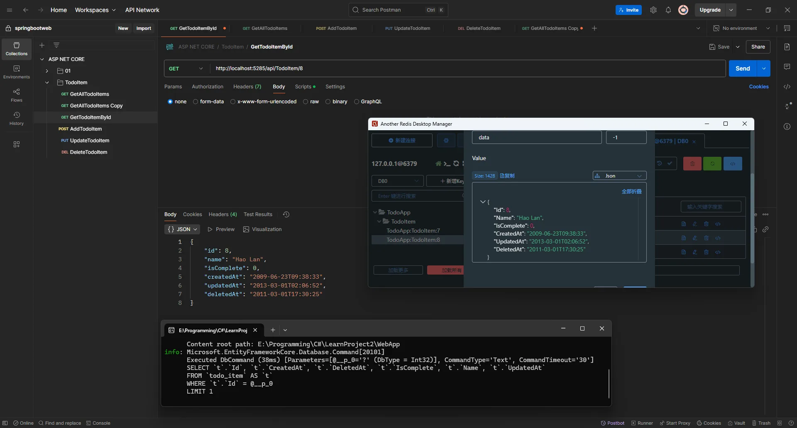

# 5、使用Java常用标准Result格式

1. ApiResult

```C#
using WebApp.Controllers;  // 引入控制器命名空间，允许与控制器交互

namespace WebApp.Result
{
    /// <summary>
    /// 通用响应结果包装类
    /// 遵循Java常见的REST API响应格式标准
    /// 包含状态码、消息和数据三部分
    /// 用于统一API接口的返回格式
    /// </summary>
    /// <typeparam name="T">响应数据的类型，使用泛型支持不同类型的返回数据</typeparam>
    public class ApiResult<T>
    {
        /// <summary>
        /// 状态码，表示请求处理的结果
        /// 一般约定：200表示成功，4xx表示客户端错误，5xx表示服务器错误
        /// 与HTTP状态码保持一致，便于客户端理解和处理
        /// </summary>
        public int Code { get; set; }  // HTTP状态码

        /// <summary>
        /// 响应消息，用于描述请求处理结果
        /// 成功时通常为"操作成功"，失败时描述具体错误原因
        /// 提供人类可读的结果说明，增强API的可用性
        /// </summary>
        public string Message { get; set; }  // 响应说明文本

        /// <summary>
        /// 响应数据
        /// 请求成功时包含业务数据，失败时可能为null或错误详情
        /// 是API调用的主要结果内容
        /// </summary>
        public T Data { get; set; }  // 业务数据，类型由泛型T决定

        /// <summary>
        /// 创建成功响应
        /// 生成标准的成功响应对象，状态码固定为200
        /// </summary>
        /// <param name="data">业务数据，将被封装到返回对象中</param>
        /// <param name="message">成功消息，默认为"操作成功"</param>
        /// <returns>表示成功的响应结果对象</returns>
        public static ApiResult<T> Success(T data, string message = "操作成功")
        {
            // 创建并返回一个成功状态的响应对象
            // 使用HTTP 200状态码表示请求成功
            return new ApiResult<T>
            {
                Code = 200,           // 成功状态码
                Message = message,    // 成功消息
                Data = data           // 业务数据
            };
        }

        /// <summary>
        /// 创建失败响应
        /// 生成自定义状态码和消息的失败响应对象
        /// 作为其他特定失败响应方法的基础方法
        /// </summary>
        /// <param name="code">错误状态码，通常为4xx或5xx</param>
        /// <param name="message">错误消息，描述失败原因</param>
        /// <param name="data">附加数据，默认为默认值（引用类型为null）</param>
        /// <returns>表示失败的响应结果对象</returns>
        public static ApiResult<T> Fail(int code, string message, T data = default)
        {
            // 创建并返回一个失败状态的响应对象
            // 允许自定义状态码和消息
            return new ApiResult<T>
            {
                Code = code,          // 自定义错误码
                Message = message,    // 错误描述
                Data = data           // 可选的附加数据
            };
        }

        /// <summary>
        /// 创建未找到资源的响应
        /// 快速生成404错误响应，用于资源不存在的场景
        /// </summary>
        /// <param name="message">错误消息，默认为"资源不存在"</param>
        /// <returns>表示资源不存在的响应结果对象，状态码为404</returns>
        public static ApiResult<T> NotFound(string message = "资源不存在")
        {
            // 调用基础Fail方法，使用HTTP 404状态码
            // 404表示"Not Found"，即请求的资源不存在
            return Fail(404, message);  // 复用Fail方法，使用404状态码
        }

        /// <summary>
        /// 创建服务器错误响应
        /// 快速生成500错误响应，用于服务器内部错误场景
        /// </summary>
        /// <param name="message">错误消息，默认为"服务器内部错误"</param>
        /// <returns>表示服务器错误的响应结果对象，状态码为500</returns>
        public static ApiResult<T> Error(string message = "服务器内部错误")
        {
            // 调用基础Fail方法，使用HTTP 500状态码
            // 500表示"Internal Server Error"，即服务器内部错误
            return Fail(500, message);  // 复用Fail方法，使用500状态码
        }
    }
}
```

2. PageResult

```C#
namespace WebApp.Result
{
    /// <summary>
    /// 分页数据包装类
    /// 包含分页数据和分页元数据
    /// 用于封装分页查询的结果，提供统一的分页数据结构
    /// 遵循Java常见的分页响应格式标准
    /// </summary>
    /// <typeparam name="T">分页项目的数据类型，使用泛型支持不同类型的数据项</typeparam>
    public class PageResult<T>
    {
        /// <summary>
        /// 分页数据项集合
        /// 包含当前页的实际数据记录
        /// 类型由泛型参数T决定，如List<TodoItemVO>
        /// </summary>
        public List<T> Records { get; set; }

        /// <summary>
        /// 当前页码
        /// 表示当前返回的是第几页数据
        /// 从1开始计数，与前端分页控件保持一致
        /// </summary>
        public int Current { get; set; }

        /// <summary>
        /// 每页大小
        /// 表示每页包含的记录数量
        /// 用于前端分页控件的页大小设置
        /// </summary>
        public int Size { get; set; }

        /// <summary>
        /// 总记录数
        /// 表示符合查询条件的数据总量
        /// 用于计算总页数和显示记录计数
        /// </summary>
        public int Total { get; set; }

        /// <summary>
        /// 总页数
        /// 根据总记录数和每页大小动态计算
        /// 使用Math.Ceiling确保能显示所有数据
        /// 只读属性，无需手动设置
        /// </summary>
        public int Pages => (int)Math.Ceiling((double)Total / Size);
    }
}
```

3. ITodoItemService

```C#
using WebApp.Pojo.DTO;      // 引入数据传输对象，用于接收客户端输入数据
using WebApp.Pojo.Entity;   // 引入实体类，表示数据库中的记录
using WebApp.Pojo.VO;       // 引入视图对象，用于向客户端返回数据

namespace WebApp.Services
{
    /// <summary>
    /// 待办事项服务接口
    /// 定义了待办事项的业务逻辑操作
    /// 作为业务逻辑层的核心组件，处理待办事项的业务规则和转换逻辑
    /// 位于表示层(Controller)和数据访问层(Mapper)之间，协调数据流转和处理
    /// </summary>
    public interface ITodoItemService
    {
        /// <summary>
        /// 获取所有待办事项
        /// 以视图对象(VO)形式返回，适合前端展示
        /// 不包含筛选条件，返回系统中的所有待办事项
        /// </summary>
        /// <returns>所有待办事项的VO集合，如果没有记录则返回空列表</returns>
        public List<TodoItemVO> GetAllTodoItems();

        /// <summary>
        /// 根据ID获取特定的待办事项
        /// 将数据库实体转换为视图对象返回
        /// 是获取单个待办事项详情的主要方法
        /// </summary>
        /// <param name="id">待办事项的唯一标识符</param>
        /// <returns>对应ID的待办事项视图对象，如果不存在可能抛出异常</returns>
        /// <exception cref="Exception">当找不到指定ID的待办事项时抛出</exception>
        public TodoItemVO GetTodoItemById(int id);

        /// <summary>
        /// 添加一个新的待办事项
        /// 将DTO转换为实体对象并保存，然后返回创建后的视图对象
        /// 负责验证数据、生成必要的元数据(如时间戳)并确保数据一致性
        /// </summary>
        /// <param name="todoItemDTO">包含新待办事项信息的DTO，由客户端提供</param>
        /// <returns>创建成功后的待办事项视图对象，包含生成的ID和时间戳</returns>
        /// <exception cref="Exception">当创建过程中发生错误时可能抛出</exception>
        public TodoItemVO AddTodoItem(TodoItemDTO todoItemDTO);

        /// <summary>
        /// 更新指定ID的待办事项
        /// 使用DTO中的数据更新已有实体，并返回更新后的视图对象
        /// 负责验证ID存在性、更新时间戳并确保数据一致性
        /// </summary>
        /// <param name="id">待更新待办事项的ID，用于定位数据库记录</param>
        /// <param name="todoItemDTO">包含更新信息的DTO，由客户端提供</param>
        /// <returns>更新后的待办事项视图对象，反映所有变更</returns>
        /// <exception cref="Exception">当找不到指定ID的待办事项或更新过程中发生错误时抛出</exception>
        public TodoItemVO UpdateTodoItem(int id, TodoItemDTO todoItemDTO);

        /// <summary>
        /// 删除指定ID的待办事项
        /// 执行删除操作并返回删除前的待办事项信息
        /// 确保在彻底删除前能获取待办事项的最后状态
        /// </summary>
        /// <param name="id">待删除待办事项的ID，用于定位数据库记录</param>
        /// <returns>删除前的待办事项视图对象，可用于撤销操作或通知客户端</returns>
        /// <exception cref="Exception">当找不到指定ID的待办事项时抛出</exception>
        public TodoItemVO DeleteTodoItem(int id);

        /// <summary>
        /// 获取分页的待办事项列表，支持可选的名称筛选和排序
        /// 为前端分页展示提供灵活的数据查询能力
        /// 通过组合参数实现多样化的查询需求
        /// </summary>
        /// <param name="pageNumber">当前页码，从1开始计数</param>
        /// <param name="pageSize">每页记录数，控制返回数据量</param>
        /// <param name="name">可选的名称筛选条件，为null时不筛选</param>
        /// <param name="sortBy">可选的排序字段，如"id"、"name"、"createdAt"等</param>
        /// <param name="order">可选的排序方向，"asc"为升序，"desc"为降序</param>
        /// <returns>符合条件的分页待办事项集合，已应用筛选和排序</returns>
        public List<TodoItemVO> GetPagedTodoItems(int pageNumber, int pageSize, string? name = null, string? sortBy = null, string? order = null);

        /// <summary>
        /// 获取符合条件的待办事项总数
        /// 主要用于支持分页功能，计算总页数
        /// 与GetPagedTodoItems方法配合使用
        /// </summary>
        /// <param name="name">可选的名称筛选条件，与GetPagedTodoItems方法的筛选条件保持一致</param>
        /// <returns>符合筛选条件的待办事项总数</returns>
        public int GetTodoItemCount(string? name = null);
    }
}
```

4. TodoItemServiceImpl

```C#
using WebApp.Mapper;        // 引入数据映射层接口，用于数据访问操作
using WebApp.Pojo.DTO;      // 引入数据传输对象，用于接收客户端数据
using WebApp.Pojo.Entity;   // 引入实体对象，对应数据库表结构
using WebApp.Pojo.VO;       // 引入视图对象，用于向客户端返回数据

namespace WebApp.Services.Impl
{
    /// <summary>
    /// 待办事项服务实现类
    /// 实现了ITodoItemService接口定义的所有业务逻辑操作
    /// 作为连接表示层和数据访问层的桥梁，处理数据转换和业务规则
    /// </summary>
    public class TodoItemServiceImpl : ITodoItemService
    {
        /// <summary>
        /// 待办事项数据映射器接口，用于数据访问操作
        /// 通过依赖注入获取具体实现
        /// </summary>
        private readonly ITodoItemMapper _todoItemMapper; // 数据访问层组件

        /// <summary>
        /// 构造函数，通过依赖注入初始化数据映射器
        /// </summary>
        /// <param name="todoItemMapper">待办事项数据映射器接口实现</param>
        public TodoItemServiceImpl(ITodoItemMapper todoItemMapper)
        {
            _todoItemMapper = todoItemMapper;  // 初始化数据映射器，采用依赖注入模式
        }

        /// <summary>
        /// 获取所有待办事项
        /// 将从数据层获取的实体列表转换为视图对象列表
        /// </summary>
        /// <returns>所有待办事项的视图对象集合</returns>
        public List<TodoItemVO> GetAllTodoItems()
        {
            // 调用数据映射器获取所有待办事项实体
            // 此处不进行业务筛选，获取全部数据
            List<TodoItem> todoItems = _todoItemMapper.GetAllTodoItems();

            // 使用LINQ将实体列表转换为VO列表并返回
            // 这里完成了从实体对象到视图对象的转换，确保数据表现层与持久化层的分离
            // 通过Select投影，避免了手动循环转换的冗余代码
            return todoItems.Select(item => new TodoItemVO
            {
                Id = item.Id,                  // 复制ID
                Name = item.Name,              // 复制名称
                IsComplete = item.IsComplete,  // 复制完成状态
                CreatedAt = item.CreatedAt,    // 复制创建时间
                UpdatedAt = item.UpdatedAt,    // 复制更新时间
                DeletedAt = item.DeletedAt     // 复制删除时间（软删除标记）
            }).ToList();
        }

        /// <summary>
        /// 根据ID获取特定的待办事项
        /// 如果项目不存在则抛出异常
        /// </summary>
        /// <param name="id">待办事项的唯一标识符</param>
        /// <returns>对应ID的待办事项视图对象</returns>
        /// <exception cref="Exception">当找不到待办事项时抛出</exception>
        public TodoItemVO GetTodoItemById(int id)
        {
            // 调用数据映射器根据ID查找待办事项
            // 这是获取单个实体的基本操作
            TodoItem todoItem = _todoItemMapper.GetTodoItemById(id);

            // 如果未找到项目，抛出异常
            // 这里体现了业务逻辑层的职责：验证数据存在性并处理异常情况
            // 确保业务操作的完整性和一致性
            if (todoItem == null)
            {
                throw new Exception("Todo item not found");  // 抛出异常，表示找不到指定ID的待办事项
            }

            // 将实体转换为视图对象并返回
            // 完成从持久化模型到展示模型的数据转换
            // 这种转换确保了内部数据模型与外部展现的分离
            return new TodoItemVO
            {
                Id = todoItem.Id,                  // 映射ID
                Name = todoItem.Name,              // 映射名称
                IsComplete = todoItem.IsComplete,  // 映射完成状态
                CreatedAt = todoItem.CreatedAt,    // 映射创建时间
                UpdatedAt = todoItem.UpdatedAt,    // 映射更新时间
                DeletedAt = todoItem.DeletedAt     // 映射删除时间
            };
        }

        /// <summary>
        /// 添加一个新的待办事项
        /// 将DTO转换为实体对象，保存后返回创建的视图对象
        /// </summary>
        /// <param name="todoItemDTO">包含新待办事项信息的DTO</param>
        /// <returns>创建成功后的待办事项视图对象</returns>
        /// <exception cref="Exception">当创建操作失败时抛出</exception>
        public TodoItemVO AddTodoItem(TodoItemDTO todoItemDTO)
        {
            // 创建新的待办事项实体，设置适当的初始值
            // 体现业务逻辑层的职责：从DTO创建实体对象，并设置必要的默认值
            // 这里处理了数据来源到数据存储的转换过程
            TodoItem todoItem = new TodoItem(
                    todoId: Random.Shared.Next(),        // 生成随机ID，在实际应用中应使用更可靠的ID生成策略，如GUID或数据库自增
                    id: todoItemDTO.Id,                  // 使用DTO提供的ID
                    name: todoItemDTO.Name,              // 使用DTO提供的名称
                    isComplete: todoItemDTO.IsComplete,  // 使用DTO提供的完成状态
                    createdAt: DateTime.Now,             // 设置创建时间为当前时间，这是业务规则的一部分
                    updatedAt: DateTime.Now);            // 设置更新时间为当前时间，初始与创建时间相同

            // 调用数据映射器添加新项目到数据存储
            // 将业务逻辑处理完的实体委托给数据访问层保存
            _todoItemMapper.AddTodoItem(todoItem);

            // 验证添加操作是否成功，从数据存储中重新获取项目
            // 这是一种安全实践，确认数据确实被正确保存
            TodoItem todoItemCreate = _todoItemMapper.GetTodoItemById(todoItemDTO.Id);

            // 注意：这里有一个bug，应该检查todoItemCreate而不是todoItem
            // 修正后的代码应该是: if (todoItemCreate == null)
            // 当前代码无法正确验证数据是否成功保存
            if (todoItem == null)  // 这是一个bug，应该检查todoItemCreate
            {
                throw new Exception("Todo item not found");  // 抛出异常，表示创建的待办事项不存在
            }

            // 将实体转换为视图对象并返回给调用方
            // 完成从实体对象到视图对象的转换
            // 这种转换确保了数据在不同层之间的安全传递
            return new TodoItemVO
            {
                Id = todoItem.Id,                  // 映射ID
                Name = todoItem.Name,              // 映射名称
                IsComplete = todoItem.IsComplete,  // 映射完成状态
                CreatedAt = todoItem.CreatedAt,    // 映射创建时间
                UpdatedAt = todoItem.UpdatedAt,    // 映射更新时间
                DeletedAt = todoItem.DeletedAt     // 映射删除时间（通常为null）
            };
        }

        /// <summary>
        /// 更新指定ID的待办事项
        /// 使用DTO中的数据更新已有实体，保存后返回更新的视图对象
        /// </summary>
        /// <param name="id">待更新待办事项的ID</param>
        /// <param name="todoItemDTO">包含更新信息的DTO</param>
        /// <returns>更新后的待办事项视图对象</returns>
        /// <exception cref="Exception">当待办事项不存在或更新失败时抛出</exception>
        public TodoItemVO UpdateTodoItem(int id, TodoItemDTO todoItemDTO)
        {
            // 调用数据映射器根据ID查找待办事项
            // 确保待更新的数据确实存在
            TodoItem todoItem = _todoItemMapper.GetTodoItemById(id);

            // 如果未找到项目，抛出异常
            // 验证数据存在性，体现业务逻辑层的职责
            // 确保操作的前置条件得到满足
            if (todoItem == null)
            {
                throw new Exception("Todo item not found");  // 抛出异常，表示找不到要更新的待办事项
            }

            // 用DTO中的数据更新实体属性
            // 体现业务逻辑层职责：将输入数据映射到实体对象，并更新必要的元数据
            // 这里实现了数据的部分更新，保留了不需要修改的字段
            todoItem.Id = todoItemDTO.Id;                 // 更新ID
            todoItem.Name = todoItemDTO.Name;             // 更新名称
            todoItem.IsComplete = todoItemDTO.IsComplete; // 更新完成状态
            todoItem.UpdatedAt = DateTime.Now;            // 更新修改时间为当前时间，体现业务规则

            // 调用数据映射器更新项目在数据存储中的记录
            // 将修改后的实体委托给数据访问层保存
            _todoItemMapper.UpdateTodoItem(id, todoItem);

            // 验证更新操作是否成功，从数据存储中重新获取项目
            // 这是一种安全实践，确认数据确实被正确更新
            TodoItem todoItemUpdate = _todoItemMapper.GetTodoItemById(todoItemDTO.Id);

            // 注意：这里有一个bug，应该检查todoItemUpdate而不是todoItem
            // 修正后的代码应该是: if (todoItemUpdate == null)
            // 当前代码无法正确验证数据是否成功更新
            if (todoItem == null)  // 这是一个bug，应该检查todoItemUpdate
            {
                throw new Exception("Todo item not found");  // 抛出异常，表示更新后的待办事项不存在
            }

            // 将更新后的实体转换为视图对象并返回给调用方
            // 这种转换确保了数据在不同层之间的安全传递
            return new TodoItemVO
            {
                Id = todoItem.Id,                  // 映射ID
                Name = todoItem.Name,              // 映射名称
                IsComplete = todoItem.IsComplete,  // 映射完成状态
                CreatedAt = todoItem.CreatedAt,    // 映射创建时间
                UpdatedAt = todoItem.UpdatedAt,    // 映射更新时间（已被更新为当前时间）
                DeletedAt = todoItem.DeletedAt     // 映射删除时间
            };
        }

        /// <summary>
        /// 删除指定ID的待办事项
        /// 执行删除操作并返回删除前的待办事项信息
        /// </summary>
        /// <param name="id">待删除待办事项的ID</param>
        /// <returns>删除前的待办事项视图对象</returns>
        /// <exception cref="Exception">当待办事项不存在时抛出</exception>
        public TodoItemVO DeleteTodoItem(int id)
        {
            // 调用数据映射器根据ID查找待办事项
            // 确保待删除的数据确实存在
            TodoItem todoItem = _todoItemMapper.GetTodoItemById(id);

            // 如果未找到项目，抛出异常
            // 验证数据存在性，体现业务逻辑层的职责
            // 确保操作的前置条件得到满足
            if (todoItem == null)
            {
                throw new Exception("Todo item not found");  // 抛出异常，表示找不到要删除的待办事项
            }

            // 在删除前，创建视图对象以保存项目的信息用于返回
            // 这样即使记录被删除，我们仍然能够向客户端返回被删除的数据
            // 体现了设计考虑：保留删除前的数据供客户端使用，比如用于撤销操作
            TodoItemVO result = new TodoItemVO
            {
                Id = todoItem.Id,                  // 保存ID
                Name = todoItem.Name,              // 保存名称
                IsComplete = todoItem.IsComplete,  // 保存完成状态
                CreatedAt = todoItem.CreatedAt,    // 保存创建时间
                UpdatedAt = todoItem.UpdatedAt,    // 保存更新时间
                DeletedAt = todoItem.DeletedAt     // 保存删除时间
            };

            // 调用数据映射器从数据存储中删除项目
            // 将删除操作委托给数据访问层执行
            _todoItemMapper.DeleteTodoItem(id);

            // 返回删除前的项目信息
            // 这样客户端可以知道被删除的是什么数据
            // 有助于提供更好的用户体验，如显示"已删除xxx项目"的消息
            return result;
        }

        /// <summary>
        /// 获取分页的待办事项列表，支持可选的名称筛选和排序
        /// </summary>
        /// <param name="pageNumber">当前页码，从1开始计数</param>
        /// <param name="pageSize">每页记录数</param>
        /// <param name="name">可选的名称筛选条件，null表示不筛选</param>
        /// <param name="sortBy">可选的排序字段，null使用默认排序</param>
        /// <param name="order">可选的排序方向，null使用默认方向</param>
        /// <returns>指定页的待办事项视图对象集合</returns>
        public List<TodoItemVO> GetPagedTodoItems(int pageNumber, int pageSize, string? name = null,
                                         string? sortBy = null, string? order = null)
        {
            // 调用数据访问层获取分页数据，传递所有筛选和排序参数
            // 体现了分层设计：将复杂的查询逻辑委托给数据访问层
            // 服务层专注于业务逻辑和数据转换，而不直接处理数据查询的细节
            var todoItems = _todoItemMapper.GetPagedTodoItems(pageNumber, pageSize, name, sortBy, order);

            // 将实体对象转换为视图对象
            // 确保返回给控制层的是展示层模型，而非持久层模型
            // 使用LINQ进行批量转换，提高代码效率和可读性
            return todoItems.Select(item => new TodoItemVO
            {
                Id = item.Id,                  // 映射ID
                Name = item.Name,              // 映射名称
                IsComplete = item.IsComplete,  // 映射完成状态
                CreatedAt = item.CreatedAt,    // 映射创建时间
                UpdatedAt = item.UpdatedAt,    // 映射更新时间
                DeletedAt = item.DeletedAt     // 映射删除时间
            }).ToList();
        }

        /// <summary>
        /// 获取符合条件的待办事项总数
        /// 主要用于支持分页功能，计算总页数
        /// </summary>
        /// <param name="name">可选的名称筛选条件，与GetPagedTodoItems方法的筛选条件保持一致</param>
        /// <returns>符合筛选条件的待办事项总数</returns>
        public int GetTodoItemCount(string? name = null)
        {
            // 直接委托给数据访问层执行记录计数
            // 保持与GetPagedTodoItems方法使用的筛选条件一致，确保分页的准确性
            return _todoItemMapper.GetTodoItemCount(name);
        }
    }
}
```

5. ITodoItemMapper

```C#
using System.Xml.Linq;       // 引入XML操作相关命名空间，用于可能的XML数据处理
using WebApp.Pojo.Entity;    // 引入实体类命名空间，包含TodoItem实体定义

namespace WebApp.Mapper
{
    /// <summary>
    /// 待办事项数据映射器接口
    /// 定义了对待办事项(TodoItem)实体的数据访问操作
    /// 作为数据访问层的核心组件，负责数据操作的抽象
    /// 遵循数据映射器模式，将领域模型与数据访问逻辑分离
    /// </summary>
    public interface ITodoItemMapper
    {
        /// <summary>
        /// 获取所有待办事项
        /// 从数据存储中检索所有未删除的待办事项记录
        /// 不包含任何过滤或排序逻辑，返回原始数据集合
        /// </summary>
        /// <returns>所有待办事项的集合，如果没有记录则返回空列表</returns>
        public List<TodoItem> GetAllTodoItems();

        /// <summary>
        /// 根据ID获取特定的待办事项
        /// 从数据存储中查找匹配指定ID的单个待办事项记录
        /// </summary>
        /// <param name="id">待办事项的唯一标识符</param>
        /// <returns>对应ID的待办事项对象，如果不存在则返回null</returns>
        public TodoItem GetTodoItemById(int id);

        /// <summary>
        /// 添加一个新的待办事项
        /// 将待办事项对象持久化到数据存储中
        /// 不负责生成ID或设置时间戳，调用方应确保这些字段已正确设置
        /// </summary>
        /// <param name="todoItem">需要添加的待办事项对象，应包含完整的必要信息</param>
        public void AddTodoItem(TodoItem todoItem);

        /// <summary>
        /// 更新指定ID的待办事项
        /// 用提供的对象替换数据存储中的现有记录
        /// 调用方负责确保更新的字段值合法且时间戳已更新
        /// </summary>
        /// <param name="id">待更新待办事项的ID，用于定位记录</param>
        /// <param name="todoItem">包含更新信息的待办事项对象，会完全替换原有记录</param>
        public void UpdateTodoItem(int id, TodoItem todoItem);

        /// <summary>
        /// 删除指定ID的待办事项
        /// 从数据存储中物理删除记录
        /// 如果实现软删除，则应设置DeletedAt字段而非物理删除
        /// </summary>
        /// <param name="id">待删除待办事项的ID</param>
        public void DeleteTodoItem(int id);

        /// <summary>
        /// 获取分页的待办事项列表，支持可选的名称筛选和排序
        /// 实现数据的分页查询，提高大数据量下的查询效率和性能
        /// 可组合使用多种查询条件，满足复杂的数据展示需求
        /// </summary>
        /// <param name="pageNumber">页码，指定要返回的页数，从1开始</param>
        /// <param name="pageSize">页大小，指定每页包含的记录数量</param>
        /// <param name="name">可选的名称筛选，按名称模糊匹配过滤记录</param>
        /// <param name="sortBy">可选的排序字段，如"id"、"name"、"createdAt"等</param>
        /// <param name="order">可选的排序方向，"asc"表示升序，"desc"表示降序</param>
        /// <returns>符合条件的待办事项集合，已应用分页、筛选和排序</returns>
        public List<TodoItem> GetPagedTodoItems(int pageNumber, int pageSize, string? name = null, string? sortBy = null, string? order = null);

        /// <summary>
        /// 获取符合条件的待办事项总数
        /// 用于分页功能中计算总页数和显示记录总数
        /// 与GetPagedTodoItems方法配合使用，确保分页的完整性
        /// </summary>
        /// <param name="name">可选的名称筛选条件，与GetPagedTodoItems方法的筛选条件保持一致</param>
        /// <returns>符合筛选条件的待办事项总数</returns>
        public int GetTodoItemCount(string? name = null);
    }
}
```

6. TodoItemMapperImpl

```C#
using WebApp.DB;             // 引入数据库上下文命名空间，包含TodoItemDbContext类
using WebApp.Pojo.Entity;    // 引入实体类命名空间，包含TodoItem实体类定义

namespace WebApp.Mapper.Impl
{
    /// <summary>
    /// TodoItem 数据映射器的实现类
    /// 提供对待办事项数据的数据库操作实现
    /// 实现 ITodoItemMapper 接口定义的所有数据访问操作
    /// 使用 Entity Framework Core 框架与数据库进行交互
    /// </summary>
    public class TodoItemMapperImpl : ITodoItemMapper
    {
        /// <summary>
        /// 数据库上下文，用于与数据库交互
        /// 通过依赖注入获取，生命周期由容器管理
        /// 提供对 TodoItems 表的访问和操作能力
        /// </summary>
        private readonly TodoItemDbContext _context; // 数据库上下文实例，封装了数据库连接和操作

        /// <summary>
        /// 构造函数，通过依赖注入初始化数据库上下文
        /// 遵循依赖注入原则，降低类之间的耦合度
        /// </summary>
        /// <param name="todoItemDbContext">数据库上下文实例，由依赖注入容器提供</param>
        public TodoItemMapperImpl(TodoItemDbContext todoItemDbContext)
        {
            _context = todoItemDbContext;  // 初始化数据库上下文，为后续数据库操作做准备
        }

        /// <summary>
        /// 获取所有待办事项
        /// 从数据库中检索所有 TodoItem 记录
        /// 不包含任何过滤条件，返回表中的所有数据
        /// </summary>
        /// <returns>包含所有待办事项的集合，如果没有记录则返回空列表</returns>
        public List<TodoItem> GetAllTodoItems()
        {
            // 使用 EF Core 的 ToList 方法将所有记录加载到内存中
            // 这会执行 SELECT * FROM todo_item 查询
            // 将查询结果转换为List<TodoItem>集合并返回
            return _context.TodoItems.ToList();
        }

        /// <summary>
        /// 根据 ID 获取特定的待办事项
        /// 从数据库中查找匹配指定 ID 的 TodoItem
        /// 使用主键索引进行高效查询
        /// </summary>
        /// <param name="id">待办事项的唯一标识符</param>
        /// <returns>对应 ID 的待办事项对象，如果不存在则返回 null</returns>
        public TodoItem GetTodoItemById(int id)
        {
            // 使用 EF Core 的 Find 方法根据主键查找记录
            // Find 方法会先检查跟踪的实体，如果没有再查询数据库
            // 这会执行 SELECT * FROM todo_item WHERE Id = {id} LIMIT 1 查询
            // 如果找不到记录，返回null
            return _context.TodoItems.Find(id);
        }

        /// <summary>
        /// 添加一个新的待办事项
        /// 将 TodoItem 对象插入到数据库中
        /// 完成后会自动保存更改
        /// </summary>
        /// <param name="todoItem">需要添加的待办事项对象，应包含完整的必要信息</param>
        public void AddTodoItem(TodoItem todoItem)
        {
            // 使用 EF Core 的 Add 方法将新记录添加到上下文
            // 这会将实体标记为"已添加"状态，但还未实际写入数据库
            // 实体将在下一次调用SaveChanges时插入数据库
            _context.TodoItems.Add(todoItem);

            // 保存更改到数据库
            // 这会执行 INSERT INTO todo_item (...) VALUES (...) 查询
            // 所有被跟踪且状态为"已添加"的实体都会被持久化到数据库
            _context.SaveChanges();
        }

        /// <summary>
        /// 更新指定 ID 的待办事项
        /// 使用传入的 TodoItem 对象更新数据库中的记录
        /// 完成后会自动保存更改
        /// </summary>
        /// <param name="id">待更新待办事项的 ID，用于定位记录</param>
        /// <param name="todoItem">包含更新信息的待办事项对象，会完全替换原有记录</param>
        /// <remarks>注意：此方法不检查记录是否存在，可能导致异常。实际应用中应先确认记录存在</remarks>
        public void UpdateTodoItem(int id, TodoItem todoItem)
        {
            // 使用 EF Core 的 Update 方法更新记录
            // 这会将实体标记为"已修改"状态，但还未实际写入数据库
            // 注意：此处没有检查 id 参数与 todoItem.Id 是否一致
            // 也没有检查记录是否存在，可能导致异常
            _context.TodoItems.Update(todoItem);

            // 保存更改到数据库
            // 这会执行 UPDATE todo_item SET ... WHERE Id = {todoItem.Id} 查询
            // 所有被跟踪且状态为"已修改"的实体都会被更新到数据库
            _context.SaveChanges();
        }

        /// <summary>
        /// 删除指定 ID 的待办事项
        /// 从数据库中移除匹配的记录
        /// 采用物理删除方式，完全从数据库中移除记录
        /// </summary>
        /// <param name="id">待删除待办事项的 ID</param>
        /// <remarks>注意：如果记录不存在，此方法不会执行任何操作，也不会抛出异常</remarks>
        public void DeleteTodoItem(int id)
        {
            // 使用 EF Core 的 Find 方法查找记录
            // 这确保只有在记录存在时才执行删除操作
            // 首先尝试获取要删除的实体
            var item = _context.TodoItems.Find(id);

            // 验证实体是否存在
            if (item != null)
            {
                // 如果记录存在，使用 Remove 方法删除记录
                // 这会将实体标记为"已删除"状态，但还未实际从数据库中删除
                _context.TodoItems.Remove(item);

                // 保存更改到数据库
                // 这会执行 DELETE FROM todo_item WHERE Id = {id} 查询
                // 所有被跟踪且状态为"已删除"的实体都会从数据库中移除
                _context.SaveChanges();
            }
            // 如果记录不存在，不执行任何操作，静默返回
            // 这种设计使方法在记录不存在时也能安全执行，不会抛出异常
        }

        /// <summary>
        /// 获取分页的待办事项列表，支持可选的名称筛选和排序
        /// 根据给定的参数从数据库中检索并返回符合条件的数据子集
        /// </summary>
        /// <param name="pageNumber">要获取的页码，从1开始</param>
        /// <param name="pageSize">每页包含的记录数</param>
        /// <param name="name">可选的名称筛选条件，支持包含匹配</param>
        /// <param name="sortBy">可选的排序字段名称</param>
        /// <param name="order">可选的排序方向，"asc"表示升序，其他值表示降序</param>
        /// <returns>分页过滤后的待办事项集合</returns>
        public List<TodoItem> GetPagedTodoItems(int pageNumber, int pageSize, string? name = null,
                                       string? sortBy = null, string? order = null)
        {
            // 创建基础查询
            // 定义一个IQueryable<TodoItem>，这样可以延迟执行查询，只在需要时才访问数据库
            // 使用LINQ查询构建器模式，逐步添加条件，最后执行
            IQueryable<TodoItem> query = _context.TodoItems;

            // 应用名称筛选
            // 如果提供了名称参数，则添加WHERE条件
            // 使用Contains进行模糊查询，相当于SQL中的LIKE '%name%'
            if (!string.IsNullOrEmpty(name))
            {
                query = query.Where(t => t.Name != null && t.Name.Contains(name));
            }

            // 确定排序方向
            // 解析order参数，确定是升序还是降序排序
            // 如果order参数是"asc"则为升序，否则为降序
            bool isAscending = !string.IsNullOrEmpty(order) && order.ToLower() == "asc";

            // 应用排序
            // 根据sortBy参数选择排序字段，并应用之前确定的排序方向
            // 使用switch语句处理不同的排序字段，提供灵活的排序功能
            if (!string.IsNullOrEmpty(sortBy))
            {
                switch (sortBy.ToLower())
                {
                    case "id":
                        // 按ID排序
                        query = isAscending ? query.OrderBy(t => t.Id) : query.OrderByDescending(t => t.Id);
                        break;

                    case "name":
                        // 按名称排序
                        query = isAscending ? query.OrderBy(t => t.Name) : query.OrderByDescending(t => t.Name);
                        break;

                    case "iscomplete":
                        // 按完成状态排序
                        query = isAscending ? query.OrderBy(t => t.IsComplete) : query.OrderByDescending(t => t.IsComplete);
                        break;

                    case "updatedat":
                        // 按更新时间排序
                        query = isAscending ? query.OrderBy(t => t.UpdatedAt) : query.OrderByDescending(t => t.UpdatedAt);
                        break;

                    case "createdat":
                        // 按创建时间排序
                        query = isAscending ? query.OrderBy(t => t.CreatedAt) : query.OrderByDescending(t => t.CreatedAt);
                        break;

                    default:
                        // 默认按创建时间排序（当提供了不支持的排序字段时）
                        query = isAscending ? query.OrderBy(t => t.CreatedAt) : query.OrderByDescending(t => t.CreatedAt);
                        break;
                }
            }
            else
            {
                // 默认按创建时间降序排序
                // 如果没有指定排序字段，则使用创建时间降序作为默认排序
                // 新创建的待办事项会显示在列表前面
                query = query.OrderByDescending(t => t.CreatedAt);
            }

            // 应用分页
            // 使用Skip和Take方法实现分页
            // Skip跳过前(pageNumber-1)*pageSize条记录，Take获取pageSize条记录
            // 例如：要获取第2页，每页10条，则跳过前10条，再取10条
            return query
                .Skip((pageNumber - 1) * pageSize)  // 跳过之前页的记录
                .Take(pageSize)                     // 获取当前页的记录数
                .ToList();                          // 执行查询并返回结果列表
        }


        /// <summary>
        /// 获取符合条件的待办事项总数
        /// 用于分页功能中计算总页数和显示记录总数
        /// 与GetPagedTodoItems方法配合使用，确保分页的完整性
        /// </summary>
        /// <param name="name">可选的名称筛选条件，与GetPagedTodoItems方法的筛选条件保持一致</param>
        /// <returns>符合筛选条件的待办事项总数</returns>
        public int GetTodoItemCount(string? name = null)
        {
            // 创建基础查询
            // 定义一个IQueryable<TodoItem>，便于添加条件过滤
            // 使用与GetPagedTodoItems相同的筛选条件，确保计数与分页数据一致
            IQueryable<TodoItem> query = _context.TodoItems;

            // 应用名称筛选
            // 如果提供了名称参数，则添加WHERE条件
            // 需要与GetPagedTodoItems方法使用相同的筛选逻辑
            if (!string.IsNullOrEmpty(name))
            {
                query = query.Where(t => t.Name != null && t.Name.Contains(name));
            }

            // 返回符合条件的记录总数
            // Count()方法会生成SELECT COUNT(*) FROM查询，在数据库中执行计数
            // 比将所有数据加载到内存中再计数更高效
            return query.Count();
        }
    }
}
```

最后构建了如下的工程

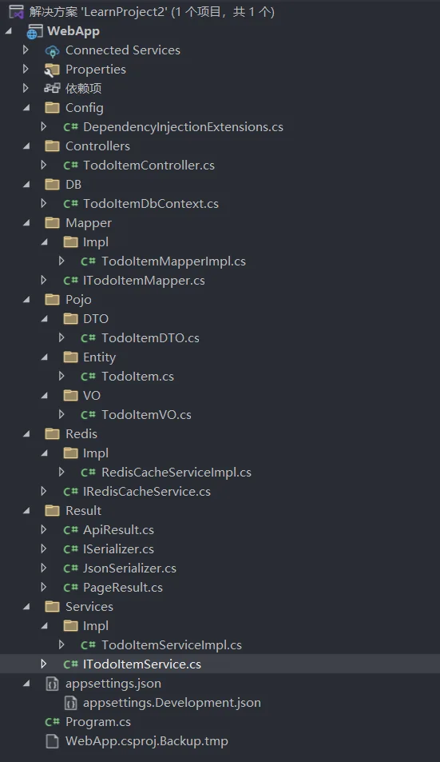

1、查询结果

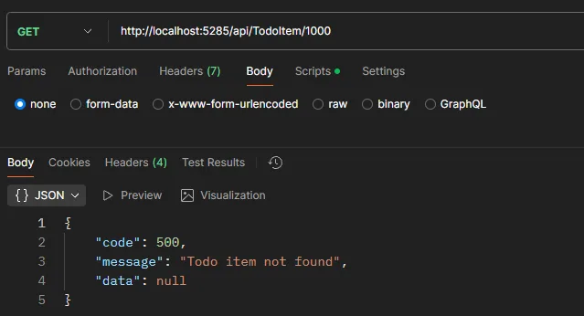

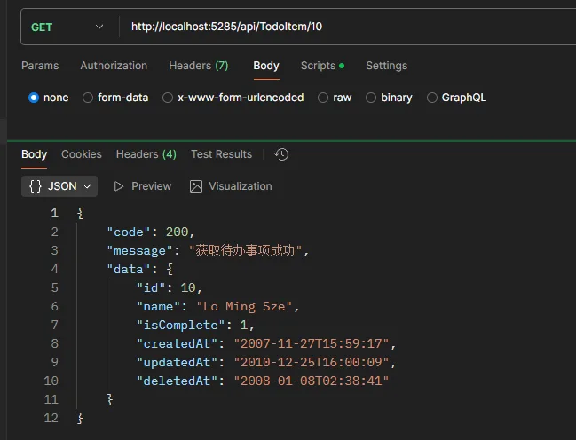
