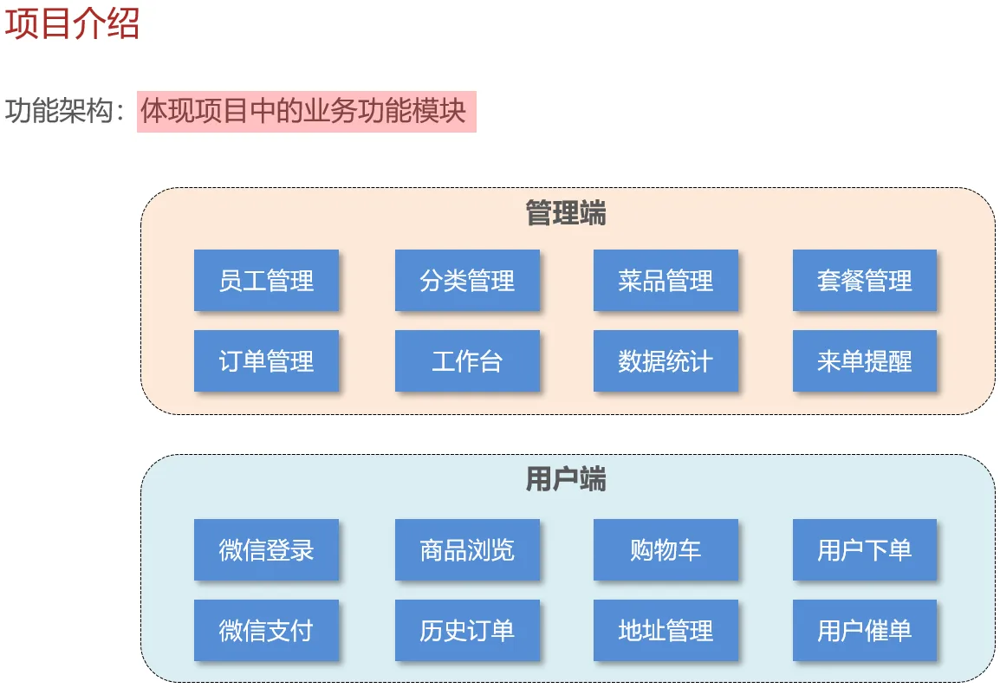
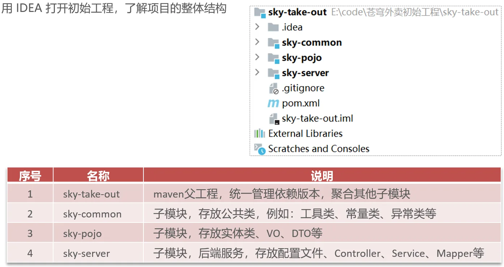
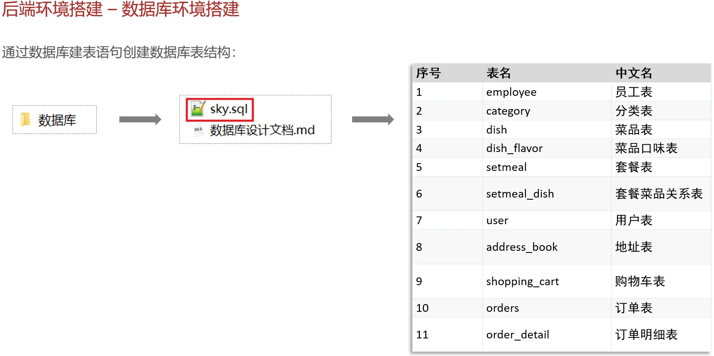
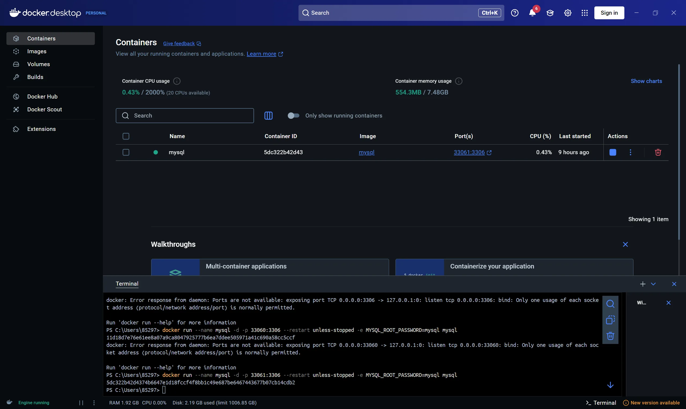
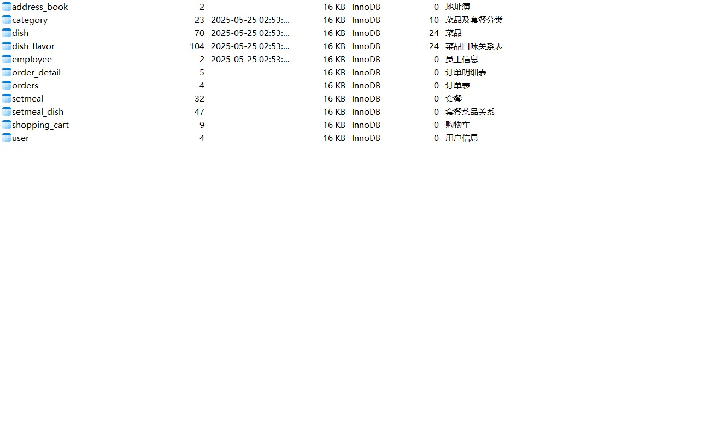
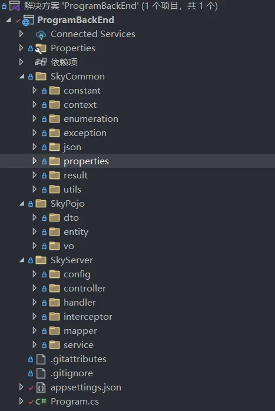
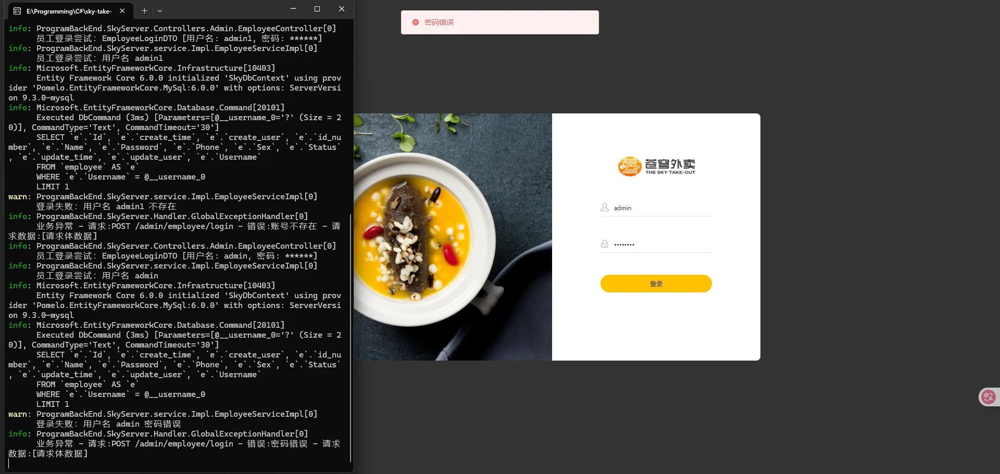
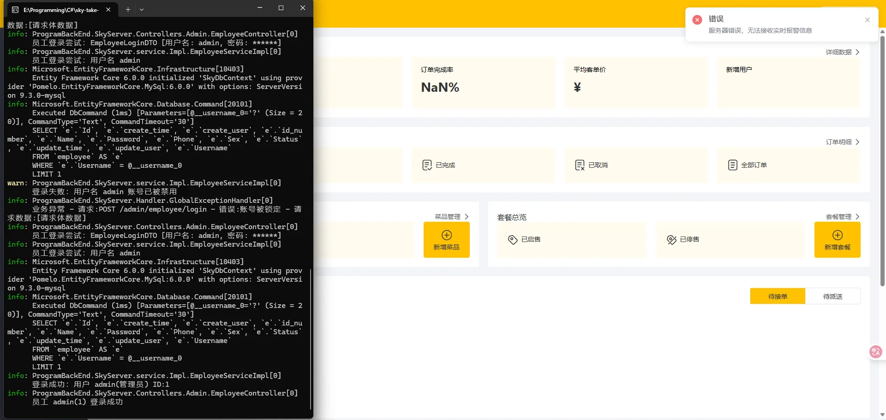

# 1、项目简介

本项目为学习项目，由哔哩哔哩[黑马程序员Java项目实战《苍穹外卖》，最适合新手的SpringBoot+SSM的企业级Java项目实战](https://www.bilibili.com/video/av315565756?p=1)为蓝本，将所有代码更改为ASP.NET Core 6.0，构建单体应用。





# 2、数据准备

依据资料，将所需内容进行基准准备。

在搭建数据库时，为进行模拟，使用Docker Hub模拟Linux中的构建与使用



```cmd
docker run --name mysql -d -p 33061:3306 --restart unless-stopped -e MYSQL_ROOT_PASSWORD=mysql mysql
```



并且使用工具导入sql脚本，从而构建数据库。



# 3、内容初步重构

依据给的初始资料，将内容进行初步重构。首先创建各类相关文件夹，随后将SkyPojo中的内容全部重建。



## 1、数据库重构

由于ASP.NET Core中并不像Java一样，因此构建`SkyDbContext.cs`，负责与MySQL数据库的交互，管理实体到数据库表的映射关系。

```C#
using Microsoft.EntityFrameworkCore;
using ProgramBackEnd.SkyPojo.entity;

namespace ProgramBackEnd.SkyServer.config
{
    /// <summary>
    /// 天空外卖数据库上下文类
    /// <para>
    /// 此类继承自DbContext，作为Entity Framework Core的核心组件，
    /// 负责与MySQL数据库的交互，管理实体到数据库表的映射关系。
    /// </para>
    /// <para>
    /// 提供实体集合的访问和跟踪变更，支持CRUD操作和事务管理。
    /// </para>
    /// </summary>
    public class SkyDbContext : DbContext
    {
        /// <summary>
        /// 构造函数，通过依赖注入接收数据库配置
        /// <para>
        /// 接收ASP.NET Core依赖注入系统提供的配置参数，
        /// 包含数据库连接字符串、提供程序设置等。
        /// </para>
        /// </summary>
        /// <param name="options">数据库上下文配置选项</param>
        public SkyDbContext(DbContextOptions<SkyDbContext> options) : base(options)
        {
        }

        #region 实体集合定义

        /// <summary>
        /// 地址簿实体集合
        /// <para>映射到数据库中的address_book表，存储用户配送地址信息</para>
        /// </summary>
        public DbSet<AddressBook> AddressBooks { get; set; }

        /// <summary>
        /// 分类实体集合
        /// <para>映射到数据库中的category表，存储菜品和套餐分类</para>
        /// </summary>
        public DbSet<Category> Categories { get; set; }

        /// <summary>
        /// 菜品实体集合
        /// <para>映射到数据库中的dish表，存储菜品基本信息</para>
        /// </summary>
        public DbSet<Dish> Dishes { get; set; }

        /// <summary>
        /// 菜品口味实体集合
        /// <para>映射到数据库中的dish_flavor表，存储菜品的口味选项</para>
        /// </summary>
        public DbSet<DishFlavor> DishFlavors { get; set; }

        /// <summary>
        /// 员工实体集合
        /// <para>映射到数据库中的employee表，存储系统员工账户信息</para>
        /// </summary>
        public DbSet<Employee> Employees { get; set; }

        /// <summary>
        /// 订单详情实体集合
        /// <para>映射到数据库中的order_detail表，存储订单中的菜品明细</para>
        /// </summary>
        public DbSet<OrderDetail> OrderDetails { get; set; }

        /// <summary>
        /// 订单实体集合
        /// <para>映射到数据库中的orders表，存储用户订单主体信息</para>
        /// </summary>
        public DbSet<Orders> Orders { get; set; }

        /// <summary>
        /// 套餐实体集合
        /// <para>映射到数据库中的setmeal表，存储套餐基本信息</para>
        /// </summary>
        public DbSet<Setmeal> Setmeals { get; set; }

        /// <summary>
        /// 套餐菜品关系实体集合
        /// <para>映射到数据库中的setmeal_dish表，存储套餐与菜品的多对多关系</para>
        /// </summary>
        public DbSet<SetmealDish> SetmealDishes { get; set; }

        /// <summary>
        /// 购物车实体集合
        /// <para>映射到数据库中的shopping_cart表，存储用户购物车商品</para>
        /// </summary>
        public DbSet<ShoppingCart> ShoppingCarts { get; set; }

        /// <summary>
        /// 用户实体集合
        /// <para>映射到数据库中的user表，存储移动端用户账户信息</para>
        /// </summary>
        public DbSet<User> Users { get; set; }

        #endregion

        /// <summary>
        /// 配置实体与数据库表的映射关系
        /// <para>
        /// 在此方法中使用Fluent API进行数据库映射的详细配置，
        /// 包括表名映射、主键设置、外键关系、索引等。
        /// </para>
        /// <para>
        /// 此配置优先级高于数据注解(Attributes)。
        /// </para>
        /// </summary>
        /// <param name="modelBuilder">模型构建器，用于配置实体映射</param>
        protected override void OnModelCreating(ModelBuilder modelBuilder)
        {
            base.OnModelCreating(modelBuilder);

            // ============================================
            // 表名映射配置
            // 按照snake_case命名约定配置数据库表名
            // ============================================

            // 地址簿实体映射配置
            modelBuilder.Entity<AddressBook>().ToTable("address_book");

            // 分类实体映射配置
            modelBuilder.Entity<Category>().ToTable("category");

            // 菜品实体映射配置
            modelBuilder.Entity<Dish>().ToTable("dish");

            // 菜品口味实体映射配置
            modelBuilder.Entity<DishFlavor>().ToTable("dish_flavor");

            // 员工实体映射配置
            modelBuilder.Entity<Employee>().ToTable("employee");

            // 订单详情实体映射配置
            modelBuilder.Entity<OrderDetail>().ToTable("order_detail");

            // 订单实体映射配置
            modelBuilder.Entity<Orders>().ToTable("orders");

            // 套餐实体映射配置
            modelBuilder.Entity<Setmeal>().ToTable("setmeal");

            // 套餐菜品关系实体映射配置
            modelBuilder.Entity<SetmealDish>().ToTable("setmeal_dish");

            // 购物车实体映射配置
            modelBuilder.Entity<ShoppingCart>().ToTable("shopping_cart");

            // 用户实体映射配置
            modelBuilder.Entity<User>().ToTable("user");
        }
    }
}
```

## 2、依赖项注入

将服务注册逻辑从Program.cs中分离，提高代码的组织性和可维护性。

```C#
using Microsoft.Extensions.DependencyInjection;
using System.Reflection;
using ProgramBackEnd.SkyServer.service.Impl;
using ProgramBackEnd.SkyServer.service;
using ProgramBackEnd.SkyServer.mapper;
using ProgramBackEnd.SkyServer.mapper.Impl;

namespace ProgramBackEnd.SkyServer.config
{
    /// <summary>
    /// 依赖注入扩展类
    /// <para>
    /// 提供统一的服务注册扩展方法，集中管理应用程序的依赖注入配置。
    /// 通过使用此类，可以将服务注册逻辑从Program.cs中分离，提高代码的组织性和可维护性。
    /// </para>
    /// <para>
    /// 遵循依赖注入设计模式，实现松耦合、可测试的应用程序架构。
    /// </para>
    /// </summary>
    public static class DependencyInjectionExtensions
    {
        #region 应用服务注册

        /// <summary>
        /// 注册应用程序核心业务服务
        /// <para>
        /// 将服务接口与其具体实现类关联，使控制器可以通过构造函数注入这些服务。
        /// 所有服务均使用Scoped生命周期，确保在同一HTTP请求上下文中共享同一实例。
        /// </para>
        /// </summary>
        /// <param name="services">ASP.NET Core服务集合</param>
        /// <returns>配置后的服务集合，支持方法链式调用</returns>
        /// <remarks>
        /// 当添加新的服务接口和实现时，应在此方法中注册它们。
        /// </remarks>
        public static IServiceCollection RegisterApplicationServices(this IServiceCollection services)
        {
            // ====================================================
            // 业务服务层注册 - 处理业务逻辑和操作编排
            // ====================================================

            // 员工管理服务 - 处理员工认证和信息管理
            services.AddScoped<IEmployeeService, EmployeeServiceImpl>();

            // ====================================================
            // 数据访问层注册 - 处理数据库交互
            // ====================================================

            // 员工数据映射器 - 处理员工数据的CRUD操作
            services.AddScoped<IEmployeeMapper, EmployeeMapperImpl>();

            return services;
        }

        #endregion


        #region 公共入口点

        /// <summary>
        /// 注册应用程序中的所有服务 - 主入口点
        /// <para>
        /// 此方法作为Program.cs中调用的单一入口点，集中调用各个专门的服务注册方法。
        /// 以这种方式组织依赖注入，可以让Program.cs保持简洁，同时便于服务注册的管理和扩展。
        /// </para>
        /// </summary>
        /// <param name="services">ASP.NET Core服务集合</param>
        /// <returns>配置后的服务集合，支持方法链式调用</returns>
        /// <example>
        /// 在Program.cs中使用:
        /// <code>
        /// var builder = WebApplication.CreateBuilder(args);
        /// builder.Services.RegisterAllServices();
        /// </code>
        /// </example>
        public static IServiceCollection RegisterAllServices(this IServiceCollection services)
        {
            // 注册业务核心服务
            services.RegisterApplicationServices();

            return services;
        }

        #endregion
    }
}
```

## 3、全局异常处理器

由于在测试时经常出现问题，因此添加全局异常处理器，从而确保能够给用户合理的反馈。

```C#
using Microsoft.AspNetCore.Mvc;
using Microsoft.AspNetCore.Mvc.Filters;
using ProgramBackEnd.SkyCommon.exception;
using ProgramBackEnd.SkyCommon.result;


namespace ProgramBackEnd.SkyServer.Handler
{
    /// <summary>
    /// 全局异常处理器
    /// <para>
    /// 捕获并统一处理整个应用程序中抛出的异常，提供规范化的错误响应。
    /// 区分业务异常和系统异常，确保向客户端返回友好且一致的错误信息。
    /// </para>
    /// <para>
    /// 在ASP.NET Core中，通过实现ExceptionFilterAttribute来拦截所有未处理的异常，
    /// 替代传统的try-catch块，简化控制器代码并提供集中式异常处理。
    /// </para>
    /// </summary>
    /// <remarks>
    /// 处理流程：
    /// 1. 捕获异常并区分业务异常和系统异常
    /// 2. 记录详细的异常日志
    /// 3. 转换异常为标准Result响应对象
    /// 4. 设置适当的HTTP状态码
    /// </remarks>
    public class GlobalExceptionHandler : ExceptionFilterAttribute
    {

        /// <summary>
        /// 日志记录器
        /// 用于记录异常详情，便于问题排查和系统监控
        /// </summary>
        private readonly ILogger<GlobalExceptionHandler> _logger;

        /// <summary>
        /// 构造函数，通过依赖注入获取日志服务
        /// <para>
        /// 通过ASP.NET Core依赖注入系统获取ILogger接口的实现，
        /// 用于记录异常信息和处理过程。
        /// </para>
        /// </summary>
        /// <param name="logger">日志记录器实例</param>
        /// <exception cref="ArgumentNullException">当logger为null时抛出</exception>
        public GlobalExceptionHandler(ILogger<GlobalExceptionHandler> logger)
        {
            _logger = logger ?? throw new ArgumentNullException(nameof(logger));
        }

        /// <summary>
        /// 异常发生时的处理方法
        /// <para>
        /// 当应用程序中抛出未处理的异常时，此方法会被ASP.NET Core管道调用，
        /// 对异常进行分类处理，并返回标准化的错误响应。
        /// </para>
        /// </summary>
        /// <param name="context">
        /// 异常上下文，包含异常信息和HTTP请求/响应上下文
        /// </param>
        public override void OnException(ExceptionContext context)
        {
            // 获取请求信息用于日志记录
            var request = context.HttpContext.Request;
            var requestPath = request.Path;
            var requestMethod = request.Method;

            // 捕获请求体数据（用于POST等包含请求体的请求）
            string requestBody = "[无请求体]";
            if (request.HasFormContentType)
            {
                requestBody = "[表单数据]";
            }
            else if (request.ContentLength.HasValue && request.ContentLength > 0)
            {
                try
                {
                    // 注意：这里不能读取请求体，因为在过滤器中请求体可能已经被读取
                    // 在生产环境中，可以考虑使用中间件捕获请求体
                    requestBody = "[请求体数据]";
                }
                catch
                {
                    requestBody = "[无法读取请求体]";
                }
            }

            // 检查异常是否为业务异常
            if (context.Exception is BaseException baseException)
            {
                // 记录业务异常，使用Information级别，因为这是预期内的异常
                _logger.LogInformation(
                    "业务异常 - 请求:{Method} {Path} - 错误:{Message} - 请求数据:{RequestBody}",
                    requestMethod, requestPath, baseException.Message, requestBody);

                // 创建标准错误结果响应
                var result = Result<object>.Error(baseException.Message);

                // 设置HTTP响应
                context.Result = new ObjectResult(result)
                {
                    StatusCode = StatusCodes.Status200OK // 业务异常返回200状态码，错误信息在result对象中
                };

                // 标记异常已处理，阻止异常继续传播
                context.ExceptionHandled = true;
            }
            else
            {
                // 系统异常更为严重，使用Error级别，并记录完整的异常堆栈
                _logger.LogError(context.Exception,
                    "系统异常 - 请求:{Method} {Path} - 错误:{Message} - 堆栈:{StackTrace} - 请求数据:{RequestBody}",
                    requestMethod, requestPath, context.Exception.Message,
                    context.Exception.StackTrace, requestBody);

                // 对于非业务异常，返回友好的通用错误信息，避免暴露系统细节
                var result = Result<object>.Error("系统繁忙，请稍后再试");

                // 设置HTTP响应
                context.Result = new ObjectResult(result)
                {
                    StatusCode = StatusCodes.Status500InternalServerError // 系统异常返回500状态码
                };

                // 标记异常已处理
                context.ExceptionHandled = true;
            }

            // 调用基类方法，确保执行完整的异常处理流程
            base.OnException(context);
        }
    }

    /// <summary>
    /// 全局异常处理扩展方法
    /// <para>
    /// 提供简洁的扩展方法，用于在应用启动时注册全局异常处理器。
    /// 遵循ASP.NET Core的服务注册模式，简化Program.cs的配置代码。
    /// </para>
    /// </summary>
    public static class GlobalExceptionHandlerExtensions
    {
        /// <summary>
        /// 为现有的MVC构建器添加全局异常处理
        /// <para>
        /// 当已经调用了AddControllers()后，可以使用此方法添加全局异常处理。
        /// </para>
        /// </summary>
        /// <param name="builder">MVC构建器</param>
        /// <returns>MVC构建器，支持方法链式调用</returns>
        /// <example>
        /// 在Program.cs中使用:
        /// <code>
        /// builder.Services.AddControllers().AddGlobalExceptionHandler();
        /// </code>
        /// </example>
        public static IMvcBuilder AddGlobalExceptionHandler(this IMvcBuilder builder)
        {
            builder.AddMvcOptions(options =>
            {
                options.Filters.Add<GlobalExceptionHandler>();
            });

            return builder;
        }
    }
}
```


## 4、修改Program.cs

将上述修改后的内容注入到Program.cs中，以使用

```C#
/// <summary>
/// 应用程序入口类
/// 配置服务、中间件和启动ASP.NET Core Web API
/// </summary>

// ======================================
// 引用命名空间
// ======================================
using Microsoft.EntityFrameworkCore;                // 提供Entity Framework Core数据库交互功能
using Microsoft.Extensions.DependencyInjection;     // 提供依赖注入服务
using ProgramBackEnd.SkyCommon.properties;          // 包含应用配置属性类
using ProgramBackEnd.SkyServer.config;              // 包含应用服务配置
using ProgramBackEnd.SkyServer.Handler;             // 包含全局异常处理器

// ======================================
// 应用程序构建和配置
// ======================================

// 创建Web应用程序构建器
// WebApplicationBuilder提供配置、日志记录和服务注册的API
var builder = WebApplication.CreateBuilder(args);

// ======================================
// 服务注册
// ======================================

// 数据库服务配置
// 注册SkyDbContext作为Entity Framework数据上下文
// 配置使用MySQL作为数据库提供程序，并使用appsettings.json中的连接字符串
builder.Services.AddDbContext<SkyDbContext>(options =>
    options.UseMySql(
        // 从配置文件获取连接字符串，支持开发/测试/生产环境配置分离
        builder.Configuration.GetConnectionString("DefaultConnection"),
        // 指定MySQL数据库版本，确保兼容性
        new MySqlServerVersion(new Version(9, 3, 0))
    )
);

// JWT认证配置
// 将appsettings.json中的JwtConfig节绑定到JwtProperties类
// 用于JWT令牌生成和验证
builder.Services.Configure<JwtProperties>(builder.Configuration.GetSection("JwtConfig"));

// MVC控制器服务
// 注册ASP.NET Core MVC服务，支持API控制器
// 允许应用程序处理HTTP请求并返回响应
builder.Services.AddControllers().AddGlobalExceptionHandler();

// 批量注册应用服务
// 使用自定义扩展方法注册所有业务服务、映射器和仓储
// 避免在Program.cs中手动注册每个服务，提高代码维护性
builder.Services.RegisterAllServices();

// ======================================
// 应用程序实例构建和中间件配置
// ======================================

// 构建应用程序实例
// 基于上述配置创建Web应用实例
var app = builder.Build();

// ======================================
// 中间件管道配置
// ======================================

// 配置控制器路由
// 将HTTP请求路由映射到对应的控制器操作方法
// 如: /admin/employee/login 将映射到EmployeeController的Login方法
app.MapControllers();

// ======================================
// 应用程序启动
// ======================================

// 启动应用程序并开始监听HTTP请求
// 程序将持续运行，直到被明确停止
app.Run();
```

## 5、修改appsettings.json

因为引入了数据库与JWT，因此需要修改以适应

```json
{
  /* ====================================
   * 日志配置
   * 控制应用程序不同部分的日志记录级别
   * ==================================== */
  "Logging": {
    "LogLevel": {
      /* 默认日志级别为Information，记录普通操作信息 */
      "Default": "Information",
      /* AspNetCore框架日志级别为Warning，只记录警告和错误 */
      "Microsoft.AspNetCore": "Warning"
    }
  },

  /* ====================================
   * 数据库连接配置
   * 定义与MySQL数据库的连接参数
   * ==================================== */
  "ConnectionStrings": {
    /* 主要数据库连接字符串
     * server: 数据库服务器地址
     * port: MySQL端口号
     * database: 应用程序使用的数据库名称
     * uid: 数据库用户名
     * pwd: 数据库密码
     */
    "DefaultConnection": "server=localhost;port=33061;database=sky_take_out;uid=root;pwd=mysql;"
  },

  /* ====================================
   * Kestrel服务器配置
   * ASP.NET Core内置Web服务器设置
   * ==================================== */
  "Kestrel": {
    "Endpoints": {
      /* HTTP服务配置，应用程序将在8080端口监听请求 */
      "Http": {
        "Url": "http://localhost:8080"
      }
    }
  },

  /* ====================================
   * JWT认证配置
   * 用于生成和验证身份令牌
   * ==================================== */
  "JwtConfig": {
    /* 管理员端API的密钥，用于签名和验证管理接口的JWT令牌，jwt签名加密时使用的秘钥*/
    "AdminSecretKey": "AdminSecretKey_sky1234567890123456789012",
    /* 管理员令牌有效期(毫秒)，默认为2小时 */
    "AdminTtl": 7200000,
    /* 管理员端API的令牌名称，用于标识JWT令牌，前端传递过来的令牌名称*/
    "AdminTokenName": "token",
  },

  /* ====================================
   * 主机限制配置
   * 指定允许哪些主机访问应用程序
   * ==================================== */
  "AllowedHosts": "*" /* "*"表示允许所有主机访问，生产环境建议限制特定域名 */
}
```


# 4、Employee相关内容

## 1、EmployeeController.cs重建

 文件位置：ProgramBackEnd\SkyServer\controller\admin\EmployeeController.cs

依据初始代码进行重建

```C#
using Microsoft.AspNetCore.Mvc;
using Microsoft.Extensions.Options;
using ProgramBackEnd.SkyCommon.constant;
using ProgramBackEnd.SkyCommon.properties;
using ProgramBackEnd.SkyCommon.result;
using ProgramBackEnd.SkyCommon.utils;
using ProgramBackEnd.SkyPojo.dto;
using ProgramBackEnd.SkyPojo.entity;
using ProgramBackEnd.SkyPojo.vo;
using ProgramBackEnd.SkyServer.service;

namespace ProgramBackEnd.SkyServer.Controllers.Admin
{
    /// <summary>
    /// 员工管理控制器
    /// <para>
    /// 提供系统后台员工账户相关的API接口，包括员工登录和退出功能。
    /// 作为管理系统的入口点，用于验证员工身份并颁发JWT令牌。
    /// </para>
    /// </summary>
    [ApiController]
    [Route("/admin/employee")]
    public class EmployeeController : ControllerBase
    {
        /// <summary>
        /// 员工服务接口
        /// 提供员工相关的业务逻辑处理
        /// </summary>
        private readonly IEmployeeService _employeeService;

        /// <summary>
        /// JWT配置属性
        /// 包含管理员和用户JWT令牌生成所需的配置
        /// </summary>
        private readonly JwtProperties _jwtProperties;

        /// <summary>
        /// 日志记录器
        /// 用于记录控制器操作和异常情况
        /// </summary>
        private readonly ILogger<EmployeeController> _logger;

        /// <summary>
        /// 构造函数，通过依赖注入初始化控制器
        /// <para>
        /// ASP.NET Core依赖注入系统会自动提供所需的服务实例。
        /// 遵循依赖倒置原则，通过接口而非具体实现建立依赖。
        /// </para>
        /// </summary>
        /// <param name="employeeService">员工服务实现，提供员工业务逻辑处理</param>
        /// <param name="jwtOptions">JWT配置选项，提供令牌生成所需的密钥和有效期</param>
        /// <param name="logger">日志记录器，用于记录操作日志</param>
        public EmployeeController(IEmployeeService employeeService, IOptions<JwtProperties> jwtOptions, ILogger<EmployeeController> logger)
        {
            _employeeService = employeeService ?? throw new ArgumentNullException(nameof(employeeService));
            _jwtProperties = jwtOptions?.Value ?? throw new ArgumentNullException(nameof(jwtOptions));
            _logger = logger ?? throw new ArgumentNullException(nameof(logger));
        }

        /// <summary>
        /// 员工登录接口
        /// <para>
        /// 验证员工用户名和密码，成功后生成JWT令牌并返回员工基本信息。
        /// 此接口作为系统的认证入口点，接收前端提交的登录凭证。
        /// </para>
        /// </summary>
        /// <param name="employeeLoginDTO">员工登录数据传输对象，包含用户名和密码</param>
        /// <returns>
        /// 统一封装的结果对象，包含:
        /// - 状态码(1表示成功)
        /// - 员工信息(ID、用户名、姓名)
        /// - JWT令牌(用于后续认证)
        /// </returns>
        /// <remarks>
        /// 请求示例:
        /// POST /admin/employee/login
        /// {
        ///    "username": "admin",
        ///    "password": "123456"
        /// }
        /// </remarks>
        [HttpPost("login")]
        public async Task<Result<EmployeeLoginVO>> Login([FromBody] EmployeeLoginDTO employeeLoginDTO)
        {
            // 记录登录尝试，脱敏显示，避免密码泄露
            _logger.LogInformation("员工登录尝试：{EmployeeInfo}", employeeLoginDTO);

            // 调用业务服务层进行登录验证
            // 如果验证失败，服务层会抛出对应异常
            Employee employee = await _employeeService.LoginAsync(employeeLoginDTO);
            _logger.LogInformation("员工 {Username}({Id}) 登录成功", employee.Username, employee.Id);

            // 登录成功后，生成jwt令牌
            var claims = new Dictionary<string, object>
            {
                { JwtClaimsConstant.EMP_ID, employee.Id }
            };

            string token = JwtUtil.CreateJWT(
                _jwtProperties.AdminSecretKey,
                _jwtProperties.AdminTtl,
                claims);

            // 构建返回的登录视图对象
            var employeeLoginVO = new EmployeeLoginVO
            {
                Id = employee.Id,
                UserName = employee.Username,
                Name = employee.Name,
                Token = token
            };

            return Result<EmployeeLoginVO>.Success(employeeLoginVO);
        }

        /// <summary>
        /// 员工退出登录接口
        /// <para>
        /// 基于JWT的无状态认证中，服务端不需要实际处理退出逻辑。
        /// 客户端只需删除本地存储的令牌即可完成"退出"操作。
        /// </para>
        /// </summary>
        /// <returns>统一封装的成功结果对象</returns>
        /// <remarks>
        /// 请求示例:
        /// POST /admin/employee/logout
        /// </remarks>
        [HttpPost("logout")]
        public Result<string> Logout()
        {
            // 记录退出请求
            _logger.LogInformation("员工退出登录");

            // 在JWT认证模式下，服务端不需要处理退出逻辑
            // JWT是无状态的，服务端不维护会话信息
            // 客户端只需要删除本地存储的token即可

            // 返回成功信息
            return Result<string>.Success("退出成功");
        }
    }
}
```

## 2、EmployeeService

接口：ProgramBackEnd\SkyServer\service\IEmployeeService.cs

```C#
using System.Threading.Tasks;
using ProgramBackEnd.SkyPojo.dto;
using ProgramBackEnd.SkyPojo.entity;

namespace ProgramBackEnd.SkyServer.service
{
    /// <summary>
    /// 员工服务接口
    /// <para>
    /// 定义系统中员工相关的业务操作契约，是员工管理模块的核心服务接口。
    /// 此接口遵循职责单一原则，专注于员工账户管理和验证等核心业务功能。
    /// </para>
    /// </summary>
    /// <remarks>
    /// 实现类应处理所有业务逻辑和异常情况，确保返回值或异常信息符合系统规范。
    /// 控制器通过依赖注入获取此接口的实现，实现表现层与业务逻辑层的解耦。
    /// </remarks>
    public interface IEmployeeService
    {
        /// <summary>
        /// 员工登录认证
        /// <para>
        /// 验证员工的登录凭证，包括用户名存在性、密码正确性和账号状态检查。
        /// 成功则返回员工实体信息，失败则抛出对应的业务异常。
        /// </para>
        /// </summary>
        /// <param name="employeeLoginDTO">
        /// 员工登录数据传输对象，包含用户名和密码。
        /// 用户名和密码都不应为空，密码通常以加密形式存储在数据库中。
        /// </param>
        /// <returns>
        /// 验证成功的员工实体对象，包含ID、用户名、姓名等完整信息。
        /// 此信息可用于后续JWT令牌生成和权限判断。
        /// </returns>
        Task<Employee> LoginAsync(EmployeeLoginDTO employeeLoginDTO);

    }
}
```

具体实现： ProgramBackEnd\SkyServer\service\Impl\EmployeeServiceImpl.cs

```C#
using ProgramBackEnd.SkyCommon.constant;
using ProgramBackEnd.SkyPojo.dto;
using ProgramBackEnd.SkyPojo.entity;
using ProgramBackEnd.SkyCommon.exception;
using ProgramBackEnd.SkyServer.mapper;

namespace ProgramBackEnd.SkyServer.service.Impl
{
    /// <summary>
    /// 员工服务实现类
    /// <para>
    /// 实现<see cref="IEmployeeService"/>接口，提供员工账户管理和认证的核心业务逻辑。
    /// 此类处理员工登录验证、密码比对和账号状态检查等操作，确保系统安全性。
    /// </para>
    /// </summary>
    /// <remarks>
    /// 该实现遵循三层架构设计，通过依赖注入的数据访问层处理数据持久化，
    /// 自身专注于业务规则和异常处理，保持业务逻辑的独立性和可测试性。
    /// </remarks>
    public class EmployeeServiceImpl : IEmployeeService
    {

        /// <summary>
        /// 员工数据访问对象
        /// 负责与数据库交互，执行员工相关的CRUD操作
        /// </summary>
        private readonly IEmployeeMapper _employeeMapper;

        /// <summary>
        /// 日志记录器
        /// 用于记录业务操作和异常信息，便于系统监控和问题排查
        /// </summary>
        private readonly ILogger<EmployeeServiceImpl> _logger;

        /// <summary>
        /// 构造函数，通过依赖注入获取所需服务
        /// <para>
        /// 依赖注入方式将数据访问层和日志服务注入到业务层，
        /// 符合依赖倒置原则，便于单元测试和模块替换。
        /// </para>
        /// </summary>
        /// <param name="employeeMapper">员工数据访问对象，提供数据库操作能力</param>
        /// <param name="logger">日志记录器，用于记录操作日志</param>
        /// <exception cref="ArgumentNullException">任何参数为null时抛出</exception>
        public EmployeeServiceImpl(IEmployeeMapper employeeMapper, ILogger<EmployeeServiceImpl> logger)
        {
            _employeeMapper = employeeMapper ?? throw new ArgumentNullException(nameof(employeeMapper));
            _logger = logger ?? throw new ArgumentNullException(nameof(logger));
        }


        /// <summary>
        /// 员工登录认证实现
        /// <para>
        /// 验证员工登录凭据，包含三个主要步骤：
        /// 1. 根据用户名查询员工记录
        /// 2. 验证账号存在性、密码正确性和账号状态
        /// 3. 返回验证成功的员工信息
        /// </para>
        /// </summary>
        /// <param name="employeeLoginDTO">员工登录数据，包含用户名和密码</param>
        /// <returns>登录成功的员工完整信息</returns>
        /// <exception cref="AccountNotFoundException">当用户名不存在时抛出</exception>
        /// <exception cref="PasswordErrorException">当密码不匹配时抛出</exception>
        /// <exception cref="AccountLockedException">当账号被锁定时抛出</exception>
        /// <exception cref="ArgumentNullException">当参数为null时抛出</exception>
        public async Task<Employee> LoginAsync(EmployeeLoginDTO employeeLoginDTO)
        {
            // 参数验证
            if (employeeLoginDTO == null)
            {
                throw new ArgumentNullException(nameof(employeeLoginDTO), "登录信息不能为空");
            }

            string username = employeeLoginDTO.Username?.Trim();
            string password = employeeLoginDTO.Password;

            // 验证用户名和密码不为空
            if (string.IsNullOrEmpty(username))
            {
                throw new ArgumentException("用户名不能为空", nameof(employeeLoginDTO));
            }

            if (string.IsNullOrEmpty(password))
            {
                throw new ArgumentException("密码不能为空", nameof(employeeLoginDTO));
            }

            _logger.LogInformation("员工登录尝试：用户名 {Username}", username);


            // 1. 根据用户名查询数据库中的员工记录
            Employee employee = await _employeeMapper.GetByUsernameAsync(username);

            // 2. 处理各种异常情况（用户名不存在、密码不对、账号被锁定）
            // 2.1 检查账号是否存在
            if (employee == null)
            {
                // 账号不存在，记录警告日志并抛出业务异常
                _logger.LogWarning("登录失败：用户名 {Username} 不存在", username);
                throw new AccountNotFoundException(MessageConstant.ACCOUNT_NOT_FOUND);
            }

            // 2.2 验证密码
            /* 
             * 密码验证说明：
             * 目前实现为明文比对，生产环境应使用加密存储和验证
             * 推荐使用PBKDF2、BCrypt等安全哈希算法
             */
            if (password != employee.Password)
            {
                // 密码错误，记录警告日志并抛出业务异常
                _logger.LogWarning("登录失败：用户名 {Username} 密码错误", username);
                throw new PasswordErrorException(MessageConstant.PASSWORD_ERROR);
            }

            // 2.3 检查账号状态
            if (employee.Status == StatusConstant.DISABLE)
            {
                // 账号被锁定，记录警告日志并抛出业务异常
                _logger.LogWarning("登录失败：用户名 {Username} 账号已被禁用", username);
                throw new AccountLockedException(MessageConstant.ACCOUNT_LOCKED);
            }

            // 3. 登录成功，记录信息日志
            _logger.LogInformation("登录成功：用户 {Username}({Name}) ID:{Id}",username, employee.Name, employee.Id);

            // 4. 返回员工实体对象，用于生成JWT令牌
            return employee;
        }
    }
}
```

## 3、EmployeeMapper

接口：ProgramBackEnd\SkyServer\mapper\IEmployeeMapper.cs

```C#
using ProgramBackEnd.SkyPojo.entity;

namespace ProgramBackEnd.SkyServer.mapper
{
    /// <summary>
    /// 员工数据访问接口
    /// <para>
    /// 定义员工实体与数据库交互的数据访问操作。此接口作为数据访问层的核心组件，
    /// 负责提供员工数据的查询、创建、更新和删除等基本操作。
    /// </para>
    /// <para>
    /// 在系统架构中，该接口位于数据访问层，由存储库模式实现，
    /// 使业务逻辑层能够以松耦合方式操作员工数据，而不依赖具体的数据访问技术。
    /// </para>
    /// </summary>
    /// <remarks>
    /// 此接口对应Java项目中的EmployeeMapper接口，在C#中采用异步模式提高系统性能。
    /// 实现类应处理所有与数据库交互的细节，包括连接管理、SQL执行和异常处理。
    /// </remarks>
    public interface IEmployeeMapper
    {
        /// <summary>
        /// 根据用户名查询员工信息
        /// <para>
        /// 在数据库中通过用户名(Username)精确匹配查找员工记录，
        /// 返回包含员工完整信息的实体对象。此方法通常用于登录验证和账户查询。
        /// </para>
        /// </summary>
        /// <param name="username">
        /// 要查询的员工用户名，不区分大小写，不应为null或空字符串
        /// </param>
        /// <returns>
        /// 与用户名匹配的员工实体对象。如果未找到匹配记录，则返回null。
        /// 返回的Employee对象包含员工的完整信息，包括ID、姓名、密码（已加密）及状态等。
        /// </returns>
        /// <exception cref="System.ArgumentNullException">当username参数为null时可能抛出</exception>
        /// <exception cref="System.Data.Common.DbException">当数据库访问出错时可能抛出</exception>
        /// <remarks>
        /// 实现注意：
        /// 1. 查询应该是精确匹配，而非模糊查询
        /// 2. 用户名通常不区分大小写，实现时应考虑数据库的大小写敏感性
        /// 3. 为提高性能，可考虑对用户名列添加索引
        /// </remarks>
        Task<Employee> GetByUsernameAsync(string username);

    }
}
```

具体实现： ProgramBackEnd\SkyServer\mapper\Impl\EmployeeMapperImpl.cs

```C#
using Microsoft.EntityFrameworkCore;
using ProgramBackEnd.SkyPojo.entity;
using ProgramBackEnd.SkyServer.config;

namespace ProgramBackEnd.SkyServer.mapper.Impl
{
    /// <summary>
    /// 员工数据访问实现类
    /// <para>
    /// 实现<see cref="IEmployeeMapper"/>接口，使用Entity Framework Core提供员工数据的数据库操作。
    /// 此类位于数据访问层，负责将业务逻辑与数据持久化机制隔离，提高系统的可维护性和可测试性。
    /// </para>
    /// </summary>
    /// <remarks>
    /// 该类通过依赖注入获取数据库上下文，处理员工相关数据的CRUD操作。
    /// 所有方法实现都采用异步模式，符合现代.NET应用开发的最佳实践。
    /// </remarks>
    public class EmployeeMapperImpl : IEmployeeMapper
    {

        /// <summary>
        /// 数据库上下文
        /// <para>
        /// 提供对数据库的访问能力，包含所有实体集合和管理数据库连接。
        /// 通过依赖注入获得，生命周期由ASP.NET Core框架管理。
        /// </para>
        /// </summary>
        private readonly SkyDbContext _context;

        /// <summary>
        /// 构造函数，通过依赖注入初始化数据库上下文
        /// <para>
        /// 遵循依赖注入设计模式，由ASP.NET Core DI容器提供SkyDbContext实例。
        /// </para>
        /// </summary>
        /// <param name="skyDbContext">数据库上下文实例，提供数据库访问能力</param>
        /// <exception cref="ArgumentNullException">当skyDbContext为null时抛出</exception>
        public EmployeeMapperImpl(SkyDbContext skyDbContext)
        {
            _context = skyDbContext ?? throw new ArgumentNullException(nameof(skyDbContext));
        }

        /// <summary>
        /// 根据用户名查询员工信息
        /// <para>
        /// 在数据库中通过用户名精确匹配查找员工记录。
        /// 使用Entity Framework Core的异步方法提高性能，特别是在高并发环境下。
        /// </para>
        /// </summary>
        /// <param name="username">要查询的员工用户名</param>
        /// <returns>
        /// 匹配的员工实体；如果未找到匹配记录则返回null
        /// </returns>
        /// <exception cref="ArgumentNullException">当username参数为null时抛出</exception>
        /// <exception cref="InvalidOperationException">当数据库操作失败时可能抛出</exception>
        public async Task<Employee> GetByUsernameAsync(string username)
        {
            // 参数验证
            if (string.IsNullOrEmpty(username))
            {
                throw new ArgumentNullException(nameof(username), "用户名不能为空");
            }

            // 使用LINQ查询，通过FirstOrDefaultAsync异步获取结果
            // FirstOrDefaultAsync在找不到匹配记录时返回null而不是抛出异常
            return await _context.Employees.FirstOrDefaultAsync(e => e.Username == username);
        }


    }
}
```

## 4、JWT使用

在“EmployeeController.cs”中使用了JWT令牌相关，因此也要重写。

### 1、JwtClaimsConstant

首先是JWT声明相关常量

ProgramBackEnd\SkyCommon\constant\JwtClaimsConstant.cs

```C#
namespace ProgramBackEnd.SkyCommon.constant
{
    /// <summary>
    /// JWT声明相关常量
    /// <para>
    /// 定义JWT(JSON Web Token)令牌中使用的标准和自定义声明(Claims)的键名。
    /// 这些常量用于确保系统在生成和验证JWT令牌时使用一致的声明标识符。
    /// </para>
    /// <para>
    /// JWT声明是令牌中包含的键值对信息，用于传递用户身份和相关信息，
    /// 分为员工端(B端)和用户端(C端)两套声明体系。
    /// </para>
    /// </summary>
    public static class JwtClaimsConstant
    {
        /// <summary>
        /// 员工ID的声明键名
        /// <para>
        /// 用于员工登录后生成的管理端JWT令牌中，存储员工的唯一标识符。
        /// 此声明在后续API请求中用于识别员工身份和权限验证。
        /// </para>
        /// </summary>
        public const string EMP_ID = "empId";

        /// <summary>
        /// 用户ID的声明键名
        /// <para>
        /// 用于C端用户登录后生成的用户端JWT令牌中，存储用户的唯一标识符。
        /// 主要标识移动端用户身份，用于个性化服务和访问控制。
        /// </para>
        /// </summary>
        public const string USER_ID = "userId";

        /// <summary>
        /// 手机号的声明键名
        /// <para>
        /// 用于在JWT令牌中存储用户的联系电话。
        /// 主要用于C端用户的令牌中，便于快速获取用户联系方式，
        /// 但应注意手机号属于敏感个人信息，需谨慎处理。
        /// </para>
        /// </summary>
        public const string PHONE = "phone";

        /// <summary>
        /// 用户名的声明键名
        /// <para>
        /// 用于存储登录账号名称。
        /// 在员工令牌中存储员工的登录账号名，
        /// 在用户令牌中可能存储微信昵称或注册的用户名。
        /// </para>
        /// </summary>
        public const string USERNAME = "username";

        /// <summary>
        /// 姓名的声明键名
        /// <para>
        /// 用于存储用户或员工的真实姓名。
        /// 可用于系统日志记录、操作审计和界面展示当前登录用户信息。
        /// </para>
        /// </summary>
        public const string NAME = "name";
    }
}
```

### 2、Jwt工具

Jwt工具用以辅助构建、解析JWT

ProgramBackEnd\SkyCommon\utils\JwtUtil.cs

```C#
using Microsoft.IdentityModel.Tokens;
using System.IdentityModel.Tokens.Jwt;
using System.Security.Claims;
using System.Text;

namespace ProgramBackEnd.SkyCommon.utils
{
    /// <summary>
    /// JWT(JSON Web Token)工具类
    /// <para>
    /// 提供JWT令牌的生成、解析和验证功能。JWT是一种基于JSON的开放标准(RFC 7519)，
    /// 用于在各方之间安全地传输信息。令牌中包含经过数字签名的声明(claims)，
    /// 可用于身份验证和信息交换。
    /// </para>
    /// </summary>
    /// <remarks>
    /// JWT由三部分组成，以点(.)分隔：
    /// 1. 头部(Header) - 包含令牌类型和使用的签名算法
    /// 2. 载荷(Payload) - 包含声明(claims)，即要传输的数据
    /// 3. 签名(Signature) - 用于验证令牌未被篡改
    /// 
    /// 本工具类使用HMAC-SHA256(HS256)算法进行签名，确保令牌的完整性和真实性。
    /// </remarks>
    public static class JwtUtil
    {
        /// <summary>
        /// 创建JWT令牌
        /// <para>
        /// 生成一个包含指定声明和过期时间的JWT令牌，使用HS256算法签名。
        /// 生成的令牌可用于客户端的身份验证和会话管理。
        /// </para>
        /// </summary>
        /// <param name="secretKey">
        /// JWT密钥，用于签名令牌。
        /// 应使用足够长且随机的字符串，建议至少32个字符。
        /// </param>
        /// <param name="ttlMillis">
        /// JWT令牌有效期(毫秒)。
        /// 设置合理的过期时间可以减少令牌被盗用的风险。
        /// </param>
        /// <param name="claims">
        /// 要包含在JWT中的声明信息，如用户ID、角色等。
        /// Key为声明名称，Value为声明值。
        /// </param>
        /// <returns>生成的JWT令牌字符串</returns>
        /// <exception cref="ArgumentNullException">当secretKey为null或空时抛出</exception>
        /// <exception cref="ArgumentException">当ttlMillis小于或等于0时抛出</exception>
        /// <example>
        /// 使用示例:
        /// <code>
        /// var claims = new Dictionary&lt;string, object&gt;
        /// {
        ///     { "userId", 123 },
        ///     { "role", "admin" }
        /// };
        /// string token = JwtUtil.CreateJWT("your-secure-key", 7200000, claims); // 有效期2小时
        /// </code>
        /// </example>
        public static string CreateJWT(string secretKey, long ttlMillis, Dictionary<string, object> claims)
        {
            // 参数验证
            if (string.IsNullOrEmpty(secretKey))
                throw new ArgumentNullException(nameof(secretKey), "JWT密钥不能为空");

            if (ttlMillis <= 0)
                throw new ArgumentException("令牌有效期必须大于0", nameof(ttlMillis));

            // 计算过期时间
            var issuedAt = DateTime.UtcNow;
            var expiration = issuedAt.AddMilliseconds(ttlMillis);

            // 创建安全密钥
            var key = new SymmetricSecurityKey(Encoding.UTF8.GetBytes(secretKey));

            // 创建签名证书
            var credentials = new SigningCredentials(key, SecurityAlgorithms.HmacSha256);

            // 创建JWT安全令牌描述符
            var tokenDescriptor = new SecurityTokenDescriptor
            {
                IssuedAt = issuedAt,          // 令牌签发时间
                NotBefore = issuedAt,         // 令牌生效时间
                Expires = expiration,          // 令牌过期时间
                SigningCredentials = credentials  // 签名证书
            };

            // 添加自定义声明
            if (claims != null && claims.Count > 0)
            {
                var claimsList = new List<Claim>();
                foreach (var claim in claims)
                {
                    // 将各种类型的值转换为字符串，处理null值
                    string value = claim.Value?.ToString() ?? "";
                    claimsList.Add(new Claim(claim.Key, value));
                }

                tokenDescriptor.Subject = new ClaimsIdentity(claimsList);
            }

            // 创建JWT处理器并生成令牌
            var tokenHandler = new JwtSecurityTokenHandler();
            var token = tokenHandler.CreateToken(tokenDescriptor);

            // 将令牌序列化为字符串并返回
            return tokenHandler.WriteToken(token);
        }
    }
}
```

## 5、exception

由于需要很多的特定报错，因此构建ProgramBackEnd\SkyCommon\exception中的文件

### 1、BaseException.cs

构建为基础异常，作为基类。

```C#
using System;
using System.Runtime.Serialization;

namespace ProgramBackEnd.SkyCommon.exception
{
    /// <summary>
    /// 业务异常基类
    /// <para>
    /// 用于表示系统中的业务逻辑异常，与技术性异常(如NullReferenceException)相区分。
    /// 业务异常通常表示由于业务规则限制而无法完成操作，例如账号锁定、权限不足等。
    /// </para>
    /// <para>
    /// 所有具体的业务异常类型都应继承此类，以便全局异常处理器能够区分业务异常和系统异常，
    /// 从而提供友好的错误消息而非技术细节。
    /// </para>
    /// </summary>
    /// <remarks>
    /// 使用业务异常的优点：
    /// 1. 提供明确的业务含义，便于前端显示友好错误信息
    /// 2. 与技术异常区分，便于异常处理和日志记录
    /// 3. 规范化异常处理流程，提高代码可维护性
    /// </remarks>
    [Serializable]
    public class BaseException : Exception
    {
        /// <summary>
        /// 默认无参构造函数
        /// <para>
        /// 创建一个不带错误消息的业务异常。
        /// 通常建议使用带消息的构造函数，以提供更明确的错误信息。
        /// </para>
        /// </summary>
        /// <example>
        /// <code>
        /// throw new BaseException();
        /// </code>
        /// </example>
        public BaseException() : base()
        {
        }

        /// <summary>
        /// 带错误消息的构造函数
        /// <para>
        /// 创建一个包含特定错误消息的业务异常。
        /// 这是最常用的构造函数，提供清晰的业务错误说明。
        /// </para>
        /// </summary>
        /// <param name="message">
        /// 错误消息，描述发生的业务异常。
        /// 此消息可能会显示给最终用户，应当简洁明了且不包含敏感信息。
        /// </param>
        /// <example>
        /// <code>
        /// throw new BaseException("用户名或密码错误");
        /// </code>
        /// </example>
        public BaseException(string message) : base(message)
        {
        }
    }
}
```

### 2、AccountNotFoundException

```C#
using System;
using System.Runtime.Serialization;

namespace ProgramBackEnd.SkyCommon.exception
{
    /// <summary>
    /// 账号不存在异常
    /// <para>
    /// 当系统无法找到用户请求的账号时抛出此异常。通常发生在登录、密码重置或
    /// 查询特定用户信息等操作中，表示所查询的账号标识符（如用户名、ID等）在系统中不存在。
    /// </para>
    /// <para>
    /// 此异常属于业务逻辑异常，应当由全局异常处理器捕获并转换为用户友好的错误消息。
    /// </para>
    /// </summary>
    /// <remarks>
    /// 使用场景：
    /// - 用户登录时提供了不存在的用户名
    /// - 通过ID查询用户信息但该ID不存在
    /// - 密码重置流程中输入了未注册的账号
    /// </remarks>
    [Serializable]
    public class AccountNotFoundException : BaseException
    {
        /// <summary>
        /// 默认无参构造函数
        /// <para>
        /// 创建一个不带错误消息的账号不存在异常。
        /// 推荐使用带消息的构造函数，以提供更明确的错误原因。
        /// </para>
        /// </summary>
        /// <example>
        /// <code>
        /// throw new AccountNotFoundException();
        /// </code>
        /// </example>
        public AccountNotFoundException() : base("用户不存在，请重新输入")
        {
        }

        /// <summary>
        /// 带错误消息的构造函数
        /// <para>
        /// 创建一个包含特定错误消息的账号不存在异常。
        /// 这是最常用的构造方式，提供清晰的错误描述。
        /// </para>
        /// </summary>
        /// <param name="message">
        /// 错误消息，描述账号不存在的具体情况。
        /// 例如："用户'admin'不存在"或"找不到ID为123的账户"。
        /// </param>
        /// <example>
        /// <code>
        /// throw new AccountNotFoundException("用户名'admin'不存在，请检查输入或注册新账号");
        /// </code>
        /// </example>
        public AccountNotFoundException(string message) : base(message)
        {
        }
    }
}
```


### 3、PasswordErrorException

```
using System;
using System.Runtime.Serialization;
using System.Security.Authentication;

namespace ProgramBackEnd.SkyCommon.exception
{
    /// <summary>
    /// 密码错误异常
    /// <para>
    /// 当用户提供的密码与系统中存储的密码不匹配时抛出此异常。此异常通常发生在用户登录、
    /// 修改密码或其他需要密码验证的操作中，表示身份验证失败。
    /// </para>
    /// <para>
    /// 作为业务异常的一种，此异常应当由全局异常处理器捕获并转换为对用户友好的错误消息，
    /// 而不暴露技术细节或安全敏感信息。
    /// </para>
    /// </summary>
    /// <remarks>
    /// 使用场景：
    /// - 用户登录时提供了错误的密码
    /// - 更改密码时，原密码验证失败
    /// - API认证过程中提供了错误的凭证
    /// 
    /// 安全注意事项：
    /// - 不应在错误消息中指明密码的具体错误（如长度不足、缺少特殊字符等）
    /// - 应考虑实现登录失败尝试次数限制，防止暴力破解
    /// </remarks>
    [Serializable]
    public class PasswordErrorException : BaseException
    {
        /// <summary>
        /// 默认无参构造函数
        /// <para>
        /// 创建一个带有标准错误消息的密码错误异常。
        /// </para>
        /// </summary>
        /// <example>
        /// <code>
        /// throw new PasswordErrorException();
        /// // 将使用默认消息："密码错误，请重新输入"
        /// </code>
        /// </example>
        public PasswordErrorException() : base("密码错误，请重新输入")
        {
        }

        /// <summary>
        /// 带错误消息的构造函数
        /// <para>
        /// 创建一个包含自定义错误消息的密码错误异常。
        /// 这是最常用的构造方式，可提供更具体或更友好的错误描述。
        /// </para>
        /// </summary>
        /// <param name="message">
        /// 错误消息，描述密码错误的具体情况。
        /// 出于安全考虑，消息不应包含有关密码规则或密码错误原因的详细信息。
        /// </param>
        /// <example>
        /// <code>
        /// throw new PasswordErrorException("用户名或密码不正确，请检查后重试");
        /// </code>
        /// </example>
        public PasswordErrorException(string message) : base(message)
        {
        }
    }
}
```



### 4、AccountLockedException

```C#
using System;
using System.Runtime.Serialization;

namespace ProgramBackEnd.SkyCommon.exception
{
    /// <summary>
    /// 账号被锁定异常
    /// <para>
    /// 当用户账号因安全策略或管理操作被锁定而无法登录或执行操作时抛出此异常。
    /// 账号锁定通常源于多次登录失败、管理员手动锁定、违反使用条款等安全策略。
    /// </para>
    /// <para>
    /// 此异常属于业务逻辑异常，用于区分其他登录失败原因（如密码错误、账号不存在等），
    /// 应当由全局异常处理器捕获并转换为明确的用户提示信息。
    /// </para>
    /// </summary>
    /// <remarks>
    /// 使用场景：
    /// - 用户多次输入错误密码导致账号自动锁定
    /// - 管理员通过后台将账号设置为锁定状态
    /// - 系统检测到异常行为自动锁定账号
    /// - 用户账号处于禁用状态尝试登录
    /// 
    /// 建议处理方式：
    /// - 提供明确的解锁指引（如联系管理员、等待锁定期过后）
    /// - 记录详细的锁定原因和时间，便于审计和解锁决策
    /// </remarks>
    [Serializable]
    public class AccountLockedException : BaseException
    {
        /// <summary>
        /// 默认无参构造函数
        /// <para>
        /// 创建一个带有标准错误消息的账号锁定异常。
        /// </para>
        /// </summary>
        /// <example>
        /// <code>
        /// throw new AccountLockedException();
        /// // 将使用默认消息："账号已被锁定，请联系管理员"
        /// </code>
        /// </example>
        public AccountLockedException() : base("账号已被锁定，请联系管理员")
        {
        }

        /// <summary>
        /// 带错误消息的构造函数
        /// <para>
        /// 创建一个包含自定义错误消息的账号锁定异常。
        /// 可以提供更具体的锁定原因或解锁指引。
        /// </para>
        /// </summary>
        /// <param name="message">
        /// 错误消息，描述账号被锁定的原因或解锁方式。
        /// 应提供清晰的后续操作指引，如何解锁或何时可再次尝试。
        /// </param>
        /// <example>
        /// <code>
        /// throw new AccountLockedException("您的账号因多次登录失败已被锁定，请30分钟后再试");
        /// </code>
        /// </example>
        public AccountLockedException(string message) : base(message)
        {
        }
    }
}
```


### 5、完整登录内容

当完全正确时，可以正常登录



# 4、完善登录功能

由于现在时明文加密，现在将其改编为MD5加密

## 1、MD5Util

将MD5工具类进行封装

```C#
using System.Security.Cryptography;
using System.Text;

namespace ProgramBackEnd.SkyCommon.utils
{
    /// <summary>
    /// MD5加密工具类
    /// <para>
    /// 提供MD5哈希计算功能，主要用于密码加密等场景。
    /// 注意：仅作为示例，生产环境应使用更安全的加密算法。
    /// </para>
    /// </summary>
    public static class MD5Util
    {
        /// <summary>
        /// 计算字符串的MD5哈希值
        /// </summary>
        /// <param name="input">要计算哈希的字符串</param>
        /// <returns>MD5哈希值的十六进制字符串表示</returns>
        public static string ComputeHash(string input)
        {
            using (var md5 = MD5.Create())
            {
                byte[] inputBytes = Encoding.UTF8.GetBytes(input);
                byte[] hashBytes = md5.ComputeHash(inputBytes);
                // 将字节数组转换为十六进制字符串
                StringBuilder sb = new StringBuilder();
                foreach (byte b in hashBytes)
                {
                    sb.Append(b.ToString("x2"));
                }
                return sb.ToString();
            }
        }
    }
}
```

## 2、EmployeeService

修改EmployeeService中的实现，将代码替换

```C#
/// <summary>
/// 员工登录认证实现
/// <para>
/// 验证员工登录凭据，包含三个主要步骤：
/// 1. 根据用户名查询员工记录
/// 2. 验证账号存在性、密码正确性和账号状态
/// 3. 返回验证成功的员工信息
/// </para>
/// </summary>
/// <param name="employeeLoginDTO">员工登录数据，包含用户名和密码</param>
/// <returns>登录成功的员工完整信息</returns>
/// <exception cref="AccountNotFoundException">当用户名不存在时抛出</exception>
/// <exception cref="PasswordErrorException">当密码不匹配时抛出</exception>
/// <exception cref="AccountLockedException">当账号被锁定时抛出</exception>
/// <exception cref="ArgumentNullException">当参数为null时抛出</exception>
public async Task<Employee> LoginAsync(EmployeeLoginDTO employeeLoginDTO)
{
    // 参数验证
    if (employeeLoginDTO == null)
    {
        throw new ArgumentNullException(nameof(employeeLoginDTO), "登录信息不能为空");
    }

    string username = employeeLoginDTO.Username?.Trim();
    string password = employeeLoginDTO.Password;

    // 验证用户名和密码不为空
    if (string.IsNullOrEmpty(username))
    {
        throw new ArgumentException("用户名不能为空", nameof(employeeLoginDTO));
    }

    if (string.IsNullOrEmpty(password))
    {
        throw new ArgumentException("密码不能为空", nameof(employeeLoginDTO));
    }

    _logger.LogInformation("员工登录尝试：用户名 {Username}", username);


    // 1. 根据用户名查询数据库中的员工记录
    Employee employee = await _employeeMapper.GetByUsernameAsync(username);

    // 2. 处理各种异常情况（用户名不存在、密码不对、账号被锁定）
    // 2.1 检查账号是否存在
    if (employee == null)
    {
        // 账号不存在，记录警告日志并抛出业务异常
        _logger.LogWarning("登录失败：用户名 {Username} 不存在", username);
        throw new AccountNotFoundException(MessageConstant.ACCOUNT_NOT_FOUND);
    }

    // 2.2 验证密码
    /* 
     * 密码验证说明：
     * 使用MD5加密算法进行密码验证
     */
    if (MD5Util.ComputeHash(password) != employee.Password)
    {
        // 密码错误，记录警告日志并抛出业务异常
        _logger.LogWarning("登录失败：用户名 {Username} 密码错误", username);
        throw new PasswordErrorException(MessageConstant.PASSWORD_ERROR);
    }

    // 2.3 检查账号状态
    if (employee.Status == StatusConstant.DISABLE)
    {
        // 账号被锁定，记录警告日志并抛出业务异常
        _logger.LogWarning("登录失败：用户名 {Username} 账号已被禁用", username);
        throw new AccountLockedException(MessageConstant.ACCOUNT_LOCKED);
    }

    // 3. 登录成功，记录信息日志
    _logger.LogInformation("登录成功：用户 {Username}({Name}) ID:{Id}",username, employee.Name, employee.Id);

    // 4. 返回员工实体对象，用于生成JWT令牌
    return employee;
}
```
