# 1、员工管理界面

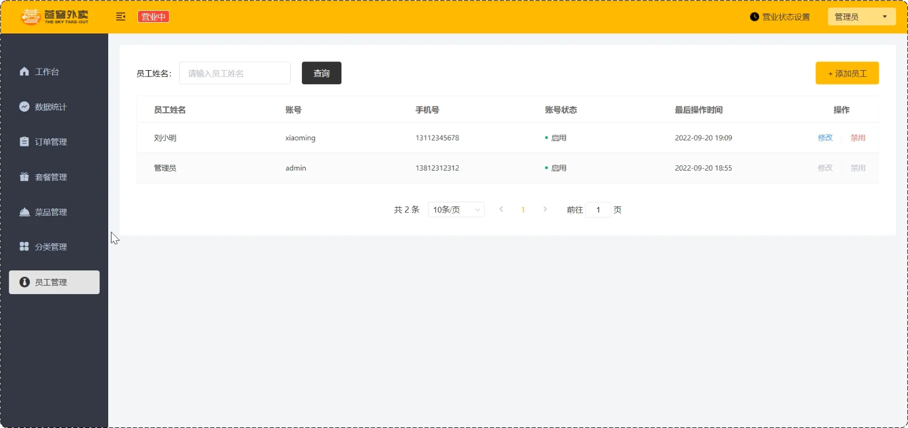

## 1、新增员工


### 1、EmployeeController.cs

ProgramBackEnd\SkyServer\controller\admin\EmployeeController.cs

该文件中添加如下内容：

```C#
        /// <summary>
        /// 新增员工接口
        /// <para>
        /// 创建新员工账户，设置默认密码并保存员工基本信息。
        /// 只有已认证的管理员可以调用此接口。
        /// </para>
        /// </summary>
        /// <param name="employeeDTO">员工数据传输对象，包含新员工的基本信息</param>
        /// <returns>统一封装的成功结果对象</returns>
        /// <response code="200">返回保存成功的信息</response>
        [HttpPost]
        public async Task<Result<string>> Save([FromBody] EmployeeDTO employeeDTO)
        {
            // 记录操作，但不记录详细信息以避免敏感数据泄露
            _logger.LogInformation("创建新员工: {Name}", employeeDTO.Name);

            // 调用业务服务保存员工信息
            // 业务层会处理数据验证、默认值设置和持久化
            await _employeeService.Save(employeeDTO);

            // 返回成功响应
            return Result<string>.Success("员工创建成功");
        }
```

### 2、EmployeeService

在ProgramBackEnd\SkyServer\service\IEmployeeService.cs中添加如下内容：

```C#
        /// <summary>
        /// 新增员工
        /// <para>
        /// 创建新的员工账户，包括以下操作:
        /// 1. 验证必要字段的有效性
        /// 2. 设置默认密码并加密
        /// 3. 设置账号状态为启用
        /// 4. 保存员工信息到数据库
        /// </para>
        /// </summary>
        /// <param name="employeeDTO">
        /// 员工数据传输对象，包含:
        /// - Username: 登录用户名，必须唯一
        /// - Name: 员工真实姓名
        /// - Phone: 联系电话
        /// - Sex: 性别
        /// - IdNumber: 身份证号码
        /// </param>
        /// <returns>
        /// 创建成功的员工实体对象，包含系统生成的ID和默认配置。
        /// </returns>
        /// <exception cref="BusinessException">当用户名已存在或数据验证失败时抛出</exception>
        /// <exception cref="ArgumentException">当必填字段为空时抛出</exception>
        Task<Employee> Save(EmployeeDTO employeeDTO);
```

在ProgramBackEnd\SkyServer\service\Impl\EmployeeServiceImpl.cs中添加如下内容：

```C#
/// <summary>
/// 创建新员工
/// </summary>
/// <param name="employeeDTO">员工信息数据传输对象</param>
/// <returns>创建成功的员工实体，包含系统生成的ID</returns>
/// <exception cref="BaseException">未找到当前登录用户信息时抛出</exception>
public async Task<Employee> Save(EmployeeDTO employeeDTO)
{
    // 1. 获取当前操作人ID：用于审计跟踪
    long? currentEmpId = BaseContext.GetCurrentId();
    if (!currentEmpId.HasValue)
    {
        _logger.LogWarning("创建员工失败：未能获取当前操作人信息");
        throw new BaseException("未获取到当前登录用户信息");
    }

    // 2. 验证员工信息的完整性和有效性
    if (employeeDTO == null)
    {
        throw new ArgumentNullException(nameof(employeeDTO), "员工信息不能为空");
    }

    if (string.IsNullOrEmpty(employeeDTO.Username))
    {
        throw new ArgumentException("用户名不能为空", nameof(employeeDTO));
    }

    if (string.IsNullOrEmpty(employeeDTO.Name))
    {
        throw new ArgumentException("姓名不能为空", nameof(employeeDTO));
    }

    // 可以添加更多的数据验证逻辑，如手机号格式、身份证号有效性等

    // 3. 构建员工实体对象：设置默认值和审计字段
    DateTime now = DateTime.Now;
    Employee employee = new Employee
    {
        Username = employeeDTO.Username?.Trim(),
        Name = employeeDTO.Name?.Trim(),
        // 使用系统默认密码并加密存储
        Password = MD5Util.ComputeHash(PasswordConstant.DEFAULT_PASSWORD),
        Phone = employeeDTO.Phone?.Trim(),
        Sex = employeeDTO.Sex?.Trim(),
        IdNumber = employeeDTO.IdNumber?.Trim(),
        // 默认启用状态
        Status = StatusConstant.ENABLE,
        // 设置审计字段
        CreateTime = now,
        UpdateTime = now,
        CreateUser = currentEmpId.Value,
        UpdateUser = currentEmpId.Value
    };

    // 4. 保存员工数据并返回结果
    _logger.LogInformation("创建员工：用户名 {Username}, 姓名 {Name}",
        employee.Username, employee.Name);

    return await _employeeMapper.Insert(employee);
}
```

### 3、EmployeeMapper

在ProgramBackEnd\SkyServer\mapper\IEmployeeMapper.cs中添加如下内容：

```C#
        /// <summary>
        /// 新增员工记录
        /// </summary>
        /// <param name="employee">要插入的员工实体</param>
        /// <returns>
        /// 包含自动生成ID的员工实体对象
        /// </returns>
        /// <exception cref="ArgumentNullException">当employee为null时抛出</exception>
        /// <exception cref="DbUpdateException">数据库唯一约束冲突或其他更新错误时抛出</exception>
        /// <remarks>
        /// 此方法将员工信息插入数据库，并返回包含自动生成ID的完整实体。
        /// 实现应确保:
        /// 1. ID字段由数据库自动生成
        /// 2. 创建时间和更新时间正确设置
        /// 3. 处理唯一键约束(如用户名唯一)冲突
        /// </remarks>
        Task<Employee> Insert(Employee employee);
```

在ProgramBackEnd\SkyServer\mapper\Impl\EmployeeMapperImpl.cs中添加如下内容：

```C#
        /// <summary>
        /// 新增员工记录
        /// </summary>
        /// <param name="employee">员工实体</param>
        /// <returns>包含生成ID的员工实体</returns>
        /// <exception cref="ArgumentNullException">当employee为null时抛出</exception>
        /// <exception cref="DbUpdateException">数据库更新失败时抛出</exception>
        public async Task<Employee> Insert(Employee employee)
        {
            // 参数验证
            if (employee == null)
            {
                throw new ArgumentNullException(nameof(employee), "员工对象不能为空");
            }

            try
            {
                // 使用异步方法添加实体
                // 注：无需手动设置ID，由数据库自增列生成
                await _context.Employees.AddAsync(employee);

                // 提交更改到数据库
                await _context.SaveChangesAsync();

                // 返回包含数据库生成ID的实体对象
                return employee;
            }
            catch (DbUpdateException ex)
            {
                // 处理唯一键约束冲突等数据库错误
                // 提供更具体的错误信息，便于上层处理
                string errorMessage = ex.InnerException?.Message?.Contains("Duplicate entry") == true
                    ? "员工用户名已存在，请使用其他用户名"
                    : $"保存员工数据时发生错误: {ex.Message}";

                throw new DbUpdateException(errorMessage, ex);
            }
            catch (Exception ex)
            {
                // 处理其他未预期的异常
                throw new InvalidOperationException("保存员工数据时发生未知错误", ex);
            }
        }
```

由于在Employee中需要指定创建与更新成员的指定者，因此需要通过拦截器等内容注入到ThreadLocal中

### 4、JwtTokenValidationMiddleware.cs

在ProgramBackEnd\SkyServer\Middlewares\JwtTokenValidationMiddleware.cs中添加如下内容：

```C#
using Microsoft.AspNetCore.Http;
using Microsoft.Extensions.Options;
using ProgramBackEnd.SkyCommon.constant;
using ProgramBackEnd.SkyCommon.context;
using ProgramBackEnd.SkyCommon.properties;
using ProgramBackEnd.SkyCommon.result;
using ProgramBackEnd.SkyCommon.utils;
using System.Text.Json;

namespace ProgramBackEnd.SkyServer.Middlewares
{
    /// <summary>
    /// JWT令牌验证中间件
    /// <para>
    /// 拦截对管理后台的请求，进行身份认证和授权管理。
    /// 集成了令牌验证的所有逻辑，无需依赖外部拦截器。
    /// </para>
    /// </summary>
    public class JwtTokenValidationMiddleware
    {
        /// <summary>
        /// 请求处理管道中的下一个委托
        /// </summary>
        private readonly RequestDelegate _next;

        /// <summary>
        /// 日志记录器
        /// </summary>
        private readonly ILogger<JwtTokenValidationMiddleware> _logger;

        /// <summary>
        /// JWT配置属性
        /// </summary>
        private readonly JwtProperties _jwtProperties;

        /// <summary>
        /// 不需要验证令牌的路径集合
        /// </summary>
        private static readonly HashSet<string> _excludedPaths = new(StringComparer.OrdinalIgnoreCase)
        {
            "/admin/employee/login"
            // 可在此处添加其他免验证的路径
        };

        /// <summary>
        /// 构造函数
        /// </summary>
        /// <param name="next">请求管道中的下一个中间件</param>
        /// <param name="logger">日志记录服务</param>
        /// <param name="jwtOptions">JWT配置选项</param>
        public JwtTokenValidationMiddleware(
            RequestDelegate next,
            ILogger<JwtTokenValidationMiddleware> logger,
            IOptions<JwtProperties> jwtOptions)
        {
            _next = next ?? throw new ArgumentNullException(nameof(next), "请求委托不能为空");
            _logger = logger ?? throw new ArgumentNullException(nameof(logger), "日志记录器不能为空");
            _jwtProperties = jwtOptions?.Value ?? throw new ArgumentNullException(nameof(jwtOptions), "JWT配置不能为空");
        }

        /// <summary>
        /// 处理HTTP请求的核心方法
        /// </summary>
        /// <param name="context">HTTP上下文</param>
        /// <returns>异步任务</returns>
        public async Task InvokeAsync(HttpContext context)
        {
            try
            {
                string path = context.Request.Path.Value?.ToLower() ?? "";

                // 判断是否需要进行令牌验证（与Java版本的拦截器注册逻辑对应）
                if (path.StartsWith("/admin/", StringComparison.OrdinalIgnoreCase) && !_excludedPaths.Contains(path))
                {
                    _logger.LogInformation("开始JWT验证: {Path}", path);

                    // 验证令牌
                    var (success, employeeId) = ValidateToken(context);

                    if (!success)
                    {
                        // 验证失败，返回401响应
                        _logger.LogWarning("JWT验证失败: {Path}", context.Request.Path);
                        await SendUnauthorizedResponseAsync(context);
                        return;
                    }

                    // 验证成功，将员工ID存储在请求上下文和线程本地存储中
                    context.Items["EmpId"] = employeeId;
                    BaseContext.SetCurrentId(employeeId);
                    _logger.LogInformation("员工ID {EmpId} 已设置到请求上下文和线程存储", employeeId);
                }

                // 验证通过或不需验证，继续请求处理
                await _next(context);
            }
            finally
            {
                // 请求结束后清理线程本地存储，防止内存泄漏
                BaseContext.RemoveCurrentId();
            }
        }

        /// <summary>
        /// 验证JWT令牌的有效性并提取员工ID
        /// </summary>
        /// <param name="context">HTTP请求上下文</param>
        /// <returns>验证结果，包含是否成功和员工ID</returns>
        private (bool Success, long EmployeeId) ValidateToken(HttpContext context)
        {
            try
            {
                // 从HTTP请求头获取令牌
                string token = ExtractToken(context);
                if (string.IsNullOrEmpty(token))
                {
                    return (false, 0);
                }

                // 解析JWT令牌
                _logger.LogInformation("正在验证JWT令牌");
                Dictionary<string, object> claims = JwtUtil.ParseJWT(_jwtProperties.AdminSecretKey, token);

                // 提取员工ID声明
                if (!TryGetEmployeeId(claims, out long empId))
                {
                    _logger.LogWarning("JWT令牌不包含有效的员工ID");
                    return (false, 0);
                }

                _logger.LogInformation("JWT验证成功, 员工ID: {EmpId}", empId);
                return (true, empId);
            }
            catch (Exception ex)
            {
                _logger.LogWarning(ex, "JWT验证过程发生异常: {Message}", ex.Message);
                return (false, 0);
            }
        }

        /// <summary>
        /// 从HTTP请求头中提取JWT令牌
        /// </summary>
        /// <param name="context">HTTP上下文</param>
        /// <returns>JWT令牌字符串，未找到则返回null</returns>
        private string ExtractToken(HttpContext context)
        {
            // 检查请求头中是否包含指定名称的令牌
            if (!context.Request.Headers.TryGetValue(_jwtProperties.AdminTokenName, out var tokenValues) || tokenValues.Count == 0)
            {
                _logger.LogWarning("请求缺少JWT令牌: {TokenName}", _jwtProperties.AdminTokenName);
                return null;
            }

            string token = tokenValues.First();

            if (string.IsNullOrEmpty(token))
            {
                _logger.LogWarning("JWT令牌为空");
                return null;
            }

            return token;
        }

        /// <summary>
        /// 尝试从JWT声明中提取员工ID
        /// </summary>
        /// <param name="claims">JWT声明字典</param>
        /// <param name="employeeId">提取的员工ID</param>
        /// <returns>是否成功提取</returns>
        private bool TryGetEmployeeId(Dictionary<string, object> claims, out long employeeId)
        {
            employeeId = 0;

            // 检查是否包含员工ID声明
            if (!claims.TryGetValue(JwtClaimsConstant.EMP_ID, out object empIdObj) || empIdObj == null)
            {
                return false;
            }

            // 尝试将声明值转换为长整型
            try
            {
                employeeId = Convert.ToInt64(empIdObj.ToString());
                return employeeId > 0; // 确保ID有效（大于0）
            }
            catch (FormatException ex)
            {
                _logger.LogWarning(ex, "员工ID格式无效: {Value}", empIdObj);
                return false;
            }
            catch (OverflowException ex)
            {
                _logger.LogWarning(ex, "员工ID数值溢出: {Value}", empIdObj);
                return false;
            }
        }

        /// <summary>
        /// 发送未授权响应
        /// </summary>
        /// <param name="context">HTTP上下文</param>
        private static async Task SendUnauthorizedResponseAsync(HttpContext context)
        {
            // 设置响应状态码和内容类型
            context.Response.StatusCode = StatusCodes.Status200OK; // 使用200但在数据中标记错误
            context.Response.ContentType = "application/json; charset=utf-8";

            // 创建标准错误响应
            var result = Result<string>.Error(MessageConstant.NOT_LOGIN);

            // 写入JSON响应
            await context.Response.WriteAsJsonAsync(result, new JsonSerializerOptions
            {
                PropertyNamingPolicy = JsonNamingPolicy.CamelCase
            });
        }
    }
}
```

### 5、JwtUtil

在ProgramBackEnd\SkyCommon\utils\JwtUtil.cs中添加如下内容：

```C#
using Microsoft.IdentityModel.Tokens;
using ProgramBackEnd.SkyCommon.exception;
using System.IdentityModel.Tokens.Jwt;
using System.Security.Claims;
using System.Text;

namespace ProgramBackEnd.SkyCommon.utils
{
    /// <summary>
    /// JWT(JSON Web Token)工具类
    /// <para>
    /// 提供JWT令牌的生成、解析和验证功能。JWT是一种基于JSON的开放标准(RFC 7519)，
    /// 用于在各方之间安全地传输信息。令牌中包含经过数字签名的声明(claims)，
    /// 可用于身份验证和信息交换。
    /// </para>
    /// </summary>
    /// <remarks>
    /// JWT由三部分组成，以点(.)分隔：
    /// 1. 头部(Header) - 包含令牌类型和使用的签名算法
    /// 2. 载荷(Payload) - 包含声明(claims)，即要传输的数据
    /// 3. 签名(Signature) - 用于验证令牌未被篡改
    /// 
    /// 本工具类使用HMAC-SHA256(HS256)算法进行签名，确保令牌的完整性和真实性。
    /// </remarks>
    public static class JwtUtil
    {
        /// <summary>
        /// 创建JWT令牌
        /// <para>
        /// 生成一个包含指定声明和过期时间的JWT令牌，使用HS256算法签名。
        /// 生成的令牌可用于客户端的身份验证和会话管理。
        /// </para>
        /// </summary>
        /// <param name="secretKey">
        /// JWT密钥，用于签名令牌。
        /// 应使用足够长且随机的字符串，建议至少32个字符。
        /// </param>
        /// <param name="ttlMillis">
        /// JWT令牌有效期(毫秒)。
        /// 设置合理的过期时间可以减少令牌被盗用的风险。
        /// </param>
        /// <param name="claims">
        /// 要包含在JWT中的声明信息，如用户ID、角色等。
        /// Key为声明名称，Value为声明值。
        /// </param>
        /// <returns>生成的JWT令牌字符串</returns>
        /// <exception cref="ArgumentNullException">当secretKey为null或空时抛出</exception>
        /// <exception cref="ArgumentException">当ttlMillis小于或等于0时抛出</exception>
        /// <example>
        /// 使用示例:
        /// <code>
        /// var claims = new Dictionary&lt;string, object&gt;
        /// {
        ///     { "userId", 123 },
        ///     { "role", "admin" }
        /// };
        /// string token = JwtUtil.CreateJWT("your-secure-key", 7200000, claims); // 有效期2小时
        /// </code>
        /// </example>
        public static string CreateJWT(string secretKey, long ttlMillis, Dictionary<string, object> claims)
        {
            // 参数验证
            if (string.IsNullOrEmpty(secretKey))
                throw new ArgumentNullException(nameof(secretKey), "JWT密钥不能为空");

            if (ttlMillis <= 0)
                throw new ArgumentException("令牌有效期必须大于0", nameof(ttlMillis));

            // 计算过期时间
            var issuedAt = DateTime.UtcNow;
            var expiration = issuedAt.AddMilliseconds(ttlMillis);

            // 创建安全密钥
            var key = new SymmetricSecurityKey(Encoding.UTF8.GetBytes(secretKey));

            // 创建签名证书
            var credentials = new SigningCredentials(key, SecurityAlgorithms.HmacSha256);

            // 创建JWT安全令牌描述符
            var tokenDescriptor = new SecurityTokenDescriptor
            {
                IssuedAt = issuedAt,          // 令牌签发时间
                NotBefore = issuedAt,         // 令牌生效时间
                Expires = expiration,          // 令牌过期时间
                SigningCredentials = credentials  // 签名证书
            };

            // 添加自定义声明
            if (claims != null && claims.Count > 0)
            {
                var claimsList = new List<Claim>();
                foreach (var claim in claims)
                {
                    // 将各种类型的值转换为字符串，处理null值
                    string value = claim.Value?.ToString() ?? "";
                    claimsList.Add(new Claim(claim.Key, value));
                }

                tokenDescriptor.Subject = new ClaimsIdentity(claimsList);
            }

            // 创建JWT处理器并生成令牌
            var tokenHandler = new JwtSecurityTokenHandler();
            var token = tokenHandler.CreateToken(tokenDescriptor);

            // 将令牌序列化为字符串并返回
            return tokenHandler.WriteToken(token);
        }

        /// <summary>
        /// 解析JWT令牌
        /// <para>
        /// 验证并解析JWT令牌，提取包含的声明信息。
        /// 此方法会验证令牌的签名和有效期。
        /// </para>
        /// </summary>
        /// <param name="secretKey">
        /// JWT密钥，用于验证令牌签名。
        /// 必须与创建令牌时使用的密钥相同。
        /// </param>
        /// <param name="token">
        /// 要解析的JWT令牌字符串。
        /// </param>
        /// <returns>
        /// JWT中包含的声明集合。
        /// Key为声明名称，Value为声明值。
        /// </returns>
        /// <exception cref="ArgumentNullException">当secretKey或token为null或空时抛出</exception>
        /// <exception cref="SecurityTokenException">当令牌签名无效或已过期时抛出</exception>
        /// <exception cref="FormatException">当令牌格式不正确时抛出</exception>
        /// <example>
        /// 使用示例:
        /// <code>
        /// try 
        /// {
        ///     var claims = JwtUtil.ParseJWT("your-secure-key", token);
        ///     var userId = Convert.ToInt64(claims["userId"]);
        /// }
        /// catch (SecurityTokenException ex)
        /// {
        ///     // 处理无效令牌的情况
        /// }
        /// </code>
        /// </example>
        public static Dictionary<string, object> ParseJWT(string secretKey, string token)
        {
            // 参数验证
            if (string.IsNullOrEmpty(secretKey))
                throw new ArgumentNullException(nameof(secretKey), "JWT密钥不能为空");

            if (string.IsNullOrEmpty(token))
                throw new ArgumentNullException(nameof(token), "JWT令牌不能为空");

            // 创建令牌验证参数
            var tokenValidationParameters = new TokenValidationParameters
            {
                // 验证签名密钥
                ValidateIssuerSigningKey = true,
                IssuerSigningKey = new SymmetricSecurityKey(Encoding.UTF8.GetBytes(secretKey)),

                // 不验证发行者
                ValidateIssuer = false,
                ValidIssuer = null,

                // 不验证受众
                ValidateAudience = false,
                ValidAudience = null,

                // 验证生命周期
                ValidateLifetime = true,

                // 设置时钟偏差为零，严格验证过期时间
                ClockSkew = TimeSpan.Zero,

                // 要求令牌存在过期时间声明
                RequireExpirationTime = true
            };

            // 创建JWT处理器
            var tokenHandler = new JwtSecurityTokenHandler();

            try
            {
                // 验证并解析令牌
                ClaimsPrincipal principal = tokenHandler.ValidateToken(token, tokenValidationParameters, out SecurityToken validatedToken);

                // 确保使用的是预期的安全算法
                if (!(validatedToken is JwtSecurityToken jwtToken) ||
                    !jwtToken.Header.Alg.Equals(SecurityAlgorithms.HmacSha256, StringComparison.InvariantCultureIgnoreCase))
                {
                    throw new SecurityTokenException("无效的令牌");
                }

                // 获取所有声明并转换为Dictionary
                var claims = principal.Claims;
                var claimsDictionary = new Dictionary<string, object>();

                foreach (var claim in claims)
                {
                    claimsDictionary[claim.Type] = claim.Value;
                }

                return claimsDictionary;
            }
            catch (SecurityTokenExpiredException)
            {
                // 令牌已过期
                throw new JWTTokenException("令牌已过期");
            }
            catch (SecurityTokenInvalidSignatureException)
            {
                // 令牌签名无效
                throw new JWTTokenException("令牌签名无效");
            }
            catch (SecurityTokenException ex)
            {
                // 其他安全令牌异常
                throw new JWTTokenException($"令牌验证失败: {ex.Message}");
            }
        }
    }
}
```


### 6、Program.cs

在ProgramBackEnd\Program.cs中添加如下内容以使用中间件：

```C#
/// <summary>
/// 应用程序入口类
/// <para>
/// 配置服务、中间件和启动ASP.NET Core Web API。
/// 这是ASP.NET Core应用程序的主入口点，负责整个应用的配置和启动流程。
/// </para>
/// </summary>

// ======================================
// 引用命名空间
// ======================================
using Microsoft.EntityFrameworkCore;                // 提供Entity Framework Core数据库交互功能
using Microsoft.Extensions.DependencyInjection;     // 提供依赖注入容器和服务注册功能
using ProgramBackEnd.SkyCommon.properties;          // 包含应用配置属性类，如JWT设置
using ProgramBackEnd.SkyServer.config;              // 包含应用服务配置和数据库上下文
using ProgramBackEnd.SkyServer.Handler;             // 包含全局异常处理器，提供统一错误处理
using ProgramBackEnd.SkyServer.Interceptors;        // 包含JWT令牌验证拦截器
using ProgramBackEnd.SkyServer.Middlewares;         // 包含自定义中间件组件

// ======================================
// 应用程序构建和初始化
// ======================================

// 创建Web应用程序构建器
// WebApplicationBuilder是ASP.NET Core应用程序的基础构建块
// 提供配置源、日志提供程序和服务容器的统一接口
var builder = WebApplication.CreateBuilder(args);

// ======================================
// 服务容器配置部分
// ======================================

// 1. 数据库上下文配置
// 注册Entity Framework数据库上下文，并配置MySQL提供程序
builder.Services.AddDbContext<SkyDbContext>(options =>
    options.UseMySql(
        // 从配置文件获取连接字符串，便于不同环境使用不同数据库
        builder.Configuration.GetConnectionString("DefaultConnection"),
        // 指定MySQL服务器版本，确保EF Core生成兼容SQL
        new MySqlServerVersion(new Version(9, 3, 0))
    )
);

// 2. JWT身份验证配置
// 将配置文件中的JWT设置绑定到强类型对象
// 这样可以在应用程序中以类型安全的方式访问JWT设置
builder.Services.Configure<JwtProperties>(builder.Configuration.GetSection("JwtConfig"));

// 3. Web框架服务注册
// 添加MVC控制器支持，并注册全局异常处理过滤器
// 这使应用程序能够处理HTTP请求并通过控制器返回响应
builder.Services.AddControllers().AddGlobalExceptionHandler(); // 自定义扩展方法，注册全局异常处理

// 4. 业务服务注册
// 使用扩展方法批量注册所有业务服务、数据访问组件和工具服务
// 这种方式避免在Program.cs中列出所有服务，保持代码整洁
builder.Services.RegisterAllServices();

// ======================================
// 应用程序实例构建
// ======================================

// 基于上述服务和配置构建WebApplication实例
// 此步骤完成服务容器的构建并准备HTTP请求处理管道
var app = builder.Build();

// ======================================
// HTTP请求处理管道配置（中间件注册）
// ======================================

// 注意：中间件的注册顺序决定了它们的执行顺序
// 这对于正确处理请求至关重要

// 1. 开发环境特定中间件
// 如果需要为开发环境配置特定中间件（如开发者异常页），可以在此添加
// if (app.Environment.IsDevelopment())
// {
//     app.UseDeveloperExceptionPage();
// }

// 2. 基础设施中间件
// 配置路由中间件，建立请求路由系统
app.UseRouting();

// 3. 身份验证与授权中间件
// JWT令牌验证中间件，拦截请求并验证身份令牌
// 位于路由之后，确保路由已解析，但在终端中间件之前
app.UseMiddleware<JwtTokenValidationMiddleware>();

// 4. 终端中间件
// 将HTTP请求映射到对应的控制器端点
// 如：/admin/employee/login 将映射到EmployeeController的Login方法
app.MapControllers();

// ======================================
// 应用程序启动
// ======================================

// 启动Web主机并开始监听HTTP请求
// 应用程序将持续运行，直到被明确停止或发生未处理异常
app.Run();
```

用户存在：

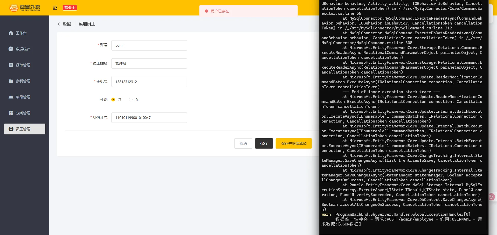

用户未存在：

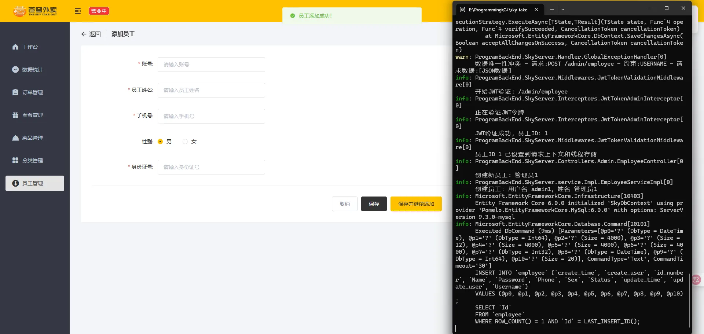

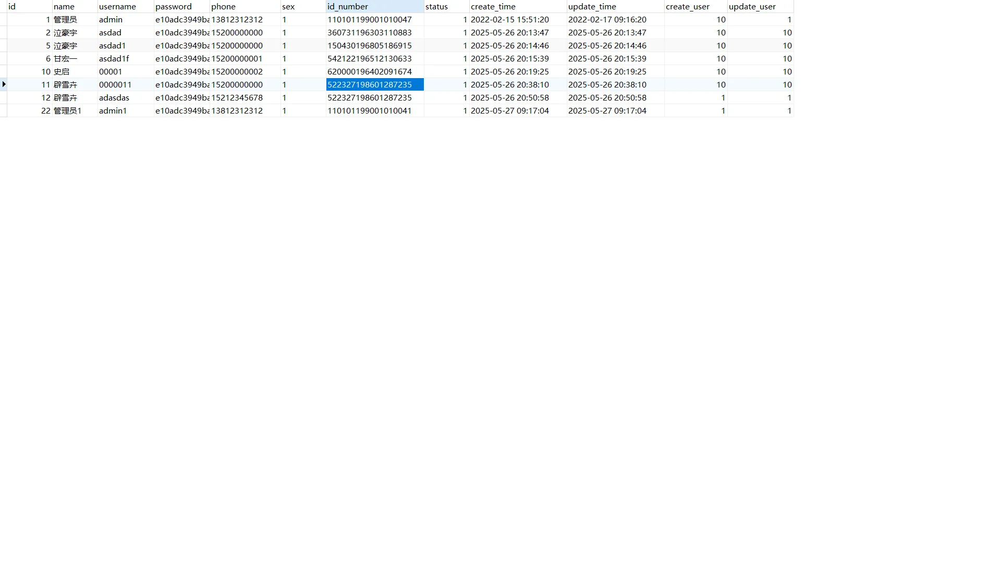

## 2、员工分页查询

### 1、EmployeeController.cs

ProgramBackEnd\SkyServer\controller\admin\EmployeeController.cs

该文件中添加如下内容：

```C#
        /// <summary>
        /// 员工分页查询接口
        /// <para>
        /// 根据查询条件获取员工列表，支持按姓名筛选并进行分页。
        /// 此接口为管理员提供员工信息的分页浏览功能，便于员工管理。
        /// </para>
        /// </summary>
        /// <param name="employeePageQueryDTO">
        /// 员工分页查询数据传输对象，包含：
        /// - Name: 员工姓名(可选)，用于筛选
        /// - Page: 当前页码，从1开始
        /// - PageSize: 每页记录数，控制返回数据量
        /// </param>
        /// <returns>
        /// 统一封装的结果对象，包含：
        /// - 状态码(1表示成功)
        /// - 分页数据(总记录数和当前页数据列表)
        /// </returns>
        /// <response code="200">
        /// 返回查询结果，包含员工列表和分页信息
        /// </response>
        [HttpGet("page")]
        public async Task<Result<PageResult>> Page([FromQuery] EmployeePageQueryDTO employeePageQueryDTO)
        {
            // 记录查询参数日志，便于问题排查和性能监控
            _logger.LogInformation("员工分页查询开始，查询参数：{EmployeePageQueryDTO}", employeePageQueryDTO);

            try
            {
                // 调用业务服务执行查询，分离控制器和业务逻辑
                PageResult pageResult = await _employeeService.PageQuery(employeePageQueryDTO);

                // 记录查询结果的基本信息
                _logger.LogInformation("员工分页查询成功，共返回 {Count} 条记录，总记录数 {Total}",pageResult.Records?.Count ?? 0, pageResult.Total);

                // 返回成功结果，使用统一的响应格式
                return Result<PageResult>.Success(pageResult);
            }
            catch (Exception ex)
            {
                // 记录异常信息，但不在此处处理异常
                // 异常将由全局异常处理器捕获并转换为适当的HTTP响应
                _logger.LogError(ex, "员工分页查询异常：{Message}", ex.Message);
                throw; // 重新抛出异常，交由全局异常处理
            }
        }
```

### 2、EmployeeService

在ProgramBackEnd\SkyServer\service\IEmployeeService.cs中添加如下内容：

```C#
        /// <summary>
        /// 员工分页查询
        /// <para>
        /// 根据查询条件获取员工列表并进行分页处理，支持以下功能：
        /// 1. 按员工姓名进行模糊查询
        /// 2. 分页获取员工数据，控制返回数据量
        /// 3. 按创建时间降序排序，确保最新员工排在前面
        /// </para>
        /// </summary>
        /// <param name="employeePageQueryDTO">
        /// 员工分页查询数据传输对象，包含：
        /// - Name: 员工姓名(可选)，用于模糊匹配筛选
        /// - Page: 当前页码，从1开始计数
        /// - PageSize: 每页记录数，控制返回数据量
        /// </param>
        /// <returns>
        /// 分页结果对象(PageResult)，包含：
        /// - Total: 满足条件的总记录数
        /// - Records: 当前页的员工记录列表
        /// 返回的员工信息不包含敏感字段如密码
        /// </returns>
        /// <exception cref="ArgumentException">当分页参数无效(如页码小于1)时抛出</exception>
        /// <remarks>
        /// 该方法实现需遵循以下原则：
        /// 1. 确保数据安全，过滤敏感字段
        /// 2. 优化查询性能，避免全表扫描
        /// 3. 处理空结果情况，返回空列表而非null
        /// </remarks>
        Task<PageResult> PageQuery(EmployeePageQueryDTO employeePageQueryDTO);
```

在ProgramBackEnd\SkyServer\service\Impl\EmployeeServiceImpl.cs中添加如下内容：

```C#
        /// <summary>
        /// 员工分页查询实现
        /// <para>
        /// 根据查询条件获取员工列表并进行分页处理，主要功能包括：
        /// 1. 验证并规范化分页参数，确保查询有效执行
        /// 2. 调用数据访问层执行实际查询操作
        /// 3. 封装查询结果为统一的分页响应结构
        /// </para>
        /// </summary>
        /// <param name="employeePageQueryDTO">
        /// 员工分页查询数据传输对象，包含：
        /// - Name: 员工姓名(可选)，用于模糊匹配筛选
        /// - Page: 当前页码，从1开始计数
        /// - PageSize: 每页记录数，控制返回数据量
        /// </param>
        /// <returns>
        /// 分页结果对象(PageResult)，包含：
        /// - Total: 满足条件的总记录数
        /// - Records: 当前页的员工记录列表
        /// </returns>
        /// <remarks>
        /// 方法执行流程：
        /// 1. 参数校验与默认值设置
        /// 2. 委托数据访问层执行查询
        /// 3. 封装返回数据，隐藏敏感信息
        /// </remarks>
        public async Task<PageResult> PageQuery(EmployeePageQueryDTO employeePageQueryDTO)
        {
            _logger.LogInformation("开始执行员工分页查询，查询参数：{EmployeePageQueryDTO}", employeePageQueryDTO);

            try
            {
                // 1. 参数验证与规范化：确保查询参数有效，提供合理默认值
                if (employeePageQueryDTO == null)
                {
                    throw new ArgumentNullException(nameof(employeePageQueryDTO), "分页查询参数不能为空");
                }

                // 规范化页码：小于1则设为默认值1
                if (employeePageQueryDTO.Page < 1)
                {
                    _logger.LogWarning("页码参数无效(值为{Page})，已自动调整为默认值1", employeePageQueryDTO.Page);
                    employeePageQueryDTO.Page = 1;
                }

                // 规范化页大小：小于1则设为默认值10
                if (employeePageQueryDTO.PageSize < 1)
                {
                    _logger.LogWarning("每页记录数参数无效(值为{PageSize})，已自动调整为默认值10", employeePageQueryDTO.PageSize);
                    employeePageQueryDTO.PageSize = 10;
                }

                // 2. 调用数据访问层执行查询：通过数据映射器获取分页数据
                // 使用元组解构接收查询结果，直观明了
                (int total, List<Employee> employees) = await _employeeMapper.PageQuery(employeePageQueryDTO);
                _logger.LogDebug("查询成功，共获取{Count}条记录，总记录数{Total}", employees.Count, total);

                // 3. 构建标准化的分页结果对象
                PageResult pageResult = new PageResult
                {
                    Total = total,                // 设置满足条件的总记录数
                    Records = employees           // 设置当前页的数据列表
                };

                _logger.LogInformation("员工分页查询成功完成，返回记录数：{Count}", employees.Count);
                return pageResult;
            }
            catch (Exception ex)
            {
                // 捕获并记录异常，但保持异常传播以便全局异常处理器处理
                _logger.LogError(ex, "员工分页查询过程中发生异常：{Message}", ex.Message);
                throw; // 重新抛出异常，保持原始堆栈信息
            }
        }
```

### 3、EmployeeMapper

在ProgramBackEnd\SkyServer\mapper\IEmployeeMapper.cs中添加如下内容：

```C#
        /// <summary>
        /// 员工分页查询
        /// <para>
        /// 根据查询条件从数据库中检索员工记录并分页返回。
        /// 支持按员工姓名进行模糊搜索，并对结果集进行分页处理。
        /// 作为数据访问层的核心方法，直接与数据库交互。
        /// </para>
        /// </summary>
        /// <param name="employeePageQueryDTO">
        /// 员工分页查询数据传输对象，包含：
        /// - Name: 员工姓名(可选)，用于模糊匹配查询
        /// - Page: 当前页码，从1开始计数
        /// - PageSize: 每页记录数，控制返回数据量
        /// </param>
        /// <returns>
        /// 返回元组，包含两个元素：
        /// - total: 满足条件的总记录数
        /// - employees: 当前页的员工记录列表，已按创建时间降序排序
        /// </returns>
        /// <exception cref="ArgumentNullException">查询参数对象为null时抛出</exception>
        /// <exception cref="InvalidOperationException">查询执行过程中发生错误时抛出</exception>
        /// <remarks>
        /// 实现注意事项：
        /// 1. 必须添加明确的排序(如按创建时间降序)，避免Skip/Take操作引起的不确定结果
        /// 2. 查询应先执行Count获取总数，再执行分页查询以提高性能
        /// 3. 查询需考虑大数据量场景下的性能优化，如合理利用索引
        /// 4. 需处理姓名参数的SQL注入风险，确保查询安全
        /// 
        /// 典型实现示例：
        /// <code>
        /// var query = _context.Employees;
        /// 
        /// // 添加条件过滤
        /// if (!string.IsNullOrEmpty(dto.Name))
        ///     query = query.Where(e => e.Name.Contains(dto.Name));
        ///     
        /// int total = await query.CountAsync();
        /// 
        /// // 排序并分页
        /// var employees = await query
        ///     .OrderByDescending(e => e.CreateTime)
        ///     .Skip((dto.Page - 1) * dto.PageSize)
        ///     .Take(dto.PageSize)
        ///     .ToListAsync();
        ///     
        /// return (total, employees);
        /// </code>
        /// </remarks>
        Task<(int total, List<Employee> employees)> PageQuery(EmployeePageQueryDTO employeePageQueryDTO);
```

在ProgramBackEnd\SkyServer\mapper\Impl\EmployeeMapperImpl.cs中添加如下内容：

```C#
        /// <summary>
        /// 员工分页查询实现
        /// <para>
        /// 根据查询条件从数据库检索员工记录并进行分页处理。
        /// 支持按员工姓名模糊搜索，结果按创建时间降序排列。
        /// </para>
        /// </summary>
        /// <param name="employeePageQueryDTO">
        /// 员工分页查询数据传输对象，包含：
        /// - Name: 员工姓名(可选)，用于模糊匹配
        /// - Page: 当前页码，从1开始
        /// - PageSize: 每页记录数
        /// </param>
        /// <returns>
        /// 返回包含两个元素的元组：
        /// - total: 满足条件的总记录数
        /// - employees: 当前页的员工记录列表
        /// </returns>
        /// <exception cref="ArgumentNullException">查询参数为null时抛出</exception>
        /// <exception cref="InvalidOperationException">数据库查询执行出错时抛出</exception>
        public async Task<(int total, List<Employee> employees)> PageQuery(EmployeePageQueryDTO employeePageQueryDTO)
        {
            // 1. 参数验证：确保查询参数有效
            if (employeePageQueryDTO == null)
            {
                throw new ArgumentNullException(nameof(employeePageQueryDTO), "查询参数不能为空");
            }

            // 2. 提取和规范化分页参数
            int pageNumber = Math.Max(1, employeePageQueryDTO.Page); // 确保页码至少为1
            int pageSize = Math.Max(1, employeePageQueryDTO.PageSize); // 确保每页大小至少为1

            try
            {
                // 3. 构建基础查询
                // 从员工表开始查询，后续添加条件、排序和分页
                IQueryable<Employee> query = _context.Employees;

                // 4. 添加条件过滤
                // 如果提供了姓名参数，使用Contains进行模糊匹配
                // EF Core会将此转换为SQL的LIKE操作
                if (!string.IsNullOrWhiteSpace(employeePageQueryDTO.Name))
                {
                    string name = employeePageQueryDTO.Name.Trim();
                    query = query.Where(e => e.Name.Contains(name));
                }

                // 5. 查询满足条件的总记录数
                // 在应用分页前执行COUNT查询，获取总记录数
                int total = await query.CountAsync();

                // 6. 应用排序和分页并执行查询
                // 排序确保分页结果一致性，避免EF Core警告
                List<Employee> employees = await query
                    // 主排序：按创建时间降序，展示最新员工
                    .OrderByDescending(e => e.CreateTime)
                    // 次排序：按ID升序，确保完全确定的顺序
                    .ThenBy(e => e.Id)
                    // 计算跳过的记录数
                    .Skip((pageNumber - 1) * pageSize)
                    // 获取当前页的记录数
                    .Take(pageSize)
                    // 异步执行查询并将结果转为列表
                    .ToListAsync();

                // 7. 返回查询结果
                // 使用值元组返回总记录数和当前页数据
                return (total, employees);
            }
            catch (Exception ex) when (ex is not ArgumentNullException)
            {
                // 8. 异常处理
                // 捕获并转换数据库异常，提供更明确的错误信息
                // 保留原始异常作为内部异常，便于调试
                throw new InvalidOperationException($"执行员工分页查询时发生错误: {ex.Message}", ex);
            }
        }
```

由于分页查询中涉及日期格式的转换，因此构建中间件以自动优化格式。

### 4、JacksonObjectMapper

在ProgramBackEnd\SkyCommon\json\JacksonObjectMapper.cs中添加如下内容：

```C#
using Newtonsoft.Json;
using Newtonsoft.Json.Converters;
using Newtonsoft.Json.Serialization;
using System.Globalization;
using JsonConverter = Newtonsoft.Json.JsonConverter;
using JsonSerializer = Newtonsoft.Json.JsonSerializer;

namespace ProgramBackEnd.SkyCommon.json
{
    /// <summary>
    /// 对象映射器：基于Newtonsoft.Json将C#对象与JSON字符串之间进行转换
    /// <para>- 将JSON字符串转换为C#对象：反序列化（Deserialization）</para>
    /// <para>- 将C#对象转换为JSON字符串：序列化（Serialization）</para>
    /// </summary>
    public class JacksonObjectMapper
    {
        /// <summary>
        /// 默认日期格式（年-月-日）
        /// </summary>
        public static readonly string DEFAULT_DATE_FORMAT = "yyyy-MM-dd";

        /// <summary>
        /// 默认日期时间格式（年-月-日 时:分）
        /// </summary>
        public static readonly string DEFAULT_DATE_TIME_FORMAT = "yyyy-MM-dd HH:mm";

        /// <summary>
        /// 默认时间格式（时:分:秒）
        /// </summary>
        public static readonly string DEFAULT_TIME_FORMAT = "HH:mm:ss";

        /// <summary>
        /// JSON序列化配置
        /// </summary>
        private readonly JsonSerializerSettings _settings;

        /// <summary>
        /// 构造函数：创建一个预配置的对象映射器实例
        /// </summary>
        public JacksonObjectMapper()
        {
            // 初始化JSON序列化配置
            _settings = new JsonSerializerSettings
            {
                // 处理未知属性：忽略而不抛出异常
                MissingMemberHandling = MissingMemberHandling.Ignore,

                // 处理空值：序列化时忽略空值
                NullValueHandling = NullValueHandling.Ignore,

                // 属性名称策略：使用驼峰命名法（首字母小写）
                ContractResolver = new CamelCasePropertyNamesContractResolver()
            };

            // 注册日期时间格式转换器
            _settings.Converters.Add(new IsoDateTimeConverter
            {
                DateTimeFormat = DEFAULT_DATE_TIME_FORMAT,
                Culture = CultureInfo.InvariantCulture
            });

            // 注册日期格式转换器
            _settings.Converters.Add(new DateOnlyJsonConverter(DEFAULT_DATE_FORMAT));

            // 注册时间格式转换器
            _settings.Converters.Add(new TimeOnlyJsonConverter(DEFAULT_TIME_FORMAT));
        }

        /// <summary>
        /// 将对象序列化为JSON字符串
        /// </summary>
        /// <param name="obj">要序列化的对象</param>
        /// <returns>序列化后的JSON字符串</returns>
        public string WriteValueAsString(object obj)
        {
            return JsonConvert.SerializeObject(obj, _settings);
        }

        /// <summary>
        /// 将JSON字符串反序列化为指定类型的对象
        /// </summary>
        /// <typeparam name="T">目标对象类型</typeparam>
        /// <param name="json">JSON字符串</param>
        /// <returns>反序列化后的强类型对象</returns>
        public T ReadValue<T>(string json)
        {
            return JsonConvert.DeserializeObject<T>(json, _settings);
        }

        /// <summary>
        /// 获取当前配置的JSON序列化设置
        /// </summary>
        /// <returns>JSON序列化配置</returns>
        public JsonSerializerSettings GetSerializerSettings()
        {
            return _settings;
        }
    }

    /// <summary>
    /// 日期类型JSON转换器
    /// <para>处理日期（DateTime）的序列化和反序列化，仅包含日期部分</para>
    /// </summary>
    public class DateOnlyJsonConverter : JsonConverter
    {
        /// <summary>
        /// 日期格式
        /// </summary>
        private readonly string _dateFormat;

        /// <summary>
        /// 构造函数
        /// </summary>
        /// <param name="dateFormat">指定的日期格式</param>
        public DateOnlyJsonConverter(string dateFormat)
        {
            _dateFormat = dateFormat;
        }

        /// <summary>
        /// 确定此转换器是否可以转换指定的对象类型
        /// </summary>
        public override bool CanConvert(Type objectType)
        {
            return objectType == typeof(DateTime) || objectType == typeof(DateTime?);
        }

        /// <summary>
        /// 读取JSON并转换为日期对象
        /// </summary>
        public override object ReadJson(JsonReader reader, Type objectType, object existingValue, JsonSerializer serializer)
        {
            if (reader.TokenType == JsonToken.Null)
            {
                return null;
            }

            string dateStr = reader.Value?.ToString();
            if (DateTime.TryParseExact(dateStr, _dateFormat, CultureInfo.InvariantCulture,
                                     DateTimeStyles.None, out DateTime date))
            {
                return date.Date; // 只返回日期部分
            }

            // 尝试使用默认解析
            return DateTime.Parse(dateStr, CultureInfo.InvariantCulture);
        }

        /// <summary>
        /// 将日期对象转换为JSON
        /// </summary>
        public override void WriteJson(JsonWriter writer, object value, JsonSerializer serializer)
        {
            if (value == null)
            {
                writer.WriteNull();
                return;
            }
            
            writer.WriteValue(((DateTime)value).ToString(_dateFormat, CultureInfo.InvariantCulture));
        }
    }

    /// <summary>
    /// 时间类型JSON转换器
    /// <para>处理时间（TimeSpan）的序列化和反序列化</para>
    /// </summary>
    public class TimeOnlyJsonConverter : JsonConverter
    {
        /// <summary>
        /// 时间格式
        /// </summary>
        private readonly string _timeFormat;

        /// <summary>
        /// 构造函数
        /// </summary>
        /// <param name="timeFormat">指定的时间格式</param>
        public TimeOnlyJsonConverter(string timeFormat)
        {
            _timeFormat = timeFormat;
        }

        /// <summary>
        /// 确定此转换器是否可以转换指定的对象类型
        /// </summary>
        public override bool CanConvert(Type objectType)
        {
            return objectType == typeof(TimeSpan) || objectType == typeof(TimeSpan?);
        }

        /// <summary>
        /// 读取JSON并转换为时间对象
        /// </summary>
        public override object ReadJson(JsonReader reader, Type objectType, object existingValue, JsonSerializer serializer)
        {
            if (reader.TokenType == JsonToken.Null)
            {
                return null;
            }

            string timeStr = reader.Value?.ToString();
            if (TimeSpan.TryParseExact(timeStr, _timeFormat, CultureInfo.InvariantCulture, out TimeSpan time))
            {
                return time;
            }

            // 尝试使用默认解析
            return TimeSpan.Parse(timeStr, CultureInfo.InvariantCulture);
        }

        /// <summary>
        /// 将时间对象转换为JSON
        /// </summary>
        public override void WriteJson(JsonWriter writer, object value, JsonSerializer serializer)
        {
            if (value == null)
            {
                writer.WriteNull();
                return;
            }
            
            var timeSpan = (TimeSpan)value;
            var formattedTime = $"{timeSpan.Hours:D2}:{timeSpan.Minutes:D2}:{timeSpan.Seconds:D2}";
            writer.WriteValue(formattedTime);
        }
    }
}
```

### 5、JsonFormatterMiddleware

在ProgramBackEnd\SkyServer\Middlewares\JsonFormatterMiddleware.cs中添加如下内容：

```C#
using Newtonsoft.Json;
using ProgramBackEnd.SkyCommon.json;
using System.Text;

namespace ProgramBackEnd.SkyServer.Middlewares
{
    /// <summary>
    /// JSON格式化中间件：统一处理HTTP响应中的JSON序列化格式
    /// <para>
    /// 主要功能：
    /// 1. 拦截所有HTTP响应并检测JSON内容
    /// 2. 对JSON类型的响应进行统一的格式化处理
    /// 3. 确保所有JSON响应采用一致的日期格式、命名规则和序列化策略
    /// </para>
    /// </summary>
    public class JsonFormatterMiddleware
    {
        /// <summary>
        /// 请求处理管道中的下一个委托
        /// </summary>
        private readonly RequestDelegate _next;

        /// <summary>
        /// JSON对象映射器，负责统一的序列化和反序列化逻辑
        /// </summary>
        private readonly JacksonObjectMapper _jacksonMapper;

        /// <summary>
        /// 初始化JSON格式化中间件
        /// </summary>
        /// <param name="next">请求委托，表示管道中的下一个中间件</param>
        /// <exception cref="ArgumentNullException">当next参数为null时抛出</exception>
        public JsonFormatterMiddleware(RequestDelegate next)
        {
            _next = next ?? throw new ArgumentNullException(nameof(next));
            _jacksonMapper = new JacksonObjectMapper();
        }

        /// <summary>
        /// 处理HTTP请求的核心方法
        /// </summary>
        /// <param name="context">HTTP上下文，包含请求和响应信息</param>
        /// <returns>表示异步操作的任务</returns>
        /// <exception cref="ArgumentNullException">当context参数为null时抛出</exception>
        public async Task InvokeAsync(HttpContext context)
        {
            if (context == null)
                throw new ArgumentNullException(nameof(context));

            // 保存原始响应流，以便后续还原
            var originalBodyStream = context.Response.Body;

            try
            {
                // 创建内存流用于暂存和处理响应内容
                using var responseBody = new MemoryStream();
                context.Response.Body = responseBody;

                // 调用管道中的下一个中间件，处理请求并生成响应
                await _next(context);

                // 仅当响应是JSON格式时才进行处理
                if (IsJsonResponse(context.Response))
                {
                    await FormatJsonResponseAsync(context.Response, responseBody);
                }

                // 将处理后的响应内容写回原始流
                responseBody.Seek(0, SeekOrigin.Begin);
                await responseBody.CopyToAsync(originalBodyStream);
            }
            finally
            {
                // 确保始终还原原始响应流，防止响应管道被破坏
                context.Response.Body = originalBodyStream;
            }
        }

        /// <summary>
        /// 检查响应是否为JSON格式
        /// </summary>
        /// <param name="response">HTTP响应对象</param>
        /// <returns>如果是JSON响应则返回true，否则返回false</returns>
        private static bool IsJsonResponse(HttpResponse response)
        {
            // 检查Content-Type是否包含application/json
            return response.ContentType != null &&
                   response.ContentType.ToLower().Contains("application/json");
        }

        /// <summary>
        /// 格式化JSON响应内容
        /// </summary>
        /// <param name="response">HTTP响应对象</param>
        /// <param name="responseStream">包含原始响应内容的内存流</param>
        /// <returns>表示异步操作的任务</returns>
        private async Task FormatJsonResponseAsync(HttpResponse response, MemoryStream responseStream)
        {
            // 重置流位置以读取完整内容
            responseStream.Seek(0, SeekOrigin.Begin);

            // 读取原始响应内容
            var responseBodyText = await new StreamReader(responseStream).ReadToEndAsync();

            // 只有当响应内容非空时才进行处理
            if (string.IsNullOrEmpty(responseBodyText))
            {
                return;
            }

            try
            {
                // 将原始JSON反序列化为动态对象
                var deserializedObject = JsonConvert.DeserializeObject(responseBodyText);

                // 使用JacksonObjectMapper重新序列化，应用统一的格式规则
                var reformattedJson = _jacksonMapper.WriteValueAsString(deserializedObject);

                // 清空响应流准备写入格式化后的内容
                responseStream.SetLength(0);

                // 将格式化后的JSON写入响应流
                var bytes = Encoding.UTF8.GetBytes(reformattedJson);
                await responseStream.WriteAsync(bytes, 0, bytes.Length);
            }
            catch (JsonException ex)
            {
                // 处理JSON解析错误，保留原始内容
                Console.WriteLine($"JSON格式化失败: {ex.Message}, 路径: {ex.Path}");

                // 重置流并写回原始内容，确保响应不受影响
                responseStream.SetLength(0);
                var bytes = Encoding.UTF8.GetBytes(responseBodyText);
                await responseStream.WriteAsync(bytes, 0, bytes.Length);
            }
            catch (Exception ex)
            {
                // 捕获其他可能的异常
                Console.WriteLine($"JSON处理过程中发生意外错误: {ex.Message}");
                
                // 还原原始内容
                responseStream.SetLength(0);
                var bytes = Encoding.UTF8.GetBytes(responseBodyText);
                await responseStream.WriteAsync(bytes, 0, bytes.Length);
            }
        }
    }
}
```

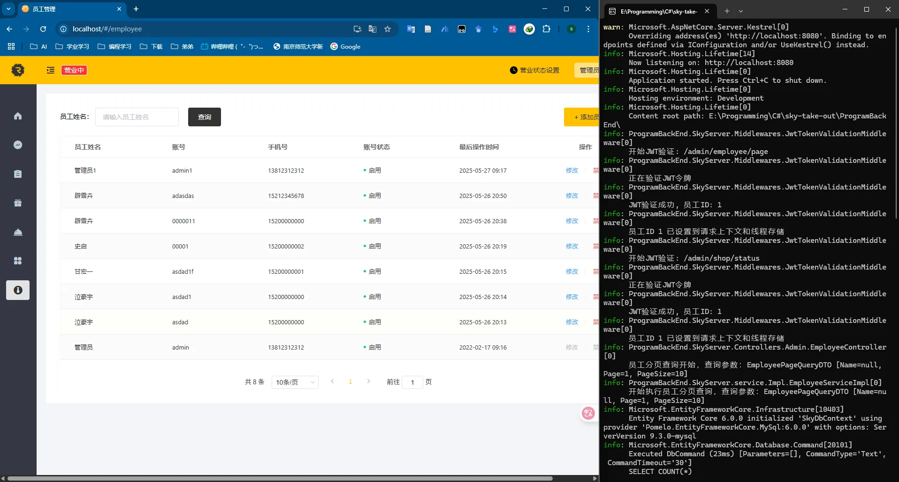

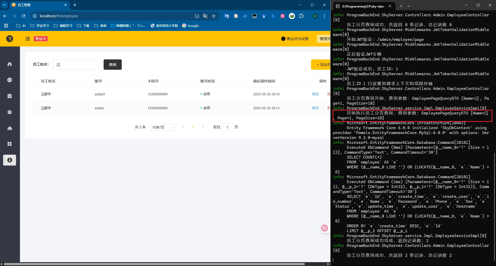

## 3、启用、禁用员工账户

### 1、EmployeeController.cs

ProgramBackEnd\SkyServer\controller\admin\EmployeeController.cs

该文件中添加如下内容：

```C#
        /// <summary>
        /// 启用或禁用员工账号
        /// <para>
        /// 根据传入的状态值修改员工账号的可用状态。
        /// 状态值：1表示启用账号，0表示禁用账号。
        /// </para>
        /// </summary>
        /// <param name="status">目标状态：1=启用，0=禁用</param>
        /// <param name="id">员工ID</param>
        /// <returns>操作结果，包含成功提示信息</returns>
        /// <response code="200">返回统一封装的结果对象，提示修改成功</response>
        /// <exception cref="ArgumentException">当状态值不是0或1时抛出</exception>
        /// <exception cref="EntityNotFoundException">当指定ID的员工不存在时抛出</exception>
        [HttpPost("status/{status}")]
        public async Task<Result<string>> StartOrStop([FromRoute] int status, [FromQuery] long id)
        {
            // 参数验证
            if (status != 0 && status != 1)
            {
                _logger.LogWarning("员工状态修改失败：无效的状态值 {Status}，员工ID {Id}", status, id);
                throw new ArgumentException("状态值只能是0(禁用)或1(启用)");
            }

            // 记录操作开始，明确操作类型
            string actionType = status == 1 ? "启用" : "禁用";
            _logger.LogInformation("正在{ActionType}员工账号，员工ID：{Id}", actionType, id);

            // 调用业务服务处理启用或禁用操作
            await _employeeService.StartOrStop(status, id);

            // 记录操作成功
            _logger.LogInformation("已成功{ActionType}员工账号，员工ID：{Id}", actionType, id);

            // 返回操作结果
            return Result<string>.Success($"员工账号{actionType}成功");
        }
```

### 2、EmployeeService

在ProgramBackEnd\SkyServer\service\IEmployeeService.cs中添加如下内容：

```C#
        /// <summary>
        /// 启用或禁用员工账号
        /// <para>
        /// 根据指定的状态值修改员工账号的可用状态，执行以下操作:
        /// 1. 验证员工ID的有效性和存在性
        /// 2. 验证状态值的合法性(必须为0或1)
        /// 3. 更新员工状态并记录修改时间
        /// 4. 保存更改到数据库并返回更新后的员工信息
        /// </para>
        /// </summary>
        /// <param name="status">
        /// 目标状态值：
        /// - 1：启用账号，允许员工登录系统
        /// - 0：禁用账号，阻止员工登录系统
        /// </param>
        /// <param name="id">员工ID，标识要修改状态的员工记录</param>
        /// <returns>
        /// 更新后的员工实体对象，包含最新的状态信息和修改时间戳。
        /// 用于向调用方确认操作已成功执行。
        /// </returns>
        /// <exception cref="ArgumentException">当状态值不是0或1时抛出</exception>
        /// <exception cref="EntityNotFoundException">当指定ID的员工不存在时抛出</exception>
        /// <exception cref="BusinessException">当操作违反业务规则时抛出</exception>
        /// <remarks>
        /// 此方法实现了账号状态管理功能，是员工管理中的关键操作。
        /// 状态变更会立即生效，影响员工的系统访问权限。
        /// </remarks>
        Task<Employee> StartOrStop(int status, long id);
```

在ProgramBackEnd\SkyServer\service\Impl\EmployeeServiceImpl.cs中添加如下内容：

```C#
/// <summary>
/// 启用或禁用员工账号
/// <para>
/// 根据传入的状态值修改员工账号状态，实现账号的启用和禁用功能。
/// 执行流程：
/// 1. 验证状态值是否合法(0或1)
/// 2. 获取当前登录用户ID用于审计
/// 3. 构建员工状态更新对象
/// 4. 调用数据访问层执行更新
/// </para>
/// </summary>
/// <param name="status">目标状态值：1表示启用，0表示禁用</param>
/// <param name="id">要修改状态的员工ID</param>
/// <returns>更新后的员工实体对象</returns>
/// <exception cref="ArgumentException">当状态值不是0或1时抛出</exception>
/// <exception cref="BaseException">当未获取到当前登录用户信息时抛出</exception>
/// <exception cref="EntityNotFoundException">当员工ID不存在时抛出(由数据层处理)</exception>
public async Task<Employee> StartOrStop(int status, long id)
{
    // 1. 参数验证：确保状态值合法
    if (status != StatusConstant.ENABLE && status != StatusConstant.DISABLE)
    {
        _logger.LogWarning("修改员工状态失败：无效的状态值 {Status}，员工ID {Id}", status, id);
        throw new ArgumentException("状态值只能是0(禁用)或1(启用)");
    }
    
    // 2. 获取当前操作人ID：用于审计跟踪
    long? currentEmpId = BaseContext.GetCurrentId();
    if (!currentEmpId.HasValue)
    {
        _logger.LogWarning("修改员工状态失败：未能获取当前操作人信息");
        throw new BaseException("未获取到当前登录用户信息");
    }

    string actionType = status == StatusConstant.ENABLE ? "启用" : "禁用";
    _logger.LogInformation("开始{ActionType}员工账号，员工ID：{Id}，操作人ID：{OperatorId}", 
        actionType, id, currentEmpId.Value);

    // 3. 构建仅包含必要更新字段的员工实体
    Employee employee = new Employee
    {
        Id = id,               // 指定要更新的员工ID
        Status = status,       // 设置新状态
        UpdateTime = DateTime.Now,  // 记录更新时间
        UpdateUser = currentEmpId.Value  // 记录操作人
    };

    try
    {
        // 4. 调用数据访问层执行更新操作
        // 注意：Update方法应实现为只更新非null字段
        employee = await _employeeMapper.Update(employee);
        
        _logger.LogInformation("已成功{ActionType}员工账号，员工ID：{Id}", actionType, id);
        
        return employee;
    }
    catch (Exception ex)
    {
        _logger.LogError(ex, "员工状态修改失败，员工ID：{Id}，目标状态：{Status}", id, status);
        throw; // 保留原始异常，由全局异常处理器处理
    }
}
```

### 3、EmployeeMapper

在ProgramBackEnd\SkyServer\mapper\IEmployeeMapper.cs中添加如下内容：

```C#
/// <summary>
/// 更新员工信息
/// <para>
/// 根据提供的员工实体对象，更新数据库中对应员工的信息。
/// 采用部分更新策略，只更新实体对象中非null/非默认值的字段，
/// 保留其他字段的现有值。作为数据访问层的核心更新方法，
/// 负责将业务层的变更持久化到数据库。
/// </para>
/// </summary>
/// <param name="employee">
/// 包含更新字段的员工实体对象，必须设置有效的Id属性，
/// 其他属性值为null时将不被更新。
/// </param>
/// <returns>
/// 更新后的完整员工实体对象，包含所有最新的字段值。
/// 用于向调用方确认更新结果和提供最新数据。
/// </returns>
/// <exception cref="ArgumentNullException">当employee参数为null时抛出</exception>
/// <exception cref="ArgumentException">当employee.Id无效或不存在时抛出</exception>
/// <exception cref="DbUpdateException">当数据库更新操作失败时抛出</exception>
/// <exception cref="InvalidOperationException">当发生其他数据访问错误时抛出</exception>
/// <remarks>
/// 实现注意事项：
/// 1. 必须验证员工ID的有效性和存在性
/// 2. 只更新提供的非null字段，保留其他字段现有值
/// 3. 自动维护UpdateTime字段为当前时间
/// 4. 处理并发更新冲突，如使用乐观锁或悲观锁策略
/// 5. 确保唯一键约束不被违反(如用户名唯一)
/// 6. 更新后返回完整的员工实体对象，包括所有已更新和未更新的字段
/// 
/// 典型用例包括：
/// - 员工账号状态变更(启用/禁用)
/// - 员工基本信息修改(联系方式、密码等)
/// - 员工权限或角色调整
/// </remarks>
Task<Employee> Update(Employee employee);
```

在ProgramBackEnd\SkyServer\mapper\Impl\EmployeeMapperImpl.cs中添加如下内容：

```C#
        /// <summary>
        /// 员工分页查询实现
        /// <para>
        /// 根据查询条件从数据库检索员工记录并进行分页处理。
        /// 支持按员工姓名模糊搜索，结果按创建时间降序排列。
        /// </para>
        /// </summary>
        /// <param name="employeePageQueryDTO">
        /// 员工分页查询数据传输对象，包含：
        /// - Name: 员工姓名(可选)，用于模糊匹配
        /// - Page: 当前页码，从1开始
        /// - PageSize: 每页记录数
        /// </param>
        /// <returns>
        /// 返回包含两个元素的元组：
        /// - total: 满足条件的总记录数
        /// - employees: 当前页的员工记录列表
        /// </returns>
        /// <exception cref="ArgumentNullException">查询参数为null时抛出</exception>
        /// <exception cref="InvalidOperationException">数据库查询执行出错时抛出</exception>
        public async Task<(int total, List<Employee> employees)> PageQuery(EmployeePageQueryDTO employeePageQueryDTO)
        {
            // 1. 参数验证：确保查询参数有效
            if (employeePageQueryDTO == null)
            {
                throw new ArgumentNullException(nameof(employeePageQueryDTO), "查询参数不能为空");
            }

            // 2. 提取和规范化分页参数
            int pageNumber = Math.Max(1, employeePageQueryDTO.Page); // 确保页码至少为1
            int pageSize = Math.Max(1, employeePageQueryDTO.PageSize); // 确保每页大小至少为1

            try
            {
                // 3. 构建基础查询
                // 从员工表开始查询，后续添加条件、排序和分页
                IQueryable<Employee> query = _context.Employees;

                // 4. 添加条件过滤
                // 如果提供了姓名参数，使用Contains进行模糊匹配
                // EF Core会将此转换为SQL的LIKE操作
                if (!string.IsNullOrWhiteSpace(employeePageQueryDTO.Name))
                {
                    string name = employeePageQueryDTO.Name.Trim();
                    query = query.Where(e => e.Name.Contains(name));
                }

                // 5. 查询满足条件的总记录数
                // 在应用分页前执行COUNT查询，获取总记录数
                int total = await query.CountAsync();

                // 6. 应用排序和分页并执行查询
                // 排序确保分页结果一致性，避免EF Core警告
                List<Employee> employees = await query
                    // 主排序：按创建时间降序，展示最新员工
                    .OrderByDescending(e => e.CreateTime)
                    // 次排序：按ID升序，确保完全确定的顺序
                    .ThenBy(e => e.Id)
                    // 计算跳过的记录数
                    .Skip((pageNumber - 1) * pageSize)
                    // 获取当前页的记录数
                    .Take(pageSize)
                    // 异步执行查询并将结果转为列表
                    .ToListAsync();

                // 7. 返回查询结果
                // 使用值元组返回总记录数和当前页数据
                return (total, employees);
            }
            catch (Exception ex) when (ex is not ArgumentNullException)
            {
                // 8. 异常处理
                // 捕获并转换数据库异常，提供更明确的错误信息
                // 保留原始异常作为内部异常，便于调试
                throw new InvalidOperationException($"执行员工分页查询时发生错误: {ex.Message}", ex);
            }
        }
```

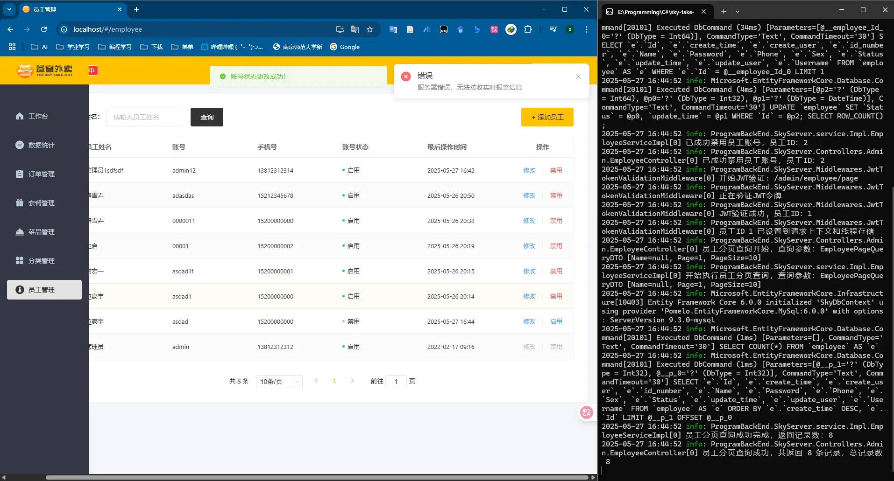

## 4、编辑员工

### 1、EmployeeController.cs

ProgramBackEnd\SkyServer\controller\admin\EmployeeController.cs

该文件中完整内容如下：

```C#
        /// <summary>
        /// 根据ID查询员工详细信息
        /// <para>
        /// 获取指定员工的完整信息，供前端展示或编辑使用。
        /// 返回信息中会过滤敏感字段如密码，确保数据安全。
        /// </para>
        /// </summary>
        /// <param name="id">要查询的员工ID</param>
        /// <returns>包含员工详细信息的结果对象</returns>
        /// <response code="200">返回员工详细信息</response>
        /// <exception cref="Exception">当查询的员工ID不存在时抛出</exception>
        [HttpGet("{id}")]
        public async Task<Result<Employee>> GetById([FromRoute] long id)
        {
            // 记录查询操作，便于审计追踪
            _logger.LogInformation("查询员工详细信息，员工ID：{Id}", id);

            // 调用业务服务获取员工信息
            Employee employee = await _employeeService.GetById(id);

            // 验证查询结果，处理员工不存在的情况
            if (employee == null)
            {
                _logger.LogWarning("未找到员工信息，员工ID：{Id}", id);
                throw new Exception($"未找到ID为{id}的员工");
            }

            _logger.LogInformation("员工信息查询成功，员工ID：{Id}，姓名：{Name}", id, employee.Name);

            // 返回成功结果，包含员工信息
            return Result<Employee>.Success(employee);
        }

        /// <summary>
        /// 更新员工信息接口
        /// <para>
        /// 修改现有员工的基本信息，如姓名、联系方式等。
        /// 只有已认证的管理员可以调用此接口，且只能修改允许的字段。
        /// </para>
        /// </summary>
        /// <param name="employeeDTO">包含更新信息的员工DTO对象</param>
        /// <returns>统一封装的操作结果对象</returns>
        /// <response code="200">返回更新成功的信息</response>
        /// <exception cref="ArgumentException">当提供的员工ID无效时抛出</exception>
        /// <exception cref="EntityNotFoundException">当指定ID的员工不存在时抛出</exception>
        [HttpPut]
        public async Task<Result<string>> Update([FromBody] EmployeeDTO employeeDTO)
        {
            // 记录更新操作，包含必要的上下文信息
            _logger.LogInformation("更新员工信息，员工ID：{Id}，姓名：{Name}", employeeDTO.Id, employeeDTO.Name);

            // 调用业务服务执行更新操作
            // 业务层负责验证数据完整性、更新审计字段并持久化
            await _employeeService.Update(employeeDTO);

            // 记录操作成功
            _logger.LogInformation("员工信息更新成功，员工ID：{Id}", employeeDTO.Id);

            // 返回统一的成功响应
            return Result<string>.Success("员工信息更新成功");
        }
```

### 2、EmployeeService

在ProgramBackEnd\SkyServer\service\IEmployeeService.cs中添加如下内容：

```C#
/// <summary>
/// 根据ID查询员工信息
/// <para>
/// 获取指定ID的员工详细信息，执行以下操作:
/// 1. 验证员工ID的有效性
/// 2. 从数据库查询对应的员工记录
/// 3. 过滤敏感信息(如密码)后返回给调用方
/// </para>
/// </summary>
/// <param name="id">要查询的员工ID，系统中员工的唯一标识</param>
/// <returns>
/// 员工实体对象，包含员工的基本信息，但不包含敏感字段如密码。
/// 如果指定ID的员工不存在，则返回null。
/// </returns>
/// <exception cref="ArgumentException">当员工ID无效(小于等于0)时抛出</exception>
/// <remarks>
/// 此方法通常用于员工信息展示、编辑前的数据获取等场景。
/// 实现时应注意移除敏感信息，确保数据安全。
/// </remarks>
Task<Employee?> GetById(long id);

/// <summary>
/// 更新员工信息
/// <para>
/// 修改现有员工的信息，执行以下操作:
/// 1. 验证员工ID的有效性和存在性
/// 2. 验证更新数据的有效性
/// 3. 选择性地更新提供的非空字段
/// 4. 记录更新时间和操作人
/// 5. 将更改保存到数据库
/// </para>
/// </summary>
/// <param name="employeeDTO">
/// 包含更新信息的员工数据传输对象，包含:
/// - Id: 要更新的员工ID，必须有效
/// - Username: 登录用户名(可选)
/// - Name: 员工真实姓名(可选)
/// - Phone: 联系电话(可选)
/// - Sex: 性别(可选)
/// - IdNumber: 身份证号码(可选)
/// </param>
/// <returns>表示异步操作的任务</returns>
/// <exception cref="ArgumentNullException">当employeeDTO为null时抛出</exception>
/// <exception cref="ArgumentException">当员工ID无效时抛出</exception>
/// <exception cref="EntityNotFoundException">当指定ID的员工不存在时抛出</exception>
/// <exception cref="BusinessException">当更新操作违反业务规则时抛出</exception>
/// <remarks>
/// 此方法实现了员工基本信息的更新功能，只更新提供的非空字段。
/// 实现时应注意验证数据有效性，确保符合业务规则。
/// </remarks>
Task Update(EmployeeDTO employeeDTO);
```

在ProgramBackEnd\SkyServer\service\Impl\EmployeeServiceImpl.cs中添加如下内容：

```C#
/// <summary>
/// 根据ID查询员工信息
/// <para>
/// 获取指定ID的员工详细信息，并移除敏感信息（如密码）后返回。
/// 执行流程：
/// 1. 验证员工ID的有效性
/// 2. 调用数据访问层查询员工详细信息
/// 3. 处理安全敏感字段，移除密码等信息
/// </para>
/// </summary>
/// <param name="id">要查询的员工ID</param>
/// <returns>员工实体对象，不包含密码等敏感信息；如未找到则返回null</returns>
/// <exception cref="ArgumentException">当ID无效（小于等于0）时抛出</exception>
/// <remarks>
/// 此方法通常用于前端展示员工信息或获取员工编辑初始数据。
/// 基于安全考虑，返回的员工信息中密码字段将被清除。
/// </remarks>
public async Task<Employee?> GetById(long id)
{
    // 1. 参数验证
    if (id <= 0)
    {
        _logger.LogWarning("查询员工信息失败：无效的员工ID {Id}", id);
        throw new ArgumentException("员工ID必须大于0", nameof(id));
    }

    _logger.LogInformation("查询员工信息，员工ID：{Id}", id);

    // 2. 调用数据访问层查询员工详细信息
    Employee? employee = await _employeeMapper.GetById(id);

    // 3. 处理结果（如未找到员工）
    if (employee == null)
    {
        _logger.LogInformation("未找到指定的员工信息，员工ID：{Id}", id);
        return null;
    }

    // 4. 处理安全敏感字段：清除密码信息
    employee.Password = null; // 移除敏感信息，确保安全

    _logger.LogInformation("成功获取员工信息，员工ID：{Id}，姓名：{Name}", id, employee.Name);

    return employee;
}

/// <summary>
/// 更新员工信息
/// <para>
/// 根据DTO中的信息更新员工记录，采用部分更新策略，
/// 只更新DTO中非空字段，保留其他字段的现有值。
/// 确保更新操作的审计信息完整可追溯。
/// </para>
/// </summary>
/// <param name="employeeDTO">包含更新信息的员工DTO对象</param>
/// <returns>表示异步操作的任务</returns>
/// <exception cref="ArgumentNullException">当employeeDTO为null时抛出</exception>
/// <exception cref="InvalidOperationException">当员工ID无效或不存在时抛出</exception>
/// <exception cref="BaseException">当未能获取当前登录用户信息时抛出</exception>
public async Task Update(EmployeeDTO employeeDTO)
{
    // 1. 参数验证
    if (employeeDTO == null)
    {
        throw new ArgumentNullException(nameof(employeeDTO), "员工信息不能为空");
    }

    if (employeeDTO.Id <= 0)
    {
        throw new ArgumentException("员工ID无效", nameof(employeeDTO));
    }

    // 2. 获取当前操作人信息用于审计
    long? currentEmpId = BaseContext.GetCurrentId();
    if (!currentEmpId.HasValue)
    {
        _logger.LogWarning("更新员工信息失败：未能获取当前操作人信息");
        throw new BaseException("未获取到当前登录用户信息");
    }

    _logger.LogInformation("开始更新员工信息，员工ID：{Id}，操作人ID：{OperatorId}", employeeDTO.Id, currentEmpId.Value);

    // 3. 创建员工实体并设置基础信息
    Employee employee = new()
    {
        Id = employeeDTO.Id,
        UpdateTime = DateTime.Now,
        UpdateUser = currentEmpId.Value
    };

    // 4. 复制属性（忽略空值和ID字段）
    // 注：此处使用PropertyUtil工具类完成属性复制，仅复制非空属性
    PropertyUtil.CopyPropertiesIgnoreNull(employeeDTO, employee);

    // 5. 调用数据访问层执行更新操作
    await _employeeMapper.Update(employee);

    _logger.LogInformation("员工信息更新成功，员工ID：{Id}", employeeDTO.Id);
}
```

### 3、EmployeeMapper

在ProgramBackEnd\SkyServer\mapper\IEmployeeMapper.cs中添加如下内容：

```C#
        /// <summary>
        /// 根据ID查询员工详细信息
        /// <para>
        /// 从数据库中检索指定ID的员工完整信息。
        /// 作为数据访问层的基础查询方法，提供单一员工记录的详细数据获取能力。
        /// 通常用于员工信息展示、编辑前的数据获取以及其他需要完整员工信息的操作。
        /// </para>
        /// </summary>
        /// <param name="id">要查询的员工ID，数据库记录的唯一标识</param>
        /// <returns>
        /// 匹配ID的员工实体对象；若未找到对应记录则返回null
        /// 返回的实体包含员工的所有字段信息，包括敏感数据
        /// </returns>
        /// <exception cref="ArgumentException">当ID无效（小于等于0）时抛出</exception>
        /// <exception cref="InvalidOperationException">查询执行过程中发生错误时抛出</exception>
        /// <remarks>
        /// 实现注意事项：
        /// 1. 确保参数验证，避免无效ID值
        /// 2. 优化查询性能，利用主键索引
        /// 3. 处理未找到记录的情况，返回null而非抛出异常
        /// 4. 记录查询异常，提供有意义的错误信息
        /// 
        /// 业务层应负责过滤返回数据中的敏感字段（如密码），确保数据安全。
        /// </remarks>
        Task<Employee?> GetById(long id);
```

在ProgramBackEnd\SkyServer\mapper\Impl\EmployeeMapperImpl.cs中添加如下内容：

```C#
/// <summary>
/// 根据ID查询员工详细信息
/// <para>
/// 从数据库中检索指定ID的员工完整信息。
/// 操作流程：
/// 1. 验证ID参数有效性
/// 2. 查询数据库获取员工信息
/// 3. 处理查询结果，包括未找到情况
/// </para>
/// </summary>
/// <param name="id">要查询的员工ID</param>
/// <returns>匹配的员工实体对象；未找到则返回null</returns>
/// <exception cref="ArgumentException">当ID无效（小于等于0）时抛出</exception>
/// <exception cref="InvalidOperationException">查询执行过程中发生错误时抛出</exception>
public async Task<Employee?> GetById(long id)
{
    // 1. 参数验证
    if (id <= 0)
    {
        throw new ArgumentException("员工ID必须大于0", nameof(id));
    }

    try
    {
        // 2. 使用异步方法执行查询
        // FirstOrDefaultAsync在未找到记录时返回null而不是抛出异常
        return await _context.Employees.FirstOrDefaultAsync(e => e.Id == id);
    }
    catch (Exception ex)
    {
        // 3. 异常处理：捕获并转换数据库异常
        throw new InvalidOperationException($"查询ID为 {id} 的员工信息时发生错误", ex);
    }
}
```

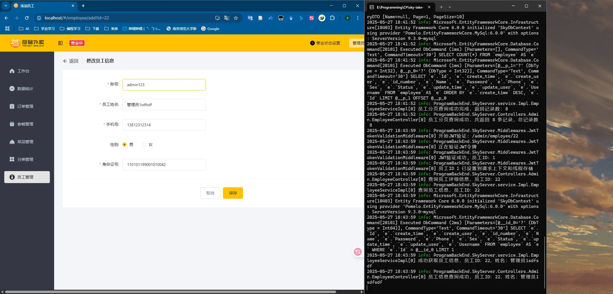

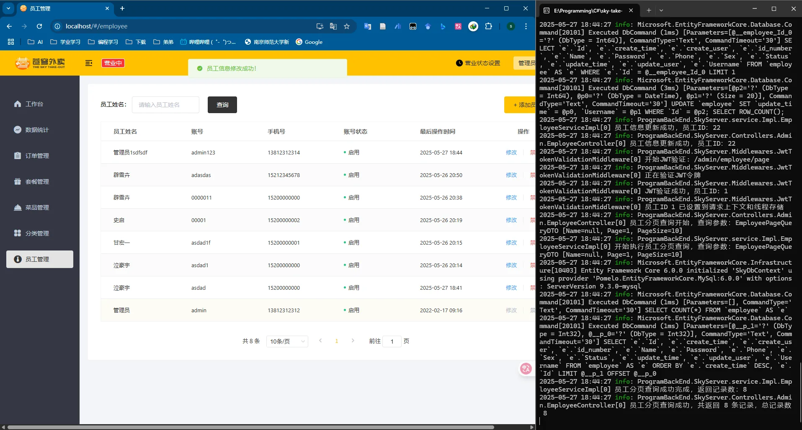

# 2、分类管理界面

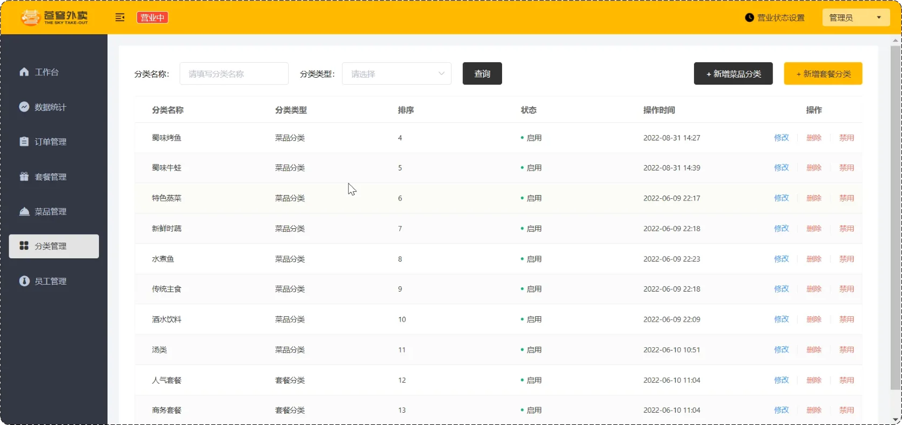

## 1、CategoryController

ProgramBackEnd\SkyServer\controller\admin\CategoryController.cs

```C#
using Microsoft.AspNetCore.Mvc;
using ProgramBackEnd.SkyCommon.result;
using ProgramBackEnd.SkyPojo.dto;
using ProgramBackEnd.SkyPojo.entity;
using ProgramBackEnd.SkyServer.service;

namespace ProgramBackEnd.SkyServer.controller.admin
{
    /// <summary>
    /// 分类管理控制器
    /// <para>
    /// 提供菜品和套餐分类的CRUD和状态管理API接口。
    /// 作为系统后台分类管理模块的核心控制器，处理分类数据的各种操作。
    /// </para>
    /// </summary>
    /// <remarks>
    /// 该控制器提供以下功能：
    /// 1. 新增分类信息
    /// 2. 分页查询分类信息
    /// 3. 删除指定分类
    /// 4. 修改分类信息
    /// 5. 启用或禁用分类
    /// 6. 根据类型查询分类列表
    /// </remarks>
    [ApiController]
    [Route("/admin/category")]
    public class CategoryController : ControllerBase
    {
        /// <summary>
        /// 日志记录器
        /// </summary>
        private readonly ILogger<CategoryController> _logger;

        /// <summary>
        /// 分类服务接口
        /// </summary>
        private readonly ICategoryService _categoryService;

        /// <summary>
        /// 构造函数，通过依赖注入初始化控制器
        /// </summary>
        /// <param name="logger">日志记录器</param>
        /// <param name="categoryService">分类服务实现</param>
        public CategoryController(ILogger<CategoryController> logger, ICategoryService categoryService)
        {
            _logger = logger;
            _categoryService = categoryService;
        }

        /// <summary>
        /// 新增分类
        /// <para>
        /// 创建新的分类记录，可用于添加菜品分类或套餐分类。
        /// 分类创建后即可在相应的菜品管理或套餐管理中使用。
        /// </para>
        /// </summary>
        /// <param name="categoryDTO">分类信息数据传输对象</param>
        /// <returns>操作结果，包含成功提示信息</returns>
        /// <response code="200">返回统一封装的成功结果对象</response>
        [HttpPost]
        public async Task<Result<string>> Save([FromBody] CategoryDTO categoryDTO)
        {
            _logger.LogInformation("开始保存分类信息: {@CategoryDTO}", categoryDTO);
            await _categoryService.Save(categoryDTO);
            return Result<string>.Success("分类保存成功");
        }

        /// <summary>
        /// 分类分页查询
        /// <para>
        /// 根据查询条件分页获取分类列表，支持按名称模糊查询和类型过滤。
        /// 主要用于后台分类管理页面的数据展示。
        /// </para>
        /// </summary>
        /// <param name="categoryPageQueryDTO">分类分页查询参数，包含页码、每页大小、名称和类型</param>
        /// <returns>包含分页结果的统一响应对象</returns>
        /// <response code="200">返回分页数据，包含总记录数和当前页数据集合</response>
        [HttpGet("page")]
        public async Task<Result<PageResult>> Page([FromQuery] CategoryPageQueryDTO categoryPageQueryDTO)
        {
            _logger.LogInformation("获取分类分页信息: {@CategoryPageQueryDTO}", categoryPageQueryDTO);
            PageResult page = await _categoryService.PageQuery(categoryPageQueryDTO);
            return Result<PageResult>.Success(page);
        }

        /// <summary>
        /// 删除分类
        /// <para>
        /// 根据ID删除指定分类。删除前会检查该分类是否有关联的菜品或套餐，
        /// 如果存在关联数据则不允许删除，以保持数据一致性。
        /// </para>
        /// </summary>
        /// <param name="id">要删除的分类ID</param>
        /// <returns>操作结果，包含成功提示信息</returns>
        /// <response code="200">返回统一封装的成功结果对象</response>
        /// <response code="400">当分类关联了菜品或套餐时返回错误信息</response>
        [HttpDelete]
        public async Task<Result<string>> DeleteById([FromQuery] long id)
        {
            _logger.LogInformation("删除分类，ID: {Id}", id);
            await _categoryService.DeleteById(id);
            return Result<string>.Success("删除分类成功");
        }

        /// <summary>
        /// 更新分类信息
        /// <para>
        /// 修改现有分类的基本信息，如名称和排序值。
        /// 用于维护和调整分类数据。
        /// </para>
        /// </summary>
        /// <param name="categoryDTO">包含更新信息的分类数据传输对象</param>
        /// <returns>操作结果，包含成功提示信息</returns>
        /// <response code="200">返回统一封装的成功结果对象</response>
        [HttpPut]
        public async Task<Result<string>> Update([FromBody] CategoryDTO categoryDTO)
        {
            _logger.LogInformation("更新分类信息: {@CategoryDTO}", categoryDTO);
            await _categoryService.Update(categoryDTO);
            return Result<string>.Success("修改分类成功");
        }

        /// <summary>
        /// 启用或禁用分类
        /// <para>
        /// 根据传入的状态值修改分类的可用状态。
        /// 状态值：1表示启用，0表示禁用。
        /// </para>
        /// </summary>
        /// <param name="status">目标状态：1=启用，0=禁用</param>
        /// <param name="id">分类ID</param>
        /// <returns>操作结果，包含成功提示信息</returns>
        /// <response code="200">返回统一封装的成功结果对象</response>
        [HttpPost("status/{status}")]
        public async Task<Result<string>> StartOrStop([FromRoute] int status, [FromQuery] long id)
        {
            _logger.LogInformation("更改分类状态，ID: {Id}，目标状态: {Status}", id, status);
            await _categoryService.StartOrStop(status, id);
            return Result<string>.Success("修改分类状态成功");
        }

        /// <summary>
        /// 根据类型查询分类列表
        /// <para>
        /// 获取指定类型的所有分类，不分页。
        /// 类型：1表示菜品分类，2表示套餐分类。
        /// 主要用于新增菜品或套餐时的分类选择下拉列表。
        /// </para>
        /// </summary>
        /// <param name="type">分类类型：1=菜品分类，2=套餐分类</param>
        /// <returns>包含分类列表的统一响应对象</returns>
        /// <response code="200">返回指定类型的分类列表数据</response>
        [HttpGet("list")]
        public async Task<Result<List<Category>>> List([FromQuery] int type)
        {
            _logger.LogInformation("获取分类列表，类型: {Type}", type);
            List<Category> categories = await _categoryService.GetCategoriesByType(type);
            return Result<List<Category>>.Success(categories);
        }
    }
}
```


## 2、CategoryService

ProgramBackEnd\SkyServer\service\ICategoryService.cs

```C#
using ProgramBackEnd.SkyCommon.result;
using ProgramBackEnd.SkyPojo.dto;
using ProgramBackEnd.SkyPojo.entity;

namespace ProgramBackEnd.SkyServer.service
{
    /// <summary>
    /// 分类服务接口
    /// <para>
    /// 定义系统中分类相关的业务操作契约，是分类管理模块的核心服务接口。
    /// 提供菜品分类和套餐分类的增删改查、状态管理等功能。
    /// </para>
    /// </summary>
    /// <remarks>
    /// 该接口遵循以下设计原则:
    /// 1. 职责单一: 专注于分类管理相关的业务逻辑
    /// 2. 接口隔离: 只定义必要的方法，避免臃肿
    /// 3. 异步设计: 所有操作均返回Task，提高系统响应性
    /// 4. 面向业务: 方法命名和参数设计贴近业务需求
    /// </remarks>
    public interface ICategoryService
    {
        /// <summary>
        /// 新增分类
        /// <para>
        /// 创建新的分类记录，包括以下步骤：
        /// 1. 验证分类必要信息的有效性
        /// 2. 确保分类名称的唯一性
        /// 3. 设置适当的状态和审计字段
        /// 4. 持久化分类信息到数据库
        /// </para>
        /// </summary>
        /// <param name="categoryDTO">
        /// 分类数据传输对象，包含：
        /// - Type: 分类类型(1:菜品分类,2:套餐分类)
        /// - Name: 分类名称
        /// - Sort: 排序优先级
        /// </param>
        /// <returns>表示异步操作的任务</returns>
        /// <exception cref="ArgumentException">当分类数据无效时抛出</exception>
        /// <exception cref="BusinessException">当分类名称已存在时抛出</exception>
        Task Save(CategoryDTO categoryDTO);

        /// <summary>
        /// 删除分类
        /// <para>
        /// 根据ID删除指定分类，包括以下步骤：
        /// 1. 验证分类ID的有效性
        /// 2. 检查分类是否关联了菜品或套餐
        /// 3. 如无关联，执行物理删除
        /// </para>
        /// </summary>
        /// <param name="id">要删除的分类ID</param>
        /// <returns>表示异步操作的任务</returns>
        /// <exception cref="ArgumentException">当ID无效时抛出</exception>
        /// <exception cref="BusinessException">当分类已关联菜品或套餐时抛出</exception>
        Task DeleteById(long id);

        /// <summary>
        /// 更新分类信息
        /// <para>
        /// 根据DTO中的信息更新分类记录，包括以下步骤：
        /// 1. 验证分类ID和更新数据的有效性
        /// 2. 检查分类名称唯一性(若修改了名称)
        /// 3. 更新分类信息并记录审计信息
        /// </para>
        /// </summary>
        /// <param name="categoryDTO">
        /// 包含更新信息的分类DTO对象，包含：
        /// - Id: 分类ID
        /// - Type: 分类类型
        /// - Name: 分类名称
        /// - Sort: 排序优先级
        /// </param>
        /// <returns>表示异步操作的任务</returns>
        /// <exception cref="ArgumentException">当分类ID或数据无效时抛出</exception>
        /// <exception cref="BusinessException">当分类名称已被其他分类使用时抛出</exception>
        Task Update(CategoryDTO categoryDTO);

        /// <summary>
        /// 分类分页查询
        /// <para>
        /// 根据查询条件分页获取分类列表，包括以下步骤：
        /// 1. 验证并规范化分页参数
        /// 2. 应用查询条件(名称模糊匹配和类型筛选)
        /// 3. 按排序字段和创建时间排序
        /// 4. 分页返回结果
        /// </para>
        /// </summary>
        /// <param name="categoryPageQueryDTO">
        /// 分类分页查询参数，包含：
        /// - Page: 页码
        /// - PageSize: 每页记录数
        /// - Name: 分类名称(可选，用于模糊查询)
        /// - Type: 分类类型(可选，用于精确筛选)
        /// </param>
        /// <returns>分页结果对象，包含总记录数和当前页数据列表</returns>
        Task<PageResult> PageQuery(CategoryPageQueryDTO categoryPageQueryDTO);

        /// <summary>
        /// 启用或禁用分类
        /// <para>
        /// 修改分类的可用状态，实现分类的启用或禁用功能。
        /// 禁用的分类将不会在前端展示，也不能用于新建菜品或套餐。
        /// </para>
        /// </summary>
        /// <param name="status">目标状态值：1表示启用，0表示禁用</param>
        /// <param name="id">要修改状态的分类ID</param>
        /// <returns>表示异步操作的任务</returns>
        /// <exception cref="ArgumentException">当状态值不是0或1时抛出</exception>
        /// <exception cref="BusinessException">当分类不存在时抛出</exception>
        Task StartOrStop(int status, long id);

        /// <summary>
        /// 根据类型查询分类列表
        /// <para>
        /// 获取指定类型的所有可用分类，不分页，通常用于下拉选择。
        /// 只返回状态为启用的分类，按照排序字段升序排列。
        /// </para>
        /// </summary>
        /// <param name="type">
        /// 分类类型：
        /// - 1: 菜品分类
        /// - 2: 套餐分类
        /// </param>
        /// <returns>分类列表，包含ID、名称等信息</returns>
        /// <remarks>
        /// 此方法通常用于菜品管理或套餐管理模块中的分类选择下拉列表。
        /// </remarks>
        Task<List<Category>> GetCategoriesByType(int type);
    }
}
```

ProgramBackEnd\SkyServer\service\Impl\CategoryServiceImpl.cs

```C#
using ProgramBackEnd.SkyCommon.constant;
using ProgramBackEnd.SkyCommon.context;
using ProgramBackEnd.SkyCommon.result;
using ProgramBackEnd.SkyCommon.utils;
using ProgramBackEnd.SkyPojo.dto;
using ProgramBackEnd.SkyPojo.entity;
using ProgramBackEnd.SkyServer.mapper;

namespace ProgramBackEnd.SkyServer.service.Impl
{
    /// <summary>
    /// 分类服务实现类
    /// <para>
    /// 实现<see cref="ICategoryService"/>接口，提供分类管理的核心业务逻辑。
    /// 处理菜品分类和套餐分类的增删改查，以及状态管理等操作。
    /// </para>
    /// </summary>
    /// <remarks>
    /// 此实现采用以下设计原则:
    /// 1. 三层架构：通过依赖注入与数据访问层解耦
    /// 2. 单一职责：专注于分类管理的业务逻辑
    /// 3. 审计追踪：所有操作都记录操作人和时间戳
    /// 4. 防御式编程：进行必要的参数验证和用户权限检查
    /// </remarks>
    public class CategoryServiceImpl : ICategoryService
    {
        /// <summary>
        /// 分类数据访问对象
        /// </summary>
        private readonly ICategoryMapper _categoryMapper;

        /// <summary>
        /// 日志记录器
        /// </summary>
        private readonly ILogger<CategoryServiceImpl> _logger;

        /// <summary>
        /// 构造函数，通过依赖注入获取所需服务
        /// </summary>
        /// <param name="categoryMapper">分类数据访问对象</param>
        /// <param name="logger">日志记录器</param>
        public CategoryServiceImpl(ICategoryMapper categoryMapper, ILogger<CategoryServiceImpl> logger)
        {
            _categoryMapper = categoryMapper ?? throw new ArgumentNullException(nameof(categoryMapper));
            _logger = logger ?? throw new ArgumentNullException(nameof(logger));
        }

        /// <summary>
        /// 删除分类
        /// <para>
        /// 根据ID删除指定分类。在实际业务中，删除前应检查该分类是否已关联菜品或套餐，
        /// 如有关联，则不允许删除，确保数据一致性。
        /// </para>
        /// </summary>
        /// <param name="id">要删除的分类ID</param>
        /// <returns>表示异步操作的任务</returns>
        /// <exception cref="ArgumentException">当ID无效时抛出</exception>
        public async Task DeleteById(long id)
        {
            if (id <= 0)
            {
                _logger.LogWarning("删除分类失败：无效的分类ID {Id}", id);
                throw new ArgumentException("分类ID无效", nameof(id));
            }

            _logger.LogInformation("开始删除分类，ID：{Id}", id);
            await _categoryMapper.DeleteById(id);
            _logger.LogInformation("分类删除成功，ID：{Id}", id);
        }

        /// <summary>
        /// 根据类型查询分类列表
        /// <para>
        /// 获取指定类型的所有可用分类，主要用于前端下拉选择。
        /// 此方法通常返回状态为启用的分类，按排序字段排序。
        /// </para>
        /// </summary>
        /// <param name="type">分类类型：1=菜品分类，2=套餐分类</param>
        /// <returns>指定类型的分类列表</returns>
        public async Task<List<Category>> GetCategoriesByType(int type)
        {
            _logger.LogInformation("查询分类列表，类型：{Type}", type);
            List<Category> categories = await _categoryMapper.GetCategoriesByType(type);
            _logger.LogInformation("查询到{Count}条分类记录，类型：{Type}", categories.Count, type);
            return categories;
        }

        /// <summary>
        /// 分类分页查询
        /// <para>
        /// 根据查询条件分页获取分类列表，支持按名称和类型筛选。
        /// </para>
        /// </summary>
        /// <param name="categoryPageQueryDTO">分类分页查询参数</param>
        /// <returns>分页结果对象，包含总记录数和当前页数据</returns>
        public async Task<PageResult> PageQuery(CategoryPageQueryDTO categoryPageQueryDTO)
        {
            _logger.LogInformation("开始执行分类分页查询，参数：{@CategoryPageQueryDTO}", categoryPageQueryDTO);

            // 1. 执行分页查询，获取结果元组
            (int total, List<Category> categories) = await _categoryMapper.PageQuery(categoryPageQueryDTO);

            // 2. 构建标准化的分页结果对象
            PageResult pageResult = new()
            {
                Total = total,         // 设置满足条件的总记录数
                Records = categories   // 设置当前页的数据列表
            };

            _logger.LogInformation("分类分页查询完成，共返回{Count}条记录，总记录数{Total}", categories.Count, total);
            return pageResult;
        }

        /// <summary>
        /// 新增分类
        /// <para>
        /// 创建新的分类记录，设置默认状态和审计信息。
        /// </para>
        /// </summary>
        /// <param name="categoryDTO">分类数据传输对象</param>
        /// <returns>表示异步操作的任务</returns>
        /// <exception cref="ArgumentException">当当前用户未登录或分类数据无效时抛出</exception>
        public async Task Save(CategoryDTO categoryDTO)
        {
            // 1. 获取当前登录用户ID，用于审计
            long? currentUserId = BaseContext.GetCurrentId();
            if (currentUserId == null)
            {
                _logger.LogWarning("新增分类失败：未获取到当前登录用户信息");
                throw new ArgumentException("当前用户ID不能为空，请先登录");
            }

            // 2. 验证分类数据
            if (categoryDTO == null || string.IsNullOrEmpty(categoryDTO.Name))
            {
                _logger.LogWarning("新增分类失败：分类数据无效");
                throw new ArgumentException("分类数据无效");
            }

            // 3. 创建分类实体并设置属性
            Category category = new Category();
            PropertyUtil.CopyProperties(categoryDTO, category);

            // 4. 设置审计字段和默认状态
            DateTime now = DateTime.Now;
            category.CreateUser = currentUserId.Value;
            category.UpdateUser = currentUserId.Value;
            category.CreateTime = now;
            category.UpdateTime = now;
            category.Status = StatusConstant.ENABLE; // 默认启用状态

            _logger.LogInformation("准备保存分类信息: {@Category}", category);

            // 5. 持久化到数据库
            await _categoryMapper.Insert(category);
            _logger.LogInformation("分类信息保存成功，名称：{Name}, 类型：{Type}", category.Name, category.Type);
        }

        /// <summary>
        /// 启用或禁用分类
        /// <para>
        /// 更新分类的可用状态，同时记录操作人和时间。
        /// 状态值：1表示启用，0表示禁用。
        /// </para>
        /// </summary>
        /// <param name="status">目标状态值</param>
        /// <param name="id">分类ID</param>
        /// <returns>表示异步操作的任务</returns>
        /// <exception cref="ArgumentException">当状态值不是0或1时抛出</exception>
        public async Task StartOrStop(int status, long id)
        {
            // 1. 参数验证
            if (status != StatusConstant.ENABLE && status != StatusConstant.DISABLE)
            {
                _logger.LogWarning("分类状态修改失败：无效的状态值 {Status}", status);
                throw new ArgumentException("状态值只能是0(禁用)或1(启用)", nameof(status));
            }

            if (id <= 0)
            {
                _logger.LogWarning("分类状态修改失败：无效的分类ID {Id}", id);
                throw new ArgumentException("分类ID无效", nameof(id));
            }

            // 2. 获取当前操作人ID
            long? currentUserId = BaseContext.GetCurrentId();
            if (currentUserId == null)
            {
                _logger.LogWarning("分类状态修改失败：未获取到当前登录用户信息");
                throw new ArgumentException("未获取到当前登录用户信息");
            }

            // 3. 构建更新实体
            string actionType = status == StatusConstant.ENABLE ? "启用" : "禁用";
            _logger.LogInformation("开始{ActionType}分类，ID：{Id}", actionType, id);

            Category category = new Category
            {
                Id = id,
                Status = status,
                UpdateUser = currentUserId.Value,
                UpdateTime = DateTime.Now
            };

            // 4. 执行更新
            await _categoryMapper.Update(category);
            _logger.LogInformation("已成功{ActionType}分类，ID：{Id}", actionType, id);
        }

        /// <summary>
        /// 更新分类信息
        /// <para>
        /// 根据DTO中的信息更新分类记录，记录修改人和时间。
        /// </para>
        /// </summary>
        /// <param name="categoryDTO">包含更新信息的分类DTO对象</param>
        /// <returns>表示异步操作的任务</returns>
        /// <exception cref="ArgumentException">当分类ID无效或当前用户未登录时抛出</exception>
        public async Task Update(CategoryDTO categoryDTO)
        {
            // 1. 参数验证
            if (categoryDTO == null || categoryDTO.Id <= 0)
            {
                _logger.LogWarning("更新分类失败：无效的分类数据或ID");
                throw new ArgumentException("分类数据或ID无效");
            }

            // 2. 获取当前操作人ID
            long? currentUserId = BaseContext.GetCurrentId();
            if (currentUserId == null)
            {
                _logger.LogWarning("更新分类失败：未获取到当前登录用户信息");
                throw new ArgumentException("未获取到当前登录用户信息");
            }

            _logger.LogInformation("开始更新分类信息，ID：{Id}，名称：{Name}", categoryDTO.Id, categoryDTO.Name);

            // 3. 创建分类实体并设置属性
            Category category = new Category();
            PropertyUtil.CopyProperties(categoryDTO, category);

            // 4. 设置审计字段
            category.UpdateUser = currentUserId.Value;
            category.UpdateTime = DateTime.Now;

            // 5. 执行更新
            await _categoryMapper.Update(category);
            _logger.LogInformation("分类信息更新成功，ID：{Id}", categoryDTO.Id);
        }
    }
}
```


## 3、CategoryMapper

ProgramBackEnd\SkyServer\mapper\ICategoryMapper.cs

```C#
using ProgramBackEnd.SkyPojo.dto;
using ProgramBackEnd.SkyPojo.entity;

namespace ProgramBackEnd.SkyServer.mapper
{
    /// <summary>
    /// 分类数据访问接口
    /// <para>
    /// 定义与数据库交互的分类相关数据操作，作为数据访问层的核心组件。
    /// 提供菜品分类和套餐分类的基础CRUD功能，实现业务逻辑与数据访问的解耦。
    /// </para>
    /// </summary>
    /// <remarks>
    /// 设计原则:
    /// 1. 职责单一: 专注于分类实体的数据访问操作
    /// 2. 持久化中立: 不暴露底层数据库实现细节
    /// 3. 异步优先: 所有操作均为异步，提高系统吞吐量
    /// 4. 接口隔离: 提供最小必要的操作集合，避免接口臃肿
    /// </remarks>
    public interface ICategoryMapper
    {
        /// <summary>
        /// 新增分类记录
        /// <para>
        /// 将分类信息持久化到数据库，包括分类名称、类型、排序值、状态等信息。
        /// </para>
        /// </summary>
        /// <param name="category">
        /// 要插入的分类实体，应包含完整的分类信息，
        /// 包括审计字段(CreateTime, UpdateTime, CreateUser, UpdateUser)
        /// </param>
        /// <returns>表示异步操作的任务</returns>
        /// <exception cref="ArgumentNullException">当category参数为null时抛出</exception>
        /// <exception cref="DbUpdateException">当数据库插入操作失败时抛出，如唯一索引冲突</exception>
        /// <remarks>
        /// 分类名称在同一类型中应保持唯一性，实现时应考虑唯一约束的处理。
        /// </remarks>
        Task Insert(Category category);

        /// <summary>
        /// 更新分类信息
        /// <para>
        /// 根据提供的分类实体，更新数据库中对应记录的信息。
        /// 采用部分更新策略，只更新非null字段，保留其他字段的现有值。
        /// </para>
        /// </summary>
        /// <param name="category">
        /// 包含更新信息的分类实体，必须设置Id属性；
        /// 其他属性如为null则不更新对应字段
        /// </param>
        /// <returns>表示异步操作的任务</returns>
        /// <exception cref="ArgumentNullException">当category为null时抛出</exception>
        /// <exception cref="ArgumentException">当分类ID无效或不存在时抛出</exception>
        /// <exception cref="DbUpdateException">当数据库更新失败时抛出</exception>
        Task Update(Category category);

        /// <summary>
        /// 根据ID删除分类
        /// <para>
        /// 从数据库中物理删除指定ID的分类记录。
        /// </para>
        /// </summary>
        /// <param name="id">要删除的分类ID</param>
        /// <returns>表示异步操作的任务</returns>
        /// <exception cref="ArgumentException">当ID无效时抛出</exception>
        /// <remarks>
        /// 在实际系统中，删除分类前应确保该分类没有关联的菜品或套餐。
        /// 此检查逻辑通常在服务层实现。
        /// </remarks>
        Task DeleteById(long id);

        /// <summary>
        /// 分类分页查询
        /// <para>
        /// 根据查询条件从数据库获取分类记录，并进行分页处理。
        /// 支持按分类名称模糊搜索和类型精确筛选。
        /// </para>
        /// </summary>
        /// <param name="categoryPageQueryDTO">
        /// 分类分页查询参数对象，包含：
        /// - Page: 当前页码，从1开始计数
        /// - PageSize: 每页记录数
        /// - Name: 分类名称(可选)，用于模糊查询
        /// - Type: 分类类型(可选)，用于精确筛选
        /// </param>
        /// <returns>
        /// 返回元组，包含两个元素：
        /// - total: 满足条件的总记录数
        /// - categories: 当前页的分类记录列表
        /// </returns>
        /// <exception cref="ArgumentNullException">当查询参数为null时抛出</exception>
        /// <remarks>
        /// 返回的分类列表应按排序字段(Sort)升序排列，确保前端展示顺序一致。
        /// 对于未指定排序值的记录，通常按创建时间排序作为次要排序条件。
        /// </remarks>
        Task<(int total, List<Category> categories)> PageQuery(CategoryPageQueryDTO categoryPageQueryDTO);

        /// <summary>
        /// 根据类型查询分类列表
        /// <para>
        /// 获取指定类型的所有分类记录，通常用于下拉选择。
        /// </para>
        /// </summary>
        /// <param name="type">
        /// 分类类型：
        /// - 1: 菜品分类
        /// - 2: 套餐分类
        /// </param>
        /// <returns>指定类型的分类列表，按排序字段升序排列</returns>
        /// <remarks>
        /// 此方法通常只返回状态为启用(Status=1)的分类，
        /// 以确保前端只能选择有效的分类。
        /// </remarks>
        Task<List<Category>> GetCategoriesByType(int type);
    }
}
```

ProgramBackEnd\SkyServer\mapper\Impl\CategoryMapperImpl.cs

```C#
using Microsoft.EntityFrameworkCore;
using ProgramBackEnd.SkyPojo.dto;
using ProgramBackEnd.SkyPojo.entity;
using ProgramBackEnd.SkyServer.config;

namespace ProgramBackEnd.SkyServer.mapper.Impl
{
    /// <summary>
    /// 分类数据访问实现类
    /// <para>
    /// 基于Entity Framework Core实现分类数据的持久化操作，
    /// 提供菜品和套餐分类的CRUD功能。
    /// 作为数据访问层的具体实现，连接业务层与数据库。
    /// </para>
    /// </summary>
    /// <remarks>
    /// 此实现具有以下特点:
    /// 1. 异步优先：所有数据库操作均采用异步方法，避免阻塞线程
    /// 2. 防御式编程：使用合理的空值检查和错误处理保障数据一致性
    /// 3. 查询优化：优化查询条件以提高数据库性能
    /// 4. 部分更新：更新操作仅修改非空字段，保留其他现有值
    /// 5. 依赖注入：通过构造函数注入数据上下文，便于单元测试
    /// </remarks>
    public class CategoryMapperImpl : ICategoryMapper
    {
        /// <summary>
        /// 数据库上下文
        /// </summary>
        private readonly SkyDbContext _skyDbContext;

        /// <summary>
        /// 构造函数，通过依赖注入获取数据库上下文
        /// </summary>
        /// <param name="skyDbContext">数据库上下文</param>
        /// <exception cref="ArgumentNullException">当skyDbContext为null时抛出</exception>
        public CategoryMapperImpl(SkyDbContext skyDbContext)
        {
            _skyDbContext = skyDbContext ?? throw new ArgumentNullException(nameof(skyDbContext), "数据库上下文不能为空");
        }

        /// <summary>
        /// 根据ID删除分类
        /// <para>
        /// 从数据库中物理删除指定ID的分类记录。
        /// 如果记录不存在，不执行任何操作。
        /// </para>
        /// </summary>
        /// <param name="id">要删除的分类ID</param>
        /// <returns>表示异步操作的任务</returns>
        /// <exception cref="ArgumentException">当ID无效时可能抛出</exception>
        /// <remarks>
        /// 因为使用了FindAsync方法，所以可以处理记录不存在的情况。
        /// 在业务层应验证是否有关联的菜品或套餐，以确保数据一致性。
        /// </remarks>
        public async Task DeleteById(long id)
        {
            // 验证ID有效性
            if (id <= 0)
            {
                throw new ArgumentException("分类ID必须大于0", nameof(id));
            }

            // 使用FindAsync高效查询主键，返回null表示记录不存在
            var category = await _skyDbContext.Categories.FindAsync(id);

            // 仅当记录存在时才执行删除操作
            if (category != null)
            {
                _skyDbContext.Categories.Remove(category);
                await _skyDbContext.SaveChangesAsync();
            }
        }

        /// <summary>
        /// 根据类型查询分类列表
        /// <para>
        /// 获取指定类型的所有分类记录，主要用于前端下拉选择。
        /// 返回的分类按照Sort字段升序排序，确保前端展示顺序一致。
        /// </para>
        /// </summary>
        /// <param name="type">分类类型：1=菜品分类，2=套餐分类</param>
        /// <returns>指定类型的分类列表</returns>
        /// <remarks>
        /// 通常此方法只应返回状态为启用(Status=1)的分类。
        /// 在实际业务中，可能需要进一步实现此筛选条件。
        /// </remarks>
        public async Task<List<Category>> GetCategoriesByType(int type)
        {
            // 构建基础查询
            IQueryable<Category> query = _skyDbContext.Categories;

            // 根据类型进行筛选，int是值类型不需要null检查
            query = query.Where(c => c.Type == type);

            // 优先按Sort字段升序排序，便于前端直接展示
            // 如Sort相同，则按创建时间排序
            return await query
                .OrderBy(c => c.Sort)
                .ThenBy(c => c.CreateTime)
                .ToListAsync();
        }

        /// <summary>
        /// 新增分类记录
        /// <para>
        /// 将分类信息持久化到数据库，包括分类名称、类型、排序值、状态等信息。
        /// </para>
        /// </summary>
        /// <param name="category">要插入的分类实体</param>
        /// <returns>表示异步操作的任务</returns>
        /// <exception cref="ArgumentNullException">当category为null时抛出</exception>
        /// <exception cref="DbUpdateException">当数据库操作失败时可能抛出</exception>
        public async Task Insert(Category category)
        {
            // 参数验证
            if (category == null)
            {
                throw new ArgumentNullException(nameof(category), "分类对象不能为空");
            }

            // 使用异步方法添加实体并保存
            await _skyDbContext.Categories.AddAsync(category);
            await _skyDbContext.SaveChangesAsync();
        }

        /// <summary>
        /// 分类分页查询
        /// <para>
        /// 根据查询条件从数据库获取分类记录，并进行分页处理。
        /// 支持按分类名称模糊搜索和类型精确筛选。
        /// </para>
        /// </summary>
        /// <param name="categoryPageQueryDTO">分类分页查询参数对象</param>
        /// <returns>包含总记录数和当前页数据的元组</returns>
        /// <exception cref="ArgumentNullException">当查询参数为null时抛出</exception>
        public async Task<(int total, List<Category> categories)> PageQuery(CategoryPageQueryDTO categoryPageQueryDTO)
        {
            // 1. 参数验证
            if (categoryPageQueryDTO == null)
            {
                throw new ArgumentNullException(nameof(categoryPageQueryDTO), "查询参数不能为空");
            }

            // 2. 提取和规范化分页参数
            int pageNumber = Math.Max(1, categoryPageQueryDTO.Page); // 确保页码至少为1
            int pageSize = Math.Max(1, categoryPageQueryDTO.PageSize); // 确保每页大小至少为1

            // 3. 构建基础查询
            IQueryable<Category> query = _skyDbContext.Categories;

            // 4. 添加名称过滤条件（如果提供）
            if (!string.IsNullOrWhiteSpace(categoryPageQueryDTO.Name))
            {
                string name = categoryPageQueryDTO.Name.Trim();
                // 添加空值检查，防止c.Name为null时调用Contains导致异常
                query = query.Where(c => c.Name != null && c.Name.Contains(name));
            }

            // 5. 添加类型过滤条件（如果提供）
            if (categoryPageQueryDTO.Type.HasValue)
            {
                int type = categoryPageQueryDTO.Type.Value;
                query = query.Where(c => c.Type == type);
            }

            // 6. 查询满足条件的总记录数
            int total = await query.CountAsync();

            // 7. 应用排序和分页并执行查询
            List<Category> categories = await query
                // 主排序：优先按Sort字段升序（符合前端展示需求）
                .OrderBy(c => c.Sort)
                // 次排序：按创建时间降序，新创建的分类优先展示
                .ThenByDescending(c => c.CreateTime)
                // 再次排序：按ID升序，确保完全确定的顺序
                .ThenBy(c => c.Id)
                // 分页处理
                .Skip((pageNumber - 1) * pageSize)
                .Take(pageSize)
                // 异步执行查询并转为列表
                .ToListAsync();

            // 8. 返回查询结果
            return (total, categories);
        }

        /// <summary>
        /// 更新分类信息
        /// <para>
        /// 根据提供的分类实体，更新数据库中对应记录的信息。
        /// 采用部分更新策略，只更新非null字段，保留其他字段的现有值。
        /// </para>
        /// </summary>
        /// <param name="category">包含更新信息的分类实体</param>
        /// <returns>表示异步操作的任务</returns>
        /// <exception cref="ArgumentNullException">当category为null时抛出</exception>
        /// <exception cref="InvalidOperationException">当指定ID的分类记录不存在时抛出</exception>
        /// <exception cref="DbUpdateException">当数据库操作失败时可能抛出</exception>
        public async Task Update(Category category)
        {
            // 1. 参数验证
            if (category == null)
            {
                throw new ArgumentNullException(nameof(category), "分类对象不能为空");
            }

            if (category.Id <= 0)
            {
                throw new ArgumentException("分类ID无效", nameof(category));
            }

            // 2. 查询现有分类记录
            var existingCategory = await _skyDbContext.Categories.FirstOrDefaultAsync(c => c.Id == category.Id)
                ?? throw new InvalidOperationException($"未找到ID为 {category.Id} 的分类记录");

            // 3. 选择性更新非空/非默认字段
            // 分类基本信息更新
            if (!string.IsNullOrEmpty(category.Name))
                existingCategory.Name = category.Name;

            // 类型更新 (1: 菜品分类, 2: 套餐分类)
            if (category.Type.HasValue)
                existingCategory.Type = category.Type;

            // 排序字段更新
            if (category.Sort.HasValue)
                existingCategory.Sort = category.Sort;

            // 状态更新 (0: 禁用, 1: 启用)
            if (category.Status.HasValue)
                existingCategory.Status = category.Status;

            // 4. 更新审计字段
            if (category.UpdateTime != default)
                existingCategory.UpdateTime = category.UpdateTime;

            // 更新操作人ID（如果提供）
            if (category.UpdateUser > 0)
                existingCategory.UpdateUser = category.UpdateUser;

            // 5. 提交更改到数据库
            await _skyDbContext.SaveChangesAsync();
        }
    }
}
```


## 4、结果展示

### 1、新增分类


### 2、分类分页查询

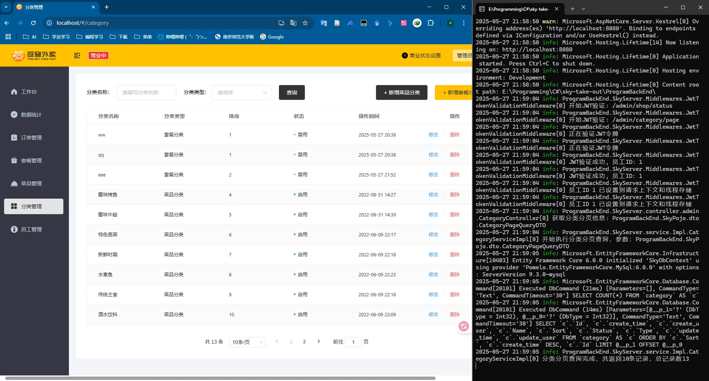

### 3、删除分类


### 4、更新分类信息

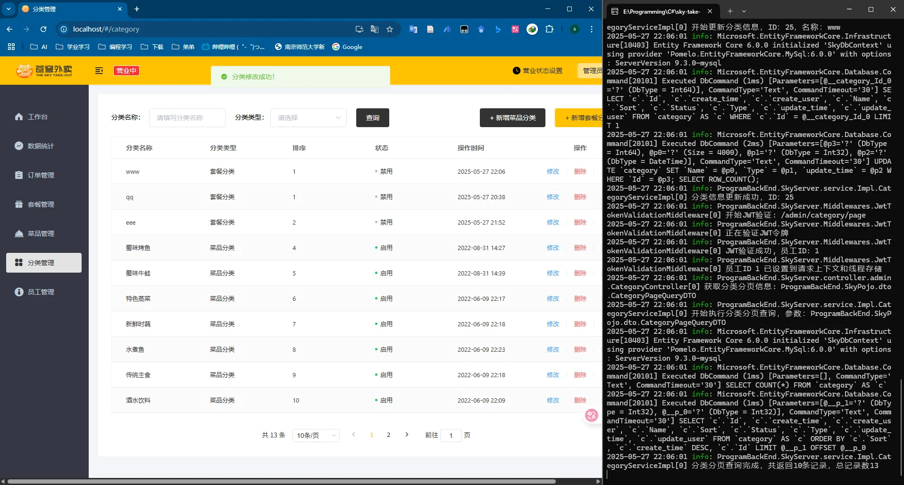

### 5、启用或禁用分类

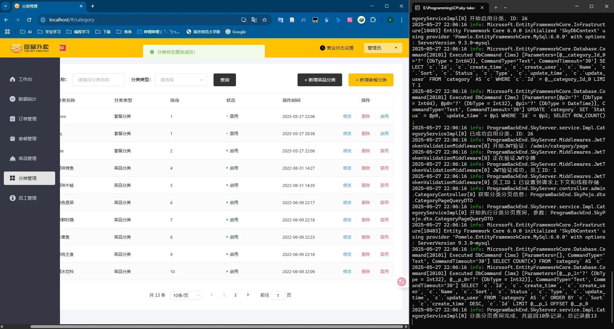

### 6、根据类型查询分类列表

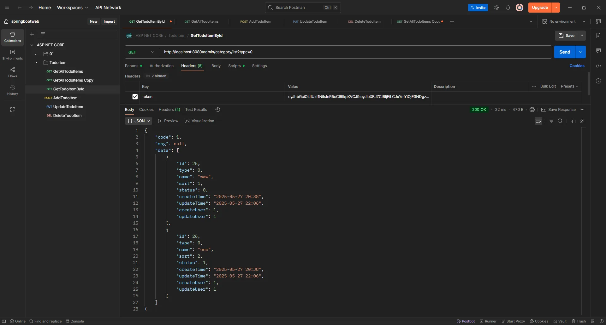
