# 1、部署Redis

首先搜寻并拉取Redis

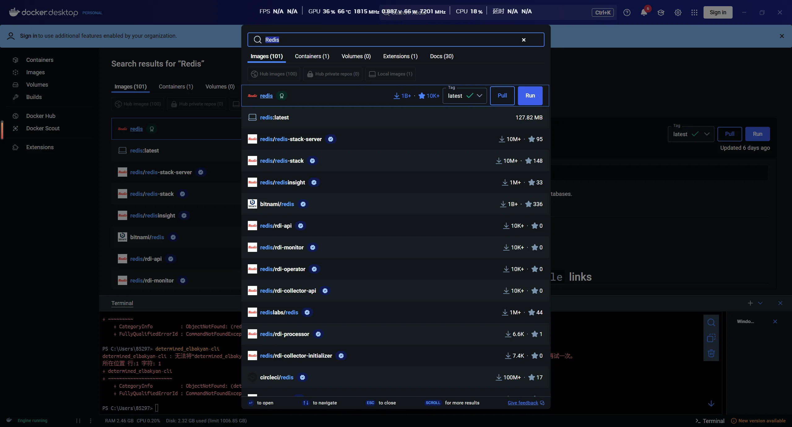

随后输入如下代码运行Redis

```cmd
docker run -p 6379:6379 -d redis:latest redis-server
```

随后在下面的页面配置密码

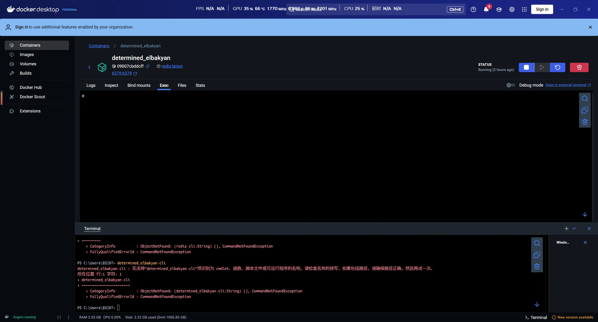

通过输入

```cmd
redis-cli
config set requirepass [mypassword]
config get requirepass
```

设定、查看密码

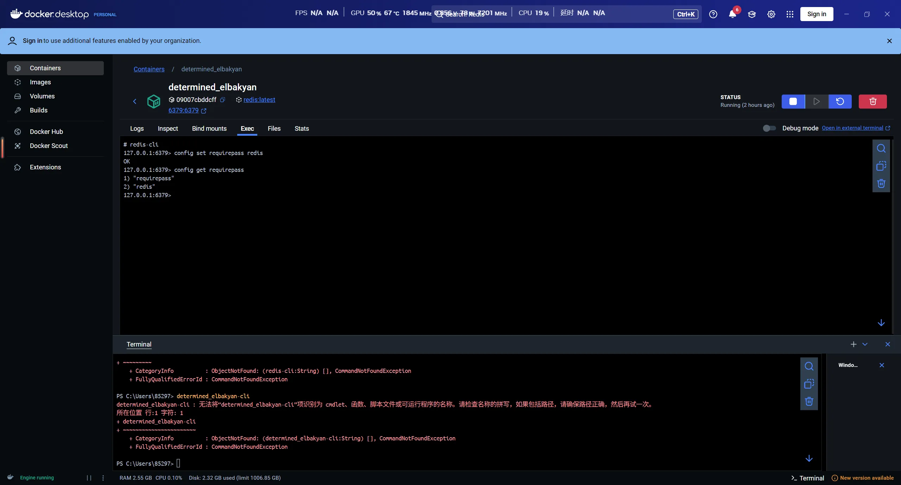

# 2、部署Minio

首先拉取Minio

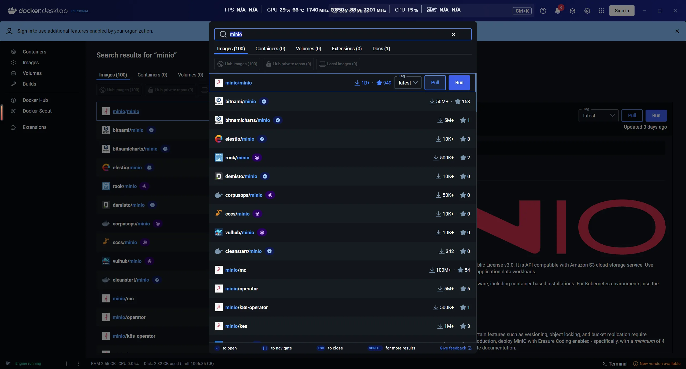

随后输入

```CMD
docker run -d -p 9000:9000 -p 9090:9090 --name minio --restart=always -e "MINIO_BROWSER_REDIRECT_URL=http://localhost:9000" -e "MINIO_ROOT_USER=minioadmin" -e "MINIO_ROOT_PASSWORD=minioadmin" minio/minio:RELEASE.2024-09-13T20-26-02Z server /data --console-address ":9000" -address ":9090"
```

以启动运行Minio

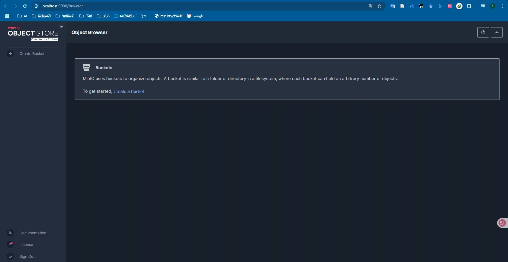

# 3、系统配置

## 1、appsettings.json

在appsettings.json中设定需要使用的详细信息，如路由、密码等内容。

ProgramBackEnd\appsettings.json

```json
{
  /* =================================================================
   * 日志配置（Logging Configuration）
   * 
   * 控制应用程序各组件的日志记录行为、格式和详细程度
   * Controls the logging behavior, format and verbosity for app components
   * ================================================================= */
  "Logging": {
    /* 不同命名空间的日志级别设置 */
    "LogLevel": {
      "Default": "Information", // 默认记录"Information"及以上级别的日志
      "Microsoft.AspNetCore": "Warning" // ASP.NET Core框架组件只记录"Warning"及以上级别
    },
    /* 控制台日志输出格式配置 */
    "Console": {
      "FormatterName": "simple", // 使用简单格式化器，提供简洁的日志输出
      "FormatterOptions": {
        "TimestampFormat": "yyyy-MM-dd HH:mm:ss ", // 日志时间戳格式
        "UseUtcTimestamp": false, // 使用本地时间而非UTC时间
        "SingleLine": true, // 每条日志占用单行，便于阅读和解析
        "IncludeScopes": false // 不包含日志作用域信息，简化输出
      }
    }
  },

  /* =================================================================
   * 数据库连接配置（Database Connection Configuration）
   * 
   * 定义应用程序与数据库交互所需的连接参数
   * Defines connection parameters for database interactions
   * ================================================================= */
  "ConnectionStrings": {
    /* MySQL主数据库连接字符串 */
    "DefaultConnection": "server=localhost;port=33061;database=sky_take_out;uid=root;pwd=mysql;",
    /* 各参数说明:
     * server: 数据库服务器地址（本地开发环境）
     * port: MySQL服务端口（33061，非标准端口，避免与默认MySQL端口冲突）
     * database: 应用程序使用的数据库名称（sky_take_out）
     * uid: 数据库访问用户名（root，生产环境建议使用限制权限的专用账号）
     * pwd: 数据库访问密码（mysql，生产环境应使用强密码）
     */

    /* Redis缓存服务器连接字符串 */
    "Redis": "localhost:6379,password=redis,ssl=false,abortConnect=false"
    /* 各参数说明:
     * localhost:6379: Redis服务器地址和端口（标准Redis端口）
     * password: Redis服务器访问密码（简单密码，生产环境应更强）
     * ssl: 是否使用SSL加密连接（开发环境关闭）
     * abortConnect: 连接失败时是否立即终止（设为false允许重试连接）
     */
  },

  /* =================================================================
   * Kestrel服务器配置（Kestrel Server Configuration）
   * 
   * 配置ASP.NET Core内置Web服务器的监听地址和端口
   * Configures the built-in web server address and port
   * ================================================================= */
  "Kestrel": {
    "Endpoints": {
      "Http": {
        "Url": "http://localhost:8080" // 应用监听在本地8080端口（避免与其他常用端口冲突）
      }
    }
  },

  /* =================================================================
   * MinIO对象存储配置（MinIO Object Storage Configuration）
   * 
   * 配置与MinIO服务连接参数，用于文件上传和管理
   * Configures connection parameters for MinIO service for file storage
   * ================================================================= */
  "MinioSettings": {
    "Endpoint": "localhost:9090", // MinIO服务端点地址和端口
    "AccessKey": "minioadmin", // 访问密钥（默认值，生产环境应更改）
    "SecretKey": "minioadmin", // 秘密密钥（默认值，生产环境应更改）
    "BucketName": "test", // 存储桶名称，用于组织文件存储
    "UseSSL": false // 是否使用SSL连接（开发环境通常关闭）
  },

  /* =================================================================
   * JWT认证配置（JWT Authentication Configuration）
   * 
   * 定义JWT令牌生成和验证所需的密钥和参数
   * Defines keys and parameters for JWT token generation and validation
   * ================================================================= */
  "JwtConfig": {
    /* 管理员访问令牌配置 */
    "AdminSecretKey": "AdminSecretKey_sky1234567890123456789012", // 管理后台JWT签名密钥（至少32字符）
    "AdminTtl": 7200000, // 管理员令牌有效期，单位毫秒（2小时）
    "AdminTokenName": "token", // 前端请求中传递管理员令牌的参数名称

    /* 普通用户访问令牌配置 */
    "UserSecretKey": "UserSecretKey_sky12345678901234567890123", // 用户端JWT签名密钥（与管理端分开）
    "UserTtl": 7200000 // 用户令牌有效期，单位毫秒（2小时）
  },

  /* =================================================================
   * CORS和主机限制配置（CORS and Host Restriction Configuration）
   * 
   * 指定允许访问应用程序的主机名和域
   * Specifies allowed host names and domains for application access
   * ================================================================= */
  "AllowedHosts": "*" // "*"表示允许所有主机访问（开发环境适用）
}
```


## 2、Program.cs

ProgramBackEnd\Program.cs

```C#
/// <summary>
/// 应用程序入口类（Application Entry Point）
/// <para>
/// 配置服务、中间件和启动ASP.NET Core Web API。
/// 本文件是整个应用程序的核心骨架，定义了服务注册、中间件管道和启动流程。
/// </para>
/// <para>
/// Configures services, middleware pipeline and launches the ASP.NET Core Web API.
/// This file represents the backbone of the entire application.
/// </para>
/// </summary>

// ========================================================================
// 引用命名空间（Namespace Imports）
// 按功能分组并排序，提高代码的组织性和可读性
// ========================================================================
// 框架核心组件
using Microsoft.EntityFrameworkCore;                // Entity Framework Core - ORM框架，提供数据访问和对象关系映射
// 项目组件
using ProgramBackEnd.SkyCommon.properties;          // 应用配置属性类，包含JWT、MinIO等配置模型
using ProgramBackEnd.SkyServer.config;              // 应用服务配置，包含数据库上下文和服务注册扩展方法
using ProgramBackEnd.SkyServer.Handler;             // 异常处理器，提供全局统一的错误处理机制
using ProgramBackEnd.SkyServer.Middlewares;         // 自定义中间件，实现请求/响应处理和身份验证等功能
// 第三方组件
using StackExchange.Redis;                          // Redis客户端库，提供高性能的分布式缓存访问能力

// ========================================================================
// 应用程序启动配置（Application Bootstrap Configuration）
// ========================================================================

// 1. 创建应用构建器
// WebApplicationBuilder是ASP.NET Core应用程序的启动点，整合了配置、日志和DI容器
var builder = WebApplication.CreateBuilder(args);

// ========================================================================
// 依赖注入服务配置（Dependency Injection Services Configuration）
// 遵循"先配置基础设施，后配置业务服务"的原则
// ========================================================================

// 1. 数据存储基础设施配置

// 1.1 配置Entity Framework数据库上下文（MySQL）
// 注册DbContext，设置为Scoped生命周期（每请求一个实例）
builder.Services.AddDbContext<SkyDbContext>(options =>
    options.UseMySql(
        // 从配置文件获取连接字符串，支持不同环境使用不同数据库配置
        builder.Configuration.GetConnectionString("DefaultConnection"),
        // 明确指定MySQL服务器版本，确保EF Core生成兼容的SQL语句
        // 这对于确保查询性能和可靠性至关重要
        new MySqlServerVersion(new Version(9, 3, 0))
    )
);

// 1.2 配置Redis分布式缓存
// 注册IDistributedCache接口实现，提供统一的缓存访问API
builder.Services.AddStackExchangeRedisCache(options =>
{
    // 使用配置文件中的Redis连接字符串，便于在不同环境中使用不同配置
    options.Configuration = builder.Configuration.GetConnectionString("Redis");
    // 可选：设置实例名称，用于在Redis中区分不同应用的缓存
    // options.InstanceName = "SkyTakeOut:";
});

// 1.3 注册Redis连接多路复用器（高级Redis访问）
// 使用单例模式确保应用程序全局共享同一连接，避免连接泄漏和资源浪费
builder.Services.AddSingleton<IConnectionMultiplexer>(sp =>
{
    // 从配置中解析Redis设置并创建连接配置对象
    var configuration = ConfigurationOptions.Parse(
        builder.Configuration.GetConnectionString("Redis"));

    // 可选：配置高级Redis连接选项
    // configuration.DefaultDatabase = 0;
    // configuration.ConnectTimeout = 5000;

    // 创建并返回连接实例，支持自动重连和命令多路复用
    return ConnectionMultiplexer.Connect(configuration);
});

// 2. 应用程序配置与服务注册

// 2.1 JWT认证配置
// 将配置节绑定到强类型对象，实现类型安全的配置访问
// 这比直接访问Configuration字符串更安全可靠
builder.Services.Configure<JwtProperties>(builder.Configuration.GetSection("JwtConfig"));

// 2.2 MinIO对象存储配置
// 通过Options模式注册配置对象，可通过依赖注入在服务中使用
builder.Services.Configure<MinioProperties>(builder.Configuration.GetSection("MinioSettings"));
// 同时注册单例实例，兼容需要直接注入MinioProperties的服务
builder.Services.AddSingleton(sp =>
{
    var minioSettings = builder.Configuration.GetSection("MinioSettings").Get<MinioProperties>();
    // 提供默认值，增强健壮性，防止配置缺失导致的NullReferenceException
    return minioSettings ?? new MinioProperties();
});

// 3. ASP.NET Core框架服务配置

// 3.1 MVC控制器和API功能
// 注册MVC控制器服务，启用API路由和模型绑定功能
builder.Services.AddControllers()
    // 添加全局异常处理过滤器，实现统一的异常处理和响应格式
    // 避免在控制器中编写重复的try-catch块
    .AddGlobalExceptionHandler();

// 4. 应用程序业务服务注册
// 使用扩展方法批量注册所有业务服务和数据访问组件
// 这种方式提高了Program.cs的清晰度，并使服务注册更加模块化
builder.Services.RegisterAllServices();

// ========================================================================
// 应用程序构建与HTTP请求管道配置
// ========================================================================

// 1. 构建应用程序实例
// 完成依赖注入容器配置，创建应用程序实例
var app = builder.Build();

// 2. 环境特定配置
// 根据环境配置不同的中间件和行为（开发、测试、生产）
if (app.Environment.IsDevelopment())
{
    // 可在此处添加仅用于开发环境的中间件
    // 例如：app.UseDeveloperExceptionPage();
}

// 3. 中间件管道配置（按处理顺序注册）
// 注意：中间件的注册顺序决定了它们的执行顺序，对应用行为有重大影响

// 3.1 基础设施中间件 - 处理所有请求的基础组件
// 配置HTTP请求路由系统
app.UseRouting();

// 3.2 可选：添加CORS中间件（如果需要跨域支持）
// app.UseCors("AllowFrontend");

// 3.3 自定义JSON格式化中间件
// 处理请求和响应中的JSON序列化/反序列化
app.UseMiddleware<JsonFormatterMiddleware>();

// 3.4 身份验证与授权中间件
// JWT令牌验证中间件，在请求到达控制器前验证身份
app.UseMiddleware<JwtTokenValidationMiddleware>();

// 3.5 终端中间件 - 处理请求的最终阶段
// 将HTTP请求路由到相应的控制器和操作方法
app.MapControllers();

// ========================================================================
// 应用程序启动（Application Launch）
// ========================================================================

// 启动Web主机并开始监听HTTP请求
// 程序将持续运行，直到被明确停止或发生未处理异常
app.Run();

// 注：可通过扩展Program.cs添加以下功能:
// 1. 应用程序启动和关闭时的日志记录
// 2. 应用程序健康检查配置 (AddHealthChecks/UseHealthChecks)
// 3. 后台服务注册 (AddHostedService)
```

## 3、Redis配置

由于会在此处和以后使用Redis，因此需要设定Redis使用的相关内容，均在“ProgramBackEnd\SkyCommon\redisCache”文件夹下

### 1、ISerializer

```C#
namespace ProgramBackEnd.SkyCommon.redisCache
{
    /// <summary>
    /// 序列化器接口
    /// <para>
    /// 定义对象与字符串之间的转换操作，为缓存系统提供数据序列化能力。
    /// 此接口抽象了序列化和反序列化的具体实现，允许在不改变客户端代码的情况下
    /// 切换不同的序列化策略（如JSON、XML、ProtoBuf等）。
    /// </para>
    /// </summary>
    /// <remarks>
    /// 实现此接口时应考虑以下因素：
    /// <list type="bullet">
    /// <item>序列化性能与结果大小的平衡</item>
    /// <item>处理特殊类型（如DateTime、循环引用等）的策略</item>
    /// <item>类型安全性和数据完整性</item>
    /// <item>兼容性和版本控制</item>
    /// </list>
    /// 此接口主要设计用于与缓存系统（如Redis）配合使用，支持复杂对象的存储和检索。
    /// </remarks>
    public interface ISerializer
    {
        /// <summary>
        /// 将对象序列化为字符串
        /// </summary>
        /// <typeparam name="T">要序列化的对象类型</typeparam>
        /// <param name="obj">要序列化的对象实例</param>
        /// <returns>序列化后的字符串表示，可存储在缓存系统中</returns>
        /// <exception cref="ArgumentNullException">当提供的对象为null且类型不允许为null时</exception>
        /// <exception cref="InvalidOperationException">当序列化过程中遇到错误时</exception>
        /// <remarks>
        /// 此方法应能处理包括复杂对象、集合和常见数据类型在内的各种C#对象。
        /// 对于值类型和字符串等简单类型，可以考虑特殊优化以提高性能。
        /// </remarks>
        /// <example>
        /// <code>
        /// var user = new User { Id = 101, Name = "张三" };
        /// string serialized = serializer.Serialize(user);
        /// // 可能的结果: {"Id":101,"Name":"张三"}
        /// </code>
        /// </example>
        string Serialize<T>(T obj);

        /// <summary>
        /// 将字符串反序列化为对象
        /// </summary>
        /// <typeparam name="T">目标对象类型，必须与序列化时使用的类型兼容</typeparam>
        /// <param name="value">要反序列化的字符串，通常是<see cref="Serialize{T}"/>方法的输出</param>
        /// <returns>反序列化后的对象实例</returns>
        /// <exception cref="ArgumentNullException">当提供的字符串为null或空时</exception>
        /// <exception cref="FormatException">当字符串格式无效或与目标类型不兼容时</exception>
        /// <exception cref="InvalidOperationException">当反序列化过程中遇到其他错误时</exception>
        /// <remarks>
        /// 此方法应能够从序列化的字符串中恢复完整的对象状态，包括复杂的对象图。
        /// 实现时应考虑类型验证和错误处理，确保即使输入数据有问题也能提供清晰的错误信息。
        /// </remarks>
        /// <example>
        /// <code>
        /// string json = "{\"Id\":101,\"Name\":\"张三\"}";
        /// User user = serializer.Deserialize&lt;User&gt;(json);
        /// // user.Id == 101, user.Name == "张三"
        /// </code>
        /// </example>
        T Deserialize<T>(string value);
    }
}
```


### 2、JsonSerializer

```C#
using System;
using System.Text.Json;

namespace ProgramBackEnd.SkyCommon.redisCache
{
    /// <summary>
    /// JSON序列化器实现类
    /// <para>
    /// 基于.NET 6内置的高性能System.Text.Json库实现ISerializer接口，
    /// 提供对象与JSON字符串之间的转换功能。作为应用程序中的默认序列化机制，
    /// 专为Redis缓存中复杂对象的存储和检索而优化。
    /// </para>
    /// </summary>
    /// <remarks>
    /// 此实现选择System.Text.Json而非Newtonsoft.Json的优势：
    /// <list type="bullet">
    /// <item>更高的性能和更低的内存占用</item>
    /// <item>与.NET Core/.NET 6深度集成</item>
    /// <item>免除额外的第三方依赖</item>
    /// </list>
    /// </remarks>
    public class JsonSerializer : ISerializer
    {
        /// <summary>
        /// JSON序列化选项，控制序列化的行为和结果格式
        /// </summary>
        private readonly JsonSerializerOptions _serializerOptions;

        /// <summary>
        /// 构造函数，初始化序列化器并配置默认选项
        /// </summary>
        public JsonSerializer()
        {
            // 配置JSON序列化选项
            _serializerOptions = new JsonSerializerOptions
            {
                // 使用驼峰命名法（如firstName而非FirstName）
                PropertyNamingPolicy = JsonNamingPolicy.CamelCase,

                // 忽略null值属性，减小序列化结果大小
                DefaultIgnoreCondition = System.Text.Json.Serialization.JsonIgnoreCondition.WhenWritingNull,

                // 允许注释，提高JSON的可读性（在反序列化时）
                ReadCommentHandling = JsonCommentHandling.Skip,

                // 对特殊字符进行转义（如中文字符不会被转为\uXXXX格式）
                Encoder = System.Text.Encodings.Web.JavaScriptEncoder.UnsafeRelaxedJsonEscaping
            };
        }

        /// <summary>
        /// 将对象序列化为JSON字符串
        /// </summary>
        /// <typeparam name="T">要序列化的对象类型</typeparam>
        /// <param name="obj">要序列化的对象实例</param>
        /// <returns>序列化后的JSON字符串</returns>
        /// <exception cref="ArgumentNullException">当对象为null且类型不允许为null时</exception>
        /// <exception cref="JsonException">当序列化过程中出现JSON相关错误时</exception>
        /// <exception cref="NotSupportedException">当对象包含不支持序列化的类型时</exception>
        public string Serialize<T>(T obj)
        {
            try
            {
                // 对象为null时进行检查（值类型不会为null）
                if (obj == null && default(T) != null)
                {
                    throw new ArgumentNullException(nameof(obj), "序列化的对象不能为null");
                }

                // 调用System.Text.Json库的序列化方法
                // 使用完全限定名称以避免与当前类的名称冲突
                return System.Text.Json.JsonSerializer.Serialize(obj, _serializerOptions);
            }
            catch (JsonException ex)
            {
                // 重新抛出更明确的异常，包含原始异常作为内部异常
                throw new JsonException($"序列化类型'{typeof(T).Name}'的对象到JSON时失败: {ex.Message}", ex);
            }
            catch (Exception ex) when (ex is not ArgumentNullException && ex is not JsonException)
            {
                // 捕获并转换其他异常
                throw new InvalidOperationException($"执行JSON序列化时发生意外错误: {ex.Message}", ex);
            }
        }

        /// <summary>
        /// 将JSON字符串反序列化为对象
        /// </summary>
        /// <typeparam name="T">目标对象类型</typeparam>
        /// <param name="value">要反序列化的JSON字符串</param>
        /// <returns>反序列化后的对象实例</returns>
        /// <exception cref="ArgumentNullException">当JSON字符串为null或空时</exception>
        /// <exception cref="JsonException">当JSON格式无效或与目标类型不兼容时</exception>
        /// <exception cref="NotSupportedException">当JSON包含目标类型不支持的属性时</exception>
        public T Deserialize<T>(string value)
        {
            // 验证输入
            if (string.IsNullOrEmpty(value))
            {
                throw new ArgumentNullException(nameof(value), "要反序列化的JSON字符串不能为null或空");
            }

            try
            {
                // 调用System.Text.Json库的反序列化方法
                // 使用完全限定名称以避免与当前类的名称冲突
                return System.Text.Json.JsonSerializer.Deserialize<T>(value, _serializerOptions);
            }
            catch (JsonException ex)
            {
                // 提供更具体的错误信息
                throw new JsonException($"将JSON反序列化为类型'{typeof(T).Name}'时失败: {ex.Message}", ex);
            }
            catch (Exception ex) when (ex is not ArgumentNullException && ex is not JsonException)
            {
                // 捕获并转换其他可能的异常
                throw new InvalidOperationException($"执行JSON反序列化时发生意外错误: {ex.Message}", ex);
            }
        }
    }
}
```


### 3、IRedisCache

```C#
namespace ProgramBackEnd.SkyCommon.redisCache
{
    /// <summary>
    /// Redis缓存访问抽象接口
    /// <para>
    /// 定义与Redis缓存交互的核心操作，提供类型安全的数据存储和检索功能。
    /// 此接口封装了Redis操作的复杂性，使应用程序代码可以简洁地使用缓存，
    /// 而不需要直接处理序列化、连接管理等底层细节。
    /// </para>
    /// <para>
    /// 实现此接口时应考虑：
    /// - 序列化/反序列化策略
    /// - 缓存键的命名约定
    /// - 错误处理和重试机制
    /// - 性能和连接管理
    /// </para>
    /// </summary>
    public interface IRedisCache
    {
        /// <summary>
        /// 异步从缓存中获取指定键的值
        /// </summary>
        /// <typeparam name="T">要返回的对象类型，必须支持序列化/反序列化</typeparam>
        /// <param name="key">缓存键，应遵循应用程序定义的命名约定</param>
        /// <returns>
        /// 如果找到键且反序列化成功，则返回反序列化后的对象；
        /// 如果未找到键、值已过期或反序列化失败，则返回 null
        /// </returns>
        /// <exception cref="ArgumentNullException">当<paramref name="key"/>为null或空字符串时抛出</exception>
        /// <exception cref="InvalidOperationException">当缓存操作失败时可能抛出，例如连接问题</exception>
        /// <remarks>
        /// 此方法不会在缓存未命中时自动填充缓存，调用方应当实现缓存回填逻辑。
        /// 使用示例：
        /// <code>
        /// var product = await _redisCache.GetAsync&lt;Product&gt;("product:1001");
        /// if (product == null) {
        ///     product = await _productRepository.GetByIdAsync(1001);
        ///     if (product != null)
        ///         await _redisCache.SetAsync("product:1001", product, TimeSpan.FromHours(1));
        /// }
        /// </code>
        /// </remarks>
        Task<T?> GetAsync<T>(string key);

        /// <summary>
        /// 异步将值存储在缓存中，使用指定的键
        /// </summary>
        /// <typeparam name="T">要缓存的对象类型，必须支持序列化</typeparam>
        /// <param name="key">缓存键，应遵循一致的命名模式，如"实体类型:ID"格式</param>
        /// <param name="value">要缓存的对象，不应为null</param>
        /// <param name="expiry">
        /// 可选的过期时间；
        /// 如果为null，则使用默认过期策略（由实现定义，通常为项目配置的全局过期时间）
        /// </param>
        /// <returns>表示异步操作的任务，完成后表示缓存设置成功</returns>
        /// <exception cref="ArgumentNullException">当<paramref name="key"/>或<paramref name="value"/>为null时抛出</exception>
        /// <exception cref="InvalidOperationException">当缓存操作失败时可能抛出</exception>
        /// <remarks>
        /// 如果键已经存在，此方法会覆盖原有的值和过期时间。
        /// 建议根据数据更新频率和访问模式合理设置过期时间：
        /// - 频繁变化的数据：短过期时间或考虑不缓存
        /// - 静态或很少变化的数据：较长过期时间
        /// - 用户特定的数据：考虑会话生命周期或用户活动时间
        /// </remarks>
        Task SetAsync<T>(string key, T value, TimeSpan? expiry = null);

        /// <summary>
        /// 异步从缓存中移除指定键的值
        /// </summary>
        /// <param name="key">要移除的缓存键</param>
        /// <returns>
        /// 如果键存在且被成功移除，则返回 true；
        /// 如果键不存在，则返回 false
        /// </returns>
        /// <exception cref="ArgumentNullException">当<paramref name="key"/>为null或空字符串时抛出</exception>
        /// <exception cref="InvalidOperationException">当缓存操作失败时可能抛出</exception>
        /// <remarks>
        /// 当实体数据更新或删除时，应调用此方法以保持缓存与数据源的一致性。
        /// 考虑在数据变更事件或事务完成后自动执行缓存失效操作。
        /// </remarks>
        Task<bool> RemoveAsync(string key);

        /// <summary>
        /// 异步检查缓存中是否存在指定的键
        /// </summary>
        /// <param name="key">要检查的缓存键</param>
        /// <returns>
        /// 如果缓存中存在指定的键且未过期，则返回 true；
        /// 否则返回 false
        /// </returns>
        /// <exception cref="ArgumentNullException">当<paramref name="key"/>为null或空字符串时抛出</exception>
        /// <exception cref="InvalidOperationException">当缓存操作失败时可能抛出</exception>
        /// <remarks>
        /// 此方法可用于在执行可能昂贵的获取和设置操作前进行检查。
        /// 注意：在分布式环境中，键的存在状态可能在此方法返回后立即改变，
        /// 因此应谨慎使用此方法来做决策，特别是在高并发场景下。
        /// </remarks>
        Task<bool> ExistsAsync(string key);
    }
}
```

### 4、RedisCacheImpl

```c#
using System;
using System.Threading.Tasks;
using StackExchange.Redis;

namespace ProgramBackEnd.SkyCommon.redisCache
{
    /// <summary>
    /// Redis缓存服务实现类
    /// <para>
    /// 基于StackExchange.Redis提供高性能的分布式缓存访问能力，
    /// 实现IRedisCache接口定义的核心缓存操作。此实现将对象序列化为
    /// 字符串并存储在Redis中，确保类型安全和高效的数据存取。
    /// </para>
    /// </summary>
    public class RedisCacheImpl : IRedisCache
    {
        /// <summary>
        /// Redis数据库实例
        /// <para>
        /// 提供对Redis命令的直接访问，支持所有Redis操作。
        /// 由ConnectionMultiplexer管理，线程安全且可在多个请求中重用。
        /// </para>
        /// </summary>
        private readonly IDatabase _db;

        /// <summary>
        /// 序列化器接口实例
        /// <para>
        /// 负责对象与字符串之间的转换，使Redis能够存储复杂对象。
        /// 典型实现包括JSON序列化、二进制序列化等。
        /// </para>
        /// </summary>
        private readonly ISerializer _serializer;

        /// <summary>
        /// 构造函数，通过依赖注入初始化Redis数据库和序列化器
        /// </summary>
        /// <param name="redis">Redis连接多路复用器，管理与Redis服务器的连接池</param>
        /// <param name="serializer">用于序列化和反序列化对象的组件</param>
        /// <exception cref="ArgumentNullException">当任一依赖项为null时抛出</exception>
        public RedisCacheImpl(IConnectionMultiplexer redis, ISerializer serializer)
        {
            // 验证参数，确保依赖项有效
            if (redis == null) throw new ArgumentNullException(nameof(redis));
            if (serializer == null) throw new ArgumentNullException(nameof(serializer));

            // 初始化成员
            _db = redis.GetDatabase();  // 获取Redis数据库实例，默认使用database 0
            _serializer = serializer;   // 设置序列化器
        }

        /// <summary>
        /// 从Redis缓存中异步获取值
        /// </summary>
        /// <typeparam name="T">要返回的对象类型</typeparam>
        /// <param name="key">缓存键</param>
        /// <returns>
        /// 如果键存在且反序列化成功，则返回反序列化后的对象；
        /// 如果键不存在或已过期，则返回默认值(null或值类型的默认值)
        /// </returns>
        /// <exception cref="ArgumentNullException">当key为null或空字符串时抛出</exception>
        /// <exception cref="InvalidOperationException">当Redis操作失败或反序列化出错时抛出</exception>
        public async Task<T?> GetAsync<T>(string key)
        {
            // 参数验证
            if (string.IsNullOrEmpty(key))
                throw new ArgumentNullException(nameof(key), "缓存键不能为null或空字符串");

            try
            {
                // 从Redis获取字符串值
                var value = await _db.StringGetAsync(key);

                // 如果值不存在，直接返回类型的默认值
                if (value.IsNull)
                    return default;

                // 将字符串值反序列化为请求的类型并返回
                return _serializer.Deserialize<T>(value);
            }
            catch (RedisException ex)
            {
                // 捕获并转换Redis特定异常，提供更多上下文信息
                throw new InvalidOperationException($"从Redis获取键'{key}'时发生错误: {ex.Message}", ex);
            }
            catch (Exception ex) when (ex is not ArgumentNullException)
            {
                // 捕获其他异常（如序列化错误）
                throw new InvalidOperationException($"处理缓存键'{key}'时发生错误: {ex.Message}", ex);
            }
        }

        /// <summary>
        /// 将值异步存储到Redis缓存中
        /// </summary>
        /// <typeparam name="T">要缓存的对象类型</typeparam>
        /// <param name="key">缓存键</param>
        /// <param name="value">要缓存的对象</param>
        /// <param name="expiry">
        /// 可选的过期时间；
        /// 如果为null，则数据将永久保存直到显式删除
        /// </param>
        /// <returns>表示异步操作的任务</returns>
        /// <exception cref="ArgumentNullException">当key为null或value为null时抛出</exception>
        /// <exception cref="InvalidOperationException">当Redis操作失败或序列化出错时抛出</exception>
        public async Task SetAsync<T>(string key, T value, TimeSpan? expiry = null)
        {
            // 参数验证
            if (string.IsNullOrEmpty(key))
                throw new ArgumentNullException(nameof(key), "缓存键不能为null或空字符串");
            if (value == null)
                throw new ArgumentNullException(nameof(value), "缓存值不能为null");

            try
            {
                // 将对象序列化为字符串
                var serializedValue = _serializer.Serialize(value);

                // 使用指定的键值和过期时间将序列化后的值存储到Redis
                // 如果操作成功，StringSetAsync返回true，但我们不需要检查这个结果
                await _db.StringSetAsync(key, serializedValue, expiry);
            }
            catch (RedisException ex)
            {
                throw new InvalidOperationException($"向Redis设置键'{key}'时发生错误: {ex.Message}", ex);
            }
            catch (Exception ex) when (ex is not ArgumentNullException)
            {
                throw new InvalidOperationException($"序列化或缓存数据时发生错误: {ex.Message}", ex);
            }
        }

        /// <summary>
        /// 从Redis缓存中异步移除指定键的值
        /// </summary>
        /// <param name="key">要移除的缓存键</param>
        /// <returns>
        /// 如果键存在且被成功移除，则返回true；
        /// 如果键不存在，则返回false
        /// </returns>
        /// <exception cref="ArgumentNullException">当key为null或空字符串时抛出</exception>
        /// <exception cref="InvalidOperationException">当Redis操作失败时抛出</exception>
        public async Task<bool> RemoveAsync(string key)
        {
            // 参数验证
            if (string.IsNullOrEmpty(key))
                throw new ArgumentNullException(nameof(key), "缓存键不能为null或空字符串");

            try
            {
                // 从Redis中删除指定的键
                // KeyDeleteAsync方法返回一个布尔值，表示键是否存在并被删除
                return await _db.KeyDeleteAsync(key);
            }
            catch (RedisException ex)
            {
                throw new InvalidOperationException($"从Redis删除键'{key}'时发生错误: {ex.Message}", ex);
            }
        }

        /// <summary>
        /// 异步检查Redis缓存中是否存在指定的键
        /// </summary>
        /// <param name="key">要检查的缓存键</param>
        /// <returns>
        /// 如果缓存中存在指定的键，则返回true；
        /// 否则返回false
        /// </returns>
        /// <exception cref="ArgumentNullException">当key为null或空字符串时抛出</exception>
        /// <exception cref="InvalidOperationException">当Redis操作失败时抛出</exception>
        public async Task<bool> ExistsAsync(string key)
        {
            // 参数验证
            if (string.IsNullOrEmpty(key))
                throw new ArgumentNullException(nameof(key), "缓存键不能为null或空字符串");

            try
            {
                // 检查Redis中是否存在指定的键
                return await _db.KeyExistsAsync(key);
            }
            catch (RedisException ex)
            {
                throw new InvalidOperationException($"检查Redis键'{key}'存在性时发生错误: {ex.Message}", ex);
            }
        }
    }
}
```

## 4、MinioProperties

MinioProperties用来承接设置中Minio的必要参数

```C#
using System;

namespace ProgramBackEnd.SkyCommon.properties
{
    /// <summary>
    /// MinIO对象存储服务配置属性类
    /// <para>
    /// 封装与MinIO服务连接所需的配置信息，用于文件上传、下载和管理。
    /// MinIO是一个高性能的对象存储服务，兼容Amazon S3 API，
    /// 可用于存储图片、文档、视频等非结构化数据。
    /// </para>
    /// </summary>
    /// <remarks>
    /// 此类通常通过appsettings.json的"MinioSettings"节配置，
    /// 并通过依赖注入在应用程序中使用。配置示例：
    /// <code>
    /// "MinioSettings": {
    ///   "Endpoint": "localhost:9000",
    ///   "AccessKey": "minioadmin",
    ///   "SecretKey": "minioadmin",
    ///   "BucketName": "myBucket",
    ///   "UseSSL": false
    /// }
    /// </code>
    /// </remarks>
    public class MinioProperties
    {
        /// <summary>
        /// MinIO服务端点地址
        /// <para>
        /// 格式为"主机名:端口"，例如"localhost:9000"或"minio.example.com:9000"。
        /// 不包含协议前缀(http://或https://)，协议由<see cref="UseSSL"/>属性决定。
        /// </para>
        /// </summary>
        public string? Endpoint { get; set; }

        /// <summary>
        /// MinIO访问密钥（Access Key）
        /// <para>
        /// 用于访问MinIO服务的身份标识，相当于用户名。
        /// 默认MinIO安装通常使用"minioadmin"作为默认访问密钥。
        /// </para>
        /// </summary>
        public string? AccessKey { get; set; }

        /// <summary>
        /// MinIO密钥（Secret Key）
        /// <para>
        /// 用于验证访问MinIO服务的密码凭证。
        /// 默认MinIO安装通常使用"minioadmin"作为默认密钥。
        /// 生产环境应使用强密钥并妥善保管。
        /// </para>
        /// </summary>
        public string? SecretKey { get; set; }

        /// <summary>
        /// MinIO存储桶名称
        /// <para>
        /// 存储桶是存储对象的容器，类似于文件系统中的顶级目录。
        /// 名称必须符合DNS命名规则：仅小写字母、数字、点(.)和连字符(-)，
        /// 长度3-63个字符，不能以点或连字符开头或结尾。
        /// </para>
        /// </summary>
        public string? BucketName { get; set; }

        /// <summary>
        /// 是否使用SSL加密连接
        /// <para>
        /// 当设置为true时，使用HTTPS协议连接MinIO服务；
        /// 当设置为false时，使用HTTP协议连接MinIO服务。
        /// 生产环境通常应启用SSL以确保数据传输安全。
        /// </para>
        /// </summary>
        public bool UseSSL { get; set; }
    }
}
```

# 4、CommonController

文件上传控制器

```C#
using Microsoft.AspNetCore.Mvc;
using ProgramBackEnd.SkyCommon.result;
using ProgramBackEnd.SkyServer.service;

namespace ProgramBackEnd.SkyServer.controller.admin
{
    /// <summary>
    /// 管理端通用功能控制器
    /// <para>
    /// 提供文件上传等通用功能的API端点，供管理后台使用。
    /// 此控制器处理与业务逻辑无关的通用操作。
    /// </para>
    /// </summary>
    [ApiController]
    [Route("/admin/common/upload")]
    public class CommonController : ControllerBase
    {
        /// <summary>
        /// 文件上传服务接口
        /// </summary>
        private readonly IFileUploadService _fileUploadService;

        /// <summary>
        /// 构造函数，通过依赖注入初始化控制器
        /// </summary>
        /// <param name="fileUploadService">文件上传服务，处理文件存储逻辑</param>
        public CommonController(IFileUploadService fileUploadService)
        {
            _fileUploadService = fileUploadService ?? throw new ArgumentNullException(nameof(fileUploadService));
        }

        /// <summary>
        /// 文件上传接口
        /// <para>
        /// 接收客户端发送的文件并上传至存储服务（如MinIO），返回可访问的URL。
        /// 主要用于上传图片等资源文件，供其他功能引用。
        /// </para>
        /// </summary>
        /// <param name="file">待上传的文件表单数据</param>
        /// <returns>包含上传成功后文件访问URL的结果对象</returns>
        /// <response code="200">上传成功，返回文件URL</response>
        /// <response code="400">文件无效或为空</response>
        /// <response code="500">服务器内部错误</response>
        [HttpPost]
        public async Task<Result<string>> Upload(IFormFile file)
        {
            // 上传文件并获取URL
            string url = await _fileUploadService.UploadFileAsync(file);

            // 返回包含URL的成功结果
            return Result<string>.Success(url);
        }
    }
}
```


# 5、FileUploadService

文件上传服务相关代码

## 1、IFileUploadService

```C#
using Microsoft.AspNetCore.Http;
using System.Threading.Tasks;

namespace ProgramBackEnd.SkyServer.service
{
    /// <summary>
    /// 文件上传服务接口
    /// <para>
    /// 定义文件上传相关的操作，支持将客户端上传的文件保存到存储系统（如MinIO、Azure Blob等）。
    /// 此接口将文件存储的实现细节与业务逻辑分离，使得控制器可以不关心具体的存储机制。
    /// </para>
    /// </summary>
    /// <remarks>
    /// 实现此接口时，应考虑：
    /// - 文件类型验证和安全检查
    /// - 文件大小限制
    /// - 生成唯一的文件名以避免冲突
    /// - 错误处理和异常管理
    /// - 存储服务的配置和连接管理
    /// </remarks>
    public interface IFileUploadService
    {
        /// <summary>
        /// 异步上传文件到存储系统
        /// </summary>
        /// <param name="file">要上传的文件，通常来自HTTP请求的表单数据</param>
        /// <returns>
        /// 上传成功后文件的访问URL，客户端可通过此URL获取文件内容
        /// </returns>
        /// <exception cref="ArgumentNullException">当文件参数为null时抛出</exception>
        /// <exception cref="ArgumentException">当文件内容为空或格式无效时抛出</exception>
        /// <exception cref="InvalidOperationException">当上传过程中发生错误时抛出</exception>
        /// <remarks>
        /// 此方法负责将文件保存到配置的存储系统，并返回可访问的URL。
        /// 实现应考虑生成唯一文件名、设置适当的内容类型、处理潜在的存储错误等。
        /// </remarks>
        Task<string> UploadFileAsync(IFormFile file);
    }
}
```


## 2、FileUploadServiceImpl

```C#
using Microsoft.AspNetCore.Http;
using Microsoft.Extensions.Logging;
using Minio;
using Minio.DataModel.Args;
using ProgramBackEnd.SkyCommon.exception;
using ProgramBackEnd.SkyCommon.properties;
using System;
using System.IO;
using System.Threading.Tasks;

namespace ProgramBackEnd.SkyServer.service.Impl
{
    /// <summary>
    /// 文件上传服务的MinIO实现
    /// <para>
    /// 负责处理文件上传逻辑，将文件保存到MinIO对象存储服务。
    /// 支持生成唯一文件名、自动创建目录结构，并返回可访问的文件URL。
    /// </para>
    /// </summary>
    public class FileUploadServiceImpl : IFileUploadService
    {
        /// <summary>
        /// MinIO配置选项
        /// </summary>
        private readonly MinioProperties _minioProperties;

        /// <summary>
        /// 构造函数
        /// </summary>
        /// <param name="minioProperties">MinIO配置信息</param>
        /// <exception cref="ArgumentNullException">当MinIO配置为null时抛出</exception>
        public FileUploadServiceImpl(MinioProperties minioProperties)
        {
            _minioProperties = minioProperties ?? throw new ArgumentNullException(nameof(minioProperties));
        }

        /// <summary>
        /// 异步将文件上传到MinIO存储服务
        /// </summary>
        /// <param name="file">要上传的文件</param>
        /// <returns>上传成功后的文件访问URL</returns>
        /// <exception cref="ArgumentException">当文件无效时抛出</exception>
        /// <exception cref="BaseException">当上传过程出现问题时抛出</exception>
        public async Task<string> UploadFileAsync(IFormFile file)
        {
            // 1. 验证文件有效性
            if (file == null || file.Length == 0)
                throw new ArgumentException("文件不能为空或大小为零", nameof(file));

            try
            {
                // 2. 创建MinIO客户端
                var minioClient = new MinioClient()
                    .WithEndpoint(_minioProperties.Endpoint)
                    .WithCredentials(_minioProperties.AccessKey, _minioProperties.SecretKey)
                    .WithSSL(_minioProperties.UseSSL)
                    .Build();

                // 3. 确保目标存储桶存在
                var bucketName = _minioProperties.BucketName;
                var bucketExistsArgs = new BucketExistsArgs().WithBucket(bucketName);
                bool bucketExists = await minioClient.BucketExistsAsync(bucketExistsArgs);

                if (!bucketExists)
                {
                    // 如果存储桶不存在，则创建它
                    var makeBucketArgs = new MakeBucketArgs().WithBucket(bucketName);
                    await minioClient.MakeBucketAsync(makeBucketArgs);
                }

                // 4. 构建文件路径和名称
                // 使用日期作为目录，确保文件组织有序
                string dateDir = DateTime.Now.ToString("yyyyMMdd");

                // 生成不带连字符的GUID，确保文件名唯一性
                string uuid = Guid.NewGuid().ToString("N");

                // 保留原始文件扩展名，确保文件类型可识别
                string extension = Path.GetExtension(file.FileName);

                // 组合最终的对象名：日期目录/UUID+原始扩展名
                string objectName = $"{dateDir}/{uuid}{extension}";

                // 5. 执行文件上传
                using var stream = file.OpenReadStream();
                var putObjectArgs = new PutObjectArgs()
                    .WithBucket(bucketName)
                    .WithObject(objectName)
                    .WithStreamData(stream)
                    .WithObjectSize(file.Length)
                    .WithContentType(file.ContentType);

                await minioClient.PutObjectAsync(putObjectArgs);

                // 6. 构建并返回可访问的URL
                string? endpointUrl = _minioProperties.Endpoint;

                if (string.IsNullOrEmpty(endpointUrl))
                {
                    throw new BaseException("MinIO端点配置无效");
                }

                // 确保URL包含协议前缀
                if (!endpointUrl.StartsWith("http"))
                {
                    endpointUrl = (_minioProperties.UseSSL ? "https://" : "http://") + endpointUrl;
                }

                // 组合完整URL：端点/存储桶名/对象名
                string url = $"{endpointUrl}/{bucketName}/{objectName}";
                Console.WriteLine($"文件上传成功: {url}"); // 记录成功信息
                return url;
            }
            catch (Exception ex) when (ex is not ArgumentException && ex is not BaseException)
            {
                // 记录异常并转换为应用程序特定的异常
                Console.WriteLine($"上传文件时发生错误: {ex.Message}");
                throw new BaseException($"文件上传失败: {ex.Message}");
            }
        }
    }
}
```

# 6、Dish相关代码

## 1、DishController

ProgramBackEnd\SkyServer\controller\admin\DishController.cs

```C#
using Microsoft.AspNetCore.Mvc;
using Microsoft.Extensions.Logging;
using ProgramBackEnd.SkyCommon.result;
using ProgramBackEnd.SkyPojo.dto;
using ProgramBackEnd.SkyPojo.entity;
using ProgramBackEnd.SkyPojo.vo;
using ProgramBackEnd.SkyServer.service;
using StackExchange.Redis;
using System;
using System.Collections.Generic;
using System.Linq;
using System.Threading.Tasks;

namespace ProgramBackEnd.SkyServer.controller.admin
{
    /// <summary>
    /// 菜品管理控制器
    /// <para>
    /// 提供管理端菜品相关的API接口，包括菜品的增删改查、状态管理等功能。
    /// 所有方法都带有缓存清理机制，确保数据一致性。
    /// </para>
    /// </summary>
    [ApiController]
    [Route("/admin/dish")]
    public class DishController : ControllerBase
    {
        /// <summary>
        /// Redis连接多路复用器，用于缓存操作
        /// </summary>
        private readonly IConnectionMultiplexer _redis;
        
        /// <summary>
        /// 日志记录器
        /// </summary>
        private readonly ILogger<DishController> _logger;
        
        /// <summary>
        /// 菜品服务接口
        /// </summary>
        private readonly IDishService _dishService;

        /// <summary>
        /// 构造函数，通过依赖注入初始化控制器
        /// </summary>
        /// <param name="dishService">菜品服务，处理菜品相关业务逻辑</param>
        /// <param name="redis">Redis连接，用于缓存管理</param>
        /// <param name="logger">日志记录器，用于记录操作日志</param>
        public DishController(IDishService dishService, IConnectionMultiplexer redis, ILogger<DishController> logger)
        {
            _dishService = dishService ?? throw new ArgumentNullException(nameof(dishService));
            _redis = redis ?? throw new ArgumentNullException(nameof(redis));
            _logger = logger ?? throw new ArgumentNullException(nameof(logger));
        }

        /// <summary>
        /// 新增菜品
        /// <para>
        /// 保存菜品基本信息和口味数据，并清理相关缓存。
        /// </para>
        /// </summary>
        /// <param name="dishDTO">菜品数据传输对象，包含菜品信息和口味数据</param>
        /// <returns>保存结果，成功返回提示信息</returns>
        /// <response code="200">保存成功</response>
        /// <response code="400">请求数据无效</response>
        /// <response code="500">服务器内部错误</response>
        [HttpPost]
        public async Task<Result<string>> Save([FromBody] DishDTO dishDTO)
        {
            // 调用服务层保存菜品和口味信息
            await _dishService.SaveWithFlavor(dishDTO);

            // 构建缓存键，基于分类ID
            string key = $"dish_{dishDTO.CategoryId}";

            // 清理相关缓存，确保数据一致性
            CleanCache(key);

            // 返回成功结果
            return Result<string>.Success("保存成功");
        }

        /// <summary>
        /// 菜品分页查询
        /// <para>
        /// 根据查询条件获取菜品分页列表，支持按名称、分类和状态筛选。
        /// </para>
        /// </summary>
        /// <param name="dishPageQueryDTO">分页查询参数，包含页码、每页大小和筛选条件</param>
        /// <returns>分页结果，包含总记录数和当前页数据</returns>
        /// <response code="200">查询成功</response>
        /// <response code="400">查询参数无效</response>
        [HttpGet("page")]
        public async Task<Result<PageResult>> Page([FromQuery] DishPageQueryDTO dishPageQueryDTO)
        {
            // 记录查询参数，便于问题排查
            _logger.LogInformation("菜品分页查询:{@DishPageQueryDTO}", dishPageQueryDTO);

            // 调用服务层执行分页查询
            var pageResult = await _dishService.PageQuery(dishPageQueryDTO);

            // 返回查询结果
            return Result<PageResult>.Success(pageResult);
        }

        /// <summary>
        /// 批量删除菜品
        /// <para>
        /// 支持单个或多个菜品的删除操作，同时清理相关缓存。
        /// </para>
        /// </summary>
        /// <param name="ids">菜品ID列表，多个ID用逗号分隔</param>
        /// <returns>删除结果，成功返回提示信息</returns>
        /// <response code="200">删除成功</response>
        /// <response code="400">请求参数无效</response>
        /// <response code="409">菜品在售或被关联，无法删除</response>
        [HttpDelete]
        public async Task<Result<string>> Delete([FromQuery] string ids)
        {
            // 解析逗号分隔的ID字符串为长整型列表
            var idList = !string.IsNullOrEmpty(ids)
                ? ids.Split(',').Select(long.Parse).ToList()
                : new List<long>();

            // 记录操作信息，便于审计和问题排查
            _logger.LogInformation("菜品批量删除：{@Ids}", idList);

            // 调用服务层执行删除操作
            await _dishService.DeleteBatch(idList);

            // 清理所有菜品相关缓存，确保数据一致性
            CleanCache("dish_*");

            // 返回成功结果
            return Result<string>.Success("删除成功");
        }

        /// <summary>
        /// 根据ID查询菜品详情
        /// <para>
        /// 获取指定菜品的完整信息，包括基本信息和口味数据。
        /// </para>
        /// </summary>
        /// <param name="id">菜品ID</param>
        /// <returns>菜品详情，包含菜品基本信息和口味数据</returns>
        /// <response code="200">查询成功</response>
        /// <response code="404">指定ID的菜品不存在</response>
        [HttpGet("{id}")]
        public async Task<Result<DishVO>> GetById([FromRoute] long id)
        {
            // 记录查询信息
            _logger.LogInformation("根据ID查询菜品：{Id}", id);

            // 调用服务层获取菜品详情
            DishVO dishVO = await _dishService.GetByIdWithFlavor(id);

            // 返回查询结果
            return Result<DishVO>.Success(dishVO);
        }

        /// <summary>
        /// 修改菜品信息
        /// <para>
        /// 更新菜品的基本信息和口味数据，同时清理相关缓存。
        /// </para>
        /// </summary>
        /// <param name="dishDTO">菜品数据传输对象，包含更新后的菜品信息和口味数据</param>
        /// <returns>更新结果，成功返回提示信息</returns>
        /// <response code="200">修改成功</response>
        /// <response code="400">请求数据无效</response>
        /// <response code="404">指定ID的菜品不存在</response>
        [HttpPut]
        public async Task<Result<string>> Update([FromBody] DishDTO dishDTO)
        {
            // 记录操作信息，但避免记录大量图片数据
            _logger.LogInformation("修改菜品：ID={Id}, Name={Name}", dishDTO.Id, dishDTO.Name);

            // 调用服务层执行更新操作
            await _dishService.UpdateWithFlavor(dishDTO);

            // 清理所有菜品相关缓存，确保数据一致性
            CleanCache("dish_*");

            // 返回成功结果
            return Result<string>.Success("修改成功");
        }

        /// <summary>
        /// 修改菜品状态（起售/停售）
        /// <para>
        /// 更新菜品的销售状态，同时清理相关缓存。
        /// 停售操作可能同时影响关联的套餐状态。
        /// </para>
        /// </summary>
        /// <param name="status">目标状态：1表示起售，0表示停售</param>
        /// <param name="id">菜品ID</param>
        /// <returns>操作结果，成功返回提示信息</returns>
        /// <response code="200">操作成功</response>
        /// <response code="400">请求参数无效</response>
        /// <response code="404">指定ID的菜品不存在</response>
        [HttpPost("status/{status}")]
        public async Task<Result<string>> StartOrStop([FromRoute] int status, [FromQuery] long id)
        {
            // 记录操作信息
            _logger.LogInformation("修改菜品状态：status={Status}, id={Id}", status, id);

            // 调用服务层执行状态更新
            await _dishService.StartOrStop(status, id);

            // 清理所有菜品相关缓存，确保数据一致性
            CleanCache("dish_*");

            // 返回成功结果，根据状态值提供具体信息
            string message = status == 1 ? "菜品已起售" : "菜品已停售";
            return Result<string>.Success(message);
        }

        /// <summary>
        /// 根据分类ID查询菜品列表
        /// <para>
        /// 获取指定分类下的所有菜品，主要用于套餐管理和点餐页面。
        /// </para>
        /// </summary>
        /// <param name="categoryId">菜品分类ID</param>
        /// <returns>菜品列表</returns>
        /// <response code="200">查询成功</response>
        /// <response code="400">请求参数无效</response>
        [HttpGet("list")]
        public async Task<Result<List<Dish>>> List([FromQuery] long categoryId)
        {
            // 记录查询信息
            _logger.LogInformation("根据分类ID查询菜品：{CategoryId}", categoryId);

            // 调用服务层获取菜品列表
            List<Dish> list = await _dishService.List(categoryId);

            // 返回查询结果
            return Result<List<Dish>>.Success(list);
        }

        /// <summary>
        /// 清理Redis缓存数据
        /// <para>
        /// 根据指定的模式匹配缓存键并删除，确保数据一致性。
        /// 支持精确键名和通配符模式。
        /// </para>
        /// </summary>
        /// <param name="pattern">缓存键模式，如"dish_123"或"dish_*"</param>
        private void CleanCache(string pattern)
        {
            try
            {
                // 获取Redis数据库实例
                var db = _redis.GetDatabase();

                // 获取Redis服务器端点
                var endpoint = _redis.GetEndPoints().FirstOrDefault();
                if (endpoint == null)
                {
                    _logger.LogWarning("无法获取Redis服务器端点，缓存清理操作已跳过");
                    return;
                }

                // 获取服务器实例，用于执行键查找操作
                var server = _redis.GetServer(endpoint);

                // 查找匹配模式的所有键
                var keys = server.Keys(pattern: pattern).ToArray();

                // 如果找到匹配的键，则批量删除
                if (keys.Length > 0)
                {
                    // 执行批量删除操作
                    db.KeyDelete(keys);
                    
                    // 记录清理信息
                    _logger.LogInformation("已清理{Count}个匹配'{Pattern}'的缓存键", keys.Length, pattern);
                }
                else
                {
                    _logger.LogDebug("未找到匹配'{Pattern}'的缓存键", pattern);
                }
            }
            catch (Exception ex)
            {
                // 缓存清理失败不应影响主要业务流程，只记录错误
                _logger.LogError(ex, "清理缓存时发生错误，模式：{Pattern}", pattern);
            }
        }
    }
}
```


## 2、IDishService

ProgramBackEnd\SkyServer\service\IDishService.cs

```C#
using ProgramBackEnd.SkyCommon.result;
using ProgramBackEnd.SkyPojo.dto;
using ProgramBackEnd.SkyPojo.entity;
using ProgramBackEnd.SkyPojo.vo;
using System.Collections.Generic;
using System.Threading.Tasks;

namespace ProgramBackEnd.SkyServer.service
{
    /// <summary>
    /// 菜品服务接口
    /// <para>
    /// 定义系统中与菜品相关的业务操作，包括菜品的增删改查、状态管理和分页查询等功能。
    /// 该接口处理菜品及其关联的口味数据，支持完整的菜品生命周期管理。
    /// </para>
    /// </summary>
    /// <remarks>
    /// 此接口的实现应考虑：
    /// - 数据验证和业务规则检查
    /// - 事务管理，特别是涉及多表操作时
    /// - 缓存策略，提高查询性能
    /// - 关联数据的处理（如菜品与口味的关系）
    /// </remarks>
    public interface IDishService
    {
        /// <summary>
        /// 保存菜品及其口味信息
        /// </summary>
        /// <param name="dishDTO">菜品数据传输对象，包含菜品基本信息和口味数据</param>
        /// <returns>表示异步操作的任务</returns>
        /// <exception cref="ArgumentNullException">当dishDTO为null时抛出</exception>
        /// <exception cref="InvalidOperationException">当保存过程中发生错误时抛出</exception>
        /// <remarks>
        /// 此方法将执行以下操作：
        /// 1. 保存菜品基本信息到dish表
        /// 2. 处理菜品的口味数据，保存到dish_flavor表
        /// 3. 设置创建和更新信息（时间、用户ID）
        /// </remarks>
        Task SaveWithFlavor(DishDTO dishDTO);

        /// <summary>
        /// 分页查询菜品信息
        /// </summary>
        /// <param name="dishPageQueryDTO">分页查询条件，包含页码、每页大小、名称搜索、分类和状态筛选</param>
        /// <returns>分页结果，包含总记录数和当前页的菜品列表</returns>
        /// <exception cref="ArgumentNullException">当查询参数为null时抛出</exception>
        /// <remarks>
        /// 支持的查询条件包括：
        /// - 菜品名称模糊搜索
        /// - 根据分类ID筛选
        /// - 根据菜品状态筛选（起售/停售）
        /// 
        /// 查询结果会根据创建时间降序排列，并包含菜品关联的分类名称
        /// </remarks>
        Task<PageResult> PageQuery(DishPageQueryDTO dishPageQueryDTO);

        /// <summary>
        /// 根据ID获取菜品及其口味信息
        /// </summary>
        /// <param name="id">菜品ID</param>
        /// <returns>菜品视图对象，包含菜品基本信息和口味数据</returns>
        /// <exception cref="ArgumentException">当ID无效时抛出</exception>
        /// <exception cref="InvalidOperationException">当菜品不存在或查询失败时抛出</exception>
        /// <remarks>
        /// 此方法查询单个菜品的完整信息，包括：
        /// 1. 菜品的基本属性（名称、价格、图片等）
        /// 2. 所有关联的口味数据
        /// 3. 菜品所属分类名称
        /// </remarks>
        Task<DishVO> GetByIdWithFlavor(long id);

        /// <summary>
        /// 更新菜品及其口味信息
        /// </summary>
        /// <param name="dishDTO">菜品数据传输对象，包含更新后的菜品信息和口味数据</param>
        /// <returns>表示异步操作的任务</returns>
        /// <exception cref="ArgumentNullException">当dishDTO为null时抛出</exception>
        /// <exception cref="InvalidOperationException">当更新过程中发生错误时抛出</exception>
        /// <remarks>
        /// 此方法执行以下操作：
        /// 1. 更新菜品基本信息
        /// 2. 删除原有的口味数据
        /// 3. 添加新的口味数据
        /// 4. 更新修改时间和修改人信息
        /// </remarks>
        Task UpdateWithFlavor(DishDTO dishDTO);

        /// <summary>
        /// 批量删除菜品及其口味数据
        /// </summary>
        /// <param name="ids">要删除的菜品ID集合</param>
        /// <returns>表示异步操作的任务</returns>
        /// <exception cref="ArgumentNullException">当ID集合为null时抛出</exception>
        /// <exception cref="InvalidOperationException">当有菜品正在起售或被套餐关联时抛出</exception>
        /// <remarks>
        /// 删除操作会进行以下业务检查：
        /// 1. 验证菜品是否处于停售状态（起售中的菜品不能删除）
        /// 2. 验证菜品是否被套餐关联（被关联的菜品不能删除）
        /// 
        /// 删除后会同时清理菜品关联的所有口味数据
        /// </remarks>
        Task DeleteBatch(List<long> ids);

        /// <summary>
        /// 切换菜品的售卖状态（起售/停售）
        /// </summary>
        /// <param name="status">目标状态：1表示起售，0表示停售</param>
        /// <param name="id">菜品ID</param>
        /// <returns>表示异步操作的任务</returns>
        /// <exception cref="ArgumentException">当状态值无效或ID无效时抛出</exception>
        /// <exception cref="InvalidOperationException">当操作失败时抛出</exception>
        /// <remarks>
        /// 当菜品状态设置为停售(0)时，会自动将包含该菜品的套餐也设置为停售状态。
        /// 这确保了数据的一致性，防止顾客点到无法提供的菜品。
        /// </remarks>
        Task StartOrStop(int status, long id);

        /// <summary>
        /// 根据分类ID查询菜品列表
        /// </summary>
        /// <param name="categoryId">菜品分类ID</param>
        /// <returns>指定分类下的菜品列表</returns>
        /// <remarks>
        /// 此方法主要用于：
        /// 1. 在套餐管理中选择菜品
        /// 2. 在客户端展示某一分类下的所有菜品
        /// 
        /// 返回的菜品默认按创建时间降序排列，且只包含状态为启用(1)的菜品
        /// </remarks>
        Task<List<Dish>> List(long categoryId);
    }
}
```


## 3、DishServiceImpl

ProgramBackEnd\SkyServer\service\Impl\DishServiceImpl.cs

```C#
using Microsoft.EntityFrameworkCore;
using ProgramBackEnd.SkyCommon.context;
using ProgramBackEnd.SkyCommon.exception;
using ProgramBackEnd.SkyCommon.result;
using ProgramBackEnd.SkyCommon.utils;
using ProgramBackEnd.SkyPojo.dto;
using ProgramBackEnd.SkyPojo.entity;
using ProgramBackEnd.SkyPojo.vo;
using ProgramBackEnd.SkyServer.config;
using ProgramBackEnd.SkyServer.mapper;
using System;
using System.Collections;
using System.Collections.Generic;
using System.Threading.Tasks;

namespace ProgramBackEnd.SkyServer.service.Impl
{
    /// <summary>
    /// 菜品服务实现类
    /// <para>
    /// 提供菜品管理的核心业务逻辑实现，包括菜品的CRUD操作、状态管理、
    /// 以及与菜品口味和套餐的关联处理。所有数据库操作均采用异步方式，
    /// 复杂操作使用事务确保数据一致性。
    /// </para>
    /// </summary>
    public class DishServiceImpl : IDishService
    {
        /// <summary>
        /// 菜品数据访问接口
        /// </summary>
        private readonly IDishMapper _dishMapper;

        /// <summary>
        /// 菜品口味数据访问接口
        /// </summary>
        private readonly IDishFlavorMapper _dishFlavorMapper;

        /// <summary>
        /// 套餐菜品关系数据访问接口
        /// </summary>
        private readonly ISetmealDishMapper _setmealDishMapper;

        /// <summary>
        /// 套餐数据访问接口
        /// </summary>
        private readonly ISetmealMapper _setmealMapper;

        /// <summary>
        /// 数据库上下文，用于事务管理
        /// </summary>
        private readonly SkyDbContext _skyDbContext;

        /// <summary>
        /// 构造函数，通过依赖注入初始化所需服务
        /// </summary>
        /// <param name="dishMapper">菜品数据访问接口</param>
        /// <param name="dishFlavorMapper">菜品口味数据访问接口</param>
        /// <param name="setmealDishMapper">套餐菜品关系数据访问接口</param>
        /// <param name="setmealMapper">套餐数据访问接口</param>
        /// <param name="skyDbContext">数据库上下文</param>
        /// <exception cref="ArgumentNullException">当任何依赖项为null时抛出</exception>
        public DishServiceImpl(
            IDishMapper dishMapper,
            IDishFlavorMapper dishFlavorMapper,
            ISetmealDishMapper setmealDishMapper,
            ISetmealMapper setmealMapper,
            SkyDbContext skyDbContext)
        {
            _dishMapper = dishMapper ?? throw new ArgumentNullException(nameof(dishMapper));
            _dishFlavorMapper = dishFlavorMapper ?? throw new ArgumentNullException(nameof(dishFlavorMapper));
            _setmealDishMapper = setmealDishMapper ?? throw new ArgumentNullException(nameof(setmealDishMapper));
            _setmealMapper = setmealMapper ?? throw new ArgumentNullException(nameof(setmealMapper));
            _skyDbContext = skyDbContext ?? throw new ArgumentNullException(nameof(skyDbContext));
        }

        /// <summary>
        /// 批量删除菜品及其口味数据
        /// </summary>
        /// <param name="ids">待删除的菜品ID集合</param>
        /// <returns>表示异步操作的任务</returns>
        /// <exception cref="BaseException">当菜品不能删除时抛出，包含具体原因</exception>
        /// <exception cref="Exception">当数据库操作失败时抛出</exception>
        public async Task DeleteBatch(List<long> ids)
        {
            if (ids == null || ids.Count == 0)
            {
                return; // 空集合无需操作
            }

            // 使用事务确保数据一致性
            using var transaction = await _skyDbContext.Database.BeginTransactionAsync();

            try
            {
                // 业务规则验证1: 检查是否有起售中的菜品
                foreach (var id in ids)
                {
                    Dish dish = await _dishMapper.GetById(id);
                    if (dish == null)
                    {
                        // 菜品不存在，跳过该ID
                        continue;
                    }

                    // 状态为1表示菜品正在售卖中，不允许删除
                    if (dish.Status == 1)
                    {
                        throw new BaseException("起售中的菜品不能删除，请先停售再删除");
                    }
                }

                // 业务规则验证2: 检查菜品是否被套餐关联
                List<long> setmealIds = await _setmealDishMapper.GetSetmealIdsByDishIds(ids);
                if (setmealIds != null && setmealIds.Count > 0)
                {
                    throw new BaseException("菜品已被套餐关联，请先解除关联再删除");
                }

                // 通过业务验证后，执行删除操作
                foreach (var id in ids)
                {
                    // 1. 删除菜品基本数据
                    await _dishMapper.DeleteById(id);

                    // 2. 级联删除菜品关联的口味数据
                    await _dishFlavorMapper.DeleteByDishId(id);
                }

                // 所有操作成功，提交事务
                await transaction.CommitAsync();
            }
            catch (Exception ex)
            {
                // 发生异常时回滚事务
                await transaction.RollbackAsync();

                // 重新抛出异常，保留原始异常信息
                // 如果是业务异常(BaseException)则直接抛出，其他异常包装后抛出
                if (ex is BaseException)
                {
                    throw;
                }
                else
                {
                    throw new Exception($"删除菜品失败: {ex.Message}", ex);
                }
            }
        }

        /// <summary>
        /// 根据ID获取菜品及其口味信息
        /// </summary>
        /// <param name="id">菜品ID</param>
        /// <returns>包含菜品基本信息和口味数据的视图对象</returns>
        /// <exception cref="Exception">当查询失败时抛出</exception>
        public async Task<DishVO> GetByIdWithFlavor(long id)
        {
            // 1. 查询菜品基本信息
            Dish dish = await _dishMapper.GetById(id) ?? throw new BaseException($"未找到ID为{id}的菜品");

            // 2. 查询菜品关联的口味数据
            List<DishFlavor> dishFlavors = await _dishFlavorMapper.GetByDishId(id);

            // 3. 构建并填充返回的视图对象
            DishVO dishVO = new();

            // 使用工具类复制基本属性
            PropertyUtil.CopyProperties(dish, dishVO);

            // 设置口味数据集合
            dishVO.Flavors = dishFlavors ?? new List<DishFlavor>();

            return dishVO;
        }

        /// <summary>
        /// 根据分类ID查询启用状态的菜品列表
        /// </summary>
        /// <param name="categoryId">菜品分类ID</param>
        /// <returns>指定分类下的启用状态菜品列表</returns>
        public async Task<List<Dish>> List(long categoryId)
        {
            // 创建查询条件对象
            Dish queryDish = new()
            {
                CategoryId = categoryId,
                Status = 1  // 1表示菜品启用（在售）状态
            };

            // 调用数据访问层执行查询
            return await _dishMapper.List(queryDish);
        }

        /// <summary>
        /// 分页查询菜品信息
        /// </summary>
        /// <param name="dishPageQueryDTO">分页查询参数</param>
        /// <returns>分页结果，包含总记录数和当前页数据</returns>
        /// <exception cref="ArgumentNullException">当查询参数为null时抛出</exception>
        public async Task<PageResult> PageQuery(DishPageQueryDTO dishPageQueryDTO)
        {
            if (dishPageQueryDTO == null)
            {
                throw new ArgumentNullException(nameof(dishPageQueryDTO));
            }

            // 调用数据访问层执行分页查询
            (long total, IList dishList) = await _dishMapper.PageQuery(dishPageQueryDTO);

            // 封装并返回分页查询结果
            return new PageResult(total, dishList);
        }

        /// <summary>
        /// 保存菜品及其口味信息
        /// </summary>
        /// <param name="dishDTO">菜品数据传输对象，包含菜品基本信息和口味数据</param>
        /// <returns>表示异步操作的任务</returns>
        /// <exception cref="ArgumentNullException">当dishDTO为null时抛出</exception>
        /// <exception cref="Exception">当保存过程中发生错误时抛出</exception>
        public async Task SaveWithFlavor(DishDTO dishDTO)
        {
            if (dishDTO == null)
            {
                throw new ArgumentNullException(nameof(dishDTO), "菜品数据不能为空");
            }

            // 1. 准备菜品基本信息
            Dish dish = new();
            PropertyUtil.CopyProperties(dishDTO, dish);

            // 获取当前登录用户ID并设置审计字段
            long currentUserId = BaseContext.GetCurrentId() ?? 0;
            DateTime now = DateTime.Now;

            dish.CreateTime = now;
            dish.UpdateTime = now;
            dish.CreateUser = currentUserId;
            dish.UpdateUser = currentUserId;

            // 2. 保存菜品基本信息
            await _dishMapper.Insert(dish);

            // 插入后dish对象会被自动更新主键值
            long dishId = dish.Id;

            // 3. 处理菜品口味数据
            List<DishFlavor> flavors = dishDTO.Flavors;
            if (flavors != null && flavors.Count > 0)
            {
                // 为每个口味设置关联的菜品ID
                foreach (var flavor in flavors)
                {
                    flavor.DishId = dishId;
                }

                // 批量保存口味数据
                await _dishFlavorMapper.InsertBatch(flavors);
            }
        }

        /// <summary>
        /// 菜品起售停售状态管理
        /// </summary>
        /// <param name="status">目标状态：1表示起售，0表示停售</param>
        /// <param name="id">菜品ID</param>
        /// <returns>表示异步操作的任务</returns>
        /// <exception cref="ArgumentException">当状态值无效时抛出</exception>
        /// <exception cref="BaseException">当菜品不存在时抛出</exception>
        /// <exception cref="Exception">当操作过程中发生错误时抛出</exception>
        public async Task StartOrStop(int status, long id)
        {
            // 参数验证
            if (status != 0 && status != 1)
            {
                throw new ArgumentException("无效的状态值，只能为0(停售)或1(起售)", nameof(status));
            }

            // 使用事务确保数据一致性
            using var transaction = await _skyDbContext.Database.BeginTransactionAsync();

            try
            {
                // 1. 创建菜品更新对象，仅设置需要更新的字段
                Dish dish = new()
                {
                    Id = id,
                    Status = status,
                    // 设置审计字段
                    UpdateTime = DateTime.Now,
                    UpdateUser = BaseContext.GetCurrentId() ?? 0
                };

                // 2. 更新菜品状态
                await _dishMapper.Update(dish);

                // 3. 级联处理：当菜品停售时，相关联的套餐也需要停售
                if (status == 0) // 0表示停售
                {
                    // 3.1 查询包含此菜品的所有套餐
                    List<long> dishIds = new() { id };
                    List<long> setmealIds = await _setmealDishMapper.GetSetmealIdsByDishIds(dishIds);

                    // 3.2 将关联的套餐也设置为停售状态
                    if (setmealIds != null && setmealIds.Count > 0)
                    {
                        long currentUserId = BaseContext.GetCurrentId() ?? 0;
                        DateTime now = DateTime.Now;

                        foreach (long setmealId in setmealIds)
                        {
                            // 创建套餐更新对象
                            Setmeal setmeal = new()
                            {
                                Id = setmealId,
                                Status = 0, // 停售
                                UpdateTime = now,
                                UpdateUser = currentUserId
                            };

                            // 更新套餐状态
                            await _setmealMapper.Update(setmeal);
                        }
                    }
                }

                // 提交事务
                await transaction.CommitAsync();
            }
            catch (Exception ex)
            {
                // 回滚事务
                await transaction.RollbackAsync();

                // 包装异常信息并重新抛出
                string action = status == 1 ? "起售" : "停售";
                throw new Exception($"菜品{action}操作失败: {ex.Message}", ex);
            }
        }

        /// <summary>
        /// 更新菜品及其口味信息
        /// </summary>
        /// <param name="dishDTO">菜品数据传输对象，包含更新后的菜品信息和口味数据</param>
        /// <returns>表示异步操作的任务</returns>
        /// <exception cref="ArgumentNullException">当dishDTO为null时抛出</exception>
        /// <exception cref="BaseException">当菜品不存在时可能抛出</exception>
        /// <exception cref="Exception">当更新过程中发生错误时抛出</exception>
        public async Task UpdateWithFlavor(DishDTO dishDTO)
        {
            if (dishDTO == null)
            {
                throw new ArgumentNullException(nameof(dishDTO), "菜品更新数据不能为空");
            }

            if (dishDTO.Id <= 0)
            {
                throw new ArgumentException("无效的菜品ID", nameof(dishDTO));
            }

            // 1. 准备菜品基本信息
            Dish dish = new();
            PropertyUtil.CopyProperties(dishDTO, dish);

            // 设置审计字段
            dish.UpdateTime = DateTime.Now;
            dish.UpdateUser = BaseContext.GetCurrentId() ?? 0;

            try
            {
                // 2. 更新菜品基本信息
                await _dishMapper.Update(dish);

                // 3. 重建口味数据（先删除后新增）
                // 3.1 删除原有的口味数据
                await _dishFlavorMapper.DeleteByDishId(dishDTO.Id);

                // 3.2 添加新的口味数据
                List<DishFlavor> flavors = dishDTO.Flavors;
                if (flavors != null && flavors.Count > 0)
                {
                    // 为每个口味设置关联的菜品ID
                    foreach (var flavor in flavors)
                    {
                        flavor.DishId = dishDTO.Id;
                    }

                    // 批量插入新的口味数据
                    await _dishFlavorMapper.InsertBatch(flavors);
                }
            }
            catch (Exception ex)
            {
                throw new Exception($"更新菜品信息失败: {ex.Message}", ex);
            }
        }
    }
}
```


## 4、IDishMapper

ProgramBackEnd\SkyServer\mapper\IDishMapper.cs

```C#
using ProgramBackEnd.SkyPojo.dto;
using ProgramBackEnd.SkyPojo.entity;
using System;
using System.Collections;
using System.Collections.Generic;
using System.Threading.Tasks;

namespace ProgramBackEnd.SkyServer.mapper
{
    /// <summary>
    /// 菜品数据访问接口
    /// <para>
    /// 定义与菜品相关的数据库操作，提供对菜品数据的增删改查功能。
    /// 所有方法均为异步实现，支持高并发数据访问场景。
    /// </para>
    /// </summary>
    /// <remarks>
    /// 此接口是系统数据访问层与业务逻辑层之间的桥梁，
    /// 实现类通常使用Entity Framework Core或其他ORM框架与数据库交互。
    /// </remarks>
    public interface IDishMapper
    {
        /// <summary>
        /// 根据分类ID统计菜品数量
        /// </summary>
        /// <param name="id">分类ID</param>
        /// <returns>该分类下的菜品数量</returns>
        /// <remarks>
        /// 此方法主要用于在尝试删除分类前，检查是否有菜品关联该分类。
        /// </remarks>
        Task<int> CountByCategoryId(long id);

        /// <summary>
        /// 根据ID删除菜品
        /// </summary>
        /// <param name="id">菜品ID</param>
        /// <returns>表示异步操作的任务</returns>
        /// <remarks>
        /// 此方法只删除菜品基本信息，不处理关联的口味数据。
        /// 在业务层通常需要配合删除口味数据，并通过事务保证数据一致性。
        /// </remarks>
        Task DeleteById(long id);

        /// <summary>
        /// 根据ID查询菜品详情
        /// </summary>
        /// <param name="id">菜品ID</param>
        /// <returns>菜品对象，如果不存在则可能返回null</returns>
        /// <remarks>
        /// 此方法只返回菜品基本信息，不包含口味数据。
        /// 如需获取完整信息，应在业务层配合口味查询。
        /// </remarks>
        Task<Dish> GetById(long id);

        /// <summary>
        /// 插入新菜品
        /// </summary>
        /// <param name="dish">要插入的菜品对象</param>
        /// <returns>表示异步操作的任务</returns>
        /// <remarks>
        /// 此方法执行后，<paramref name="dish"/>对象的Id属性会被设置为数据库生成的ID值。
        /// 这使得调用方可以获取新插入记录的ID，用于后续操作。
        /// </remarks>
        Task Insert(Dish dish);

        /// <summary>
        /// 根据条件查询菜品列表
        /// </summary>
        /// <param name="dish">包含查询条件的菜品对象</param>
        /// <returns>符合条件的菜品列表</returns>
        /// <remarks>
        /// <paramref name="dish"/>对象的非null属性将作为查询条件：
        /// - CategoryId: 按分类筛选
        /// - Status: 按状态筛选(1-起售，0-停售)
        /// - Name: 按名称模糊匹配
        /// 
        /// 返回的菜品按创建时间降序排序。
        /// </remarks>
        Task<List<Dish>> List(Dish dish);

        /// <summary>
        /// 分页查询菜品
        /// </summary>
        /// <param name="dishPageQueryDTO">分页查询条件</param>
        /// <returns>包含总记录数和当前页菜品列表的元组</returns>
        /// <remarks>
        /// 返回元组中：
        /// - total: 满足条件的总记录数
        /// - dishList: 当前页的菜品视图对象列表，包含分类名称
        /// 
        /// 结果按创建时间降序排序，支持按名称模糊查询、分类和状态筛选。
        /// </remarks>
        Task<(long total, IList dishList)> PageQuery(DishPageQueryDTO dishPageQueryDTO);

        /// <summary>
        /// 更新菜品信息
        /// </summary>
        /// <param name="dish">包含更新字段的菜品对象</param>
        /// <returns>表示异步操作的任务</returns>
        /// <remarks>
        /// 此方法采用选择性更新策略，只更新<paramref name="dish"/>对象中非默认值的属性。
        /// 这意味着：
        /// - 字符串属性为null时不会被更新
        /// - 数值类型属性为0时不会被更新（除非显式需要更新为0）
        /// - 日期类型属性为默认值时不会被更新
        /// 
        /// 确保在调用此方法前设置必要的审计字段（如UpdateTime、UpdateUser）。
        /// </remarks>
        Task Update(Dish dish);
    }
}
```


## 5、DishMapperImpl

ProgramBackEnd\SkyServer\controller\admin\DishController.cs

```C#
using Microsoft.EntityFrameworkCore;
using ProgramBackEnd.SkyPojo.dto;
using ProgramBackEnd.SkyPojo.entity;
using ProgramBackEnd.SkyPojo.vo;
using ProgramBackEnd.SkyServer.config;
using System;
using System.Collections;
using System.Collections.Generic;
using System.Linq;
using System.Threading.Tasks;

namespace ProgramBackEnd.SkyServer.mapper.Impl
{
    /// <summary>
    /// 菜品数据访问实现类
    /// <para>
    /// 基于Entity Framework Core实现IDishMapper接口，提供对菜品数据的增删改查操作。
    /// 所有数据库交互均采用异步方式执行，支持高并发环境下的数据访问需求。
    /// </para>
    /// </summary>
    /// <remarks>
    /// 此类处理与dish表及关联表的所有数据库交互，包括：
    /// - 基本的CRUD操作
    /// - 条件查询和计数
    /// - 分页查询并关联分类数据
    /// - 按特定条件筛选菜品列表
    /// </remarks>
    public class DishMapperImpl : IDishMapper
    {
        /// <summary>
        /// 数据库上下文
        /// </summary>
        private readonly SkyDbContext _skyDbContext;

        /// <summary>
        /// 构造函数，通过依赖注入初始化数据库上下文
        /// </summary>
        /// <param name="skyDbContext">应用程序数据库上下文</param>
        /// <exception cref="ArgumentNullException">当数据库上下文为null时抛出</exception>
        public DishMapperImpl(SkyDbContext skyDbContext)
        {
            _skyDbContext = skyDbContext ?? throw new ArgumentNullException(nameof(skyDbContext));
        }

        /// <summary>
        /// 根据分类ID统计关联的菜品数量
        /// </summary>
        /// <param name="id">分类ID</param>
        /// <returns>该分类下的菜品数量</returns>
        /// <remarks>
        /// 此方法用于验证分类是否可删除，如果分类下有菜品，通常不应该允许删除该分类。
        /// </remarks>
        public async Task<int> CountByCategoryId(long id)
        {
            // 查询指定分类ID的菜品数量
            int total = await _skyDbContext.Dishes
                .Where(d => d.CategoryId == id)
                .CountAsync();

            return total;
        }

        /// <summary>
        /// 根据ID删除菜品
        /// </summary>
        /// <param name="id">菜品ID</param>
        /// <returns>表示异步操作的任务</returns>
        /// <exception cref="InvalidOperationException">当删除操作失败时抛出</exception>
        /// <remarks>
        /// 此方法执行物理删除，从数据库中永久移除记录。
        /// 注意：此操作不会级联删除关联的口味数据，应由调用方处理关联表数据。
        /// </remarks>
        public async Task DeleteById(long id)
        {
            try
            {
                // 1. 查找要删除的菜品记录
                var dish = await _skyDbContext.Dishes.FindAsync(id);

                // 2. 如果菜品存在，则从DbContext中删除，否则不执行任何操作
                if (dish != null)
                {
                    _skyDbContext.Dishes.Remove(dish);
                    await _skyDbContext.SaveChangesAsync();
                }
                // 注意：当记录不存在时，我们不抛出异常
                // 这与SQL DELETE语句的行为一致，它在记录不存在时也会成功执行
            }
            catch (Exception ex)
            {
                // 将异常转换为更具体的错误信息，便于定位问题
                throw new InvalidOperationException($"删除菜品(ID:{id})时发生错误: {ex.Message}", ex);
            }
        }

        /// <summary>
        /// 根据ID查询菜品详情
        /// </summary>
        /// <param name="id">菜品ID</param>
        /// <returns>菜品对象，如果不存在则抛出异常</returns>
        /// <exception cref="Exception">当菜品不存在时抛出</exception>
        /// <exception cref="InvalidOperationException">当查询过程中发生错误时抛出</exception>
        /// <remarks>
        /// 此方法只返回菜品基本信息，不包含口味数据。
        /// 口味数据需通过专门的方法查询。
        /// </remarks>
        public async Task<Dish> GetById(long id)
        {
            try
            {
                // 使用FirstOrDefaultAsync查询，结果为null时抛出自定义异常
                var dish = await _skyDbContext.Dishes
                    .FirstOrDefaultAsync(d => d.Id == id);
                
                // 如果菜品不存在，抛出业务异常
                if (dish == null)
                {
                    throw new Exception($"未找到ID为{id}的菜品");
                }
                
                return dish;
            }
            catch (Exception ex) when (ex.Message != $"未找到ID为{id}的菜品")
            {
                // 捕获并转换数据库异常，但保留我们自己的业务异常
                throw new InvalidOperationException($"查询菜品(ID:{id})时发生错误: {ex.Message}", ex);
            }
        }

        /// <summary>
        /// 插入新菜品
        /// </summary>
        /// <param name="dish">要插入的菜品对象</param>
        /// <returns>表示异步操作的任务</returns>
        /// <remarks>
        /// 执行此方法后，dish对象的Id属性会被设置为数据库生成的主键值，
        /// 便于后续操作（如添加口味数据）使用此ID。
        /// </remarks>
        public async Task Insert(Dish dish)
        {
            // 将菜品实体添加到DbContext中
            await _skyDbContext.Dishes.AddAsync(dish);
            
            // 保存更改到数据库并自动设置生成的主键值
            await _skyDbContext.SaveChangesAsync();
            // 注意：EF Core会自动将生成的主键ID回填到dish对象中
        }

        /// <summary>
        /// 根据条件查询菜品列表
        /// </summary>
        /// <param name="dish">包含查询条件的菜品对象</param>
        /// <returns>符合条件的菜品列表</returns>
        /// <exception cref="InvalidOperationException">当查询过程中发生错误时抛出</exception>
        /// <remarks>
        /// 支持以下条件查询：
        /// - 按菜品名称模糊搜索
        /// - 按分类ID精确匹配
        /// - 按菜品状态筛选
        /// 
        /// 结果会按创建时间降序排序，通常用于前台展示和套餐管理。
        /// </remarks>
        public async Task<List<Dish>> List(Dish dish)
        {
            try
            {
                // 1. 构建基础查询
                IQueryable<Dish> query = _skyDbContext.Dishes.AsQueryable();

                // 2. 应用动态查询条件

                // 2.1 按名称模糊查询（如果提供了名称）
                if (!string.IsNullOrEmpty(dish.Name))
                {
                    query = query.Where(d => d.Name != null && d.Name.Contains(dish.Name));
                }

                // 2.2 按分类ID筛选（如果提供了分类ID且大于0）
                if (dish.CategoryId > 0)
                {
                    query = query.Where(d => d.CategoryId == dish.CategoryId);
                }

                // 2.3 按状态筛选（如果提供了状态）
                if (dish.Status.HasValue)
                {
                    query = query.Where(d => d.Status == dish.Status);
                }

                // 3. 应用排序（创建时间降序）
                query = query.OrderByDescending(d => d.CreateTime);

                // 4. 执行查询并返回结果列表
                return await query.ToListAsync();
            }
            catch (Exception ex)
            {
                // 转换为应用程序异常
                throw new InvalidOperationException($"查询菜品列表时发生错误: {ex.Message}", ex);
            }
        }

        /// <summary>
        /// 分页查询菜品，并关联分类信息
        /// </summary>
        /// <param name="dishPageQueryDTO">分页查询参数</param>
        /// <returns>包含总记录数和当前页菜品列表的元组</returns>
        /// <exception cref="ArgumentNullException">当查询参数为null时抛出</exception>
        /// <exception cref="InvalidOperationException">当查询过程中发生错误时抛出</exception>
        /// <remarks>
        /// 此方法执行以下操作：
        /// 1. 关联菜品表和分类表，获取分类名称
        /// 2. 应用过滤条件（名称、分类ID、状态）
        /// 3. 计算总记录数
        /// 4. 执行分页查询并排序
        /// 5. 将结果转换为前端所需的视图对象
        /// </remarks>
        public async Task<(long total, IList dishList)> PageQuery(DishPageQueryDTO dishPageQueryDTO)
        {
            // 1. 参数验证
            if (dishPageQueryDTO == null)
            {
                throw new ArgumentNullException(nameof(dishPageQueryDTO), "查询参数不能为空");
            }

            // 2. 规范化分页参数，确保有效值
            int page = Math.Max(1, dishPageQueryDTO.Page);
            int pageSize = Math.Max(1, dishPageQueryDTO.PageSize);

            try
            {
                // 3. 构建菜品和分类的关联查询
                // 使用左外连接，确保即使菜品没有关联的分类也能被查询到
                var query = from d in _skyDbContext.Dishes
                            join c in _skyDbContext.Categories
                            on d.CategoryId equals c.Id into categoryGroup
                            from c in categoryGroup.DefaultIfEmpty()
                            select new
                            {
                                // 菜品基本信息
                                d.Id,
                                d.Name,
                                d.CategoryId,
                                d.Price,
                                d.Image,
                                d.Description,
                                d.Status,
                                d.CreateTime,
                                d.UpdateTime,
                                d.CreateUser,
                                d.UpdateUser,

                                // 分类名称（来自分类表）
                                CategoryName = c.Name
                            };

                // 4. 应用查询条件

                // 4.1 按名称模糊查询
                if (!string.IsNullOrEmpty(dishPageQueryDTO.Name))
                {
                    string name = dishPageQueryDTO.Name.Trim();
                    query = query.Where(d => d.Name != null && d.Name.Contains(name));
                }

                // 4.2 按分类ID筛选
                if (dishPageQueryDTO.CategoryId.HasValue && dishPageQueryDTO.CategoryId > 0)
                {
                    query = query.Where(d => d.CategoryId == dishPageQueryDTO.CategoryId);
                }

                // 4.3 按状态筛选
                if (dishPageQueryDTO.Status.HasValue)
                {
                    query = query.Where(d => d.Status == dishPageQueryDTO.Status);
                }

                // 5. 查询总记录数（用于分页）
                long total = await query.LongCountAsync();

                // 6. 执行分页查询
                var dishDataList = await query
                    // 主排序：按创建时间降序
                    .OrderByDescending(d => d.CreateTime)
                    // 次排序：按ID升序（确保排序稳定性）
                    .ThenBy(d => d.Id)
                    // 分页：跳过前面页的记录
                    .Skip((page - 1) * pageSize)
                    // 分页：获取当前页的记录数
                    .Take(pageSize)
                    // 执行查询并获取结果
                    .ToListAsync();

                // 7. 将查询结果转换为视图对象
                var dishList = dishDataList.Select(d => new DishVO(
                    d.Id,
                    d.Name,
                    d.CategoryId,
                    d.Price,
                    d.Image,
                    d.Description,
                    d.Status,
                    d.UpdateTime,
                    d.CategoryName,
                    new List<DishFlavor>() // 初始化空的口味列表
                )).ToList();

                // 8. 返回查询结果：总记录数和当前页数据
                return (total, dishList);
            }
            catch (Exception ex) when (ex is not ArgumentNullException)
            {
                // 转换异常，提供更明确的上下文信息
                throw new InvalidOperationException($"执行菜品分页查询时发生错误: {ex.Message}", ex);
            }
        }

        /// <summary>
        /// 更新菜品信息
        /// </summary>
        /// <param name="dish">包含更新字段的菜品对象</param>
        /// <returns>表示异步操作的任务</returns>
        /// <exception cref="InvalidOperationException">当菜品不存在或更新失败时抛出</exception>
        /// <remarks>
        /// 此方法采用选择性更新策略，只更新非默认值的字段，具体规则如下：
        /// - 字符串属性不为null时更新
        /// - 数值类型属性不为0时更新
        /// - 可空类型有值时更新
        /// - 更新时间总是更新（即使为默认值）
        /// 
        /// 此行为模拟MyBatis的动态SQL功能，避免不必要的字段更新。
        /// </remarks>
        public async Task Update(Dish dish)
        {
            try
            {
                // 1. 查找数据库中已存在的菜品记录
                var existingDish = await _skyDbContext.Dishes.FindAsync(dish.Id);
                
                // 如果菜品不存在，抛出异常
                if (existingDish == null)
                {
                    throw new InvalidOperationException($"未找到ID为{dish.Id}的菜品");
                }

                // 2. 选择性更新各个字段

                // 更新名称（如果提供了新值）
                if (dish.Name != null)
                    existingDish.Name = dish.Name;

                // 更新分类ID（如果不为默认值0）
                if (dish.CategoryId != 0)
                    existingDish.CategoryId = dish.CategoryId;

                // 更新价格（如果不为默认值0）
                if (dish.Price != 0)
                    existingDish.Price = dish.Price;

                // 更新图片路径（如果提供了新值）
                if (dish.Image != null)
                    existingDish.Image = dish.Image;

                // 更新描述信息（如果提供了新值）
                if (dish.Description != null)
                    existingDish.Description = dish.Description;

                // 更新状态（如果提供了值）
                if (dish.Status.HasValue)
                    existingDish.Status = dish.Status;

                // 更新时间总是更新（用于记录最后修改时间）
                existingDish.UpdateTime = dish.UpdateTime;

                // 更新修改人（如果不为默认值0）
                if (dish.UpdateUser != 0)
                    existingDish.UpdateUser = dish.UpdateUser;

                // 3. 保存所有更改到数据库
                await _skyDbContext.SaveChangesAsync();
            }
            catch (Exception ex) when (!(ex is InvalidOperationException && ex.Message.StartsWith("未找到ID")))
            {
                // 捕获并转换其他异常，但保留"菜品不存在"的业务异常
                throw new InvalidOperationException($"更新菜品(ID:{dish.Id})时发生错误: {ex.Message}", ex);
            }
        }
    }
}
```


## 6、IDishFlavorMapper

ProgramBackEnd\SkyServer\mapper\IDishFlavorMapper.cs

```C#
using ProgramBackEnd.SkyPojo.entity;
using System.Collections.Generic;
using System.Threading.Tasks;

namespace ProgramBackEnd.SkyServer.mapper
{
    /// <summary>
    /// 菜品口味数据访问接口
    /// <para>
    /// 定义与菜品口味（DishFlavor）相关的数据库操作，提供对口味数据的增删改查功能。
    /// 此接口负责处理菜品与其对应口味选项之间的关系，支持批量操作和按菜品ID查询。
    /// </para>
    /// </summary>
    /// <remarks>
    /// 菜品口味是菜品的重要属性，如辣度、甜度、口味偏好等。
    /// 每个菜品可以有多个口味选项，用户可以根据自己的喜好进行选择。
    /// 此接口的实现应确保口味数据与菜品数据的一致性。
    /// </remarks>
    public interface IDishFlavorMapper
    {
        /// <summary>
        /// 根据菜品ID删除所有关联的口味数据
        /// </summary>
        /// <param name="id">菜品ID</param>
        /// <returns>表示异步操作的任务</returns>
        /// <remarks>
        /// 当菜品被删除或更新时，需要先删除相关的口味数据。
        /// 此方法执行级联删除操作，删除指定菜品ID关联的所有口味记录。
        /// </remarks>
        /// <exception cref="InvalidOperationException">当删除操作失败时可能抛出</exception>
        Task DeleteByDishId(long id);

        /// <summary>
        /// 根据菜品ID查询所有口味数据
        /// </summary>
        /// <param name="id">菜品ID</param>
        /// <returns>菜品口味列表，如果没有相关口味则返回空列表</returns>
        /// <remarks>
        /// 此方法用于获取指定菜品的所有口味选项，常用于：
        /// 1. 展示菜品详情时显示口味信息
        /// 2. 编辑菜品时加载已有的口味数据
        /// 3. 用户点餐时展示可选的口味选项
        /// </remarks>
        /// <exception cref="InvalidOperationException">当查询过程中发生错误时可能抛出</exception>
        Task<List<DishFlavor>> GetByDishId(long id);

        /// <summary>
        /// 批量插入菜品口味数据
        /// </summary>
        /// <param name="flavors">口味数据列表</param>
        /// <returns>表示异步操作的任务</returns>
        /// <remarks>
        /// 此方法用于在添加或更新菜品时，批量保存口味数据。
        /// 调用此方法前应确保：
        /// 1. 每个DishFlavor对象都已设置正确的DishId
        /// 2. 列表中不包含重复的口味定义
        /// </remarks>
        /// <exception cref="ArgumentNullException">当flavors参数为null时可能抛出</exception>
        /// <exception cref="InvalidOperationException">当批量插入过程中发生错误时可能抛出</exception>
        Task InsertBatch(List<DishFlavor> flavors);
    }
}
```


## 7、DishFlavorMapperImpl

ProgramBackEnd\SkyServer\mapper\Impl\DishFlavorMapperImpl.cs

```C#
using Microsoft.EntityFrameworkCore;
using ProgramBackEnd.SkyPojo.entity;
using ProgramBackEnd.SkyServer.config;
using System;
using System.Collections.Generic;
using System.Linq;
using System.Threading.Tasks;

namespace ProgramBackEnd.SkyServer.mapper.Impl
{
    /// <summary>
    /// 菜品口味数据访问实现类
    /// <para>
    /// 基于Entity Framework Core实现对dish_flavor表的数据访问操作，
    /// 提供菜品口味数据的增删改查功能，支持批量操作和按菜品ID查询。
    /// </para>
    /// </summary>
    /// <remarks>
    /// 此类负责菜品口味数据的持久化，确保口味数据与菜品的一致性和关联性，
    /// 是实现菜品个性化定制的重要组成部分。
    /// </remarks>
    public class DishFlavorMapperImpl : IDishFlavorMapper
    {
        /// <summary>
        /// 数据库上下文
        /// </summary>
        private readonly SkyDbContext _skyDbContext;

        /// <summary>
        /// 构造函数，通过依赖注入初始化数据库上下文
        /// </summary>
        /// <param name="skyDbContext">应用程序数据库上下文</param>
        /// <exception cref="ArgumentNullException">当数据库上下文为null时抛出</exception>
        public DishFlavorMapperImpl(SkyDbContext skyDbContext)
        {
            _skyDbContext = skyDbContext ?? throw new ArgumentNullException(nameof(skyDbContext));
        }

        /// <summary>
        /// 根据菜品ID删除所有关联的口味数据
        /// </summary>
        /// <param name="dishId">菜品ID</param>
        /// <returns>表示异步操作的任务</returns>
        /// <exception cref="InvalidOperationException">当删除操作失败时抛出</exception>
        /// <remarks>
        /// 此方法在更新菜品时用于清除旧的口味数据，或在删除菜品时级联删除口味数据。
        /// 使用批量删除策略，避免多次数据库操作，提高性能。
        /// </remarks>
        public async Task DeleteByDishId(long dishId)
        {
            try
            {
                // 1. 查询需要删除的口味记录
                // 使用ToListAsync()立即执行查询，将结果加载到内存
                var flavorsToDelete = await _skyDbContext.DishFlavors
                    .Where(df => df.DishId == dishId)
                    .ToListAsync();

                // 2. 执行批量删除操作（如果存在要删除的记录）
                if (flavorsToDelete.Any())
                {
                    // 使用RemoveRange进行批量删除，比单条删除更高效
                    _skyDbContext.DishFlavors.RemoveRange(flavorsToDelete);
                    
                    // 提交更改到数据库
                    await _skyDbContext.SaveChangesAsync();
                }
                // 如果没有找到匹配的记录，无需执行任何操作
                // 这与SQL DELETE语句的行为一致：没有匹配记录时不报错
            }
            catch (Exception ex)
            {
                // 转换为应用程序异常，提供更有意义的错误信息
                throw new InvalidOperationException(
                    $"删除菜品口味数据时发生错误(菜品ID:{dishId}): {ex.Message}", ex);
            }
        }

        /// <summary>
        /// 根据菜品ID查询所有口味数据
        /// </summary>
        /// <param name="id">菜品ID</param>
        /// <returns>菜品口味列表，如果没有相关口味则返回空列表</returns>
        /// <exception cref="InvalidOperationException">当查询过程中发生错误时抛出</exception>
        /// <remarks>
        /// 此方法用于获取菜品的完整口味信息，常用于编辑菜品和展示菜品详情。
        /// 返回的列表已按口味添加顺序排序，便于前端展示。
        /// </remarks>
        public async Task<List<DishFlavor>> GetByDishId(long id)
        {
            try
            {
                // 查询指定菜品ID的所有口味数据
                // 注意：此处可以根据需要添加排序条件，如按ID或Name排序
                return await _skyDbContext.DishFlavors
                    .Where(df => df.DishId == id)
                    .ToListAsync();
            }
            catch (Exception ex)
            {
                // 提供详细的错误信息，便于问题排查
                throw new InvalidOperationException(
                    $"查询菜品口味数据时发生错误(菜品ID:{id}): {ex.Message}", ex);
            }
        }

        /// <summary>
        /// 批量插入菜品口味数据
        /// </summary>
        /// <param name="flavors">口味数据列表</param>
        /// <returns>表示异步操作的任务</returns>
        /// <exception cref="InvalidOperationException">当批量插入过程中发生错误时可能抛出</exception>
        /// <remarks>
        /// 此方法使用高效的批量插入策略，一次性将多个口味记录添加到数据库。
        /// 在添加或更新菜品时，通常会先删除旧口味，再批量插入新口味。
        /// </remarks>
        public async Task InsertBatch(List<DishFlavor> flavors)
        {
            // 输入验证：如果列表为空，直接返回，无需进行数据库操作
            if (flavors == null || flavors.Count == 0)
            {
                return;
            }

            try
            {
                // 使用AddRangeAsync方法批量添加实体，比逐个添加更高效
                await _skyDbContext.DishFlavors.AddRangeAsync(flavors);
                
                // 将更改保存到数据库
                await _skyDbContext.SaveChangesAsync();
            }
            catch (Exception ex)
            {
                // 捕获并转换异常，提供更具体的错误信息
                throw new InvalidOperationException(
                    $"批量插入菜品口味数据时发生错误: {ex.Message}", ex);
            }
        }
    }
}
```


## 8、ISetmealMapper

ProgramBackEnd\SkyServer\mapper\ISetmealMapper.cs

```C#
using ProgramBackEnd.SkyPojo.entity;
using System.Threading.Tasks;

namespace ProgramBackEnd.SkyServer.mapper
{
    /// <summary>
    /// 套餐数据访问接口
    /// <para>
    /// 定义与套餐（Setmeal）相关的数据库操作，提供对setmeal表的基本访问功能。
    /// 此接口支持套餐数据的查询和更新操作，是套餐管理功能的数据访问层基础。
    /// </para>
    /// </summary>
    /// <remarks>
    /// 套餐是由多个菜品组合而成的销售单元，具有自己的价格和状态。
    /// 此接口的实现应确保套餐数据的完整性和一致性，特别是在更新操作中。
    /// </remarks>
    public interface ISetmealMapper
    {
        /// <summary>
        /// 根据分类ID统计套餐数量
        /// </summary>
        /// <param name="id">分类ID</param>
        /// <returns>指定分类下的套餐数量</returns>
        /// <remarks>
        /// 此方法主要用于以下场景：
        /// - 在尝试删除分类前，检查该分类是否有关联的套餐
        /// - 统计各分类下的套餐分布情况
        /// - 验证某分类是否可以进行特定操作
        /// </remarks>
        /// <exception cref="InvalidOperationException">当数据库操作失败时可能抛出</exception>
        Task<int> CountByCategoryId(long id);

        /// <summary>
        /// 更新套餐信息
        /// </summary>
        /// <param name="setmeal">包含要更新字段的套餐对象</param>
        /// <returns>表示异步操作的任务</returns>
        /// <remarks>
        /// 此方法执行选择性更新，只更新setmeal对象中非默认值的字段。
        /// 常用场景包括：
        /// - 修改套餐基本信息（名称、价格、描述等）
        /// - 更新套餐状态（启用/停用）
        /// - 更新套餐图片
        /// 
        /// 调用此方法前应确保已设置必要的审计字段（如UpdateTime、UpdateUser）。
        /// </remarks>
        /// <exception cref="ArgumentNullException">当setmeal参数为null时可能抛出</exception>
        /// <exception cref="InvalidOperationException">当更新操作失败时可能抛出</exception>
        Task Update(Setmeal setmeal);
    }
}
```


## 9、SetmealMapperImpl

ProgramBackEnd\SkyServer\mapper\Impl\SetmealMapperImpl.cs

```C#
using Microsoft.EntityFrameworkCore;
using ProgramBackEnd.SkyPojo.entity;
using ProgramBackEnd.SkyServer.config;
using System;
using System.Linq;
using System.Threading.Tasks;

namespace ProgramBackEnd.SkyServer.mapper.Impl
{
    /// <summary>
    /// 套餐数据访问实现类
    /// <para>
    /// 基于Entity Framework Core实现ISetmealMapper接口，
    /// 提供对套餐（Setmeal）数据的统计和更新功能。
    /// </para>
    /// </summary>
    /// <remarks>
    /// 此类处理与setmeal表的交互，确保套餐数据的一致性和完整性。
    /// 实现了选择性字段更新策略，只更新明确设置了值的属性。
    /// </remarks>
    public class SetmealMapperImpl : ISetmealMapper
    {
        /// <summary>
        /// 数据库上下文
        /// </summary>
        private readonly SkyDbContext _skyDbContext;

        /// <summary>
        /// 构造函数，通过依赖注入初始化数据库上下文
        /// </summary>
        /// <param name="skyDbContext">应用程序数据库上下文</param>
        /// <exception cref="ArgumentNullException">当数据库上下文为null时抛出</exception>
        public SetmealMapperImpl(SkyDbContext skyDbContext)
        {
            _skyDbContext = skyDbContext ?? throw new ArgumentNullException(nameof(skyDbContext));
        }

        /// <summary>
        /// 根据分类ID统计套餐数量
        /// </summary>
        /// <param name="id">分类ID</param>
        /// <returns>该分类下的套餐数量</returns>
        /// <remarks>
        /// 此方法常用于检查分类是否可以被删除，如果分类下存在套餐，
        /// 通常不允许删除该分类以维护数据一致性。
        /// </remarks>
        public async Task<int> CountByCategoryId(long id)
        {
            try
            {
                // 执行查询，计算指定分类下的套餐总数
                int total = await _skyDbContext.Setmeals
                    .Where(s => s.CategoryId == id)
                    .CountAsync();

                return total;
            }
            catch (Exception ex)
            {
                // 将数据库异常转换为更具体的应用异常
                throw new InvalidOperationException(
                    $"统计分类ID为{id}的套餐数量时发生错误: {ex.Message}", ex);
            }
        }

        /// <summary>
        /// 更新套餐信息
        /// </summary>
        /// <param name="setmeal">包含要更新字段的套餐对象</param>
        /// <returns>表示异步操作的任务</returns>
        /// <exception cref="InvalidOperationException">当套餐不存在或更新失败时抛出</exception>
        /// <remarks>
        /// 此方法实现了选择性更新策略，只有非默认值的字段会被更新：
        /// - 字符串属性不为null时更新
        /// - 数值类型属性不为0时更新（除非显式需要更新为0）
        /// - 可空类型属性有值时更新
        /// - 日期类型属性不为默认值时更新
        /// 
        /// 此行为模拟了MyBatis的动态SQL功能，避免不必要的字段更新。
        /// </remarks>
        public async Task Update(Setmeal setmeal)
        {
            if (setmeal == null)
            {
                throw new ArgumentNullException(nameof(setmeal), "套餐对象不能为null");
            }

            try
            {
                // 1. 查找数据库中已存在的套餐记录
                var existingSetmeal = await _skyDbContext.Setmeals.FindAsync(setmeal.Id);
                
                // 如果找不到套餐，抛出业务异常
                if (existingSetmeal == null)
                {
                    throw new InvalidOperationException($"未找到ID为{setmeal.Id}的套餐");
                }

                // 2. 选择性更新属性（只更新非默认值）

                // 更新名称（如果提供）
                if (setmeal.Name != null)
                    existingSetmeal.Name = setmeal.Name;

                // 更新分类ID（如果不为默认值0）
                if (setmeal.CategoryId != 0)
                    existingSetmeal.CategoryId = setmeal.CategoryId;

                // 更新价格（如果不为默认值0）
                if (setmeal.Price != 0)
                    existingSetmeal.Price = setmeal.Price;

                // 更新状态（如果提供）
                if (setmeal.Status.HasValue)
                    existingSetmeal.Status = setmeal.Status;

                // 更新描述（如果提供）
                if (setmeal.Description != null)
                    existingSetmeal.Description = setmeal.Description;

                // 更新图片（如果提供）
                if (setmeal.Image != null)
                    existingSetmeal.Image = setmeal.Image;

                // 更新时间（如果提供非默认值）
                if (setmeal.UpdateTime != default)
                    existingSetmeal.UpdateTime = setmeal.UpdateTime;

                // 更新用户ID（如果不为默认值0）
                if (setmeal.UpdateUser != 0)
                    existingSetmeal.UpdateUser = setmeal.UpdateUser;

                // 3. 保存所有更改到数据库
                await _skyDbContext.SaveChangesAsync();
            }
            catch (Exception ex) when (!(ex is InvalidOperationException && ex.Message.StartsWith("未找到ID")))
            {
                // 捕获并转换数据库异常，但保留"套餐不存在"类型的业务异常
                throw new InvalidOperationException(
                    $"更新套餐(ID:{setmeal.Id})时发生错误: {ex.Message}", ex);
            }
        }
    }
}
```


## 10、ISetmealDishMapper

ProgramBackEnd\SkyServer\mapper\ISetmealDishMapper.cs

```C#
using System.Collections.Generic;
using System.Threading.Tasks;

namespace ProgramBackEnd.SkyServer.mapper
{
    /// <summary>
    /// 套餐菜品关系数据访问接口
    /// <para>
    /// 定义套餐与菜品之间关联关系的数据访问操作。此接口主要负责维护
    /// setmeal_dish表的数据，管理套餐和菜品之间的多对多关系。
    /// </para>
    /// </summary>
    /// <remarks>
    /// 套餐（Setmeal）通常由多个菜品（Dish）组成，而同一个菜品也可以出现在多个套餐中，
    /// 形成多对多的关系。此接口的实现提供了查询这种关系的能力，主要用于业务规则校验
    /// 和关联数据处理。
    /// </remarks>
    public interface ISetmealDishMapper
    {
        /// <summary>
        /// 根据菜品ID集合查询关联的套餐ID集合
        /// </summary>
        /// <param name="ids">菜品ID集合</param>
        /// <returns>包含这些菜品的套餐ID集合</returns>
        /// <remarks>
        /// 此方法用于确定哪些套餐包含了指定的菜品。典型用例包括：
        /// - 检查菜品是否可以删除（若被套餐引用则不可删除）
        /// - 当菜品状态变更时，同步更新相关套餐的状态
        /// - 分析菜品的使用情况，如查询某菜品被多少套餐引用
        /// 
        /// 如果没有套餐包含这些菜品，将返回空列表而不是null。
        /// </remarks>
        /// <exception cref="ArgumentNullException">当ids参数为null时可能抛出</exception>
        /// <exception cref="InvalidOperationException">当数据库操作失败时可能抛出</exception>
        Task<List<long>> GetSetmealIdsByDishIds(List<long> ids);
    }
}
```


## 11、SetmealDishMapperImpl

ProgramBackEnd\SkyServer\mapper\Impl\SetmealDishMapperImpl.cs

```C#
using Microsoft.EntityFrameworkCore;
using ProgramBackEnd.SkyServer.config;
using System;
using System.Collections.Generic;
using System.Linq;
using System.Threading.Tasks;

namespace ProgramBackEnd.SkyServer.mapper.Impl
{
    /// <summary>
    /// 套餐菜品关系数据访问实现类
    /// <para>
    /// 基于Entity Framework Core实现ISetmealDishMapper接口，
    /// 提供套餐与菜品关联关系的数据访问能力。
    /// </para>
    /// </summary>
    /// <remarks>
    /// 此类负责维护setmeal_dish表的数据访问，处理套餐和菜品之间的多对多关系。
    /// 通过查询此关系表，可以实现如确定菜品是否可删除、修改菜品状态时同步
    /// 更新相关套餐状态等业务功能。
    /// </remarks>
    public class SetmealDishMapperImpl : ISetmealDishMapper
    {
        /// <summary>
        /// 数据库上下文
        /// </summary>
        private readonly SkyDbContext _skyDbContext;

        /// <summary>
        /// 构造函数，通过依赖注入初始化数据库上下文
        /// </summary>
        /// <param name="skyDbContext">应用程序数据库上下文</param>
        /// <exception cref="ArgumentNullException">当数据库上下文为null时抛出</exception>
        public SetmealDishMapperImpl(SkyDbContext skyDbContext)
        {
            _skyDbContext = skyDbContext ?? throw new ArgumentNullException(nameof(skyDbContext));
        }

        /// <summary>
        /// 根据菜品ID列表获取关联的套餐ID列表
        /// </summary>
        /// <param name="ids">菜品ID列表</param>
        /// <returns>与这些菜品关联的套餐ID列表（已去重）</returns>
        /// <remarks>
        /// 此方法查询所有引用了指定菜品的套餐，主要用于：
        /// - 检查菜品是否可以删除（若被套餐引用则通常不允许删除）
        /// - 当菜品状态变更为停售时，同步停售包含该菜品的套餐
        /// - 分析菜品使用情况，了解哪些菜品被多个套餐引用
        /// 
        /// 查询会自动去重，确保结果中每个套餐ID只出现一次，即使某个套餐
        /// 包含了多个指定的菜品。
        /// </remarks>
        public async Task<List<long>> GetSetmealIdsByDishIds(List<long> ids)
        {
            // 参数验证：如果为空或无元素，直接返回空列表
            if (ids == null || ids.Count == 0)
            {
                return new List<long>();
            }

            try
            {
                // 查询与指定菜品ID列表相关的所有套餐ID
                // 相当于SQL: SELECT DISTINCT setmeal_id FROM setmeal_dish WHERE dish_id IN (...)
                var setmealIds = await _skyDbContext.SetmealDishes
                    .Where(sd => ids.Contains(sd.DishId))  // 筛选包含指定菜品的记录
                    .Select(sd => sd.SetmealId)            // 提取套餐ID
                    .Distinct()                            // 去除重复记录
                    .ToListAsync();                        // 执行查询并获取结果

                return setmealIds;
            }
            catch (Exception ex)
            {
                // 转换为特定异常，提供更明确的错误上下文
                throw new InvalidOperationException(
                    $"查询包含指定菜品的套餐时发生错误: {ex.Message}", ex);
            }
        }
    }
}
```

# 7、结果展示

## 1、查

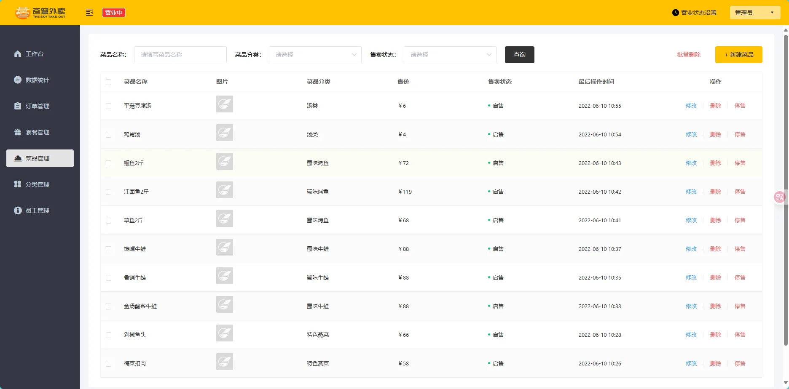

## 2、增

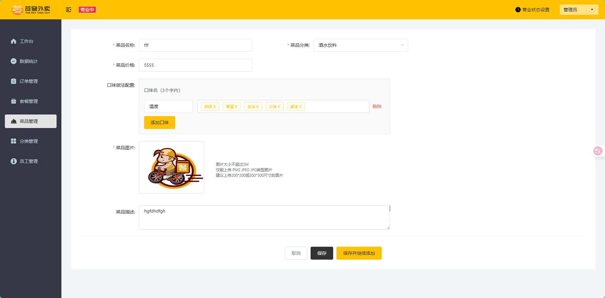

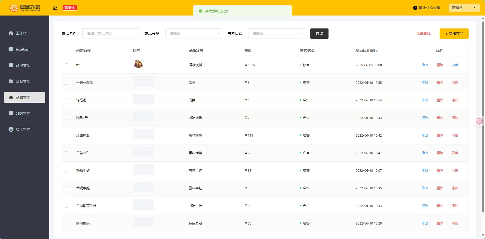

## 3、改

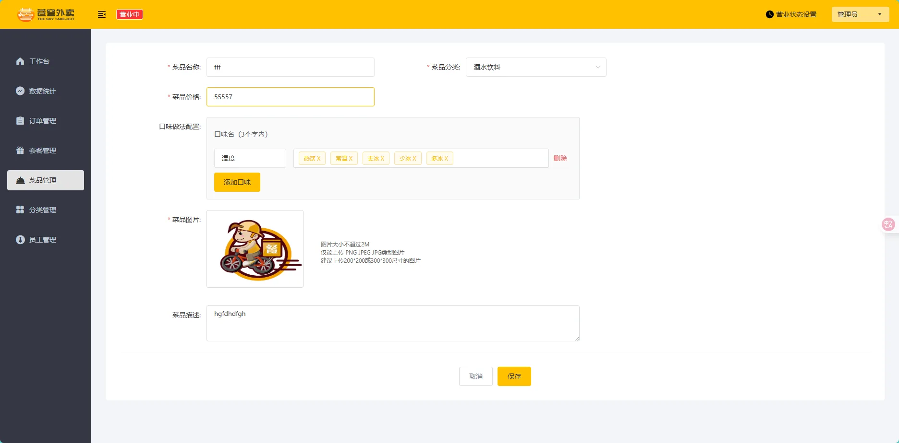

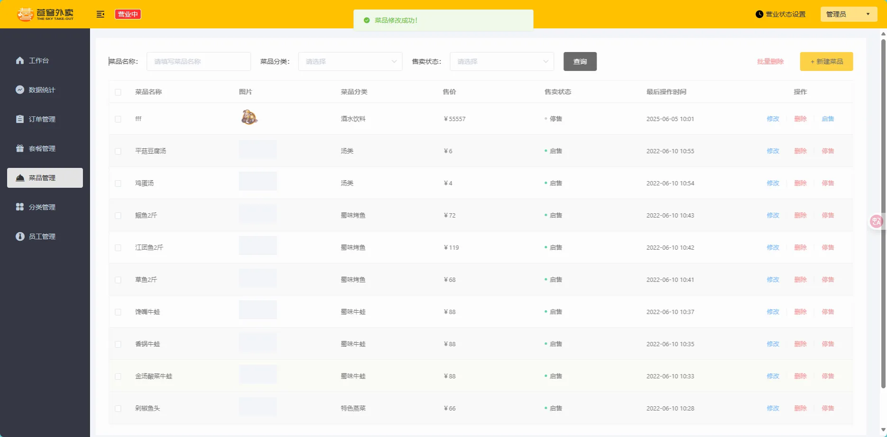

## 4、删

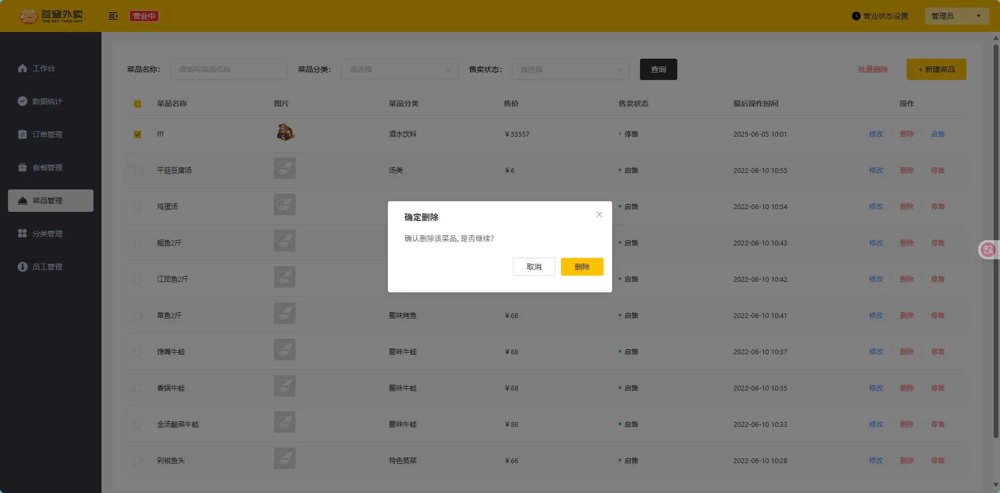

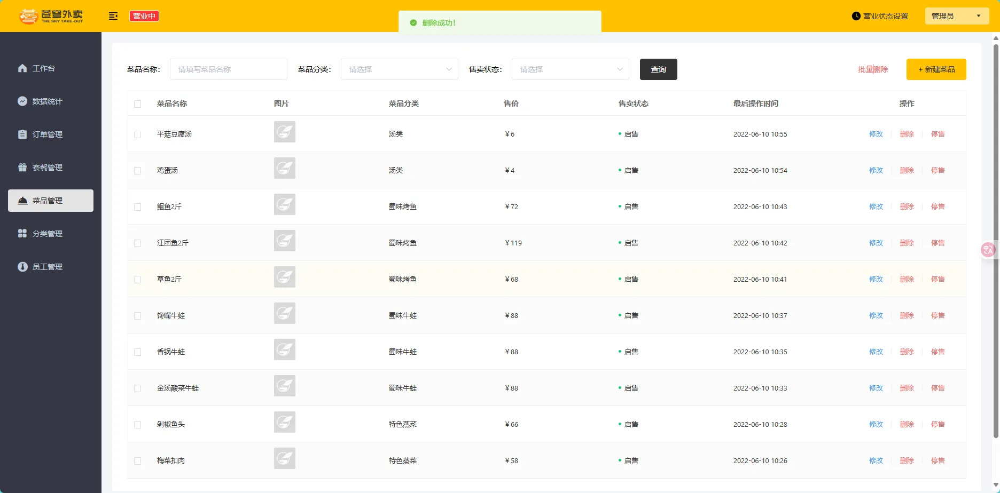
