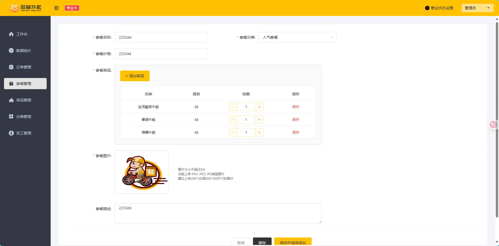
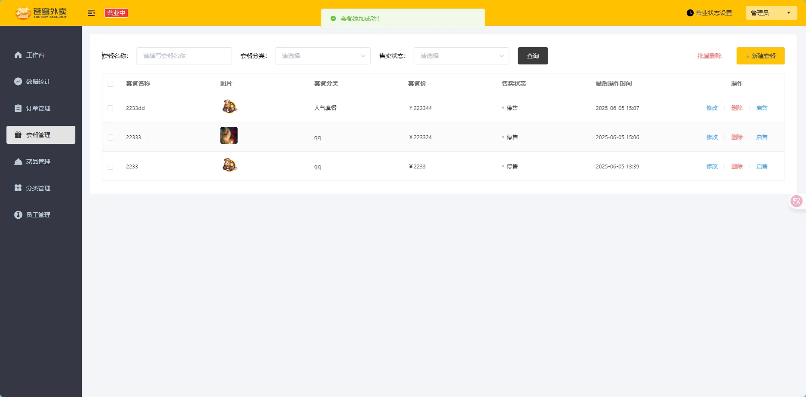
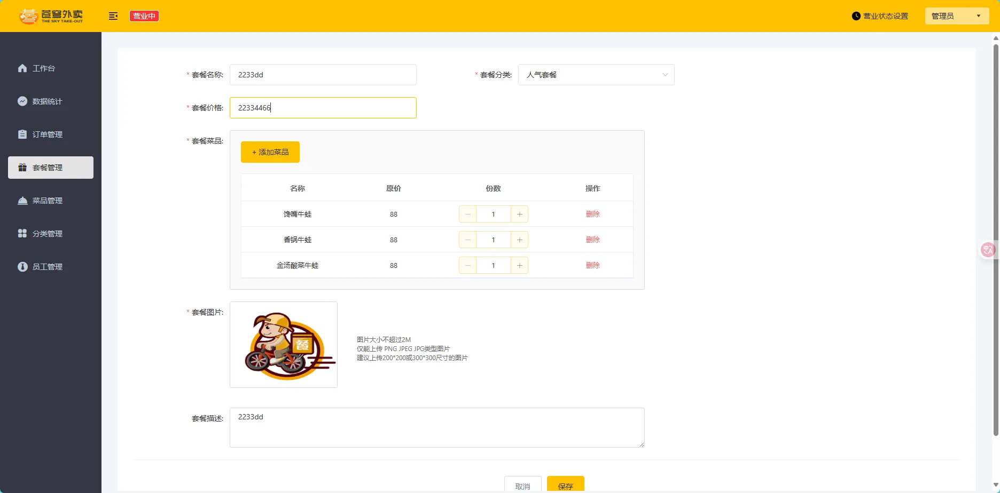
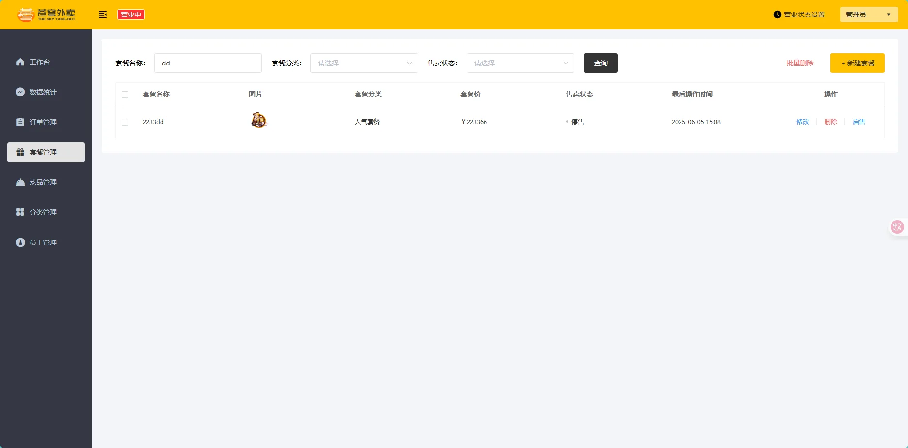
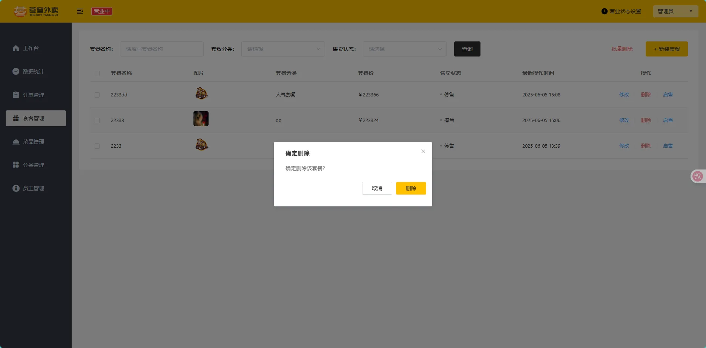
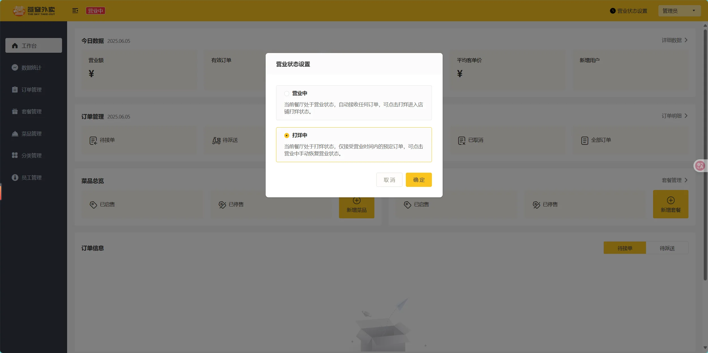
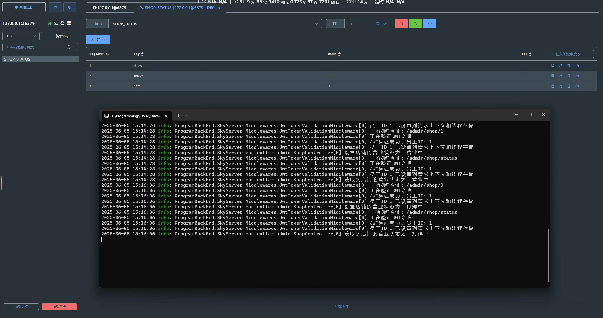
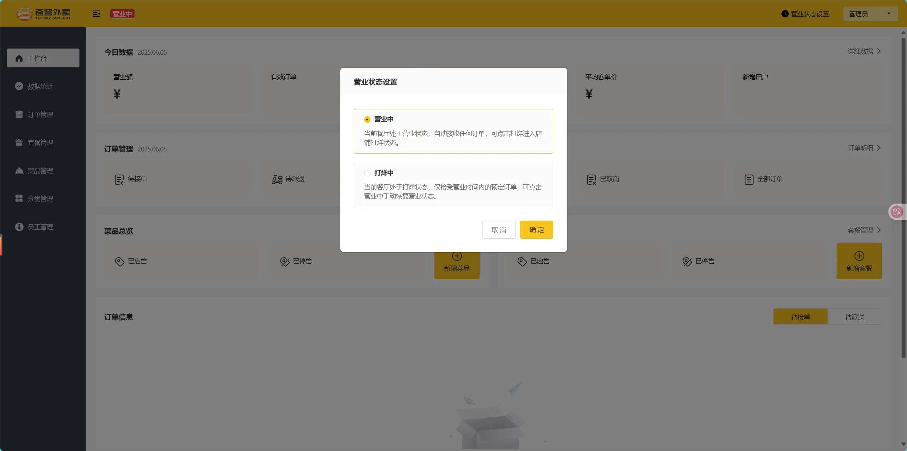

# 1、事务管理

在 C# .NET ASP.NET Core 中，确保事务一致性主要通过数据库事务机制实现，确保多个操作要么全部成功，要么全部失败。以下是常见的实现方式及其示例：

### **1. Entity Framework Core 事务（推荐）**

**方式 1：使用 `DbContext.Database.BeginTransaction()`**

```C#
using (var transaction = context.Database.BeginTransaction())
{
    try
    {
        // 操作 1：插入订单
        context.Orders.Add(order);
        await context.SaveChangesAsync();

        // 操作 2：更新库存
        product.Stock -= order.Quantity;
        context.Products.Update(product);
        await context.SaveChangesAsync();

        transaction.Commit(); // 提交事务
    }
    catch
    {
        transaction.Rollback(); // 回滚事务
        throw;
    }
}
```

**方式 2：使用 `ExecutionStrategy`（自动重试）**

适用于分布式数据库（如 Azure SQL），支持瞬态错误重试：

```C#
var strategy = context.Database.CreateExecutionStrategy();
await strategy.ExecuteAsync(async () =>
{
    using (var transaction = context.Database.BeginTransaction())
    {
        await context.Orders.AddAsync(order);
        await context.SaveChangesAsync();

        product.Stock -= order.Quantity;
        context.Products.Update(product);
        await context.SaveChangesAsync();

        transaction.Commit();
    }
});
```

### **2. 使用 `TransactionScope`（跨资源事务）**

适用于跨多个数据库或外部服务的分布式事务（需启用 `MSDTC` 服务）：

```C#
using (var scope = new TransactionScope(TransactionScopeAsyncFlowOption.Enabled))
{
    try
    {
        // 操作 1：数据库 A
        await dbContextA.SaveChangesAsync();

        // 操作 2：数据库 B
        await dbContextB.SaveChangesAsync();

        // 操作 3：调用外部 API
        await httpClient.PostAsync("api/payment", ...);

        scope.Complete(); // 标记事务成功
    }
    catch
    {
        // 自动回滚（未调用 Complete()）
        throw;
    }
}
```

> **注意**：SQLite 不支持分布式事务，SQL Server 需配置 MSDTC。

### **3. 基于仓储模式的 Unit of Work（UoW）**

通过封装事务逻辑，统一管理多个仓储操作：

```C#
public class UnitOfWork : IUnitOfWork
{
    private readonly AppDbContext _context;
    public UnitOfWork(AppDbContext context) => _context = context;

    public async Task CommitAsync()
    {
        using (var transaction = await _context.Database.BeginTransactionAsync())
        {
            try
            {
                await _context.SaveChangesAsync();
                await transaction.CommitAsync();
            }
            catch
            {
                await transaction.RollbackAsync();
                throw;
            }
        }
    }
}

// 使用示例
public class OrderService
{
    private readonly IUnitOfWork _uow;
    public OrderService(IUnitOfWork uow) => _uow = uow;

    public async Task CreateOrderAsync(Order order)
    {
        // 操作多个仓储...
        await _orderRepository.AddAsync(order);
        await _inventoryRepository.UpdateStockAsync(...);
        await _uow.CommitAsync(); // 统一提交事务
    }
}
```

### **4. 显式 ADO.NET 事务**

直接使用 `SqlTransaction` 控制事务：

```C#
using (var connection = new SqlConnection(connectionString))
{
    await connection.OpenAsync();
    using (var transaction = connection.BeginTransaction())
    {
        try
        {
            // 命令 1
            using (var cmd1 = new SqlCommand("INSERT INTO Orders ...", connection, transaction))
            {
                await cmd1.ExecuteNonQueryAsync();
            }

            // 命令 2
            using (var cmd2 = new SqlCommand("UPDATE Products SET Stock ...", connection, transaction))
            {
                await cmd2.ExecuteNonQueryAsync();
            }

            await transaction.CommitAsync();
        }
        catch
        {
            await transaction.RollbackAsync();
            throw;
        }
    }
}
```

### 5.**事务一致性形式总结**

| **形式**                           | **适用场景**                      | **优点**                  | **缺点**                 |
| :--------------------------------- | :-------------------------------- | :------------------------ | :----------------------- |
| EF Core 事务（`BeginTransaction`） | 单个数据库操作                    | 简单、与 EF Core 深度集成 | 仅限单个 DbContext       |
| `TransactionScope`                 | 跨数据库/外部服务                 | 支持分布式事务            | 需 MSDTC、性能开销大     |
| Unit of Work (UoW)                 | 领域驱动设计（DDD）、复杂业务逻辑 | 高内聚、易测试            | 需额外抽象层             |
| ADO.NET 显式事务                   | 原生 SQL 操作                     | 完全控制、高性能          | 代码冗余、需手动管理连接 |

# 2、SetmealController

ProgramBackEnd\SkyServer\controller\admin\SetmealController.cs

```C#
using Microsoft.AspNetCore.Mvc;
using ProgramBackEnd.SkyCommon.result;
using ProgramBackEnd.SkyPojo.dto;
using ProgramBackEnd.SkyPojo.vo;
using ProgramBackEnd.SkyServer.service;
using System;
using System.Collections.Generic;
using System.Linq;
using System.Threading.Tasks;

namespace ProgramBackEnd.SkyServer.controller.admin
{
    /// <summary>
    /// 套餐管理控制器
    /// <para>
    /// 提供套餐相关的CRUD操作API，包括新增、分页查询、删除、修改、查询详情和起售停售功能。
    /// 所有操作都会记录日志，并返回统一格式的响应结果。
    /// </para>
    /// </summary>
    [Route("/admin/setmeal")]
    [ApiController]
    [ApiExplorerSettings(GroupName = "套餐相关接口")]
    public class SetmealController : ControllerBase
    {
        private readonly ISetmealService _setmealService;
        private readonly ILogger<SetmealController> _logger;

        /// <summary>
        /// 构造函数，通过依赖注入初始化服务
        /// </summary>
        /// <param name="setmealService">套餐服务接口</param>
        /// <param name="logger">日志记录器</param>
        public SetmealController(ISetmealService setmealService, ILogger<SetmealController> logger)
        {
            _setmealService = setmealService ?? throw new ArgumentNullException(nameof(setmealService));
            _logger = logger ?? throw new ArgumentNullException(nameof(logger));
        }

        /// <summary>
        /// 新增套餐
        /// </summary>
        /// <param name="setmealDTO">套餐数据传输对象，包含套餐基本信息和关联菜品</param>
        /// <returns>操作结果，成功时返回成功消息</returns>
        /// <response code="200">返回成功结果</response>
        /// <response code="400">参数错误</response>
        /// <response code="500">服务器内部错误</response>
        [HttpPost]
        public async Task<Result<string>> Save([FromBody] SetmealDTO setmealDTO)
        {
            _logger.LogInformation("开始新增套餐: {@SetmealDTO}", new { setmealDTO.Id, setmealDTO.Name, setmealDTO.Price, DishCount = setmealDTO.SetmealDishes?.Count ?? 0 });

            await _setmealService.SaveWithDish(setmealDTO);

            _logger.LogInformation("套餐新增成功: {SetmealName}", setmealDTO.Name);
            return Result<string>.Success("套餐添加成功");
        }

        /// <summary>
        /// 分页查询套餐列表
        /// </summary>
        /// <param name="setmealPageQueryDTO">分页查询参数，包含页码、每页大小和筛选条件</param>
        /// <returns>分页结果，包含总记录数和当前页数据</returns>
        /// <response code="200">返回查询结果</response>
        /// <response code="500">服务器内部错误</response>
        [HttpGet("page")]
        public async Task<Result<PageResult>> Page([FromQuery] SetmealPageQueryDTO setmealPageQueryDTO)
        {
            _logger.LogInformation("分页查询套餐: 第{Page}页，每页{PageSize}条",
                setmealPageQueryDTO.Page, setmealPageQueryDTO.PageSize);

            PageResult pageResult = await _setmealService.PageQuery(setmealPageQueryDTO);

            _logger.LogInformation("分页查询套餐完成: 共{Total}条记录", pageResult.Total);
            return Result<PageResult>.Success(pageResult);
        }

        /// <summary>
        /// 批量删除套餐
        /// </summary>
        /// <param name="ids">套餐ID列表，多个ID用逗号分隔</param>
        /// <returns>操作结果，成功时返回成功消息</returns>
        /// <response code="200">返回成功结果</response>
        /// <response code="400">参数错误或某些套餐不能删除</response>
        /// <response code="500">服务器内部错误</response>
        [HttpDelete]
        public async Task<Result<string>> Delete([FromQuery] string ids)
        {
            // 将逗号分隔的ID字符串解析为长整型列表
            List<long> idList = ids.Split(',')
                .Where(s => !string.IsNullOrWhiteSpace(s))
                .Select(s => long.Parse(s.Trim()))
                .ToList();

            _logger.LogInformation("开始删除套餐，ID列表: {IDs}", string.Join(",", idList));

            // 调用服务层执行批量删除
            await _setmealService.DeleteBatch(idList);

            _logger.LogInformation("套餐删除成功，ID列表: {IDs}", ids);
            return Result<string>.Success("套餐删除成功");
        }

        /// <summary>
        /// 根据ID查询套餐详情
        /// </summary>
        /// <param name="id">套餐ID</param>
        /// <returns>套餐详情，包含基本信息和关联菜品</returns>
        /// <response code="200">返回套餐详情</response>
        /// <response code="404">套餐不存在</response>
        /// <response code="500">服务器内部错误</response>
        [HttpGet("{id}")]
        public async Task<Result<SetmealVO>> GetById([FromRoute] long id)
        {
            _logger.LogInformation("根据ID查询套餐: {ID}", id);

            SetmealVO setmealVO = await _setmealService.GetByIdWithDish(id);

            _logger.LogInformation("查询套餐成功: {ID}, 名称: {Name}", id, setmealVO.Name);
            return Result<SetmealVO>.Success(setmealVO);
        }

        /// <summary>
        /// 修改套餐信息
        /// </summary>
        /// <param name="setmealDTO">套餐数据，包含要更新的信息和关联菜品</param>
        /// <returns>操作结果，成功时返回成功消息</returns>
        /// <response code="200">返回成功结果</response>
        /// <response code="400">参数错误</response>
        /// <response code="404">套餐不存在</response>
        /// <response code="500">服务器内部错误</response>
        [HttpPut]
        public async Task<Result<string>> Update([FromBody] SetmealDTO setmealDTO)
        {
            _logger.LogInformation("开始修改套餐，ID: {ID}, 名称: {Name}", setmealDTO.Id, setmealDTO.Name);

            await _setmealService.Update(setmealDTO);

            _logger.LogInformation("套餐修改成功，ID: {ID}", setmealDTO.Id);
            return Result<string>.Success("套餐修改成功");
        }

        /// <summary>
        /// 套餐起售/停售状态管理
        /// </summary>
        /// <param name="status">目标状态：1表示起售，0表示停售</param>
        /// <param name="id">套餐ID</param>
        /// <returns>操作结果，成功时返回成功消息</returns>
        /// <response code="200">返回成功结果</response>
        /// <response code="400">状态值无效或套餐无法更改为指定状态</response>
        /// <response code="404">套餐不存在</response>
        /// <response code="500">服务器内部错误</response>
        [HttpPost("status/{status}")]
        public async Task<Result<string>> StartOrStop([FromRoute] int status, [FromQuery] long id)
        {
            _logger.LogInformation("开始更新套餐状态，ID: {ID}, 状态: {Status}", id, status == 1 ? "起售" : "停售");

            await _setmealService.StartOrStop(status, id);

            string message = status == 1 ? "套餐起售成功" : "套餐停售成功";
            _logger.LogInformation("套餐状态更新成功，ID: {ID}, 状态: {Status}", id, status == 1 ? "起售" : "停售");

            return Result<string>.Success(message);
        }
    }
}
```


# 3、SetmealService

## 1、ISetmealService

ProgramBackEnd\SkyServer\service\ISetmealService.cs

```C#
using ProgramBackEnd.SkyCommon.result;
using ProgramBackEnd.SkyPojo.dto;
using ProgramBackEnd.SkyPojo.vo;
using System;
using System.Collections.Generic;
using System.Threading.Tasks;

namespace ProgramBackEnd.SkyServer.service
{
    /// <summary>
    /// 套餐服务接口
    /// <para>
    /// 定义套餐相关的核心业务逻辑操作，包括套餐的CRUD操作、
    /// 状态管理以及与菜品的关联处理。所有方法均采用异步设计。
    /// </para>
    /// </summary>
    public interface ISetmealService
    {
        /// <summary>
        /// 批量删除套餐
        /// </summary>
        /// <param name="ids">要删除的套餐ID列表</param>
        /// <returns>表示异步操作的任务</returns>
        /// <exception cref="BaseException">当套餐处于启用状态无法删除时抛出</exception>
        /// <remarks>
        /// 此方法会执行以下操作：
        /// 1. 验证所有套餐的状态，确保没有处于启用状态的套餐（启用状态套餐不允许删除）
        /// 2. 删除套餐基本信息
        /// 3. 删除套餐与菜品的关联关系
        /// 
        /// 整个过程在事务中执行，确保数据一致性。
        /// </remarks>
        Task DeleteBatch(List<long> ids);

        /// <summary>
        /// 根据ID查询套餐及其包含的菜品
        /// </summary>
        /// <param name="id">套餐ID</param>
        /// <returns>包含套餐详情和关联菜品的视图对象</returns>
        /// <exception cref="BaseException">当套餐不存在时抛出</exception>
        /// <remarks>
        /// 返回的视图对象包含：
        /// - 套餐的基本信息
        /// - 套餐所属分类名称
        /// - 套餐包含的所有菜品列表
        /// </remarks>
        Task<SetmealVO> GetByIdWithDish(long id);

        /// <summary>
        /// 分页查询套餐
        /// </summary>
        /// <param name="setmealPageQueryDTO">分页查询参数，包含页码、每页大小和筛选条件</param>
        /// <returns>分页结果，包含总记录数和当前页数据集合</returns>
        /// <exception cref="ArgumentNullException">当查询参数为null时抛出</exception>
        /// <remarks>
        /// 支持的筛选条件包括：
        /// - 套餐名称（模糊匹配）
        /// - 套餐分类（精确匹配）
        /// - 套餐状态（精确匹配）
        /// 
        /// 结果默认按更新时间降序排序。
        /// </remarks>
        Task<PageResult> PageQuery(SetmealPageQueryDTO setmealPageQueryDTO);

        /// <summary>
        /// 新增套餐及其关联的菜品
        /// </summary>
        /// <param name="setmealDTO">套餐数据，包含套餐基本信息和关联菜品列表</param>
        /// <returns>表示异步操作的任务</returns>
        /// <exception cref="ArgumentNullException">当setmealDTO为null时抛出</exception>
        /// <remarks>
        /// 此方法会执行以下操作：
        /// 1. 保存套餐的基本信息
        /// 2. 保存套餐与菜品的关联关系
        /// 
        /// 整个过程在事务中执行，确保数据一致性。
        /// </remarks>
        Task SaveWithDish(SetmealDTO setmealDTO);

        /// <summary>
        /// 套餐起售/停售状态管理
        /// </summary>
        /// <param name="status">目标状态：1表示起售，0表示停售</param>
        /// <param name="id">套餐ID</param>
        /// <returns>表示异步操作的任务</returns>
        /// <exception cref="BaseException">
        /// 当套餐包含未启售菜品且尝试将套餐状态设置为起售时抛出
        /// </exception>
        /// <remarks>
        /// 业务规则：
        /// - 当套餐状态更改为起售(1)时，会检查该套餐中所有菜品是否均为启用状态，
        ///   若存在未启用的菜品，则不允许套餐起售
        /// - 当套餐状态更改为停售(0)时，直接更新状态，无额外校验
        /// </remarks>
        Task StartOrStop(int status, long id);

        /// <summary>
        /// 更新套餐及其关联菜品信息
        /// </summary>
        /// <param name="setmealDTO">套餐数据，包含更新后的套餐信息和关联菜品</param>
        /// <returns>表示异步操作的任务</returns>
        /// <exception cref="ArgumentNullException">当setmealDTO为null时抛出</exception>
        /// <remarks>
        /// 此方法会执行以下操作：
        /// 1. 更新套餐的基本信息
        /// 2. 删除原有的套餐菜品关联数据
        /// 3. 重新建立套餐与菜品的关联关系
        /// 
        /// 整个过程在事务中执行，确保数据一致性。
        /// </remarks>
        Task Update(SetmealDTO setmealDTO);
    }
}
```


## 2、SetmealServiceImpl

ProgramBackEnd\SkyServer\service\Impl\SetmealServiceImpl.cs

```C#
using Microsoft.EntityFrameworkCore;
using ProgramBackEnd.SkyCommon.context;
using ProgramBackEnd.SkyCommon.exception;
using ProgramBackEnd.SkyCommon.result;
using ProgramBackEnd.SkyCommon.utils;
using ProgramBackEnd.SkyPojo.dto;
using ProgramBackEnd.SkyPojo.entity;
using ProgramBackEnd.SkyPojo.vo;
using ProgramBackEnd.SkyServer.config;
using ProgramBackEnd.SkyServer.mapper;
using System;
using System.Collections.Generic;
using System.Linq;
using System.Threading.Tasks;

namespace ProgramBackEnd.SkyServer.service.Impl
{
    /// <summary>
    /// 套餐服务实现类
    /// <para>
    /// 提供套餐相关的业务逻辑实现，包括套餐的CRUD操作、状态管理以及与菜品的关联处理。
    /// 所有数据库操作均采用异步方式，复杂操作使用事务确保数据一致性。
    /// </para>
    /// <para>
    /// 主要功能包括：
    /// - 套餐的新增、分页查询、修改、删除
    /// - 套餐的启用/停用状态管理
    /// - 套餐与菜品关联关系的维护
    /// - 业务规则验证（如：起售中的套餐不能删除，套餐起售前确保其包含的菜品全部为启用状态）
    /// </para>
    /// </summary>
    public class SetmealServiceImpl : ISetmealService
    {
        private readonly ISetmealMapper _setmealMapper;
        private readonly ISetmealDishMapper _setmealDishMapper;
        private readonly IDishMapper _dishMapper;
        private readonly SkyDbContext _skyDbContext;

        /// <summary>
        /// 构造函数，通过依赖注入初始化所需服务
        /// </summary>
        /// <param name="setmealMapper">套餐数据访问接口</param>
        /// <param name="setmealDishMapper">套餐菜品关系数据访问接口</param>
        /// <param name="dishMapper">菜品数据访问接口</param>
        /// <param name="skyDbContext">数据库上下文，用于事务管理</param>
        /// <exception cref="ArgumentNullException">当任何依赖项为null时抛出</exception>
        public SetmealServiceImpl(
            ISetmealMapper setmealMapper,
            ISetmealDishMapper setmealDishMapper,
            IDishMapper dishMapper,
            SkyDbContext skyDbContext)
        {
            _setmealMapper = setmealMapper ?? throw new ArgumentNullException(nameof(setmealMapper));
            _setmealDishMapper = setmealDishMapper ?? throw new ArgumentNullException(nameof(setmealDishMapper));
            _dishMapper = dishMapper ?? throw new ArgumentNullException(nameof(dishMapper));
            _skyDbContext = skyDbContext ?? throw new ArgumentNullException(nameof(skyDbContext));
        }

        /// <inheritdoc/>
        public async Task DeleteBatch(List<long> ids)
        {
            // 参数校验 - 如果ID列表为空则直接返回
            if (ids == null || ids.Count == 0)
            {
                return;
            }

            // 使用EF Core事务确保数据一致性
            using var transaction = await _skyDbContext.Database.BeginTransactionAsync();

            try
            {
                // 第一步：检查所有套餐状态，确保没有正在启用的套餐
                foreach (long id in ids)
                {
                    // 获取套餐信息
                    Setmeal setmeal = await _setmealMapper.GetById(id);

                    // 业务规则：起售中的套餐不能删除
                    if (setmeal != null && setmeal.Status == 1)
                    {
                        throw new BaseException("起售中的套餐不能删除");
                    }
                }

                // 第二步：执行删除操作，确保关联数据一并删除
                foreach (long setmealId in ids)
                {
                    // 1. 删除套餐表中的主数据
                    await _setmealMapper.DeleteById(setmealId);

                    // 2. 删除套餐菜品关系表中的关联数据
                    await _setmealDishMapper.DeleteBySetmealId(setmealId);
                }

                // 提交事务
                await transaction.CommitAsync();
            }
            catch (Exception ex)
            {
                // 发生异常时回滚事务
                await transaction.RollbackAsync();

                // 业务异常直接抛出，技术异常包装后抛出
                if (ex is BaseException)
                {
                    throw;
                }
                else
                {
                    throw new Exception($"批量删除套餐失败: {ex.Message}", ex);
                }
            }
        }

        /// <inheritdoc/>
        public async Task<SetmealVO> GetByIdWithDish(long id)
        {
            try
            {
                // 1. 查询套餐基本信息
                var setmeal = await _setmealMapper.GetById(id);
                if (setmeal == null)
                {
                    throw new BaseException($"套餐不存在：ID {id}");
                }

                // 2. 创建返回的视图对象并复制套餐基本属性
                SetmealVO setmealVO = new SetmealVO();
                PropertyUtil.CopyProperties(setmeal, setmealVO);

                // 3. 查询套餐关联的菜品数据
                var setmealDishes = await _skyDbContext.SetmealDishes
                    .Where(sd => sd.SetmealId == id)
                    .ToListAsync();

                // 4. 设置关联的菜品数据
                setmealVO.SetmealDishes = setmealDishes ?? new List<SetmealDish>();

                // 5. 查询并设置分类名称，增强数据展示
                if (setmeal.CategoryId > 0)
                {
                    var category = await _skyDbContext.Categories.FindAsync(setmeal.CategoryId);
                    if (category != null)
                    {
                        setmealVO.CategoryName = category.Name;
                    }
                }

                return setmealVO;
            }
            catch (BaseException)
            {
                // 业务异常直接抛出
                throw;
            }
            catch (Exception ex)
            {
                // 技术异常包装后抛出
                throw new Exception($"查询套餐详情失败: {ex.Message}", ex);
            }
        }

        /// <inheritdoc/>
        public async Task<PageResult> PageQuery(SetmealPageQueryDTO setmealPageQueryDTO)
        {
            // 参数校验
            if (setmealPageQueryDTO == null)
            {
                throw new ArgumentNullException(nameof(setmealPageQueryDTO), "分页查询参数不能为空");
            }

            try
            {
                // 从DTO中获取分页参数
                int page = setmealPageQueryDTO.Page;
                int pageSize = setmealPageQueryDTO.PageSize;

                // 确保页码和每页记录数有效
                if (page <= 0) page = 1;
                if (pageSize <= 0) pageSize = 10;

                // 调用数据访问层执行分页查询
                (long total, List<SetmealVO> setmealVOList) = await _setmealMapper.PageQuery(setmealPageQueryDTO);

                // 构造并返回分页结果
                return new PageResult(total, setmealVOList);
            }
            catch (Exception ex)
            {
                // 包装异常信息并重新抛出
                throw new Exception($"分页查询套餐数据失败: {ex.Message}", ex);
            }
        }

        /// <inheritdoc/>
        public async Task SaveWithDish(SetmealDTO setmealDTO)
        {
            // 参数校验
            if (setmealDTO == null)
            {
                throw new ArgumentNullException(nameof(setmealDTO), "套餐数据不能为空");
            }

            // 使用EF Core事务确保数据一致性
            using var transaction = await _skyDbContext.Database.BeginTransactionAsync();

            try
            {
                // 1. 准备套餐实体对象
                Setmeal setmeal = new Setmeal();

                // 2. 复制基本属性(从DTO到实体)
                PropertyUtil.CopyProperties(setmealDTO, setmeal);

                // 3. 设置创建和更新相关的审计字段
                var now = DateTime.Now;
                long userId = BaseContext.GetCurrentId() ?? 0;

                setmeal.CreateTime = now;
                setmeal.UpdateTime = now;
                setmeal.CreateUser = userId;
                setmeal.UpdateUser = userId;

                // 4. 向套餐表插入数据
                await _setmealMapper.Insert(setmeal);

                // 5. 获取生成的套餐ID（这个ID会在Insert操作后自动回填到setmeal对象）
                long setmealId = setmeal.Id;

                // 6. 处理套餐菜品关联信息
                if (setmealDTO.SetmealDishes != null && setmealDTO.SetmealDishes.Count > 0)
                {
                    // 为每个关联的菜品设置套餐ID
                    foreach (var dish in setmealDTO.SetmealDishes)
                    {
                        dish.SetmealId = setmealId;
                    }

                    // 批量保存套餐和菜品的关联关系
                    await _setmealDishMapper.InsertBatch(setmealDTO.SetmealDishes);
                }

                // 7. 所有操作成功，提交事务
                await transaction.CommitAsync();
            }
            catch (Exception ex)
            {
                // 发生异常时回滚事务
                await transaction.RollbackAsync();

                // 重新抛出异常，保留原始异常信息
                throw new Exception($"保存套餐失败: {ex.Message}", ex);
            }
        }

        /// <inheritdoc/>
        public async Task StartOrStop(int status, long id)
        {
            // 参数校验
            if (status != 0 && status != 1)
            {
                throw new ArgumentException("状态值必须为0(停售)或1(起售)", nameof(status));
            }

            // 使用EF Core事务确保数据一致性
            using var transaction = await _skyDbContext.Database.BeginTransactionAsync();

            try
            {
                // 业务规则：起售套餐时，需要判断套餐内是否有停售菜品，如果有则不允许起售
                if (status == 1) // 1表示启用
                {
                    // 1. 查询套餐中包含的所有菜品关联数据
                    var setmealDishes = await _skyDbContext.SetmealDishes
                        .Where(sd => sd.SetmealId == id)
                        .ToListAsync();
                        
                    // 2. 验证关联菜品是否都已启用
                    if (setmealDishes != null && setmealDishes.Count > 0)
                    {
                        // 获取套餐中所有菜品ID
                        var dishIds = setmealDishes.Select(sd => sd.DishId).ToList();
                        
                        // 查询这些菜品的状态
                        var dishes = await _skyDbContext.Dishes
                            .Where(d => dishIds.Contains(d.Id))
                            .ToListAsync();
                        
                        // 检查是否有停售的菜品
                        foreach (var dish in dishes)
                        {
                            if (dish.Status == 0) // 0表示菜品停售
                            {
                                throw new BaseException("套餐内包含未启售菜品，无法启售");
                            }
                        }
                    }
                }

                // 3. 创建更新对象，仅设置需要更新的字段
                Setmeal setmeal = new Setmeal
                {
                    Id = id,
                    Status = status,
                    UpdateTime = DateTime.Now,
                    UpdateUser = BaseContext.GetCurrentId() ?? 0
                };

                // 4. 更新套餐状态
                await _setmealMapper.Update(setmeal);
                
                // 5. 提交事务
                await transaction.CommitAsync();
            }
            catch (BaseException)
            {
                // 业务异常直接抛出
                await transaction.RollbackAsync();
                throw;
            }
            catch (Exception ex)
            {
                // 回滚事务
                await transaction.RollbackAsync();
                
                // 包装技术异常
                string action = status == 1 ? "起售" : "停售";
                throw new Exception($"套餐{action}失败: {ex.Message}", ex);
            }
        }

        /// <inheritdoc/>
        public async Task Update(SetmealDTO setmealDTO)
        {
            // 参数校验
            if (setmealDTO == null)
            {
                throw new ArgumentNullException(nameof(setmealDTO), "套餐数据不能为空");
            }

            if (setmealDTO.Id <= 0)
            {
                throw new ArgumentException("套餐ID无效", nameof(setmealDTO));
            }

            // 使用EF Core事务确保数据一致性
            using var transaction = await _skyDbContext.Database.BeginTransactionAsync();

            try
            {
                // 1. 创建套餐实体并复制属性
                Setmeal setmeal = new Setmeal();
                PropertyUtil.CopyProperties(setmealDTO, setmeal);

                // 2. 设置更新时间和更新人
                setmeal.UpdateTime = DateTime.Now;
                setmeal.UpdateUser = BaseContext.GetCurrentId() ?? 0;

                // 3. 修改套餐表基本信息
                await _setmealMapper.Update(setmeal);

                // 4. 获取套餐ID
                long setmealId = setmealDTO.Id;

                // 5. 删除套餐和菜品的原有关联关系
                await _setmealDishMapper.DeleteBySetmealId(setmealId);

                // 6. 重新建立套餐和菜品的关联关系
                if (setmealDTO.SetmealDishes != null && setmealDTO.SetmealDishes.Count > 0)
                {
                    // 为每个菜品设置套餐ID
                    foreach (var dish in setmealDTO.SetmealDishes)
                    {
                        dish.SetmealId = setmealId;
                    }

                    // 批量插入新的关联关系
                    await _setmealDishMapper.InsertBatch(setmealDTO.SetmealDishes);
                }

                // 7. 提交事务
                await transaction.CommitAsync();
            }
            catch (Exception ex)
            {
                // 发生异常时回滚事务
                await transaction.RollbackAsync();

                // 重新抛出异常，根据类型提供适当的错误信息
                if (ex is ArgumentException || ex is ArgumentNullException)
                {
                    throw; // 参数异常直接抛出
                }
                else
                {
                    throw new Exception($"更新套餐失败: {ex.Message}", ex);
                }
            }
        }
    }
}
```


# 4、SetmealMapper

## 1、ISetmealMapper

```C#
using ProgramBackEnd.SkyPojo.dto;
using ProgramBackEnd.SkyPojo.entity;
using ProgramBackEnd.SkyPojo.vo;
using System;
using System.Collections.Generic;
using System.Threading.Tasks;

namespace ProgramBackEnd.SkyServer.mapper
{
    /// <summary>
    /// 套餐数据访问接口
    /// <para>
    /// 定义与套餐（Setmeal）相关的数据库操作，提供对setmeal表的基本访问功能。
    /// 此接口支持套餐数据的增删改查操作，是套餐管理功能的数据访问层基础。
    /// </para>
    /// </summary>
    /// <remarks>
    /// 套餐是由多个菜品组合而成的销售单元，具有自己的价格和状态。
    /// 此接口的实现应确保套餐数据的完整性和一致性，特别是在更新和删除操作中。
    /// 所有方法均采用异步设计模式，以提高系统性能和响应能力。
    /// </remarks>
    public interface ISetmealMapper
    {
        /// <summary>
        /// 根据分类ID统计套餐数量
        /// </summary>
        /// <param name="id">分类ID</param>
        /// <returns>指定分类下的套餐数量</returns>
        /// <remarks>
        /// 此方法主要用于以下场景：
        /// - 在尝试删除分类前，检查该分类是否有关联的套餐
        /// - 统计各分类下的套餐分布情况
        /// - 验证某分类是否可以进行特定操作
        /// </remarks>
        /// <exception cref="InvalidOperationException">当数据库操作失败时可能抛出</exception>
        Task<int> CountByCategoryId(long id);

        /// <summary>
        /// 根据ID删除套餐
        /// </summary>
        /// <param name="setmealId">套餐ID</param>
        /// <returns>表示异步操作的任务</returns>
        /// <remarks>
        /// 此方法执行物理删除操作，从数据库中永久移除指定套餐记录。
        /// 通常与删除套餐菜品关系表中的数据配合使用，以确保数据一致性。
        /// 
        /// 注意：调用此方法前应确认套餐状态为停售，以避免删除正在使用的套餐。
        /// </remarks>
        /// <exception cref="InvalidOperationException">当删除操作失败时可能抛出</exception>
        Task DeleteById(long setmealId);

        /// <summary>
        /// 根据ID查询套餐信息
        /// </summary>
        /// <param name="id">套餐ID</param>
        /// <returns>套餐实体对象，若不存在则返回null</returns>
        /// <remarks>
        /// 此方法用于获取套餐的基本信息，不包含与之关联的菜品数据。
        /// 常用于以下场景：
        /// - 检查套餐是否存在
        /// - 获取套餐的状态、价格等基本信息
        /// - 作为修改套餐前的数据准备
        /// - 套餐状态变更前的验证
        /// </remarks>
        /// <exception cref="InvalidOperationException">当查询操作失败时可能抛出</exception>
        Task<Setmeal> GetById(long id);

        /// <summary>
        /// 新增套餐
        /// </summary>
        /// <param name="setmeal">套餐实体对象</param>
        /// <returns>表示异步操作的任务</returns>
        /// <remarks>
        /// 此方法用于向数据库添加新的套餐记录，会自动获取并回填生成的主键ID。
        /// 调用此方法前应确保已设置必要的字段（如名称、分类、价格等）和审计字段
        /// （如创建时间、创建人等）。
        /// 
        /// 新增套餐后，通常还需要添加套餐与菜品的关联关系数据。
        /// </remarks>
        /// <exception cref="ArgumentNullException">当setmeal参数为null时抛出</exception>
        /// <exception cref="InvalidOperationException">当插入操作失败时可能抛出</exception>
        Task Insert(Setmeal setmeal);

        /// <summary>
        /// 分页查询套餐
        /// </summary>
        /// <param name="setmealPageQueryDTO">分页查询参数，包含页码、每页大小和筛选条件</param>
        /// <returns>包含总记录数和当前页数据的元组</returns>
        /// <remarks>
        /// 此方法执行套餐的分页查询，支持多条件筛选：
        /// - 可按套餐名称模糊匹配
        /// - 可按分类ID精确匹配
        /// - 可按套餐状态精确匹配
        /// 
        /// 查询结果包含套餐基本信息和所属分类名称，默认按创建时间降序排列。
        /// 返回的元组中包含两部分数据：总记录数和当前页的套餐列表。
        /// </remarks>
        /// <exception cref="ArgumentNullException">当查询参数为null时抛出</exception>
        /// <exception cref="InvalidOperationException">当查询操作失败时可能抛出</exception>
        Task<(long total, List<SetmealVO> setmealVOList)> PageQuery(SetmealPageQueryDTO setmealPageQueryDTO);

        /// <summary>
        /// 更新套餐信息
        /// </summary>
        /// <param name="setmeal">包含要更新字段的套餐对象</param>
        /// <returns>表示异步操作的任务</returns>
        /// <remarks>
        /// 此方法执行选择性更新，只更新setmeal对象中非默认值的字段。
        /// 常用场景包括：
        /// - 修改套餐基本信息（名称、价格、描述等）
        /// - 更新套餐状态（启用/停用）
        /// - 更新套餐图片
        /// 
        /// 调用此方法前应确保已设置必要的审计字段（如UpdateTime、UpdateUser）。
        /// </remarks>
        /// <exception cref="ArgumentNullException">当setmeal参数为null时可能抛出</exception>
        /// <exception cref="InvalidOperationException">当更新操作失败时可能抛出</exception>
        Task Update(Setmeal setmeal);
    }
}
```


## 2、SetmealMapperImpl

```C#
using Microsoft.EntityFrameworkCore;
using ProgramBackEnd.SkyPojo.dto;
using ProgramBackEnd.SkyPojo.entity;
using ProgramBackEnd.SkyPojo.vo;
using ProgramBackEnd.SkyServer.config;
using System;
using System.Collections.Generic;
using System.Linq;
using System.Threading.Tasks;

namespace ProgramBackEnd.SkyServer.mapper.Impl
{
    /// <summary>
    /// 套餐数据访问实现类
    /// <para>
    /// 基于Entity Framework Core实现ISetmealMapper接口，
    /// 提供对套餐（Setmeal）数据的完整CRUD操作支持。
    /// </para>
    /// </summary>
    /// <remarks>
    /// 此类处理与setmeal表的直接交互，确保套餐数据的一致性和完整性。
    /// 实现了选择性字段更新策略，只更新显式设置了值的属性，避免不必要的数据库操作。
    /// 所有方法均采用异步实现，遵循Entity Framework Core的最佳实践。
    /// </remarks>
    public class SetmealMapperImpl : ISetmealMapper
    {
        /// <summary>
        /// 数据库上下文
        /// </summary>
        private readonly SkyDbContext _skyDbContext;

        /// <summary>
        /// 构造函数，通过依赖注入初始化数据库上下文
        /// </summary>
        /// <param name="skyDbContext">应用程序数据库上下文</param>
        /// <exception cref="ArgumentNullException">当数据库上下文为null时抛出</exception>
        public SetmealMapperImpl(SkyDbContext skyDbContext)
        {
            _skyDbContext = skyDbContext ?? throw new ArgumentNullException(nameof(skyDbContext));
        }

        /// <inheritdoc/>
        public async Task<int> CountByCategoryId(long id)
        {
            try
            {
                // 执行查询，计算指定分类下的套餐总数
                int total = await _skyDbContext.Setmeals
                    .Where(s => s.CategoryId == id)
                    .CountAsync();

                return total;
            }
            catch (Exception ex)
            {
                // 将数据库异常转换为更具体的应用异常
                throw new InvalidOperationException(
                    $"统计分类ID为{id}的套餐数量时发生错误: {ex.Message}", ex);
            }
        }

        /// <inheritdoc/>
        public async Task DeleteById(long setmealId)
        {
            try
            {
                // 先查询再删除，确保实体存在并被正确跟踪
                var setmeal = await _skyDbContext.Setmeals.FindAsync(setmealId);
                if (setmeal != null)
                {
                    // 从DbContext中移除实体
                    _skyDbContext.Setmeals.Remove(setmeal);
                    
                    // 提交更改到数据库
                    await _skyDbContext.SaveChangesAsync();
                }
                // 如果实体不存在，不执行任何操作（与接口行为一致）
            }
            catch (Exception ex)
            {
                // 捕获并转换数据库异常，提供更详细的错误信息
                throw new InvalidOperationException($"删除套餐(ID:{setmealId})时发生错误: {ex.Message}", ex);
            }
        }

        /// <inheritdoc/>
        public async Task<Setmeal> GetById(long id)
        {
            try
            {
                // 使用FindAsync方法根据主键查询单个实体
                var setmeal = await _skyDbContext.Setmeals.FindAsync(id);
                
                // 如果找不到套餐，抛出异常提供明确的错误信息
                if (setmeal == null)
                {
                    throw new InvalidOperationException($"未找到ID为{id}的套餐");
                }
                
                return setmeal;
            }
            catch (Exception ex) when (!(ex is InvalidOperationException && ex.Message.StartsWith("未找到ID")))
            {
                // 只包装技术异常，保留业务异常的原始信息
                throw new InvalidOperationException($"查询套餐(ID:{id})时发生错误: {ex.Message}", ex);
            }
        }

        /// <inheritdoc/>
        public async Task Insert(Setmeal setmeal)
        {
            if (setmeal == null)
            {
                throw new ArgumentNullException(nameof(setmeal), "套餐对象不能为null");
            }

            try
            {
                // 将套餐实体添加到DbContext
                await _skyDbContext.Setmeals.AddAsync(setmeal);

                // 保存更改，EF Core会自动将生成的ID赋值回实体对象
                await _skyDbContext.SaveChangesAsync();
            }
            catch (Exception ex)
            {
                // 捕获并转换数据库异常，提供更具体的错误信息
                throw new InvalidOperationException($"添加套餐记录时发生错误: {ex.Message}", ex);
            }
        }

        /// <inheritdoc/>
        public async Task<(long total, List<SetmealVO> setmealVOList)> PageQuery(SetmealPageQueryDTO setmealPageQueryDTO)
        {
            if (setmealPageQueryDTO == null)
            {
                throw new ArgumentNullException(nameof(setmealPageQueryDTO), "查询参数不能为null");
            }

            try
            {
                // 1. 构建基础查询 - 联结套餐表和分类表
                var query = from s in _skyDbContext.Setmeals
                            join c in _skyDbContext.Categories
                            on s.CategoryId equals c.Id into categoryJoin
                            from category in categoryJoin.DefaultIfEmpty() // 左连接
                            select new SetmealVO
                            {
                                // 套餐基本信息
                                Id = s.Id,
                                CategoryId = s.CategoryId,
                                Name = s.Name,
                                Price = s.Price,
                                Status = s.Status,
                                Description = s.Description,
                                Image = s.Image,
                                UpdateTime = s.UpdateTime,
                                // 分类名称
                                CategoryName = category.Name
                            };

                // 2. 应用动态筛选条件
                // 2.1 名称条件 - 模糊匹配，确保处理null值
                if (!string.IsNullOrEmpty(setmealPageQueryDTO.Name))
                {
                    query = query.Where(s => s.Name != null && s.Name.Contains(setmealPageQueryDTO.Name));
                }

                // 2.2 状态条件 - 精确匹配
                if (setmealPageQueryDTO.Status.HasValue)
                {
                    query = query.Where(s => s.Status == setmealPageQueryDTO.Status.Value);
                }

                // 2.3 分类ID条件 - 精确匹配，忽略无效值
                if (setmealPageQueryDTO.CategoryId.HasValue && setmealPageQueryDTO.CategoryId.Value > 0)
                {
                    query = query.Where(s => s.CategoryId == setmealPageQueryDTO.CategoryId.Value);
                }

                // 3. 应用排序 - 按更新时间降序
                query = query.OrderByDescending(s => s.UpdateTime);

                // 4. 执行查询获取总记录数
                long total = await query.CountAsync();

                // 5. 执行分页查询获取当前页数据
                // 确保页码和每页大小的有效性
                int page = Math.Max(1, setmealPageQueryDTO.Page);
                int pageSize = Math.Max(1, setmealPageQueryDTO.PageSize);

                // 计算分页边界并执行查询
                List<SetmealVO> setmealVOList = await query
                    .Skip((page - 1) * pageSize)
                    .Take(pageSize)
                    .ToListAsync();

                // 6. 返回结果元组：总记录数和当前页数据列表
                return (total, setmealVOList);
            }
            catch (Exception ex)
            {
                // 转换为应用异常并提供详细的错误上下文
                throw new InvalidOperationException($"分页查询套餐信息失败: {ex.Message}", ex);
            }
        }

        /// <inheritdoc/>
        public async Task Update(Setmeal setmeal)
        {
            if (setmeal == null)
            {
                throw new ArgumentNullException(nameof(setmeal), "套餐对象不能为null");
            }

            try
            {
                // 1. 查找数据库中已存在的套餐记录
                var existingSetmeal = await _skyDbContext.Setmeals.FindAsync(setmeal.Id);

                // 如果找不到套餐，抛出业务异常
                if (existingSetmeal == null)
                {
                    throw new InvalidOperationException($"未找到ID为{setmeal.Id}的套餐");
                }

                // 2. 选择性更新属性（只更新非默认值）
                // 2.1 更新文本类属性（只在非null时更新）
                if (setmeal.Name != null)
                    existingSetmeal.Name = setmeal.Name;

                if (setmeal.Description != null)
                    existingSetmeal.Description = setmeal.Description;

                if (setmeal.Image != null)
                    existingSetmeal.Image = setmeal.Image;
                
                // 2.2 更新数值类属性（只在非默认值时更新）
                if (setmeal.CategoryId != 0)
                    existingSetmeal.CategoryId = setmeal.CategoryId;

                if (setmeal.Price != 0)
                    existingSetmeal.Price = setmeal.Price;

                // 2.3 更新可空类型属性（只在有值时更新）
                if (setmeal.Status.HasValue)
                    existingSetmeal.Status = setmeal.Status;

                // 2.4 更新审计字段（只在有效值时更新）
                if (setmeal.UpdateTime != default)
                    existingSetmeal.UpdateTime = setmeal.UpdateTime;

                if (setmeal.UpdateUser != 0)
                    existingSetmeal.UpdateUser = setmeal.UpdateUser;

                // 3. 保存所有更改到数据库
                await _skyDbContext.SaveChangesAsync();
            }
            catch (Exception ex) when (!(ex is InvalidOperationException && ex.Message.StartsWith("未找到ID")))
            {
                // 捕获并转换数据库异常，但保留"套餐不存在"类型的业务异常
                throw new InvalidOperationException(
                    $"更新套餐(ID:{setmeal.Id})时发生错误: {ex.Message}", ex);
            }
        }
    }
}
```


# 5、SetmealDishMapper

## 1、ISetmealDishMapper

```C#
using ProgramBackEnd.SkyPojo.entity;
using System;
using System.Collections.Generic;
using System.Threading.Tasks;

namespace ProgramBackEnd.SkyServer.mapper
{
    /// <summary>
    /// 套餐菜品关系数据访问接口
    /// <para>
    /// 定义套餐与菜品之间关联关系的数据访问操作。此接口主要负责维护
    /// setmeal_dish表的数据，实现套餐和菜品之间多对多关系的增删改查。
    /// </para>
    /// </summary>
    /// <remarks>
    /// 套餐（Setmeal）通常由多个菜品（Dish）组成，而同一个菜品也可以出现在多个套餐中，
    /// 形成多对多的关系。此接口提供了维护这种关系的核心操作：
    /// - 批量新增套餐菜品关系
    /// - 根据套餐ID删除关联关系
    /// - 根据菜品ID查询关联的套餐
    /// 
    /// 此接口的实现应确保数据一致性，特别是在批量操作和删除操作中。
    /// 所有方法均采用异步设计模式，提高系统的并发处理能力。
    /// </remarks>
    public interface ISetmealDishMapper
    {
        /// <summary>
        /// 根据套餐ID删除套餐和菜品的关联关系
        /// </summary>
        /// <param name="setmealId">套餐ID</param>
        /// <returns>表示异步操作的任务</returns>
        /// <remarks>
        /// 此方法用于以下场景：
        /// - 删除套餐时，需要同时删除其关联的菜品关系
        /// - 更新套餐内容时，先删除旧关系，再建立新关系
        /// - 套餐数据清理和维护
        /// 
        /// 执行物理删除，将从数据库中彻底移除记录，不可恢复。
        /// </remarks>
        /// <exception cref="InvalidOperationException">当删除操作失败时可能抛出</exception>
        Task DeleteBySetmealId(long setmealId);

        /// <summary>
        /// 根据菜品ID集合查询关联的套餐ID集合
        /// </summary>
        /// <param name="ids">菜品ID集合</param>
        /// <returns>包含这些菜品的套餐ID集合（已去重）</returns>
        /// <remarks>
        /// 此方法用于确定哪些套餐包含了指定的菜品。典型用例包括：
        /// - 检查菜品是否可以删除（若被套餐引用则不可删除）
        /// - 当菜品状态变更时，同步更新相关套餐的状态
        /// - 分析菜品的使用情况，如查询某菜品被多少套餐引用
        /// 
        /// 返回的套餐ID列表是去重后的结果，即使一个套餐包含了多个查询菜品，
        /// 该套餐ID也只会在结果中出现一次。如果没有套餐包含这些菜品，将返回空列表。
        /// </remarks>
        /// <exception cref="ArgumentNullException">当ids参数为null时可能抛出</exception>
        /// <exception cref="InvalidOperationException">当数据库操作失败时可能抛出</exception>
        Task<List<long>> GetSetmealIdsByDishIds(List<long> ids);

        /// <summary>
        /// 批量插入套餐菜品关联关系
        /// </summary>
        /// <param name="setmealDishes">套餐菜品关系对象集合</param>
        /// <returns>表示异步操作的任务</returns>
        /// <remarks>
        /// 此方法用于以下场景：
        /// - 创建新套餐时，建立套餐与多个菜品的关联
        /// - 更新套餐时，重建套餐与菜品的关联关系
        /// 
        /// 调用此方法前，应确保集合中的每个对象都已正确设置以下属性：
        /// - SetmealId：套餐ID
        /// - DishId：菜品ID
        /// - Name：菜品名称（可选，但推荐设置以便于查询显示）
        /// - Price：菜品价格
        /// - Copies：菜品份数
        /// 
        /// 此方法执行批量插入操作，相比多次单条插入具有更高的性能。
        /// </remarks>
        /// <exception cref="ArgumentNullException">当setmealDishes参数为null时抛出</exception>
        /// <exception cref="InvalidOperationException">当插入操作失败时可能抛出</exception>
        Task InsertBatch(List<SetmealDish> setmealDishes);
    }
}
```

## 2、SetmealDishMapperImpl

```C#
using Microsoft.EntityFrameworkCore;
using ProgramBackEnd.SkyPojo.entity;
using ProgramBackEnd.SkyServer.config;
using System;
using System.Collections.Generic;
using System.Linq;
using System.Threading.Tasks;

namespace ProgramBackEnd.SkyServer.mapper.Impl
{
    /// <summary>
    /// 套餐菜品关系数据访问实现类
    /// <para>
    /// 基于Entity Framework Core实现ISetmealDishMapper接口，
    /// 提供套餐与菜品关联关系的完整数据访问操作。
    /// </para>
    /// </summary>
    /// <remarks>
    /// 此类负责维护setmeal_dish表的数据访问，处理套餐和菜品之间的多对多关系。
    /// 支持的主要功能包括：
    /// - 根据套餐ID删除关联关系记录
    /// - 根据菜品ID查询关联的套餐
    /// - 批量插入套餐菜品关系
    /// 
    /// 所有方法均采用异步实现，并提供完整的异常处理，确保数据操作的可靠性。
    /// </remarks>
    public class SetmealDishMapperImpl : ISetmealDishMapper
    {
        /// <summary>
        /// 数据库上下文
        /// </summary>
        private readonly SkyDbContext _skyDbContext;

        /// <summary>
        /// 构造函数，通过依赖注入初始化数据库上下文
        /// </summary>
        /// <param name="skyDbContext">应用程序数据库上下文</param>
        /// <exception cref="ArgumentNullException">当数据库上下文为null时抛出</exception>
        public SetmealDishMapperImpl(SkyDbContext skyDbContext)
        {
            _skyDbContext = skyDbContext ?? throw new ArgumentNullException(nameof(skyDbContext));
        }

        /// <inheritdoc/>
        public async Task DeleteBySetmealId(long setmealId)
        {
            try
            {
                // 1. 查找与指定套餐ID关联的所有记录
                var relationsToDelete = await _skyDbContext.SetmealDishes
                    .Where(sd => sd.SetmealId == setmealId)
                    .ToListAsync();

                // 2. 检查是否找到了关联记录
                if (relationsToDelete.Any())
                {
                    // 3. 批量删除这些关系记录（比单条删除更高效）
                    _skyDbContext.SetmealDishes.RemoveRange(relationsToDelete);

                    // 4. 提交更改到数据库
                    await _skyDbContext.SaveChangesAsync();
                }
                // 如果没有找到关联记录，则不执行任何操作，静默完成
                // 这符合"幂等性"原则，多次调用得到相同结果
            }
            catch (DbUpdateException ex)
            {
                // 数据库更新异常，提供更具体的错误上下文
                throw new InvalidOperationException(
                    $"删除套餐(ID:{setmealId})的关联菜品时发生数据库错误: {ex.Message}", ex);
            }
            catch (Exception ex)
            {
                // 其他类型的异常，转换为应用异常并保留原始信息
                throw new InvalidOperationException(
                    $"删除套餐(ID:{setmealId})和菜品的关联关系时发生错误: {ex.Message}", ex);
            }
        }

        /// <inheritdoc/>
        public async Task<List<long>> GetSetmealIdsByDishIds(List<long> ids)
        {
            // 参数验证：如果为空或无元素，直接返回空列表
            if (ids == null || ids.Count == 0)
            {
                return new List<long>();
            }

            try
            {
                // 1. 构建查询 - 找出包含指定菜品的所有套餐ID
                // 相当于SQL: SELECT DISTINCT setmeal_id FROM setmeal_dish WHERE dish_id IN (...)
                var query = _skyDbContext.SetmealDishes
                    .Where(sd => ids.Contains(sd.DishId))  // 筛选包含指定菜品的记录
                    .Select(sd => sd.SetmealId)            // 提取套餐ID
                    .Distinct();                           // 去除重复记录

                // 2. 执行查询并将结果转换为列表
                var setmealIds = await query.ToListAsync();

                // 3. 返回结果（即使为空列表也是有效返回值）
                return setmealIds;
            }
            catch (Exception ex)
            {
                // 转换为应用异常并提供详细的错误上下文
                string idList = string.Join(",", ids);
                throw new InvalidOperationException(
                    $"查询包含指定菜品(IDs:{idList})的套餐时发生错误: {ex.Message}", ex);
            }
        }

        /// <inheritdoc/>
        public async Task InsertBatch(List<SetmealDish> setmealDishes)
        {
            // 参数验证
            if (setmealDishes == null)
            {
                throw new ArgumentNullException(nameof(setmealDishes), "套餐菜品关系集合不能为null");
            }

            // 空集合检查 - 提前返回避免不必要的数据库操作
            if (setmealDishes.Count == 0)
            {
                return;
            }

            try
            {
                // 1. 使用AddRangeAsync批量添加实体（性能优于逐个添加）
                await _skyDbContext.SetmealDishes.AddRangeAsync(setmealDishes);

                // 2. 一次性保存所有更改到数据库
                int affectedRows = await _skyDbContext.SaveChangesAsync();

                // 3. 验证操作结果（可选，但有助于及早发现问题）
                if (affectedRows != setmealDishes.Count)
                {
                    // 记录警告日志（若有日志系统）或进行其他适当处理
                    // 这里我们选择不抛出异常，因为部分成功也是可接受的
                }
            }
            catch (DbUpdateException ex)
            {
                // 数据库更新异常，提供更具体的错误信息
                throw new InvalidOperationException(
                    $"批量插入套餐菜品关系时发生数据库错误: {ex.Message}", ex);
            }
            catch (Exception ex)
            {
                // 其他异常，转换为应用异常并提供上下文
                throw new InvalidOperationException(
                    $"批量插入{setmealDishes.Count}条套餐菜品关系数据失败: {ex.Message}", ex);
            }
        }
    }
}
```

# 6、结果展示

## 1、增





## 2、改




## 3、查



## 4、删




# 6、店铺状态设定

设定店铺状态通过Redis实现

## 1、ShopController

```C#
using Microsoft.AspNetCore.Mvc;
using Microsoft.Extensions.Logging;
using Microsoft.Extensions.Caching.Distributed;
using ProgramBackEnd.SkyCommon.result;
using System;
using System.Threading.Tasks;
using System.Text;
using System.Text.Json;

namespace ProgramBackEnd.SkyServer.controller.admin
{
    /// <summary>
    /// 店铺相关接口
    /// </summary>
    [Route("/admin/shop")]
    [ApiController]
    [ApiExplorerSettings(GroupName = "店铺相关接口")]
    public class ShopController : ControllerBase
    {
        private const string KEY = "SHOP_STATUS";
        private readonly IDistributedCache _cache;
        private readonly ILogger<ShopController> _logger;

        /// <summary>
        /// 构造函数
        /// </summary>
        /// <param name="cache">分布式缓存服务</param>
        /// <param name="logger">日志服务</param>
        public ShopController(IDistributedCache cache, ILogger<ShopController> logger)
        {
            _cache = cache ?? throw new ArgumentNullException(nameof(cache));
            _logger = logger ?? throw new ArgumentNullException(nameof(logger));
        }

        /// <summary>
        /// 设置店铺的营业状态
        /// </summary>
        /// <param name="status">状态值：1表示营业中，0表示打烊中</param>
        /// <returns>操作结果</returns>
        [HttpPut("{status}")]
        public async Task<Result<string>> SetStatus([FromRoute] int status)
        {
            _logger.LogInformation("设置店铺的营业状态为：{Status}", status == 1 ? "营业中" : "打烊中");

            // 将整数值转换为字节数组存储
            await _cache.SetStringAsync(KEY, status.ToString());

            return Result<string>.Success("设置店铺营业状态成功");
        }

        /// <summary>
        /// 获取店铺的营业状态
        /// </summary>
        /// <returns>店铺状态：1表示营业中，0表示打烊中</returns>
        [HttpGet("status")]
        public async Task<Result<int>> GetStatus()
        {
            // 从缓存中获取状态
            string value = await _cache.GetStringAsync(KEY);
            int status = string.IsNullOrEmpty(value) ? 0 : int.Parse(value);

            _logger.LogInformation("获取到店铺的营业状态为：{Status}", status == 1 ? "营业中" : "打烊中");

            return Result<int>.Success(status);
        }
    }
}
```







